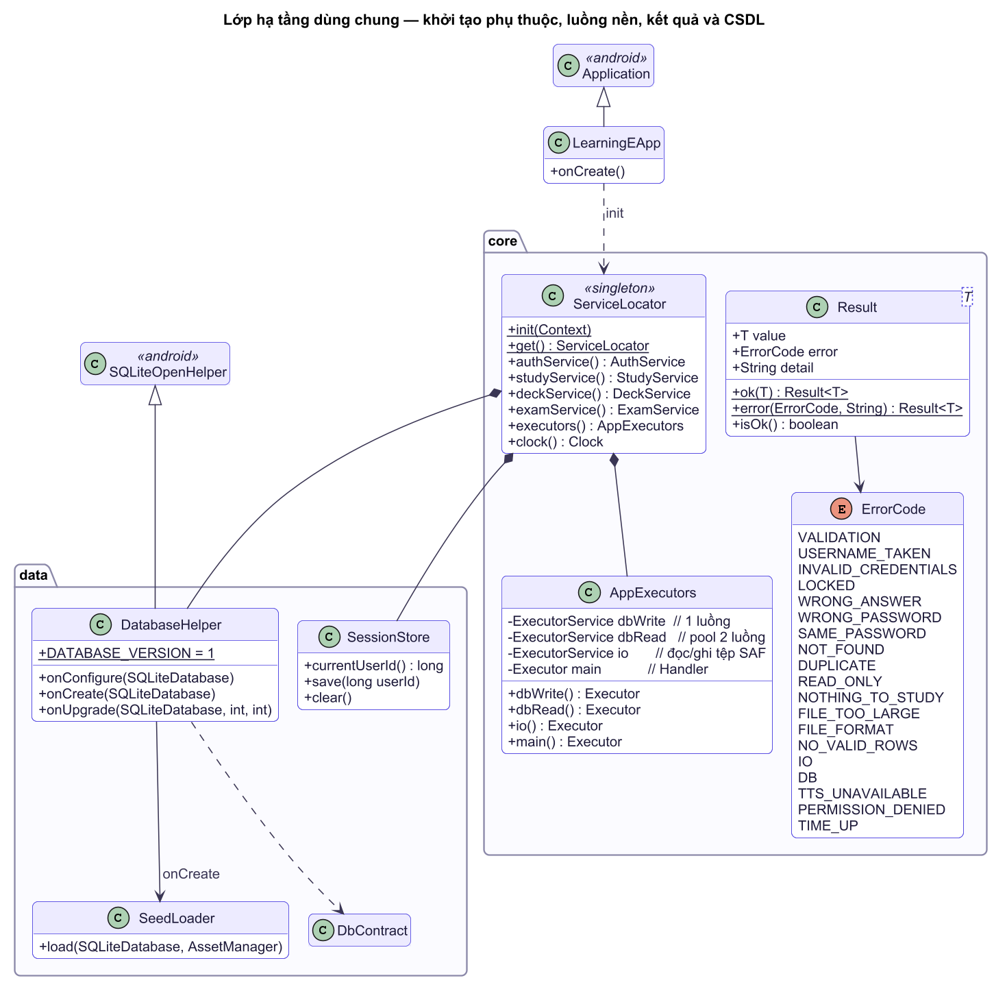
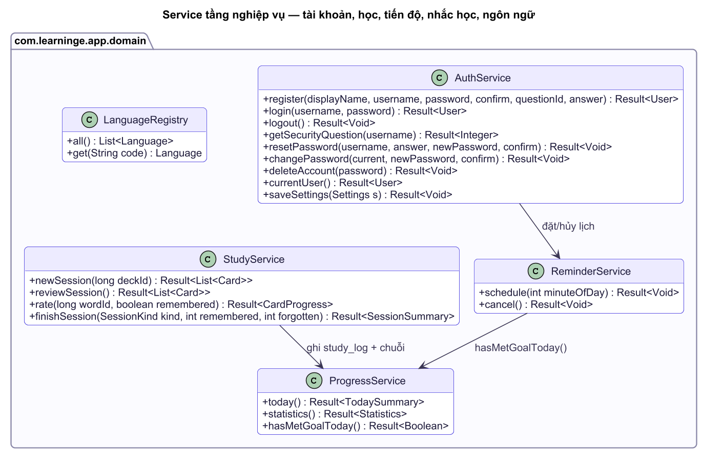
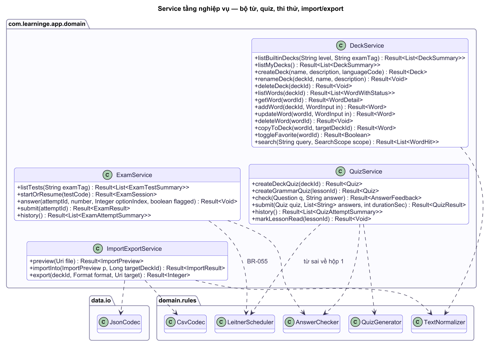
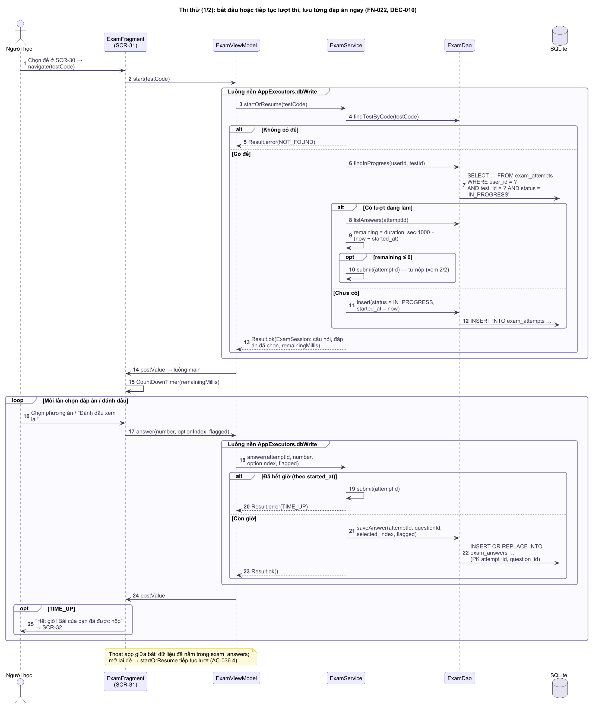
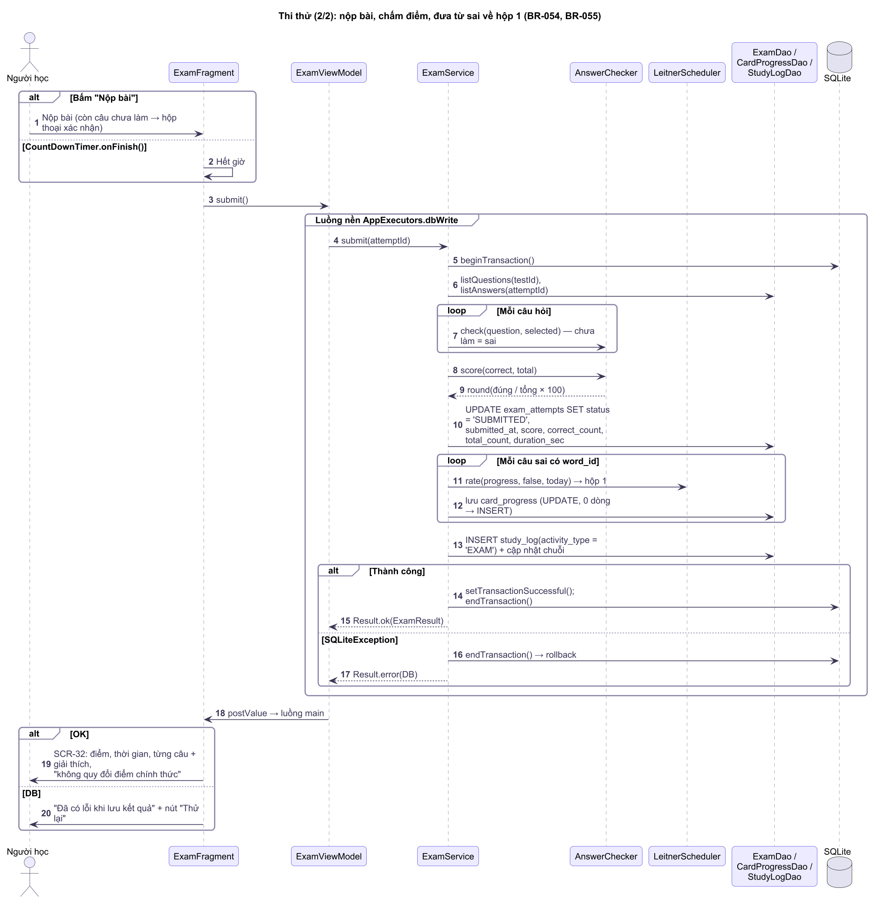
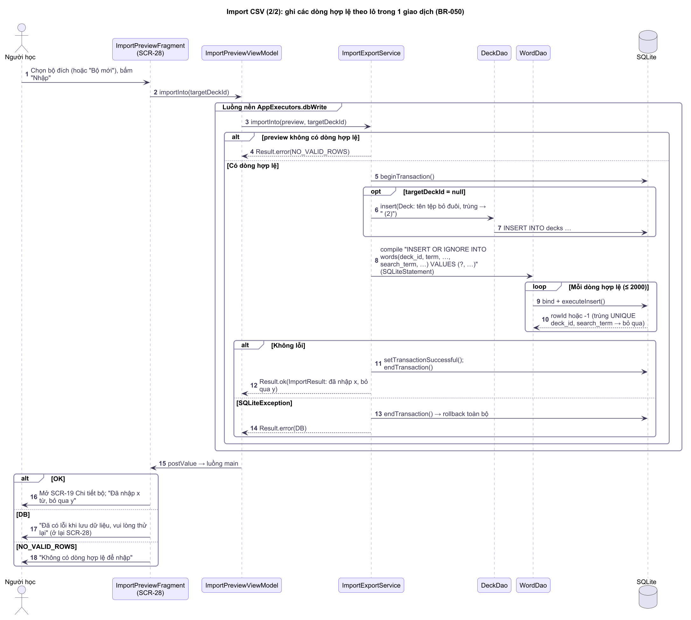

# API Specification — hợp đồng giao tiếp giữa các tầng

**Mục đích:** LearningE chạy ngoại tuyến, **không có REST API hay máy chủ**. "API" của dự án là hợp đồng giữa tầng giao diện và tầng nghiệp vụ (các Service), giữa Service và tầng dữ liệu (DAO), cộng với định dạng tệp import/export và tham số điều hướng giữa màn hình. Tài liệu này là hợp đồng để các thành viên làm song song: ai viết màn hình chỉ gọi đúng các phương thức dưới đây, ai viết Service trả đúng kết quả và mã lỗi dưới đây.

Tài liệu liên quan: [SYSTEM-BLUEPRINT](SYSTEM-BLUEPRINT.md) · [Business-Rules](../project/Business-Rules.md) · [SRS](../project/SRS.md) (thông báo lỗi) · [DATABASE-DESIGN](DATABASE-DESIGN.md).

## 1. Quy ước chung

<!-- diagram:class/cls-core-infrastructure.puml -->

<!-- /diagram -->

| Quy ước | Nội dung |
|---|---|
| Gọi bất đồng bộ | Mọi phương thức Service chạy trên `AppExecutors` (luồng nền). ViewModel gọi Service và đẩy kết quả lên giao diện bằng `LiveData.postValue`. Không gọi Service trên luồng giao diện. |
| Luồng (`AppExecutors`, gói `core`) | Bốn luồng: `main` (cập nhật giao diện), `dbRead` (pool 2 luồng, đọc CSDL), `dbWrite` (1 luồng, tuần tự hóa mọi thao tác ghi), `io` (đọc/ghi tệp qua Storage Access Framework, để tệp chậm không chặn hàng đợi ghi CSDL). |
| Gói của kiểu dùng chung | `Result<T>` và `ErrorCode` nằm ở gói `com.learninge.app.core`; dùng được ở mọi tầng. |
| Kiểu trả về | `Result<T>`: hoặc `Result.ok(value)`, hoặc `Result.error(ErrorCode, String detail)`. Không ném exception ra khỏi Service — bắt `SQLiteException`/`IOException` và đổi thành mã lỗi. |
| Người dùng hiện tại | Service tự lấy `userId` từ `SessionStore`; giao diện **không** truyền `userId` (NFR-S5, tách dữ liệu người dùng). |
| Ngày "hôm nay" | Service nhận `Clock` qua `ServiceLocator`; quy tắc trong `domain.rules` nhận `LocalDate today` làm tham số để test được. |
| Giao dịch | Một phương thức Service = một giao dịch CSDL khi ghi nhiều bảng (`beginTransaction` / `setTransactionSuccessful` / `endTransaction`). |
| Chuỗi giao diện | Service trả `ErrorCode`; ViewModel đổi mã lỗi sang chuỗi trong `strings.xml` (bảng mục 2). |

```java
package com.learninge.app.core;

public final class Result<T> {
    public final T value;            // null khi lỗi
    public final ErrorCode error;    // null khi thành công
    public final String detail;      // thông tin thêm (vd số giây còn khóa, số dòng lỗi), có thể null
    public static <T> Result<T> ok(T value) { ... }
    public static <T> Result<T> error(ErrorCode code, String detail) { ... }
    public boolean isOk() { return error == null; }
}
```

## 2. Mã lỗi (`ErrorCode`)
| Mã | Khi nào | Chuỗi giao diện (`strings.xml`) | Quy tắc |
|---|---|---|---|
| `VALIDATION` | Trường nhập sai định dạng/độ dài; `detail` = tên trường | Theo bảng validation trong SRS | SRS §Validation |
| `USERNAME_TAKEN` | Tên đăng nhập đã tồn tại | "Tên đăng nhập đã được sử dụng" | BR-001 |
| `INVALID_CREDENTIALS` | Sai tên đăng nhập hoặc mật khẩu | "Tên đăng nhập hoặc mật khẩu không đúng" | BR-003 |
| `LOCKED` | Đang bị khóa tạm; `detail` = số giây còn lại | "Bạn đã nhập sai quá nhiều lần. Thử lại sau %d giây" | BR-003, BR-008 |
| `WRONG_ANSWER` | Sai câu trả lời bảo mật; `detail` = số lần thử còn lại | "Câu trả lời không đúng (còn %d lần thử)" | BR-007, BR-008 |
| `WRONG_PASSWORD` | Sai mật khẩu hiện tại khi đổi mật khẩu/xóa tài khoản | "Mật khẩu hiện tại không đúng" | US-004, US-005 |
| `SAME_PASSWORD` | Mật khẩu mới trùng mật khẩu cũ | "Mật khẩu mới phải khác mật khẩu hiện tại" | US-004 |
| `NOT_FOUND` | Không tìm thấy tài khoản/bộ/từ/đề | "Không tìm thấy dữ liệu" / "Không tìm thấy tài khoản" | — |
| `DUPLICATE` | Trùng tên bộ hoặc trùng từ trong bộ | "Bạn đã có bộ tên này" / "Từ này đã có trong bộ" | BR-044, BR-047 |
| `READ_ONLY` | Sửa/xóa bộ có sẵn hoặc xóa bộ mặc định | (không hiện — nút bị ẩn) | BR-043, BR-045 |
| `NOTHING_TO_STUDY` | Không còn từ Mới / không có thẻ đến hạn / bộ < 4 từ khi tạo quiz | "Bạn đã học hết từ mới…" / "Hôm nay không có thẻ cần ôn" / "Chưa đủ từ để tạo bài kiểm tra" | AC-009.4, AC-012.3, AC-013.1 |
| `FILE_TOO_LARGE` | Tệp > 1 MB hoặc > 2000 dòng | "File quá lớn (tối đa 1 MB, 2000 dòng)" | BR-050 |
| `FILE_FORMAT` | Sai tiêu đề CSV, JSON hỏng, không phải UTF-8 | "Sai định dạng: …" (`detail` = lý do) | BR-048, BR-049 |
| `NO_VALID_ROWS` | Không có dòng hợp lệ để nhập | "Không có dòng hợp lệ để nhập" | BR-050 |
| `IO` | Lỗi đọc/ghi tệp, hủy chọn nơi lưu | "Không thể xuất file" / "Không đọc được file, vui lòng chọn lại" | AC-032.3, AC-033.2 |
| `DB` | `SQLiteException`, bộ nhớ đầy | "Đã có lỗi khi lưu dữ liệu, vui lòng thử lại" | NFR-A3 |
| `TTS_UNAVAILABLE` | Máy thiếu giọng đọc cho ngôn ngữ | "Máy chưa có giọng đọc …" + nút cài đặt | AC-010.2 |
| `PERMISSION_DENIED` | Không có quyền thông báo | "Bật quyền thông báo để nhận nhắc học" | AC-019.4 |
| `TIME_UP` | Trả lời câu thi thử sau khi hết giờ — Service tự nộp bài | "Hết giờ! Bài của bạn đã được nộp" | BR-054 |

## 3. Service — tầng nghiệp vụ (`com.learninge.app.domain`)

<!-- diagram:class/cls-services-account-progress.puml -->

<!-- /diagram -->

<!-- diagram:class/cls-services-content.puml -->

<!-- /diagram -->

### 3.1 `AuthService` (F1)
| Phương thức | Đầu vào | Kết quả thành công | Lỗi có thể | Quy tắc / US |
|---|---|---|---|---|
| `register(displayName, username, password, confirm, questionId, answer)` | chuỗi, `questionId` 1..5 | `Result<User>`; tạo `user_settings` mặc định và bộ "Sổ tay của tôi"; lưu phiên | `VALIDATION`, `USERNAME_TAKEN`, `DB` | BR-001, BR-002, BR-004, BR-009, BR-046; US-001 |
| `login(username, password)` | chuỗi | `Result<User>`; đặt đếm sai về 0; lưu phiên | `INVALID_CREDENTIALS`, `LOCKED` | BR-002..BR-004; US-002 |
| `logout()` | — | `Result<Void>`; xóa phiên, hủy nhắc học | — | US-002 |
| `getSecurityQuestion(username)` | chuỗi | `Result<Integer>` (mã câu hỏi) | `NOT_FOUND`, `LOCKED` | US-027 |
| `resetPassword(username, answer, newPassword, confirm)` | chuỗi | `Result<Void>` | `WRONG_ANSWER`, `LOCKED`, `VALIDATION` | BR-007, BR-008; US-027 |
| `changePassword(current, newPassword, confirm)` | chuỗi | `Result<Void>` | `WRONG_PASSWORD`, `SAME_PASSWORD`, `VALIDATION` | US-004 |
| `deleteAccount(password)` | chuỗi | `Result<Void>`; xóa toàn bộ dữ liệu người dùng (CASCADE) | `WRONG_PASSWORD`, `DB` | BR-005; US-005 |
| `currentUser()` | — | `Result<User>` hoặc `NOT_FOUND` nếu chưa đăng nhập | — | BR-004 |
| `saveSettings(Settings s)` | cấp độ, mục tiêu, giờ nhắc, bật/tắt | `Result<Void>`; đặt lại lịch nhắc nếu đổi giờ | `VALIDATION` | BR-006, BR-030; US-003, US-006 |

### 3.2 `DeckService` (F2, F6)
| Phương thức | Đầu vào | Kết quả | Lỗi | Quy tắc / US |
|---|---|---|---|---|
| `listBuiltinDecks(String level, String examTag)` | lọc theo cấp độ hoặc kỳ thi, `null` = tất cả | `Result<List<DeckSummary>>` (tên, ngôn ngữ, số từ, số từ đã thuộc) | `DB` | US-007, US-035 |
| `listMyDecks()` | — | `Result<List<DeckSummary>>` kèm số thẻ đến hạn | `DB` | US-028 |
| `createDeck(name, description, languageCode)` | chuỗi | `Result<Deck>` | `VALIDATION`, `DUPLICATE` | BR-044; US-028 |
| `renameDeck(deckId, name, description)` | | `Result<Void>` | `READ_ONLY`, `DUPLICATE` | BR-043, BR-044; US-029 |
| `deleteDeck(deckId)` | | `Result<Void>`; xóa từ + tiến độ | `READ_ONLY` | BR-045; US-029 |
| `listWords(deckId)` | | `Result<List<WordWithStatus>>` (Mới/Đang học/Đã thuộc, yêu thích) | `NOT_FOUND` | BR-014; US-008 |
| `getWord(wordId)` | | `Result<WordDetail>` | `NOT_FOUND` | US-008 |
| `addWord(deckId, WordInput in)` / `updateWord(wordId, WordInput in)` / `deleteWord(wordId)` | `term`, `reading`, `meaning`, `example`, `exampleTranslation` | `Result<Word>` / `Result<Void>` | `VALIDATION`, `DUPLICATE`, `READ_ONLY` | BR-047; US-030 |
| `copyToDeck(wordId, targetDeckId)` | | `Result<Word>` (bản sao) | `DUPLICATE`, `READ_ONLY` | AC-030.4 |
| `toggleFavorite(wordId)` | | `Result<Boolean>` (trạng thái mới) | `DB` | US-011 |
| `search(String query, SearchScope scope)` | ≤ 50 ký tự; `ALL`, `FAVORITES`, `MY_DECKS` | `Result<List<WordHit>>` tối đa 50 | `DB` | BR-040, BR-053; US-022 |

### 3.3 `StudyService` (F2)
| Phương thức | Kết quả | Lỗi | Quy tắc / US |
|---|---|---|---|
| `newSession(deckId)` | `Result<List<Card>>` gồm N từ Mới (N theo mục tiêu còn lại, tối thiểu 5) | `NOTHING_TO_STUDY` | BR-010; US-009, US-031 |
| `reviewSession()` | `Result<List<Card>>` thẻ đến hạn, tối đa 50 | `NOTHING_TO_STUDY` | BR-013; US-012 |
| `rate(wordId, boolean remembered)` | `Result<CardProgress>` hộp + ngày ôn tiếp mới | `DB` | BR-011, BR-012, BR-015 |
| `finishSession(SessionKind kind, int remembered, int forgotten)` | `Result<SessionSummary>` (kèm chuỗi ngày mới); gọi `ProgressService.completeSession(kind, today)` để ghi nhật ký học (`study_log`) và cập nhật chuỗi ngày trong một giao dịch | `DB` | BR-031, BR-032 |

### 3.4 `QuizService` (F3, F5)
| Phương thức | Kết quả | Lỗi | Quy tắc / US |
|---|---|---|---|
| `createDeckQuiz(deckId)` | `Result<Quiz>` 10 câu, xoay vòng dạng câu; bỏ câu nghe nếu thiếu giọng đọc | `NOTHING_TO_STUDY` | BR-020, BR-024; US-013 |
| `createGrammarQuiz(lessonId)` | `Result<Quiz>` 5–10 câu trắc nghiệm có giải thích | `NOTHING_TO_STUDY` | US-021 |
| `check(Question q, String answer)` | `Result<AnswerFeedback>` đúng/sai + đáp án đúng (không lưu) | `VALIDATION` (trống) | BR-022, BR-025 |
| `submit(Quiz quiz, List<String> answers, int durationSec)` | `Result<QuizResult>`; lưu lượt làm; từ sai về hộp 1 | `DB` | BR-021, BR-023 |
| `history()` | `Result<List<QuizAttemptSummary>>` mới nhất trước | `DB` | US-015 |
| `markLessonRead(lessonId)` | `Result<Void>`; ghi hoạt động học (1 lần/ngày/bài) | `DB` | BR-032; US-020 |

### 3.5 `ExamService` (F7)

<!-- diagram:sequence/seq-exam-start-answer.puml -->

<!-- /diagram -->

<!-- diagram:sequence/seq-exam-submit.puml -->

<!-- /diagram -->

| Phương thức | Kết quả | Lỗi | Quy tắc / US |
|---|---|---|---|
| `listTests(String examTag)` | `Result<List<ExamTestSummary>>` | `DB` | US-035 |
| `startOrResume(testCode)` | `Result<ExamSession>` (câu hỏi, câu đã trả lời, `remainingMillis`); tạo lượt mới hoặc tiếp tục lượt đang làm | `NOT_FOUND` | DEC-010; AC-036.4 |
| `answer(attemptId, number, Integer optionIndex, boolean flagged)` | `Result<Void>` (ghi ngay) | `DB`, `TIME_UP` → tự nộp | DEC-010 |
| `submit(attemptId)` | `Result<ExamResult>`; câu chưa làm tính sai; từ sai về hộp 1 | `DB` | BR-054, BR-055; AC-036.2/036.3 |
| `history()` | `Result<List<ExamAttemptSummary>>` | `DB` | US-036 |

### 3.6 `ImportExportService` (F6)

<!-- diagram:sequence/seq-import-commit.puml -->

<!-- /diagram -->

| Phương thức | Kết quả | Lỗi | Quy tắc / US |
|---|---|---|---|
| `preview(Uri file)` | `Result<ImportPreview>`: định dạng, tổng dòng, hợp lệ, trùng, lỗi (số dòng + lý do), 5 dòng đầu | `FILE_TOO_LARGE`, `FILE_FORMAT`, `IO` | BR-048..BR-050; AC-032.1 |
| `importInto(ImportPreview p, Long targetDeckId)` | `Result<ImportResult>` (đã nhập, bỏ qua); `targetDeckId = null` → tạo bộ mới theo tên tệp | `NO_VALID_ROWS`, `DB` | BR-050; AC-032.2 |
| `export(deckId, Format format, Uri target)` | `Result<Integer>` số từ đã xuất | `IO` | BR-051; AC-033.1 |

Đọc/ghi tệp (`preview`, `export`) chạy trên luồng `io`; phần ghi CSDL của `importInto` chạy trên `dbWrite`. `CsvCodec` là Java thuần ở `domain.rules`; `JsonCodec` nằm ở `data.io` (cạnh mã Storage Access Framework) vì dùng `org.json` — lớp này của Android chỉ là bản giả khi chạy unit test trên JVM, nên muốn test `JsonCodec` bằng `testDebugUnitTest` phải thêm thư viện `org.json:json` ở phạm vi test (chỉ thêm khi viết test đó).

### 3.7 `ProgressService`, `ReminderService`, `LanguageRegistry` (F4, F7)
| Phương thức | Kết quả | Quy tắc / US |
|---|---|---|
| `ProgressService.today()` | `Result<TodaySummary>`: tên, chuỗi ngày, từ mới hôm nay / mục tiêu, thẻ đến hạn, bộ học gần nhất | US-016 |
| `ProgressService.statistics()` | `Result<Statistics>`: số từ theo trạng thái, tiến độ từng bộ, điểm TB 7 ngày, hoạt động 7 ngày | BR-033; US-017 |
| `ProgressService.completeSession(SessionKind kind, LocalDate today)` | `Result<SessionSummary>`; ghi `study_log`, cập nhật chuỗi ngày trong một giao dịch. Do `StudyService.finishSession` gọi khi kết thúc phiên học/ôn | BR-031, BR-032 |
| `ProgressService.hasMetGoalToday()` | `Result<Boolean>` | BR-030 |
| `ReminderService.schedule(int minuteOfDay)` / `cancel()` | `Result<Void>`; lỗi `PERMISSION_DENIED` | BR-030; US-019 |
| `LanguageRegistry.all()` / `get(code)` | `List<Language>` / `Language` (locale TTS, nhãn cách đọc) | BR-052; US-034 |

## 4. DAO — tầng dữ liệu (`com.learninge.app.data.dao`)
- Mỗi bảng chính một DAO: `UserDao`, `SettingsDao`, `LanguageDao`, `DeckDao`, `WordDao`, `CardProgressDao`, `FavoriteDao`, `GrammarDao`, `QuizDao`, `ExamDao`, `StudyLogDao`.
- Phương thức đặt tên: `findById`, `findBy<Điều kiện>`, `list<…>`, `insert`, `update`, `delete`, `count<…>`.
- **Không dùng UPSERT.** Cấm `INSERT … ON CONFLICT DO UPDATE` vì cần SQLite 3.24 (chỉ có từ Android 11, API 30) trong khi `minSdk` là 24. Ghi tiến độ thẻ: chạy `UPDATE`; nếu số dòng bị ảnh hưởng bằng 0 thì `INSERT`, cả hai trong cùng một giao dịch do Service/Repository mở. Được dùng `INSERT OR IGNORE` và `INSERT OR REPLACE`. Test DAO phải chứng minh ghi hai lần cùng (user, word) chỉ còn một dòng.
- Chỉ dùng `SQLiteDatabase.query/rawQuery` với tham số `?` hoặc `SQLiteStatement` đã biên dịch; tên bảng/cột lấy từ `DbContract`.
- DAO **không** mở giao dịch và không chứa quy tắc nghiệp vụ; Service/Repository mở giao dịch.
- DAO trả POJO trong `data.model` (`User`, `Deck`, `Word`, `CardProgress`, `QuizAttempt`, `ExamAttempt`…), không trả `Cursor` ra ngoài.

## 5. Tham số điều hướng giữa màn hình
Dùng Navigation Safe Args; chỉ truyền ID, không truyền đối tượng lớn.
| Đích | Tham số | Ghi chú |
|---|---|---|
| Danh sách từ / Chi tiết bộ (SCR-07, SCR-19) | `long deckId` | |
| Chi tiết từ (SCR-08) | `long wordId` | |
| Flashcard (SCR-09) | `String source` (`NEW`, `REVIEW`), `long deckId` (bỏ qua khi `REVIEW`) | |
| Quiz (SCR-13) | `String source` (`DECK`, `GRAMMAR`), `long refId` | |
| Thêm/sửa từ (SCR-20) | `long deckId`, `long wordId` (= -1 khi thêm mới) | |
| Xem trước import (SCR-28) | `String uri` | Giữ quyền đọc bằng `takePersistableUriPermission` không cần thiết — đọc ngay |
| Làm bài thi thử (SCR-31) | `String testCode` | |

## 6. Định dạng tệp (giao tiếp với bên ngoài app)
| Định dạng | Hướng | Đặc tả |
|---|---|---|
| CSV từ vựng | Import, export | UTF-8 (export kèm BOM), tiêu đề `term,reading,meaning,example,example_translation`, RFC 4180 — chi tiết và ví dụ ở [DATABASE-DESIGN](DATABASE-DESIGN.md) |
| JSON bộ từ | Import, export, dữ liệu nạp sẵn | `{ "deck": {...}, "source": "...", "words": [ {term, reading, pos, meaning, example, example_translation} ] }` |
| JSON đề thi, ngữ pháp, ngôn ngữ | Chỉ dữ liệu nạp sẵn | `exams.json`, `grammar.json`, `languages.json` — xem DATABASE-DESIGN |
