# Database Design — thiết kế CSDL

> **TỰ SINH** từ bộ phân tích thiết kế đã duyệt của nhóm — không sửa trực tiếp tệp này; đề xuất thay đổi qua Issue/PR để nhóm trưởng cập nhật nguồn và sinh lại. Danh mục tài liệu: [docs/README.md](../README.md).

**Mục đích:** ERD và lược đồ SQLite của ứng dụng và của máy chủ (cột, khóa, ràng buộc, cột đồng bộ), index và truy vấn chính, chính sách lưu giữ; định dạng dữ liệu nạp sẵn (JSON) và import/export (CSV/JSON).

## Mô hình dữ liệu
> Thiết kế cơ sở dữ liệu: ERD, thực thể, ràng buộc, index, vòng đời dữ liệu, PII.
> Nghiệp vụ **không đổi** so với thay đổi phạm vi (BR-001..BR-078: khóa tăng dần, HMAC câu hỏi giả, token opaque SHA-256 30 ngày, LWW + tombstone, lô ≤ 500, quy tắc XP và cửa sổ −7 ngày/+5 phút, tuần ISO `Asia/Ho_Chi_Minh` top 50, nội dung cần token). Nơi triển khai server **chưa chốt** (thay đổi phạm vi Q3: máy cục bộ, MongoDB Atlas, Railway hoặc VPS) — mô hình dữ liệu dưới đây không phụ thuộc nơi chạy; mục §Retention / backup ghi điểm khác nhau. Chưa có code và chưa có CSDL thật ở cả hai phía nên **không cần migration dữ liệu** (app giữ `DATABASE_VERSION = 1`; mỗi kho server bắt đầu ở `V001`/bootstrap v1). Hợp đồng gRPC: API_CONTRACT. Thuật ngữ theo Glossary.

## ERD

<!-- diagram:erd/erd-overview.puml -->
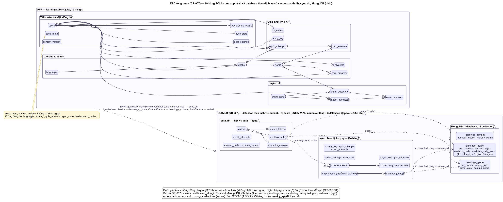
<!-- /diagram -->

<!-- diagram:erd/erd-auth-db.puml -->
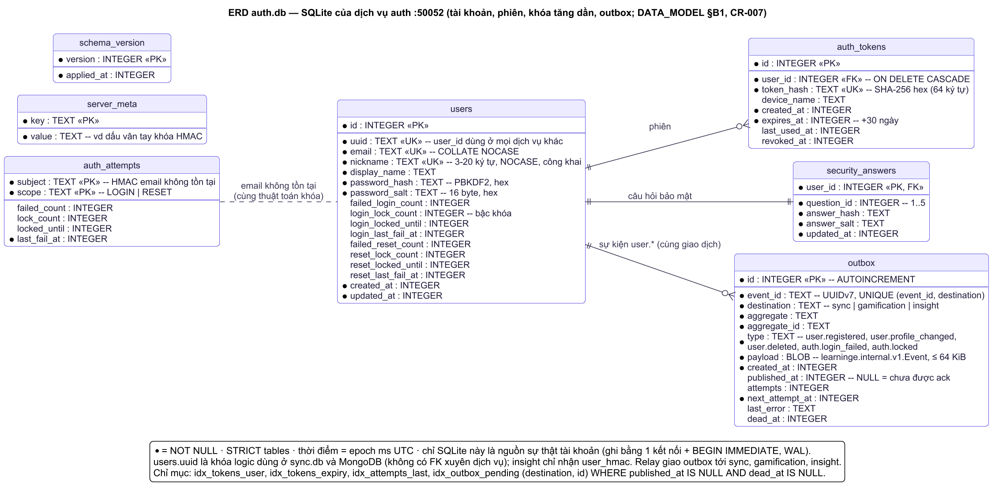
<!-- /diagram -->

<!-- diagram:erd/erd-sync-db.puml -->
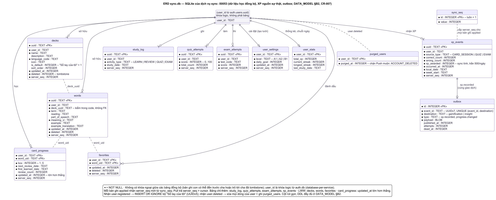
<!-- /diagram -->

<!-- diagram:erd/mongo-collections.puml -->
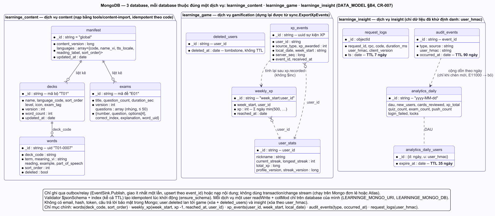
<!-- /diagram -->
**(A) CSDL app** — cột đồng bộ viết tắt `sync*` = `uuid`, `updated_at`, `deleted`, `dirty`, `server_seq` (xem §Chi tiết).
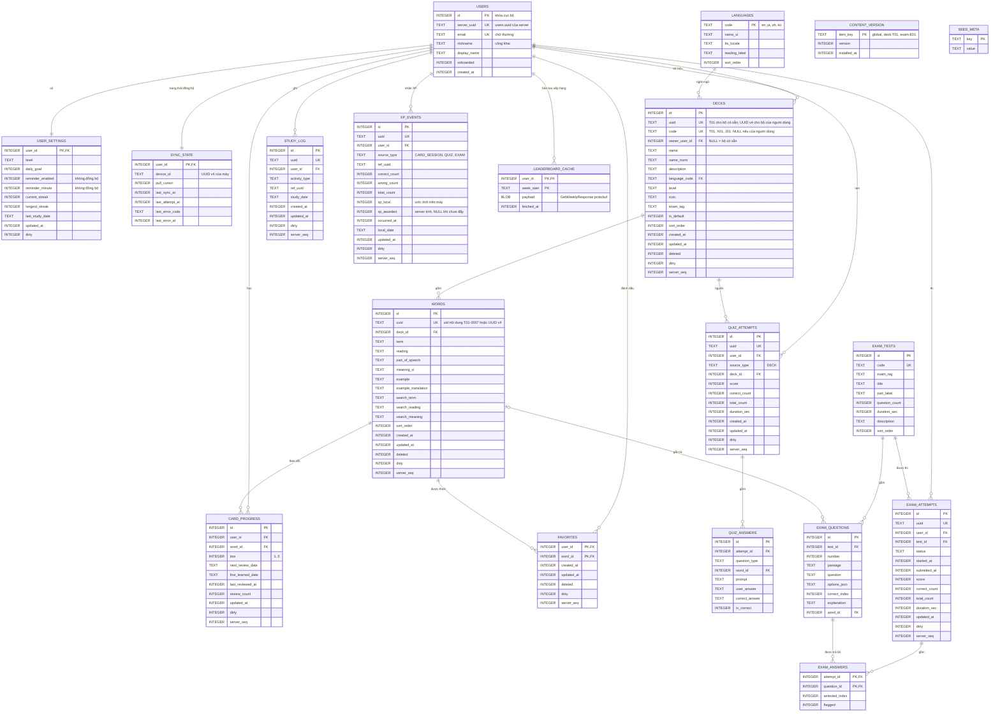

**(B1) `auth.db`** — SQLite của dịch vụ `auth` (cổng 50052):
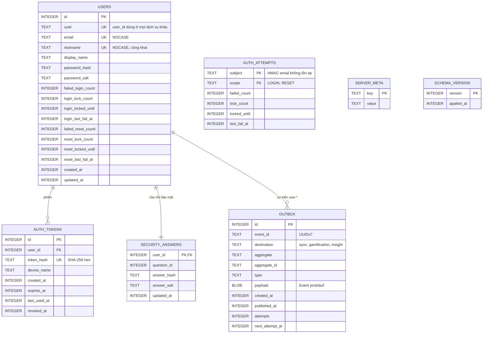

**(B2) `sync.db`** — SQLite của dịch vụ `sync` (cổng 50053). `user_id` = `users.uuid` của `auth.db` (khóa **logic**, không có bảng `users` và không có FK — database-per-service); xóa dữ liệu khi nhận sự kiện `user.deleted`:
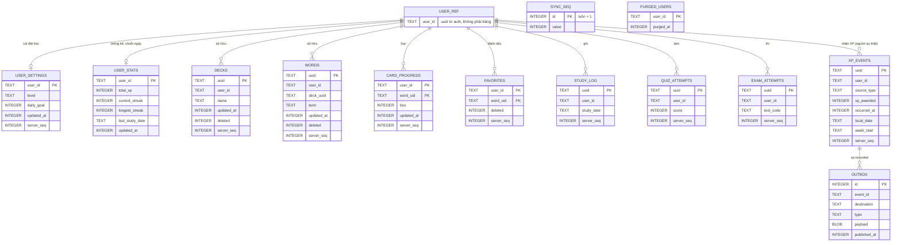

**(B3) MongoDB** — 3 database, mỗi database thuộc đúng một dịch vụ (mô hình tài liệu; `_id` ghi rõ khóa idempotent):
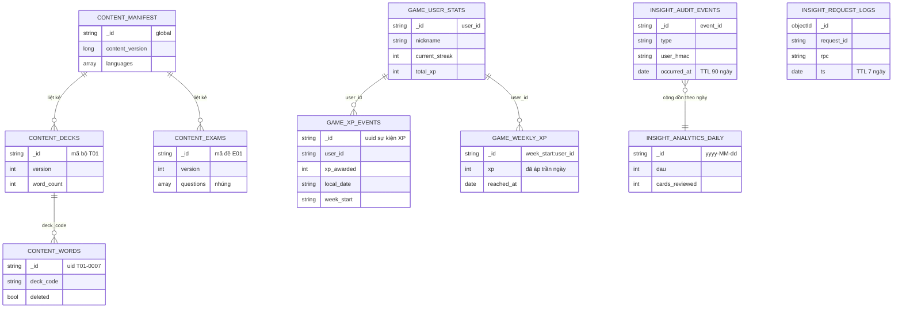
ERD server rút gọn cột; định nghĩa đầy đủ ở §Chi tiết (B). Bảng người dùng trong `sync.db` **không có khóa ngoại giữa các bảng đồng bộ** (bản ghi con có thể đến trước cha hoặc trỏ tới cha đã là tombstone); tính sở hữu kiểm bằng code (`DECK_NOT_OWNED`, API_CONTRACT EP-11).

## Thực thể

<!-- diagram:erd/erd-account-settings.puml -->
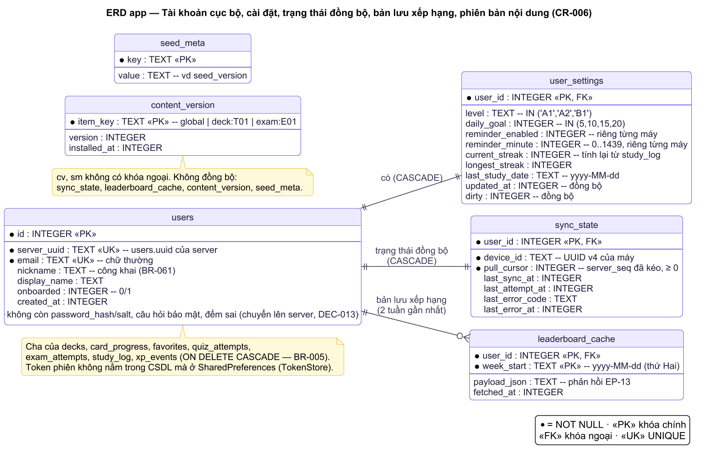
<!-- /diagram -->

<!-- diagram:erd/erd-vocabulary.puml -->
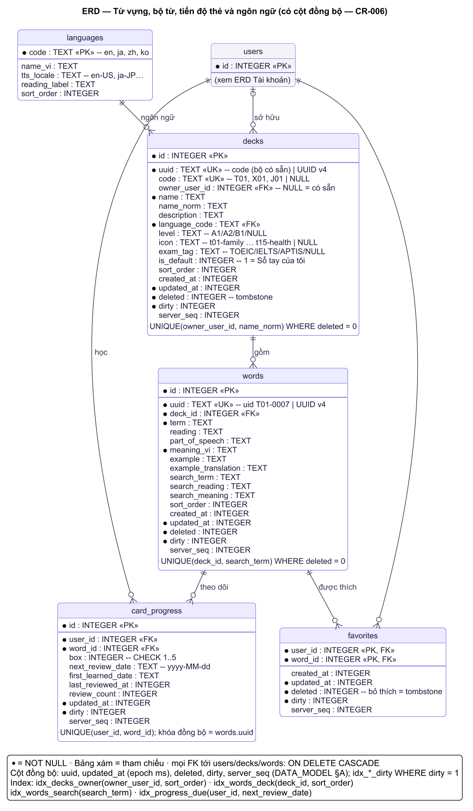
<!-- /diagram -->

<!-- diagram:erd/erd-quiz-log-xp.puml -->
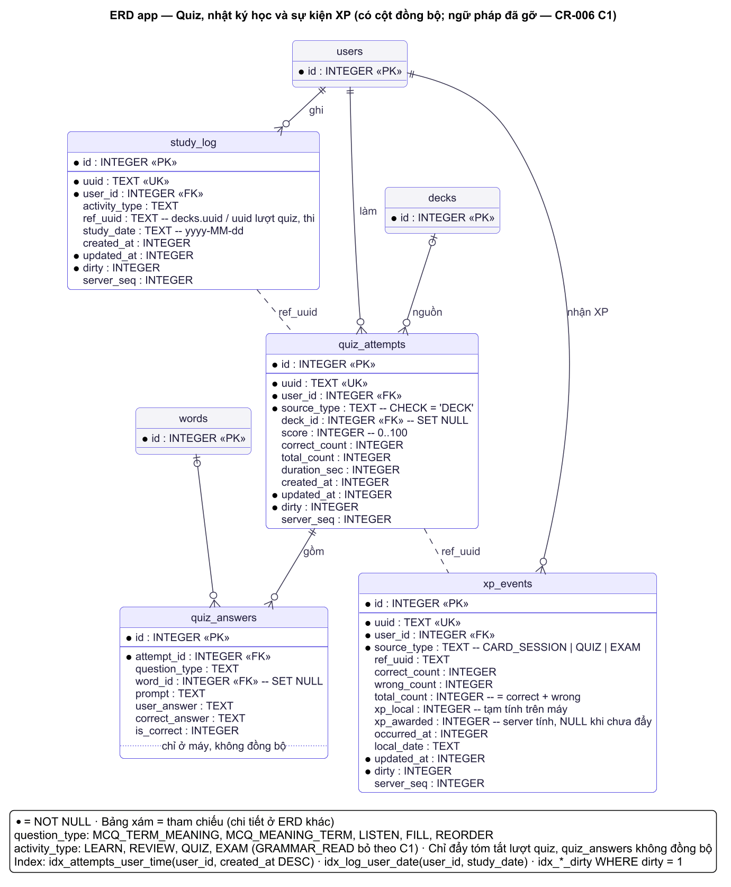
<!-- /diagram -->

<!-- diagram:erd/erd-exam.puml -->
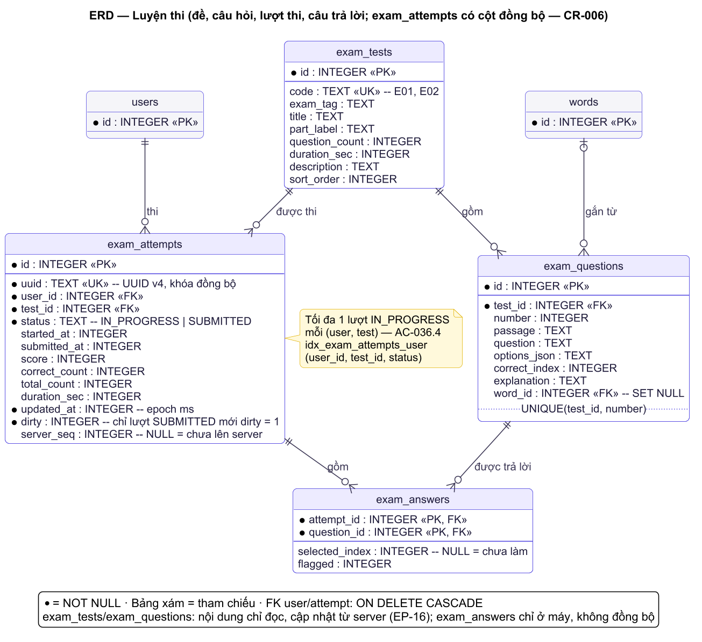
<!-- /diagram -->
Kiểu SQLite: `INTEGER`, `TEXT`. Thời điểm (`*_at`, `*_until`) = epoch millis UTC; ngày (`*_date`, `week_start`) = `yyyy-MM-dd`. Boolean = 0/1.

**(A) App**
| Bảng/collection | Trường chính | Ràng buộc | PII? |
|---|---|---|---|
| `users` | id, server_uuid, email, nickname, display_name, onboarded, created_at | `server_uuid` UNIQUE NOT NULL; `email` UNIQUE NOT NULL (chữ thường). **Không còn** `password_hash/salt`, câu hỏi/trả lời bảo mật, đếm sai/khóa (chuyển lên server, DEC-013). Token **không** lưu trong CSDL mà trong SharedPreferences riêng tư (`TokenStore`; Should: mã hóa AES-GCM bằng khóa Android Keystore — NFR-S4) | **Có**: email, nickname, display_name |
| `user_settings` | user_id, level, daily_goal, reminder_enabled, reminder_minute, current_streak, longest_streak, last_study_date, updated_at, dirty | Như cũ; chỉ `level`, `daily_goal` được đồng bộ; nhắc học là cài đặt riêng từng máy; chuỗi ngày tính lại từ `study_log` sau mỗi lần kéo | Không |
| `sync_state` (mới) | user_id, device_id, pull_cursor, last_sync_at, last_attempt_at, last_error_code, last_error_at | PK = FK `users.id` CASCADE; `pull_cursor` ≥ 0, mặc định 0; nguồn dữ liệu SCR-35 (US-041) | Không |
| `languages` | code, name_vi, tts_locale, reading_label, sort_order | Như cũ; cập nhật được từ EP-14 | Không |
| `decks` | + uuid, updated_at, deleted, dirty, server_seq | `uuid` UNIQUE NOT NULL; bộ có sẵn: `uuid = code`, không bao giờ `dirty` (chỉ đọc, BR-043); UNIQUE một phần `(owner_user_id, name_norm) WHERE deleted = 0 AND owner_user_id IS NOT NULL` | Có thể |
| `words` | + uuid, updated_at, deleted, dirty, server_seq | `uuid` UNIQUE NOT NULL — từ có sẵn: `uid` trong file seed/nội dung (vd `T01-0007`), từ của người dùng: UUID v4; UNIQUE một phần `(deck_id, search_term) WHERE deleted = 0` | Có thể |
| `card_progress` | + updated_at, dirty, server_seq | UNIQUE(user_id, word_id) như cũ; khóa đồng bộ = `words.uuid` (không cần cột uuid riêng); không xóa (không có `deleted`) | Không |
| `favorites` | + updated_at, deleted, dirty, server_seq | PK(user_id, word_id); bỏ thích = `deleted = 1` (thích lại: `UPDATE deleted = 0`) | Không |
| `quiz_attempts` | + uuid, updated_at, dirty, server_seq | `source_type` CHECK IN ('DECK') (bỏ GRAMMAR theo C1); chỉ đẩy tóm tắt lượt — `quiz_answers` **không** đồng bộ | Không |
| `quiz_answers` | như cũ (bỏ `grammar_question_id`) | Chỉ ở máy | Không |
| `exam_tests`, `exam_questions` | như cũ | Nội dung chỉ đọc; cập nhật từ EP-16 | Không |
| `exam_attempts` | + uuid, updated_at, dirty, server_seq | Chỉ lượt `SUBMITTED` được đánh dấu `dirty`; `exam_answers` không đồng bộ | Không |
| `exam_answers` | như cũ | Chỉ ở máy | Không |
| `study_log` | + uuid, ref_uuid, updated_at, dirty, server_seq | `ref_uuid` thay `ref_id` (trỏ `decks.uuid`/lượt quiz/thi để có nghĩa trên máy khác) | Không |
| `xp_events` (mới) | id, uuid, user_id, source_type, ref_uuid, correct_count, wrong_count, total_count, xp_local, xp_awarded, occurred_at, local_date, updated_at, dirty, server_seq | `source_type` CHECK IN ('CARD_SESSION','QUIZ','EXAM'); counts ≥ 0, `correct_count + wrong_count = total_count`; chỉ-thêm; `xp_awarded` ghi đè bằng giá trị server trả về (BR-066) | Không |
| `leaderboard_cache` (mới) | user_id, week_start, payload (BLOB protobuf), fetched_at | PK(user_id, week_start); chỉ giữ 2 tuần gần nhất; hiện khi mất mạng kèm "Cập nhật lúc …" (US-042) | Có (nickname người khác — dữ liệu công khai) |
| `content_version` (mới) | item_key, version, installed_at | PK `item_key`; `global` = `content_version` của manifest; `deck:T01`, `exam:E01` = phiên bản từng mục đã cài | Không |
| `seed_meta` | key, value | Như cũ | Không |

**(B) Server — bảng phân bổ dữ liệu (DEC-020)**
| Thực thể | Kho | Dịch vụ sở hữu (duy nhất được ghi) | Lý do chọn kho |
|---|---|---|---|
| `users`, `auth_tokens`, `security_answers`, `auth_attempts`, `server_meta` | SQLite `auth.db` | `auth` | Quan hệ, cần UNIQUE (email, nickname) và giao dịch ACID cho khóa tăng dần/thu hồi token; chứa PII + bí mật → không sao chép đi đâu |
| `user_settings`, `user_stats`, `decks`, `words`, `card_progress`, `favorites`, `study_log`, `quiz_attempts`, `exam_attempts`, `sync_seq`, `purged_users` | SQLite `sync.db` | `sync` | Lõi offline-first: LWW + `server_seq` + tombstone cần **một giao dịch cho cả lô ≤ 500** |
| `xp_events` (bản gốc, có `xp_awarded` đã tính) | SQLite `sync.db` | `sync` | Đến cùng lô Push với tiến độ → ghi cùng giao dịch, không mất XP khi Mongo ngừng; là nguồn để `gamification rebuild` |
| `outbox` (mỗi DB SQLite một bảng) | `auth.db`, `sync.db` | `auth`, `sync` (relay trong cùng tiến trình) | Ghi cùng giao dịch với thay đổi nghiệp vụ → không có ghi kép (dual-write) |
| `manifest`, `decks`, `words`, `exams` (nội dung có sẵn) | MongoDB `learninge_content` | `content` (ghi bởi công cụ `content-import`) | Tài liệu lồng nhau, đọc nhiều, không thuộc người dùng; nguồn sự thật là JSON trong git (`content/`) |
| `xp_events` (bản sao), `weekly_xp`, `user_stats`, `deleted_users` (tombstone) | MongoDB `learninge_game` | `gamification` | Ghi nối đuôi + tổng hợp theo tuần (index `{week_start, xp:-1, reached_at}`); dựng lại được hoàn toàn từ `sync` + `auth` |
| `audit_events` (TTL 90 ngày), `request_logs` (TTL 7 ngày) | MongoDB `learninge_insight` | `insight` | Ghi khối lượng lớn, hết hạn tự động bằng index TTL; không chứa email/mật khẩu/token/câu trả lời, chỉ `user_hmac` |
| `analytics_daily`, `analytics_daily_users` (TTL 35 ngày) | MongoDB `learninge_insight` | `insight` | Bản sao phân tích đã khử định danh, tách khỏi CSDL nghiệp vụ để truy vấn báo cáo không làm chậm sync |
| Cache token (≤ 60 s), bộ đếm giới hạn tần suất | Bộ nhớ tiến trình | `edge` | Dữ liệu tạm, mất khi khởi động lại là chấp nhận được |

**(B1) `auth.db`**
| Bảng | Trường chính | Ràng buộc | PII? |
|---|---|---|---|
| `users` | id, uuid, email, nickname, display_name, password_hash, password_salt, `failed_login_count`, `login_lock_count`, `login_locked_until`, `login_last_fail_at`, `failed_reset_count`, `reset_lock_count`, `reset_locked_until`, `reset_last_fail_at`, created_at, updated_at | `uuid` UNIQUE (UUID v4, là `user_id` ở mọi dịch vụ khác); `email`, `nickname` UNIQUE COLLATE NOCASE; hash/salt hex NOT NULL | **Có**: email, nickname, display_name; hash mật khẩu nhạy cảm |
| `auth_tokens` | id, user_id, token_hash, device_name, created_at, expires_at, last_used_at, revoked_at | `token_hash` UNIQUE (SHA-256 hex 64 ký tự của token 32 byte); hạn 30 ngày không trượt; FK CASCADE | Nhạy cảm (hash token) |
| `security_answers` | user_id, question_id, answer_hash, answer_salt, updated_at | PK = FK CASCADE; `question_id` 1..5 | Nhạy cảm |
| `auth_attempts` | subject, scope, failed_count, lock_count, locked_until, last_fail_at | PK(subject, scope); `subject` = HMAC-SHA256(khóa server, email chuẩn hóa) hex; **chỉ** cho email không tồn tại (BR-076) | Không (không có email rõ) |
| `server_meta` | key, value | Chỉ `hmac_key_version`, `hmac_key_fingerprint` — **không lưu khóa** | Không |
| `outbox` | id, event_id, destination, aggregate, aggregate_id, type, payload, created_at, published_at, attempts, next_attempt_at, last_error, dead_at | UNIQUE(event_id, destination) — §Outbox | Không (payload theo bên nhận, §Outbox) |
| `schema_version` | version, applied_at | Theo dõi migration | Không |

**(B2) `sync.db`**
| Bảng | Trường chính | Ràng buộc | PII? |
|---|---|---|---|
| `user_settings` | user_id, level, daily_goal, updated_at, server_seq | PK `user_id`; **không tạo sẵn khi đăng ký** (khác thay đổi phạm vi vì `auth` không ghi được `sync.db`) — tạo khi app đẩy `settings` lần đầu. Bộ "Sổ tay của tôi" thì `sync` tạo khi nhận `user.registered` (`decks.is_default = 1`, uuid tất định UUIDv5); app luôn có mặc định cục bộ (BR-006) | Không |
| `user_stats` | user_id, total_xp, current_streak, longest_streak, last_study_date, updated_at | Cập nhật trong cùng giao dịch Push; nguồn chuỗi ngày cho `GetMe` và sự kiện `progress.changed` | Không |
| `decks`, `words` | uuid, user_id, (cột nội dung như app), created_at, updated_at, deleted, server_seq | PK `uuid`; `words.deck_uuid` phải thuộc cùng `user_id` (kiểm trong code) | Có thể (nội dung tự nhập) |
| `card_progress` | user_id, word_uid, box, next_review_date, first_learned_date, last_reviewed_at, review_count, updated_at, server_seq | PK(user_id, word_uid); box 1..5 | Không |
| `favorites` | user_id, word_uid, created_at, updated_at, deleted, server_seq | PK(user_id, word_uid) | Không |
| `study_log`, `quiz_attempts`, `exam_attempts` | uuid, user_id, cột tóm tắt, created_at/updated_at, server_seq | PK `uuid`; chỉ-thêm | Không |
| `xp_events` | uuid, user_id, source_type, ref_uuid, counts, xp_awarded, occurred_at, received_at, local_date, week_start, server_seq | PK `uuid`; `xp_awarded` do `sync` tính (BR-065..BR-068, đã áp trần 500/ngày); **nguồn sự thật XP** | Không |
| `sync_seq` | id (=1), value | Một dòng; bộ đếm `server_seq` toàn `sync.db` | Không |
| `purged_users` | user_id, purged_at | Đánh dấu tài khoản đã xóa để chặn lô Push "đến muộn" ghi lại dữ liệu (§Toàn vẹn) | Không |
| `outbox`, `schema_version` | như `auth.db` | Như `auth.db`; `destination` của `sync` chỉ là `gamification`, `insight` | Không |

**(B3) MongoDB** (driver `mongodb` chính thức; validator `$jsonSchema` mức `strict`/`error` — §Chi tiết B4)
| Database.collection | Trường chính | Ràng buộc | PII? |
|---|---|---|---|
| `learninge_content.manifest` | _id `"global"`, content_version, languages[], updated_at | Một tài liệu; ghi **cuối cùng** khi import (điểm "commit") | Không |
| `learninge_content.decks` | _id = mã bộ, name, description, language_code, level, icon, exam_tag, sort_order, version, word_count, updated_at | `_id` khớp `^[A-Z][0-9]{2}$` | Không |
| `learninge_content.words` | _id = uid, deck_code, term, reading, part_of_speech, meaning_vi, example, example_translation, sort_order, deleted | `_id` khớp `^[A-Z][0-9]{2}-[0-9]{4}$`; gỡ khỏi bộ = `deleted: true` (không xóa vì `card_progress` còn trỏ tới) | Không |
| `learninge_content.exams` | _id = mã đề, title, …, version, questions[] (nhúng: number, passage, question, options[4], correct_index, explanation, word_uid) | ≤ 20 câu/đề → nhúng (tài liệu < 100 KB) | Không |
| `learninge_game.xp_events` | _id = uuid sự kiện XP, user_id, source_type, xp_awarded, occurred_at, local_date, week_start, server_seq, event_id, received_at | Bản sao chỉ đọc của `sync.xp_events`; upsert theo `_id` | Không (user_id là UUID ngẫu nhiên) |
| `learninge_game.weekly_xp` | _id = `<week_start>:<user_id>`, week_start, user_id, xp, reached_at, updated_at | **Tính lại** từ `xp_events` (không `$inc`) → nhận trùng không sai | Không |
| `learninge_game.user_stats` | _id = user_id, nickname, current_streak, longest_streak, total_xp, profile_version, streak_version, updated_at | `nickname` là dữ liệu công khai (BR-061); áp sự kiện cũ hơn `*_version` thì bỏ qua | Có (nickname — công khai) |
| `learninge_insight.audit_events` | _id = event_id, type, source, user_hmac, occurred_at, attrs | TTL 90 ngày theo `occurred_at`; `attrs` chỉ chứa số/mã, không chuỗi tự do | Không (bút danh HMAC) |
| `learninge_insight.request_logs` | _id ObjectId, request_id, rpc, code, duration_ms, user_hmac, client_version, ts | TTL 7 ngày theo `ts`; **không** lưu IP, metadata `authorization`, nội dung message | Không |
| `learninge_insight.analytics_daily` | _id = `yyyy-MM-dd`, dau, new_users, cards_reviewed, xp_total, quiz_count, exam_count, push_count, push_records, login_failed, locks, updated_at | Chỉ số tổng hợp, không có định danh; giữ tới hết đồ án | Không |
| `learninge_insight.analytics_daily_users` | _id = {d, u} (ngày, user_hmac), expire_at | TTL 35 ngày; chỉ để đếm DAU không trùng | Không (bút danh) |

## Chi tiết từng thực thể

### (A) App — cột đồng bộ
| Cột | Kiểu | Null? | Mặc định | Ý nghĩa |
|---|---|---|---|---|
| `uuid` | TEXT | Không | — | Khóa toàn cục: UUID v4 chữ thường do app sinh (`UUID.randomUUID()`), hoặc `code`/`uid` của nội dung có sẵn |
| `updated_at` | INTEGER | Không | thời điểm tạo | Epoch millis theo đồng hồ máy, đặt lại mỗi lần sửa |
| `deleted` | INTEGER | Không | 0 | Tombstone; mọi truy vấn hiển thị thêm `AND deleted = 0` |
| `dirty` | INTEGER | Không | 1 | 1 = chưa đẩy; về 0 khi server trả `applied`/`duplicate` và `updated_at` chưa đổi |
| `server_seq` | INTEGER | Có | NULL | `server_seq` gần nhất biết được; NULL = chưa từng lên server |

Bảng có cột đồng bộ: `user_settings` (chỉ `updated_at`, `dirty`), `decks`, `words`, `card_progress`, `favorites`, `quiz_attempts`, `exam_attempts`, `study_log`, `xp_events`. Bảng **không** đồng bộ: `languages`, `exam_tests`, `exam_questions` (nội dung, tải qua EP-14..16), `quiz_answers`, `exam_answers` (chi tiết chỉ ở máy), `sync_state`, `leaderboard_cache`, `content_version`, `seed_meta`.

Ánh xạ khóa khi đẩy/kéo (khóa cục bộ `INTEGER` không bao giờ rời máy):
| Bảng app | Khóa gửi lên | Tham chiếu chuyển đổi |
|---|---|---|
| `decks` | `uuid` | — |
| `words` | `uuid` | `deck_id` → `deck_uuid` |
| `card_progress`, `favorites` | `key` = `words.uuid` | `word_id` ↔ `words.uuid` (kéo về từ chưa có trên máy → giữ bản ghi chờ trong bộ nhớ của lượt kéo, áp dụng sau khi trang chứa `words` tương ứng được ghi; nếu không có từ → bỏ qua và ghi log) |
| `quiz_attempts` | `uuid` | `deck_id` → `deck_ref` (= `decks.uuid`) |
| `exam_attempts` | `uuid` | `test_id` → `test_code` |
| `study_log`, `xp_events` | `uuid` | `ref_uuid` sẵn có |

DDL mẫu (app, SQLite của Android 10 = 3.22 — **không** UPSERT, có index một phần):
```sql
CREATE TABLE words (
  id INTEGER PRIMARY KEY AUTOINCREMENT,
  uuid TEXT NOT NULL UNIQUE,
  deck_id INTEGER NOT NULL REFERENCES decks(id) ON DELETE CASCADE,
  term TEXT NOT NULL, reading TEXT, part_of_speech TEXT, meaning_vi TEXT NOT NULL,
  example TEXT, example_translation TEXT,
  search_term TEXT NOT NULL, search_reading TEXT, search_meaning TEXT,
  sort_order INTEGER NOT NULL DEFAULT 0, created_at INTEGER NOT NULL,
  updated_at INTEGER NOT NULL, deleted INTEGER NOT NULL DEFAULT 0 CHECK (deleted IN (0,1)),
  dirty INTEGER NOT NULL DEFAULT 1 CHECK (dirty IN (0,1)), server_seq INTEGER
);
CREATE UNIQUE INDEX ux_words_deck_term ON words(deck_id, search_term) WHERE deleted = 0;
CREATE INDEX idx_words_dirty ON words(dirty) WHERE dirty = 1;

CREATE TABLE sync_state (
  user_id INTEGER PRIMARY KEY REFERENCES users(id) ON DELETE CASCADE,
  device_id TEXT NOT NULL, pull_cursor INTEGER NOT NULL DEFAULT 0 CHECK (pull_cursor >= 0),
  last_sync_at INTEGER, last_attempt_at INTEGER, last_error_code TEXT, last_error_at INTEGER
);

CREATE TABLE xp_events (
  id INTEGER PRIMARY KEY AUTOINCREMENT, uuid TEXT NOT NULL UNIQUE,
  user_id INTEGER NOT NULL REFERENCES users(id) ON DELETE CASCADE,
  source_type TEXT NOT NULL CHECK (source_type IN ('CARD_SESSION','QUIZ','EXAM')),
  ref_uuid TEXT,
  correct_count INTEGER NOT NULL CHECK (correct_count >= 0),
  wrong_count INTEGER NOT NULL CHECK (wrong_count >= 0),
  total_count INTEGER NOT NULL CHECK (total_count = correct_count + wrong_count),
  xp_local INTEGER NOT NULL, xp_awarded INTEGER,
  occurred_at INTEGER NOT NULL, local_date TEXT NOT NULL,
  updated_at INTEGER NOT NULL, dirty INTEGER NOT NULL DEFAULT 1, server_seq INTEGER
);
```

`leaderboard_cache.payload`: đổi từ `payload_json TEXT` (JSON của REST) sang `payload BLOB` = bytes của message `learninge.app.v1.GetWeeklyResponse` (protobuf-lite `toByteArray()`/`parseFrom()`); app không còn `org.json` cho dữ liệu server. Mọi bảng khác của (A) **không đổi**.

### (B1) `auth.db` — DDL (`LearningE_Server/migrations/auth/V001__init.sql`)
SQLite bundled trong `rusqlite` (≥ 3.45; phiên bản chốt ở SPIKE S-01, ghi vào SYSTEM-BLUEPRINT (công nghệ)): dùng `STRICT`, UPSERT, `RETURNING`, index một phần. Thời điểm = epoch millis UTC (`INTEGER`).
```sql
CREATE TABLE users (
  id INTEGER PRIMARY KEY,
  uuid TEXT NOT NULL UNIQUE CHECK (length(uuid) = 36),
  email TEXT NOT NULL UNIQUE COLLATE NOCASE CHECK (length(email) BETWEEN 5 AND 254),
  nickname TEXT NOT NULL UNIQUE COLLATE NOCASE CHECK (length(nickname) BETWEEN 3 AND 20),
  display_name TEXT NOT NULL CHECK (length(display_name) BETWEEN 2 AND 30),
  password_hash TEXT NOT NULL, password_salt TEXT NOT NULL,
  failed_login_count INTEGER NOT NULL DEFAULT 0, login_lock_count INTEGER NOT NULL DEFAULT 0,
  login_locked_until INTEGER, login_last_fail_at INTEGER,
  failed_reset_count INTEGER NOT NULL DEFAULT 0, reset_lock_count INTEGER NOT NULL DEFAULT 0,
  reset_locked_until INTEGER, reset_last_fail_at INTEGER,
  created_at INTEGER NOT NULL, updated_at INTEGER NOT NULL
) STRICT;

CREATE TABLE auth_tokens (
  id INTEGER PRIMARY KEY,
  user_id INTEGER NOT NULL REFERENCES users(id) ON DELETE CASCADE,
  token_hash TEXT NOT NULL UNIQUE CHECK (length(token_hash) = 64),
  device_name TEXT CHECK (device_name IS NULL OR length(device_name) <= 60),
  created_at INTEGER NOT NULL, expires_at INTEGER NOT NULL,
  last_used_at INTEGER, revoked_at INTEGER
) STRICT;
CREATE INDEX idx_tokens_user ON auth_tokens(user_id);
CREATE INDEX idx_tokens_expiry ON auth_tokens(expires_at);

CREATE TABLE security_answers (
  user_id INTEGER PRIMARY KEY REFERENCES users(id) ON DELETE CASCADE,
  question_id INTEGER NOT NULL CHECK (question_id BETWEEN 1 AND 5),
  answer_hash TEXT NOT NULL, answer_salt TEXT NOT NULL, updated_at INTEGER NOT NULL
) STRICT;

-- Bộ đếm khóa tăng dần cho email KHÔNG tồn tại (cùng thuật toán, cùng kết quả như email có thật — BR-076)
CREATE TABLE auth_attempts (
  subject TEXT NOT NULL CHECK (length(subject) = 64),
  scope TEXT NOT NULL CHECK (scope IN ('LOGIN','RESET')),
  failed_count INTEGER NOT NULL DEFAULT 0, lock_count INTEGER NOT NULL DEFAULT 0,
  locked_until INTEGER, last_fail_at INTEGER NOT NULL,
  PRIMARY KEY (subject, scope)
) STRICT;
CREATE INDEX idx_attempts_last ON auth_attempts(last_fail_at);

CREATE TABLE server_meta (key TEXT PRIMARY KEY, value TEXT NOT NULL) STRICT;

CREATE TABLE outbox (
  id INTEGER PRIMARY KEY AUTOINCREMENT,
  event_id TEXT NOT NULL CHECK (length(event_id) = 36),          -- UUIDv7, khóa idempotent ở bên nhận
  destination TEXT NOT NULL CHECK (destination IN ('sync','gamification','insight')),
  aggregate TEXT NOT NULL,                                        -- 'user' | 'xp_event' | 'auth'
  aggregate_id TEXT NOT NULL,
  type TEXT NOT NULL,                                             -- 'user.deleted', 'xp.recorded', ...
  payload BLOB NOT NULL CHECK (length(payload) <= 65536),         -- learninge.internal.v1.Event (protobuf)
  created_at INTEGER NOT NULL,
  published_at INTEGER,                                           -- NULL = chưa được bên nhận ack
  attempts INTEGER NOT NULL DEFAULT 0,
  next_attempt_at INTEGER NOT NULL,
  last_error TEXT,
  dead_at INTEGER,
  UNIQUE (event_id, destination)
) STRICT;
CREATE INDEX idx_outbox_pending ON outbox(destination, id) WHERE published_at IS NULL AND dead_at IS NULL;
CREATE INDEX idx_outbox_published ON outbox(published_at) WHERE published_at IS NOT NULL;

CREATE TABLE schema_version (version INTEGER PRIMARY KEY, applied_at INTEGER NOT NULL) STRICT;
```

### (B2) `sync.db` — DDL (`LearningE_Server/migrations/sync/V001__init.sql`)
```sql
CREATE TABLE user_settings (
  user_id TEXT PRIMARY KEY CHECK (length(user_id) = 36),
  level TEXT NOT NULL DEFAULT 'A1' CHECK (level IN ('A1','A2','B1')),
  daily_goal INTEGER NOT NULL DEFAULT 10 CHECK (daily_goal IN (5,10,15,20)),
  updated_at INTEGER NOT NULL, server_seq INTEGER NOT NULL
) STRICT;

CREATE TABLE user_stats (
  user_id TEXT PRIMARY KEY,
  total_xp INTEGER NOT NULL DEFAULT 0 CHECK (total_xp >= 0),
  current_streak INTEGER NOT NULL DEFAULT 0, longest_streak INTEGER NOT NULL DEFAULT 0,
  last_study_date TEXT, updated_at INTEGER NOT NULL
) STRICT;

CREATE TABLE decks (
  uuid TEXT PRIMARY KEY, user_id TEXT NOT NULL,
  name TEXT NOT NULL CHECK (length(name) BETWEEN 1 AND 50), description TEXT,
  language_code TEXT NOT NULL, icon TEXT,
  is_default INTEGER NOT NULL DEFAULT 0 CHECK (is_default IN (0,1)), sort_order INTEGER NOT NULL DEFAULT 0,
  created_at INTEGER NOT NULL, updated_at INTEGER NOT NULL,
  deleted INTEGER NOT NULL DEFAULT 0 CHECK (deleted IN (0,1)), server_seq INTEGER NOT NULL
) STRICT;

CREATE TABLE words (
  uuid TEXT PRIMARY KEY, user_id TEXT NOT NULL,
  deck_uuid TEXT NOT NULL, term TEXT NOT NULL, reading TEXT, part_of_speech TEXT,
  meaning_vi TEXT NOT NULL, example TEXT, example_translation TEXT,
  sort_order INTEGER NOT NULL DEFAULT 0, created_at INTEGER NOT NULL, updated_at INTEGER NOT NULL,
  deleted INTEGER NOT NULL DEFAULT 0 CHECK (deleted IN (0,1)), server_seq INTEGER NOT NULL
) STRICT;

CREATE TABLE card_progress (
  user_id TEXT NOT NULL, word_uid TEXT NOT NULL,
  box INTEGER NOT NULL CHECK (box BETWEEN 1 AND 5),
  next_review_date TEXT NOT NULL, first_learned_date TEXT NOT NULL,
  last_reviewed_at INTEGER, review_count INTEGER NOT NULL DEFAULT 0,
  updated_at INTEGER NOT NULL, server_seq INTEGER NOT NULL,
  PRIMARY KEY (user_id, word_uid)
) STRICT;

CREATE TABLE favorites (
  user_id TEXT NOT NULL, word_uid TEXT NOT NULL,
  created_at INTEGER NOT NULL, updated_at INTEGER NOT NULL,
  deleted INTEGER NOT NULL DEFAULT 0 CHECK (deleted IN (0,1)), server_seq INTEGER NOT NULL,
  PRIMARY KEY (user_id, word_uid)
) STRICT;

CREATE TABLE study_log (
  uuid TEXT PRIMARY KEY, user_id TEXT NOT NULL,
  activity_type TEXT NOT NULL CHECK (activity_type IN ('LEARN','REVIEW','QUIZ','EXAM')),
  ref_uuid TEXT, study_date TEXT NOT NULL, created_at INTEGER NOT NULL,
  updated_at INTEGER NOT NULL, server_seq INTEGER NOT NULL
) STRICT;

CREATE TABLE quiz_attempts (
  uuid TEXT PRIMARY KEY, user_id TEXT NOT NULL,
  source_type TEXT NOT NULL CHECK (source_type = 'DECK'), deck_ref TEXT,
  score INTEGER NOT NULL CHECK (score BETWEEN 0 AND 100),
  correct_count INTEGER NOT NULL, total_count INTEGER NOT NULL CHECK (total_count BETWEEN 1 AND 200),
  duration_sec INTEGER NOT NULL, created_at INTEGER NOT NULL,
  updated_at INTEGER NOT NULL, server_seq INTEGER NOT NULL
) STRICT;

CREATE TABLE exam_attempts (
  uuid TEXT PRIMARY KEY, user_id TEXT NOT NULL,
  test_code TEXT NOT NULL, score INTEGER NOT NULL CHECK (score BETWEEN 0 AND 100),
  correct_count INTEGER NOT NULL, total_count INTEGER NOT NULL CHECK (total_count BETWEEN 1 AND 200),
  duration_sec INTEGER NOT NULL, started_at INTEGER NOT NULL, submitted_at INTEGER NOT NULL,
  updated_at INTEGER NOT NULL, server_seq INTEGER NOT NULL
) STRICT;

CREATE TABLE xp_events (
  uuid TEXT PRIMARY KEY, user_id TEXT NOT NULL,
  source_type TEXT NOT NULL CHECK (source_type IN ('CARD_SESSION','QUIZ','EXAM')),
  ref_uuid TEXT,
  correct_count INTEGER NOT NULL CHECK (correct_count BETWEEN 0 AND 200),
  wrong_count INTEGER NOT NULL CHECK (wrong_count BETWEEN 0 AND 200),
  total_count INTEGER NOT NULL CHECK (total_count = correct_count + wrong_count),
  xp_awarded INTEGER NOT NULL CHECK (xp_awarded >= 0),
  occurred_at INTEGER NOT NULL, received_at INTEGER NOT NULL,
  local_date TEXT NOT NULL, week_start TEXT NOT NULL, server_seq INTEGER NOT NULL
) STRICT;

CREATE TABLE sync_seq (id INTEGER PRIMARY KEY CHECK (id = 1), value INTEGER NOT NULL) STRICT;
INSERT INTO sync_seq VALUES (1, 0);

CREATE TABLE purged_users (user_id TEXT PRIMARY KEY, purged_at INTEGER NOT NULL) STRICT;

-- Index kéo thay đổi (EP-12) và trần XP ngày
CREATE INDEX idx_settings_seq ON user_settings(user_id, server_seq);
CREATE INDEX idx_decks_user_seq ON decks(user_id, server_seq);
CREATE INDEX idx_words_user_seq ON words(user_id, server_seq);
CREATE INDEX idx_progress_user_seq ON card_progress(user_id, server_seq);
CREATE INDEX idx_fav_user_seq ON favorites(user_id, server_seq);
CREATE INDEX idx_log_user_seq ON study_log(user_id, server_seq);
CREATE INDEX idx_quiz_user_seq ON quiz_attempts(user_id, server_seq);
CREATE INDEX idx_exam_user_seq ON exam_attempts(user_id, server_seq);
CREATE INDEX idx_xp_user_seq ON xp_events(user_id, server_seq);
CREATE INDEX idx_xp_user_date ON xp_events(user_id, local_date);
CREATE INDEX idx_xp_seq ON xp_events(server_seq);   -- ExportXpEvents cho rebuild
CREATE INDEX idx_log_user_date ON study_log(user_id, study_date);

CREATE TABLE outbox (
  id INTEGER PRIMARY KEY AUTOINCREMENT,
  event_id TEXT NOT NULL CHECK (length(event_id) = 36),          -- UUIDv7, khóa idempotent ở bên nhận
  destination TEXT NOT NULL CHECK (destination IN ('sync','gamification','insight')),
  aggregate TEXT NOT NULL,                                        -- 'user' | 'xp_event' | 'auth'
  aggregate_id TEXT NOT NULL,
  type TEXT NOT NULL,                                             -- 'user.deleted', 'xp.recorded', ...
  payload BLOB NOT NULL CHECK (length(payload) <= 65536),         -- learninge.internal.v1.Event (protobuf)
  created_at INTEGER NOT NULL,
  published_at INTEGER,                                           -- NULL = chưa được bên nhận ack
  attempts INTEGER NOT NULL DEFAULT 0,
  next_attempt_at INTEGER NOT NULL,
  last_error TEXT,
  dead_at INTEGER,
  UNIQUE (event_id, destination)
) STRICT;
CREATE INDEX idx_outbox_pending ON outbox(destination, id) WHERE published_at IS NULL AND dead_at IS NULL;
CREATE INDEX idx_outbox_published ON outbox(published_at) WHERE published_at IS NOT NULL;

CREATE TABLE schema_version (version INTEGER PRIMARY KEY, applied_at INTEGER NOT NULL) STRICT;
```

Ví dụ ghi LWW cho `card_progress` (một câu, chỉ ghi khi bản đến mới hơn — BR-062; `changes() = 0` → kết quả `STALE`, đọc bản hiện có trả về cho app):
```sql
INSERT INTO card_progress (user_id, word_uid, box, next_review_date, first_learned_date,
                           last_reviewed_at, review_count, updated_at, server_seq)
VALUES (?1, ?2, ?3, ?4, ?5, ?6, ?7, ?8, ?9)
ON CONFLICT (user_id, word_uid) DO UPDATE SET
  box = excluded.box, next_review_date = excluded.next_review_date,
  first_learned_date = excluded.first_learned_date, last_reviewed_at = excluded.last_reviewed_at,
  review_count = excluded.review_count, updated_at = excluded.updated_at, server_seq = excluded.server_seq
WHERE excluded.updated_at > card_progress.updated_at;
```

### Quy tắc XP (dịch vụ `sync` tính khi nhận Push, BR-065..BR-068)
| `source_type` | `xp_awarded` trước trần |
|---|---|
| `CARD_SESSION` | `2 × correct_count + 1 × wrong_count` |
| `QUIZ` | `correct_count + (correct_count = total_count ? 5 : 0)` |
| `EXAM` | `correct_count` |

Trần 500 XP/ngày theo `local_date` (ngày `Asia/Ho_Chi_Minh` của `occurred_at`): `xp_awarded = max(0, min(tính được, 500 − SUM(xp_awarded) đã có của user trong ngày đó))`, tính **theo thứ tự `sync` nhận** trong giao dịch Push (như thay đổi phạm vi). `occurred_at` không bị kẹp mà được kiểm theo khoảng `[received_at − 7 ngày, received_at + 5 phút]`: ngoài khoảng hoặc vô lý theo BR-068 (phiên > 50 thẻ, quiz > 10 câu, thi > 20 câu, đúng > tổng, `correct + wrong ≠ total`) → vẫn lưu, `xp_awarded = 0`; số đếm không phải số nguyên 0..200 → `REJECTED`, không lưu. `local_date`/`week_start` tính từ `occurred_at` (sự kiện tương lai quá 5 phút dùng `received_at`). `week_start` = thứ Hai của tuần ISO theo `Asia/Ho_Chi_Minh` (`chrono-tz`).

`gamification` **không tính lại** `xp_awarded`; nó cộng `xp_awarded` từ bản sao và áp lại trần như **bất biến phòng thủ**: `weekly_xp.xp = Σ_ngày min(500, Σ xp_awarded của ngày)` — bình thường bằng đúng tổng của `sync`; nếu khác (dữ liệu hỏng) thì log `WARN` kèm user và tuần.

### Quy tắc khóa tăng dần (BR-003, BR-008) — dịch vụ `auth`
Áp cho từng cặp (email chuẩn hóa, `scope` = `LOGIN` | `RESET`); email có thật dùng cột `failed_*_count`, `*_lock_count`, `*_locked_until`, `*_last_fail_at` trong `users`, email không tồn tại dùng dòng `(subject, scope)` trong `auth_attempts` — **cùng một lớp xử lý, cùng kết quả** (không để lộ email nào có thật). Thời điểm là epoch millis.
1. Đang khóa (`now < locked_until`) → từ chối `RESOURCE_EXHAUSTED` (`ACCOUNT_LOCKED`/`RESET_LOCKED`), thời gian chờ = `ceil((locked_until − now)/1000)` giây (trailer `retry-after-seconds`, API_CONTRACT), **không** băm, không đếm thêm.
2. Nếu `now > max(locked_until, last_fail_at) + 24 giờ` thì coi `failed_count = 0`, `lock_count = 0` (quyết định 11/11/2026 — SRS BR-003; áp dụng cả email thật và không tồn tại).
3. Sai (mật khẩu/câu trả lời): `failed_count += 1`, `last_fail_at = now`; khi `failed_count = 5` → `lock_count += 1`, `locked_until = now + min(60 s × 2^(lock_count − 1), 3600 s)`, `failed_count = 0`. Dãy khóa: 60 s, 2, 4, 8, 16, 32 phút, 1 giờ (từ lần 7 luôn 1 giờ).
4. Đúng (đăng nhập thành công / đặt lại mật khẩu thành công): `failed_count = 0`, `lock_count = 0`, `locked_until = NULL` cho `scope` tương ứng (đặt lại mật khẩu xóa cả bộ `LOGIN`, SRS AC-027.2).
5. Cập nhật đọc–ghi trong một giao dịch ngắn (`UPDATE … SET failed_count = failed_count + 1 …` / UPSERT) để hai yêu cầu song song không bỏ sót lần sai.
6. Dọn dẹp: lúc khởi động và mỗi giờ xóa dòng `auth_attempts` có `max(locked_until, last_fail_at) < now − 24 giờ`; khi dấu vân tay khóa HMAC trong `server_meta` đổi (đổi `LEARNINGE_SERVER_KEY`) thì xóa toàn bộ `auth_attempts` (các `subject` cũ không còn khớp).

### (B3) Outbox — lược đồ sự kiện và relay (DEC-020)
Bảng `outbox` (giống nhau ở `auth.db` và `sync.db`):
```sql
CREATE TABLE outbox (
  id INTEGER PRIMARY KEY AUTOINCREMENT,
  event_id TEXT NOT NULL CHECK (length(event_id) = 36),          -- UUIDv7, khóa idempotent ở bên nhận
  destination TEXT NOT NULL CHECK (destination IN ('sync','gamification','insight')),
  aggregate TEXT NOT NULL,                                        -- 'user' | 'xp_event' | 'auth'
  aggregate_id TEXT NOT NULL,
  type TEXT NOT NULL,                                             -- 'user.deleted', 'xp.recorded', ...
  payload BLOB NOT NULL CHECK (length(payload) <= 65536),         -- learninge.internal.v1.Event (protobuf)
  created_at INTEGER NOT NULL,
  published_at INTEGER,                                           -- NULL = chưa được bên nhận ack
  attempts INTEGER NOT NULL DEFAULT 0,
  next_attempt_at INTEGER NOT NULL,
  last_error TEXT,
  dead_at INTEGER,
  UNIQUE (event_id, destination)
) STRICT;
CREATE INDEX idx_outbox_pending ON outbox(destination, id) WHERE published_at IS NULL AND dead_at IS NULL;
CREATE INDEX idx_outbox_published ON outbox(published_at) WHERE published_at IS NOT NULL;
```
- **Một dòng cho mỗi (sự kiện, bên nhận)**: sự kiện có 3 bên nhận ghi 3 dòng cùng `event_id`. Nhờ vậy mỗi bên nhận có tiến độ, số lần thử và lỗi riêng; bên nhận chậm không chặn bên khác; payload được **cắt theo bên nhận** (bên `insight` không bao giờ nhận `user_id` hay nickname, chỉ `user_hmac`).
- `event_id` = UUIDv7 (sắp theo thời gian, crate `uuid` feature `v7`), sinh **một lần** khi ghi; giữ nguyên qua mọi lần thử lại → là khóa idempotent ở bên nhận.
- `payload` = bytes của `learninge.internal.v1.Event` (API_CONTRACT §Webhook / sự kiện) — đã chứa lại `event_id`, `type`, `aggregate`, `aggregate_id`, `created_at_ms` để bên nhận không cần đọc cột.

Danh mục sự kiện:
| `type` | `aggregate` / `aggregate_id` | Phát bởi (cùng giao dịch với) | Bên nhận → payload | Bên nhận làm gì (idempotent) |
|---|---|---|---|---|
| `user.registered` | `user` / users.uuid | `auth` Register | sync → {user_id}; gamification → {user_id, nickname, created_at}; insight → {user_hmac} | sync: tạo bộ "Sổ tay của tôi" `uuid = UUIDv5(NS_LEARNINGE, "notebook:" + user_id)`, `INSERT OR IGNORE`, cấp `server_seq` (API_CONTRACT §Bộ mặc định); game: upsert `user_stats` (nickname, `profile_version`); insight: audit + `new_users` |
| `user.profile_changed` | `user` / users.uuid | `auth` UpdateMe | gamification → {user_id, nickname, version = updated_at}; insight → {user_hmac} | game: `updateOne({_id, profile_version < v}, {$set})` (sự kiện cũ bị bỏ qua) |
| `user.deleted` | `user` / users.uuid | `auth` DeleteAccount | sync → {user_id}; gamification → {user_id}; insight → {user_hmac} | sync: xóa mọi dòng của user + ghi `purged_users` (mọi sự kiện sau đó có `user_id` này — kể cả `user.registered` đến muộn — bị bỏ qua, vẫn ack); game: xóa `xp_events`, `weekly_xp`, `user_stats` của user + ghi tombstone `deleted_users {_id: user_id, deleted_at}` và bỏ qua (vẫn ack) mọi sự kiện sau cho user đó (THREAT_MODEL TM-39); insight: xóa `audit_events`, `request_logs`, `analytics_daily_users` theo `user_hmac` (tổng hợp ngày giữ lại vì đã khử định danh) |
| `auth.login_failed` | `auth` / `LOGIN`\|`RESET` | `auth` khi sai mật khẩu/câu trả lời | insight → {scope, user_hmac?} (chỉ có khi email tồn tại) | audit + `login_failed` |
| `auth.locked` | `auth` / `LOGIN`\|`RESET` | `auth` khi chạm lần sai thứ 5 | insight → {scope, lock_level, lock_seconds, user_hmac?} | audit + `locks` |
| `xp.recorded` | `xp_event` / uuid | `sync` Push (mỗi `xp_events` APPLIED) | gamification → {uuid, user_id, source_type, xp_awarded, occurred_at, local_date, week_start, server_seq, received_at}; insight → {user_hmac, source_type, xp_awarded, local_date} | game: upsert `xp_events` theo `_id = uuid` rồi **tính lại** `weekly_xp` (user, tuần) và `user_stats.total_xp`; insight: audit + `xp_total` |
| `progress.changed` | `user` / users.uuid | `sync` Push (một sự kiện/lô nếu có bản ghi APPLIED; gửi cả gamification vì `LeaderboardEntry.streak` cần chuỗi ngày — SYSTEM-BLUEPRINT hiện chỉ ghi đích insight) | gamification → {user_id, current_streak, longest_streak, last_study_date, version = updated_at}; insight → {user_hmac, date, cards, quizzes, exams, records} | game: `$set` chuỗi ngày nếu `streak_version < version`; insight: audit + cộng dồn ngày |

`user_hmac` = 32 ký tự hex đầu của `HMAC-SHA256(LEARNINGE_PSEUDONYM_KEY, users.uuid)` — khóa bút danh **tách khỏi** `LEARNINGE_SERVER_KEY` (khóa câu hỏi giả chỉ `auth` giữ); **chỉ `auth`, `sync` giữ khóa bút danh**; `edge` nhận `user_hmac` qua `ValidateTokenResponse`; `gamification`, `insight`, `content` và MongoDB không bao giờ có khóa (THREAT_MODEL D-10).

**Ngữ nghĩa relay** (crate `common::outbox`, chạy trong tiến trình của `auth` và `sync`):
1. Ghi: thay đổi nghiệp vụ + các dòng `outbox` trong **cùng một giao dịch SQLite**; sau `COMMIT` báo `tokio::sync::Notify` để relay chạy ngay (không chờ chu kỳ).
2. Đọc: mỗi `destination` một vòng lặp; mỗi 1 s (hoặc khi được báo) lấy `SELECT … WHERE destination = ? AND published_at IS NULL AND dead_at IS NULL AND next_attempt_at <= now ORDER BY id LIMIT 200`.
3. Gửi: `EventSink.Publish` (deadline 3 s) tới địa chỉ bên nhận lấy từ cấu hình (`SYNC_ADDR`, `GAMIFICATION_ADDR`, `INSIGHT_ADDR`). Bên nhận trả danh sách `event_id` đã xử lý (kể cả bản trùng). Relay đặt `published_at = now` cho các id được ack trong một giao dịch.
4. Lỗi tạm (`UNAVAILABLE`, `DEADLINE_EXCEEDED`, `RESOURCE_EXHAUSTED`, mất kết nối): `attempts += 1`, `next_attempt_at = now + min(1 s × 2^attempts, 15 s)` ± 20% nhiễu (**trần 15 s**, không phải 60 s — để NFR-N6 đạt), `last_error` = mã gRPC; giữ thứ tự theo `id` trong từng `destination` (dừng lô ở dòng lỗi đầu tiên). **Thử lại ngay khi đích sống lại:** trong lúc một `destination` đang lùi, vòng lặp hỏi `grpc.health.v1.Health/Check` của đích mỗi 1 s; trả `SERVING` → đặt `attempts = 0` và `next_attempt_at = now` cho các dòng chờ của `destination` đó rồi xả ngay.
5. Lỗi vĩnh viễn (`INVALID_ARGUMENT`, `FAILED_PRECONDITION` — payload không giải mã được) sau 5 lần → `dead_at = now`, log `ERROR` kèm `event_id`; không chặn các dòng sau. Dòng "chết" xem lại thủ công (`learninge-server outbox requeue <event_id>`).
6. Bảo đảm: **giao ít nhất một lần** + bên nhận idempotent theo `event_id`/khóa tự nhiên ⇒ hiệu quả **đúng một lần** về trạng thái. Thứ tự giữa các bên nhận không bảo đảm; trong một bên nhận theo `id`, nhưng bên nhận vẫn phải chịu được sự kiện đến lệch thứ tự (vì thử lại) — dùng `*_version` hoặc tính lại từ nguồn.
7. Dọn: dòng đã phát xóa sau 7 ngày (việc nền mỗi giờ). Số dòng chờ > 10 000 của một `destination` → log `WARN` mỗi phút; chỉ số `outbox_pending{destination}` trong log/health chi tiết.
8. NFR-N6: khi bên nhận sống lại, tồn đọng 10 000 dòng xả hết trong ≤ 60 s (200 dòng/lô, không chờ chu kỳ khi lô đầy). Ngân sách: phát hiện đích sống lại ≤ 15 s (trần lùi; thường ≤ 1 s nhờ hỏi `Health`) + xả 50 lô; với trần lùi 60 s như bản trước, một đích ngừng lâu có thể chờ thêm tới 60 s trước lần thử đầu nên **không** đạt.

### (B4) MongoDB — collection, validator, index
Kết nối: mỗi dịch vụ một chuỗi kết nối riêng, **cùng một tên biến ở mọi dịch vụ**: `LEARNINGE_MONGO_URI` + `LEARNINGE_MONGO_DB` (`learninge_content` / `learninge_game` / `learninge_insight`) — mỗi dịch vụ chỉ nhận URI của mình (thống nhất với SYSTEM-BLUEPRINT §Cấu hình, F-24; `content-import` dùng giá trị của `content`), **bật xác thực**, mỗi dịch vụ một user với **role tùy biến** trên đúng database của nó = `readWrite` + `collMod` (bootstrap validator cần `collMod`, không có trong `readWrite`); **không** cấp `dbAdmin`, `root`, `*AnyDatabase` cho user dịch vụ; user root chỉ dùng trong `mongo-init` (`content-import` dùng user của `content`; THREAT_MODEL TM-43). Không dùng transaction nhiều tài liệu hay change stream → không cần replica set (chạy được với `mongod` đơn lẻ; nếu chọn Atlas thì replica set có sẵn, không ảnh hưởng). `writeConcern: majority` (đơn lẻ = 1), `readConcern: local`. Mỗi database có tài liệu `_schema` trong collection `meta` (`{_id: "schema", version: 1}`) do bootstrap ghi.

Bootstrap (chạy khi dịch vụ khởi động, idempotent — `common::mongo::ensure_schema`): collection chưa có → `createCollection` kèm validator; đã có → `collMod` validator; rồi `createIndexes` (Mongo bỏ qua index trùng định nghĩa). Mọi validator: `validationLevel: "strict"`, `validationAction: "error"`, `additionalProperties: false` (chặn trường lạ, chống lọt PII).

**`learninge_content`**
```javascript
db.createCollection("manifest", { validator: { $jsonSchema: {
  bsonType: "object", required: ["_id", "content_version", "languages", "updated_at"], additionalProperties: false,
  properties: {
    _id: { enum: ["global"] },
    content_version: { bsonType: "long", minimum: 1 },
    languages: { bsonType: "array", maxItems: 10, items: {
      bsonType: "object", required: ["code", "name_vi", "tts_locale", "reading_label", "sort_order"], additionalProperties: false,
      properties: { code: { bsonType: "string", pattern: "^[a-z]{2}$" }, name_vi: { bsonType: "string", maxLength: 40 },
        tts_locale: { bsonType: "string", maxLength: 10 }, reading_label: { bsonType: "string", maxLength: 40 },
        sort_order: { bsonType: "int" } } } },
    updated_at: { bsonType: "date" } } } } });

db.createCollection("decks", { validator: { $jsonSchema: {
  bsonType: "object", additionalProperties: false,
  required: ["_id", "name", "language_code", "sort_order", "version", "word_count", "updated_at"],
  properties: {
    _id: { bsonType: "string", pattern: "^[A-Z][0-9]{2}$" },
    name: { bsonType: "string", minLength: 1, maxLength: 50 }, description: { bsonType: ["string", "null"], maxLength: 200 },
    language_code: { bsonType: "string", pattern: "^[a-z]{2}$" }, level: { enum: ["A1", "A2", "B1", null] },
    icon: { bsonType: ["string", "null"], maxLength: 40 }, exam_tag: { bsonType: ["string", "null"], maxLength: 20 },
    sort_order: { bsonType: "int" }, version: { bsonType: "int", minimum: 1 },
    word_count: { bsonType: "int", minimum: 0 }, updated_at: { bsonType: "date" } } } } });

db.createCollection("words", { validator: { $jsonSchema: {
  bsonType: "object", additionalProperties: false,
  required: ["_id", "deck_code", "term", "meaning_vi", "sort_order", "deleted"],
  properties: {
    _id: { bsonType: "string", pattern: "^[A-Z][0-9]{2}-[0-9]{4}$" },
    deck_code: { bsonType: "string", pattern: "^[A-Z][0-9]{2}$" },
    term: { bsonType: "string", minLength: 1, maxLength: 100 }, reading: { bsonType: ["string", "null"], maxLength: 100 },
    part_of_speech: { bsonType: ["string", "null"], maxLength: 20 }, meaning_vi: { bsonType: "string", minLength: 1, maxLength: 200 },
    example: { bsonType: ["string", "null"], maxLength: 300 }, example_translation: { bsonType: ["string", "null"], maxLength: 300 },
    sort_order: { bsonType: "int" }, deleted: { bsonType: "bool" } } } } });
db.words.createIndex({ deck_code: 1, sort_order: 1 }, { name: "ix_words_deck" });

db.createCollection("exams", { validator: { $jsonSchema: {
  bsonType: "object", additionalProperties: false,
  required: ["_id", "title", "question_count", "duration_sec", "sort_order", "version", "updated_at", "questions"],
  properties: {
    _id: { bsonType: "string", pattern: "^[A-Z][0-9]{2}$" },
    exam_tag: { bsonType: ["string", "null"] }, title: { bsonType: "string", maxLength: 100 },
    part_label: { bsonType: ["string", "null"] }, description: { bsonType: ["string", "null"], maxLength: 300 },
    question_count: { bsonType: "int", minimum: 1, maximum: 50 }, duration_sec: { bsonType: "int", minimum: 60 },
    sort_order: { bsonType: "int" }, version: { bsonType: "int", minimum: 1 }, updated_at: { bsonType: "date" },
    questions: { bsonType: "array", minItems: 1, maxItems: 50, items: {
      bsonType: "object", additionalProperties: false, required: ["number", "question", "options", "correct_index"],
      properties: { number: { bsonType: "int", minimum: 1 }, passage: { bsonType: ["string", "null"], maxLength: 2000 },
        question: { bsonType: "string", maxLength: 500 },
        options: { bsonType: "array", minItems: 4, maxItems: 4, items: { bsonType: "string", maxLength: 200 } },
        correct_index: { bsonType: "int", minimum: 0, maximum: 3 }, explanation: { bsonType: ["string", "null"], maxLength: 500 },
        word_uid: { bsonType: ["string", "null"], pattern: "^[A-Z][0-9]{2}-[0-9]{4}$" } } } } } } } });
db.decks.createIndex({ sort_order: 1 }, { name: "ix_decks_sort" });
db.exams.createIndex({ sort_order: 1 }, { name: "ix_exams_sort" });
```

**`learninge_game`**
```javascript
db.createCollection("xp_events", { validator: { $jsonSchema: {
  bsonType: "object", additionalProperties: false,
  required: ["_id", "user_id", "source_type", "xp_awarded", "occurred_at", "local_date", "week_start", "server_seq", "event_id", "received_at"],
  properties: {
    _id: { bsonType: "string", pattern: "^[0-9a-f-]{36}$" }, user_id: { bsonType: "string", pattern: "^[0-9a-f-]{36}$" },
    source_type: { enum: ["CARD_SESSION", "QUIZ", "EXAM"] }, xp_awarded: { bsonType: "int", minimum: 0, maximum: 500 },
    occurred_at: { bsonType: "date" }, received_at: { bsonType: "date" },
    local_date: { bsonType: "string", pattern: "^\\d{4}-\\d{2}-\\d{2}$" }, week_start: { bsonType: "string", pattern: "^\\d{4}-\\d{2}-\\d{2}$" },
    server_seq: { bsonType: "long" }, event_id: { bsonType: "string" } } } } });
db.xp_events.createIndex({ user_id: 1, week_start: 1, local_date: 1 }, { name: "ix_xp_user_week" });

db.createCollection("weekly_xp", { validator: { $jsonSchema: {
  bsonType: "object", additionalProperties: false, required: ["_id", "week_start", "user_id", "xp", "reached_at", "updated_at"],
  properties: {
    _id: { bsonType: "string" }, week_start: { bsonType: "string", pattern: "^\\d{4}-\\d{2}-\\d{2}$" },
    user_id: { bsonType: "string" }, xp: { bsonType: "int", minimum: 0, maximum: 3500 },
    reached_at: { bsonType: "date" }, updated_at: { bsonType: "date" } } } } });
db.weekly_xp.createIndex({ week_start: 1, xp: -1, reached_at: 1, user_id: 1 }, { name: "ix_weekly_rank" });
db.weekly_xp.createIndex({ user_id: 1, week_start: -1 }, { name: "ix_weekly_user" });

db.createCollection("user_stats", { validator: { $jsonSchema: {
  bsonType: "object", additionalProperties: false, required: ["_id", "updated_at"],
  properties: {
    _id: { bsonType: "string" }, nickname: { bsonType: "string", pattern: "^[A-Za-z0-9_.]{3,20}$" },
    current_streak: { bsonType: "int", minimum: 0 }, longest_streak: { bsonType: "int", minimum: 0 },
    total_xp: { bsonType: "long", minimum: 0 }, profile_version: { bsonType: "long" }, streak_version: { bsonType: "long" },
    updated_at: { bsonType: "date" } } } } });

// Tombstone người dùng đã xóa (TM-39, F-22): bỏ qua (vẫn ack) mọi sự kiện có user_id này đến sau `user.deleted`
db.createCollection("deleted_users", { validator: { $jsonSchema: {
  bsonType: "object", additionalProperties: false, required: ["_id", "deleted_at"],
  properties: {
    _id: { bsonType: "string", pattern: "^[0-9a-f-]{36}$" },   // user_id (UUID nội bộ)
    deleted_at: { bsonType: "date" } } } } });
// Chỉ tra cứu theo _id → không cần index phụ. Không TTL: tài liệu chỉ chứa UUID (không PII), cần tồn tại lâu hơn
// thời gian giữ outbox (7 ngày) và mọi lần `requeue` thủ công; bị xóa cùng database khi dọn hạ tầng sau môn (TM-28).
```
Tính lại sau `xp.recorded` (user U, tuần W) — một pipeline, kết quả `replaceOne({_id: W + ":" + U}, …, {upsert: true})`:
```javascript
db.xp_events.aggregate([
  { $match: { user_id: U, week_start: W } },
  { $group: { _id: "$local_date", xp: { $sum: "$xp_awarded" },
              last: { $max: { $cond: [{ $gt: ["$xp_awarded", 0] }, "$occurred_at", null] } } } },
  { $group: { _id: null, xp: { $sum: { $min: ["$xp", 500] } }, reached_at: { $max: "$last" } } } ]);
```
Bảng xếp hạng (EP-13): `weekly_xp.find({week_start: W, xp: {$gt: 0}}).sort({xp: -1, reached_at: 1, user_id: 1}).limit(50)` (dùng `ix_weekly_rank`, không sort trong bộ nhớ) rồi `user_stats.find({_id: {$in: ids}})` lấy nickname, chuỗi ngày. Hạng của "tôi" = `countDocuments({week_start: W, $or: [{xp: {$gt: x}}, {xp: x, reached_at: {$lt: r}}, {xp: x, reached_at: r, user_id: {$lt: U}}]}) + 1`. Người chưa có `user_stats.nickname` (sự kiện `user.registered` chưa tới) bị ẩn khỏi danh sách tới khi có.

**`learninge_insight`**
```javascript
db.createCollection("audit_events", { validator: { $jsonSchema: {
  bsonType: "object", additionalProperties: false, required: ["_id", "type", "source", "occurred_at"],
  properties: {
    _id: { bsonType: "string" }, type: { bsonType: "string", pattern: "^[a-z_]+\\.[a-z_]+$" },
    source: { enum: ["auth", "sync", "edge"] }, user_hmac: { bsonType: "string", pattern: "^[0-9a-f]{32}$" },
    occurred_at: { bsonType: "date" },
    attrs: { bsonType: "object", additionalProperties: { bsonType: ["int", "long", "bool", "string"], maxLength: 40 } } } } } });
db.audit_events.createIndex({ occurred_at: 1 }, { name: "ttl_audit_90d", expireAfterSeconds: 7776000 });
db.audit_events.createIndex({ user_hmac: 1 }, { name: "ix_audit_user", sparse: true });
db.audit_events.createIndex({ type: 1, occurred_at: -1 }, { name: "ix_audit_type" });

db.createCollection("request_logs", { validator: { $jsonSchema: {
  bsonType: "object", additionalProperties: false, required: ["_id", "request_id", "rpc", "code", "duration_ms", "ts"],
  properties: {
    _id: { bsonType: "objectId" }, request_id: { bsonType: "string", pattern: "^[A-Za-z0-9_-]{1,64}$" },
    rpc: { bsonType: "string", maxLength: 80 }, code: { bsonType: "int", minimum: 0, maximum: 16 },
    duration_ms: { bsonType: "int", minimum: 0 }, user_hmac: { bsonType: "string", pattern: "^[0-9a-f]{32}$" },
    client_version: { bsonType: "int" }, ts: { bsonType: "date" } } } } });
db.request_logs.createIndex({ ts: 1 }, { name: "ttl_reqlog_7d", expireAfterSeconds: 604800 });
db.request_logs.createIndex({ user_hmac: 1 }, { name: "ix_reqlog_user", sparse: true });

db.createCollection("analytics_daily", { validator: { $jsonSchema: {
  bsonType: "object", additionalProperties: false, required: ["_id", "updated_at"],
  properties: {
    _id: { bsonType: "string", pattern: "^\\d{4}-\\d{2}-\\d{2}$" },
    dau: { bsonType: "int" }, new_users: { bsonType: "int" }, cards_reviewed: { bsonType: "int" }, xp_total: { bsonType: "long" },
    quiz_count: { bsonType: "int" }, exam_count: { bsonType: "int" }, push_count: { bsonType: "int" },
    push_records: { bsonType: "int" }, login_failed: { bsonType: "int" }, locks: { bsonType: "int" },
    updated_at: { bsonType: "date" } } } } });

db.createCollection("analytics_daily_users", { validator: { $jsonSchema: {
  bsonType: "object", additionalProperties: false, required: ["_id", "expire_at"],
  properties: { _id: { bsonType: "object", required: ["d", "u"], additionalProperties: false,
    properties: { d: { bsonType: "string" }, u: { bsonType: "string", pattern: "^[0-9a-f]{32}$" } } },
    expire_at: { bsonType: "date" } } } } });
db.analytics_daily_users.createIndex({ expire_at: 1 }, { name: "ttl_dau_35d", expireAfterSeconds: 0 });
db.analytics_daily_users.createIndex({ "_id.u": 1 }, { name: "ix_dau_user" });
```
Idempotent ở `insight`: (1) `insertOne` vào `audit_events` với `_id = event_id`; lỗi `E11000` (trùng) → ack, **không** cộng dồn; (2) chỉ khi chèn mới mới `$inc` các trường của `analytics_daily` (upsert theo ngày); DAU: `insertOne` `analytics_daily_users {_id: {d, u}}` thành công → `$inc dau`. Sự cố giữa (1) và (2) làm thiếu 1 đơn vị đếm — chấp nhận cho số liệu phân tích (không phải dữ liệu nghiệp vụ). Thứ tự TTL (90 ngày) dài hơn mọi khoảng thử lại của relay nên tập `_id` của `audit_events` đủ làm tập "đã thấy".

`request_logs` không đi qua outbox: `edge` đẩy best-effort bằng `InsightIngest.LogRequests` (hàng đợi bộ nhớ ≤ 1 000 mục, lô 100 hoặc mỗi 2 s, đầy thì bỏ và tăng bộ đếm `request_logs_dropped`); mất log không ảnh hưởng nghiệp vụ.

## Index & truy vấn chính
| Truy vấn / use case | Bộ lọc & sắp xếp | Index đề xuất | Ước lượng số dòng |
|---|---|---|---|
| (App) "Bộ của tôi"; bộ có sẵn | `owner_user_id = ? AND deleted = 0 ORDER BY sort_order` | `idx_decks_owner (owner_user_id, sort_order)` | ≤ 100 bộ |
| (App) Từ của bộ | `deck_id = ? AND deleted = 0 ORDER BY sort_order` | `idx_words_deck (deck_id, sort_order)` | ≤ 5.000 từ |
| (App) Chặn trùng từ (BR-047, BR-050) | `(deck_id, search_term)` khi `deleted = 0` | UNIQUE một phần `ux_words_deck_term` | — |
| (App) Tra từ (NFR-P3) | `search_term >= ? AND search_term < ?` | `idx_words_search (search_term)` | ≤ 5.000 |
| (App) Thẻ đến hạn (BR-013) | `user_id = ? AND next_review_date <= ? ORDER BY next_review_date, box LIMIT 50` | `idx_progress_due (user_id, next_review_date)` | ≤ 5.000 |
| (App) Lịch sử quiz / thi | `user_id = ? ORDER BY created_at DESC` | `idx_attempts_user_time`, `idx_exam_attempts_user (user_id, test_id, status)` | ≤ 2.000 |
| (App) Hoạt động theo ngày | `user_id = ? AND study_date BETWEEN ? AND ?` | `idx_log_user_date (user_id, study_date)` | ≤ 5.000 |
| (App) Gom bản ghi cần đẩy | `dirty = 1` mỗi bảng đồng bộ, `LIMIT 500` | Index một phần `idx_<bảng>_dirty (dirty) WHERE dirty = 1` | thường < 500 |
| (App) Áp dụng bản kéo về | `uuid = ?` | UNIQUE `uuid` mỗi bảng | — |
| (App) XP hôm nay / tuần | `user_id = ? AND local_date >= ?` | `idx_xp_user_date (user_id, local_date)` | ≤ 3.000 |
| (auth) Xác thực token (`TokenValidator.ValidateToken`) | `token_hash = ? AND revoked_at IS NULL AND expires_at > ?` | UNIQUE `token_hash`; `edge` cache 60 s | ≤ 1.000 |
| (auth) Đăng nhập, đặt lại | `email = ? COLLATE NOCASE` | UNIQUE `email` | ≤ 200 |
| (auth) Thu hồi mọi token của user | `user_id = ? AND revoked_at IS NULL` | `idx_tokens_user` | ≤ 20/user |
| (auth) Dọn token, `auth_attempts` | `expires_at < ?`; `last_fail_at < ?` | `idx_tokens_expiry`, `idx_attempts_last` | ≤ 1.000 |
| (auth, sync) Relay outbox | `destination = ? AND published_at IS NULL AND dead_at IS NULL ORDER BY id LIMIT 200` | `idx_outbox_pending` (một phần) | thường < 200 |
| (sync) Kéo thay đổi (EP-12) | `user_id = ? AND server_seq > ? ORDER BY server_seq LIMIT ?` trên từng bảng, gộp `UNION ALL` | `idx_<bảng>_user_seq (user_id, server_seq)` cho 9 bảng đồng bộ | ≤ 20.000/người |
| (sync) Trần XP ngày | `user_id = ? AND local_date = ?` → `SUM(xp_awarded)` | `idx_xp_user_date` | ≤ 100/ngày |
| (sync) Chuỗi ngày | `user_id = ? AND study_date >= ?` | `idx_log_user_date` | ≤ 400 |
| (sync) Xuất XP cho rebuild | `server_seq > ? ORDER BY server_seq LIMIT 1000` | `idx_xp_seq` | ≤ 100.000 |
| (game) Bảng xếp hạng tuần | `{week_start: W, xp > 0}` sắp `{xp:-1, reached_at:1, user_id:1}` limit 50 | `ix_weekly_rank` (index phủ cả sort) | ≤ 10.000/tuần |
| (game) Tính lại tuần của user | `{user_id, week_start}` | `ix_xp_user_week` | ≤ 300/tuần |
| (content) Từ của bộ (EP-15) | `{deck_code} sort {sort_order}` | `ix_words_deck` | ≤ 1.000 |
| (insight) Purge theo bút danh | `{user_hmac}` / `{"_id.u"}` | `ix_audit_user`, `ix_reqlog_user`, `ix_dau_user` | ≤ 10.000 |
| (insight) Hết hạn | TTL theo `occurred_at`, `ts`, `expire_at` | `ttl_audit_90d`, `ttl_reqlog_7d`, `ttl_dau_35d` (tiến trình TTL chạy mỗi 60 s) | — |
Tìm theo cách đọc/nghĩa (`LIKE '%' || ? || '%'`) không dùng được index; với ≤ 5.000 từ vẫn đạt NFR-P3. Import 2.000 dòng dùng `SQLiteStatement` + `INSERT OR IGNORE` (dựa trên index UNIQUE một phần) trong một giao dịch.

## Toàn vẹn và giao dịch
- Ranh giới transaction, khóa/đồng thời, idempotency, xử lý xóa liên đới:
  - **App:** thao tác nhiều bảng trong một giao dịch trên luồng `dbWrite` (NFR-A3). Mỗi **trang kéo về** (≤ 500 bản ghi) ghi trong **một** giao dịch rồi mới lưu `pull_cursor` trong cùng giao dịch — tắt app giữa chừng thì kéo lại trang đó (idempotent). Ghi bản kéo về: bản có `dirty = 1` và `updated_at` cục bộ > bản kéo về thì **giữ bản cục bộ** (sẽ đẩy lần sau, server phân xử); ngược lại `UPDATE … WHERE uuid = ?`, 0 dòng thì `INSERT` (không UPSERT — DEC-011). **Cấm `INSERT OR REPLACE` trên `decks`, `words`, `quiz_attempts`, `exam_attempts`** vì REPLACE xóa dòng cũ và kích hoạt `ON DELETE CASCADE` xóa dữ liệu con.
  - **App — xóa:** xóa bộ = `UPDATE decks SET deleted = 1, dirty = 1` + `UPDATE words SET deleted = 1, dirty = 1 WHERE deck_id = ?` trong cùng giao dịch (không `DELETE`). Xóa cứng tombstone chỉ khi `dirty = 0` và quá 30 ngày (dọn lúc mở app). Xóa tài khoản (sau EP-10 thành công) và đăng xuất có chọn "Xóa dữ liệu trên máy": `DELETE FROM users WHERE id = ?` (CASCADE).
  - **App — xóa cờ dirty:** `UPDATE <bảng> SET dirty = 0, server_seq = ? WHERE uuid = ? AND updated_at = ?` (không mất sửa đổi xảy ra trong lúc đang đẩy).
  - **PRAGMA app:** `setForeignKeyConstraintsEnabled(true)` trong `onConfigure`; giữ chế độ journal mặc định của Android.
  - **Server — nguyên tắc chung:** không giao dịch nào trải qua hai kho; không dịch vụ nào ghi đồng thời SQLite và MongoDB trong một yêu cầu (chống dual-write). Thay đổi cần lan sang kho khác → dòng `outbox` trong cùng giao dịch.
  - **Server — SQLite (`auth`, `sync`):** mỗi DB một kết nối ghi duy nhất (Mutex) + tối đa 4 kết nối đọc, tất cả chạy trong `tokio::task::spawn_blocking`; PRAGMA mỗi kết nối: `journal_mode = WAL`, `synchronous = NORMAL`, `foreign_keys = ON`, `busy_timeout = 5000`. Hết `busy_timeout` → `UNAVAILABLE` (API_CONTRACT §Quy ước lỗi).
  - **`auth` — Register:** một giao dịch: `users` + `security_answers` + `auth_tokens` + `outbox` (`user.registered` × 3 bên nhận: sync, gamification, insight). Trùng email/nickname → `ALREADY_EXISTS`, rollback cả giao dịch (không có sự kiện). **Khóa tăng dần:** đọc–ghi bộ đếm trong một giao dịch `BEGIN IMMEDIATE` ngắn (§Quy tắc khóa tăng dần).
  - **`auth` — ChangePassword, ResetPassword, DeleteAccount:** một giao dịch: sửa/xóa `users` + `UPDATE auth_tokens SET revoked_at = now WHERE user_id = ? AND revoked_at IS NULL` (hoặc CASCADE khi xóa) + `outbox`. `edge` xóa mọi mục cache token của user ngay khi nhận kết quả OK.
  - **`sync` — Push:** **một giao dịch `BEGIN IMMEDIATE`** cho cả lô ≤ 500: kiểm `purged_users` (có → `PERMISSION_DENIED` `ACCOUNT_DELETED`, không ghi gì) → với từng bản ghi cấp `server_seq` bằng `UPDATE sync_seq SET value = value + 1 WHERE id = 1 RETURNING value`, ghi bản ghi (UPSERT LWW / `INSERT … ON CONFLICT DO NOTHING` cho bảng chỉ-thêm) → cập nhật `user_stats` → chèn `outbox` (`xp.recorded` cho từng XP APPLIED, một `progress.changed` cho cả lô) → `COMMIT`. Lỗi một bản ghi → `REJECTED` nhưng không rollback cả lô; lỗi hệ thống → rollback cả lô, trả `INTERNAL`/`UNAVAILABLE` (app đẩy lại, idempotent).
  - **`sync` — idempotency & sở hữu:** như thay đổi phạm vi: bản ghi chỉ-thêm `ON CONFLICT (uuid) DO NOTHING` (0 dòng → `DUPLICATE`, kiểm theo (`uuid`, `user_id`)); mọi câu lệnh có `WHERE user_id = ?` lấy từ metadata `x-user-id` do `edge` gắn sau khi xác thực (không bao giờ từ message); `uuid` thuộc user khác → `REJECTED` `INVALID_RECORD`, không trả `current`.
  - **`sync` — xóa tài khoản:** nhận `user.deleted` → một giao dịch `DELETE FROM <9 bảng> WHERE user_id = ?` + `INSERT OR IGNORE INTO purged_users`; nhận lại sự kiện → không còn gì để xóa (idempotent). `purged_users` chặn lô Push đã qua `edge` trước khi token bị thu hồi nhưng tới `sync` sau khi xóa.
  - **MongoDB:** mọi ghi là thao tác một tài liệu (nguyên tử sẵn) với `_id` tự nhiên (`event_id`, uuid XP, `week:user`, mã bộ, uid) → `replaceOne`/`updateOne` `upsert: true` lặp lại cho cùng kết quả. Tổng hợp (`weekly_xp`, `total_xp`) luôn **tính lại** từ dữ liệu gốc, không `$inc` (trừ `analytics_daily` có chốt chặn §B4).
  - **`content-import`:** ghi `words` → `decks` → `exams` bằng `replaceOne` upsert theo `_id`, cuối cùng mới ghi `manifest` (tăng `content_version` nếu có mục đổi). Import dở dang → manifest cũ vẫn trỏ phiên bản cũ; app chỉ tải mục có `version` lớn hơn, chạy lại import là đủ.

**Nhất quán và sự cố** (NFR-N5, NFR-N6):
| Sự cố | Ảnh hưởng | Dữ liệu | Phục hồi |
|---|---|---|---|
| MongoDB ngừng (cả 3 database) | Register/Login/Push/Pull **chạy bình thường** (chỉ SQLite); EP-13 và EP-14..16 trả `UNAVAILABLE` → app dùng `leaderboard_cache` và seed/bản đã tải; `GetMe` trả `stats_partial = true` (XP tổng lấy từ `sync.user_stats`, XP tuần = 0) | Outbox tích lũy trong `auth.db`/`sync.db` (không mất) | Mongo sống lại → relay xả tồn đọng ≤ 60 s; không cần thao tác tay |
| Chỉ `gamification` (hoặc `insight`, `content`) ngừng | Như trên nhưng chỉ phần tương ứng | Outbox dòng của `destination` đó chờ; bên khác vẫn nhận | Tự xả khi dịch vụ chạy lại |
| `sync` ngừng | Push/Pull `UNAVAILABLE`; app giữ `dirty`, đồng bộ lần sau (BR-077); `GetMe` thiếu chuỗi ngày → `stats_partial` | Sự kiện `user.deleted` cho `sync` chờ trong outbox của `auth` | Tự xả |
| `auth` ngừng | Đăng ký/đăng nhập `UNAVAILABLE`; RPC cần token vẫn chạy với token còn trong cache `edge` (≤ 60 s), sau đó `UNAVAILABLE` (không phải `UNAUTHENTICATED` → app **không** xóa token) | Không đổi | Khởi động lại `auth` |
| Mất dữ liệu MongoDB (volume hỏng) | Như Mongo ngừng tới khi dựng lại | Nội dung, XP tuần, audit mất | `content-import` (từ git) + `gamification rebuild` (từ `sync.ExportXpEvents`, `sync.ExportUserStats`, `auth.ExportProfiles`); audit/request log/analytics **chấp nhận mất** |
| Mất `sync.db`/`auth.db` | Nghiêm trọng (nguồn sự thật) | Mất tới bản sao lưu gần nhất | Khôi phục bản `.backup` → `gamification rebuild` để Mongo khớp lại với SQLite; app sẽ đẩy lại bản ghi còn `dirty` |
| Sự kiện trùng / đến lệch thứ tự | Không ảnh hưởng | Upsert theo `_id`, `*_version`, tính lại | — |
| Bên nhận từ chối vĩnh viễn (payload hỏng) | Không chặn sự kiện khác | Dòng `dead_at` | Sửa lỗi, `outbox requeue` |

## Migration
- Công cụ, quy ước đặt tên, thay đổi tương thích ngược (expand/contract), kế hoạch hoàn tác:
  - **App:** chưa có CSDL thật → viết lại `DatabaseHelper.onCreate` theo lược đồ trên, giữ `DATABASE_VERSION = 1` (T-003 làm lại ). Từ bản phát hành đầu: tăng `DATABASE_VERSION`, mỗi phiên bản một bước trong `onUpgrade` (`ALTER TABLE … ADD COLUMN`, tạo bảng mới), không xóa bảng dữ liệu người dùng (NFR-E3).
  - **SQLite server (`auth.db`, `sync.db`):** bộ chạy migration tự viết trong `common::migrate` (không thêm `refinery`/`sqlx`): tệp `migrations/<auth|sync>/V###__<mô_tả>.sql` nhúng vào binary bằng `include_str!`, chạy các tệp có số > `MAX(schema_version.version)` theo thứ tự, mỗi tệp một giao dịch, ghi `schema_version`. Chỉ-tiến (forward-only). Trước khi chạy tệp mới, dịch vụ tạo bản sao `VACUUM INTO '<db>.bak-<version>'` (hoàn tác = dừng dịch vụ, chép lại file .bak). Hai DB đánh số **độc lập** (`auth` V001.., `sync` V001..).
  - **MongoDB:** không có migration dạng tệp; `ensure_schema` (§B4) là khai báo — mỗi lần đổi validator/index thì tăng `meta._schema.version` và viết bước chuyển đổi idempotent trong code (vd `updateMany` thêm trường mặc định) chạy **trước** `collMod`. Đổi lược đồ kiểu expand/contract: (1) nới validator (`validationLevel: "moderate"` hoặc thêm trường tùy chọn), (2) triển khai code ghi trường mới, (3) chuyển đổi dữ liệu cũ, (4) siết validator. Dữ liệu `learninge_game` và `learninge_content` dựng lại được nên có thể chọn "xóa + rebuild/import" thay cho chuyển đổi.
  - **Outbox/proto:** payload là protobuf nên thêm trường trong `Event` là tương thích hai chiều (API_CONTRACT §Versioning); bên nhận phải chịu được trường thiếu.
  - Khởi tạo: `auth` V001, `sync` V001 (DDL §B1, §B2); Mongo bootstrap v1 (§B4); nội dung nạp bằng `content-import` (§Seed).

## Retention / backup
- Thời hạn lưu, xóa/ẩn danh PII, sao lưu (chi tiết: BACKUP_RESTORE):
  - **App:** dữ liệu trong bộ nhớ riêng của app; `android:allowBackup="false"` + `dataExtractionRules` loại trừ `sharedpref`/`database` khỏi sao lưu và chuyển máy (NFR-S4); token trong SharedPreferences riêng tư (Should: mã hóa Android Keystore AES-GCM), xóa khi đăng xuất/`UNAUTHENTICATED`/xóa tài khoản. `quiz_answers`, `exam_answers` chỉ ở máy (< 3 MB/năm). `leaderboard_cache` giữ 2 tuần.
  - **Server — thời hạn:** dữ liệu tài khoản và tiến độ giữ tới khi người dùng xóa tài khoản (EP-10) hoặc hết đợt đồ án. EP-10: `auth` xóa ngay trong giao dịch (CASCADE) và thu hồi token → các dịch vụ khác xóa khi nhận `user.deleted` (bình thường < 2 s, tối đa theo NFR-N6 ≤ 60 s sau khi bên nhận sẵn sàng). `auth_tokens` hết hạn/thu hồi xóa sau 7 ngày; `auth_attempts` sau 24 giờ không hoạt động; outbox đã phát sau 7 ngày. Tombstone trong `sync.db` giữ suốt đợt đồ án. `audit_events` 90 ngày, `request_logs` 7 ngày, `analytics_daily_users` 35 ngày (TTL); `analytics_daily` giữ tới hết đồ án (không định danh).
  - **Không PII sang MongoDB:** email, `display_name`, hash mật khẩu/câu trả lời, token **không bao giờ** rời `auth.db`; `learninge_game` chỉ có `user_id` (UUID ngẫu nhiên) + nickname công khai; `learninge_insight` chỉ có `user_hmac`. Validator `additionalProperties: false` chặn trường lạ lọt vào.
  - **Sao lưu SQLite (nguồn sự thật, ưu tiên 1):** trước mỗi buổi demo, trước mỗi migration và hằng ngày khi có dữ liệu thật: `sqlite3 auth.db ".backup 'backup/auth-<ngày>.db'"` và tương tự `sync.db` (an toàn khi WAL đang mở; hoặc lệnh `learninge-server backup --out <thư mục>` dùng `VACUUM INTO`). Sao `auth.db` trước `sync.db` không bắt buộc vì không có ràng buộc chéo; sau khôi phục, sự kiện còn trong outbox sẽ được phát lại (idempotent).
  - **Sao lưu MongoDB (ưu tiên 2, dựng lại được):** `mongodump --uri "$LEARNINGE_MONGO_URI" --db learninge_content --gzip --archive=backup/content-<ngày>.gz` (lặp cho `learninge_game`, `learninge_insight` với URI của dịch vụ tương ứng, chạy trong mạng riêng như công cụ vận hành); khôi phục `mongorestore --gzip --archive=… --drop`. Nếu chọn MongoDB Atlas (Q3) thì dùng thêm bản chụp của Atlas; nếu chọn nền tảng PaaS (vd Railway) thì file SQLite **phải nằm trên volume bền vững**, không trên đĩa tạm của container (mục mở cho SYSTEM-BLUEPRINT/lập trình viên khi chốt Q3).
  - Bản sao lưu chứa PII (email, hash) → lưu ngoài repo, không commit; `*.db`, `*.db-wal`, `*.db-shm`, `*.bak*`, `backup/` có trong `.gitignore` của repo server. Khóa `LEARNINGE_SERVER_KEY`/`LEARNINGE_PSEUDONYM_KEY` **không** nằm trong bản sao lưu (biến môi trường); mất khóa → id câu hỏi giả đổi và `user_hmac` mới không khớp bản cũ (chấp nhận).
  - Dữ liệu demo không chứa PII thật (email `demo1@learninge.test`).

## Dữ liệu mẫu (seed) và dữ liệu test
- **Nội dung có sẵn (một nguồn cho cả app và server):** file JSON theo DEC-002 trong `app/src/main/assets/seed/` (bản nền trong APK để dùng ngoại tuyến). Định dạng bổ sung : mỗi từ có trường **`uid`** ổn định dạng `<mã bộ>-<4 chữ số>` (vd `T01-0007`), không đổi khi sửa nội dung; mỗi bộ/đề có `version` (số nguyên, tăng khi sửa). Phạm vi theo cắt C4/C5: 15 chủ đề × 20 từ, X01 40 từ, X02/X03 30 từ, J01, đề E01 20 câu. CODING-STANDARDS cập nhật định dạng ở phase 4.
- **Server — nội dung:** công cụ `tools/content-import` (repo `LearningE_Server`) đọc thư mục `content/` (JSON cùng định dạng seed của app, chép từ repo app hoặc tham chiếu theo đường dẫn `LEARNINGE_CONTENT_DIR`), kiểm bằng cùng luật như validator, ghi vào `learninge_content` (thứ tự §Toàn vẹn). Bộ/đề có `version` lớn hơn bản trong Mongo thì thay; từ bị bỏ khỏi file → `deleted: true`. Chạy lại không đổi gì nếu nội dung không đổi (idempotent).
- **Dữ liệu demo server** (`LEARNINGE_DEMO_SEED=true`, chỉ máy demo): 2 tài khoản `demo1@learninge.test`, `demo2@learninge.test` (mật khẩu ghi trong README nội bộ của nhóm, không phải mật khẩu thật) + 8 người dùng giả; tạo qua chính RPC `Register` và `Push` (để dữ liệu đi đúng đường outbox → Mongo), không chèn thẳng vào Mongo.
- **Dữ liệu test:** test `auth`/`sync` dùng file SQLite tạm (`tempfile`) chạy migration thật, mỗi test một DB; test `content`/`gamification`/`insight` dùng MongoDB container dùng một lần (database tên ngẫu nhiên, xóa sau test); test app dùng CSDL trong bộ nhớ (`SQLiteOpenHelper` tên `null`). Bộ dữ liệu biên giữ như thay đổi phạm vi: 500 bản ghi một lô (NFR-N3), 501 bản ghi (`INVALID_ARGUMENT` `BATCH_TOO_LARGE`), hai máy sửa cùng `card_progress` (BR-062), XP chạm trần 500/ngày (BR-068), tuần ISO đổi lúc 00:00 thứ Hai giờ Việt Nam. Thêm : cùng sự kiện `xp.recorded` gửi 2 lần → 1 tài liệu, `weekly_xp` không đổi; tắt Mongo giữa phiên → Push OK, outbox tăng, bật lại → xả ≤ 60 s; `user.deleted` → 3 dịch vụ sạch dữ liệu của user; Push sau khi xóa → `PERMISSION_DENIED`; `gamification rebuild` cho cùng kết quả bảng xếp hạng với dữ liệu trước khi xóa Mongo.

## Định dạng dữ liệu nạp sẵn và import/export
Định dạng file seed và nội dung (DEC-002) — dùng chung cho app và server
Mỗi bộ một file `{deck, source, words}` (`T01.json` … `T15.json`, `X01.json` … `X03.json`, `J01.json` trong `decks/`), cộng `languages.json`, `grammar.json`, `exams.json`. **Vị trí:** app `app/src/main/assets/seed/` (bản dùng ngoại tuyến, trong APK); server `content/` cùng cấu trúc thư mục (`content/decks/…`, `content/languages.json`, `content/grammar.json`, `content/exams.json`) — nguồn cho EP-14..EP-16 qua `content-import`. **Một định dạng, hai bản:** mọi thay đổi định dạng (thêm trường) làm ở cả hai repo trong cùng đợt, kèm test kiểm schema (app: unit test seed / TC-SEED; server: `cargo test` nạp toàn bộ `content/**/*.json` bằng cùng bộ phân tích của `content-import`). Trường `deck.icon` là tên icon chủ đề (`t01-family` … `t15-health`) hoặc `null`; không dùng emoji:
```json
{
  "deck": { "code": "T01", "name": "Gia đình", "name_en": "Family", "language": "en", "icon": "t01-family", "level": "A1", "exam_tag": null, "sort_order": 1 },
  "source": "Tự soạn; câu ví dụ tham khảo Tatoeba (CC BY 2.0 FR)",
  "words": [
    { "term": "mother", "reading": "/ˈmʌðər/", "pos": "danh từ", "meaning": "mẹ",
      "example": "My mother is a teacher.", "example_translation": "Mẹ tôi là giáo viên." }
  ]
}
```
`grammar.json`: mảng `lessons`, mỗi bài có `code`, `title`, `level`, `formula`, `usage`, `examples` (mảng `{en, vi}`), `common_mistakes`, `questions` (mảng `{question, options[4], correct_index, explanation}`), `source`. File UTF-8 không BOM, thụt lề 2 dấu cách.

Theo thay đổi phạm vi: cùng định dạng `deck`/`words` được dùng cho **import/export JSON** (BR-049). `exams.json`: mảng `tests`, mỗi đề có `code`, `exam_tag`, `title`, `part_label`, `duration_sec`, `questions` (mảng `{number, passage?, question, options[4], correct_index, explanation, deck_code?, term?}` — `deck_code`+`term` để gắn câu với từ trong bộ luyện thi). `languages.json`: mảng `{code, name_vi, tts_locale, reading_label, sort_order}`. `content-import` ghi đè theo `code` (idempotent) và tăng `content_version`.

**Định dạng CSV import/export (BR-048, DEC-008):** UTF-8 (export ghi kèm BOM để Excel mở đúng tiếng Việt), dòng tiêu đề bắt buộc:
```text
term,reading,meaning,example,example_translation
apple,/ˈæp.əl/,quả táo,"I eat an apple, every day.","Tôi ăn một quả táo, mỗi ngày."
```
