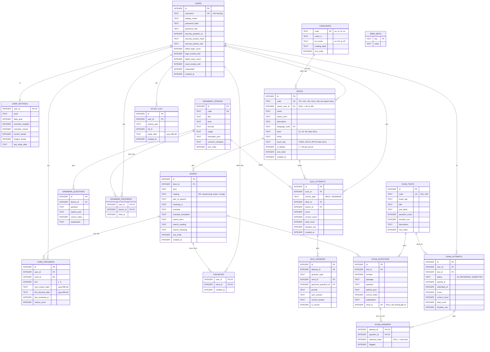

# Database Design — thiết kế CSDL

> **TỰ SINH** từ bộ phân tích thiết kế đã duyệt của nhóm — không sửa trực tiếp tệp này; đề xuất thay đổi qua Issue/PR để nhóm trưởng cập nhật nguồn và sinh lại. Danh mục tài liệu: [docs/README.md](../README.md).

**Mục đích:** ERD, 18 bảng SQLite với cột/khóa/ràng buộc, index và truy vấn chính, chính sách lưu giữ; định dạng dữ liệu nạp sẵn (JSON) và import/export (CSV/JSON).

## Mô hình dữ liệu
> ERD, thực thể, ràng buộc, PII.
> **thay đổi phạm vi:** bảng `topics` và `notebook_entries` gộp thành `decks` + `words` dùng chung cho bộ có sẵn, bộ của người dùng, bộ luyện thi và mọi ngôn ngữ; thêm `languages`, `exam_tests`, `exam_questions`, `exam_attempts`, `exam_answers`. Chưa có code nên không cần migration (DATABASE_VERSION = 1).

## ERD


## Thực thể
Kiểu dữ liệu SQLite: `INTEGER`, `TEXT`. Thời điểm (`*_at`, `*_until`) lưu epoch millis; ngày (`*_date`) lưu chuỗi `yyyy-MM-dd` theo giờ máy (BR-042). Giá trị boolean là 0/1.
| Bảng/collection | Trường chính | Ràng buộc | PII? |
|---|---|---|---|
| `users` | id, username, display_name, password_hash/salt, security_question_id, security_answer_hash/salt, đếm sai + thời điểm khóa (đăng nhập, đặt lại), onboarded, created_at | `username` UNIQUE, NOT NULL, lưu chữ thường (BR-001); `security_question_id` CHECK 1..5 (BR-009); hash/salt NOT NULL (hex) | **Có**: username, display_name; hash mật khẩu và câu trả lời là dữ liệu nhạy cảm (NFR-S1) |
| `user_settings` | user_id, level, daily_goal, reminder_enabled, reminder_minute (0..1439), current_streak, longest_streak, last_study_date | PK = FK `users.id` ON DELETE CASCADE; `level` CHECK IN ('A1','A2','B1'); `daily_goal` CHECK IN (5,10,15,20) | Không |
| `languages` | code, name_vi, tts_locale, reading_label, sort_order | PK `code`; seed: en "Tiếng Anh" en-US "Phiên âm (IPA)", ja "Tiếng Nhật" ja-JP "Cách đọc (kana/romaji)", zh "Tiếng Trung" zh-CN "Pinyin", ko "Tiếng Hàn" ko-KR "Romaja" (BR-052). Thêm ngôn ngữ = thêm 1 dòng | Không |
| `decks` | id, code, owner_user_id, name, name_norm, description, language_code, level, emoji, exam_tag, is_default, sort_order, created_at | `owner_user_id` FK `users.id` ON DELETE CASCADE, NULL = bộ có sẵn chỉ đọc (BR-043); `code` UNIQUE (chỉ bộ có sẵn có code); UNIQUE(owner_user_id, name_norm) cho bộ của người dùng (BR-044); `language_code` FK `languages.code`; `exam_tag` CHECK IN ('TOEIC','IELTS','APTIS') hoặc NULL; mỗi người dùng đúng 1 bộ `is_default = 1` (BR-046, kiểm tra trong `DeckService`) | Có thể (tên/mô tả do người dùng nhập) |
| `words` | id, deck_id, term, reading, part_of_speech, meaning_vi, example, example_translation, search_term, search_reading, search_meaning, sort_order, created_at | FK `decks.id` ON DELETE CASCADE (BR-045); `term`, `meaning_vi` NOT NULL; UNIQUE(deck_id, search_term) (BR-047); cột `search_*` do `TextNormalizer` sinh theo ngôn ngữ của bộ (BR-053); độ dài theo SRS §Validation | Có thể (từ do người dùng nhập) |
| `card_progress` | id, user_id, word_id, box, next_review_date, first_learned_date, last_reviewed_at, review_count | FK users/words ON DELETE CASCADE; CHECK `box` BETWEEN 1 AND 5; UNIQUE(user_id, word_id) (BR-015). Không có bản ghi = trạng thái Mới (BR-014) | Không |
| `favorites` | user_id, word_id, created_at | PK(user_id, word_id); FK ON DELETE CASCADE | Không |
| `grammar_lessons` | id, code (G01..G10), title, level, formula, usage, examples_json, common_mistakes, sort_order | `code` UNIQUE; seed chỉ đọc | Không |
| `grammar_questions` | id, lesson_id, question, options_json (mảng 4 chuỗi), correct_index (0..3), explanation | FK `grammar_lessons.id`; seed chỉ đọc | Không |
| `grammar_progress` | user_id, lesson_id, read_at | PK(user_id, lesson_id); FK ON DELETE CASCADE | Không |
| `quiz_attempts` | id, user_id, source_type, deck_id, lesson_id, score (0..100), correct_count, total_count, duration_sec, created_at | FK ON DELETE CASCADE (user); `deck_id` FK ON DELETE SET NULL (xóa bộ vẫn giữ lịch sử điểm); CHECK `source_type` IN ('DECK','GRAMMAR'); chỉ ghi khi làm xong (BR-023) | Không |
| `quiz_answers` | id, attempt_id, question_type (MCQ_TERM_MEANING, MCQ_MEANING_TERM, LISTEN, FILL, REORDER, GRAMMAR), word_id, grammar_question_id, prompt, user_answer, correct_answer, is_correct | FK `quiz_attempts.id` ON DELETE CASCADE; `word_id` FK ON DELETE SET NULL | Không |
| `exam_tests` | id, code (E01, E02), exam_tag, title, part_label, question_count, duration_sec, description, sort_order | `code` UNIQUE; seed chỉ đọc (BR-054) | Không |
| `exam_questions` | id, test_id, number, passage, question, options_json, correct_index, explanation, word_id | FK `exam_tests.id`; `word_id` FK `words.id` ON DELETE SET NULL (từ trong bộ luyện thi có sẵn); UNIQUE(test_id, number) | Không |
| `exam_attempts` | id, user_id, test_id, status, started_at, submitted_at, score, correct_count, total_count, duration_sec | FK ON DELETE CASCADE (user); CHECK `status` IN ('IN_PROGRESS','SUBMITTED'); tối đa 1 lượt IN_PROGRESS mỗi (user, test) — tiếp tục khi mở lại (AC-036.4) | Không |
| `exam_answers` | attempt_id, question_id, selected_index, flagged | PK(attempt_id, question_id); FK ON DELETE CASCADE; ghi ngay khi chọn đáp án để không mất khi thoát app | Không |
| `study_log` | id, user_id, activity_type (LEARN, REVIEW, QUIZ, GRAMMAR_READ, EXAM), ref_id, study_date, created_at | FK ON DELETE CASCADE; nguồn tính chuỗi ngày, biểu đồ 7 ngày, "đã đạt mục tiêu" (BR-031..BR-033, BR-055) | Không |
| `seed_meta` | key, value | `seed_version` để `onUpgrade` biết cần nạp lại seed (FN-015) | Không |

Ghi chú thiết kế:
- **Bộ có sẵn và bộ của người dùng dùng chung bảng** để flashcard, ôn tập, quiz, tra từ, export chạy một đường code duy nhất (SYSTEM-BLUEPRINT). 15 chủ đề (T01..T15), 3 bộ luyện thi (X01..X03), bộ tiếng Nhật (J01) có `owner_user_id = NULL`.
- **"Lưu vào bộ" (AC-030.4)** chép một dòng `words` sang bộ đích (bản sao), không tham chiếu chéo — sửa/xóa bản sao không ảnh hưởng dữ liệu có sẵn.
- **Đổi ngôn ngữ bộ** chỉ khi bộ chưa có từ (BR-052) vì cột `search_*` đã chuẩn hóa theo ngôn ngữ.
- Bộ đếm "từ mới đã học hôm nay" = số bản ghi `card_progress` của người dùng có `first_learned_date` = hôm nay; không lưu số tổng riêng (BR-033).
- Chuỗi ngày lưu sẵn trong `user_settings` để Trang chủ đọc nhanh, được cập nhật cùng giao dịch ghi `study_log` (FLOW-008).
- Xóa tài khoản: `DELETE FROM users WHERE id = ?` — CASCADE xóa bộ của người dùng, từ trong bộ, tiến độ, lượt làm bài (BR-005).

## Index & truy vấn chính
| Index | Phục vụ truy vấn | Yêu cầu |
|---|---|---|
| `idx_decks_owner (owner_user_id, sort_order)` | "Bộ của tôi"; danh sách bộ có sẵn (`owner_user_id IS NULL`) theo cấp độ/kỳ thi | US-007, US-028, US-035 |
| `idx_words_deck (deck_id, sort_order)` | Danh sách từ của bộ; lấy từ Mới theo thứ tự | SCR-07, SCR-19, FN-006 |
| UNIQUE `(deck_id, search_term)` | Chặn trùng khi thêm/import (BR-047, BR-050); tra tiền tố trong một bộ | US-030, US-032 |
| `idx_words_search (search_term)` | Tra từ toàn bộ: `search_term >= ? AND search_term < ?` (khoảng [q, q + '￿']) | BR-040, BR-053, NFR-P3 |
| `idx_progress_due (user_id, next_review_date)` | Thẻ đến hạn: `WHERE user_id=? AND next_review_date <= ? ORDER BY next_review_date, box LIMIT 50` | BR-013, FN-007 |
| UNIQUE `(user_id, word_id)` trên `card_progress` | Upsert tiến độ một thẻ; trạng thái từng từ khi `LEFT JOIN` với `words` | BR-014, BR-015 |
| `idx_attempts_user_time (user_id, created_at DESC)` | Lịch sử quiz; điểm trung bình 7 ngày | US-015, US-017 |
| `idx_exam_attempts_user (user_id, test_id, status)` | Lượt thi đang làm dở; lịch sử thi thử | US-036 |
| `idx_log_user_date (user_id, study_date)` | Hoạt động hôm nay / 7 ngày; kiểm tra đã đạt mục tiêu trước khi nhắc học | BR-030, BR-031 |
Tìm theo cách đọc/nghĩa (`LIKE '%' || ? || '%'`) không dùng được index; với ≤ 5000 từ vẫn đạt NFR-P3 (người kiểm thử đo ở TC-NFR-E1). Import 2000 dòng dùng `SQLiteStatement` đã biên dịch + `INSERT OR IGNORE` dựa trên UNIQUE `(deck_id, search_term)` trong một giao dịch.

## Retention / backup
- Dữ liệu chỉ nằm trong bộ nhớ riêng của app (`/data/data/<package>/databases/learninge.db`); không đồng bộ, không gửi ra ngoài (NFR-R2).
- `android:allowBackup="false"` (NFR-S4). Người dùng tự sao lưu nội dung bộ từ bằng **Export** (US-033); tiến độ học không được xuất (BR-051).
- Giữ dữ liệu cho đến khi người dùng xóa tài khoản (BR-005) hoặc gỡ app. `study_log`, `quiz_answers`, `exam_answers` không tự xóa (ước tính < 3 MB sau 1 năm dùng mỗi ngày).
- Nâng cấp lược đồ: tăng `DATABASE_VERSION`, viết bước di chuyển trong `onUpgrade` theo từng phiên bản; không xóa bảng chứa dữ liệu người dùng (NFR-E3).

## Định dạng dữ liệu nạp sẵn và import/export
Định dạng file seed (DEC-002) — mỗi file chủ đề:
```json
{
  "deck": { "code": "T01", "name": "Gia đình", "name_en": "Family", "language": "en", "emoji": "👪", "level": "A1", "exam_tag": null, "sort_order": 1 },
  "source": "Tự soạn; câu ví dụ tham khảo Tatoeba (CC BY 2.0 FR)",
  "words": [
    { "term": "mother", "reading": "/ˈmʌðər/", "pos": "danh từ", "meaning": "mẹ",
      "example": "My mother is a teacher.", "example_translation": "Mẹ tôi là giáo viên." }
  ]
}
```
`grammar.json`: mảng `lessons`, mỗi bài có `code`, `title`, `level`, `formula`, `usage`, `examples` (mảng `{en, vi}`), `common_mistakes`, `questions` (mảng `{question, options[4], correct_index, explanation}`), `source`. File UTF-8 không BOM, thụt lề 2 dấu cách.

Theo thay đổi phạm vi: cùng định dạng `deck`/`words` được dùng cho **import/export JSON** (BR-049). `exams.json`: mảng `tests`, mỗi đề có `code`, `exam_tag`, `title`, `part_label`, `duration_sec`, `questions` (mảng `{number, passage?, question, options[4], correct_index, explanation, deck_code?, term?}` — `deck_code`+`term` để gắn câu với từ trong bộ luyện thi). `languages.json`: mảng `{code, name_vi, tts_locale, reading_label, sort_order}`.

**Định dạng CSV import/export (BR-048, DEC-008):** UTF-8 (export ghi kèm BOM để Excel mở đúng tiếng Việt), dòng tiêu đề bắt buộc:
```text
term,reading,meaning,example,example_translation
apple,/ˈæp.əl/,quả táo,"I eat an apple, every day.","Tôi ăn một quả táo, mỗi ngày."
```
