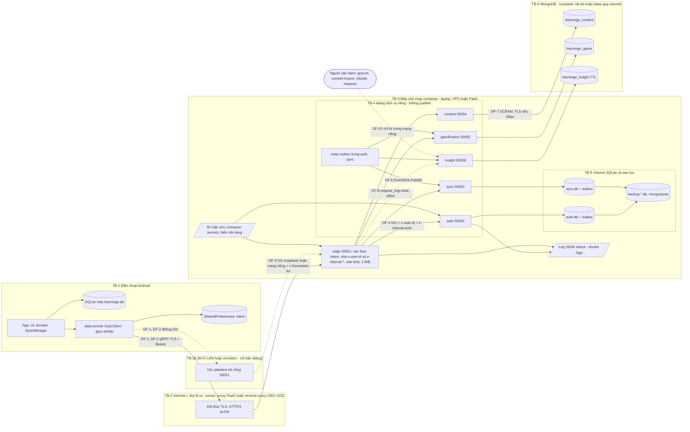

# Security Threat Model — phân tích mối đe dọa

> **TỰ SINH** từ bộ phân tích thiết kế đã duyệt của nhóm — không sửa trực tiếp tệp này; đề xuất thay đổi qua Issue/PR để nhóm trưởng cập nhật nguồn và sinh lại. Danh mục tài liệu: [docs/README.md](../README.md).

**Mục đích:** ranh giới tin cậy, tài sản cần bảo vệ, mối đe dọa theo STRIDE với biện pháp giảm thiểu, người chịu trách nhiệm, cách kiểm chứng (TC-SEC) và rủi ro còn lại.

## Threat Model

> Tài sản, ranh giới tin cậy, mối đe dọa, biện pháp.

## Phạm vi, giả định và cách đọc
- **Phạm vi:** app Android LearningE (offline-first, `grpc-okhttp` + protobuf-lite — DEC-020), backend 6 dịch vụ Rust `edge`, `auth`, `sync`, `content`, `gamification`, `insight` (tokio + tonic, DEC-018/DEC-019), SQLite `auth.db`/`sync.db` là nguồn sự thật, MongoDB `learninge_content`/`learninge_game`/`learninge_insight` nạp qua outbox (DEC-021), hợp đồng proto3 `learninge.app.v1` (công khai, qua edge `:50051`) và `learninge.internal.v1` (nội bộ), xác thực token opaque (DEC-013), đồng bộ LWW (DEC-014), lớp lộ ra Internet theo DEC-023 (**chưa chốt**: P1 laptop + tunnel, P2 Atlas, P3 Railway, P4 VPS). Nguồn: thay đổi phạm vi, SYSTEM-BLUEPRINT, SYSTEM-BLUEPRINT (công nghệ), ARCHITECTURE-DECISIONS DEC-018..DEC-023, DATABASE-DESIGN (B1–B4), API_CONTRACT, NFR-S1..S10, NFR-N1..N6.
- **Giả định:** đồ án học tập, ≤ 50 tài khoản, ≤ 10 yêu cầu/giây; server chỉ cần sẵn sàng trong đợt kiểm thử/chấm (tới ≈ 03/01/2027); không dữ liệu thanh toán; người dùng thật là thành viên nhóm và người chấm. Kẻ tấn công thực tế: người biết URL công khai (bị quét tự động), người cùng Wi-Fi, người cầm điện thoại đã mở khóa, người dùng hợp lệ muốn gian lận XP, một container/dịch vụ bị chiếm hoặc cấu hình sai trong cùng mạng riêng, người có quyền ở nhà cung cấp hạ tầng (tunnel, PaaS, Atlas).
- **Ngoài phạm vi:** tấn công vật lý vào máy chủ đang mở khóa, malware trên máy dev, lỗ hổng của chính Android/Linux kernel/Docker/nhà cung cấp hạ tầng, DoS phân tán quy mô lớn.
- **Thang đánh giá (giữ thay đổi phạm vi):** Khả năng (K) và Tác động (T) mỗi thứ Cao/TB/Thấp. Mức độ = ma trận K×T: Cao nếu (K Cao, T ≥ TB) hoặc (K TB, T Cao); Thấp nếu cả hai ≤ TB và có một Thấp; còn lại TB. Cột "Mức độ" là mức **trước** biện pháp; cột "Còn lại" là mức **sau** khi làm đủ biện pháp.
- **Owner ():** lập trình viên = người phụ trách từng dịch vụ (phân công Q6 **chưa chốt** — thay đổi phạm vi §6), lập trình viên (app), người review kiêm người review (review), người kiểm thử (ca kiểm thử), "Người vận hành" (chạy compose/tunnel/PaaS/VPS, giữ bí mật).
- **Kiểm chứng:** `TC-SEC-xx` = ca kiểm thử đề xuất (người kiểm thử đưa vào TESTING-STRATEGY); `RC-xx` = mục kiểm tra khi review code/cấu hình. ID cũ giữ nguyên nghĩa; kỳ vọng HTTP cũ được ghi lại theo mã gRPC + trailer `error-code` (API_CONTRACT §Quy ước lỗi).

## Bối cảnh hệ thống và sơ đồ luồng dữ liệu
App chỉ nói chuyện với **edge** (cổng duy nhất được publish). TLS của app kết thúc ở **lớp lộ ra** (tunnel/proxy của PaaS/reverse proxy — tùy DEC-023), đoạn lớp lộ ra → edge và edge → dịch vụ là **h2c** trong loopback/mạng riêng. Edge xác thực token qua `auth.ValidateToken`, xóa metadata nội bộ do client gửi, gắn `x-user-id` + khóa nội bộ rồi chuyển tiếp. `auth`/`sync` ghi SQLite và outbox trong cùng giao dịch; relay trong chính dịch vụ phát gọi `EventSink.Publish` của `sync`/`gamification`/`insight`, các dịch vụ này ghi MongoDB.

| Luồng | Dữ liệu | Qua ranh giới |
|---|---|---|
| DF-1 Đăng ký/đăng nhập/đổi–đặt lại mật khẩu/xóa tài khoản (EP-02..EP-10) | email, mật khẩu rõ, câu trả lời bảo mật, token trả về | TB-1 → TB-2 (hoặc TB-2b) → TB-3 → TB-4 (`auth`) |
| DF-2 Gọi RPC có token (EP-04..EP-07, EP-10..EP-16) | `authorization: Bearer`, dữ liệu học | TB-1 → TB-2 → TB-3 |
| DF-3 Lớp lộ ra → edge | Toàn bộ DF-1/DF-2 ở dạng **rõ** (h2c), metadata IP thật | TB-2 → TB-3 |
| DF-4 Edge → dịch vụ (`*Backend`, `ValidateToken`) | `token_sha256`, `x-user-id`, `x-request-id`, message công khai (gồm mật khẩu cho `AuthBackend`) | TB-3 → TB-4 |
| DF-5 Dịch vụ ↔ SQLite, sao lưu | Toàn bộ dữ liệu nguồn sự thật, PII, hash, outbox | TB-4 → TB-5 |
| DF-6 Relay outbox → `EventSink.Publish` | Sự kiện (user_id, nickname, XP; insight chỉ `user_hmac`) | trong TB-4 |
| DF-7 Dịch vụ → MongoDB | Nội dung, XP bản sao, nickname, audit/analytics (`user_hmac`) | TB-4 → TB-6 (P2: qua Internet) |
| DF-8 Edge → insight `request_logs` | `request_id`, rpc, mã, thời gian, `user_hmac` (không IP) | trong TB-4 |
| DF-9 Bí mật cấu hình | `LEARNINGE_SERVER_KEY`, `LEARNINGE_PSEUDONYM_KEY`, `LEARNINGE_INTERNAL_TOKEN`, mật khẩu Mongo | nơi lưu bí mật → TB-3 |
| DF-10 Vận hành | `grpcurl` `GetDailyStats`, `gamification rebuild` (`Export*`), `content-import`, `outbox requeue` | người vận hành → TB-4 |
| DF-11 Lưu cục bộ trên máy | CSDL máy, token | trong TB-1 |

## Tài sản cần bảo vệ
| ID | Tài sản | Nơi lưu | Vì sao quan trọng | Mức |
|---|---|---|---|---|
| A-01 | Mật khẩu rõ (khi gửi) và hash PBKDF2 + salt | DF-1, DF-3, DF-4; `auth.db` `users` | Người dùng hay dùng lại mật khẩu | Cao |
| A-02 | Token phiên (rõ trên máy và trên DF-1..DF-3; SHA-256 trong `auth.db`; cache ở edge) | SharedPreferences; `auth_tokens`; bộ nhớ edge | Cầm token = chiếm phiên 30 ngày | Cao |
| A-03 | Câu trả lời bảo mật (hash) | `security_answers` | Đường đặt lại mật khẩu = chiếm tài khoản | Cao |
| A-04 | PII: email, tên hiển thị; biệt danh (công khai) | `auth.db`; nickname cả ở `learninge_game` | Nghĩa vụ bảo vệ dữ liệu cá nhân | TB |
| A-05 | Dữ liệu học: tiến độ, bộ từ riêng, lượt làm bài, `xp_events` gốc | SQLite máy + `sync.db` | Mất/sai = mất công học (R-36) | TB |
| A-06 | Toàn vẹn XP và bảng xếp hạng | `sync.db` `xp_events`; `learninge_game` | Công bằng (REQ-021) | TB |
| A-07 | Tính sẵn sàng khi demo/chấm | Máy chủ + lớp lộ ra + Mongo | Hỏng demo = mất điểm (R-35, R-42, R-45) | Cao |
| A-08 | File `auth.db`/`sync.db` (+ `-wal`), bản sao lưu, `mongodump` | Volume, thư mục `backup/` | Chứa A-01..A-06 cùng lúc | Cao |
| A-09 | `LEARNINGE_SERVER_KEY` (HMAC câu hỏi giả, `auth_attempts`) | Biến môi trường/secret của `auth` | Lộ ⇒ dò email có thật qua id câu hỏi giả (TM-03) | TB |
| A-10 | `LEARNINGE_PSEUDONYM_KEY` (tạo `user_hmac`) | Secret của `auth`, `sync` | Lộ + có danh sách `users.uuid` ⇒ gỡ bút danh dữ liệu insight | TB |
| A-11 | `LEARNINGE_INTERNAL_TOKEN` (xác thực giữa dịch vụ, D-09) | Secret của cả 6 dịch vụ + công cụ vận hành | Lộ + vào được mạng riêng ⇒ giả `x-user-id`, giả sự kiện | Cao |
| A-12 | Thông tin đăng nhập MongoDB (root + 3 user dịch vụ), tài khoản Atlas/Railway/VPS/tunnel, SSH key | `.env`/secret nền tảng; máy thành viên | Chiếm hạ tầng = chiếm mọi dữ liệu | Cao |
| A-13 | Outbox (sự kiện chưa/đã phát) | `auth.db`, `sync.db` | Giả/sửa sự kiện ⇒ sai XP, xóa nhầm dữ liệu | TB |
| A-14 | Dữ liệu insight (audit, request log, analytics) | `learninge_insight` | Bút danh — gỡ được nếu có A-10 | Thấp |
| A-15 | Nội dung học, hợp đồng proto, keystore ký release, `GRPC_HOST` | Repo, `local.properties` | Nội dung sai cho mọi người; lộ keystore | TB |

## Ranh giới tin cậy
| ID | Ranh giới | Bên trong tin gì | Không được tin |
|---|---|---|---|
| TB-1 | Điện thoại ↔ mạng | App tin SQLite máy và token của chính nó; chỉ tin server qua TLS hợp lệ (bản release) | Phía server: **mọi thứ client gửi** (message, metadata `x-user-id`/`x-internal-*`, `x-request-id`, `updated_at_ms`, số đếm XP, `record_id`) |
| TB-2 | Internet + lớp lộ ra (tunnel / proxy PaaS / reverse proxy) | Chứng chỉ TLS của tên miền công khai | Nhà cung cấp tunnel/PaaS **thấy bản rõ** (TLS kết thúc ở đó, P1/P3); URL công khai bị quét; metadata `x-forwarded-for`/`cf-connecting-ip` chỉ đúng khi do proxy tin cậy đặt |
| TB-2b | Wi-Fi LAN / emulator (debug) | — | Mọi máy cùng mạng nghe/giả mạo được h2c |
| TB-3 | Máy chủ (hệ điều hành, Docker, tài khoản vận hành) | Tiến trình edge; bí mật nạp từ env/secret | Kết nối tới edge không đến từ địa chỉ proxy tin cậy (`EDGE_TRUSTED_PROXIES`) khi đọc IP thật |
| TB-4 | Mạng dịch vụ riêng (bridge compose / private network của PaaS / loopback ở chế độ gộp) | Lời gọi có `x-internal-auth` đúng (D-09); `x-user-id` **chỉ** khi lời gọi đã qua kiểm khóa nội bộ | Lời gọi thiếu/sai khóa nội bộ; mọi dịch vụ khác cùng mạng PaaS; sự kiện có `type`/`source` không khớp danh sách cho phép (D-13) |
| TB-5 | File SQLite + sao lưu | Chỉ dịch vụ sở hữu ghi (một kết nối ghi) | Bản sao ra ngoài (USB, cloud cá nhân, máy thành viên) |
| TB-6 | MongoDB | Chỉ user của đúng dịch vụ, quyền trên đúng database; TLS khi qua Internet (P2) | Mọi kết nối không xác thực; Internet (cổng 27017 không bao giờ public, Atlas có IP allowlist) |

## Phương án triển khai P1–P4: ranh giới TLS và kiểm soát tối thiểu
Q3/DEC-023 chưa chốt. Bảng này là điều kiện **tối thiểu** để phương án được dùng cho demo/chấm; người vận hành đánh dấu trong runbook T-152 và người review kiểm bằng TC-SEC-38. Kiểm soát chung cho mọi phương án ở cuối mục.

| Phương án | TLS kết thúc ở đâu / ai thấy bản rõ | HTTP/2 tới edge | Ranh giới mới | Kiểm soát tối thiểu (bắt buộc) | Còn lại |
|---|---|---|---|---|---|
| P2 MongoDB Atlas (free) + dịch vụ ở P1/P3/P4 | Không đổi lớp lộ ra của edge; **thêm** đường Mongo qua Internet: TLS bắt buộc (`mongodb+srv://`, mặc định TLS), Atlas thấy dữ liệu đã lưu | Không liên quan | TB-6 chuyển ra Internet; dữ liệu ở bên thứ ba (chỉ bút danh/nickname/nội dung — không email, hash, token) | 3 user SCRAM riêng, role chỉ trên database của mình (không `atlasAdmin`, không `readWriteAnyDatabase`); **IP Access List** = IP công khai của máy chạy dịch vụ (cập nhật trước buổi chấm), **cấm `0.0.0.0/0`**; nếu chạy ở P3 với IP ra động thì ưu tiên Mongo trong mạng riêng của P3 thay vì Atlas, hoặc chấp nhận có ghi nhận `0.0.0.0/0` + mật khẩu ngẫu nhiên ≥ 24 ký tự + TLS (Còn lại TB); tài khoản Atlas MFA, chỉ người vận hành là Owner; tắt Data API/endpoint HTTP; xóa cluster sau môn | Thấp (TB nếu buộc `0.0.0.0/0`) |
| P3 Railway (PaaS container) | Proxy biên Railway — **nền tảng thấy bản rõ**; proxy → container qua mạng nền tảng | Phải xác minh proxy công khai chuyển h2/gRPC tới container. **Nếu chỉ có TCP proxy thì TLS phải kết thúc tại edge** (bật TLS của tonic — crate/feature mới, cần duyệt, cập nhật DEC-023); **cấm** cho app release gọi h2c qua TCP proxy công khai | Mạng riêng dùng chung cho **mọi** service trong project ⇒ D-09 khóa nội bộ là lớp bắt buộc; volume gắn 1 replica | Chỉ `edge` có public domain; các dịch vụ khác và Mongo **không** bật public networking/TCP proxy; secret qua Variables của nền tảng (không "shared variables" cho khóa chỉ một dịch vụ cần, xem D-10); `auth.db`/`sync.db` trên volume; `EDGE_TRUSTED_PROXIES` đặt theo dải địa chỉ proxy nền tảng (xác minh lúc triển khai — sai thì rate limit theo IP gộp mọi người, TM-04); thành viên project tối thiểu + MFA; xóa project sau môn | TB (nền tảng thấy bản rõ — chấp nhận) |
| P4 VPS + compose + reverse proxy (vd Caddy) | Reverse proxy trên **chính VPS** (chứng chỉ ACME); proxy → edge h2c qua loopback/mạng compose — không bên thứ ba nào thấy bản rõ (trừ nhà cung cấp VPS có quyền truy cập máy) | Proxy phải cấu hình upstream h2c (Caddy `transport http { versions h2c }`) | Bề mặt quản trị SSH; Docker publish **bỏ qua ufw/iptables** của host | Tường lửa của nhà cung cấp + host chỉ mở 443 (và 80 cho ACME), 22 chỉ key (tắt mật khẩu, tắt root login, giới hạn IP nếu được); edge publish `127.0.0.1` hoặc không publish (proxy trong cùng mạng compose); **không bao giờ** `ports:` cho Mongo/50052–50056; cập nhật bảo mật tự động; sao lưu `auth.db`/`sync.db` mã hóa, ra ngoài VPS; `.env` quyền 600; hủy VPS + xóa đĩa sau môn | Thấp |

**Kiểm soát chung (mọi phương án):** release chỉ TLS (D-11); chỉ edge lộ ra (NFR-S9); khóa nội bộ D-09; Mongo bật xác thực + user theo dịch vụ (TM-43); `APP_ENV=prod` bắt buộc khóa có mặt, reflection tắt, không seed demo (TM-34, TM-47); `LEARNINGE_DEMO_SEED` chỉ máy demo; log không PII (TM-48); sao lưu trước buổi chấm; dọn sạch hạ tầng + dữ liệu sau khi kết thúc môn (TM-28).

## Mối đe dọa (STRIDE)
Bảng tóm tắt theo thành phần; chi tiết K/T, owner, kiểm chứng và rủi ro còn lại ở các bảng con bên dưới. TM-01..TM-32 giữ ID của thay đổi phạm vi (đã ánh xạ sang kiến trúc thay đổi phạm vi); TM-33..TM-50 là mối đe dọa mới. (thay đổi phạm vi §2 dự kiến "thêm TM-19..TM-24" — các ID này đã dùng ở thay đổi phạm vi nên mối đe dọa mới đánh số từ TM-33.)

| ID | Mối đe dọa | Thành phần | Mức độ | Biện pháp |
|---|---|---|---|---|
| TM-01 | S: Dò mật khẩu / credential stuffing | EP-03 (edge + auth) | Cao | Giới hạn IP ở edge + khóa tăng dần ở auth (BR-003, quyết định 11/11/2026) |
| TM-02 | S: Dò câu trả lời bảo mật để chiếm tài khoản | EP-08, EP-09 | Cao | Giới hạn IP + khóa đặt lại tăng dần (BR-008) |
| TM-03 | I: Dò email đã đăng ký | EP-02, EP-03, EP-08, EP-09 | TB | Thông báo chung, id câu hỏi giả HMAC (`LEARNINGE_SERVER_KEY`), khóa giống nhau |
| TM-04 | S/D: Giả `x-forwarded-for` né giới hạn tần suất; sai cấu hình proxy tin cậy | edge rate limit | Cao | Chỉ tin metadata khi peer thuộc `EDGE_TRUSTED_PROXIES`, phần tử cuối |
| TM-05 | D: Làm cạn CPU bằng PBKDF2 | auth | Cao | Giới hạn trước khi băm, semaphore 4 phép |
| TM-06 | I: Lộ token trên máy | App TokenStore | TB | `allowBackup=false` + `dataExtractionRules`, Keystore AES-GCM (Should) |
| TM-07 | S: Dùng lại token bị đánh cắp | edge + auth | TB | Hạn 30 ngày, thu hồi khi đăng xuất/đổi mật khẩu |
| TM-08 | I: Lộ file SQLite / sao lưu / mongodump | TB-5 | Cao | Hash token, PBKDF2, volume riêng, không đồng bộ cloud, xóa sau môn |
| TM-09 | E: Token cũ còn dùng được sau đổi mật khẩu/xóa tài khoản | auth (+ cache edge — TM-37) | TB | Thu hồi trong cùng giao dịch; edge xóa cache |
| TM-10 | I: Lớp lộ ra thấy bản rõ | TB-2 | TB | Theo phương án P1–P4; tài khoản demo |
| TM-11 | I/T: Nghe lén h2c (LAN, cấu hình sai) | App, DF-1 | Cao | Release chỉ TLS (chặn bằng mã — TM-35) |
| TM-12 | S: Server giả / host bị đổi | App ServerConfig | TB | Ô "Địa chỉ server" chỉ ở debug |
| TM-13 | E: Vượt lớp lộ ra, gọi thẳng edge/cổng nội bộ | Máy chủ | TB | Edge bind/publish loopback; chỉ edge publish |
| TM-14 | I/T: IDOR/BOLA trong đồng bộ | sync EP-11, EP-12 | Cao | Mọi truy vấn lọc `user_id` từ `x-user-id` |
| TM-15 | T/E: Gán hàng loạt qua trường do server quản lý | sync, auth | Cao | Danh sách trắng trường theo loại bản ghi |
| TM-16 | T: Gian lận XP | sync `xp_events` | Cao | Server tính lại, trần, cửa sổ −7 ngày/+5 phút |
| TM-17 | T: Thao túng LWW bằng `updated_at_ms` tương lai | sync | Thấp | Kẹp `server_time + 5 phút` |
| TM-18 | D: Message lớn, chuỗi dài, quá nhiều bản ghi | Toàn API | TB | 1 MiB, ≤ 500 bản ghi, độ dài trường (chi tiết TM-44) |
| TM-19 | D: Nghẽn khóa ghi SQLite | sync, auth | TB | 30 Push/phút/token, giao dịch ngắn, `UNAVAILABLE` |
| TM-20 | T/E: SQL injection / NoSQL injection | store của mọi dịch vụ | Cao | `rusqlite` tham số `?`; truy vấn Mongo có kiểu, không toán tử từ client |
| TM-21 | T/R: Chèn dòng log giả | edge, log | Thấp | `x-request-id` chỉ nhận UUID; log JSON |
| TM-22 | I: Lỗi lộ chi tiết nội bộ | `common` AppError → Status | TB | `INTERNAL` thông điệp chung + `request_id` |
| TM-23 | I: Bí mật/CSDL bị commit lên repo | 2 repo | Cao | `.gitignore`, `.env.example` chỉ tên biến |
| TM-24 | I: Log chứa PII/token/mật khẩu | Mọi dịch vụ, app | TB | Không log message auth, `authorization`; email che (chi tiết TM-48) |
| TM-25 | T/D: Hỏng/mất file SQLite | TB-5 | TB | WAL, `.backup`/`VACUUM INTO`, `quick_check` |
| TM-26 | R: Chối bỏ thao tác tài khoản | auth, insight | Thấp | Sự kiện bảo mật + `audit_events` |
| TM-27 | I: Xóa tài khoản không đầy đủ trong `auth.db`/`sync.db` | auth, sync | TB | CASCADE + `foreign_keys=ON` + test đếm 0 (lan sang Mongo: TM-41) |
| TM-28 | I: Quyền riêng tư (PDPL) | Toàn hệ thống | TB | Tối thiểu dữ liệu, thông báo, quyền xóa, dọn sau môn |
| TM-29 | T: Chuỗi cung ứng dependency **app** (Gradle) | App | TB | Ghim phiên bản, khóa phụ thuộc, dependency verification |
| TM-30 | T: Nội dung server bị sửa/độc hại | content, `content-import` | Thấp | Nội dung từ git qua review, validator Mongo, app hiển thị văn bản thường |
| TM-31 | S: Tài khoản demo mật khẩu biết trước trên URL công khai | Seed demo | Thấp | Chỉ dữ liệu giả, tắt seed ngoài demo |
| TM-32 | S: Token còn hiệu lực sau đăng xuất ngoại tuyến | EP-04, BR-073 | Thấp | Chấp nhận (D-01), Could: `pending_revoke` |
| TM-33 | S/E: Giả mạo giữa dịch vụ — gọi thẳng dịch vụ nội bộ với `x-user-id` tùy ý | TB-4 | Cao | Không publish cổng nội bộ + **khóa nội bộ dùng chung `x-internal-auth`** (D-09) + edge xóa metadata nội bộ |
| TM-34 | I: gRPC reflection / health liệt kê dịch vụ, RPC nội bộ | edge, mọi dịch vụ | Thấp | Reflection tắt ở prod (từ chối khởi động nếu bật) |
| TM-35 | I/T: App release gọi gRPC plaintext (`grpc-okhttp` bỏ qua `network_security_config`) | App `GrpcClient` | Cao | Chặn bằng mã + chặn lúc build release (D-11) |
| TM-36 | I/T: Kết thúc TLS và h2c ở lớp lộ ra theo từng phương án | TB-2, TB-3 | TB | Bảng P1–P4; đoạn h2c chỉ trên loopback/mạng riêng |
| TM-37 | E: Token đã thu hồi vẫn dùng được nhờ cache 60 s ở edge | edge | TB | Edge xóa cache theo user khi Logout/ChangePassword/ResetPassword/DeleteAccount (D-12) |
| TM-38 | S/T: Đầu độc outbox / `EventSink.Publish` giả (XP giả, `user.deleted` giả) | relay, sync, gamification, insight | TB | Khóa nội bộ + danh sách (type, source) cho phép + kiểm payload (D-13) |
| TM-39 | T: Phát lại / trùng / lệch thứ tự sự kiện làm "hồi sinh" dữ liệu người đã xóa | Bên nhận sự kiện | TB | Idempotent theo `event_id`; tombstone người dùng đã xóa ở sync và gamification |
| TM-40 | D: Outbox phình khi bên nhận ngừng lâu | `auth.db`, `sync.db` | Thấp | WARN > 10 000, dead-letter, theo dõi đĩa |
| TM-41 | I: Xóa tài khoản lan sang Mongo chậm/thiếu | outbox → sync, gamification, insight | TB | Sự kiện `user.deleted` ≤ 60 s khi đích chạy; tombstone; test 3 dịch vụ (D-14) |
| TM-42 | I: Gỡ bút danh dữ liệu insight | `learninge_insight`, A-10 | Thấp | Khóa bút danh tách riêng, chỉ auth + sync giữ (D-10), TTL |
| TM-43 | I/E: MongoDB lộ cổng/không xác thực/quyền rộng | TB-6 | Cao | Không publish 27017, xác thực, user theo dịch vụ, Atlas TLS + IP allowlist |
| TM-44 | D: DoS bằng protobuf/HTTP/2 (message lớn, nhiều phần tử, header lớn, nhiều stream, không deadline) | edge, mọi dịch vụ | Cao | Giới hạn kích thước/số phần tử/header/stream, timeout server, h2 đã vá |
| TM-45 | T: Chuỗi cung ứng **server** (crate, `protoc` vendored, image Docker) | Repo server, CI, image | TB | `Cargo.lock` + `--locked`, `cargo audit`, `cargo deny`, image ghim digest |
| TM-46 | E: Container chạy root, FS ghi được, quyền thừa | Image, compose | TB | Non-root, read-only rootfs, `cap_drop: ALL`, `no-new-privileges`, giới hạn tài nguyên |
| TM-47 | I: Bí mật lộ qua repo, image, log, `docker inspect`, nền tảng | Cấu hình | Cao | Env/compose secrets/biến nền tảng, kiểm lúc khởi động, không in giá trị |
| TM-48 | I: PII/token lọt log do in nguyên message proto (`Debug`) | `tracing` mọi dịch vụ | TB | Cấm log message; trường log danh sách trắng |
| TM-49 | I: Lạm dụng RPC vận hành/xuất hàng loạt (`Export*`, `GetDailyStats`, `requeue`) | TB-4, người vận hành | TB | Khóa nội bộ, chỉ gọi từ trong mạng riêng, không port-forward công khai |
| TM-50 | E: Chiếm bề mặt quản trị hạ tầng (SSH VPS, tài khoản Railway/Atlas/tunnel, Docker bỏ qua tường lửa) | TB-3, TB-6 | TB | Key-only SSH, MFA, tường lửa nhà cung cấp, không `ports:` thừa |

### Xác thực và phiên (DF-1, DF-2)
| ID | Kịch bản khai thác | K/T | Biện pháp (bắt buộc / đề xuất) | Owner | Kiểm chứng | Còn lại |
|---|---|---|---|---|---|---|
| TM-01 | Thử danh sách mật khẩu phổ biến cho một/nhiều email. Với khóa tăng dần đã quyết (60 s → gấp đôi, trần 1 giờ) một email chịu ≈ 145 lần thử/ngày; chính sách 8 ký tự chữ+số vẫn cho mật khẩu yếu | TB/Cao | **Bắt buộc (giữ thay đổi phạm vi):** 5 `Login`/phút/IP ở **edge** kiểm trước khi gọi auth; khóa email tăng dần ở **auth** (`LockPolicy`, DATABASE-DESIGN §Quy tắc khóa tăng dần), tính cả email không tồn tại, về 0 sau 24 giờ không sai hoặc khi thành công; `UNAUTHENTICATED` `INVALID_CREDENTIALS` chung; PBKDF2 120.000 vòng. **Đề xuất còn mở:** chặn 20 mật khẩu phổ biến nhất khi đăng ký | lập trình viên (edge, auth); người phân tích (BR-003) | TC-SEC-01, TC-SEC-02 | Thấp |
| TM-02 | Câu hỏi bảo mật có không gian đáp án nhỏ (≈ 63 tỉnh/thành) → đoán, đặt lại mật khẩu, nhận `AuthSession` | TB/Cao | **Bắt buộc:** 5 yêu cầu/phút/IP cho EP-08/EP-09 ở edge; khóa đặt lại tăng dần giống mật khẩu (BR-008); băm câu trả lời PBKDF2; đặt lại thành công thu hồi mọi token (BR-058) **và edge xóa cache của user** (TM-37). **Đề xuất còn mở:** bộ 5 câu hỏi khó đoán, cảnh báo trên UI | người phân tích (BR-008, BR-009); lập trình viên | TC-SEC-03 | Thấp-TB (giới hạn của REQ-014, chấp nhận) |
| TM-03 | Dò email: id câu hỏi giả tự tính được; khác biệt khóa giữa email thật/giả; `ALREADY_EXISTS` `EMAIL_TAKEN` | Cao/Thấp | **Giữ:** id giả = `HMAC-SHA256(LEARNINGE_SERVER_KEY, email chuẩn hóa) mod 5 + 1`; khóa chỉ ở `auth`; `APP_ENV=prod` thiếu khóa → **từ chối khởi động** (đã sửa API_CONTRACT cho khớp SYSTEM-BLUEPRINT, F-17); email giả bị đếm/khóa như thật, PBKDF2 với salt giả; `EMAIL_TAKEN` chấp nhận (D-02) với 10 `Register`/giờ/IP | lập trình viên (auth); nhóm trưởng (AC-027.3) | TC-SEC-04, TC-SEC-05 | Thấp |
| TM-04 | Client gửi `x-forwarded-for` đổi liên tục để né giới hạn IP; hoặc đứng sau proxy mà không khai báo proxy tin cậy ⇒ mọi người cùng một IP, một kẻ dò làm `RESOURCE_EXHAUSTED` cả buổi demo; P3: peer là proxy nền tảng (không phải loopback) | Cao/Cao | **Bắt buộc:** IP = peer HTTP/2; chỉ khi `EDGE_TRUST_PROXY=true` **và** peer ∈ `EDGE_TRUSTED_PROXIES` mới đọc `cf-connecting-ip` hoặc phần tử **cuối** của `x-forwarded-for`; giá trị không phải IP → dùng peer (đã thống nhất tên biến trong API_CONTRACT, F-18). Khóa theo email (bền vững trong `auth.db`) vẫn chặn dù IP bị giả. Mỗi phương án P1–P4 ghi rõ giá trị `EDGE_TRUSTED_PROXIES` trong runbook | lập trình viên (edge); Người vận hành | TC-SEC-06, RC-03 | Thấp |
| TM-05 | Nhiều `Login`/`Register`/`ResetPassword` song song từ nhiều IP: PBKDF2 ≈ 100–300 ms CPU mỗi lần → CPU 100%, NFR-N4 vỡ | TB/Cao | **Bắt buộc:** kiểm định dạng → giới hạn IP (edge) → khóa email (auth) → mới băm; PBKDF2 trong `spawn_blocking` với `tokio::sync::Semaphore` 4 permit, chờ > 2 s → `UNAVAILABLE` `SERVICE_UNAVAILABLE` + `retry-after-seconds: 5`; edge `ConcurrencyLimit` 64; mật khẩu ≤ 64 ký tự | lập trình viên (auth, edge) | TC-SEC-07 | Thấp |
| TM-06 | Token rõ trong SharedPreferences bị lấy qua sao lưu, chuyển máy, `run-as` bản debug, máy root, Logcat | TB/TB | **Giữ thay đổi phạm vi:** `allowBackup=false` + `dataExtractionRules` loại `sharedpref`, `database` (cloud-backup và device-transfer); interceptor không log token; bàn giao APK release (không `debuggable`). **Should:** `TokenStore` AES-256-GCM với khóa Android Keystore; giải mã lỗi → xóa token. (DEC-020 đã thêm thư viện gRPC nhưng **không** thêm `security-crypto`) | lập trình viên | TC-SEC-08, RC-07 | Thấp |
| TM-07 | Token lộ (TM-06, TM-10/TM-36, log) dùng từ máy khác tới 30 ngày | TB/TB | Hạn cứng 30 ngày; thu hồi khi đăng xuất; đổi/đặt lại mật khẩu thu hồi **mọi** token = "đăng xuất mọi thiết bị" (hướng dẫn sử dụng); token chỉ ở metadata, không trong message/URL/log; **token thô không vào mạng nội bộ** (edge chỉ gửi `token_sha256`) | lập trình viên; nhóm trưởng | TC-SEC-09 | Thấp |
| TM-08 | Lộ `auth.db`/`sync.db`, bản sao lưu, `mongodump` (laptop mất, chép lên Drive, volume PaaS, snapshot VPS) | TB/Cao | **Bắt buộc:** volume riêng cho mỗi DB, không mount thư mục đồng bộ cloud; `backup/` ngoài repo, không commit; ổ laptop BitLocker/FileVault (P1); sao lưu VPS mã hóa (P4); xóa DB, volume, sao lưu, snapshot, cluster sau môn. Không pepper (đã quyết 11/11) — câu trả lời bảo mật phá offline được nếu DB lộ (chấp nhận). Khóa (A-09..A-11) **không** nằm trong DB hay sao lưu | Người vận hành; lập trình viên | RC-11 | TB (chấp nhận, như thay đổi phạm vi) |
| TM-09 | Sau đổi/đặt lại mật khẩu/xóa tài khoản, token cũ vẫn gọi được: thu hồi sai giao dịch hoặc cache phiên | TB/Cao | **Bắt buộc:** `UPDATE auth_tokens SET revoked_at` trong **cùng giao dịch** với đổi hash/xóa user; `ValidateToken` kiểm `revoked_at IS NULL AND expires_at > now`; phần cache: TM-37 | lập trình viên (auth, edge) | TC-SEC-09, TC-SEC-29 | Thấp |
| TM-32 | Đăng xuất khi mất mạng: token trên server còn hiệu lực tới 30 ngày | Thấp/TB | **D-01 giữ:** chấp nhận; Could: hàng đợi `pending_revoke` gọi EP-04 khi có mạng | lập trình viên; nhóm trưởng | TC-SEC-09 | Thấp |
| TM-37 | Edge cache kết quả `ValidateToken` ≤ 60 s: token vừa bị thu hồi (đăng xuất, đổi/đặt lại mật khẩu từ máy khác, xóa tài khoản) vẫn được chấp nhận tới hết cửa sổ cache | TB/TB | **Quyết định D-12:** giữ cache 60 s (không thêm cơ chế đẩy thu hồi). **Bắt buộc:** khóa cache = `token_sha256`, giá trị gồm `user_id`, `user_hmac`, `expires_at_ms`; TTL = min(60 s, `expires_at`); edge giữ chỉ mục `user_id → {token_sha256}` và **xóa mọi mục của user** ngay khi chuyển tiếp OK `Logout` (token hiện tại), `ChangePassword`, `DeleteAccount` (user từ `x-user-id`) và `ResetPassword` (user từ `AuthSession.user.id` trả về — đóng khe hở SYSTEM-BLUEPRINT RA-10); cache trong bộ nhớ, giới hạn ≤ 10 000 mục; chỉ một bản edge (nhiều bản edge ⇒ phải xem lại D-12). Cửa sổ ≤ 60 s chỉ còn với thu hồi **không** đi qua edge (thao tác tay trên DB, token hết hạn đã được chặn bởi `expires_at`) — chấp nhận | lập trình viên (edge) | TC-SEC-29 | Thấp |

### Đường truyền, lớp lộ ra và cấu hình app (DF-1..DF-3, TB-2, TB-3)
| ID | Kịch bản khai thác | K/T | Biện pháp (bắt buộc / đề xuất) | Owner | Kiểm chứng | Còn lại |
|---|---|---|---|---|---|---|
| TM-10 | TLS kết thúc ở lớp lộ ra: nhà cung cấp tunnel/PaaS thấy mật khẩu, câu trả lời, token rõ (P1, P3); reverse proxy cùng máy (P4) thì không có bên thứ ba | Thấp/Cao | Theo bảng P1–P4; chỉ tài khoản demo; màn Đăng ký nhắc "không dùng lại mật khẩu"; tắt tunnel/xóa hạ tầng sau demo; không pinning chứng chỉ (URL/chứng chỉ có thể đổi — chấp nhận) | Người vận hành; người thiết kế (SCR-01) | TC-SEC-38, RC-12 | TB (P1/P3) · Thấp (P4) |
| TM-11 | Dự phòng LAN dùng h2c: người cùng Wi-Fi bắt mật khẩu/token | TB/Cao | **Bắt buộc:** h2c chỉ bản debug, chỉ host danh sách trắng (`10.0.2.2`, `localhost`, IP LAN khai báo); LAN chỉ khi không có lớp lộ ra, tài khoản demo, điểm phát Wi-Fi riêng của nhóm; khi LAN edge nghe `0.0.0.0` với `EDGE_TRUST_PROXY=false` và chỉ trong buổi thử; phần release: TM-35 | lập trình viên; Người vận hành | TC-SEC-10, TC-SEC-26 | Thấp |
| TM-12 | Lừa người dùng trỏ app tới server giả (thu mật khẩu) | Thấp/Cao | Ô "Địa chỉ server" **chỉ** ở debug; release lấy `BuildConfig.GRPC_HOST/PORT` cố định, `GRPC_TLS=true`, kiểm chứng chỉ theo kho CA của hệ thống (không tự viết `TrustManager` chấp nhận mọi chứng chỉ) | lập trình viên | RC-08 | Thấp |
| TM-13 | Gọi thẳng edge bỏ qua lớp lộ ra (giả `x-forwarded-for`, nghe lén h2c), hoặc gọi thẳng cổng 50052–50056/27017 | TB/TB | **Bắt buộc:** compose chỉ có `ports:` cho edge và chỉ `127.0.0.1:50051:50051` (P1, P4) hoặc không publish (proxy trong cùng mạng); dịch vụ nội bộ chỉ `expose`; chế độ gộp `--all`: dịch vụ nội bộ nghe `127.0.0.1:5005x`, chỉ edge có thể nghe `0.0.0.0` (LAN debug) — **đề xuất cho SYSTEM-BLUEPRINT**; F-01/TM-04 chặn giả header từ peer không tin cậy | lập trình viên; Người vận hành | TC-SEC-06, TC-SEC-27 | Thấp |
| TM-31 | `LEARNINGE_DEMO_SEED=true` tạo `demo1/demo2@learninge.test`, mật khẩu trong README nội bộ; URL công khai | TB/Thấp | Chỉ dữ liệu giả; `APP_ENV=prod` từ chối seed trừ khi bật rõ cho buổi demo; mật khẩu demo không trùng mật khẩu thật; đặt lại DB sau demo | Người vận hành | RC-12 | Thấp |
| TM-35 | `grpc-okhttp` dùng OkHttp nhúng và **không** đọc `network_security_config` ⇒ nếu `GrpcClient` gọi `usePlaintext()` trong release (cấu hình sai, ô địa chỉ lọt vào release, host LAN cứng) thì mật khẩu/token đi rõ qua Internet mà không lớp nào chặn | TB/Cao | **Quyết định D-11, bắt buộc:** (1) `GrpcChannelFactory` mặc định `useTransportSecurity()`; `usePlaintext()` chỉ khi `BuildConfig.DEBUG && host ∈ PLAINTEXT_ALLOWLIST` — ngược lại ném `IllegalStateException` (fail closed); (2) task Gradle cho `release` làm hỏng build nếu `GRPC_TLS != true` hoặc thiếu `GRPC_HOST`; (3) ô "Địa chỉ server" và danh sách trắng chỉ trong source set `debug`; (4) không tắt kiểm hostname/chứng chỉ; (5) `network_security_config` giữ cho kết nối không phải gRPC nhưng **không** được tính là biện pháp cho TM-35 | lập trình viên | TC-SEC-26, RC-08 | Thấp |
| TM-36 | Lớp lộ ra hạ cấp/sai cấu hình: (a) đoạn h2c proxy → edge chạy qua mạng không tin cậy (vd TCP proxy công khai P3, proxy ở máy khác); (b) tunnel chỉ HTTP/1.1 làm gRPC hỏng giữa buổi chấm; (c) proxy ghi log body/metadata | Thấp/Cao | **Bắt buộc:** đoạn h2c **chỉ** trên loopback hoặc mạng riêng của compose/nền tảng; nếu phương án buộc edge nhận kết nối từ Internet trực tiếp thì TLS phải ở edge (tonic TLS — cần duyệt crate/feature, cập nhật DEC-023); kiểm ALPN `h2` và một lời gọi `Login` thật qua lớp lộ ra trong buổi diễn tập; tắt log body/header ở proxy (Caddy mặc định không log header `authorization` — kiểm lại khi cấu hình); dự phòng LAN + emulator + video (R-42) | Người vận hành; người review | TC-SEC-38 | Thấp-TB (phụ thuộc phương án) |

### Ranh giới dịch vụ nội bộ (DF-4, DF-6, DF-10, TB-4)
| ID | Kịch bản khai thác | K/T | Biện pháp (bắt buộc / đề xuất) | Owner | Kiểm chứng | Còn lại |
|---|---|---|---|---|---|---|
| TM-33 | Kẻ tấn công có chỗ đứng trong mạng riêng (container khác bị chiếm, service khác cùng project Railway P3, compose lỡ publish 50053, chế độ gộp nghe `0.0.0.0` trên LAN) gọi thẳng `SyncBackend.Pull`/`AuthBackend.DeleteAccount`… với `x-user-id` của nạn nhân ⇒ đọc/xóa dữ liệu bất kỳ ai, không cần token. Hoặc client gửi `x-user-id`/`x-user-id-bin`/`x-internal-*` qua edge mong được chuyển tiếp | TB/Cao | **Quyết định D-09, bắt buộc:** (1) mọi server nội bộ (cả 5 dịch vụ sau edge, kể cả `EventSink`, `Export*`, `GetDailyStats`) gắn interceptor `common::internal_auth` kiểm metadata `x-internal-auth` = `LEARNINGE_INTERNAL_TOKEN` bằng so sánh hằng thời gian (`subtle`), sai/thiếu → `UNAUTHENTICATED` không chi tiết + log WARN; chỉ `grpc.health.v1.Health/Check` được miễn (cho healthcheck); (2) client nội bộ (edge, relay, gamification `rebuild`, công cụ vận hành) gắn khóa qua interceptor; (3) edge **xóa** mọi metadata có tên `x-user-id`, `x-user-id-bin` hoặc tiền tố `x-internal-` từ client trước mọi xử lý (kể cả RPC công khai), rồi mới gắn của mình; (4) dịch vụ chỉ đọc `x-user-id` **sau** khi qua interceptor và chỉ chấp nhận UUID hợp lệ; (5) không publish cổng nội bộ (TM-13). mTLS không chọn (lý do ở D-09) | lập trình viên (`common`, edge) | TC-SEC-24, RC-14 | Thấp |
| TM-34 | `grpcurl list` qua reflection lộ toàn bộ RPC (kể cả tên gói nội bộ được import), giúp dò tấn công; health với tên dịch vụ lộ trạng thái nội bộ | TB/Thấp | **Bắt buộc:** reflection chỉ ở edge, chỉ khi `LEARNINGE_GRPC_REFLECTION=true` **và** `APP_ENV=dev`; `APP_ENV=prod` + cờ bật → từ chối khởi động (đã sửa API_CONTRACT, F-19); dịch vụ nội bộ không bao giờ bật reflection; edge Health chỉ trả cho `""` và 2 tên dịch vụ công khai đã định nghĩa (EP-01); header `x-server-version` chỉ là số phiên bản ứng dụng (không tên/phiên bản crate) | lập trình viên (edge) | TC-SEC-25 | Thấp |
| TM-38 | Ai đó gọi `EventSink.Publish` với sự kiện giả: `xp.recorded` `xp_awarded` lớn để leo hạng, `user.deleted` để `sync` xóa sạch dữ liệu một người, `user.profile_changed` đổi nickname người khác; hoặc sửa dòng `outbox` trong DB rồi `requeue` | Thấp/Cao | **Quyết định D-13, bắt buộc:** (1) khóa nội bộ (TM-33); (2) bên nhận kiểm **danh sách cho phép** cố định trong `common::events`: (`type` → `source` hợp lệ: `user.*`, `auth.*` chỉ từ `auth`; `xp.recorded`, `progress.changed` chỉ từ `sync`) và (`type` → đích hợp lệ) — sai → bỏ sự kiện, trả trong `acked_event_ids` để không kẹt relay, log ERROR (không cộng gì); `source` hiện là trường tự khai nên đây là lớp phòng thủ thêm, lớp chính là khóa nội bộ; (3) kiểm payload theo cùng ràng buộc nghiệp vụ trước khi ghi Mongo: `xp_awarded` 0..500, `event_id` UUIDv7, `user_id` UUID, nickname theo BR-061, `PublishRequest` ≤ 200 sự kiện (> 200 → `INVALID_ARGUMENT`); validator Mongo là chốt cuối; (4) `gamification` áp lại trần ngày khi tổng hợp (đã có — bất biến phòng thủ); (5) `outbox requeue` là lệnh CLI chạy trong container (`docker compose exec`), không phải RPC | lập trình viên (`common`, sync, gamification, insight) | TC-SEC-30, RC-15 | Thấp |
| TM-39 | Relay gửi lại (ack mất), `requeue`, hoặc sự kiện từ 2 nguồn đến lệch thứ tự: `xp.recorded` (từ sync) tới gamification **sau** `user.deleted` (từ auth) ⇒ tạo lại `xp_events`/`user_stats` của người đã xóa; `user.registered` tới sync sau `user.deleted` ⇒ tạo lại bộ "Sổ tay"; `analytics_daily` cộng hai lần | TB/TB | **Bắt buộc:** idempotent theo `event_id`/khóa tự nhiên (DATABASE-DESIGN §B3–B4); **tombstone**: `sync` kiểm `purged_users` cả khi xử lý `user.registered`/mọi sự kiện có `user_id`; `gamification` giữ `deleted_users {_id: user_id}` và bỏ qua (vẫn ack) mọi sự kiện sau cho user đó (đã thêm vào DATABASE-DESIGN, F-22); `*_version` cho hồ sơ/chuỗi ngày; analytics cộng thiếu/thừa 1 chấp nhận (không phải dữ liệu nghiệp vụ) | lập trình viên (sync, gamification) | TC-SEC-31 | Thấp |
| TM-40 | Bên nhận ngừng lâu (Mongo hỏng cả buổi) ⇒ outbox tăng; payload ≤ 64 KiB × nhiều sự kiện làm đầy đĩa nhỏ (VPS 20 GB, volume PaaS) | Thấp/TB | WARN khi > 10 000 dòng/đích; dòng lỗi vĩnh viễn → `dead_at` (không chặn); dọn dòng đã phát sau 7 ngày; runbook: kiểm dung lượng volume trước buổi chấm; quy mô ≤ 50 người dùng nên tồn đọng thực tế nhỏ | lập trình viên; Người vận hành | RC-16 | Thấp |
| TM-49 | Kẻ có chỗ đứng trong mạng riêng (hoặc lỡ port-forward) gọi `AuthBackend.ExportProfiles`, `SyncBackend.ExportXpEvents`/`ExportUserStats` để tải hàng loạt, hoặc `GetDailyStats`; người vận hành chạy `grpcurl` từ máy cá nhân qua cổng mở tạm | TB/TB | **Bắt buộc:** khóa nội bộ (D-09) cho mọi RPC này; `limit` bị kẹp ≤ 1 000, `GetDailyStats` ≤ 92 ngày; chỉ gọi từ trong mạng riêng (`docker compose exec`/`run --rm` một container công cụ có khóa); **không** `ports:`/`ssh -L` công khai; `ExportProfiles` chỉ trả `user_id`, nickname, version (không email) — đã đúng | lập trình viên; Người vận hành | TC-SEC-40 | Thấp |

### Đồng bộ, phân quyền, XP (DF-2, sync)
| ID | Kịch bản khai thác | K/T | Biện pháp (bắt buộc / đề xuất) | Owner | Kiểm chứng | Còn lại |
|---|---|---|---|---|---|---|
| TM-14 | IDOR/BOLA: B đẩy bản ghi có `record_id` của A để ghi đè/tombstone; đẩy `deck_uuid` của A; đẩy `xp_events` trùng `uuid` của A để nhận `current`; Pull dữ liệu người khác | Cao/Cao | **Giữ (D-05):** `user_id` **chỉ** từ `x-user-id` (sau D-09); mọi SQL của `sync` có `WHERE user_id = ?`; UPSERT LWW có điều kiện `user_id`; `uuid` thuộc người khác → `REJECTED` `INVALID_RECORD`, không ghi, không trả `current`; kiểm trùng theo (`uuid`, `user_id`); `deck_uuid` phải thuộc cùng user và chưa tombstone. App: DAO lọc `user_id` phiên hiện tại | lập trình viên (sync); lập trình viên | TC-SEC-11, TC-SEC-12, RC-01 | Thấp |
| TM-15 | Gán hàng loạt: client đặt `server_seq`, `xp_awarded`, `received_at_ms`, `local_date`, `week_start`, `user_id` trong message `Change`; `UpdateMe` cố đổi email | TB/Cao | **Bắt buộc:** mỗi loại bản ghi có danh sách trường client được ghi; trường do server quản lý trong message vào **luôn bị bỏ qua** và lấy từ server; `UpdateMe` chỉ `nickname`, `display_name` (proto không có email — đã đúng); không dùng `..Default::default()`/`From` tự động chép mọi trường từ message vào bản ghi DB | lập trình viên (sync, auth) | TC-SEC-13, RC-02 | Thấp |
| TM-16 | Sửa app/gửi tay `xp_events` để leo hạng: số đếm lớn, `occurred_at` lùi ngày, tự đặt `xp_awarded` | Cao/TB | **Giữ (D-04):** `sync` tự tính XP, số đếm nguyên 0..200 (sai → `REJECTED`), sự kiện vô lý hoặc ngoài [`received_at` − 7 ngày, + 5 phút] lưu với `xp_awarded = 0`; trần 500 XP/ngày; `gamification` áp lại trần (phòng thủ); tối đa gian lận 3.500 XP/tuần | lập trình viên (sync, gamification) | TC-SEC-14 | TB — chấp nhận (không có bằng chứng phía server cho phiên offline) |
| TM-17 | `updated_at_ms` năm 2100 để thắng LWW mãi | Thấp/Thấp | Kẹp > `server_time + 5 phút` về `server_time`; chỉ ảnh hưởng dữ liệu của chính người gửi | lập trình viên (sync) | TC-SEC-15 | Thấp |
| TM-19 | Nhiều token cùng Push lô 500 liên tục → một kết nối ghi `BEGIN IMMEDIATE` nghẽn, yêu cầu khác chờ `busy_timeout` 5 s | TB/TB | 30 Push/phút/token (edge); 10 `Register`/giờ/IP; giao dịch ngắn; hết `busy_timeout` → `UNAVAILABLE` + `retry-after-seconds`; app thử lại có giãn cách (BR-077); edge `ConcurrencyLimit` 64 | lập trình viên (sync, edge) | TC-SEC-17 | Thấp |
| TM-27 | Xóa tài khoản sót dữ liệu trong `auth.db`/`sync.db`: `foreign_keys` tắt; bảng mới không FK; Push đến muộn sau khi xóa | TB/TB | `PRAGMA foreign_keys = ON` mỗi kết nối; `sync` xóa 9 bảng trong một giao dịch + `purged_users` chặn Push muộn (`PERMISSION_DENIED` `ACCOUNT_DELETED`); test đếm 0 dòng theo `user_id` ở **mọi** bảng có cột `user_id` (lấy danh sách từ `sqlite_master`); app xóa CSDL người dùng, token, lịch nhắc. Lan sang Mongo: TM-41 | lập trình viên (auth, sync); lập trình viên | TC-SEC-18, TC-SEC-32 | Thấp |

### Dữ liệu, MongoDB, quyền riêng tư (DF-5, DF-7, TB-5, TB-6)
| ID | Kịch bản khai thác | K/T | Biện pháp (bắt buộc / đề xuất) | Owner | Kiểm chứng | Còn lại |
|---|---|---|---|---|---|---|
| TM-20 | SQL injection qua email, tên bộ, `code`; NoSQL injection nếu ghép giá trị client thành document truy vấn (`{"$ne": …}`, `$where`) | TB/Cao | **Bắt buộc:** `rusqlite` chỉ `params![]`/`?`, không `format!` vào SQL; tên bảng từ bảng cố định theo loại bản ghi; Mongo: dựng filter bằng `doc!{"field": giá_trị_có_kiểu}` từ trường proto đã kiểm (string/int), **không** nhận BSON/JSON thô từ client, không `$where`/`$function`/`$accumulator`; `code` khớp `^[A-Z][0-9]{2}$` trước khi truy vấn | lập trình viên; người review | TC-SEC-19, RC-04 | Thấp |
| TM-25 | Mất điện, chép `.db` khi đang mở (thiếu `-wal`), migration lỗi | TB/Cao | WAL + `synchronous = NORMAL`; sao lưu `sqlite3 .backup`/`VACUUM INTO` trước demo và trước migration; `PRAGMA quick_check` khi khởi động, lỗi → dịch vụ không lên; migration chỉ-tiến trong giao dịch; Mongo dựng lại được (`content-import`, `gamification rebuild`) | lập trình viên; Người vận hành | TC-SEC-23 | Thấp |
| TM-28 | Thu thập quá mức, công khai thông tin cá nhân, không xóa được, dữ liệu ở bên thứ ba (Atlas/Railway) | TB/TB | Chỉ email (đăng nhập), biệt danh (công khai), tên hiển thị (không công khai); Mongo không email/hash/token/câu trả lời; insight chỉ `user_hmac`; màn Đăng ký có thông báo dữ liệu + mục đích + quyền xóa; xóa tài khoản lan khắp hệ thống (TM-41); xóa toàn bộ hạ tầng + dữ liệu sau môn. Pháp lý: Nghị định 13/2023/NĐ-CP và Luật Bảo vệ dữ liệu cá nhân 2025 (hiệu lực 01/01/2026) — nhóm kiểm văn bản hiện hành; nếu chọn P2/P3 thêm 1 câu "dữ liệu lưu tại nhà cung cấp đám mây ở nước ngoài" vào thông báo | nhóm trưởng; người thiết kế; lập trình viên | TC-SEC-18, TC-SEC-32, RC-12 | Thấp |
| TM-30 | `content/*.json` bị sửa, chuỗi có HTML/script, `content-import` ghi đè sai | Thấp/Thấp | Nội dung chỉ từ git qua review PR; `content-import` kiểm cùng luật validator; validator Mongo `additionalProperties: false`; app hiển thị `TextView.setText` thường (không `Html.fromHtml`, không WebView); `code` regex | lập trình viên; lập trình viên | RC-10 | Thấp |
| TM-41 | Xóa tài khoản: `auth` xóa ngay nhưng `sync`/`gamification`/`insight` xóa qua `user.deleted` — trong ≤ 60 s nickname vẫn trên bảng xếp hạng; nếu đích ngừng lâu thì dữ liệu nằm lại tới khi đích sống; dòng outbox đã phát (payload có `user_id`, nickname) còn 7 ngày; `mongodump`/sao lưu cũ còn dữ liệu | TB/TB | **Quyết định D-14:** chấp nhận lan truyền bất đồng bộ ≤ 60 s khi đích chạy (NFR-N6). **Bắt buộc:** `user.deleted` ghi cùng giao dịch xóa (không mất được); tombstone TM-39; insight purge theo `user_hmac` ở `audit_events`, `request_logs`, `analytics_daily_users`; test 3 dịch vụ sạch (TC-SEC-32). **Đề xuất:** `auth`/`sync` xóa các dòng outbox **đã phát** có `aggregate_id` của user trong cùng giao dịch xử lý xóa (giảm 7 ngày → 0); sao lưu cũ xóa theo lịch (TM-08) | lập trình viên (auth, sync, gamification, insight) | TC-SEC-32 | Thấp |
| TM-42 | `user_hmac` (HMAC-SHA256 cắt 128 bit) gỡ được nếu có `LEARNINGE_PSEUDONYM_KEY` + danh sách `users.uuid` (có ở `auth.db`, `sync.db` và `learninge_game`); dịch vụ giữ khóa càng nhiều thì bề mặt càng lớn | Thấp/TB | **Quyết định D-10:** khóa bút danh tách khỏi `LEARNINGE_SERVER_KEY`; **chỉ `auth` và `sync` giữ** (là nơi phát sự kiện); edge **không** giữ — nhận `user_hmac` từ `ValidateTokenResponse` (đã thêm trường cộng thêm vào API_CONTRACT, F-21) và cache cùng `user_id`; `gamification`, `insight`, `content` và Mongo **không bao giờ** có khóa; không log khóa; TTL insight (90/7/35 ngày); đổi khóa chỉ khi nghi lộ ⇒ khi đó xóa `learninge_insight` (bút danh cũ không purge được nữa) | lập trình viên; Người vận hành | TC-SEC-33 | Thấp |
| TM-43 | MongoDB lộ ra Internet không xác thực (cổng 27017 publish trong compose, VPS bỏ qua ufw, Railway bật TCP proxy cho Mongo, Atlas allowlist `0.0.0.0/0`); hoặc một dịch vụ bị chiếm dùng user Mongo quyền rộng (root/`readWriteAnyDatabase`) đọc/xóa database của dịch vụ khác | TB/Cao | **Bắt buộc:** không có `ports:` cho Mongo ở mọi compose (kể cả override); `--auth` + script `mongo-init` tạo 3 user, mỗi user một **role tùy biến** trên đúng database của mình = `readWrite` + `collMod`/`createIndex` cần cho bootstrap (validator `collMod` không có trong `readWrite` — **không** cấp `dbAdmin`/`root`, đã ghi vào DATABASE-DESIGN, F-23); user root chỉ dùng trong `mongo-init`, mật khẩu ngẫu nhiên ≥ 24 ký tự qua secret; `content-import` dùng user `content`; Atlas (P2): TLS, IP allowlist cụ thể, MFA (bảng P1–P4); `serverSelectionTimeout` 2 s (đã có) | lập trình viên; Người vận hành | TC-SEC-27, TC-SEC-28, RC-17 | Thấp |

### Đầu vào, DoS, lỗi, log, bí mật (TB-3, TB-4)
| ID | Kịch bản khai thác | K/T | Biện pháp (bắt buộc / đề xuất) | Owner | Kiểm chứng | Còn lại |
|---|---|---|---|---|---|---|
| TM-18 | Message gần 1 MiB toàn chuỗi dài; 500 bản ghi × chuỗi dài; `limit` lớn ở Pull | TB/TB | `max_decoding_message_size` 1 MiB ở edge (vượt → `RESOURCE_EXHAUSTED` `PAYLOAD_TOO_LARGE`); ≤ 500 `changes` (`INVALID_ARGUMENT` `BATCH_TOO_LARGE`); `limit` 1..500; độ dài mọi chuỗi theo SRS §Validation, trần chung 1.000 ký tự (vượt → `REJECTED` `INVALID_RECORD`) | lập trình viên (edge, sync) | TC-SEC-16 | Thấp |
| TM-44 | DoS tầng giao thức: (a) message lồng/`repeated` lớn tốn CPU giải mã; (b) metadata/header rất lớn hoặc nhiều; (c) mở hàng trăm stream trên một kết nối, HTTP/2 Rapid Reset (CVE-2023-44487), CONTINUATION flood (2024); (d) lời gọi không deadline giữ tài nguyên mãi; (e) client chậm giữ kết nối; (f) `GetMe` quạt ra 3 lời gọi nội bộ | TB/Cao | **Bắt buộc:** (1) giới hạn kích thước: edge nhận 1 MiB, nội bộ 4 MiB, app nhận 4 MiB (có sẵn); (2) **kiểm số phần tử `repeated` trước khi xử lý** ở mọi RPC: `changes` ≤ 500, `PublishRequest.events` ≤ 200, `LogRequests.logs` ≤ 100, `Export*.limit` kẹp ≤ 1 000 (đã thêm quy ước vào API_CONTRACT, F-20); (3) message proto của dự án không đệ quy; giữ giới hạn đệ quy mặc định của `prost` (không tắt); (4) HTTP/2 server: `http2_max_header_list_size` 16 KiB, `max_concurrent_streams` ≤ 100/kết nối, `concurrency_limit_per_connection(64)`, `ConcurrencyLimit` 64 toàn edge, `Server::timeout` (≥ deadline trần nhóm + 2 s) để lời gọi **không có deadline** vẫn bị cắt, `tcp_keepalive`, `http2_keepalive_interval` cho kết nối ngoài; (5) crate `h2`/`hyper` trong `Cargo.lock` ở bản đã vá Rapid Reset/CONTINUATION — `cargo audit` chặn (TM-45); (6) `GetMe`: phần phụ deadline 300 ms, không thử lại ở edge; (7) giới hạn kết nối/tốc độ ở lớp lộ ra nếu nền tảng có (P4 Caddy, P3) | lập trình viên (edge, `common`) | TC-SEC-34, RC-18 | Thấp-TB (DoS băng thông/phân tán ngoài phạm vi) |
| TM-21 | `x-request-id` chứa `\r\n`/chuỗi dài để chèn dòng log | Thấp/Thấp | Edge chỉ nhận UUID hợp lệ (ngược lại sinh mới); log JSON (`tracing-subscriber` `json`) tự thoát ký tự; `device_name` bỏ ký tự điều khiển | lập trình viên (edge, auth) | TC-SEC-20 | Thấp |
| TM-22 | Lỗi lộ câu SQL, đường dẫn, lỗi driver Mongo (có thể chứa URI/host), panic trả lỗi lạ | TB/TB | `impl From<AppError> for Status` ở `common`: lỗi không lường trước → `INTERNAL` + `grpc-message` chung + trailer `error-code = INTERNAL_ERROR`, chi tiết chỉ vào log kèm `request_id`; edge thay `grpc-message` của `INTERNAL` từ dịch vụ đích bằng câu chung (API_CONTRACT đã có); không `unwrap`/`expect` trên đường xử lý yêu cầu (clippy `unwrap_used` mức deny trong `services/*`); lỗi Mongo/rusqlite không đưa nguyên `Display` vào `Status` | lập trình viên | TC-SEC-21, RC-05 | Thấp |
| TM-23 | Commit nhầm lên GitHub công khai: `deploy/.env`, `*.db*`, `backup/`, `mongodump`, URL tunnel, keystore, mật khẩu demo, khóa | TB/Cao | **Bắt buộc:** `.gitignore` repo server: `.env`, `.env.*` (trừ `.env.example`), `*.db`, `*.db-wal`, `*.db-shm`, `*.bak*`, `backup/`, `data/`, `*.gz`, `*.log`, `target/`; `.env.example` chỉ tên biến; repo app giữ mục thay đổi phạm vi (`local.properties`, keystore); trước mỗi commit `git status` + `git grep -nE "trycloudflare|ngrok|BEGIN .*PRIVATE KEY|mongodb(\+srv)?://[^<]*:[^<]*@"`; bật GitHub secret scanning/push protection cho cả 2 repo (miễn phí với repo công khai) | lập trình viên; lập trình viên; người review | RC-06, TC-SEC-37 | Thấp |
| TM-24 | Log chứa mật khẩu, câu trả lời, token, email; giữ log/IP lâu | TB/TB | **Giữ (D-06):** một dòng/lời gọi ở edge: `request_id`, `rpc`, mã gRPC, `duration_ms`, `user_hmac`; không message `AuthService`, không `authorization`; email chỉ dạng che `m***@gmail.com` cho sự kiện auth thất bại khi chưa có user; IP chỉ ở dòng WARN `UNAUTHENTICATED`/`RESOURCE_EXHAUSTED` và **không** gửi sang insight; log stdout, `docker compose logs` xóa cùng container sau đợt demo. App: không log token; R8 bỏ `Log.d/v`. Chi tiết cho Rust: TM-48 | lập trình viên; lập trình viên | TC-SEC-22, RC-09 | Thấp |
| TM-26 | Chối đã đổi mật khẩu/xóa tài khoản; không truy được sự cố | Thấp/Thấp | Sự kiện bảo mật INFO (`AUTH_LOGIN_OK/FAIL`, `AUTH_LOCKED`, `PASSWORD_CHANGED`, `PASSWORD_RESET`, `ACCOUNT_DELETED`) với `request_id`, `user_hmac`; bản bền vững ở `audit_events` (TTL 90 ngày) | lập trình viên (auth, insight) | RC-09 | Thấp |
| TM-47 | Bí mật lộ: commit `deploy/.env`; `ENV`/`ARG` trong Dockerfile nằm trong layer image; `docker inspect` hiện env; log in cấu hình khi khởi động; biến "shared" của PaaS cho mọi dịch vụ; khóa yếu/giống nhau giữa dev và demo | TB/Cao | **Bắt buộc:** bí mật chỉ qua env lúc chạy (`env_file: deploy/.env` không commit) hoặc compose `secrets:` (file `/run/secrets/*`, ưu tiên cho P4) hoặc Variables của nền tảng (P3), **không** `ENV`/`ARG` bí mật trong Dockerfile; mỗi dịch vụ chỉ nhận bí mật mình cần (bảng D-10); khóa sinh bằng `openssl rand -base64 32` (≥ 32 byte), **khác nhau** giữa dev và demo; `APP_ENV=prod` thiếu/ngắn khóa → từ chối khởi động; config struct có `Debug` che bí mật (in `***`), không log giá trị env; mật khẩu Mongo trong `MONGO_URI` không bao giờ log (driver lỗi kết nối có thể in host — chỉ log host) | lập trình viên (`common`); Người vận hành | TC-SEC-37, RC-19 | Thấp |
| TM-48 | `tracing::info!(?request)` hoặc `#[instrument]` mặc định ghi mọi tham số bằng `Debug` — `prost` sinh `Debug` in **mọi trường**, kể cả `password`, `security_answer`, `token`, `email`; lỗi `Status` chứa message gốc | TB/TB | **Bắt buộc:** cấm log message proto (`?req`, `{:?}` trên `Request<T>`/message) ở mọi dịch vụ; `#[instrument(skip_all, fields(request_id, rpc))]`; trường log là danh sách trắng (`request_id`, `rpc`, `code`, `duration_ms`, `user_hmac`, `record_count`); kiểm bằng review + grep `instrument(` không có `skip_all`, `?req`; test TC-SEC-39 grep log của cả 6 dịch vụ | lập trình viên; người review | TC-SEC-39, RC-20 | Thấp |

### Chuỗi cung ứng, container, hạ tầng
| ID | Kịch bản khai thác | K/T | Biện pháp (bắt buộc / đề xuất) | Owner | Kiểm chứng | Còn lại |
|---|---|---|---|---|---|---|
| TM-29 | Dependency app có lỗ hổng/bị thay: `grpc-okhttp`, `protobuf-javalite`, plugin `com.google.protobuf`, artifact `protoc`/`protoc-gen-grpc-java` tải về lúc build (binary chạy trên máy dev); phiên bản động; Gradle wrapper bị sửa | TB/TB | **Bắt buộc:** phiên bản chính xác trong `gradle/libs.versions.toml` (SYSTEM-BLUEPRINT (công nghệ), ≥ 2 tuần tuổi); `dependencyLocking` + commit lock; **Gradle dependency verification** (`./gradlew --write-verification-metadata sha256 help`, commit `gradle/verification-metadata.xml`, gồm cả artifact `protoc`) để build hỏng khi checksum đổi; `distributionSha256Sum` cho wrapper; quét OSV trên lock trước M1 và trước G6; chỉ thêm dependency đã duyệt (Q1) | lập trình viên; người review | TC-SEC-35, RC-13 | Thấp |
| TM-45 | Crate bị chiếm/typosquat, bản vá bảo mật thiếu (vd `h2`, `rustls`, `mongodb`), `protoc-bin-vendored` chứa binary chạy lúc build, `build.rs` của crate chạy code tùy ý, image `rust`/`debian`/`mongo` bị đổi tag | TB/TB | **Bắt buộc (NFR-S10):** `Cargo.lock` commit, CI/build dùng `cargo build --locked`, Docker build `--locked`; `cargo audit` 0 lỗi mức cao (trước M1, mỗi PR nâng phụ thuộc, trước buổi chấm); **`cargo deny check`** (`advisories`, `bans` chặn trùng phiên bản lớn, `sources` chỉ crates.io — không git dependency, `licenses`) — công cụ dòng lệnh, không phải dependency của mã, cài `cargo install --locked` (xin duyệt như công cụ, cùng nhóm `cargo-audit`); chỉ crate trong danh sách Q1; quy tắc ≥ 2 tuần tuổi; image ghim theo **digest** (`mongo:8.0.34@sha256:…`, `rust:1.99.1-slim-bookworm@sha256:…`, `debian:bookworm-slim@sha256:…`); dependabot/renovate chỉ tạo PR, không tự merge | lập trình viên; người review | TC-SEC-35, RC-21 | Thấp-TB (crate mới, nhóm mới học Rust) |
| TM-46 | Container dịch vụ bị chiếm (lỗi parse, RCE trong crate) → root trong container, ghi binary, đọc volume của dịch vụ khác, gọi Docker socket, ăn hết RAM laptop | Thấp/Cao | **Bắt buộc:** Dockerfile `USER 10001:10001` (đã có ý "không phải root" — ghi cụ thể UID); compose cho mọi dịch vụ: `read_only: true`, `tmpfs: /tmp`, `cap_drop: [ALL]`, `security_opt: [no-new-privileges:true]`, `mem_limit`/`cpus`/`pids_limit`, chỉ volume dữ liệu của chính dịch vụ được ghi (`auth-data` chỉ mount vào `auth`), **không** mount `/var/run/docker.sock`, không `privileged`; stage chạy chỉ binary + `ca-certificates` (không shell công cụ nếu được — `debian:bookworm-slim` chấp nhận); Mongo dùng image chính thức (chạy user `mongodb`), volume riêng; `restart: unless-stopped` | lập trình viên; Người vận hành | TC-SEC-36, RC-22 | Thấp |
| TM-50 | Chiếm bề mặt quản trị: SSH mật khẩu/root trên VPS (P4); Docker publish bỏ qua ufw nên "đã chặn tường lửa" nhưng cổng vẫn mở; tài khoản Railway/Atlas/ngrok/Cloudflare không MFA, nhiều người là Owner; token CLI nền tảng nằm trong repo | TB/Cao | **Bắt buộc:** P4: SSH key-only, `PermitRootLogin no`, tường lửa **của nhà cung cấp** (không chỉ ufw) chỉ 22/80/443, cập nhật tự động; mọi phương án: tài khoản hạ tầng MFA, ít Owner nhất (người vận hành + 1 dự phòng), token CLI chỉ trong biến môi trường máy cá nhân; quét cổng từ bên ngoài sau mỗi lần triển khai (TC-SEC-27); hủy tài nguyên sau môn | Người vận hành | TC-SEC-27, TC-SEC-38 | Thấp |

## Quyết định bảo mật
Quyết định ở mức tài liệu của người review kiêm người review (chưa phải phê duyệt của người dùng); người dùng có thể đổi khi duyệt G3/M0b.

### Giữ từ thay đổi phạm vi (ánh xạ sang gRPC)
| ID | Câu hỏi | Quyết định | Ảnh hưởng thay đổi phạm vi |
|---|---|---|---|
| D-01 | Đăng xuất ngoại tuyến để token còn hiệu lực | **Chấp nhận** (TM-32), Could `pending_revoke` | Không đổi |
| D-02 | `Register` báo trùng email | **Giữ** `ALREADY_EXISTS` `EMAIL_TAKEN` + 10/giờ/IP | Mã gRPC thay 409 |
| D-03 | Câu hỏi giả EP-08/EP-09 | **HMAC-SHA256(`LEARNINGE_SERVER_KEY`, email) mod 5 + 1**; email giả đếm/khóa như thật | Khóa chỉ ở `auth` (D-10) |
| D-04 | Cửa sổ XP | `occurred_at` ngoài [−7 ngày, +5 phút] → lưu, `xp_awarded = 0`; kẹp `updated_at` +5 phút | Hiện thực ở `sync` (DATABASE-DESIGN §Quy tắc XP) |
| D-05 | IDOR | `user_id` chỉ từ danh tính đã xác thực; `uuid` người khác → `REJECTED`, không `current` | Danh tính = `x-user-id` do edge gắn **sau D-09** |
| D-06 | Log | Email chỉ dạng che, không mật khẩu/câu trả lời/token/`authorization` | Áp cho cả 6 dịch vụ + cấm log message proto (TM-48) |
| D-07 | Ngoại lệ cleartext cho LAN | Chỉ debug, chỉ host danh sách trắng; release chỉ TLS | Chặn bằng mã vì `grpc-okhttp` bỏ qua NSC (D-11) |
| D-08 | Nội dung cần token? | **Cần token** | `ContentService` cần token (API_CONTRACT giữ) |

### Mới 
| ID | Câu hỏi | Quyết định | Lý do | Ảnh hưởng tài liệu |
|---|---|---|---|---|
| D-09 | Dịch vụ nội bộ tin `x-user-id` thế nào: chỉ dựa cách ly mạng, khóa nội bộ dùng chung, hay mTLS? | **Khóa nội bộ dùng chung** `LEARNINGE_INTERNAL_TOKEN` (≥ 32 byte ngẫu nhiên) gửi trong metadata `x-internal-auth` trên **mọi** lời gọi nội bộ; interceptor `common` so sánh hằng thời gian; edge xóa mọi `x-internal-*`/`x-user-id*` từ client; vẫn giữ cách ly mạng (không publish). **Không** mTLS trong đồ án. Nâng cấp sau (Could): khóa riêng từng dịch vụ gọi (edge, relay-auth, relay-sync, ops) để bên nhận biết chắc ai gọi | Cách ly mạng một mình **không đủ** ở P3 (mọi service của project chung mạng riêng), ở chế độ gộp/LAN và khi compose lỡ publish; khóa dùng chung: ≈ 30 dòng trong `common`, một biến môi trường, dễ giải thích khi vấn đáp, test được bằng `grpcurl -H`; mTLS cần CA, cấp/xoay chứng chỉ cho 6 dịch vụ, bật TLS của tonic (crate/feature mới phải duyệt), lỗi cấu hình dễ làm hỏng demo — chi phí không tương xứng với ≤ 50 người dùng. Đánh đổi chấp nhận: kênh nội bộ vẫn h2c (khóa đi rõ trong mạng riêng) — chỉ ai đã nghe lén được mạng riêng mới lấy được, khi đó họ đã thấy cả dữ liệu | API_CONTRACT §Quy ước chung (đã sửa, F-19); SYSTEM-BLUEPRINT §Cấu hình thêm `LEARNINGE_INTERNAL_TOKEN`, §Metadata thêm `x-internal-auth` (lập trình viên) |
| D-10 | Ai giữ khóa nào? | `LEARNINGE_SERVER_KEY`: **chỉ `auth`**. `LEARNINGE_PSEUDONYM_KEY`: **chỉ `auth`, `sync`** (edge nhận `user_hmac` qua `ValidateTokenResponse`). `LEARNINGE_INTERNAL_TOKEN`: cả 6 dịch vụ + container công cụ vận hành. Mật khẩu Mongo: mỗi dịch vụ chỉ mật khẩu user của mình; root chỉ `mongo-init`. Không khóa nào nằm trong DB, image, repo, sao lưu | Nguyên tắc quyền tối thiểu: dịch vụ giữ danh sách `user_id` (`gamification`) hoặc dữ liệu bút danh (`insight`) không được giữ khóa bút danh — nếu không, chiếm một dịch vụ là gỡ được bút danh; bỏ edge khỏi danh sách giữ khóa vì `auth` đã tính được khi `ValidateToken` (thêm 1 trường cộng thêm, tương thích v1) | API_CONTRACT `ValidateTokenResponse.user_hmac` + câu log (đã sửa, F-21); DATABASE-DESIGN §B3 (đã sửa); SYSTEM-BLUEPRINT §Cấu hình: bỏ `edge` khỏi `LEARNINGE_PSEUDONYM_KEY` (lập trình viên) |
| D-11 | Chặn plaintext gRPC ở app | TLS bắt buộc ở release; h2c chỉ `BuildConfig.DEBUG` + host danh sách trắng; fail closed bằng mã + chặn lúc build release | `grpc-okhttp` không tôn trọng `network_security_config` (TM-35) | SYSTEM-BLUEPRINT đã có; TESTING-STRATEGY thêm TC-SEC-26 |
| D-12 | Cache token 60 s ở edge sau đăng xuất/đặt lại: chấp nhận hay đẩy thu hồi? | **Giữ cache ≤ 60 s, không thêm kênh đẩy thu hồi**; edge xóa cache theo user khi chuyển tiếp OK `Logout`, `ChangePassword`, `ResetPassword` (user lấy từ `AuthSession.user.id`), `DeleteAccount`; TTL = min(60 s, `expires_at`) | Mọi đường thu hồi của người dùng đều đi qua edge (chỉ có một edge) ⇒ không còn cửa sổ trong luồng bình thường; kênh đẩy (stream/sự kiện auth → edge) thêm độ phức tạp mà chỉ phủ trường hợp thao tác tay trên DB | API_CONTRACT §Xác thực (đã sửa, F-21); SYSTEM-BLUEPRINT RA-10 đóng (lập trình viên); TC-SEC-29 |
| D-13 | Chống sự kiện giả/phát lại | Khóa nội bộ (D-09) + danh sách (`type` → `source`, đích) cố định + kiểm payload theo ràng buộc nghiệp vụ + `PublishRequest` ≤ 200 + tombstone người đã xóa | Sự kiện `user.deleted` có tác động phá hủy; outbox giao ít nhất một lần nên phát lại là bình thường | API_CONTRACT §Webhook/sự kiện (đã sửa, F-20); DATABASE-DESIGN tombstone (F-22) |
| D-14 | Lan truyền xóa tài khoản ≤ 60 s | **Chấp nhận** bất đồng bộ (NFR-N6); `auth` xóa đồng bộ phần nhạy cảm nhất (email, hash, token, câu trả lời) ngay trong giao dịch | Dữ liệu còn lại ở Mongo là nickname công khai, XP, bút danh; quy mô đồ án | Không đổi; TC-SEC-32 |
| D-15 | gRPC reflection | Chỉ edge, chỉ `APP_ENV=dev` + `LEARNINGE_GRPC_REFLECTION=true`; prod + cờ bật → từ chối khởi động | Giảm thông tin dò tấn công; `grpcurl` dùng `-import-path proto` | API_CONTRACT (đã sửa, F-19) |

## Rủi ro ưu tiên (tóm tắt)
1. **TM-33 giả mạo giữa dịch vụ** (Cao → Thấp): cách ly mạng không đủ ở P3/chế độ gộp/LAN → khóa nội bộ `x-internal-auth` cho mọi RPC nội bộ + edge xóa metadata nội bộ (D-09). Test TC-SEC-24.
2. **TM-35 plaintext gRPC ở bản release** (Cao → Thấp): `grpc-okhttp` bỏ qua `network_security_config` → chặn bằng mã + chặn build release (D-11). Test TC-SEC-26.
3. **TM-43 MongoDB lộ/quyền rộng** (Cao → Thấp): không publish 27017, xác thực, role tùy biến theo database, Atlas TLS + IP allowlist cụ thể. Test TC-SEC-27/28.
4. **TM-14 IDOR + TM-04 giả IP/proxy tin cậy theo từng phương án** (Cao → Thấp): `user_id` chỉ từ `x-user-id` đã qua khóa nội bộ; `EDGE_TRUSTED_PROXIES` đúng với P1–P4.
5. **TM-44 DoS tầng protobuf/HTTP/2** (Cao → Thấp-TB): giới hạn kích thước, số phần tử `repeated`, header, stream, timeout server, `h2` đã vá — demo laptop dễ bị làm treo nhất.
Tiếp theo: TM-36/TM-10 lớp lộ ra theo phương án (nhà cung cấp thấy bản rõ ở P1/P3 — chấp nhận), TM-38/TM-39 sự kiện giả/hồi sinh dữ liệu, TM-47 bí mật, TM-48 log `Debug` của proto, TM-45 chuỗi cung ứng crate.

## Rủi ro còn lại (chấp nhận có ghi nhận)
| Rủi ro | Mức còn lại | Lý do chấp nhận / điều kiện xem lại |
|---|---|---|
| TM-02 câu trả lời bảo mật yếu | Thấp-TB | Giới hạn của REQ-014; khóa tăng dần giảm tốc độ đoán |
| TM-08 DB/sao lưu lộ ⇒ phá câu trả lời offline (không pepper) | TB | Đã quyết 11/11; giảm bằng mã hóa ổ, xóa sau môn |
| TM-10/TM-36 nhà cung cấp tunnel (P1)/PaaS (P3) thấy bản rõ | TB | Chỉ tài khoản demo; P4 loại bỏ rủi ro này |
| TM-16 gian lận XP trong trần (≤ 3.500 XP/tuần) | TB | Không có bằng chứng phía server cho phiên offline |
| TM-37 thu hồi ngoài edge chậm ≤ 60 s | Thấp | Xem lại nếu chạy nhiều bản edge |
| TM-41 dữ liệu Mongo của người đã xóa tồn tại ≤ 60 s (hoặc tới khi đích sống lại); outbox đã phát 7 ngày | Thấp | NFR-N6; đề xuất xóa outbox đã phát của user |
| D-09 kênh nội bộ h2c, khóa dùng chung (không biết chắc dịch vụ nào gọi) | Thấp | Xem lại nếu có dữ liệu thật/ngoài đồ án → khóa riêng từng dịch vụ hoặc mTLS |
| P2 với IP ra động buộc `0.0.0.0/0` | TB | Chỉ khi không tránh được; mật khẩu mạnh + TLS |
| TM-45 crate mới, nhóm mới học Rust | Thấp-TB | `cargo audit`/`cargo deny` trước mỗi mốc |

## Review API_CONTRACT và DATABASE-DESIGN
Phạm vi: API_CONTRACT bản 2026-11-12 (proto v1) và DATABASE-DESIGN (B1–B4) bản 2026-11-12. Các sửa "Đã sửa" là chỉnh nhỏ, không đổi cấu trúc, số trường hay tên RPC; F-01..F-16 của thay đổi phạm vi đã được lập trình viên mang sang proto (F-01 → §Xác thực IP, F-02/F-03 → EP-08/EP-09, F-04 → bảng giới hạn PBKDF2, F-05..F-08 → EP-11, F-09 → `x-request-id` UUID, F-10 → không còn HTTP cache, F-15 → "Thông tin không khớp", F-16 → `ContentService` cần token) — bản đầy đủ ở snapshot thay đổi phạm vi.

| ID | Mức | Tài liệu | Phát hiện | Thay đổi cụ thể | Trạng thái |
|---|---|---|---|---|---|
| F-17 | TB | API_CONTRACT EP-08 | Thiếu `LEARNINGE_SERVER_KEY` → "khóa tạm + WARN" mâu thuẫn SYSTEM-BLUEPRINT (prod từ chối khởi động); khóa tạm đổi mỗi lần khởi động làm id câu hỏi giả không ổn định ⇒ lộ email (TM-03) | `APP_ENV=prod` thiếu khóa → `auth` từ chối khởi động; khóa tạm chỉ ở dev | Đã sửa |
| F-18 | TB | API_CONTRACT §Xác thực | Dùng tên `LEARNINGE_TRUST_PROXY` trong khi SYSTEM-BLUEPRINT dùng `EDGE_TRUST_PROXY` + `EDGE_TRUSTED_PROXIES` ⇒ cấu hình sai, rate limit hỏng (TM-04) | Đổi sang `EDGE_TRUST_PROXY` + peer ∈ `EDGE_TRUSTED_PROXIES` | Đã sửa |
| F-19 | Cao | API_CONTRACT §Quy ước chung, §Link spec | Dịch vụ nội bộ tin `x-user-id` chỉ nhờ cổng không lộ ("mục mở") (TM-33); reflection chưa có chốt chặn prod (TM-34) | Thêm metadata nội bộ `x-internal-auth` bắt buộc (D-09); reflection: prod + cờ bật → từ chối khởi động (D-15) | Đã sửa |
| F-20 | TB | API_CONTRACT §Quy ước chung, §Webhook | Chưa có quy tắc chung kiểm số phần tử `repeated`/metadata trước khi xử lý; `EventSink` chưa nói kiểm nguồn/payload (TM-38, TM-44) | Thêm quy ước giới hạn (`changes` ≤ 500, `events` ≤ 200, `logs` ≤ 100, `limit` kẹp ≤ 1 000, metadata ≤ 16 KiB, timeout server khi không có deadline); `EventSink`: khóa nội bộ + (type, source) cho phép + kiểm payload | Đã sửa |
| F-21 | TB | API_CONTRACT `ValidateTokenResponse`, §Xác thực, §Quy ước chung (log) | Edge phải giữ khóa bút danh chỉ để tính `user_hmac` (mở rộng bề mặt khóa, TM-42); `ResetPassword` không xóa cache (RA-10, TM-37) | Thêm `string user_hmac = 3` (cộng thêm, tương thích v1); câu log: `user_hmac` do auth/sync tính, edge lấy từ `ValidateToken`; nói rõ xóa cache sau `ResetPassword` theo `AuthSession.user.id` | Đã sửa |
| F-22 | TB | DATABASE-DESIGN §B3 (danh mục sự kiện), khóa bút danh | Sự kiện đến sau `user.deleted` có thể tạo lại dữ liệu của người đã xóa ở `gamification`/`sync` (TM-39); dòng "mục mở cho THREAT_MODEL" về người giữ khóa bút danh | `user.deleted`: sync kiểm `purged_users` cho mọi sự kiện, gamification ghi tombstone `deleted_users` và bỏ qua sự kiện sau; người giữ khóa = auth, sync (D-10) | Đã sửa; **DBA cần thêm** validator/index cho `deleted_users` ở §B4 |
| F-23 | TB | DATABASE-DESIGN §B4 | User Mongo chỉ có `readWrite` nhưng bootstrap cần `collMod` (validator) — dễ dẫn tới "cho nhanh" cấp `dbAdmin`/root (TM-43) | Ghi rõ role tùy biến = `readWrite` + `collMod` trên đúng database; cấm `dbAdmin`/`root`/`readWriteAnyDatabase` cho dịch vụ | Đã sửa |
| F-24 | Thấp | DATABASE-DESIGN §B4 vs SYSTEM-BLUEPRINT §Cấu hình | Tên biến Mongo khác nhau (`CONTENT_MONGO_URI`… vs `MONGO_URI`) | Thống nhất một cách đặt tên; mỗi dịch vụ chỉ nhận URI của mình | **Cần lập trình viên/DBA** chốt (không sửa) **Đã chốt 12/11/2026:** `LEARNINGE_MONGO_URI` + `LEARNINGE_MONGO_DB` cho mọi dịch vụ dùng Mongo (SYSTEM-BLUEPRINT, DATABASE-DESIGN, DEC-023). |
| F-25 | Thấp | API_CONTRACT EP-01 | `x-server-version` trên mọi phản hồi | Giữ, chỉ số phiên bản ứng dụng (không tên/phiên bản crate) | Chấp nhận, ghi RC-23 |
| F-26 | Thấp | DATABASE-DESIGN §Retention | Dòng outbox đã phát (payload có `user_id`, nickname) của người đã xóa còn 7 ngày | Đề xuất xóa trong giao dịch xử lý xóa (TM-41) | Đề xuất, không sửa |

**Danh sách sửa đã thực hiện:**
- API_CONTRACT.md: (1) dòng `Updated` thêm "review bảo mật D5"; (2) §Link spec: reflection bị từ chối ở `APP_ENV=prod` (F-19); (3) §Xác thực — đoạn giới hạn tốc độ: `EDGE_TRUST_PROXY` + `EDGE_TRUSTED_PROXIES` (F-18); (4) §Xác thực — đoạn thu hồi: xóa cache sau `ResetPassword` theo `AuthSession.user.id` (F-21); (5) EP-08: prod thiếu khóa → từ chối khởi động (F-17); (6) §Quy ước chung — metadata nội bộ `x-internal-auth` (F-19); (7) §Quy ước chung — câu log `user_hmac` (F-21); (8) §Quy ước chung — bullet giới hạn phần tử/metadata/timeout (F-20); (9) `ValidateTokenResponse` thêm `user_hmac = 3` (F-21); (10) §Webhook — kiểm nguồn/payload ở `EventSink` (F-20).
- DATABASE-DESIGN.md: (1) dòng `Updated` thêm "review bảo mật D5"; (2) §B3 dòng `user.deleted`: tombstone (F-22); (3) §B3 câu `user_hmac`: người giữ khóa = auth, sync (F-22, D-10); (4) §B4 câu kết nối: role tùy biến (F-23).

## Việc cần cập nhật ở tài liệu khác
| Tài liệu | Owner | Việc |
|---|---|---|
| SYSTEM-BLUEPRINT §Cấu hình, §Metadata, §Xác thực | lập trình viên (lập trình viên kiêm) | Thêm `LEARNINGE_INTERNAL_TOKEN` (mọi dịch vụ) + metadata `x-internal-auth` (D-09); bỏ `edge` khỏi người giữ `LEARNINGE_PSEUDONYM_KEY` (D-10); `LEARNINGE_GRPC_REFLECTION` (D-15); edge xóa cả `x-user-id-bin`; chế độ gộp `--all`: dịch vụ nội bộ nghe `127.0.0.1` (TM-13); đóng RA-10 theo D-12; §Triển khai: hardening compose (TM-46), compose `secrets:` (TM-47), `http2_max_header_list_size`, `max_concurrent_streams`, `Server::timeout` (TM-44) |
| DATABASE-DESIGN §B4 | DBA (lập trình viên kiêm) | Validator + index cho `learninge_game.deleted_users` (F-22); thống nhất tên biến Mongo (F-24) |
| ARCHITECTURE-DECISIONS DEC-023 | Người dùng/lập trình viên | Khi chốt Q3: chép cột "Kiểm soát tối thiểu" của phương án được chọn vào Consequences; nếu cần TLS tại edge → xin duyệt feature TLS của tonic |
| SRS (phi chức năng) | lập trình viên/nhóm trưởng | Thêm (đề xuất): **NFR-S11** mọi RPC nội bộ yêu cầu khóa nội bộ, thiếu → `UNAUTHENTICATED` (D-09); **NFR-S12** bản release không thể gọi gRPC plaintext (D-11); **NFR-S13** dữ liệu Mongo không chứa email/hash/token/câu trả lời, insight chỉ `user_hmac`, khóa bút danh chỉ ở auth/sync (D-10); **NFR-S14** container không root, rootfs chỉ đọc, `cap_drop ALL` (TM-46); **NFR-S15** xóa tài khoản sạch ở 3 dịch vụ ≤ 60 s khi đích chạy (D-14); NFR-S10 thêm `cargo deny check` + image ghim digest; NFR-S3 viết lại theo D-11 |
| TESTING-STRATEGY | người kiểm thử | Đưa TC-SEC-01..TC-SEC-40 vào mục bảo mật, gắn NFR-S1..S15; kỳ vọng theo mã gRPC + `error-code`; TC-SEC-38 chạy trên phương án DEC-023 đã chốt |
| PROJECT-PLAN (rủi ro) R-37 | nhóm trưởng | Trỏ tới THREAT_MODEL; rủi ro còn lại TB: TM-08, TM-10/TM-36 (P1/P3), TM-16; thêm rủi ro D-09 (khóa nội bộ dùng chung) mức Thấp |
| CODING-STANDARDS (mục repo server) | lập trình viên | `.gitignore` theo TM-23; clippy `unwrap_used` deny ở `services/*`; quy tắc log TM-48; bật GitHub secret scanning cho 2 repo |
| Runbook demo T-152 | Người vận hành | Bảng P1–P4 (mục đã chọn), `EDGE_TRUSTED_PROXIES`, sinh khóa, quét cổng, dọn hạ tầng sau môn |
| PRD AC-001 / UI-UX-SPECIFICATION SCR-01 | nhóm trưởng; người thiết kế | Giữ thay đổi phạm vi: thông báo quyền riêng tư + nhắc mật khẩu riêng; nếu P2/P3 thêm câu "lưu tại nhà cung cấp đám mây" (TM-28) |
| PRD AC-027.3 | nhóm trưởng | Giữ thay đổi phạm vi F-11: bỏ "Không tìm thấy tài khoản" (nếu chưa sửa) |

## Ca kiểm thử bảo mật đề xuất
người kiểm thử đưa vào TESTING-STRATEGY: test tích hợp server (`cargo test`, SQLite tạm + Mongo container, client sinh từ proto), `grpcurl` cho kịch bản thủ công, test JVM/instrumented cho app. "M" = thủ công. Kỳ vọng ghi theo (mã gRPC · `error-code`).

| ID | Ca kiểm thử | Kỳ vọng | Mối đe dọa |
|---|---|---|---|
| TC-SEC-01 | 6 lần `Login` trong 60 s cùng IP | Lần 6 → `RESOURCE_EXHAUSTED` · `RATE_LIMITED` + `retry-after-seconds`; auth không nhận lời gọi thứ 6 (đo < 50 ms, không có span PBKDF2) | TM-01, TM-05 |
| TC-SEC-02 | 5 lần sai mật khẩu liên tiếp cho 1 email (IP khác nhau qua proxy tin cậy), hết khóa rồi sai thêm 5; lặp với email không tồn tại | Lần 5 → `RESOURCE_EXHAUSTED` · `ACCOUNT_LOCKED` `retry-after-seconds: 60`; đúng mật khẩu khi đang khóa vẫn bị từ chối; đợt 2 → 120, đợt 3 → 240 … tối đa 3600; email giả cùng chuỗi; về 0 sau 24 giờ không sai (đồng hồ giả) | TM-01 |
| TC-SEC-03 | 5 lần sai câu trả lời EP-09 (email thật và giả), hết khóa rồi sai thêm 5 | Lần 5 → `RESET_LOCKED` 60 s, sau đó 120, 240 … tối đa 3600; đặt lại thành công thu hồi token cũ, bậc khóa về 0 | TM-02 |
| TC-SEC-04 | EP-08 với email thật và giả; lặp email giả; khởi động lại `auth` | Cùng dạng OK; id giả ổn định **kể cả sau khởi động lại**; không bằng `SHA-256(email) mod 5 + 1` một cách có hệ thống | TM-03 |
| TC-SEC-05 | EP-03/EP-09 với email không tồn tại 5 lần | `ACCOUNT_LOCKED`/`RESET_LOCKED` giống email thật; thời gian phản hồi chênh < 30% | TM-03 |
| TC-SEC-06 | `EDGE_TRUST_PROXY=true`: gửi `x-forwarded-for` đổi liên tục từ peer **không** thuộc `EDGE_TRUSTED_PROXIES`; từ peer tin cậy với `x-forwarded-for: giả, 203.0.113.9` | Peer ngoài: metadata bị bỏ qua, lần 6 → `RATE_LIMITED`; peer tin cậy: dùng `203.0.113.9` | TM-04, TM-13 |
| TC-SEC-07 | 20 `Login` song song (IP khác nhau qua proxy tin cậy) | Tối đa 4 PBKDF2 đồng thời; phần chờ > 2 s → `UNAVAILABLE` · `SERVICE_UNAVAILABLE` + `retry-after-seconds: 5`; `Health/Check` vẫn `SERVING` | TM-05 |
| TC-SEC-08 (M) | Kiểm manifest + `data_extraction_rules.xml`; tìm token trong Logcat; (nếu làm Keystore) đọc SharedPreferences bằng `run-as` | `allowBackup=false`, loại `sharedpref`/`database`; 0 token trong Logcat; token mã hóa | TM-06 |
| TC-SEC-09 | Token sau Logout, sau ChangePassword (token máy khác), sau ResetPassword, sau DeleteAccount, token hết hạn | `UNAUTHENTICATED` · `UNAUTHENTICATED` trong mọi trường hợp | TM-07, TM-09, TM-32 |
| TC-SEC-10 (M) | Bản debug gọi h2c tới IP LAN khai báo và tới host không trong danh sách trắng | Host khai báo: chạy; host khác: bị từ chối trước khi mở kết nối | TM-11 |
| TC-SEC-11 | B Push `decks`/`words` có `record_id` của A (sửa, tombstone), `words.deck_uuid` của A | `REJECTED`; dữ liệu A không đổi (so trước–sau) | TM-14 |
| TC-SEC-12 | B Push `xp_events`/`study_log` trùng `uuid` của A; B Pull `since = 0` | `REJECTED`, không có `current`; Pull không có bản ghi nào của A | TM-14 |
| TC-SEC-13 | Push `Change` với `server_seq`, `xp_awarded: 9999`, `received_at_ms` tự đặt; `UpdateMe` cố đổi email qua trường lạ | Bản ghi thuộc người gọi; trường server do server tính; email không đổi | TM-15 |
| TC-SEC-14 | `xp_events` đếm 201/âm; quiz 11 câu; đúng > tổng; `occurred_at` −8 ngày, +10 phút; nhiều sự kiện hợp lệ cùng ngày | `REJECTED` (201, âm) / `APPLIED` với `xp_awarded = 0` (vô lý, cũ, tương lai); tổng ngày ≤ 500 | TM-16 |
| TC-SEC-15 | `card_progress` với `updated_at_ms` = năm 2100 | Lưu với `updated_at = server_time` | TM-17 |
| TC-SEC-16 | Message 1 MiB + 1 byte vào edge; 501 `changes`; `term` 5.000 ký tự; `limit` 10 000 ở Pull | `RESOURCE_EXHAUSTED` · `PAYLOAD_TOO_LARGE` / `INVALID_ARGUMENT` · `BATCH_TOO_LARGE` / `REJECTED` `INVALID_RECORD` / `INVALID_ARGUMENT`; edge không sập | TM-18 |
| TC-SEC-17 | 31 Push/phút cùng token | Lần 31 → `RESOURCE_EXHAUSTED` · `RATE_LIMITED` | TM-19 |
| TC-SEC-18 | DeleteAccount rồi đếm dòng theo `user_id` ở mọi bảng có cột `user_id` trong `auth.db`, `sync.db` (danh sách từ `sqlite_master`) | 0 dòng; Push sau đó → `PERMISSION_DENIED` · `ACCOUNT_DELETED` (hoặc `UNAUTHENTICATED`) | TM-27, TM-28 |
| TC-SEC-19 | Email/tên bộ `' OR 1=1 --`; `code: ../x`, `code: {"$ne":""}`; loại bản ghi lạ trong `oneof` | `UNAUTHENTICATED` `INVALID_CREDENTIALS` / lưu nguyên văn / `INVALID_ARGUMENT` (regex) / bỏ qua hoặc `REJECTED` `UNKNOWN_ENTITY` | TM-20 |
| TC-SEC-20 | `x-request-id` chứa `\r\n`, 200 ký tự, không phải UUID | Edge sinh id mới, trả trong header; log không có dòng chèn | TM-21 |
| TC-SEC-21 | Gây lỗi: SQLite khóa > 5 s, Mongo tắt, message hỏng, RPC lạ | `UNAVAILABLE`/`INTERNAL`/`UNIMPLEMENTED` với `grpc-message` chung; không SQL, đường dẫn, URI Mongo, tên crate | TM-22 |
| TC-SEC-22 | Chạy toàn bộ test auth rồi grep log cả 6 dịch vụ (`docker compose logs`) tìm mật khẩu thử, câu trả lời, token, email đầy đủ | 0 kết quả (email chỉ dạng che) | TM-24 |
| TC-SEC-23 (M) | Kill `sync` giữa lô Push 500; khởi động lại | `quick_check` ok; cả lô rollback; app đẩy lại thành công, không trùng | TM-25 |
| TC-SEC-24 | (a) Từ một container trong mạng riêng gọi `SyncBackend/Pull` với `x-user-id` của A **không** có `x-internal-auth`, rồi với khóa sai; (b) client gọi edge bằng token của B kèm `x-user-id: <A>`, `x-user-id-bin`, `x-internal-auth: <đoán>` | (a) `UNAUTHENTICATED`, không dữ liệu, log WARN; với khóa đúng → chạy (chứng minh lớp kiểm có hiệu lực); (b) edge xóa metadata, lời gọi chạy với danh tính B; dịch vụ đích không thấy giá trị client gửi | TM-33 |
| TC-SEC-25 | `grpcurl <edge> list` khi `APP_ENV=prod`; khởi động edge với `APP_ENV=prod` + `LEARNINGE_GRPC_REFLECTION=true`; `Health/Check` với tên dịch vụ nội bộ | Reflection không có (`UNIMPLEMENTED`); edge từ chối khởi động; health trả `SERVICE_UNKNOWN`/`NOT_FOUND` cho tên lạ | TM-34 |
| TC-SEC-26 | (a) Unit test `GrpcChannelFactory` với cờ release + host LAN; (b) build `release` với `GRPC_TLS=false` hoặc thiếu `GRPC_HOST`; (c) APK release gọi một server h2c | (a) ném lỗi, không gọi `usePlaintext()`; (b) build hỏng; (c) lời gọi thất bại (không có lưu lượng rõ trong `tcpdump`/Wireshark) | TM-35 |
| TC-SEC-27 (M) | Sau mỗi lần triển khai: `docker compose ps`/`docker inspect` danh sách cổng publish; quét cổng từ máy ngoài (`nmap -p 1-65535`) tới máy chủ/IP công khai | Chỉ 443 (hoặc cổng lớp lộ ra) và 22 (P4, nếu cần); 50052–50056, 27017 đóng; edge 50051 chỉ trên `127.0.0.1` | TM-13, TM-43, TM-50 |
| TC-SEC-28 | Kết nối Mongo không thông tin đăng nhập; user `content` ghi vào `learninge_game`; user dịch vụ chạy `dropDatabase` database khác; (P2) kết nối Atlas từ IP ngoài allowlist | Thất bại xác thực / `Unauthorized` / bị chặn ở mạng | TM-43 |
| TC-SEC-29 | Login (cache được nạp) → Logout → gọi ngay `GetMe` bằng token cũ; tương tự sau ChangePassword từ máy B, sau ResetPassword, sau DeleteAccount; thu hồi trực tiếp trong `auth.db` (giả thao tác tay) | 4 trường hợp đầu: `UNAUTHENTICATED` **ngay lập tức** (không chờ 60 s); trường hợp thu hồi tay: bị từ chối trong ≤ 60 s | TM-37, TM-09 |
| TC-SEC-30 | Gọi `EventSink/Publish` (gamification) không khóa nội bộ; có khóa nhưng `xp.recorded` `xp_awarded: 9999`; `user.deleted` với `source = "sync"`; 201 sự kiện | `UNAUTHENTICATED` / sự kiện bị bỏ, không có tài liệu mới, log ERROR / bỏ (nguồn không hợp lệ), dữ liệu không đổi / `INVALID_ARGUMENT` | TM-38 |
| TC-SEC-31 | Gửi cùng `xp.recorded` 2 lần; gửi `user.deleted` rồi `xp.recorded`, `user.registered`, `user.profile_changed` cũ của cùng user | 1 tài liệu, `weekly_xp` không đổi; không tạo lại `xp_events`/`user_stats`/bộ "Sổ tay" cho user đã xóa (vẫn ack) | TM-39 |
| TC-SEC-32 | DeleteAccount; đo tới khi `sync.db` 0 dòng, `learninge_game` 0 tài liệu theo `user_id`, `learninge_insight` 0 tài liệu theo `user_hmac` (trừ `analytics_daily`); lặp với `gamification` tắt rồi bật lại | ≤ 60 s khi các đích chạy; khi đích tắt: sạch ≤ 60 s sau khi bật lại; người dùng biến khỏi EP-13 | TM-41, TM-27 |
| TC-SEC-33 | `mongodump` cả 3 database rồi grep email, `display_name`, chuỗi `users.uuid` trong `learninge_insight`; `docker inspect` env của `gamification`, `insight`, `content`, `edge` | 0 email/tên hiển thị; insight không chứa `user_id` thô; 4 dịch vụ kia **không** có `LEARNINGE_PSEUDONYM_KEY`, chỉ `auth` có `LEARNINGE_SERVER_KEY` | TM-42, TM-47 |
| TC-SEC-34 | Metadata 64 KiB; 1 000 stream đồng thời trên một kết nối; lời gọi nội bộ không deadline tới dịch vụ cố tình chậm; `PublishRequest` 201 sự kiện, `LogRequests` 101 mục, `ExportXpEvents.limit = 100000`; công cụ thử Rapid Reset (h2load/script) trên máy dev | Bị từ chối/giới hạn, edge vẫn trả `Health` `SERVING`; lời gọi không deadline bị cắt theo `Server::timeout`; `INVALID_ARGUMENT`; `limit` bị kẹp 1 000; CPU trở lại bình thường sau khi dừng | TM-44 |
| TC-SEC-35 | CI/trước mốc: `cargo build --locked`, `cargo audit`, `cargo deny check`; app `./gradlew build` với `verification-metadata.xml`, sửa 1 checksum | 0 lỗi mức cao; deny pass; build app hỏng khi checksum sai; image trong compose có `@sha256:` | TM-29, TM-45 |
| TC-SEC-36 | `docker inspect` mọi container dịch vụ; `docker compose exec auth sh -c 'touch /x'` (nếu có shell) | `User` khác `0`/root; `ReadonlyRootfs: true`; `CapDrop: [ALL]`; `no-new-privileges`; có giới hạn bộ nhớ; ghi ngoài volume/tmp thất bại | TM-46 |
| TC-SEC-37 | Khởi động từng dịch vụ với `APP_ENV=prod` thiếu/ngắn `LEARNINGE_SERVER_KEY`, `LEARNINGE_PSEUDONYM_KEY`, `LEARNINGE_INTERNAL_TOKEN`; `git grep` 2 repo theo mẫu TM-23; `docker history` image | Từ chối khởi động với thông báo không chứa giá trị; 0 bí mật trong repo; không bí mật trong layer image | TM-47, TM-23 |
| TC-SEC-38 (M) | Trên phương án DEC-023 đã chốt: kiểm chứng chỉ hợp lệ, ALPN `h2`; `Login` thật từ điện thoại qua lớp lộ ra; gọi HTTP/1.1 tới URL công khai; xác nhận đoạn h2c không truy cập được từ ngoài; đối chiếu cột "Kiểm soát tối thiểu" | TLS hợp lệ, h2; `Login` OK; HTTP/1.1 không tới được edge; mọi mục kiểm soát tối thiểu đạt (ghi biên bản vào runbook) | TM-10, TM-36, TM-50 |
| TC-SEC-39 | Chạy toàn bộ test tích hợp với `RUST_LOG=debug`; grep log 6 dịch vụ tìm `password`, `security_answer`, `token:`, mẫu email, `authorization` | 0 kết quả (trường log chỉ thuộc danh sách trắng) | TM-48 |
| TC-SEC-40 | Gọi `AuthBackend/ExportProfiles`, `SyncBackend/ExportXpEvents`, `InsightBackend/GetDailyStats` không khóa nội bộ và từ ngoài mạng riêng; `GetDailyStats` 400 ngày | `UNAUTHENTICATED` / không kết nối được / `INVALID_ARGUMENT` | TM-49 |

## Checklist review code
Dùng khi review PR server (Rust), app (Java) và cấu hình triển khai (người review kiêm người review).
- RC-01: Mọi SQL trên bảng người dùng của `sync`/`auth` có `user_id = ?` lấy từ `x-user-id` (sau interceptor khóa nội bộ); không đọc `user_id` từ message (TM-14).
- RC-02: Danh sách trường client được ghi theo loại bản ghi; trường do server quản lý luôn lấy từ server; không chép tự động mọi trường message → DB (TM-15).
- RC-03: Hàm lấy IP ở edge đúng TM-04 (`EDGE_TRUST_PROXY`, `EDGE_TRUSTED_PROXIES`, phần tử cuối); có unit test peer tin cậy/không tin cậy (TM-04).
- RC-04: Không `format!`/nối chuỗi vào SQL; Mongo filter dựng từ giá trị có kiểu, không nhận BSON/JSON thô từ client, không `$where` (TM-20).
- RC-05: `AppError → Status` ở `common`; `INTERNAL` thông điệp chung; không `unwrap`/`expect` trên đường xử lý yêu cầu; lỗi driver không lọt vào `grpc-message` (TM-22).
- RC-06: `.gitignore` 2 repo đủ mục TM-23; `.env.example` chỉ tên biến; `git grep` sạch (TM-23).
- RC-07: `TokenStore` không log; Keystore AES-GCM nếu làm; xóa token khi `UNAUTHENTICATED`/đăng xuất (TM-06).
- RC-08: `GrpcChannelFactory` fail closed; task Gradle chặn release không TLS; ô "Địa chỉ server" + danh sách trắng chỉ ở `debug`; không `TrustManager`/`HostnameVerifier` tùy biến (TM-11, TM-12, TM-35).
- RC-09: Log không chứa message auth, `authorization`, email đầy đủ, IP ngoài dòng WARN; có sự kiện bảo mật (TM-24, TM-26).
- RC-10: `content-import` kiểm lược đồ; app không render HTML (TM-30).
- RC-11: Volume/sao lưu không nằm trong thư mục đồng bộ cloud; sao lưu ngoài repo, mã hóa ở P4 (TM-08).
- RC-12: Runbook demo: tài khoản demo, tắt tunnel/hủy hạ tầng sau môn, `EDGE_TRUSTED_PROXIES` đúng phương án, xóa dữ liệu sau môn (TM-10, TM-28, TM-31).
- RC-13: App: phiên bản ghim, lock, `verification-metadata.xml`, `distributionSha256Sum`, kết quả OSV đính kèm PR M1 (TM-29).
- RC-14: Interceptor `x-internal-auth` gắn vào **mọi** server nội bộ (kể cả `EventSink`, `Export*`, `InsightBackend`), so sánh bằng `subtle`; edge xóa `x-user-id`, `x-user-id-bin`, `x-internal-*` trước mọi xử lý (TM-33).
- RC-15: `EventSink` kiểm (type, source, đích) theo bảng cố định, kiểm payload và ≤ 200 sự kiện trước khi ghi Mongo (TM-38).
- RC-16: Relay: lỗi vĩnh viễn → `dead_at`; WARN tồn đọng; dọn dòng đã phát; tombstone ở bên nhận (TM-39, TM-40).
- RC-17: Compose/override không có `ports:` cho Mongo và 50052–50056; `mongo-init` tạo role tùy biến theo database; không user dịch vụ nào có `root`/`dbAdmin`/`*AnyDatabase` (TM-43).
- RC-18: Server tonic đặt `max_decoding_message_size`, `http2_max_header_list_size`, `max_concurrent_streams`, `concurrency_limit_per_connection`, `timeout`; kiểm số phần tử `repeated` ở đầu handler; client nội bộ luôn có deadline (TM-44).
- RC-19: Bí mật chỉ từ env/secret lúc chạy; config `Debug` che bí mật; `APP_ENV=prod` kiểm có mặt + độ dài khóa; mỗi dịch vụ chỉ nhận khóa của mình theo D-10 (TM-47).
- RC-20: Không `?req`/`{:?}` trên message proto; `#[instrument(skip_all, …)]`; trường log thuộc danh sách trắng (TM-48).
- RC-21: `Cargo.lock` đổi trong PR có kết quả `cargo audit` + `cargo deny check`; không git dependency; image ghim digest (TM-45).
- RC-22: Dockerfile `USER` không root; compose `read_only`, `tmpfs`, `cap_drop: [ALL]`, `no-new-privileges`, giới hạn tài nguyên; không mount Docker socket (TM-46).
- RC-23: Reflection chỉ dev ở edge; `x-server-version` chỉ số phiên bản ứng dụng (TM-34, F-25).
- RC-24: Bề mặt quản trị: SSH key-only, tường lửa nhà cung cấp, MFA tài khoản hạ tầng, token CLI không trong repo (TM-50).
