# System Blueprint — bản thiết kế tổng thể hệ thống

> **TỰ SINH** từ bộ phân tích thiết kế đã duyệt của nhóm — không sửa trực tiếp tệp này; đề xuất thay đổi qua Issue/PR để nhóm trưởng cập nhật nguồn và sinh lại. Danh mục tài liệu: [docs/README.md](../README.md).

**Mục đích:** bức tranh toàn hệ thống: tính năng, kiến trúc 3 tầng, gói mã nguồn, luồng dữ liệu, lược đồ lớp, công nghệ và lý do chọn.

## Đọc trước khi nhận task
Trang này là **điểm bắt đầu** cho mọi thành viên. Danh mục đầy đủ: [docs/README.md](../README.md) · Figma: [Learning-English-Mobile-App](https://www.figma.com/design/wOdb07dQkcBh18PKijh8Jx/Learning-English-Mobile-App) · Quy chuẩn code: [CODING-STANDARDS](CODING-STANDARDS.md).

## Sản phẩm trong một trang
**LearningE** là ứng dụng Android (Java, giao diện XML Material 3, CSDL SQLite) giúp người mới học tiếng Anh (A1–B1) học đều mỗi ngày, **chạy hoàn toàn ngoại tuyến**, không quảng cáo.

| Nhóm | Tính năng | User story | Màn hình | Bảng dữ liệu chính |
|---|---|---|---|---|
| F1 Tài khoản | Đăng ký (có câu hỏi bảo mật), đăng nhập, khóa tạm khi sai 5 lần, quên mật khẩu, thiết lập lần đầu, hồ sơ, đổi mật khẩu, xóa tài khoản | US-001..006, US-027 | SCR-01..04, 22, 23, 25 | `users`, `user_settings` |
| F2 Từ vựng | 15 chủ đề có sẵn, danh sách từ, chi tiết từ, phát âm (TTS), yêu thích, flashcard học từ mới, ôn tập Leitner | US-007..012 | SCR-05..10 | `decks`, `words`, `card_progress`, `favorites` |
| F3 Quiz | 5 dạng câu (2 trắc nghiệm, nghe chọn, điền từ, sắp xếp câu), kết quả, lịch sử | US-013..015 | SCR-12..15 | `quiz_attempts`, `quiz_answers` |
| F4 Tiến độ & nhắc học | Trang chủ hôm nay, thống kê, chuỗi ngày học, nhắc học hằng ngày | US-016..019 | SCR-05, 21, 22 | `study_log`, `user_settings` |
| F5 Ngữ pháp & tra từ | 10 bài ngữ pháp + bài tập, tra từ, sổ tay | US-020..024 | SCR-16..20 | `grammar_*`, `words` |
| F6 Bộ từ & import/export | Tạo/sửa/xóa bộ, thêm/sửa/xóa từ, học/quiz trên bộ, import/export CSV & JSON | US-028..033 | SCR-19, 20, 26..29 | `decks`, `words` |
| F7 Đa ngôn ngữ & luyện thi | Ngôn ngữ nội dung cấu hình được (có bộ tiếng Nhật mẫu), bộ từ TOEIC/IELTS/Aptis, thi thử có giờ, tài nguyên chính thức | US-034..037 | SCR-30..33 | `languages`, `exam_*` |

Ngoài phạm vi: máy chủ/API, đồng bộ đám mây, đăng nhập mạng xã hội, admin, giao diện đa ngôn ngữ, chấm phát âm, quảng cáo, phát hành Google Play.

**Một mã ID xuyên suốt:** `REQ` (yêu cầu) → `US` (user story) → `AC` (tiêu chí) → `BR` (quy tắc) → `FLOW` (luồng) → `SCR` (màn hình) → `TC` (test case) → `T` (task). Tìm một mã bằng tìm kiếm toàn thư mục `docs/`.

## Bản đồ gói mã nguồn

<!-- diagram:architecture/arc-packages.puml -->
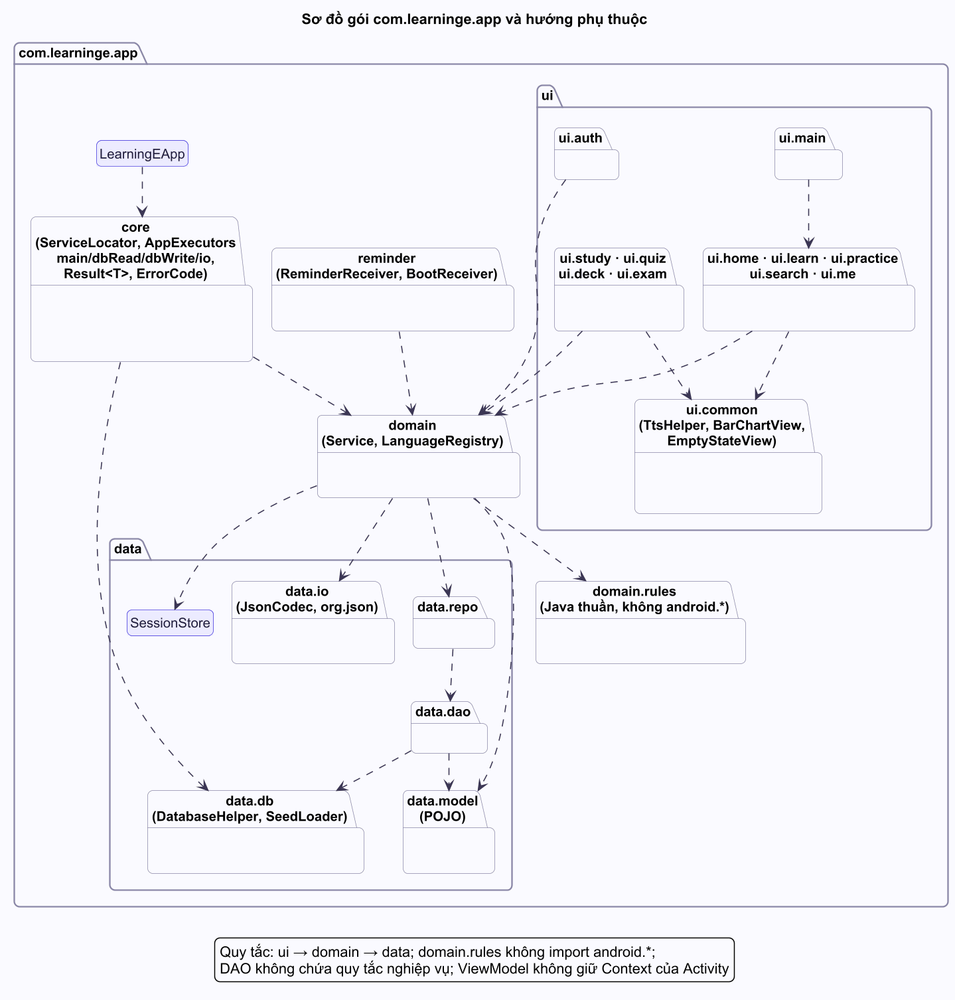
<!-- /diagram -->
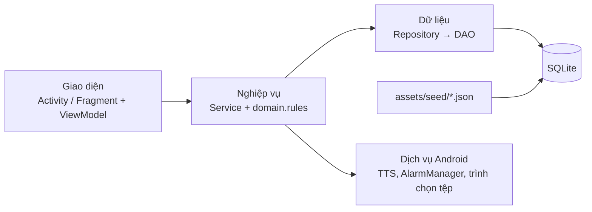
| Gói (`com.learninge.app.`) | Chứa | Quy tắc |
|---|---|---|
| (gốc) | `LearningEApp` | Khởi tạo `core.ServiceLocator` |
| `core` | `ServiceLocator`, `AppExecutors` | Mọi truy vấn CSDL chạy qua `AppExecutors` |
| `ui.<tính năng>` | Fragment, ViewModel, Adapter | Không gọi DAO trực tiếp |
| `domain` | Các Service (xem [API-SPECIFICATION](API-SPECIFICATION.md)) | Gom nhiều DAO trong một giao dịch |
| `domain.rules` | `LeitnerScheduler`, `StreakCalculator`, `QuizGenerator`, `AnswerChecker`, `CsvCodec`, `PasswordHasher`, `TextNormalizer` | Java thuần, không import `android.*`, bắt buộc unit test |
| `data.db`, `data.dao`, `data.repo`, `data.model` | `DatabaseHelper`, `SeedLoader`, DAO, POJO | Chỉ SQL có tham số `?` |
| `reminder` | `ReminderReceiver`, `BootReceiver` | Nhắc học hằng ngày |

## Quy trình làm một task (ví dụ T-032 Flashcard)
1. Nhận task trong [PROJECT-PLAN](../project/PROJECT-PLAN.md) → tạo nhánh `feature/T-032-flashcard` từ `main`.
2. Đọc US-009 trong [PRD](../project/PRD.md) → BR-010..BR-015 trong [Business-Rules](../project/Business-Rules.md) → FN-006, FLOW-004, FLOW-012 trong [Use-Cases](../project/Use-Cases.md).
3. Xem SCR-09/SCR-10 trong [UI-UX-SPECIFICATION](UI-UX-SPECIFICATION.md), mở khung Figma theo `node-id`.
4. Xem bảng `card_progress`, `words` trong [DATABASE-DESIGN](DATABASE-DESIGN.md); hợp đồng `StudyService` trong [API-SPECIFICATION](API-SPECIFICATION.md).
5. Viết code theo tầng: quy tắc + unit test → DAO/Repository → Service → ViewModel → Fragment + layout.
6. Chạy test case TC-009.x trong [TEST-CASES](../quality/TEST-CASES.md); `./gradlew lint testDebugUnitTest assembleDebug`.
7. Mở PR theo [CODING-STANDARDS](CODING-STANDARDS.md): mô tả luồng code bằng lời của mình, ảnh chụp, TC đã chạy, file + hàm minh chứng, dòng [CHANGELOG](../operations/CHANGELOG.md).

## Rubric chấm điểm và minh chứng
| Mục rubric | Điểm | Minh chứng cần có |
|---|---|---|
| Chức năng cơ bản: tạo bộ từ, thêm từ, học/ôn | 10 | `DeckService`, `WordDao`, `FlashcardFragment`, `StudyService` |
| Nâng cao (7 mục) | 20 | `AuthService`; `ImportExportService` + `CsvCodec`; `LeitnerScheduler`; `ProgressService` + `StreakCalculator`; `ReminderService`; bảng `languages` + `LanguageRegistry`; `ExamService` + SCR-30..33 |
| Chất lượng | 10 | Kiến trúc 3 tầng, độ phủ test `domain.rules` ≥ 80%, PBKDF2, không quyền INTERNET |
| Sáng tạo | 5 | TTS, chuỗi ngày, ngữ pháp, dark mode, biểu đồ tự vẽ |
| Thuyết trình, vấn đáp | 50 | Mỗi người giải thích và sửa trực tiếp được code mình làm |

## Kiến trúc
> Thành phần, luồng dữ liệu, triển khai, tích hợp.
> App Android một module, offline, không có server. Mẫu kiến trúc: **MVVM 3 tầng** (giao diện → nghiệp vụ → dữ liệu), quyết định ở DEC-001. Công nghệ: SYSTEM-BLUEPRINT (công nghệ). Lược đồ: DATABASE-DESIGN.

## Sơ đồ tổng quan

<!-- diagram:architecture/arc-components.puml -->
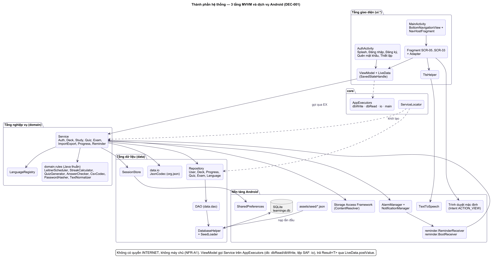
<!-- /diagram -->
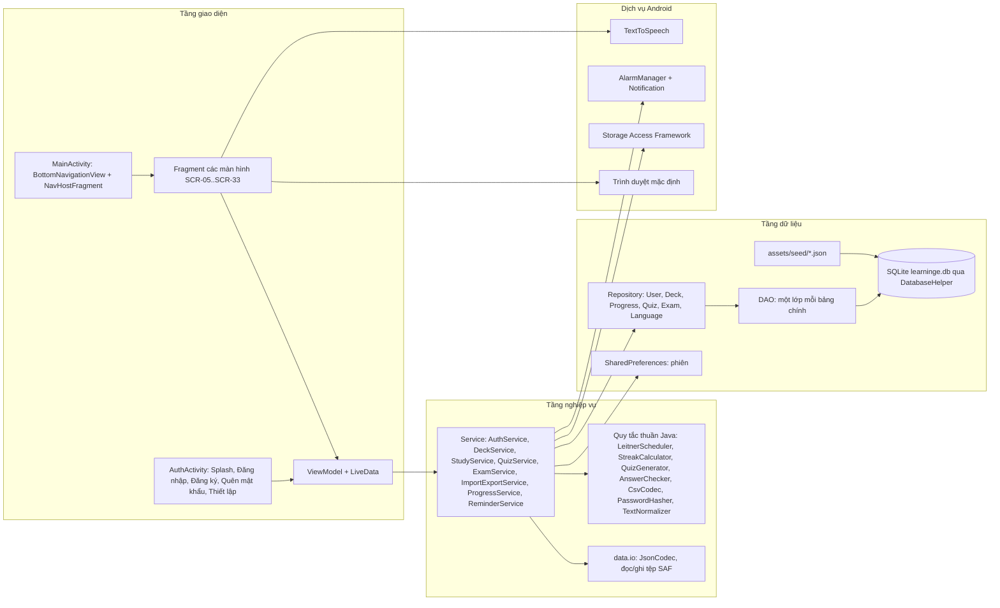

## Thành phần / service & trách nhiệm

<!-- diagram:class/cls-arch-review-feature.puml -->
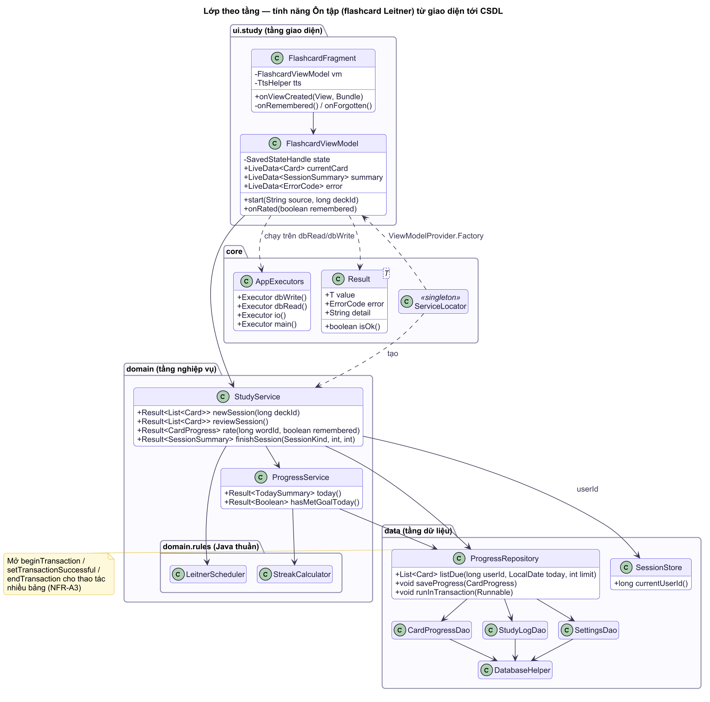
<!-- /diagram -->
Gói gốc `com.learninge.app` (lập trình viên xác nhận ở CODING-STANDARDS).
| Gói / lớp | Trách nhiệm | Phục vụ |
|---|---|---|
| `ui.auth` — `AuthActivity`, `SplashFragment`, `LoginFragment`, `RegisterFragment`, `ForgotPasswordFragment`, `OnboardingFragment` | Luồng chưa đăng nhập; xóa ngăn xếp khi vào app chính | FLOW-001, -002, -013 |
| `ui.main` — `MainActivity` | BottomNavigationView 5 tab, NavHostFragment, ẩn thanh tab ở màn hình con; xin quyền thông báo khi cần | UI-UX-SPECIFICATION (sơ đồ màn hình) |
| `ui.home`, `ui.learn`, `ui.practice`, `ui.search`, `ui.me` | Fragment + ViewModel cho từng màn hình SCR-05..SCR-33; adapter RecyclerView | UI-UX-SPECIFICATION |
| `ui.study` — `FlashcardFragment` | Dùng chung cho học mới / ôn tập / sổ tay (tham số `source`) | FLOW-004 |
| `ui.quiz` — `QuizFragment`, `QuizResultFragment` | Dùng chung cho quiz chủ đề và bài tập ngữ pháp | FLOW-005, -006 |
| `ui.deck` — `MyDecksFragment`, `DeckEditFragment`, `DeckDetailFragment`, `WordEditFragment`, `ImportPreviewFragment` | Bộ của tôi, tạo/sửa bộ, thêm/sửa/xóa từ, import (trình chọn file), export (trình lưu file) | FLOW-014..FLOW-016 |
| `ui.exam` — `ExamHubFragment`, `ExamFragment`, `ExamResultFragment`, `ExamResourcesFragment` | Luyện thi: bộ theo kỳ thi, thi thử có đồng hồ (`CountDownTimer` tính từ `started_at`), kết quả, tài nguyên chính thức | FLOW-017 |
| `ui.common` | `TtsHelper` (vòng đời TextToSpeech theo Fragment), `EmptyStateView`, `BarChartView` (Canvas), tiện ích Snackbar/Dialog | UI-UX-SPECIFICATION (hệ thống thiết kế) |
| `domain.AuthService` | Đăng ký, đăng nhập, khóa tạm (BR-003), đổi/đặt lại mật khẩu (BR-007, BR-008), xóa tài khoản (BR-005), phiên (BR-004) | FN-001..FN-004, FN-017 |
| `domain.StudyService` | Tạo phiên học/ôn (BR-010, BR-013), ghi đánh giá thẻ (BR-011, BR-012), yêu thích, sổ tay | FN-005..FN-007, FN-014 |
| `domain.QuizService` | Sinh câu hỏi (BR-020, BR-024), chấm (BR-022, BR-025), lưu lượt làm + đưa từ sai về hộp 1 (BR-021, BR-023) | FN-008, FN-009, FN-012 |
| `domain.DeckService` | Tạo/đổi tên/xóa bộ (BR-043..BR-046), thêm/sửa/xóa từ (BR-047), "Lưu vào bộ", tạo bộ "Sổ tay của tôi" khi đăng ký | FN-018, FN-021 |
| `domain.ImportExportService` | Đọc/ghi tệp qua `ContentResolver` + URI SAF trên luồng `io`, kiểm tra kích thước, gọi `CsvCodec` (`domain.rules`) / `JsonCodec` (`data.io`), rồi chèn trong 1 giao dịch trên `dbWrite` (BR-048..BR-051) | FN-019, FN-020 |
| `domain.ExamService` | Bắt đầu/tiếp tục lượt thi, lưu từng câu trả lời ngay, tự nộp khi hết giờ, chấm (BR-054), đưa từ sai về hộp 1 (BR-055) | FN-022 |
| `domain.LanguageRegistry` | Đọc bảng `languages` một lần, cung cấp `Locale` TTS, nhãn cách đọc, quy tắc chuẩn hóa cho mọi màn hình (BR-052, BR-053) | FN-021 |
| `domain.ProgressService` | Ghi `study_log` ở cuối phiên (`completeSession`, được `StudyService.finishSession` gọi), cập nhật chuỗi (BR-031, BR-032), số liệu Trang chủ/Tiến độ (BR-033), "đã đạt mục tiêu hôm nay" | FN-010 |
| `domain.ReminderService` + `reminder.ReminderReceiver`, `reminder.BootReceiver` | Đặt/hủy lịch nhắc, quyết định có hiện thông báo không (BR-030) | FN-011, FLOW-007 |
| `domain.rules.*` | Lớp Java thuần, không phụ thuộc Android, nhận "hôm nay" qua tham số `Clock`: `LeitnerScheduler`, `StreakCalculator`, `QuizGenerator` (nhận `Random` có seed), `AnswerChecker`, `PasswordHasher` (PBKDF2, DEC-003), `TextNormalizer` (chuẩn hóa theo ngôn ngữ, bỏ dấu tiếng Việt), `CsvCodec` (RFC 4180, DEC-008) | NFR-M2: unit test ≥ 80% nhánh |
| `data.io.*` | `JsonCodec` (đọc/ghi JSON bộ từ, BR-049) đặt cạnh mã SAF, **không** đặt ở `domain.rules`: `org.json` của Android chỉ là bản stub khi chạy unit test JVM ("Method … not mocked"). `CsvCodec` không dùng `org.json` nên vẫn là Java thuần ở `domain.rules`. Nếu cần unit test `JsonCodec` trên JVM thì thêm `testImplementation` của `org.json:json` vào version catalog (chỉ khi có test cần, chưa thêm) | DEC-002, BR-049 |
| `data.db.DatabaseHelper` | `SQLiteOpenHelper`: `onConfigure` (bật khóa ngoại), `onCreate` (tạo bảng + nạp seed trong giao dịch), `onUpgrade` | FN-015, FLOW-010 |
| `data.db.SeedLoader` | Đọc `assets/seed/*.json` bằng `org.json`, chèn bằng `SQLiteStatement` đã biên dịch | DEC-002 |
| `data.dao.*` | `UserDao`, `SettingsDao`, `LanguageDao`, `DeckDao`, `WordDao`, `CardProgressDao`, `FavoriteDao`, `GrammarDao`, `QuizDao`, `ExamDao`, `StudyLogDao` — chỉ SQL có tham số `?` (NFR-S2); không dùng `INSERT … ON CONFLICT DO UPDATE` | DATABASE-DESIGN |
| `data.repo.*` | Gộp DAO theo nghiệp vụ, mở giao dịch cho thao tác nhiều bảng (NFR-A3) | — |
| `data.SessionStore` | Đọc/ghi `user_id` đang đăng nhập trong SharedPreferences | BR-004 |
| `LearningEApp` + `core.ServiceLocator` | Khởi tạo một lần: DatabaseHelper, Executor, Repository, Service; ViewModel lấy phụ thuộc qua `ViewModelProvider.Factory` | DEC-001 |
| `core.AppExecutors` | `dbWrite` (1 luồng, tuần tự hóa ghi), `dbRead` (pool 2 luồng), `io` (đọc/ghi tệp qua SAF, không chiếm luồng CSDL), `main` (Handler) | NFR-P2 |
| `core.Result<T>`, `core.ErrorCode` | Kết quả trả về của mọi Service; mã lỗi dùng chung (API-SPECIFICATION §1, §2) | NFR-M1 |

Quy tắc phụ thuộc: `ui` → `domain` → `data`; `core` (`Result`, `ErrorCode`, `AppExecutors`, `ServiceLocator`) dùng được ở mọi tầng; `domain.rules` không import `android.*`; DAO không chứa quy tắc nghiệp vụ; ViewModel không giữ tham chiếu `Context` của Activity.

**Ràng buộc do `minSdk 29`:**
- **`java.time`**: `LocalDate`, `Instant`, `Clock` có sẵn từ API 26 nên dùng trực tiếp trên `minSdk 29`, không cần thư viện bổ sung.
- **UPSERT của SQLite**: `INSERT … ON CONFLICT DO UPDATE` cần SQLite 3.24 (Android 11, API 30) mà `minSdk 29` < API 30 nên **không dùng**. Ghi tiến độ thẻ: `UPDATE`, nếu 0 dòng thì `INSERT`, trong cùng giao dịch; `INSERT OR IGNORE` / `INSERT OR REPLACE` được phép.

## Luồng dữ liệu chính (sequence)

<!-- diagram:sequence/seq-review-load-rate.puml -->
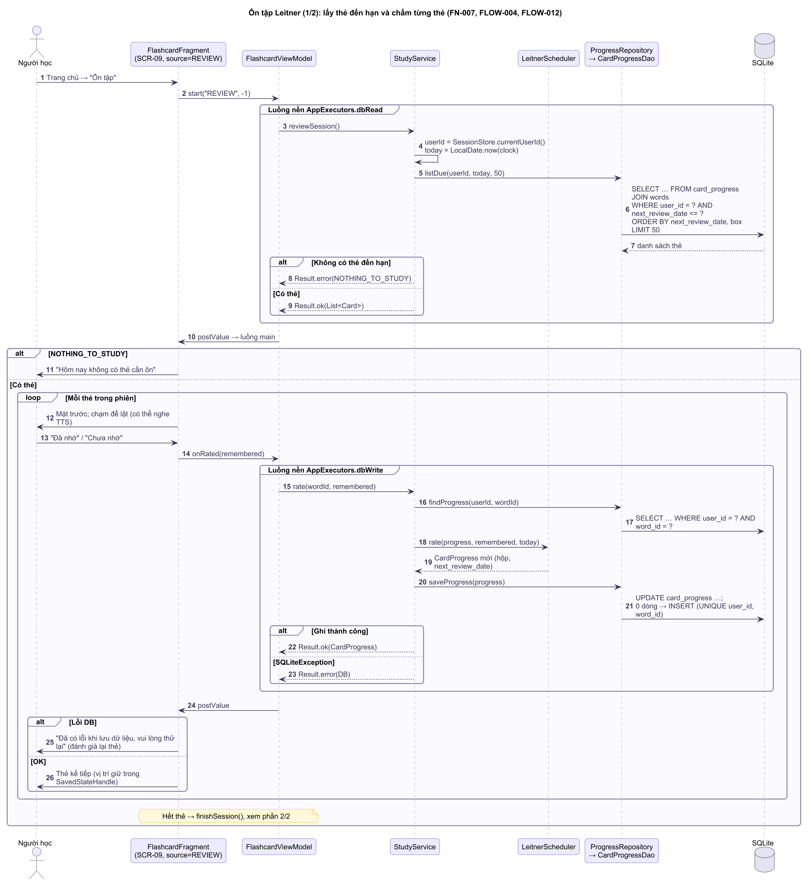
<!-- /diagram -->

<!-- diagram:sequence/seq-review-finish-streak.puml -->
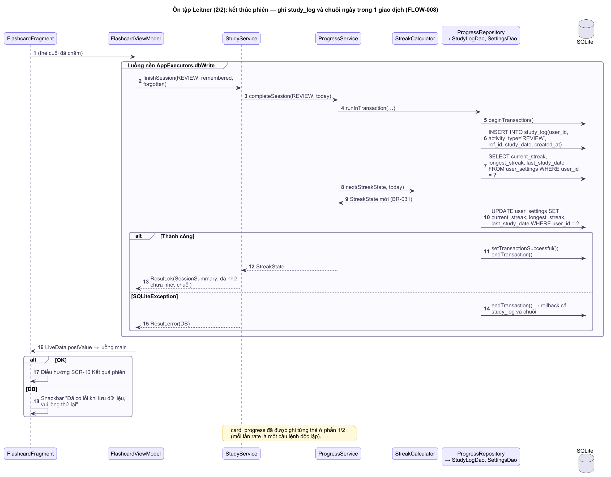
<!-- /diagram -->
Đánh giá một thẻ flashcard — chi tiết ở Use-Cases (luồng) FLOW-012. Hoàn thành phiên học và cập nhật chuỗi ngày:
```mermaid
sequenceDiagram
  actor U as Người học
  participant F as FlashcardFragment
  participant VM as FlashcardViewModel
  participant S as StudyService
  participant PS as ProgressService
  participant R as Repository
  participant DB as SQLite
  U->>F: Đánh giá thẻ cuối cùng
  F->>VM: onRated(remembered)
  VM->>S: rate(wordId, remembered) trên dbWrite
  S->>R: ghi tiến độ (LeitnerScheduler)
  R->>DB: UPDATE card_progress; 0 dòng thì INSERT
  VM->>S: finishSession(LEARN, remembered, forgotten)
  S->>PS: completeSession(LEARN, today)
  PS->>R: beginTransaction
  R->>DB: INSERT study_log
  PS->>PS: StreakCalculator.next(last_study_date, today)
  R->>DB: UPDATE user_settings (chuỗi)
  R->>DB: setTransactionSuccessful, endTransaction
  alt Thành công
    PS-->>VM: SessionResult (đã nhớ, chưa nhớ, chuỗi)
    VM-->>F: LiveData.postValue → SCR-10
  else SQLiteException
    R->>DB: endTransaction (rollback)
    VM-->>F: Lỗi → Snackbar "Đã có lỗi khi lưu dữ liệu, vui lòng thử lại"
  end
```

Nhắc học hằng ngày (FLOW-007):
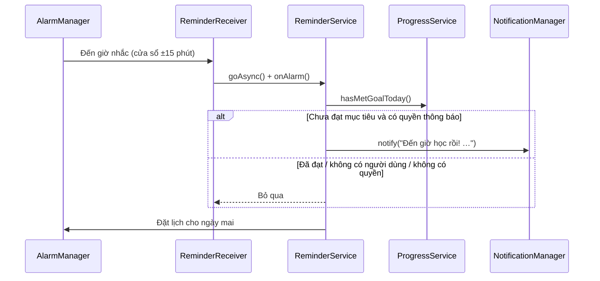

## Lược đồ lớp

<!-- diagram:class/cls-model-account-vocabulary.puml -->
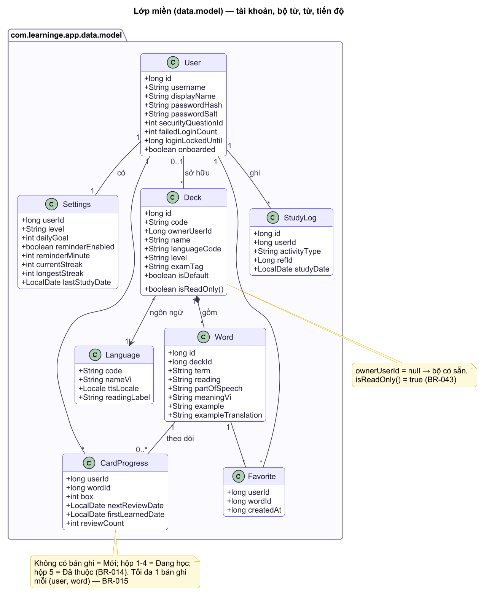
<!-- /diagram -->

<!-- diagram:class/cls-model-assessment.puml -->
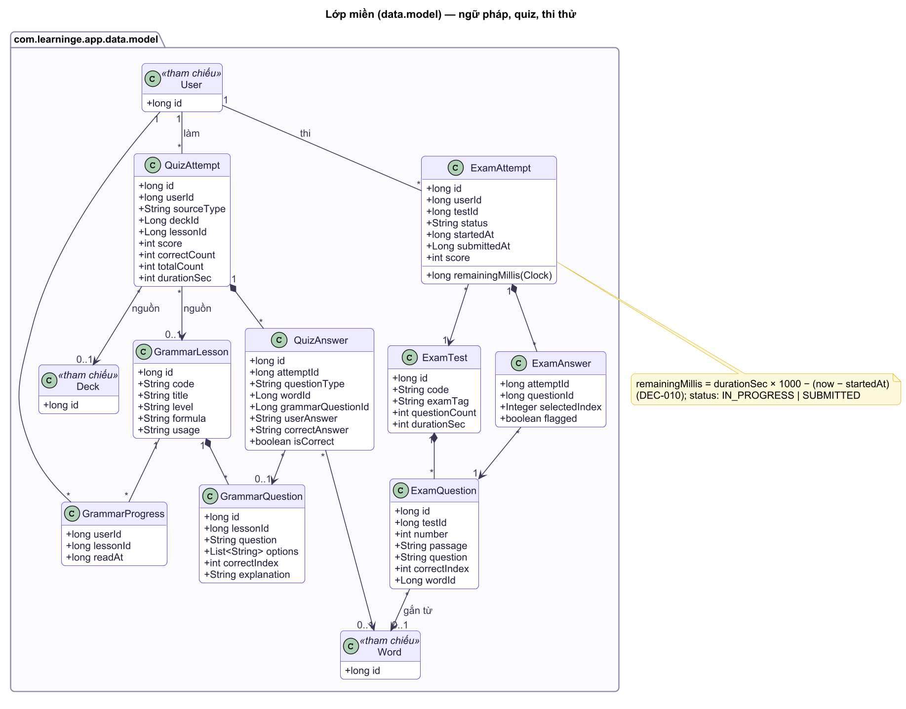
<!-- /diagram -->

<!-- diagram:class/cls-rules-learning.puml -->
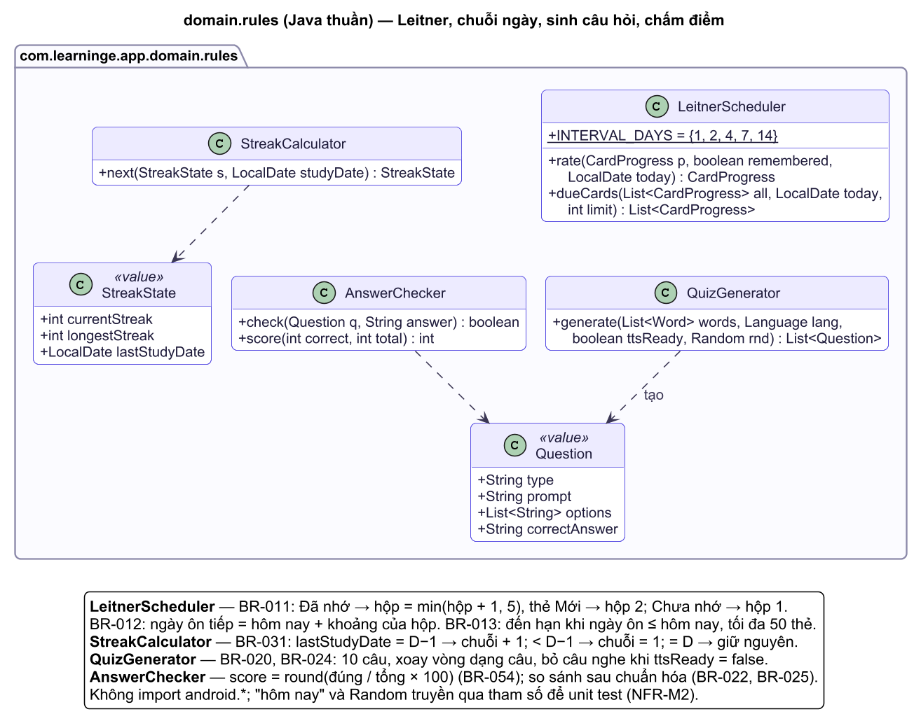
<!-- /diagram -->
Lược đồ lớp rút gọn cho tầng nghiệp vụ và dữ liệu (bản đầy đủ: `docs/diagrams/class/`, cập nhật sau mốc M1 theo code thật). Service lấy `userId` từ `SessionStore`, giao diện không truyền `userId` (NFR-S5), nên chữ ký phương thức không có tham số `userId`.
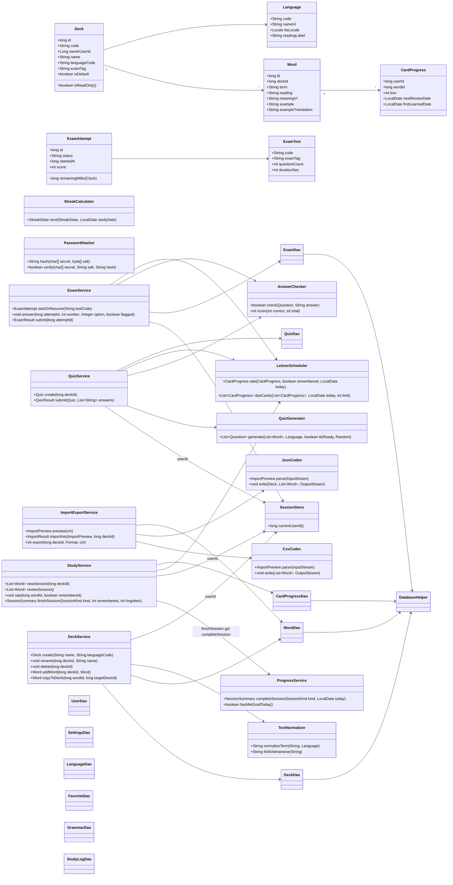
Các lớp quy tắc (`LeitnerScheduler`, `StreakCalculator`, `QuizGenerator`, `AnswerChecker`, `CsvCodec`, `PasswordHasher`, `TextNormalizer`) là Java thuần, không phụ thuộc Android, nhận "hôm nay" qua `Clock`/`LocalDate` và `Random` có seed để unit test được.

## Xác thực & phân quyền

<!-- diagram:class/cls-rules-security-io.puml -->
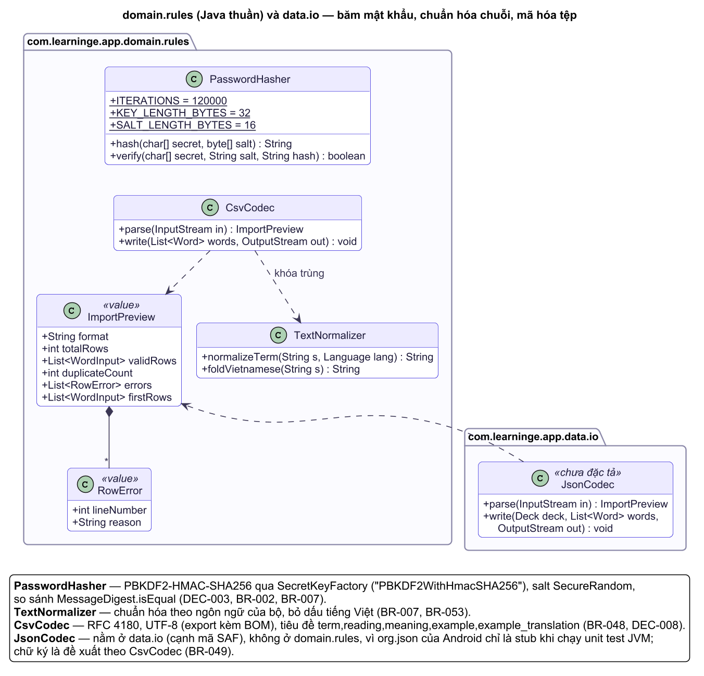
<!-- /diagram -->
- **Đăng ký / đăng nhập cục bộ**: `PasswordHasher` sinh salt 16 byte bằng `SecureRandom`, băm PBKDF2-HMAC-SHA256 120.000 vòng, độ dài khóa 32 byte, lưu hex (BR-002, DEC-003). So sánh bằng `MessageDigest.isEqual` (thời gian hằng). Câu trả lời bảo mật qua `TextNormalizer` rồi băm như mật khẩu (BR-007).
- **Khóa tạm**: `failed_login_count`, `login_locked_until` (BR-003); `failed_reset_count`, `reset_locked_until` (BR-008). Băm chạy trên luồng nền (≈ 0,3–1 giây trên máy yếu) — nút hiển thị trạng thái đang xử lý.
- **Phiên**: chỉ `user_id` trong SharedPreferences (BR-004); mọi DAO dữ liệu người dùng nhận `userId` từ `SessionStore`, không từ tham số giao diện (NFR-S5). Một vai trò, không có phân quyền theo vai trò (SRS §Ma trận phân quyền).
- **Manifest**: không có quyền `INTERNET`; `allowBackup=false`; chỉ `AuthActivity` (launcher) và `BootReceiver` `exported=true`; `ReminderReceiver` `exported=false`; `PendingIntent` dùng `FLAG_IMMUTABLE` (NFR-S3, NFR-S4).

## Tích hợp ngoài
Không có tích hợp mạng. Chỉ dùng dịch vụ hệ thống Android:
| Dịch vụ | Cách dùng | Khi lỗi |
|---|---|---|
| TextToSpeech | `TtsHelper` khởi tạo khi Fragment hiển thị, `setLanguage(language.ttsLocale)` (locale lấy từ bảng `languages`, không cố định `Locale.US`), giải phóng ở `onDestroyView`; câu "nghe chọn từ" chỉ sinh khi TTS sẵn sàng | AC-010.2, AC-013.3 |
| Storage Access Framework | `ACTION_OPEN_DOCUMENT` (import) và `ACTION_CREATE_DOCUMENT` (export) qua `ActivityResultContracts`; đọc/ghi bằng `ContentResolver.openInputStream/openOutputStream`; không cần quyền bộ nhớ | AC-032.3, AC-033.2 |
| Trình duyệt | `Intent.ACTION_VIEW` với URL cố định trong `strings.xml` (trang chính thức TOEIC/ETS, IELTS, British Council Aptis); kiểm tra `resolveActivity` trước khi mở; app vẫn không khai báo quyền INTERNET | AC-037.2 |
| AlarmManager + NotificationManager | Kênh thông báo "Nhắc học" (mức mặc định); quyền `POST_NOTIFICATIONS` (Android 13+), `RECEIVE_BOOT_COMPLETED` | AC-019.4 |

## Triển khai (môi trường, hạ tầng)

<!-- diagram:architecture/arc-deployment.puml -->

<!-- /diagram -->
- Không có hạ tầng server. Hai biến thể build: `debug` (StrictMode, log DEBUG) và `release` (R8 rút gọn mã, ký bằng keystore riêng của nhóm, không đưa keystore lên GitHub).
- Sản phẩm bàn giao: file APK release + mã nguồn trên GitHub `at1308033-sketch/LearningE_app` (RELEASE-CHECKLIST phase 7). Không phát hành Google Play (Non-goal).
- Môi trường kiểm thử: emulator API 29, API 33, API 37, ít nhất 1 máy thật (NFR-D3).

## Đáp ứng SRS (phi chức năng) thế nào
| SRS (phi chức năng) | Cách đáp ứng trong kiến trúc |
|---|---|
| NFR-P1 khởi động ≤ 2 s; seed ≤ 5 s | Seed chèn trong một giao dịch bằng `SQLiteStatement` đã biên dịch; lần sau chỉ mở CSDL; Trang chủ đọc chuỗi từ `user_settings`, không quét `study_log` |
| NFR-P2 không truy vấn trên luồng giao diện | Mọi DAO gọi qua `AppExecutors`; StrictMode bật ở debug |
| NFR-P3 tra từ ≤ 300 ms | Debounce 250 ms trong ViewModel; cột `search_term`, `search_reading`, `search_meaning` chuẩn hóa sẵn + index tiền tố trên `search_term`; giới hạn 50 kết quả |
| NFR-A1 offline | Không có quyền INTERNET, không thư viện mạng |
| NFR-A3 toàn vẹn | Repository bọc thao tác nhiều bảng trong `beginTransaction/endTransaction`; khóa ngoại CASCADE |
| NFR-A4 vòng đời | Trạng thái phiên học/quiz nằm trong ViewModel + `SavedStateHandle` (vị trí thẻ, câu hiện tại, câu trả lời đã chọn) |
| NFR-A5 nhắc học | AlarmManager inexact + đặt lại sau khởi động máy (DEC-004) |
| NFR-S1..S5 | `PasswordHasher`, SQL tham số, manifest tối thiểu, `userId` lấy từ `SessionStore` trong Service |
| NFR-D1 Android 10 (API 29) trở lên | `minSdk 29`: `java.time` và `PBKDF2WithHmacSHA256` có sẵn (DEC-003); không dùng UPSERT vì cần API 30 |
| NFR-X1 accessibility | Component Material có sẵn hỗ trợ TalkBack; `contentDescription` trong `strings.xml`; cỡ chữ `sp` |
| NFR-E1..E3 mở rộng | Seed tách khỏi code (JSON); `seed_version` + `onUpgrade`; ngôn ngữ mới = 1 dòng `languages` + file seed, không sửa code (DEC-009, AC-034.3) |
| NFR-M1, M2 bảo trì | 3 tầng, quy tắc trong `domain.rules` Java thuần có unit test |

## Công nghệ sử dụng
> Công nghệ, phiên bản, lý do chọn.

| Lớp | Công nghệ | Phiên bản | Lý do | STACKS guide |
|---|---|---|---|---|
| Ngôn ngữ | Java | Mã nguồn/đích Java 17 (`compileOptions`) | Bắt buộc theo đề (PRD §5) | developer.android.com/build/jdks |
| IDE / build | Android Studio 2026.2.x (AGP đi kèm 9.5.0, cùng dòng 9.5 với AGP 9.5.1 của dự án) + Android Gradle Plugin + Gradle wrapper; Gradle JDK = JBR đi kèm Android Studio (Java 25 chạy Gradle, mã nguồn Java 17); dòng lệnh đặt `JAVA_HOME` về `<Android Studio>\jbr` | Theo `gradle/libs.versions.toml` và `gradle/wrapper`, cùng một bản cho cả 4 thành viên | Version catalog để cả nhóm build giống nhau; `local.properties` (sdk.dir) mỗi máy tự sinh khi mở project | developer.android.com/build |
| SDK | `minSdk 29` (Android 10); `compileSdk`/`targetSdk` theo `app/build.gradle.kts` (37) | — | NFR-D1; `java.time` và PBKDF2 có sẵn, không cần thư viện hỗ trợ thêm; nhóm đều dùng Android 10+ | developer.android.com/guide/topics/manifest/uses-sdk-element |
| Giao diện | Android View + XML layout, **Material Components for Android** (Material 3, `Theme.Material3.DayNight.NoActionBar`) | `com.google.android.material:material`, version `material` trong catalog | Đủ component theo UI-UX-SPECIFICATION (hệ thống thiết kế) (Button, TextInputLayout, Chip, Card, BottomNavigationView, MaterialSwitch, Snackbar, Dialog); DayNight cho dark mode (REQ-013) | m3.material.io/develop/android/mdc-android |
| AndroidX cơ bản | AppCompat, ConstraintLayout, RecyclerView, CardView (qua Material), Core (`WindowCompat`, `NotificationCompat`) | `appcompat`, `constraintlayout` trong catalog; RecyclerView, Core thêm vào catalog khi dùng | Thư viện chuẩn của Android | developer.android.com/jetpack/androidx/versions |
| Kiến trúc trình bày | AndroidX Lifecycle: `ViewModel` + `LiveData` | Thêm vào catalog khi dựng ViewModel (T-005) | Giữ trạng thái khi xoay màn hình (NFR-A4); dùng được bằng Java | developer.android.com/topic/libraries/architecture/viewmodel |
| Điều hướng | AndroidX Navigation (Fragment) + Safe Args (Java) | Thêm vào catalog khi dựng nav graph (T-005) | Một nav graph cho tab và màn hình con; ngăn xếp riêng từng tab của BottomNavigationView (UI-UX-SPECIFICATION (sơ đồ màn hình)) | developer.android.com/guide/navigation |
| CSDL | SQLite qua `android.database.sqlite.SQLiteOpenHelper` (có sẵn trong Android SDK) | SQLite của hệ điều hành | Bắt buộc theo D2; dễ đưa SQL vào báo cáo | developer.android.com/training/data-storage/sqlite |
| Luồng nền | `java.util.concurrent.ExecutorService` trong `core.AppExecutors`: `dbWrite` (1 luồng), `dbRead` (pool 2 luồng), `io` (đọc/ghi tệp SAF), `main` (Handler); `LiveData.postValue` | JDK | Không truy vấn trên luồng giao diện (NFR-P2), không thêm thư viện | developer.android.com/guide/background/threading |
| Lưu phiên | `SharedPreferences` (chỉ lưu `user_id` đang đăng nhập) | Android SDK | BR-004; không lưu mật khẩu | developer.android.com/training/data-storage/shared-preferences |
| Băm mật khẩu | PBKDF2-HMAC-SHA256 qua `SecretKeyFactory.getInstance("PBKDF2WithHmacSHA256")` + `SecureRandom` | JDK / Android (API 26+) | BR-002, BR-007; xem DEC-003 | RFC 8018 §5.2; vector kiểm thử RFC 7914 §11 |
| Phát âm | `android.speech.tts.TextToSpeech` | Android SDK | A4; offline nếu máy có gói giọng | developer.android.com/reference/android/speech/tts/TextToSpeech |
| Nhắc học | `AlarmManager` (báo thức không chính xác) + `BroadcastReceiver` + `NotificationCompat`; receiver `BOOT_COMPLETED` | Android SDK + androidx.core | DEC-004; không cần quyền báo thức chính xác | developer.android.com/develop/background-work/services/alarms/schedule |
| Dữ liệu seed, import/export JSON | File JSON trong `app/src/main/assets/seed/` đọc bằng `org.json` (có sẵn trong Android); `JsonCodec` ở `data.io` | — | DEC-002, DEC-008; không thêm thư viện JSON. `org.json` chỉ là stub khi chạy unit test JVM: chỉ khi cần test `JsonCodec` mới thêm `testImplementation` `org.json:json` vào catalog | developer.android.com/reference/org/json/JSONObject |
| Biểu đồ | View tự vẽ bằng `Canvas` | — | DEC-005; biểu đồ cột 7 ngày đơn giản, tránh phụ thuộc thư viện ngoài | developer.android.com/develop/ui/views/layout/custom-views/custom-drawing |
| Font | Baloo 2, Lexend, Noto Sans (file `.ttf` trong `res/font/`) | SIL OFL 1.1 | UI-UX-SPECIFICATION (hệ thống thiết kế) §Typography; offline | fonts.google.com |
| Unit test | JUnit 4 + JaCoCo (báo cáo độ phủ) | `junit` trong catalog | NFR-M2: kiểm thử Leitner, chuỗi ngày, chấm điểm, PBKDF2 | developer.android.com/training/testing/local-tests |
| Instrumented test | AndroidX Test (runner, ext-junit) + Espresso | `androidx-junit`, `espresso` trong catalog | Kiểm thử DAO trên SQLite thật và luồng màn hình chính | developer.android.com/training/testing/instrumented-tests |
| Kiểm tra chất lượng | Android Lint, StrictMode (bản debug), Accessibility Scanner | Đi kèm Android Studio | NFR-Q1, NFR-P2, NFR-X1 | developer.android.com/studio/write/lint |
| Quản lý mã nguồn | Git + GitHub (`at1308033-sketch/LearningE_app`) | — | PRD; quy ước nhánh ở CODING-STANDARDS | — |
| Thiết kế | Figma (Learning-English-Mobile-App) | Gói Starter | UI-UX-SPECIFICATION | — |

**Không dùng (có chủ ý):** Room (D2), Kotlin/Compose (ràng buộc Java + XML), Firebase/Retrofit/OkHttp (offline, không có server — NFR-A1), thư viện biểu đồ (DEC-005), thư viện DI như Hilt/Dagger (dự án nhỏ, dùng một lớp `ServiceLocator` đơn giản — SYSTEM-BLUEPRINT §Thành phần).
