# System Blueprint — bản thiết kế tổng thể hệ thống

> **TỰ SINH** từ bộ phân tích thiết kế đã duyệt của nhóm — không sửa trực tiếp tệp này; đề xuất thay đổi qua Issue/PR để nhóm trưởng cập nhật nguồn và sinh lại. Danh mục tài liệu: [docs/README.md](../README.md).

**Mục đích:** bức tranh toàn hệ thống: tính năng, kiến trúc client–server (ứng dụng Android 3 tầng offline-first + 6 microservice Rust gRPC), gói mã nguồn, luồng dữ liệu, lược đồ lớp, công nghệ và lý do chọn.

## Đọc trước khi nhận task
Trang này là **điểm bắt đầu** cho mọi thành viên. Danh mục đầy đủ: [docs/README.md](../README.md) · Figma: [Learning-English-Mobile-App](https://www.figma.com/design/wOdb07dQkcBh18PKijh8Jx/Learning-English-Mobile-App) · Quy chuẩn code: [CODING-STANDARDS](CODING-STANDARDS.md).

## Sản phẩm trong một trang
**LearningE** là ứng dụng Android (Java, giao diện XML Material 3, CSDL SQLite) giúp người mới học tiếng Anh (A1–B1) học đều mỗi ngày, **chạy hoàn toàn ngoại tuyến**, không quảng cáo.

| Nhóm | Tính năng | User story | Màn hình | Bảng dữ liệu chính |
|---|---|---|---|---|
| F1 Tài khoản | Đăng ký (có câu hỏi bảo mật), đăng nhập, khóa tạm khi sai 5 lần, quên mật khẩu, thiết lập lần đầu, hồ sơ, đổi mật khẩu, xóa tài khoản | US-001..006, US-027 | SCR-01..04, 22, 23, 25 | `users`, `user_settings` |
| F2 Từ vựng | 15 chủ đề có sẵn, danh sách từ, chi tiết từ, phát âm (TTS), yêu thích, flashcard học từ mới, ôn tập Leitner | US-007..012 | SCR-05..10 | `decks`, `words`, `card_progress`, `favorites` |
| F3 Quiz | 5 dạng câu (2 trắc nghiệm, nghe chọn, điền từ, sắp xếp câu), kết quả, lịch sử | US-013..015 | SCR-12..15 | `quiz_attempts`, `quiz_answers` |
| F4 Tiến độ & nhắc học | Trang chủ hôm nay, thống kê, chuỗi ngày học, nhắc học hằng ngày | US-016..019 | SCR-05, 21, 22 | `study_log`, `user_settings` |
| F5 Ngữ pháp & tra từ | 10 bài ngữ pháp + bài tập, tra từ, sổ tay | US-020..024 | SCR-16..20 | `grammar_*`, `words` |
| F6 Bộ từ & import/export | Tạo/sửa/xóa bộ, thêm/sửa/xóa từ, học/quiz trên bộ, import/export CSV & JSON | US-028..033 | SCR-19, 20, 26..29 | `decks`, `words` |
| F7 Đa ngôn ngữ & luyện thi | Ngôn ngữ nội dung cấu hình được (có bộ tiếng Nhật mẫu), bộ từ TOEIC/IELTS/Aptis, thi thử có giờ, tài nguyên chính thức | US-034..037 | SCR-30..33 | `languages`, `exam_*` |

Ngoài phạm vi: máy chủ/API, đồng bộ đám mây, đăng nhập mạng xã hội, admin, giao diện đa ngôn ngữ, chấm phát âm, quảng cáo, phát hành Google Play.

**Một mã ID xuyên suốt:** `REQ` (yêu cầu) → `US` (user story) → `AC` (tiêu chí) → `BR` (quy tắc) → `FLOW` (luồng) → `SCR` (màn hình) → `TC` (test case) → `T` (task). Tìm một mã bằng tìm kiếm toàn thư mục `docs/`.

## Bản đồ gói mã nguồn

<!-- diagram:architecture/arc-packages.puml -->

<!-- /diagram -->
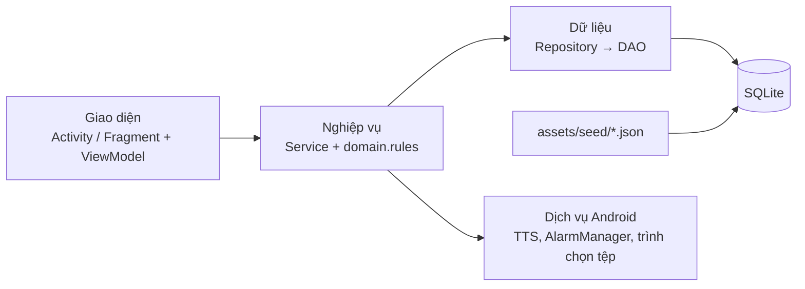
| Gói (`com.learninge.app.`) | Chứa | Quy tắc |
|---|---|---|
| (gốc) | `LearningEApp` | Khởi tạo `core.ServiceLocator` |
| `core` | `ServiceLocator`, `AppExecutors` | Mọi truy vấn CSDL chạy qua `AppExecutors` |
| `ui.<tính năng>` | Fragment, ViewModel, Adapter | Không gọi DAO trực tiếp |
| `domain` | Các Service (xem [API-SPECIFICATION](API-SPECIFICATION.md)) | Gom nhiều DAO trong một giao dịch |
| `domain.rules` | `LeitnerScheduler`, `StreakCalculator`, `QuizGenerator`, `AnswerChecker`, `CsvCodec`, `PasswordHasher`, `TextNormalizer` | Java thuần, không import `android.*`, bắt buộc unit test |
| `data.db`, `data.dao`, `data.repo`, `data.model` | `DatabaseHelper`, `SeedLoader`, DAO, POJO | Chỉ SQL có tham số `?` |
| `reminder` | `ReminderReceiver`, `BootReceiver` | Nhắc học hằng ngày |

## Quy trình làm một task (ví dụ T-032 Flashcard)
1. Nhận task trong [PROJECT-PLAN](../project/PROJECT-PLAN.md) → tạo nhánh `feature/T-032-flashcard` từ `main`.
2. Đọc US-009 trong [PRD](../project/PRD.md) → BR-010..BR-015 trong [Business-Rules](../project/Business-Rules.md) → FN-006, FLOW-004, FLOW-012 trong [Use-Cases](../project/Use-Cases.md).
3. Xem SCR-09/SCR-10 trong [UI-UX-SPECIFICATION](UI-UX-SPECIFICATION.md), mở khung Figma theo `node-id`.
4. Xem bảng `card_progress`, `words` trong [DATABASE-DESIGN](DATABASE-DESIGN.md); hợp đồng `StudyService` trong [API-SPECIFICATION](API-SPECIFICATION.md).
5. Viết code theo tầng: quy tắc + unit test → DAO/Repository → Service → ViewModel → Fragment + layout.
6. Chạy test case TC-009.x trong [TEST-CASES](../quality/TEST-CASES.md); `./gradlew lint testDebugUnitTest assembleDebug`.
7. Mở PR theo [CODING-STANDARDS](CODING-STANDARDS.md): mô tả luồng code bằng lời của mình, ảnh chụp, TC đã chạy, file + hàm minh chứng, dòng [CHANGELOG](../operations/CHANGELOG.md).

## Rubric chấm điểm và minh chứng
| Mục rubric | Điểm | Minh chứng cần có |
|---|---|---|
| Chức năng cơ bản: tạo bộ từ, thêm từ, học/ôn | 10 | `DeckService`, `WordDao`, `FlashcardFragment`, `StudyService` |
| Nâng cao (7 mục) | 20 | `AuthService`; `ImportExportService` + `CsvCodec`; `LeitnerScheduler`; `ProgressService` + `StreakCalculator`; `ReminderService`; bảng `languages` + `LanguageRegistry`; `ExamService` + SCR-30..33 |
| Chất lượng | 10 | Kiến trúc 3 tầng, độ phủ test `domain.rules` ≥ 80%, PBKDF2, không quyền INTERNET |
| Sáng tạo | 5 | TTS, chuỗi ngày, ngữ pháp, dark mode, biểu đồ tự vẽ |
| Thuyết trình, vấn đáp | 50 | Mỗi người giải thích và sửa trực tiếp được code mình làm |

## Kiến trúc
> Thành phần, luồng dữ liệu, triển khai, tích hợp.
> **thay đổi phạm vi:** LearningE gồm **app Android** (Java 17, MVVM 3 tầng — DEC-001, offline-first — DEC-014, gọi **gRPC** qua `grpc-okhttp` + protobuf-lite — DEC-020) và **backend 6 dịch vụ Rust** (`edge`, `auth`, `sync`, `content`, `gamification`, `insight` — DEC-018, DEC-019) ở repo riêng `LearningE_Server` (DEC-022). Mỗi dịch vụ sở hữu kho dữ liệu riêng: **SQLite là nguồn sự thật** (`auth.db`, `sync.db`), **MongoDB là kho phụ** (`learninge_content`, `learninge_game`, `learninge_insight`) chỉ được nạp qua **outbox** (DEC-021). Nghiệp vụ (BR-001..BR-077, US-001..US-047), pixel layer, cắt C1–C8 **không đổi** so với thay đổi phạm vi. Nơi triển khai **chưa chốt** (Q3, DEC-023): tài liệu này trung lập — mọi dịch vụ đóng gói thành image Docker, phát triển bằng `docker compose`. Công nghệ/phiên bản: SYSTEM-BLUEPRINT (công nghệ). Lược đồ: DATABASE-DESIGN. Hợp đồng proto: API_CONTRACT.

## Bối cảnh và phạm vi
- Phạm vi: app Android (minSdk 29) + backend gRPC 6 dịch vụ; không trang quản trị web, không realtime/streaming, không đăng nhập mạng xã hội (Non-goal thay đổi phạm vi giữ). Nhắc học vẫn cục bộ bằng `AlarmManager` (DEC-004) → không có dịch vụ notification.
- Người dùng: người học (một vai trò). Người vận hành: thành viên nhóm (chạy compose, `content-import`, `gamification rebuild`, `grpcurl` lấy số liệu insight).
- Hệ thống ngoài: lớp lộ ra Internet (đường hầm HTTP/2, nền tảng PaaS hoặc reverse proxy trên VPS — tùy DEC-023), MongoDB (container trong compose hoặc dịch vụ managed — tùy DEC-023), dịch vụ Android (TTS, AlarmManager, SAF, trình duyệt).
- SRS (phi chức năng) chi phối kiến trúc: offline-first NFR-N1, timeout/thử lại NFR-N2, 500 bản ghi ≤ 5 s NFR-N3, p95 ≤ 300 ms đo tại edge NFR-N4, **Mongo/dịch vụ phụ ngừng thì đăng nhập + đồng bộ vẫn chạy NFR-N5**, outbox đuổi kịp ≤ 60 s NFR-N6, chỉ edge lộ cổng NFR-S9, `cargo audit` 0 lỗi mức cao NFR-S10, bảo mật NFR-S1..S8, khởi chạy 1 lệnh NFR-E4 (`docker compose up`), không mạng/CSDL trên luồng UI NFR-P2.

**C4 mức 1 — Ngữ cảnh hệ thống**
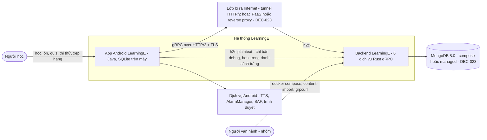

**C4 mức 2 — Container**
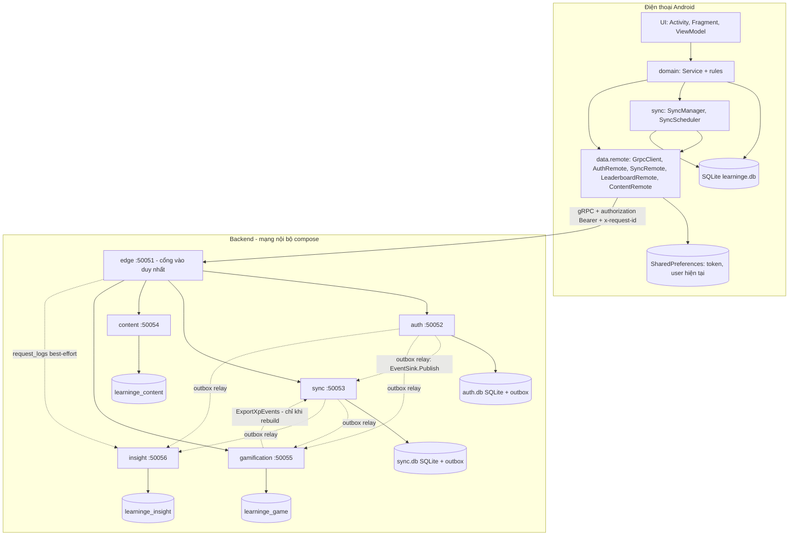
Nét liền = gọi đồng bộ trong yêu cầu của người dùng; nét đứt = bất đồng bộ (relay outbox, log) hoặc tác vụ vận hành. Không dịch vụ nào đọc thẳng kho dữ liệu của dịch vụ khác (database-per-service, DEC-019).

## Sơ đồ tổng quan

<!-- diagram:architecture/arc-components.puml -->

<!-- /diagram -->
Sơ đồ thành phần app (C4 mức 3 rút gọn); backend xem §Backend.
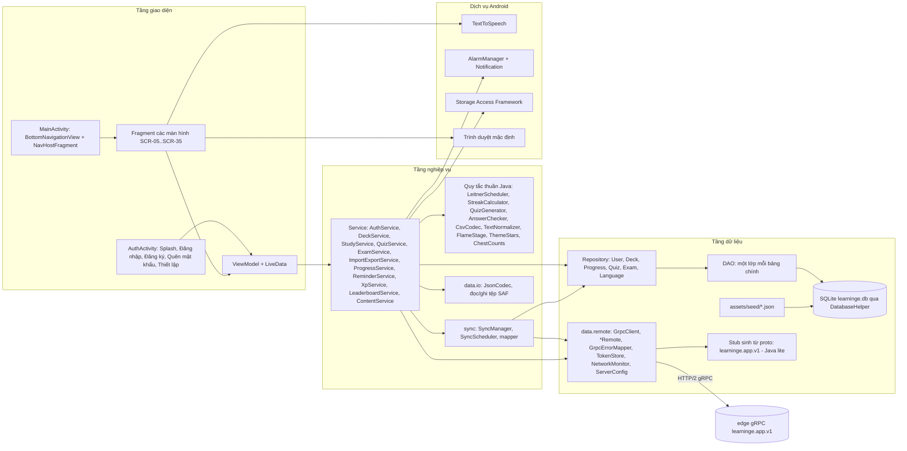

## Thành phần / service & trách nhiệm

<!-- diagram:class/cls-arch-review-feature.puml -->

<!-- /diagram -->
### App Android
Gói gốc `com.learninge.app` (CODING-STANDARDS). Tầng UI, nghiệp vụ, CSDL cục bộ **giữ nguyên thay đổi phạm vi**; chỉ `data.remote` đổi từ REST sang gRPC.
| Gói / lớp | Trách nhiệm | Phục vụ |
|---|---|---|
| `ui.auth` — `AuthActivity`, `SplashFragment`, `LoginFragment`, `RegisterFragment`, `ForgotPasswordFragment`, `OnboardingFragment` | Luồng chưa đăng nhập; xóa ngăn xếp khi vào app chính | FLOW-001, -002, -013 |
| `ui.main` — `MainActivity` | BottomNavigationView 5 tab, NavHostFragment, ẩn thanh tab ở màn hình con; xin quyền thông báo khi cần | UI-UX-SPECIFICATION (sơ đồ màn hình) |
| `ui.home`, `ui.learn`, `ui.practice`, `ui.search`, `ui.me` | Fragment + ViewModel cho từng màn hình SCR-05..SCR-35; adapter RecyclerView | UI-UX-SPECIFICATION |
| `ui.study` — `FlashcardFragment` | Dùng chung cho học mới / ôn tập / sổ tay (tham số `source`) | FLOW-004 |
| `ui.quiz` — `QuizFragment`, `QuizResultFragment` | Dùng chung cho quiz chủ đề và bài tập ngữ pháp | FLOW-005, -006 |
| `ui.deck` — `MyDecksFragment`, `DeckEditFragment`, `DeckDetailFragment`, `WordEditFragment`, `ImportPreviewFragment` | Bộ của tôi, tạo/sửa bộ, thêm/sửa/xóa từ, import/export | FLOW-014..FLOW-016 |
| `ui.exam` — `ExamHubFragment`, `ExamFragment`, `ExamResultFragment`, `ExamResourcesFragment` | Luyện thi, thi thử có đồng hồ tính từ `started_at`, tài nguyên chính thức | FLOW-017 |
| `ui.common` | `TtsHelper`, `EmptyStateView`, `BarChartView` (Canvas), tiện ích Snackbar/Dialog | UI-UX-SPECIFICATION (hệ thống thiết kế) |
| `domain.AuthService` | Đăng ký, đăng nhập, đổi/đặt lại mật khẩu, xóa tài khoản **qua `AuthRemote`** (cần mạng); kiểm định dạng ở app trước khi gửi; tạo `users` + `sync_state` cục bộ, lưu token; đăng xuất: đẩy trước, hỏi nếu còn `dirty` | FN-001..FN-004, FN-017; BR-057..BR-061 |
| `domain.StudyService`, `QuizService`, `DeckService`, `ImportExportService`, `ExamService`, `LanguageRegistry`, `ProgressService`, `ReminderService` | Như thay đổi phạm vi (BR-010..BR-055); không gọi mạng | FN-005..FN-022 |
| `domain.XpService` | Sau phiên học/quiz/thi ghi `xp_events` (`xp_local` theo BR-065..BR-067); hiển thị `xp_awarded` khi server trả về | REQ-021, US-043 |
| `domain.LeaderboardService` | Gọi EP-13 (`LeaderboardService.GetWeekly`) khi mở SCR-34; lỗi mạng hoặc `UNAVAILABLE` → `leaderboard_cache` kèm thời điểm | US-042 |
| `domain.ContentService` (Should — thay đổi phạm vi) | Gọi EP-14 `GetManifest`, so `content_version`, tải bộ/đề (EP-15/16), ghi 1 giao dịch; `UNAVAILABLE` → seed trong APK + bản đã tải | REQ-022, US-044 |
| `domain.rules.*` | Java thuần, không `android.*`, nhận `Clock`/`Random`: `LeitnerScheduler`, `StreakCalculator`, `QuizGenerator`, `AnswerChecker`, `TextNormalizer`, `CsvCodec`, `FlameStage`, `ThemeStars`, `ChestCounts` | NFR-M2 |
| `data.io.*` | `JsonCodec` cạnh mã SAF (không ở `domain.rules` vì `org.json` là stub khi unit test JVM) | DEC-002, DEC-008 |
| `data.db.DatabaseHelper`, `data.db.SeedLoader`, `data.dao.*`, `data.repo.*` | Như thay đổi phạm vi: `SQLiteOpenHelper`, seed JSON, DAO chỉ SQL có `?`, không UPSERT (DEC-011) | DATABASE-DESIGN (A) |
| `data.remote.*` | Tầng gRPC — chi tiết §Tầng mạng và đồng bộ trong app | DEC-020 |
| `LearningEApp` + `core.ServiceLocator` | Khởi tạo một lần: DatabaseHelper, Executor, Repository, Service, **`GrpcClient` (một `ManagedChannel`)** | DEC-001 |
| `core.AppExecutors` | `dbWrite` (1 luồng), `dbRead` (pool 2), `io` (tệp SAF **và mọi lời gọi gRPC**), `main` | NFR-P2, DEC-011 |
| `core.Result<T>`, `core.ErrorCode` | Kết quả của mọi Service; nhóm mã mạng ánh xạ từ mã gRPC (§Mô hình lỗi) | NFR-M1 |

Quy tắc phụ thuộc app: `ui` → `domain` → `data` (gồm `data.remote`); `sync` được `domain` gọi, dùng `data`/`data.remote`, không phụ thuộc `ui`; **chỉ `data.remote` được import lớp sinh từ proto** (`learninge.app.v1.*`) và `io.grpc.*` — domain nhận model/DTO của app, không nhận message proto (đổi proto không lan lên UI); `domain.rules` không import `android.*`.

**Ràng buộc do `minSdk 29`:** dùng `java.time` trực tiếp; không UPSERT (`UPDATE`, 0 dòng thì `INSERT`). API 29 có sẵn TLS 1.3 + ALPN nên `grpc-okhttp` dùng TLS của nền tảng, không cần Conscrypt.

### Backend — 6 dịch vụ (DEC-019)
Mã gói proto: công khai `learninge.app.v1` (app gọi, edge hiện thực), nội bộ `learninge.internal.v1` (chỉ giữa các dịch vụ). Tên RPC dưới đây là **bản thiết kế**; tên message/trường chi tiết do API_CONTRACT quyết định (mục mở cho D2).
| Dịch vụ | Trách nhiệm | gRPC service / RPC sở hữu | Kho dữ liệu | Gọi tới | Cổng |
|---|---|---|---|---|---|
| `edge` | Điểm vào duy nhất của app. Hiện thực toàn bộ `learninge.app.v1` bằng **chuyển tiếp tường minh** (mỗi RPC một hàm, không proxy chung); xác thực token qua `auth.ValidateToken` (cache 60 s, xóa theo user khi thu hồi — D-12; nhận `user_hmac` từ `ValidateTokenResponse` — D-10); xóa `x-user-id`, `x-user-id-bin`, `x-internal-*` do client gửi rồi gắn `x-user-id` + `x-internal-auth` (D-09); giới hạn tần suất theo IP; kiểm `x-client-version`; deadline; `x-request-id`; giới hạn message 1 MiB; ghép `GetMe`; gửi `request_logs` sang insight (best-effort) | `grpc.health.v1.Health` (EP-01); `AuthService` EP-02..EP-10; `SyncService` EP-11, EP-12; `LeaderboardService` EP-13; `ContentService` EP-14..EP-16 | Không (chỉ bộ nhớ: cache token, bộ đếm tần suất, hàng đợi log có giới hạn) | auth, sync, content, gamification, insight | 50051 — **cổng duy nhất được publish** |
| `auth` | EP-02..EP-10: đăng ký, đăng nhập, đăng xuất, hồ sơ, đổi/đặt lại mật khẩu, câu hỏi bảo mật (HMAC khóa server), xóa tài khoản; khóa tăng dần (BR-003, BR-008); PBKDF2 trong `spawn_blocking` với trần 4 phép đồng thời; phát sự kiện `user.registered`, `user.profile_changed`, `user.deleted`, `auth.login_failed`, `auth.locked` | `learninge.internal.v1.AuthBackend` (các RPC tương ứng EP-02..EP-10, nhận `x-user-id` từ edge) + `TokenValidator.ValidateToken` | SQLite `auth.db` + bảng `outbox` | — (sự kiện đi qua relay) | 50052 |
| `sync` | EP-11 Push, EP-12 Pull: LWW, tombstone, `server_seq`, danh sách trắng cột, kẹp `updated_at` ≤ giờ server + 5 phút; kiểm `xp_events` (loại hợp lệ, cửa sổ −7 ngày/+5 phút, mức XP theo BR-065..BR-068) và lưu làm **nguồn sự thật XP**; tính chuỗi ngày cho `GetMe`; phát `xp.recorded`, `progress.changed` (tới gamification + insight); nhận `user.registered` → tạo bộ mặc định "Sổ tay của tôi" (§Bộ mặc định); tạo `user_settings` **lười** khi app đẩy `settings` lần đầu (không tạo lúc đăng ký); nhận `user.deleted` → purge + ghi `purged_users`, lô Push đến muộn của tài khoản đã xóa → `PERMISSION_DENIED` `ACCOUNT_DELETED` | `SyncBackend.Push`, `SyncBackend.Pull`, `SyncBackend.GetStreak`, `SyncBackend.ExportXpEvents` (phân trang, cho rebuild), `EventSink.Publish` | SQLite `sync.db` + `outbox` | — | 50053 |
| `content` | EP-14..EP-16: manifest (`content_version`, `if_version` thay ETag), bộ từ, đề thi; công cụ `content-import` nạp JSON từ `content/` (cùng định dạng seed CODING-STANDARDS), idempotent theo `code` | `ContentBackend.GetManifest`, `GetDeck`, `GetExam` | MongoDB `learninge_content` | — | 50054 |
| `gamification` | EP-13 bảng xếp hạng tuần ISO Asia/Ho_Chi_Minh (top 50 + "Bạn", hòa → đạt sớm hơn), trần 500 XP/ngày khi tổng hợp; `GetStats` (total_xp, week_xp) cho `GetMe`; nhận `xp.recorded`, `progress.changed` (chuỗi ngày hiển thị ở bảng xếp hạng, cập nhật theo phiên bản `updated_at`), `user.registered`, `user.profile_changed`, `user.deleted`; lệnh `gamification rebuild` dựng lại từ `sync.ExportXpEvents` | `GamificationBackend.GetWeekly`, `GetStats`, `EventSink.Publish` | MongoDB `learninge_game` | sync (chỉ khi rebuild) | 50055 |
| `insight` | Nhận mọi sự kiện + `request_logs`; audit có TTL; bản sao phân tích đã khử định danh (`analytics_daily`: DAU, số thẻ ôn, quiz, lượng sync); purge theo `user_hmac` khi `user.deleted`. App không gọi | `EventSink.Publish`, `InsightBackend.LogRequests`, `InsightBackend.GetDailyStats` (vận hành, dùng `grpcurl`) | MongoDB `learninge_insight` | — | 50056 |

Mọi dịch vụ còn hiện thực `grpc.health.v1.Health` (qua `tonic-health`) để compose `healthcheck` và edge/relay kiểm tra phụ thuộc (Health là RPC **duy nhất** miễn khóa nội bộ). **Khóa nội bộ (D-09):** mọi server nội bộ (cả 5 dịch vụ sau edge, kể cả `EventSink`, `Export*`, `GetDailyStats`) gắn interceptor `common::internal_auth` kiểm metadata `x-internal-auth` = `LEARNINGE_INTERNAL_TOKEN` bằng so sánh hằng thời gian (`subtle`); thiếu/sai → `UNAUTHENTICATED` không chi tiết + log WARN; mọi client nội bộ (edge, relay, `gamification rebuild`, công cụ vận hành) gắn khóa qua interceptor. Dịch vụ nội bộ **chỉ bind loopback/mạng riêng**, không bao giờ công khai. Mỗi dịch vụ là **một crate thư viện có hàm `serve(config, shutdown)`** + `main` mỏng; binary `learninge-server --all` gọi cả 6 `serve()` trong một tiến trình (chế độ gộp, dự phòng demo RB-3) — cùng mã, cùng bộ test hợp đồng; ở chế độ này 5 dịch vụ nội bộ **chỉ nghe `127.0.0.1`** (không `0.0.0.0`, tránh lộ trên LAN — TM-13) và vẫn kiểm khóa nội bộ.

**Quy tắc phụ thuộc trong mỗi dịch vụ:** `grpc` (hiện thực trait sinh từ proto, chỉ chuyển đổi message ↔ kiểu miền và lỗi ↔ `Status`) → `domain` (quy tắc thuần Rust, không I/O, nhận `Clock` để test) → `store` (SQL `rusqlite` có tham số `?` hoặc truy vấn Mongo có kiểu). `user_id` **chỉ** lấy từ metadata `x-user-id` do edge gắn **và chỉ sau khi lời gọi qua interceptor khóa nội bộ** (phải là UUID hợp lệ), không từ message. Crate `common` dùng được ở mọi tầng; dịch vụ không import crate của dịch vụ khác (chỉ qua proto).

**Ghép `GetMe` (EP-05) ở edge:** gọi song song `auth.GetProfile` (bắt buộc), `sync.GetStreak` và `gamification.GetStats` (không bắt buộc, deadline 300 ms). Phần không bắt buộc lỗi/quá hạn → trả hồ sơ với `stats_partial = true` (không fail cả RPC).

### Outbox và relay (DEC-021)
- Trong `auth` và `sync`, mọi thay đổi nghiệp vụ cần phát sự kiện ghi **bản ghi `outbox` trong cùng giao dịch SQLite** với thay đổi đó. Không dịch vụ nào ghi đồng thời SQLite và Mongo trong một yêu cầu.
- Định tuyến cố định trong `common::events` (loại sự kiện → danh sách đích): `user.registered` → **sync**, gamification, insight; `user.profile_changed` → gamification, insight; `user.deleted` → sync, gamification, insight; `auth.login_failed`, `auth.locked` → insight; `xp.recorded` → gamification, insight; `progress.changed` → **gamification** (chuỗi ngày cho `LeaderboardEntry.streak`), insight. Đích nhận qua RPC `EventSink.Publish(batch)`.
- **Mỗi đích có tiến độ phát riêng** để một đích ngừng (vd insight) không chặn đích khác (vd gamification). Đề xuất lược đồ: một dòng outbox cho mỗi cặp (sự kiện, đích) ghi ngay trong giao dịch — DATABASE-DESIGN chốt (mục mở cho D2).
- Tác vụ nền relay (tokio task trong chính dịch vụ phát, crate `common::outbox`): mỗi 1 s hoặc khi được đánh thức sau commit, đọc ≤ 200 dòng chưa phát theo `id` cho từng đích → `Publish` (deadline 3 s) → nhận ack thì đặt `published_at`; lỗi thì tăng `attempts`, chờ lùi dần theo cấp số nhân 1 s → 2 s → 4 s → 8 s → **trần 15 s** (± 20% nhiễu), và **thử lại ngay khi đích trở lại `SERVING`** (trong lúc lùi, relay hỏi `grpc.health.v1.Health/Check` của đích mỗi 1 s; `SERVING` → đặt lại bộ đếm lùi của đích đó và xả ngay) — để NFR-N6 (≤ 60 s sau khi đích sống lại) luôn đạt. Thứ tự giữ theo `id` trong từng đích. Dòng đã phát xóa sau 7 ngày; > 10 000 dòng chưa phát → log WARN.
- Bên nhận **upsert theo `event_id`** (UUIDv7) → giao ít nhất một lần + idempotent = hiệu quả đúng một lần. `weekly_xp` được **tính lại** từ `xp_events` của user trong tuần (không `$inc`) nên nhận trùng không sai.
- Payload sự kiện là message protobuf (`learninge.internal.v1.Event`), **không chứa email, hash, token, câu trả lời bảo mật**; insight chỉ nhận `user_hmac`. Gamification nhận `user_id` nội bộ + nickname công khai (cần cho dòng "Bạn").

### Bộ mặc định "Sổ tay của tôi" khi đăng ký (BR-043, FN-001) — đã chốt
- **Chủ sở hữu: dịch vụ `sync`** (bộ từ là dữ liệu của `sync.db`; `auth` không ghi dữ liệu học).
- Luồng: `auth.Register` ghi `users` + outbox `user.registered` trong cùng giao dịch → relay → `sync` (`EventSink.Publish`) tạo bản ghi `decks` "Sổ tay của tôi" **idempotent theo `user_id`**: `uuid` tất định = UUIDv5(namespace LearningE cố định, `"notebook:" + user_id`), chèn `INSERT OR IGNORE`, cấp `server_seq` như mọi thay đổi khác → lần Pull kế tiếp mang bộ về máy. Nhận trùng sự kiện không tạo bản thứ hai.
- App: **không bắt buộc** có bộ này ngay sau đăng ký — chịu được việc thiếu tới lần Pull đầu (màn "Lưu vào bộ" hiện danh sách bộ hiện có, ẩn mục Sổ tay khi chưa có). Nếu app cần tạo cục bộ trước (vd offline ngay sau đăng ký), app **phải dùng cùng `uuid` tất định** (tính từ `user_id` server trả ở Register) để Push về thành `duplicate`, không sinh bản trùng. Hằng namespace UUIDv5 ghi ở DATABASE-DESIGN/API_CONTRACT (mục mở cho D2).
- **`user_settings` không tạo lúc đăng ký:** `auth` không ghi được `sync.db` nên `Register` chỉ phát `user.registered`; bản ghi `user_settings` (`level`, `daily_goal`) được `sync` tạo **lười** khi app đẩy `settings` lần đầu (app có mặc định BR-006 cục bộ). Pull trước lần đẩy đó không trả dòng `settings` — app giữ giá trị mặc định.
- `sync` ngừng lúc đăng ký: Register vẫn thành công (chỉ phụ thuộc `auth.db`); outbox giữ sự kiện, bộ được tạo khi `sync` sống lại (≤ 60 s, NFR-N6).

### Chế độ lỗi
| Sự cố | Hành vi hệ thống | App thấy |
|---|---|---|
| MongoDB ngừng | auth, sync chạy bình thường (chỉ SQLite); relay tích lũy outbox; content/gamification/insight trả `UNAVAILABLE` cho RPC cần Mongo; health của 3 dịch vụ này báo `NOT_SERVING` | Đăng nhập, đồng bộ OK; EP-13 → `leaderboard_cache`; EP-14..16 → seed/bản đã tải; `GetMe` có `stats_partial = true` |
| Dịch vụ đích ngừng (auth, sync, content, gamification, insight) | Edge nhận lỗi kết nối/`UNAVAILABLE` từ client tonic → trả **`UNAVAILABLE`** + trailer `error-code = SERVICE_UNAVAILABLE`; không thử lại phía edge (tránh khuếch đại, app tự thử lại RPC idempotent) | `SERVER_UNAVAILABLE`; nếu là auth: các RPC cần token cũng `UNAVAILABLE` (trừ token còn trong cache 60 s) |
| Đích quá hạn | Edge truyền deadline còn lại; client tonic hết hạn → `DEADLINE_EXCEEDED` | `NETWORK_TIMEOUT` |
| insight ngừng | Hàng đợi `request_logs` ở edge (≤ 1000 mục) đầy thì bỏ và đếm `dropped`; outbox insight tích lũy | Không ảnh hưởng |
| Mongo sống lại | Relay thấy đích `SERVING` (hoặc hết nhịp lùi ≤ 15 s) rồi xả outbox, tổng ≤ 60 s (NFR-N6); không cần thao tác tay | — |
| Xóa tài khoản khi `sync` đang ngừng, hoặc lô Push đến muộn | `auth` xóa ngay; `user.deleted` nằm trong outbox tới khi `sync` nhận. Khi `sync` xử lý: một giao dịch xóa mọi dòng của user + ghi `purged_users`; từ đó mọi `Push` của user đó bị từ chối `ACCOUNT_DELETED` và không ghi gì (chặn việc dữ liệu "sống lại") | `PERMISSION_DENIED` `ACCOUNT_DELETED` → app xóa token + dữ liệu cục bộ của user, báo "Tài khoản đã bị xóa", về SCR-02 (như dòng `ACCOUNT_DELETED` ở §Mô hình lỗi) |
| Mất hẳn dữ liệu Mongo | `content-import` dựng lại nội dung; `gamification rebuild` dựng lại XP/xếp hạng từ `sync.db`; audit/log chấp nhận mất | — |
| `auth.db`/`sync.db` hỏng | `PRAGMA quick_check` khi khởi động lỗi → dịch vụ không lên (health `NOT_SERVING`); khôi phục từ bản sao lưu trước demo | `UNAVAILABLE`, app vẫn học offline |
| Edge ngừng | Không có gì phía sau lộ ra | `NETWORK_OFFLINE`/`SERVER_UNAVAILABLE`, offline-first |

### Deadline và thử lại
| Đoạn | Quy tắc |
|---|---|
| App → edge (deadline mỗi lời gọi, `withDeadlineAfter`) | Auth (EP-02..EP-10) 10 s · Push 20 s · Pull 15 s · GetWeekly 5 s · content 15 s · Health 3 s |
| Edge → dịch vụ | Deadline = phần còn lại của yêu cầu − 100 ms, chặn trên bởi trần theo nhóm: auth 8 s (PBKDF2 + chờ hàng đợi ≤ 2 s), Push 18 s, Pull 13 s, còn lại 3 s; mặc định nội bộ 3 s khi không có deadline đến |
| Relay → `EventSink.Publish` | 3 s mỗi lô; lùi dần 1 s → trần 15 s; thử lại ngay khi đích `SERVING` |
| Thử lại ở app | Chỉ RPC idempotent: Pull, GetMe, GetWeekly, content, Health, **Push** (idempotent theo `uuid` + `updated_at`); khi `UNAVAILABLE`/`DEADLINE_EXCEEDED`/lỗi kết nối; tối đa 3 lần theo **BR-077** (chờ 2 s, 4 s, 8 s) có nhiễu ±20%; `RESOURCE_EXHAUSTED` chờ đúng `retry-after-seconds`. **Không** thử lại Register, Login, ChangePassword, ResetPassword, DeleteAccount (tránh đếm sai khóa tăng dần) |
| Thử lại ở edge | Không |

### Metadata gRPC
| Khóa | Hướng | Ý nghĩa |
|---|---|---|
| `authorization` | app → edge | `Bearer <token opaque>`; RPC công khai (EP-01..EP-03, EP-08, EP-09) không cần |
| `x-request-id` | app → edge → dịch vụ | UUID; app sinh mỗi lời gọi, edge nhận lại nếu hợp lệ (UUID) hoặc sinh mới; truyền qua mọi lời gọi nội bộ và sự kiện outbox (`request_id` trong payload); trả về trong header phản hồi |
| `x-client-version` | app → edge | `versionCode`; nhỏ hơn `EDGE_MIN_CLIENT` → `FAILED_PRECONDITION` + `error-code = UPGRADE_REQUIRED` |
| `x-user-id` | **chỉ** edge → dịch vụ | Edge **xóa** mọi `x-user-id`, `x-user-id-bin` và `x-internal-*` từ client (cả RPC công khai) trước mọi xử lý, rồi gắn giá trị lấy từ `ValidateToken`; dịch vụ chỉ đọc sau khi qua interceptor khóa nội bộ |
| `x-internal-auth` | **mọi** lời gọi nội bộ (edge/relay/công cụ vận hành → dịch vụ) | `LEARNINGE_INTERNAL_TOKEN`, so sánh hằng thời gian; thiếu/sai → `UNAUTHENTICATED` không chi tiết (D-09); chỉ `grpc.health.v1.Health/Check` được miễn; không bao giờ gửi tới/nhận từ app |
| `error-code` (trailer) | dịch vụ → edge → app | Mã nghiệp vụ giữ tên thay đổi phạm vi (`EMAIL_TAKEN`, `RESET_LOCKED`, `ACCOUNT_LOCKED`…) |
| `retry-after-seconds` (trailer) | edge/auth → app | Với `RESOURCE_EXHAUSTED` |

### Repo `LearningE_Server` (DEC-022)
```text
LearningE_Server/
├── Cargo.toml                 # [workspace] members = crates/*, services/*, tools/*, bin/*; [workspace.dependencies] ghim phiên bản (SYSTEM-BLUEPRINT (công nghệ))
├── Cargo.lock                 # commit (workspace có binary)
├── rust-toolchain.toml        # channel = "1.99.1", components = ["rustfmt", "clippy"]
├── proto/learninge/app/v1/*.proto        # gói công khai — nguồn sự thật, app chép bản sao
├── proto/learninge/internal/v1/*.proto   # gói nội bộ — không chép sang app
├── crates/
│   ├── proto/        # learninge-proto: build.rs (tonic-prost-build + protoc-bin-vendored) sinh mã client + server cho cả 2 gói
│   └── common/       # config từ env, tracing JSON, AppError → tonic::Status (+ trailer error-code), interceptor request-id/user-id,
│                     # mở SQLite (PRAGMA) + migrator, outbox + relay, EventSink client, health, shutdown tín hiệu
├── services/
│   ├── edge/         # lib (serve) + main; forwarders, auth cache, rate limit, GetMe composer
│   ├── auth/         # lib + main; domain (PasswordHasher, LockPolicy, TokenService), store (auth.db)
│   ├── sync/         # lib + main; domain (LwwPolicy, XpValidator, StreakCalculator), store (sync.db)
│   ├── content/      # lib + main; store Mongo
│   ├── gamification/ # lib + main (+ lệnh rebuild); domain (IsoWeek, DailyCap, Ranking), store Mongo
│   └── insight/      # lib + main; store Mongo (TTL index)
├── bin/learninge-server/   # chế độ gộp: --all hoặc --only edge,auth
├── tools/content-import/   # nạp content/*.json → learninge_content
├── content/                # JSON nguồn (cùng định dạng seed của app)
├── migrations/auth/V001__init.sql, migrations/sync/V001__init.sql
├── deploy/
│   ├── docker-compose.yml          # dev: mongo:8.0 + 6 dịch vụ, mạng nội bộ, chỉ edge publish 127.0.0.1:50051
│   ├── docker-compose.override.example.yml   # khung cho môi trường đích (DEC-023)
│   ├── Dockerfile                  # một Dockerfile nhiều stage, ARG SERVICE chọn binary
│   ├── mongo-init/                 # tạo user Mongo quyền tối thiểu cho từng dịch vụ
│   └── .env.example                # tên biến, không giá trị bí mật
└── README.md                       # chạy dev, test, compose, runbook demo
```

## Luồng dữ liệu chính (sequence)

<!-- diagram:sequence/seq-review-load-rate.puml -->

<!-- /diagram -->

<!-- diagram:sequence/seq-review-finish-streak.puml -->

<!-- /diagram -->

<!-- diagram:sequence/seq-sync-push-pull.puml -->
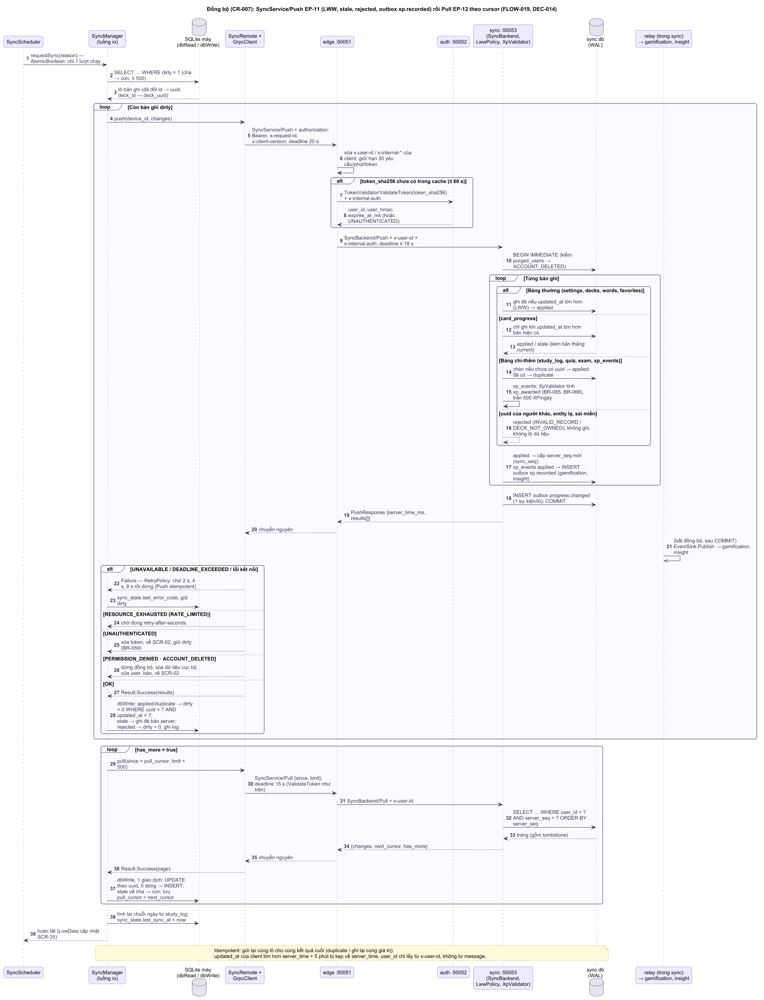
<!-- /diagram -->

<!-- diagram:sequence/seq-outbox-relay.puml -->
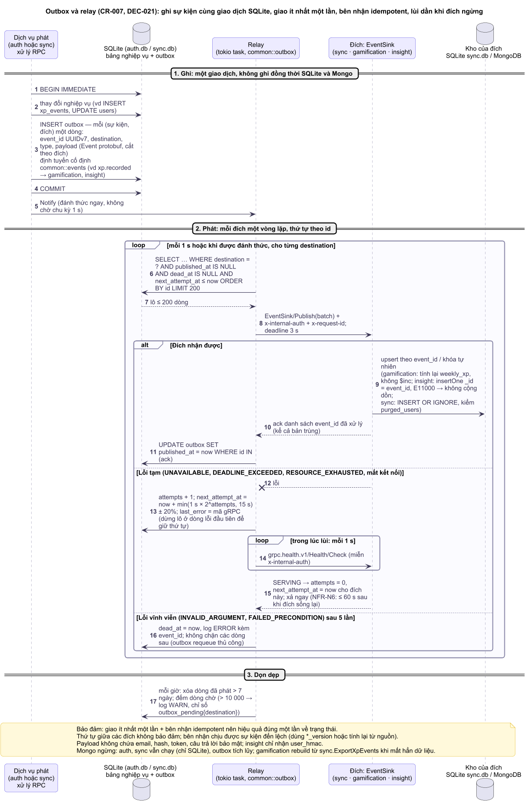
<!-- /diagram -->

<!-- diagram:sequence/seq-register-notebook.puml -->
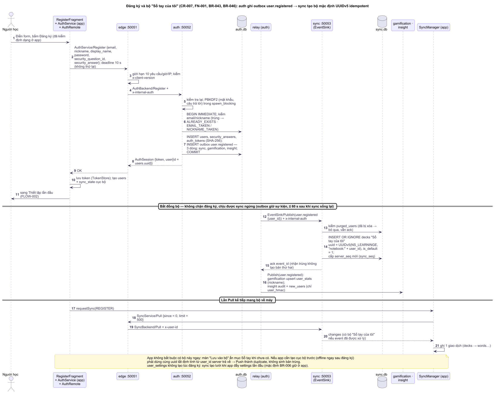
<!-- /diagram -->
Đánh giá thẻ và hoàn thành phiên học — **không đổi** (chỉ SQLite máy, xem Use-Cases (luồng) FLOW-012):
```mermaid
sequenceDiagram
  actor U as Người học
  participant F as FlashcardFragment
  participant VM as FlashcardViewModel
  participant S as StudyService
  participant PS as ProgressService
  participant R as Repository
  participant DB as SQLite
  U->>F: Đánh giá thẻ cuối cùng
  F->>VM: onRated(remembered)
  VM->>S: rate(wordId, remembered) trên dbWrite
  S->>R: ghi tiến độ (LeitnerScheduler)
  R->>DB: UPDATE card_progress; 0 dòng thì INSERT
  VM->>S: finishSession(LEARN, remembered, forgotten)
  S->>PS: completeSession(LEARN, today)
  PS->>R: beginTransaction
  R->>DB: INSERT study_log, INSERT xp_events (dirty = 1)
  PS->>PS: StreakCalculator.next(last_study_date, today)
  R->>DB: UPDATE user_settings (chuỗi); setTransactionSuccessful
  PS-->>VM: SessionResult
  VM-->>F: LiveData.postValue → SCR-10; SyncScheduler.request(AFTER_SESSION)
```

Đăng nhập (EP-03) qua edge:
```mermaid
sequenceDiagram
  participant A as App AuthRemote (io)
  participant E as edge
  participant AU as auth
  participant ADB as auth.db
  participant RL as relay (trong auth)
  participant I as insight
  A->>E: Login {email, password} + x-request-id, x-client-version, deadline 10 s
  E->>E: xóa x-user-id từ client; rate limit IP 5/phút; kiểm phiên bản
  E->>AU: AuthBackend.Login, deadline còn lại − 100 ms
  AU->>ADB: đọc users / auth_attempts, kiểm khóa tăng dần
  AU->>AU: PBKDF2 120k trong spawn_blocking (trần 4 đồng thời)
  AU->>ADB: BEGIN; INSERT auth_tokens (SHA-256 token); reset bộ đếm; INSERT outbox; COMMIT
  AU-->>E: {token, user}
  E-->>A: {token, user}
  RL-->>I: EventSink.Publish (bất đồng bộ)
  alt Sai mật khẩu
    AU->>ADB: tăng bộ đếm, có thể khóa; INSERT outbox auth.login_failed
    AU-->>E: UNAUTHENTICATED + error-code INVALID_CREDENTIALS
  else Đang khóa
    AU-->>E: RESOURCE_EXHAUSTED + error-code ACCOUNT_LOCKED + retry-after-seconds
  else auth ngừng
    E-->>A: UNAVAILABLE + error-code SERVICE_UNAVAILABLE
  end
```

Đường đi của XP (Push → outbox → Mongo):
```mermaid
sequenceDiagram
  participant SM as SyncManager (io)
  participant E as edge
  participant S as sync
  participant SDB as sync.db
  participant RL as relay (trong sync)
  participant G as gamification
  participant MG as learninge_game
  SM->>E: SyncService.Push {device_id, changes ≤ 500} + Bearer
  E->>E: ValidateToken (cache 60 s) → gắn x-user-id
  E->>S: SyncBackend.Push
  S->>SDB: BEGIN IMMEDIATE; LWW/insert-if-absent; cấp server_seq; kiểm xp_events; INSERT outbox xp.recorded; COMMIT
  S-->>E: results[] (applied/duplicate/stale/rejected, xp_awarded)
  E-->>SM: results[]
  RL->>G: EventSink.Publish [xp.recorded …]
  G->>MG: upsert xp_events theo _id; tính lại weekly_xp của user trong tuần
  G-->>RL: ack → published_at
  Note over RL,G: Mongo/gamification ngừng → outbox giữ, thử lại lùi dần; Push vẫn thành công
```

Nhắc học hằng ngày (FLOW-007) — không đổi so với thay đổi phạm vi (AlarmManager → ReminderReceiver → ReminderService → NotificationManager, đặt lịch ngày mai).

## Lược đồ lớp

<!-- diagram:class/cls-model-account-vocabulary.puml -->

<!-- /diagram -->

<!-- diagram:class/cls-model-assessment.puml -->
![Sơ đồ lớp miền: ngữ pháp [Won't], quiz, thi thử](../diagrams/class/cls-model-assessment.png)
<!-- /diagram -->

<!-- diagram:class/cls-server-modules.puml -->
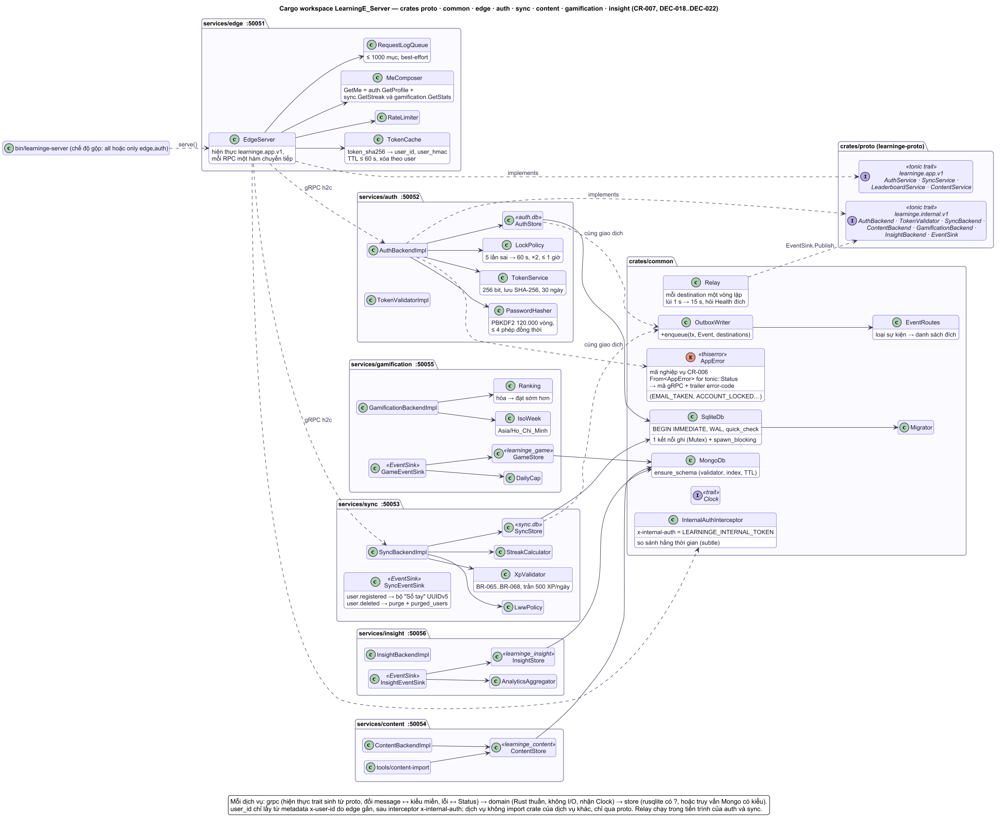
<!-- /diagram -->

<!-- diagram:class/cls-domain-game.puml -->
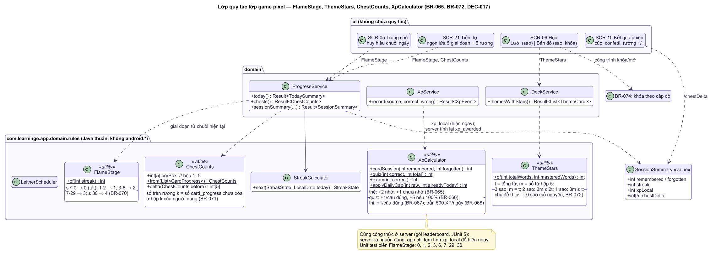
<!-- /diagram -->

<!-- diagram:class/cls-rules-learning.puml -->

<!-- /diagram -->
Lược đồ lớp tầng nghiệp vụ và dữ liệu của app **không đổi** (bản đầy đủ: `docs/diagrams/class/`; bản thay đổi phạm vi ở snapshot). Service lấy `userId` từ `TokenStore`, giao diện không truyền `userId` (NFR-S5). Lớp gRPC mới chỉ nằm ở `data.remote`:
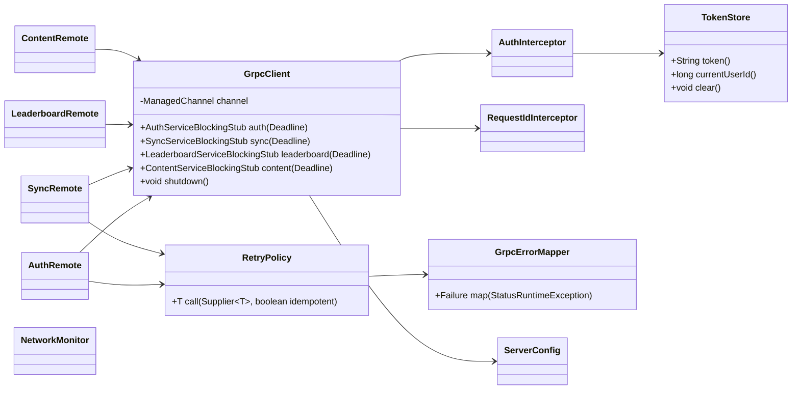

## Tầng mạng và đồng bộ trong app
| Gói / lớp | Trách nhiệm | Phục vụ |
|---|---|---|
| `data.remote.GrpcClient` | Một `ManagedChannel` dùng chung (tạo lười ở `ServiceLocator`): `OkHttpChannelBuilder.forAddress(host, port)`; **`useTransportSecurity()` mặc định**; `usePlaintext()` **chỉ khi** `BuildConfig.DEBUG` **và** host thuộc danh sách trắng (`10.0.2.2`, `localhost`, IP LAN khai báo) — vì `grpc-okhttp` dùng OkHttp nhúng, **không tôn trọng `network_security_config`**, nên chặn plaintext bằng mã; `maxInboundMessageSize` 4 MiB; keepalive tắt; `idleTimeout` 5 phút; executor của kênh = `AppExecutors.io`. Tạo **blocking stub** mỗi lời gọi kèm `withDeadlineAfter` (§Deadline) | DEC-020, NFR-S3 |
| `data.remote.AuthInterceptor`, `RequestIdInterceptor` | `ClientInterceptor`: gắn `authorization: Bearer` (nếu có token, trừ RPC công khai), `x-request-id` (UUID mới mỗi lời gọi), `x-client-version`; không ghi log token | DEC-013 |
| `data.remote.AuthRemote`, `SyncRemote`, `LeaderboardRemote`, `ContentRemote` | Thay `AuthApi`/`SyncApi`/`LeaderboardApi`/`ContentApi`: mỗi lớp bọc một service của `learninge.app.v1`; chuyển message proto ↔ model app (`sync.mapper` cho bản ghi đồng bộ); trả `Result<T>`; chạy **trên luồng `io`** (blocking stub; không dùng future stub để giữ một mô hình luồng) | API_CONTRACT EP-01..EP-16 |
| `data.remote.GrpcErrorMapper` | `StatusRuntimeException` → `ErrorCode` theo mã gRPC + trailer `error-code` (§Mô hình lỗi) | NFR-N2 |
| `data.remote.RetryPolicy` | Vòng thử lại tường minh theo BR-077 cho RPC idempotent (không dùng retry service config của gRPC để dễ giải thích/test) | BR-077 |
| `data.remote.TokenStore` | Token, `expires_at`, `user_id` cục bộ trong SharedPreferences `MODE_PRIVATE`; xóa khi `UNAUTHENTICATED`/đăng xuất; **Should (TM-06):** AES-256-GCM với khóa Android Keystore | DEC-013, NFR-S4, NFR-S7 |
| `data.remote.NetworkMonitor` | `ConnectivityManager.registerDefaultNetworkCallback` → `LiveData<Boolean> online`; mạng có lại → `SyncScheduler` + `channel.resetConnectBackoff()` | NFR-N1 |
| `data.remote.ServerConfig` | `BuildConfig.GRPC_HOST`, `GRPC_PORT`, `GRPC_TLS`; bản debug cho ghi đè host:port bằng ô "Địa chỉ server" (SharedPreferences) | DEC-023 |
| `sync.SyncManager` | Một lượt: (1) gom `dirty = 1` cha → con, lô ≤ 500 → `SyncRemote.push`; xử lý `applied`/`duplicate`/`stale`/`rejected`; (2) `pull(since = pull_cursor)` tới `has_more = false`, mỗi trang 1 giao dịch; (3) tính lại chuỗi, cập nhật `sync_state`. Chỉ một lượt tại một thời điểm (`AtomicBoolean`) | DEC-014, BR-062..BR-064 |
| `sync.SyncScheduler` | Kích hoạt khi đăng nhập/đăng ký, foreground (≤ 1 lần/5 phút), sau phiên học/quiz/thi, có mạng lại, "Đồng bộ ngay"; không WorkManager | DEC-014 |
| `sync.mapper.*` | Hàng SQLite ↔ message proto bản ghi đồng bộ (`id` cục bộ ↔ `uuid`, `deck_id` ↔ `deck_uuid`, `word_id` ↔ `word_uid`) | DATABASE-DESIGN (A) |

**Luồng chạy (threading):** `AppExecutors` 4 luồng (DEC-011). Một lượt đồng bộ chạy trên `io`: đọc lô `dirty` (gửi sang `dbRead`, chờ `Future`), gọi blocking stub trên `io`, ghi kết quả (gửi sang `dbWrite`). Không gọi gRPC trên `main` (StrictMode `detectNetwork` ở debug), không giữ giao dịch CSDL khi chờ mạng.

**Mô hình lỗi:** `core.Result<T>` = `Success(T)` | `Failure(ErrorCode, String detail)`. Ánh xạ gRPC → `ErrorCode` (bảng đầy đủ mã HTTP cũ → gRPC ở API_CONTRACT):
| `ErrorCode` | Nguồn gRPC | Hiển thị/hành vi ở app |
|---|---|---|
| `NETWORK_OFFLINE` | `NetworkMonitor` báo mất mạng; `UNAVAILABLE` không có trailer `error-code` (lỗi kết nối, DNS) | Thanh "Đang ngoại tuyến"; đăng nhập/đăng ký báo "Cần kết nối mạng" |
| `NETWORK_TIMEOUT` | `DEADLINE_EXCEEDED` | "Máy chủ phản hồi chậm, thử lại sau" |
| `SERVER_UNAVAILABLE` | `UNAVAILABLE` + `error-code = SERVICE_UNAVAILABLE`, `INTERNAL`, `UNKNOWN` | "Máy chủ đang bận"; đồng bộ để lần sau |
| `UNAUTHENTICATED` | `UNAUTHENTICATED` + `error-code = UNAUTHENTICATED` | Xóa token → SCR-02, giữ dữ liệu `dirty` (BR-059) |
| `INVALID_CREDENTIALS`, `INVALID_SECURITY_ANSWER` | Đăng nhập/đặt lại: `UNAUTHENTICATED` + mã tương ứng. **Đổi mật khẩu (EP-07) và xóa tài khoản (EP-10): sai mật khẩu hiện tại → `PERMISSION_DENIED` + `error-code = INVALID_CREDENTIALS`** (cố ý không dùng `UNAUTHENTICATED` để app **không** xóa token theo BR-059) | Lỗi chung tại form; ở EP-07/EP-10 giữ phiên, báo "Mật khẩu hiện tại không đúng" |
| `ACCOUNT_DELETED` | `PERMISSION_DENIED` + `error-code = ACCOUNT_DELETED` (EP-11 khi `purged_users` có tài khoản) | **Quy tắc app (chốt):** coi như `UNAUTHENTICATED` về xử lý token (BR-059 mở rộng: xóa token khi nhận `UNAUTHENTICATED` **hoặc** `ACCOUNT_DELETED`), dừng đồng bộ, báo "Tài khoản đã bị xóa", **xóa ngay dữ liệu cục bộ của `user_id` đó** (tài khoản không còn trên server nên không còn gì để đồng bộ, kể cả bản ghi `dirty`) rồi về SCR-02 |
| `ACCOUNT_LOCKED`, `RATE_LIMITED`, `RESET_LOCKED` | `RESOURCE_EXHAUSTED` + `retry-after-seconds` | "Thử lại sau N giây" |
| `EMAIL_TAKEN`, `NICKNAME_TAKEN` | `ALREADY_EXISTS` | Lỗi tại trường |
| `VALIDATION` | `INVALID_ARGUMENT` | Lỗi tại trường |
| `UPGRADE_REQUIRED` | `FAILED_PRECONDITION` + `error-code = UPGRADE_REQUIRED` | Hộp thoại yêu cầu cập nhật app |
| `BAD_RESPONSE` | Message thiếu trường bắt buộc khi ánh xạ; `UNIMPLEMENTED` | Log debug, coi như lỗi server |
Mã lỗi CSDL cũ (`DB_ERROR`, …) giữ nguyên.

**Hành vi khi mất mạng (NFR-N1, giữ):** sau lần đăng nhập đầu, học, ôn, quiz, thi thử, bộ từ, import/export, nhắc học chạy ngoại tuyến (đánh dấu `dirty`). Cần mạng: đăng ký, đăng nhập, đổi/đặt lại mật khẩu, xóa tài khoản, bảng xếp hạng (mất mạng → `leaderboard_cache`), tải nội dung mới. Token hết hạn khi offline: vẫn học; lần đồng bộ kế tiếp nhận `UNAUTHENTICATED` → đăng nhập lại, dữ liệu chưa đẩy giữ lại và chỉ đẩy khi đăng nhập **cùng tài khoản**.

**Cấu hình app (không bí mật trong repo):** `app/build.gradle.kts` sinh `BuildConfig.GRPC_HOST`, `GRPC_PORT`, `GRPC_TLS` cho từng build type từ thuộc tính Gradle `learninge.grpcHost`, `learninge.grpcPort` (đặt trong `local.properties` hoặc `~/.gradle/gradle.properties`, không commit); mặc định debug `10.0.2.2:50051`, TLS tắt; **release bắt buộc `GRPC_TLS = true`** (build release dừng nếu thiếu host hoặc TLS tắt). `BuildConfig.ONLINE` (mặc định `true`) giữ làm cờ rollback. `network_security_config` vẫn giữ (`cleartextTrafficPermitted="false"` ở `main`) cho mọi kết nối không phải gRPC, nhưng **không** được coi là lớp bảo vệ cho kênh gRPC. App không chứa khóa API hay bí mật nào.

## Backend
**Mô hình chạy mỗi dịch vụ:** một tiến trình tokio đa luồng (`#[tokio::main]`, số worker = số lõi). Server `tonic` với `Server::builder().timeout(...)`, `concurrency_limit_per_connection(64)`, `max_decoding_message_size(1 MiB)` (edge) / 4 MiB (nội bộ); tắt dần khi nhận SIGTERM/Ctrl+C (`serve_with_shutdown`, relay xả lô đang chạy rồi dừng). Client tới dịch vụ khác: `tonic::transport::Channel` tạo một lần lúc khởi động (`connect_lazy`, để dịch vụ lên được dù đích chưa sẵn sàng), dùng chung, `connect_timeout` 1 s.

**SQLite (auth, sync):** `rusqlite` (bundled SQLite). Một **kết nối ghi** duy nhất bọc trong `std::sync::Mutex`, mọi giao dịch ghi chạy trong `tokio::task::spawn_blocking` với `BEGIN IMMEDIATE` (tuần tự hóa ghi, tránh `SQLITE_BUSY`); đọc mở kết nối riêng trong `spawn_blocking` (WAL cho đọc song song). PRAGMA mỗi kết nối: `journal_mode = WAL`, `foreign_keys = ON`, `busy_timeout = 5000`, `synchronous = NORMAL`. Migration tự viết trong `common` (bảng `schema_version`, chạy `migrations/<svc>/V###__*.sql` theo thứ tự lúc khởi động). `PRAGMA quick_check` khi khởi động.

**MongoDB (content, gamification, insight):** driver `mongodb` chính thức (async, tokio). Mỗi dịch vụ một `Client` dùng chung, URI và user riêng (quyền `readWrite` chỉ trên database của mình); `serverSelectionTimeout` 2 s để thất bại nhanh khi Mongo ngừng → `UNAVAILABLE`. Index (kể cả TTL) được tạo idempotent lúc khởi động. Không dùng transaction/change stream → chạy được trên Mongo đơn lẻ (không cần replica set) và cả trên dịch vụ managed.

**Mô hình lỗi server:** mỗi dịch vụ có `AppError` (`thiserror`) gồm mã nghiệp vụ; `impl From<AppError> for tonic::Status` ở `common` đặt mã gRPC + trailer `error-code`; lỗi không lường trước → `INTERNAL` với thông điệp chung + log kèm `request_id` (không đưa chi tiết nội bộ, câu SQL, stack ra ngoài). Edge chuyển nguyên mã + trailer từ dịch vụ đích về app; lỗi transport → `UNAVAILABLE`/`SERVICE_UNAVAILABLE`.

**Cấu hình (biến môi trường, có mặc định; bí mật chỉ qua env/secret của nền tảng, không commit):**
| Biến | Dịch vụ | Mặc định | Ý nghĩa |
|---|---|---|---|
| `LISTEN_ADDR` | mọi dịch vụ | edge `127.0.0.1:50051`; trong compose `0.0.0.0:<cổng>` | Địa chỉ nghe; compose chỉ publish cổng của edge ra `127.0.0.1` của máy chủ. Dịch vụ nội bộ chỉ nghe loopback/mạng riêng (`0.0.0.0` chỉ **bên trong** container của mạng bridge nội bộ; chế độ `--all`: `127.0.0.1`) |
| `RUST_LOG`, `LOG_FORMAT` | mọi dịch vụ | `info`, `json` | Mức log (`tracing-subscriber` EnvFilter), định dạng `json` hoặc `pretty` (dev) |
| `AUTH_ADDR`, `SYNC_ADDR`, `CONTENT_ADDR`, `GAMIFICATION_ADDR`, `INSIGHT_ADDR` | edge, relay, gamification | `http://localhost:5005x`; compose `http://auth:50052`… | Địa chỉ dịch vụ (DNS của compose/nền tảng làm service discovery) |
| `EDGE_TRUST_PROXY` | edge | `false` | `true` khi đứng sau tunnel/PaaS/reverse proxy: chỉ khi kết nối đến từ địa chỉ proxy tin cậy (`EDGE_TRUSTED_PROXIES`, mặc định loopback) mới đọc IP thật từ metadata `x-forwarded-for` (phần tử cuối) — áp cho rate limit |
| `EDGE_MIN_CLIENT` | edge | `1` | `versionCode` tối thiểu |
| `EDGE_TOKEN_CACHE_SECS` | edge | `60` | Thời gian cache kết quả `ValidateToken` |
| `AUTH_DB_PATH`, `SYNC_DB_PATH` | auth, sync | `./data/auth.db`, `./data/sync.db` | File SQLite — **phải nằm trên volume bền vững** ở mọi môi trường |
| `LEARNINGE_SERVER_KEY` | auth | (không có) | Khóa HMAC base64 ≥ 32 byte cho câu hỏi giả (BR-076) và `auth_attempts`. Thiếu → dịch vụ **từ chối khởi động** khi `APP_ENV=prod`, chỉ dev mới dùng khóa tạm + WARN. **Chỉ `auth` giữ** (D-10) |
| `LEARNINGE_PSEUDONYM_KEY` | **auth, sync** | (không có) | Khóa HMAC tạo `user_hmac` cho insight/log (tách khỏi khóa server — D-10). **Chỉ `auth` và `sync` giữ**; `edge` không giữ (nhận `user_hmac` từ `ValidateTokenResponse`); `gamification`, `insight`, `content`, Mongo không bao giờ có khóa. Thiếu/ngắn → từ chối khởi động khi `APP_ENV=prod` |
| `LEARNINGE_INTERNAL_TOKEN` | **cả 6 dịch vụ** + công cụ vận hành | (không có) | Khóa nội bộ dùng chung ≥ 32 byte (D-09): đặt vào metadata `x-internal-auth` trên mọi lời gọi nội bộ, so sánh hằng thời gian. Thiếu/ngắn → từ chối khởi động khi `APP_ENV=prod`; khác nhau giữa dev và demo; không log |
| `LEARNINGE_GRPC_REFLECTION` | edge | `false` | `true` chỉ hợp lệ khi `APP_ENV=dev`; `prod` + `true` → từ chối khởi động (D-15); dịch vụ nội bộ không có reflection |
| `TOKEN_TTL_DAYS`, `PBKDF2_MAX_CONCURRENT` | auth | `30`, `4` | Hạn token (NFR-S7), trần băm đồng thời |
| `LEARNINGE_MONGO_URI`, `LEARNINGE_MONGO_DB` | content, gamification, insight (mỗi dịch vụ **chỉ nhận URI của mình**; cùng tên biến ở DATABASE-DESIGN §B4) | `mongodb://<user>:<pass>@mongo:27017/?authSource=<db>`; `learninge_content` / `learninge_game` / `learninge_insight` | Chuỗi kết nối + tên database của dịch vụ (Atlas dùng `mongodb+srv://…`); user role tùy biến `readWrite` + `collMod` trên đúng database; mật khẩu từ `.env`/secret, không log URI |
| `OUTBOX_BATCH`, `OUTBOX_MAX_BACKOFF_SECS`, `OUTBOX_RETENTION_DAYS` | auth, sync | `200`, `15`, `7` | Tham số relay (trần lùi 15 s + thử ngay khi đích `SERVING` để giữ NFR-N6) |
| `APP_ENV` | mọi dịch vụ | `dev` | `prod` bật kiểm tra bắt buộc (mọi khóa dịch vụ cần có mặt và ≥ 32 byte, reflection tắt, `LOG_FORMAT=json`, không seed demo) |
| `LEARNINGE_DEMO_SEED` | auth, sync | `false` | Nạp tài khoản + XP demo |

## Luồng đồng bộ (sequence, FLOW-019)
```mermaid
sequenceDiagram
  participant SS as SyncScheduler
  participant SM as SyncManager (io)
  participant DB as SQLite máy (dbRead/dbWrite)
  participant R as SyncRemote (blocking stub)
  participant E as edge
  participant S as sync
  participant SDB as sync.db
  SS->>SM: requestSync(reason)
  SM->>DB: SELECT … WHERE dirty = 1 (cha → con, ≤ 500)
  SM->>R: Push {device_id, changes}, deadline 20 s
  R->>E: gRPC + authorization Bearer + x-request-id
  E->>S: SyncBackend.Push + x-user-id
  S->>SDB: BEGIN IMMEDIATE; LWW; server_seq; xp_awarded; outbox; COMMIT
  S-->>SM: results[]
  SM->>DB: applied/duplicate → dirty = 0 WHERE uuid = ? AND updated_at = ?; stale → ghi bản server
  loop tới has_more = false
    SM->>R: Pull {since = cursor, limit = 500}, deadline 15 s
    R->>E: gRPC
    E->>S: SyncBackend.Pull + x-user-id
    S->>SDB: SELECT … WHERE user_id = ? AND server_seq > ? ORDER BY server_seq
    S-->>SM: {changes[], next_cursor, has_more}
    SM->>DB: 1 giao dịch: UPDATE theo uuid, 0 dòng thì INSERT; pull_cursor = next_cursor
  end
  SM->>DB: tính lại chuỗi; sync_state.last_sync_at = now
  alt UNAVAILABLE / DEADLINE_EXCEEDED
    SM->>DB: last_error_code; giữ dirty; RetryPolicy rồi để lần kích hoạt sau
  else UNAUTHENTICATED
    SM->>SS: xóa token, về SCR-02, giữ dirty
  end
```
Đăng nhập trên máy thứ hai (FLOW-018): `AuthRemote.login` → lưu token, tạo `users` + `sync_state(pull_cursor = 0)` → kéo toàn bộ (≈ 2.000 bản ghi = 4 trang) → Trang chủ, mục tiêu ≤ 10 s qua Wi-Fi (US-038).

## Xác thực & phân quyền

<!-- diagram:class/cls-rules-security-io.puml -->

<!-- /diagram -->
- **Tài khoản (DEC-013, hiện thực ở `auth`):** PBKDF2-HMAC-SHA256 120.000 vòng, salt 16 byte, khóa 32 byte (crate `pbkdf2` + `hmac` + `sha2`, unit test vector RFC 7914 §11); so sánh hằng thời gian (`subtle`). App không băm, không lưu mật khẩu.
- **Khóa tăng dần (BR-003, BR-008):** `auth::domain::LockPolicy` dùng chung cho đăng nhập và đặt lại mật khẩu: sai 5 lần → khóa 60 s, nhân đôi, tối đa 1 giờ; tính cả email không tồn tại (`auth_attempts`, khóa theo HMAC email). Giới hạn 5 lần đăng nhập/phút/IP ở edge (NFR-S8) kiểm **trước** khi gọi auth; trần 4 phép PBKDF2 đồng thời (`tokio::sync::Semaphore`, chờ > 2 s → `UNAVAILABLE`).
- **Phiên:** token opaque 256 bit (nguồn ngẫu nhiên hệ điều hành), base64url; `auth.db` chỉ lưu SHA-256; hạn 30 ngày; thu hồi khi đăng xuất/đổi/đặt lại mật khẩu/xóa tài khoản.
- **Xác thực qua metadata:** app gửi `authorization: Bearer <token>`. Edge: (1) xóa `x-user-id`, `x-user-id-bin`, `x-internal-*` từ client (cả RPC công khai); (2) RPC công khai đi thẳng; (3) RPC còn lại gọi `TokenValidator.ValidateToken(sha256(token))` — cache theo băm token 60 s; thiếu/sai/hết hạn → `UNAUTHENTICATED`; (4) gắn `x-user-id` + `x-internal-auth` rồi chuyển tiếp. **Cache token (D-12):** khóa = `token_sha256`, giá trị = `user_id`, `user_hmac` (do `auth` tính, trả trong `ValidateTokenResponse`), `expires_at_ms`; TTL = min(`EDGE_TOKEN_CACHE_SECS` = 60 s, `expires_at`); chỉ mục `user_id → {token_sha256}`; trong bộ nhớ, ≤ 10 000 mục, một bản edge (nhiều bản ⇒ xem lại D-12). **Edge xóa mọi mục cache của user** ngay khi chuyển tiếp OK `Logout`, `ChangePassword`, `DeleteAccount` (user từ `x-user-id`) và `ResetPassword` (user từ `AuthSession.user.id` trả về) — mọi đường thu hồi của người dùng đều qua edge nên không còn cửa sổ 60 s trong luồng bình thường (đóng RA-10).
- **Phân quyền dữ liệu:** dịch vụ lọc mọi truy vấn theo `x-user-id` (chống IDOR); không đọc `user_id` từ message. Dịch vụ nội bộ chỉ đọc `x-user-id` **sau khi** lời gọi qua interceptor khóa nội bộ `x-internal-auth` (D-09; **không** mTLS) và chỉ nhận UUID hợp lệ. Cách ly mạng (cổng 50052–50056 và 27017 không publish — NFR-S9; bind loopback/mạng riêng) là lớp thứ hai, không phải lớp duy nhất (P3: mọi service của project chung mạng riêng; chế độ gộp; compose lỡ publish). Nâng cấp sau (Could): khóa riêng từng bên gọi.
- **Người giữ bí mật (D-10, quyền tối thiểu):** `LEARNINGE_SERVER_KEY` → **chỉ `auth`**; `LEARNINGE_PSEUDONYM_KEY` → **chỉ `auth` và `sync`** (là nơi phát sự kiện; `edge` không giữ — nhận `user_hmac` từ `ValidateTokenResponse`; `gamification`, `insight`, `content` và Mongo **không bao giờ** có khóa); `LEARNINGE_INTERNAL_TOKEN` → cả 6 dịch vụ + container công cụ vận hành; mật khẩu Mongo → mỗi dịch vụ chỉ của user mình (root chỉ ở `mongo-init`). Không khóa nào nằm trong DB, image, repo hay bản sao lưu; sinh bằng `openssl rand -base64 32`, **khác nhau** giữa dev và demo.
- **Kênh truyền:** app ↔ lớp lộ ra Internet luôn TLS (h2 + ALPN); lớp lộ ra ↔ edge và edge ↔ dịch vụ là h2c trong mạng riêng/loopback. Plaintext từ app chỉ ở bản debug với host trong danh sách trắng (chặn bằng mã ở `GrpcClient`).
- **MongoDB:** bật xác thực; mỗi dịch vụ một user với role tùy biến `readWrite` + `collMod` trên đúng database của mình (không `dbAdmin`/`root`), Mongo không publish cổng; không chứa email, hash, câu trả lời bảo mật (insight dùng `user_hmac`); xóa tài khoản lan qua `user.deleted` (purge ≤ 1 phút khi các đích đang chạy); `sync` ghi thêm `purged_users` để lô Push đến muộn bị từ chối `ACCOUNT_DELETED`.
- **Manifest app (giữ):** `INTERNET`, `ACCESS_NETWORK_STATE`; `allowBackup=false` + `dataExtractionRules` loại `sharedpref`, `database`; chỉ `AuthActivity` và `BootReceiver` `exported=true`; `PendingIntent` `FLAG_IMMUTABLE`.

## Tích hợp ngoài
| Dịch vụ | Cách dùng | Khi lỗi |
|---|---|---|
| Backend LearningE (edge) | gRPC `learninge.app.v1` qua `GrpcClient` (API_CONTRACT) | Bảng `ErrorCode` ở §Tầng mạng; app vẫn chạy ngoại tuyến |
| Lớp lộ ra Internet (DEC-023, chưa chốt) | Tunnel HTTP/2 tới origin, nền tảng PaaS hoặc reverse proxy (TLS kết thúc ở đây, chuyển h2c tới edge). **Bắt buộc hỗ trợ HTTP/2 end-to-end tới edge** (gRPC không chạy trên HTTP/1.1) — xác minh ở SPIKE S-02 | Dự phòng LAN h2c (debug) → emulator → video |
| MongoDB 8.0 (container hoặc managed — DEC-023) | Driver `mongodb` từ content, gamification, insight | §Chế độ lỗi: lõi vẫn chạy |
| TextToSpeech, Storage Access Framework, trình duyệt, AlarmManager + NotificationManager | Như thay đổi phạm vi | AC-010.2, AC-013.3, AC-032.3, AC-033.2, AC-037.2, AC-019.4 |

## Triển khai (môi trường, hạ tầng)

<!-- diagram:architecture/arc-deployment.puml -->
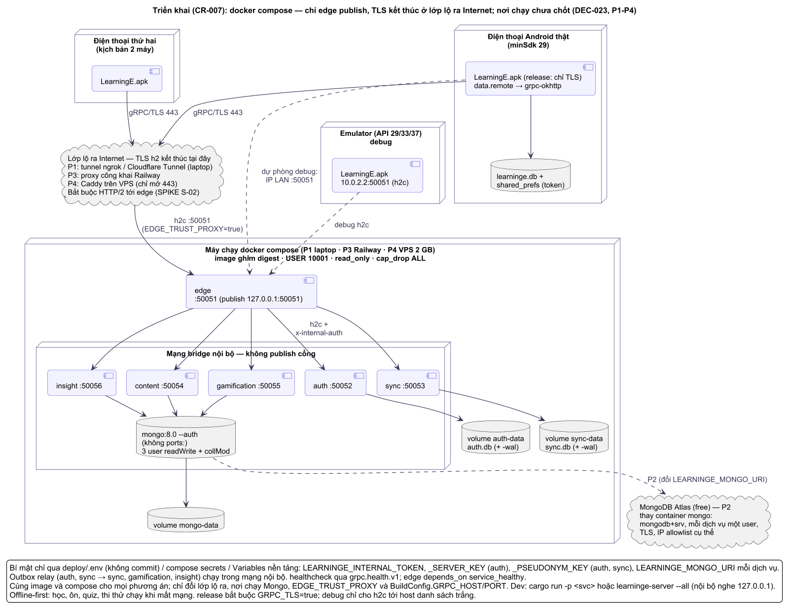
<!-- /diagram -->
**Đơn vị triển khai (trung lập với nơi chạy):** mỗi dịch vụ là một image Docker xây từ `deploy/Dockerfile` (stage build `rust:1.99.1-slim-bookworm`, `cargo build --release -p <service>`; stage chạy `debian:bookworm-slim` + `ca-certificates`, `USER 10001:10001`, chỉ chứa binary; mọi image nền ghim theo digest `@sha256:…`). `auth`, `sync` cần **volume bền vững** cho file SQLite. Image `learninge-server` (chế độ gộp) dùng cùng Dockerfile.

**Môi trường phát triển (đã chốt):** `docker compose -f deploy/docker-compose.yml up` chạy `mongo:8.0` (bật xác thực, script `mongo-init` tạo 3 user) + 6 dịch vụ trên một mạng bridge nội bộ; **chỉ edge publish `127.0.0.1:50051`**; volume `auth-data`, `sync-data`, `mongo-data`; `healthcheck` qua `grpc.health.v1`, `depends_on: condition: service_healthy` cho edge. Phát triển hằng ngày có thể `cargo run -p <svc>` + chỉ Mongo trong compose, hoặc `learninge-server --all`. Emulator gọi `10.0.2.2:50051`; máy thật cùng Wi-Fi gọi IP LAN (chỉ debug, khi đó edge nghe `0.0.0.0` và `EDGE_TRUST_PROXY=false`).
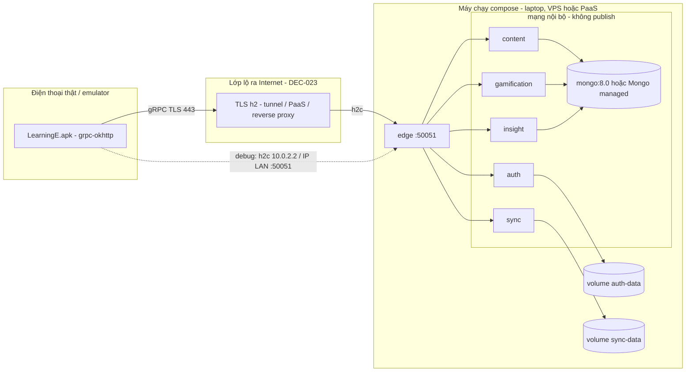

**Hardening triển khai (mọi phương án — THREAT_MODEL TM-44..TM-47; NFR-S14):**
- **Compose, mọi dịch vụ:** `user: "10001:10001"`, `read_only: true` + `tmpfs: /tmp`, `cap_drop: [ALL]`, `security_opt: [no-new-privileges:true]`, `mem_limit`/`cpus`/`pids_limit`, `restart: unless-stopped`; chỉ mount volume dữ liệu của chính dịch vụ (`auth-data` → `auth`, `sync-data` → `sync`); không `privileged`, không mount `docker.sock`.
- **Image ghim digest:** mọi `image:`/`FROM` (`rust`, `debian`, `mongo:8.0.34`) kèm `@sha256:…`; build dùng `--locked`; CI chạy `cargo audit` + `cargo deny check` (NFR-S10).
- **Mongo không publish:** không có `ports:` cho Mongo và cho 50052–50056 ở mọi compose (kể cả override); `--auth`, `mongo-init` tạo 3 user với role tùy biến `readWrite` + `collMod` trên đúng database của mình; user root chỉ dùng trong `mongo-init`.
- **Bí mật:** chỉ qua `env_file: deploy/.env` (không commit), compose `secrets:` (`/run/secrets/*`, ưu tiên ở P4) hoặc Variables của nền tảng (P3); không `ENV`/`ARG` bí mật trong Dockerfile; mỗi dịch vụ chỉ nhận bí mật mình cần (bảng người giữ khóa ở §Xác thực, D-10); `APP_ENV=prod` từ chối khởi động nếu thiếu/ngắn khóa mà dịch vụ cần.
- **Giới hạn HTTP/2 và tài nguyên (edge + `common`, TM-44):** `http2_max_header_list_size` 16 KiB, `max_concurrent_streams` ≤ 100/kết nối, `concurrency_limit_per_connection(64)` và `ConcurrencyLimit` 64 toàn edge, `Server::timeout` = trần deadline nhóm + 2 s (lời gọi không deadline vẫn bị cắt), `tcp_keepalive` + `http2_keepalive_interval` cho kết nối từ ngoài; message tối đa 1 MiB ở edge / 4 MiB nội bộ; `h2`/`hyper` ở bản đã vá Rapid Reset/CONTINUATION (`cargo audit` chặn).
- **Reflection:** chỉ ở edge và chỉ khi `APP_ENV=dev` **và** `LEARNINGE_GRPC_REFLECTION=true`; `prod` + cờ bật → từ chối khởi động; dịch vụ nội bộ không bao giờ bật reflection.
- **Mạng:** dịch vụ nội bộ chỉ nghe loopback hoặc mạng bridge/riêng của nền tảng (chế độ `--all`: `127.0.0.1`); edge publish `127.0.0.1:50051` (nghe LAN chỉ ở debug, ghi rõ, `EDGE_TRUST_PROXY=false`).

**Môi trường demo/chấm — CHƯA CHỐT (Q3 của thay đổi phạm vi, DEC-023).** Các phương án, cùng image và cùng compose, chỉ khác lớp lộ ra và nơi chạy Mongo:
| Phương án | Mô tả | Ưu | Nhược / cần xác minh |
|---|---|---|---|
| P1 Laptop + Docker Compose + tunnel HTTP/2 | Như dev; lộ edge qua ngrok (upstream HTTP/2) hoặc Cloudflare Tunnel có tên miền + bật gRPC | 0 đồng; dữ liệu nằm trên ổ của nhóm; giống hệt dev | Phụ thuộc laptop bật + Docker Desktop; tunnel miễn phí có hỗ trợ gRPC hay không (SPIKE S-02); URL có thể đổi mỗi lần chạy; nhà cung cấp tunnel thấy lưu lượng đã giải mã |
| P2 MongoDB Atlas (gói free) + dịch vụ chạy ở P1/P3/P4 | Chỉ thay Mongo bằng Atlas (`LEARNINGE_MONGO_URI=mongodb+srv://…` mỗi dịch vụ một user SCRAM riêng, TLS, IP allowlist cụ thể — không `0.0.0.0/0`); 6 dịch vụ chạy nơi khác | Mongo được quản lý, sao lưu; giảm tải laptop | Cần Internet ổn định lúc chấm (độ trễ tới vùng gần nhất, vd Singapore); dữ liệu (đã khử định danh) ra bên thứ ba; giới hạn dung lượng/kết nối gói free; không giải quyết việc lộ edge |
| P3 Railway (PaaS container) | Mỗi dịch vụ một service từ image; mạng riêng của nền tảng; volume cho `auth.db`, `sync.db`; Mongo bằng plugin của nền tảng hoặc Atlas | Không phụ thuộc laptop; URL ổn định; TLS sẵn | Tốn phí sau credit dùng thử; **phải xác minh** proxy công khai hỗ trợ gRPC/HTTP/2 tới container (hoặc dùng TCP proxy + TLS ở edge); volume gắn 1 replica; 7 container có thể vượt hạn mức |
| P4 VPS (1–2 vCPU, 2 GB RAM) | `docker compose` y như dev + reverse proxy (vd Caddy) kết thúc TLS, chuyển h2c tới edge; tên miền hoặc DNS theo IP | Toàn quyền, ổn định, chi phí thấp cố định; giống dev nhất | Tốn phí hằng tháng; nhóm phải tự quản trị (SSH key, firewall chỉ mở 443, cập nhật bảo mật, sao lưu volume); cần tên miền/chứng chỉ |

> **Quyết định nơi triển khai:** _(chờ người dùng — chốt trước T-145, tức trước khi bắt đầu code server; muộn nhất trước T-152 runbook demo)_. Kiến trúc, proto và mã dịch vụ không đổi theo lựa chọn; chỉ đổi `deploy/docker-compose.override.yml`, biến `LEARNINGE_MONGO_URI`, `EDGE_TRUST_PROXY`, và `BuildConfig.GRPC_HOST/PORT` của bản release.

- App: biến thể `debug` (StrictMode, log DEBUG, h2c tới host danh sách trắng, ô "Địa chỉ server") và `release` (R8, keystore không commit, chỉ TLS). Bàn giao APK + 2 link GitHub (app, server).
- Môi trường kiểm thử: emulator API 29/33/37 + ≥ 1 máy thật (NFR-D3); compose trên máy dev; kịch bản 2 máy; kịch bản Mongo tắt giữa phiên.

## Đáp ứng SRS (phi chức năng) thế nào
| SRS (phi chức năng) | Cách đáp ứng trong kiến trúc |
|---|---|
| NFR-P1 khởi động ≤ 2 s; seed ≤ 5 s | Seed 1 giao dịch; tạo `ManagedChannel` lười, đồng bộ khi mở app chạy nền trên `io`, không chặn Trang chủ |
| NFR-P2 không truy vấn/mạng trên luồng UI | DAO qua `AppExecutors`; blocking stub chỉ trên `io`; StrictMode ở debug |
| NFR-P3, NFR-P6 | Như thay đổi phạm vi (debounce + index; VectorDrawable, DEC-017) |
| NFR-N1 offline-first | SQLite máy là nguồn hiển thị (DEC-014); `leaderboard_cache`; seed nội dung trong APK |
| NFR-N2 timeout/thử lại | Deadline từng RPC; `RetryPolicy` BR-077 chỉ RPC idempotent; edge truyền deadline còn lại |
| NFR-N3 500 bản ghi ≤ 5 s | 1 lô = 1 RPC Push + 1 giao dịch `sync.db` + 1 giao dịch app; protobuf nhỏ hơn JSON; index `(user_id, server_seq)` |
| NFR-N4 p95 ≤ 300 ms tại edge | Đo bằng span `tracing` ở edge; ngân sách mỗi bước nội bộ ≤ 50 ms (h2c trong mạng nội bộ, kênh dùng lại); PBKDF2 loại khỏi chỉ tiêu chung |
| NFR-N5 Mongo/dịch vụ phụ ngừng | Lõi auth/sync chỉ dùng SQLite; edge trả `UNAVAILABLE` cục bộ cho RPC phụ; `GetMe` `stats_partial` |
| NFR-N6 outbox ≤ 60 s | Relay mỗi 1 s, lô 200, lùi dần theo cấp số nhân **trần 15 s** + thử ngay khi đích `SERVING` (hỏi `Health`); tiến độ riêng từng đích |
| NFR-A1, A3 toàn vẹn | Giao dịch cả hai phía; outbox cùng giao dịch; idempotent theo `event_id`/`uuid` |
| NFR-S1..S8 | PBKDF2 ở auth; SQL tham số; token băm; `user_id` từ edge; rate limit; TLS bắt buộc ở release |
| NFR-S9 chỉ edge lộ cổng | Compose chỉ publish edge (`127.0.0.1`); Mongo và cổng 50052–50056 không publish; dịch vụ nội bộ bind loopback/mạng riêng (`--all`: `127.0.0.1`) |
| NFR-S10 chuỗi cung ứng | `Cargo.lock` commit, phiên bản ghim, `--locked`, `cargo audit` + `cargo deny check` trong CI/trước demo, image ghim digest |
| NFR-S11 khóa nội bộ | Interceptor `common::internal_auth` ở mọi server nội bộ kiểm `x-internal-auth` (so sánh hằng thời gian); edge xóa `x-user-id`, `x-user-id-bin`, `x-internal-*` từ client; dịch vụ nội bộ bind loopback/mạng riêng (D-09) |
| NFR-S12 không plaintext ở release | `GrpcChannelFactory` mặc định TLS, `usePlaintext()` chỉ `BuildConfig.DEBUG` + host danh sách trắng (fail closed); build `release` hỏng nếu `GRPC_TLS != true`/thiếu `GRPC_HOST` (D-11) |
| NFR-S13 không PII trong Mongo, khóa giới hạn | Validator `additionalProperties: false`; payload sự kiện không email/hash/token/câu trả lời; insight chỉ `user_hmac`; `LEARNINGE_PSEUDONYM_KEY` chỉ `auth`+`sync`, `LEARNINGE_SERVER_KEY` chỉ `auth` (D-10) |
| NFR-S14 gia cố container | Không root (UID 10001), `read_only`, `cap_drop: [ALL]`, `no-new-privileges`, giới hạn tài nguyên, giới hạn HTTP/2 ở edge — xem §Triển khai (Hardening) |
| NFR-S15 xóa tài khoản ≤ 60 s | `user.deleted` ghi cùng giao dịch xóa ở `auth`; relay thử ngay khi đích `SERVING` (trần lùi 15 s); tombstone `purged_users`/`deleted_users` chặn sự kiện đến muộn; insight purge theo `user_hmac` (D-14) |
| NFR-D1 API 29+ | `grpc-okhttp` + TLS nền tảng (không Conscrypt); `java.time`; không UPSERT ở app |
| NFR-E1..E3 | Nội dung JSON + `content-import`; ngôn ngữ mới = dữ liệu (DEC-009) |
| NFR-E4 chạy 1 lệnh | `docker compose up` (hoặc `learninge-server --all`); migration + index tự chạy lúc khởi động |
| NFR-M1, M2 bảo trì | App 3 tầng + `data.remote`; mỗi dịch vụ 3 tầng `grpc → domain → store`; quy tắc thuần có unit test (`cargo test`, JUnit) |

## Dữ liệu và lưu trữ
Chi tiết lược đồ: DATABASE-DESIGN (A) app — không đổi; (B) server — tách theo dịch vụ.
| Kho | Chủ sở hữu | Nội dung | Vai trò |
|---|---|---|---|
| SQLite máy `learninge.db` | App | Toàn bộ dữ liệu học + `dirty`/`uuid`/`server_seq`, `sync_state`, `leaderboard_cache` | Nguồn hiển thị; nhất quán cuối cùng với server |
| SharedPreferences | App | Token, `user_id`, địa chỉ server (debug), cài đặt giao diện | — |
| SQLite `auth.db` | auth | `users`, `auth_tokens`, `security_answers`, `auth_attempts`, `server_meta`, `outbox` | **Nguồn sự thật** tài khoản/phiên |
| SQLite `sync.db` | sync | `decks`, `words`, `card_progress`, `favorites`, `study_log`, `quiz_attempts`, `exam_attempts`, `user_settings` (tạo lười), `user_stats`, `xp_events`, `sync_seq`, `purged_users`, `outbox` | **Nguồn sự thật** tiến độ và XP |
| Mongo `learninge_content` | content | `content_decks`, `content_exams`, `content_meta` | Nguồn = JSON trong git `content/`, nạp bằng `content-import` |
| Mongo `learninge_game` | gamification | `xp_events` (bản sao), `weekly_xp`, `players` | Kho phụ dựng từ outbox; rebuild được từ `sync.db` |
| Mongo `learninge_insight` | insight | `audit_events` (TTL 90 ngày), `request_logs` (TTL 7 ngày), `analytics_daily` | Kho phụ, khử định danh; mất được |

Nhất quán: LWW (DEC-014, BR-062); XP do sync kiểm và lưu, gamification tổng hợp (app chỉ hiển thị ước tính tới khi đồng bộ); Mongo nhất quán cuối cùng với SQLite qua outbox (độ trễ mục tiêu ≤ 60 s). Sao lưu trước demo: chép `auth.db`, `sync.db` (dùng `sqlite3 .backup` hoặc dừng dịch vụ) — Mongo dựng lại được.

## Khả năng mở rộng, chịu lỗi, quan sát
- **Quy mô mục tiêu:** ≤ 50 người dùng, ≤ 10 yêu cầu/giây lúc demo. Điểm nghẽn đầu tiên: một luồng ghi `sync.db` (Push đồng thời) → giao dịch ngắn, lô ≤ 500, `busy_timeout`; tiếp theo là CPU cho PBKDF2 → rate limit + semaphore. Hướng mở rộng ngoài đồ án: tách `sync.db` sang PostgreSQL, nhiều bản edge sau load balancer (cache token khi đó cần chung).
- **Chịu lỗi:** offline-first; Push idempotent; cursor chỉ tăng sau khi ghi xong trang; outbox + relay chịu đích ngừng; health check + `restart: unless-stopped` trong compose; tắt dần có kiểm soát.
- **Quan sát (thay DEC-025 của thay đổi phạm vi):** edge sinh/nhận `x-request-id`, truyền qua mọi lời gọi nội bộ và payload sự kiện; mỗi dịch vụ dùng `tracing` với span gắn `request_id`, `rpc`, `user_hmac` (không `user_id` thô ở insight), thời gian xử lý, mã gRPC; log JSON ra stdout (`docker compose logs -f`). **Không bao giờ** log token, mật khẩu, câu trả lời bảo mật, email đầy đủ (chỉ dạng che `m***@gmail.com` cho sự kiện auth thất bại chưa có user). Edge gửi `request_logs` sang insight (best-effort, hàng đợi ≤ 1000, đếm `dropped`). Đo NFR-N4: script tính p95 từ log edge hoặc `InsightBackend.GetDailyStats`. OpenTelemetry/Jaeger: Could. App: lỗi đồng bộ gần nhất ở `sync_state` (SCR-35), Logcat chỉ ở debug (R8 bỏ `Log.d/v`).

## Rủi ro kiến trúc và quyết định liên quan
| Rủi ro | Giảm thiểu | DEC |
|---|---|---|
| RA-1 Đường cong học Rust/async làm trễ server (R-41) | T-140 + SPIKE S-01; mẫu dịch vụ chuẩn trong `common`; go/no-go 29/11; rollback RB-1 về thay đổi phạm vi (snapshot) | DEC-018 |
| RA-2 Đồng bộ mất/ghi đè tiến độ (R-36) | LWW, tombstone, xóa `dirty` có điều kiện `updated_at`, trang + cursor cùng giao dịch, test 2 máy | DEC-014 |
| RA-3 Đồng hồ máy lệch | sync kẹp `updated_at` ≤ giờ server + 5 phút; kéo theo `server_seq` | DEC-014 |
| RA-4 Lộ token, brute-force, IDOR, gian lận XP, giả mạo `x-user-id` (R-37) | Token băm + thu hồi; rate limit ở edge; edge xóa metadata nội bộ; chỉ edge lộ cổng; sync kiểm XP + trần ngày; THREAT_MODEL TM-19..TM-24 | DEC-013, DEC-019 |
| RA-5 gRPC không qua được tunnel/proxy miễn phí (R-42) | SPIKE S-02 trước 20/11; phương án P1–P4 (DEC-023); dự phòng LAN + emulator + video | DEC-020, DEC-023 |
| RA-6 Plugin protobuf + AGP 9.5.1 xung đột (R-43) | SPIKE S-03; dự phòng sinh mã Java lite bằng `protoc` ngoài Gradle rồi commit vào app | DEC-020 |
| RA-7 Lệch dữ liệu SQLite ↔ Mongo (R-44) | Outbox cùng giao dịch, idempotent, tiến độ riêng từng đích, `gamification rebuild`, `content-import` | DEC-021 |
| RA-8 Vận hành 6 dịch vụ + Docker trên Windows (R-45) | Chế độ gộp `--all`; compose có healthcheck; runbook | DEC-019 |
| RA-9 Lệch proto giữa 2 repo (R-50) | `proto.lock` + `sync-proto.ps1`; chỉ thêm trường/RPC trong v1, xóa thì `reserved` | DEC-022 |
| RA-10 Cache token ở edge làm token đã thu hồi còn dùng được ≤ 60 s | **Đóng (D-12):** giữ cache ≤ 60 s; edge xóa mọi mục cache của user khi chuyển tiếp OK Logout/ChangePassword/ResetPassword (user từ `AuthSession.user.id`)/DeleteAccount | DEC-013, DEC-020 |
| RA-11 `INSERT OR REPLACE` vô tình xóa dữ liệu con qua CASCADE (app) | Quy ước DATABASE-DESIGN §Toàn vẹn; code review | DEC-011, DEC-014 |
| RA-12 Thành viên không giải thích được code Rust của mình (R-47) | Mỗi dịch vụ một người phụ trách (Q6 **chưa phân công**); không để AI viết phần không ai hiểu; `common` giữ nhỏ, không macro tự viết | DEC-018, DEC-019 |

## Công nghệ sử dụng
> Công nghệ, phiên bản, lý do chọn.
> **Quy tắc chọn phiên bản:** bản ổn định mới nhất **phát hành ≥ 2 tuần** trước ngày chọn (2026-11-12 → phát hành trước hoặc đúng 2026-10-29), kiểm tra ngày 2026-11-12 trên `crates.io/api/v1/crates/<tên>/versions` (crate) và `repo1.maven.org/maven2/<group>/<artifact>/maven-metadata.xml` + `Last-Modified` của `.pom` (Maven). Bản bị loại vì quá mới được ghi bên cạnh.
> **thay đổi phạm vi (Q1 đã duyệt 2026-11-11):** đảo ngược "app không thêm thư viện" của thay đổi phạm vi — app thêm gRPC Java (okhttp, protobuf-lite, stub), `protobuf-javalite`, plugin Gradle protobuf, `annotations-api` (compileOnly). Server: các crate ở §Server + image `mongo:8.0`. Hủy dependency Java server đã duyệt ở thay đổi phạm vi (Javalin, Jackson, sqlite-jdbc, slf4j, JUnit 5).

## App Android
| Lớp | Công nghệ | Phiên bản | Lý do | STACKS guide |
|---|---|---|---|---|
| Ngôn ngữ | Java | Nguồn/đích Java 17 (`compileOptions`) | Bắt buộc theo đề (PRD §5) | developer.android.com/build/jdks |
| IDE / build | Android Studio 2026.2.x + AGP 9.5.1 + Gradle wrapper 9.6.0; Gradle JDK = JBR của Android Studio | Theo catalog và `gradle/wrapper` | Cả nhóm build giống nhau | developer.android.com/build |
| SDK | `minSdk 29`; `compileSdk`/`targetSdk` 37 | — | NFR-D1; API 29 có TLS 1.3 + ALPN cho HTTP/2 | developer.android.com/guide/topics/manifest/uses-sdk-element |
| Giao diện | Android View + XML, Material Components (Material 3, DayNight) | `material` trong catalog | UI-UX-SPECIFICATION (hệ thống thiết kế); dark mode REQ-013 | m3.material.io/develop/android/mdc-android |
| AndroidX cơ bản | AppCompat, ConstraintLayout, RecyclerView, Core | Catalog | Thư viện chuẩn | developer.android.com/jetpack/androidx/versions |
| Kiến trúc trình bày | Lifecycle `ViewModel` + `LiveData` | Thêm ở T-005 | NFR-A4 | developer.android.com/topic/libraries/architecture/viewmodel |
| Điều hướng | Navigation (Fragment) + Safe Args (Java) | Thêm ở T-005 | UI-UX-SPECIFICATION (sơ đồ màn hình) | developer.android.com/guide/navigation |
| CSDL | SQLite qua `SQLiteOpenHelper` | SQLite của hệ điều hành | D2; không UPSERT (DEC-011) | developer.android.com/training/data-storage/sqlite |
| Luồng nền | `core.AppExecutors`: `dbWrite`, `dbRead`, `io` (tệp SAF + **mọi lời gọi gRPC**), `main` | JDK | NFR-P2; executor của `ManagedChannel` = `io` | developer.android.com/guide/background/threading |
| Lưu phiên | `SharedPreferences` `MODE_PRIVATE` qua `TokenStore` (Should: AES-GCM khóa Android Keystore) | Android SDK | BR-057, BR-059, DEC-013 | developer.android.com/training/data-storage/shared-preferences |
| **Mạng — gRPC** | `io.grpc:grpc-okhttp` (transport HTTP/2, TLS nền tảng), `io.grpc:grpc-protobuf-lite`, `io.grpc:grpc-stub` | **1.85.1** (2026-10-20) | DEC-020: app gọi edge trực tiếp; `grpc-okhttp` là transport khuyến nghị cho Android (nhẹ hơn netty), kéo theo `okio` 3.x; không cần Conscrypt trên API 29 | grpc.io/docs/languages/java/ |
| **Protobuf runtime** | `com.google.protobuf:protobuf-javalite` | **4.36.2** (2026-09-17) — khai báo tường minh để ghi đè bản 3.25.9 mà `grpc-protobuf-lite` 1.85.1 khai báo; cùng phiên bản với `protoc` | Bản lite cho Android (nhỏ, không reflection, thân thiện R8) | protobuf.dev/reference/java/ |
| **Sinh mã** | Plugin Gradle `com.google.protobuf` + `com.google.protobuf:protoc` + `io.grpc:protoc-gen-grpc-java` (tùy chọn `lite`) | Plugin **0.10.0** (2026-04-20; 0.10.1 phát hành 2026-11-04 chưa đủ 2 tuần) · `protoc` **4.36.2** · `protoc-gen-grpc-java` **1.85.1** | Sinh stub Java lite từ `app/src/main/proto/` lúc build. **Tương thích AGP 9.5.1 chưa kiểm chứng → SPIKE S-03** (T-143); thất bại → sinh mã bằng `protoc` ngoài Gradle (script) rồi commit mã sinh vào app (RB của R-43) | github.com/google/protobuf-gradle-plugin |
| Chú thích sinh mã | `org.apache.tomcat:annotations-api` (`compileOnly`) | **6.0.53** | Mã sinh của grpc-java dùng `@javax.annotation.Generated` (không có trên Android); chỉ lúc biên dịch, không vào APK | github.com/grpc/grpc-java#download |
| Đồng bộ nền | `sync.SyncManager` trên `io`; không WorkManager | — | DEC-014 | — |
| Pixel layer | VectorDrawable, `AnimatedVectorDrawable`, PNG `drawable-nodpi` | Android SDK | DEC-017 | developer.android.com/develop/ui/views/graphics/vector-drawable-resources |
| Phát âm, nhắc học | `TextToSpeech`; `AlarmManager` + `NotificationCompat` + BootReceiver | Android SDK | DEC-004 | — |
| Seed, import/export JSON | `org.json` (có sẵn), `JsonCodec` ở `data.io` | — | DEC-002, DEC-008 | developer.android.com/reference/org/json/JSONObject |
| Biểu đồ | View tự vẽ `Canvas` | — | DEC-005 | — |
| Font | Baloo 2, Lexend, Noto Sans | SIL OFL 1.1 | UI-UX-SPECIFICATION (hệ thống thiết kế) | fonts.google.com |
| Unit test | JUnit 4 + JaCoCo; `grpc-testing` + `grpc-inprocess` cho test `GrpcErrorMapper`/`RetryPolicy` nếu cần (Could, cùng phiên bản 1.85.1, chỉ `testImplementation`, cần duyệt khi thêm) | Catalog | NFR-M2 | developer.android.com/training/testing/local-tests |
| Instrumented test | AndroidX Test + Espresso | Catalog | DAO trên SQLite thật | developer.android.com/training/testing/instrumented-tests |
| Kiểm tra chất lượng | Android Lint, StrictMode, Accessibility Scanner | Đi kèm Android Studio | NFR-Q1, NFR-P2, NFR-X1 | developer.android.com/studio/write/lint |
| Quản lý mã nguồn | Git + GitHub `at1308033-sketch/LearningE_app` | — | CODING-STANDARDS | — |
| Thiết kế | Figma (Learning-English-Mobile-App) | Starter | UI-UX-SPECIFICATION | — |

**Không dùng (có chủ ý):** Room (D2), Kotlin/Compose, Firebase, Retrofit/Volley/Gson (gRPC thay REST), `grpc-netty`/`grpc-android` (`AndroidChannelBuilder` không cần: `NetworkMonitor` tự gọi `resetConnectBackoff()`), Conscrypt (TLS nền tảng API 29 đủ), `google.rpc.Status`/googleapis (mã nghiệp vụ đi trong trailer `error-code`), WorkManager, thư viện biểu đồ, DI (Hilt/Dagger).

Mục cần thêm vào `gradle/libs.versions.toml` (sau khi SPIKE S-03 xác nhận; chưa thêm):
```toml
[versions]
grpc = "1.85.1"
protobuf = "4.36.2"          # protobuf-javalite + protoc, phải trùng nhau
protobufPlugin = "0.10.0"
tomcatAnnotations = "6.0.53"

[libraries]
grpc-okhttp = { group = "io.grpc", name = "grpc-okhttp", version.ref = "grpc" }
grpc-protobuf-lite = { group = "io.grpc", name = "grpc-protobuf-lite", version.ref = "grpc" }
grpc-stub = { group = "io.grpc", name = "grpc-stub", version.ref = "grpc" }
protobuf-javalite = { group = "com.google.protobuf", name = "protobuf-javalite", version.ref = "protobuf" }
tomcat-annotations-api = { group = "org.apache.tomcat", name = "annotations-api", version.ref = "tomcatAnnotations" }
# artifact cho khối protobuf { protoc { artifact = "com.google.protobuf:protoc:4.36.2" }
#                               plugins { grpc { artifact = "io.grpc:protoc-gen-grpc-java:1.85.1" } } }  với option "lite"

[plugins]
protobuf = { id = "com.google.protobuf", version.ref = "protobufPlugin" }
```
R8: thêm quy tắc giữ cho lớp sinh protobuf-lite (`-keep class * extends com.google.protobuf.GeneratedMessageLite { <fields>; }`) — xác minh ở S-03 bằng bản release gọi `Health.Check`.

## Server
Repo riêng `LearningE_Server` (DEC-022), Cargo workspace, Rust **edition 2021**. Crate chọn: phổ biến, có bảo trì, không macro "phép thuật" khó vấn đáp.
| Lớp | Công nghệ | Phiên bản | Lý do | STACKS guide |
|---|---|---|---|---|
| Toolchain | Rust stable ghim trong `rust-toolchain.toml` (+ `rustfmt`, `clippy`) | **1.99.1** (2026-10-13). MSRV cần: `rusqlite` 0.41 → 1.89, `tonic`/`mongodb` → 1.88 | Cả nhóm và Docker build cùng một bản | rust-lang.github.io/rustup/overrides.html |
| Async runtime | `tokio` (features `rt-multi-thread`, `macros`, `signal`, `sync`, `time`) | **1.54.1** (2026-10-21) | Runtime chuẩn mà tonic và driver mongodb dựa vào | tokio.rs/tokio/tutorial |
| gRPC | `tonic` (server + client, transport HTTP/2), `tonic-prost` (codec prost) | **0.14.9** (2026-10-29) | gRPC thuần Rust phổ biến nhất; từ 0.14 phần prost tách sang `tonic-prost`/`tonic-prost-build` | docs.rs/tonic |
| Protobuf | `prost`, `prost-types` | **0.14.4** (2026-06-07; 0.14.5 phát hành 2026-11-10 chưa đủ 2 tuần) | Message Rust thuần, dùng chung với tonic 0.14 (`^0.14`) | docs.rs/prost |
| Sinh mã | `tonic-prost-build` (build-dependency của crate `proto`; tương đương `tonic-build` + prost trước 0.14) + `protoc-bin-vendored` | **0.14.9** · **3.3.0** (2026-10-05) | Sinh client/server cho `learninge.app.v1` + `internal.v1`; `protoc` đi kèm crate → không cài tay trên Windows | docs.rs/tonic-prost-build |
| Health | `tonic-health` (`grpc.health.v1`) | **0.14.9** | EP-01 + healthcheck compose | docs.rs/tonic-health |
| Middleware | `tower` (timeout, concurrency limit layer) | **0.5.3** (2026-01-12) | Lớp chung cho server/client tonic | docs.rs/tower |
| SQLite | **`rusqlite`** (feature `bundled`) | **0.41.1** (2026-10-28; 0.42.0 phát hành 2026-11-11 chưa đủ 2 tuần) | Xem "Chọn rusqlite thay sqlx" dưới bảng | docs.rs/rusqlite |
| MongoDB | `mongodb` — driver chính thức (async tokio, rustls, SRV DNS cho Atlas) | **3.9.1** (2026-09-10; 3.10.0 phát hành 2026-11-03 chưa đủ 2 tuần) | DEC-021; chạy được với `mongo:8.0` đơn lẻ và Atlas | mongodb.com/docs/drivers/rust/current |
| Băm mật khẩu | `pbkdf2` + `hmac` + `sha2` | **0.13.0** (2026-04-21) · **0.13.0** (2026-03-29) · **0.11.1** (2026-10-12) — cùng `digest` 0.11 | Giữ đúng PBKDF2-HMAC-SHA256 120.000 vòng (DEC-003/DEC-013, BR-002, BR-007); test vector RFC 7914 §11. **Không dùng Argon2/bcrypt** (giữ quy tắc bảo mật đã duyệt) | docs.rs/pbkdf2 |
| HMAC/so sánh | `hmac` (HMAC khóa server, `user_hmac`), `subtle` (so sánh hằng thời gian) | `subtle` **2.6.1** | BR-076; chống đo thời gian | docs.rs/subtle |
| Ngẫu nhiên, mã hóa | `rand` (nguồn hệ điều hành cho token 256 bit, salt), `base64` (base64url token) | **0.10.3** (2026-09-20) · **0.23.1** (2026-08-04) | DEC-013 | docs.rs/rand |
| Định danh | `uuid` (features `v4`, `v7`) | **1.29.0** (2026-10-23; 1.29.1/1.29.2 chưa đủ 2 tuần) | `uuid` bản ghi đồng bộ, `event_id` UUIDv7 (sắp theo thời gian) | docs.rs/uuid |
| Thời gian | `chrono` + `chrono-tz` | **0.4.45** (2026-06-04) · **0.10.4** (2025-07-11) | Tuần ISO Asia/Ho_Chi_Minh (BR-069), cửa sổ XP | docs.rs/chrono |
| Log | `tracing` + `tracing-subscriber` (features `json`, `env-filter`) | **0.1.44** (2025-12-18) · **0.3.23** (2026-03-13) | Log JSON có span `request_id` (DEC-020 §quan sát) | docs.rs/tracing |
| Lỗi | `thiserror` (lỗi có kiểu trong thư viện); `anyhow` chỉ ở `main`/tools | **2.0.21** (2026-09-23) · **1.0.104** (2026-07-18) | `AppError` → `tonic::Status` | docs.rs/thiserror |
| JSON | `serde` + `serde_json` | **1.0.229** (2026-07-18) · **1.0.154** (2026-10-11) | Chỉ cho `content-import`, cấu hình, log; giao thức là protobuf | serde.rs |
| Test | `cargo test` (unit + tích hợp: SQLite file tạm, Mongo container), client sinh từ proto cho test hợp đồng; `grpcurl` thủ công | Đi kèm toolchain | TESTING-STRATEGY | doc.rust-lang.org/book/ch11-00-testing.html |
| Chất lượng | `rustfmt`, `clippy -D warnings`, `cargo audit` (NFR-S10) | Đi kèm toolchain; `cargo-audit` cài bằng `cargo install --locked` | CODING-STANDARDS mục server | rustsec.org |
| MongoDB server | Image `mongo:8.0` (tag `8.0.34` cập nhật 2026-10-27) — ghim `mongo:8.0.34` trong compose | 8.0.34 | Dòng 8.0 đã duyệt (Q1); bật xác thực | hub.docker.com/_/mongo |
| Đóng gói | Docker (Dockerfile nhiều stage: `rust:1.99.1-slim-bookworm` → `debian:bookworm-slim`), Docker Compose v2 (`docker compose`) | Docker Desktop / Engine bản ổn định hiện hành trên máy dev | NFR-E4; trung lập với nơi triển khai (DEC-023) | docs.docker.com/compose |
| Công cụ vận hành | `grpcurl` (gọi thử RPC, `GetDailyStats`), tunnel/reverse proxy theo DEC-023 | Bản ổn định hiện hành | Không phải dependency của mã | github.com/fullstorydev/grpcurl |

**Chọn `rusqlite` thay `sqlx`:** (1) API đồng bộ, SQL viết tay nhìn thấy được — dễ giải thích khi vấn đáp, giống JDBC thuần của kế hoạch thay đổi phạm vi; (2) feature `bundled` đóng gói SQLite, build giống nhau trên Windows và Docker, không cần cài thư viện hệ thống; (3) `sqlx` cần macro kiểm truy vấn lúc biên dịch (phải có CSDL hoặc chế độ offline + `.sqlx/`), thêm độ phức tạp cho nhóm mới học Rust, và driver SQLite của `sqlx` thực chất cũng chạy trên luồng riêng nên không lợi về hiệu năng; (4) quy mô ≤ 10 yêu cầu/giây nên một kết nối ghi + `spawn_blocking` là đủ (SYSTEM-BLUEPRINT §Backend). Đánh đổi: phải tự bọc `spawn_blocking` và tự viết migrator nhỏ (≈ 50 dòng trong `common`).

**Không dùng (có chủ ý):** `axum`/`actix-web` (chỉ gRPC, không cần HTTP framework), `sqlx`/`diesel`/`sea-orm` (xem trên), Argon2/bcrypt (giữ PBKDF2 đã duyệt), `jsonwebtoken` (token opaque — DEC-013), Envoy (edge tự viết — Q2), OpenTelemetry (Could), `tonic` feature TLS (TLS kết thúc ở lớp lộ ra Internet — DEC-023; nếu phương án cuối cần TLS tại edge thì bật `tls-ring` và ghi lại ở DEC-023).

Mục `[workspace.dependencies]` dự kiến (chưa tạo — chỉ tài liệu; SPIKE S-01 xác nhận build):
```toml
[workspace.package]
edition = "2021"
rust-version = "1.89"

[workspace.dependencies]
tokio = { version = "1.54.1", features = ["rt-multi-thread", "macros", "signal", "sync", "time"] }
tonic = "0.14.9"
tonic-prost = "0.14.9"
tonic-health = "0.14.9"
tonic-prost-build = "0.14.9"        # build-dependency của crates/proto
protoc-bin-vendored = "3.3.0"       # build-dependency của crates/proto
prost = "0.14.4"
prost-types = "0.14.4"
tower = { version = "0.5.3", features = ["timeout", "limit"] }
rusqlite = { version = "0.41.1", features = ["bundled"] }
mongodb = "3.9.1"
pbkdf2 = "0.13.0"
hmac = "0.13.0"
sha2 = "0.11.1"
subtle = "2.6.1"
rand = "0.10.3"
base64 = "0.23.1"
uuid = { version = "1.29.0", features = ["v4", "v7"] }
chrono = { version = "0.4.45", default-features = false, features = ["clock", "std"] }
chrono-tz = "0.10.4"
tracing = "0.1.44"
tracing-subscriber = { version = "0.3.23", features = ["json", "env-filter"] }
thiserror = "2.0.21"
anyhow = "1.0.104"
serde = { version = "1.0.229", features = ["derive"] }
serde_json = "1.0.154"
```
`Cargo.lock` được commit; nâng phiên bản bằng PR riêng, kèm `cargo audit` và theo quy tắc ≥ 2 tuần.

### Cách chạy (dự kiến, NFR-E4)
1. Cài Rust bằng rustup (bản ghim tự tải nhờ `rust-toolchain.toml`) và Docker Desktop (Windows bật WSL 2).
2. `cp deploy/.env.example deploy/.env` rồi điền `LEARNINGE_SERVER_KEY`, `LEARNINGE_PSEUDONYM_KEY`, `LEARNINGE_INTERNAL_TOKEN` (base64 ≥ 32 byte), mật khẩu Mongo cho root và 3 user dịch vụ — `deploy/.env` không commit.
3. `docker compose -f deploy/docker-compose.yml up --build` → Mongo + 6 dịch vụ; edge nghe `127.0.0.1:50051`. Lần đầu tự chạy migration SQLite, tạo index Mongo.
4. Nạp nội dung: `docker compose run --rm content-import` (hoặc `cargo run -p content-import`).
5. Kiểm tra: `grpcurl -plaintext 127.0.0.1:50051 grpc.health.v1.Health/Check` → `SERVING`.
6. Không Docker: `cargo run -p learninge-server -- --all` + Mongo cài thường hoặc container riêng.
7. Test: `cargo test --workspace`; `cargo clippy --workspace -- -D warnings`; `cargo audit`.
8. App: emulator dùng `10.0.2.2:50051` (debug, h2c); máy thật theo phương án triển khai đã chốt ở DEC-023 (đặt `learninge.grpcHost`/`learninge.grpcPort` trong `local.properties`).
