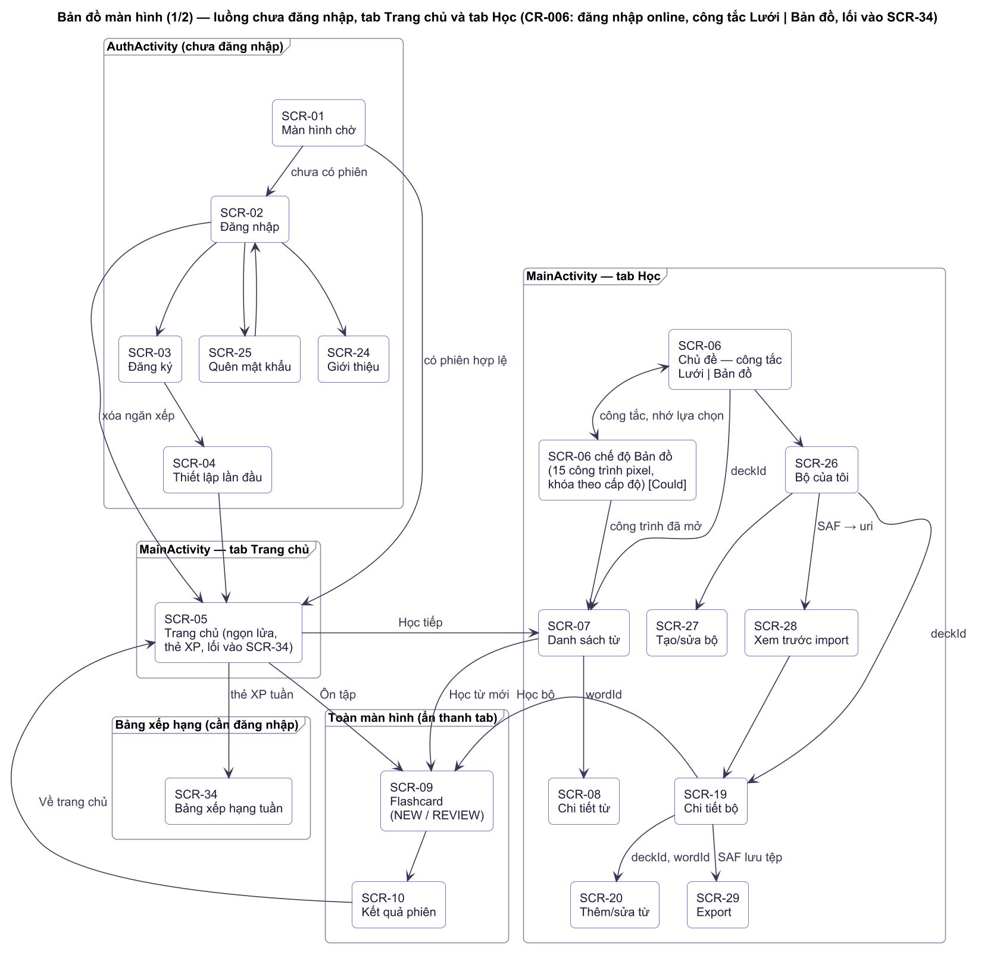
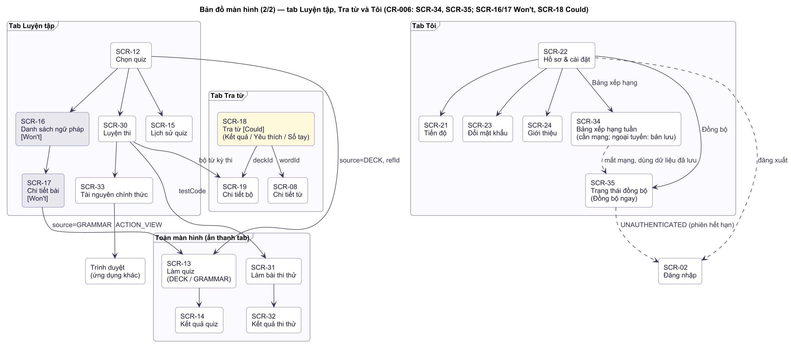
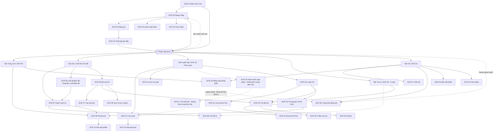

# UI/UX Specification — đặc tả giao diện và trải nghiệm

> **TỰ SINH** từ bộ phân tích thiết kế đã duyệt của nhóm — không sửa trực tiếp tệp này; đề xuất thay đổi qua Issue/PR để nhóm trưởng cập nhật nguồn và sinh lại. Danh mục tài liệu: [docs/README.md](../README.md).

**Mục đích:** sơ đồ màn hình và điều hướng, hệ thống thiết kế (màu, chữ, khoảng cách, component), đặc tả từng màn hình kèm link Figma, bố cục màn hình mới, ánh xạ token sang code.

## Sơ đồ màn hình & điều hướng
> Cấu trúc màn hình/trang và điều hướng. Mã màn hình và flow theo Use-Cases (luồng) §Bản đồ màn hình (34 màn hình / 35 mã SCR, SCR-11 gộp vào SCR-09; đã gồm thay đổi phạm vi, thay đổi phạm vi, thay đổi phạm vi). Ngữ pháp (SCR-16/17) và Dark mode là **Won't** ở thay đổi phạm vi — giữ trong sơ đồ nhưng đánh dấu "không làm trong phiên bản này".

## Sitemap

<!-- diagram:architecture/arc-navigation-auth-home-learn.puml -->

<!-- /diagram -->

<!-- diagram:architecture/arc-navigation-practice-search-me.puml -->

<!-- /diagram -->

## Danh sách màn hình
| ID | Màn hình | Vai trò truy cập | Flow liên quan |
|---|---|---|---|
| SCR-01 | Màn hình chờ (logo, nạp seed lần đầu) | Mọi người | FLOW-001, FLOW-010 |
| SCR-02 | Đăng nhập (tài khoản trên máy chủ; trạng thái không có mạng, lỗi máy chủ, phiên hết hạn — thay đổi phạm vi) | Khách | FLOW-001, FLOW-018 |
| SCR-03 | Đăng ký (gồm câu hỏi bảo mật; trạng thái online như SCR-02) | Khách | FLOW-001 |
| SCR-04 | Thiết lập lần đầu (3 bước: cấp độ, mục tiêu, nhắc học) | Người học | FLOW-002 |
| SCR-05 | Trang chủ (chào, huy hiệu chuỗi ngày pixel, mục tiêu hôm nay, thẻ cần ôn, Học tiếp, **thẻ lối vào Bảng xếp hạng tuần**) | Người học | FLOW-004, FLOW-008, FLOW-020 |
| SCR-06 | Danh sách chủ đề: **công tắc Lưới \| Bản đồ** (mặc định Lưới, nhớ lựa chọn); Lưới 2 cột + lọc cấp độ; Bản đồ 15 công trình pixel khóa theo cấp độ + thẻ "Đang học … Học tiếp" (REQ-024, Could) | Người học | FLOW-003, FLOW-022 |
| SCR-07 | Danh sách từ của chủ đề (nút Học từ mới, Làm quiz) | Người học | FLOW-003, FLOW-004 |
| SCR-08 | Chi tiết từ | Người học | FLOW-003, FLOW-011 |
| SCR-09 | Flashcard (học mới / ôn tập / sổ tay) | Người học | FLOW-004, FLOW-012 |
| SCR-10 | Kết quả phiên học (ăn mừng pixel: ngọn lửa, cúp, confetti; thẻ đã ôn, % đúng, chuỗi, XP; thẻ đã đổi hộp +/−; nút Xong) | Người học | FLOW-004 |
| SCR-11 | (Gộp vào SCR-09: ôn tập dùng chung màn hình flashcard) | — | FLOW-004 |
| SCR-12 | Luyện tập: chọn chủ đề làm quiz + lối vào Ngữ pháp, Lịch sử | Người học | FLOW-005 |
| SCR-13 | Làm quiz (5 dạng câu hỏi chủ đề + trắc nghiệm ngữ pháp) | Người học | FLOW-005, FLOW-006 |
| SCR-14 | Kết quả quiz | Người học | FLOW-005 |
| SCR-15 | Lịch sử quiz | Người học | FLOW-005 |
| SCR-16 | Danh sách bài ngữ pháp — **Không làm trong phiên bản này** (Won't) | Người học | FLOW-006 |
| SCR-17 | Chi tiết bài ngữ pháp — **Không làm trong phiên bản này** (Won't) | Người học | FLOW-006 |
| SCR-18 | Tra từ (tab Kết quả / Yêu thích / Sổ tay) — **Could** (hạ xuống ở thay đổi phạm vi) | Người học | FLOW-011 |
| SCR-19 | Chi tiết bộ: tóm tắt bộ, danh sách từ, Học / Quiz / Export, FAB thêm từ (Sổ tay của tôi là bộ mặc định) | Người học | FLOW-011, FLOW-004, FLOW-014 |
| SCR-20 | Thêm / sửa từ trong bộ | Người học | FLOW-011, FLOW-014 |
| SCR-21 | Tiến độ (ngọn lửa pixel theo chuỗi + tiến độ giai đoạn, 5 rương Leitner + nút Ôn N thẻ đến hạn, biểu đồ 7 ngày, thống kê) | Người học | FLOW-008 |
| SCR-22 | Tôi: hồ sơ & cài đặt; lối vào **Tiến độ (SCR-21), Bảng xếp hạng (SCR-34), Đồng bộ (SCR-35)**, Đổi mật khẩu, Giới thiệu | Người học | FLOW-009, FLOW-019, FLOW-020 |
| SCR-23 | Đổi mật khẩu | Người học | FLOW-009 |
| SCR-24 | Giới thiệu (nhóm, nguồn dữ liệu, giấy phép) | Mọi người | — |
| SCR-25 | Quên mật khẩu (2 bước) | Khách | FLOW-013 |
| SCR-26 | Bộ của tôi: **mục "Yêu thích" (bộ ảo chỉ đọc) ghim đầu**, danh sách bộ (tên, ngôn ngữ, số từ, thẻ đến hạn), nút Tạo bộ, Import | Người học | FLOW-014, FLOW-015 |
| SCR-27 | Tạo / sửa bộ: tên, mô tả, ngôn ngữ | Người học | FLOW-014 |
| SCR-28 | Xem trước import: số dòng hợp lệ/trùng/lỗi, 5 dòng đầu, chọn bộ đích | Người học | FLOW-015 |
| SCR-29 | Export: chọn CSV/JSON (bottom sheet) → trình lưu file hệ thống | Người học | FLOW-016 |
| SCR-30 | Luyện thi: TOEIC / IELTS / Aptis, bộ từ theo kỳ thi, đề thi thử, lịch sử thi | Người học | FLOW-017 |
| SCR-31 | Làm bài thi thử: đồng hồ đếm ngược, bảng số câu, đánh dấu xem lại | Người học | FLOW-017 |
| SCR-32 | Kết quả thi thử: điểm, thời gian, từng câu + giải thích, ghi chú "không quy đổi điểm chính thức" | Người học | FLOW-017 |
| SCR-33 | Tài nguyên chính thức: liên kết ETS/IELTS/British Council | Người học | FLOW-017 |
| SCR-34 | Bảng xếp hạng tuần: top 50 theo XP tuần, dòng "Bạn" ghim, hạng/avatar/XP/chuỗi, đếm ngược hết tuần; ngoại tuyến hiện bản lưu + "Cập nhật lúc …" | Người học (cần đăng nhập) | FLOW-020 |
| SCR-35 | Trạng thái đồng bộ: lần đồng bộ cuối, số thay đổi chờ đẩy, lỗi gần nhất, nút "Đồng bộ ngay"; 5 trạng thái chờ đẩy / đang đồng bộ / đã đồng bộ / lỗi / ngoại tuyến | Người học (cần đăng nhập) | FLOW-019 |
SCR-11 giữ mã để không lệch tài liệu đã duyệt nhưng không có màn hình riêng: **24 màn hình thực tế** cần thiết kế (SCR-04 có 3 bước, SCR-25 có 2 bước, SCR-13 có 5 dạng câu hỏi chủ đề và dạng ngữ pháp). thay đổi phạm vi thêm 8 màn hình (SCR-26..SCR-33) → 32 màn hình; thay đổi phạm vi thêm SCR-34, SCR-35 → **34 màn hình** (SCR-16/17 vẫn tính nhưng không làm ở phiên bản này); SCR-19/SCR-20 đổi từ "Sổ tay" thành "Chi tiết bộ"/"Thêm-sửa từ" dùng cho mọi bộ (sổ tay là bộ mặc định). Tab Học có 2 mục con: Chủ đề có sẵn / Bộ của tôi; tab Luyện tập thêm lối vào Luyện thi.

## Điều hướng chính
- **Thanh tab dưới (5 tab)**: Trang chủ (SCR-05) · Học (SCR-06) · Luyện tập (SCR-12) · Tra từ (SCR-18) · Tôi (SCR-22). Hiện ở 5 màn hình gốc của tab; ẩn ở màn hình con (SCR-07 trở đi) để có thêm chỗ cho nội dung.
- **Ngăn xếp trong từng tab**: màn hình con mở đè trong tab, nút Quay lại (top app bar + nút back hệ thống) trở về màn hình trước. Chuyển tab giữ ngăn xếp của tab cũ.
- **Phiên học / quiz** (SCR-09, SCR-13) mở toàn màn hình, nút Đóng (×) ở góc trái; thoát giữa quiz hỏi xác nhận (FLOW-005).
- **Luồng chưa đăng nhập** (SCR-01 → SCR-02/03/04/25) tách khỏi luồng chính; sau khi đăng nhập xóa ngăn xếp để nút back không quay lại màn hình đăng nhập.
- **Lối tắt**: Trang chủ → "Ôn tập" (SCR-09 nguồn ôn tập), "Học tiếp" (SCR-07 chủ đề gần nhất); Kết quả phiên/quiz → "Về trang chủ", "Làm quiz chủ đề này"; thông báo nhắc học → SCR-05.
- **Vị trí SCR-34 Bảng xếp hạng tuần (quyết định, thay đổi phạm vi)**: đặt trong **tab Tôi › Bảng xếp hạng** (2 lần chạm) và thêm **thẻ lối vào ở Trang chủ** (dòng phụ "Bảng xếp hạng tuần · Hạng 7 · 340 XP", 1 lần chạm). Lý do: thanh tab đã đủ 5 mục (giới hạn Material 3) nên không thêm tab; tab Luyện tập xoay quanh làm bài (quiz/thi thử) trong khi bảng xếp hạng là thông tin về bản thân và tiến độ — cùng nhóm với Tiến độ (SCR-21) và màu Tiến độ; thẻ ở Trang chủ giữ động lực hằng ngày mà không thêm tab; độ sâu ≤ 3 lần chạm.
- **SCR-35 Trạng thái đồng bộ**: tab Tôi › **Đồng bộ** (2 lần chạm); ngoài ra chạm vào thanh "Đang ngoại tuyến" hoặc Snackbar lỗi đồng bộ cũng mở SCR-35. Cả SCR-34 và SCR-35 cần tài khoản đăng nhập; chưa đăng nhập không thấy mục này (phiên hết hạn xem bên dưới).
- **Yêu thích (quyết định, thay đổi phạm vi)**: nút trái tim ở SCR-07 và SCR-08 (theo đề xuất người phân tích); mục "Yêu thích" trong SCR-26 mở SCR-19 đã lọc (chỉ đọc, Học/Quiz được) — cách vào: Học › Bộ của tôi › Yêu thích (3 lần chạm). Nhờ vậy việc xem từ yêu thích **không còn phụ thuộc tab Tra từ (SCR-18, Could)**.
- **Công tắc Lưới | Bản đồ** ở SCR-06 (REQ-024): hai nút icon trong tab Học, mặc định Lưới, lựa chọn được nhớ theo người dùng; bản đồ mở tự cuộn tới chủ đề đang học, thẻ docked "Đang học … Học tiếp" mở SCR-07; chạm công trình khóa chỉ hiện Snackbar giải thích. Cả hai chế độ dẫn tới cùng SCR-07 và cùng chiều sâu.
- **Phiên hết hạn / mất mạng**: 401 từ máy chủ đưa về SCR-02 (xóa ngăn xếp), **giữ dữ liệu chưa đồng bộ**; mất mạng chỉ hiện Offline banner, không đổi điều hướng (offline-first, NFR-N1).
- **Won't / Could**: lối vào Ngữ pháp (thẻ ở SCR-12) ẩn ở bản này, SCR-16/17 không làm; Dark mode không làm; tab Tra từ (SCR-18) ở mức Could — nếu cắt, thanh tab còn 4 mục và tìm kiếm chuyển thành ô tìm trong tab Học.
- **Độ sâu tối đa**: 3 lần chạm từ tab gốc đến bất kỳ nội dung nào (ví dụ Học → Chủ đề → Từ).

## Hệ thống thiết kế
> Design system **v2**: màu thương hiệu, màu theo nhóm tính năng, nền trang trí, bộ minh họa, typography, component.
> Nền tảng: Material Design 3 (Material Components for Android, theme `Theme.Material3.DayNight.NoActionBar`). Token định nghĩa một lần, có bản sáng và tối (bản tối chỉ là token tham chiếu: dark mode REQ-013 đã chuyển sang Won't ở thay đổi phạm vi, không làm trong phiên bản này), cùng tên ở Figma (Variables), mockup HTML và code (`values/colors.xml`, `values-night/colors.xml`, `themes.xml`).
> Mockup trực quan của toàn bộ hệ thống và 34 màn hình (thêm SCR-34, SCR-35 ở thay đổi phạm vi): `docs/design/mockups/index.html` (mở bằng trình duyệt). Sprite pixel gốc: `docs/design/pixel/`. Minh họa SVG gốc: `docs/design/illustrations/`. v1 (một màu xanh `#2F5BEA`) được giữ trong lịch sử tài liệu để rollback.

| Mục | Nội dung |
|---|---|
| Người dùng & tâm thế | Học sinh, sinh viên Việt (16–25 tuổi) học tiếng Anh A1–B1 trên điện thoại 10–15 phút mỗi ngày, hay nản sau vài ngày — cần cảm giác vui, tiến bộ nhìn thấy được, không áp lực |
| 3 từ khóa + biểu hiện cụ thể | **Thân thiện** (nhân vật sinh viên Việt, bo 16–28 dp, Baloo 2 tròn) · **Năng động** (chàm + san hô + vàng, mỗi khu vực một màu, gradient hero, lớp game pixel: ngọn lửa, rương, bản đồ) · **Rõ ràng** (một hành động chính mỗi màn hình, nội dung học luôn trên nền trắng, trang trí chỉ ở góc/hero) |
| Ý tưởng thị giác (che logo vẫn nhận ra) | Hệ "chàm + san hô + vàng" với mỗi khu vực tính năng một màu và nền hình khối; điểm nhận diện riêng của LearningE là **ngọn lửa pixel biết cười lớn dần theo chuỗi ngày, 5 rương Leitner nhiều màu và bản đồ công trình pixel** đặt trên giao diện phẳng |
| Điều KHÔNG làm (mặc định bị cấm + lý do) | Một màu xanh/chàm duy nhất trên nền xám; emoji làm icon; ảnh stock; font hệ thống không lý do; pixel hóa cả app (chỉ phần tử trò chơi, icon chủ đề và minh họa; icon UI, chữ, nút, form, thẻ giữ phẳng); chữ nằm trong sprite; gradient/khử răng cưa trong sprite; màu là cách phân biệt duy nhất (đúng/sai, hộp 1–5) |
| Tham chiếu (≤ 6, chỉ cơ chế tương tác) | Quizlet / AnkiDroid (lật thẻ, Leitner), Duolingo (chuỗi ngày, bảng xếp hạng tuần, bản đồ chặng), Material 3 (m3.material.io), concept Figma "Pixel art CR" của nhóm (Vinh). Chỉ định hướng cơ chế; không sao chép bố cục/hình |

## Visual direction
**Thân thiện · Năng động · Rõ ràng.**
- **Thân thiện**: nhân vật minh họa là học sinh, sinh viên Việt (tóc đen, nhiều tông da), bo góc lớn (16–28 dp), hình khối mềm (blob, tròn, vuông bo 30 %).
- **Năng động**: màu chàm thương hiệu + điểm nhấn san hô và vàng nắng; mỗi khu vực tính năng có một màu nhận diện và một gradient hero, nên người dùng biết mình đang ở đâu chỉ bằng màu.
- **Rõ ràng**: một hành động chính mỗi màn hình (nút Filled màu của khu vực), nội dung học (từ, câu hỏi) luôn đặt trên nền trắng/surface; trang trí chỉ nằm ở hero, góc thẻ và trạng thái rỗng, không bao giờ nằm sau chữ nội dung.
- Khác v1: v1 chỉ có một màu xanh trên nền xám, biểu tượng bằng ký tự Unicode, không minh họa. v2 bổ sung màu phụ, màu theo tính năng, nền gradient/hoa văn, bộ 13 minh họa và huy hiệu tính năng có màu.
- Tham chiếu tương tác (chỉ định hướng, không sao chép bố cục/hình): flashcard lật (Quizlet, AnkiDroid), thẻ tiến độ và chuỗi ngày (Duolingo), Material 3 (m3.material.io). Màu, hình và nhân vật là thiết kế riêng của nhóm.

## Color tokens (sáng / tối) và tương phản
Tên token = tên resource Android (`@color/<tên>`), dấu gạch dưới; Figma dùng cùng tên với `/` (vd `color/primary_container`). Tỷ lệ tương phản tính bằng công thức độ chói tương đối WCAG 2.1; ngưỡng AA 4.5:1 cho mọi chữ (kể cả chữ lớn). **109 cặp chữ/nền đã kiểm, thấp nhất 4.56:1, không cặp nào dưới 4.5:1** (bảng đầy đủ trong mockup, mục "Bảng kiểm tra tương phản").

### Thương hiệu và trung tính
| Token (`@color/…`) | Sáng | Tối | Dùng cho | Tương phản chữ (sáng · tối) |
|---|---|---|---|---|
| `primary` | `#5146E0` | `#A5A0FF` | Nút chính, tab Trang chủ/Tra từ/Tôi, liên kết | `on_primary` trên primary 6.36 · 7.62; primary làm chữ trên surface 6.36 · 7.32 |
| `on_primary` | `#FFFFFF` | `#17123D` | Chữ/icon trên primary | — |
| `primary_container` | `#ECEBFF` | `#2E2870` | Chip chọn, thẻ ghi chú, nền dải tiêu đề | `on_primary_container` 10.99 · 9.88 |
| `on_primary_container` | `#2A2180` | `#E2E0FF` | Chữ trên primary_container | — |
| `hero_brand_start` / `hero_brand_end` | `#4F3FD6` → `#6C4BF0` | `#2E2870` → `#3D2F8F` | Gradient 135° hero thương hiệu (SCR-01, 02, 05, 18, 22, 24) | chữ trắng 6.97 / 5.38; chữ `#ECEAF7` 10.69 / 8.83 |
| `accent` | `#FF7A59` | `#FF9B7D` | Điểm nhấn san hô: chấm trang trí, minh họa, huy hiệu phụ | `on_accent` `#1E1B3A` 6.43 · 8.04 |
| `accent_text` / `accent_container` | `#C2410C` / `#FFEDE5` | `#FF9B7D` / `#4A2418` | Chữ nhấn cam, nền nhấn | 4.56 · 6.58 |
| `sun` | `#FFC93C` | `#FFC857` | Vàng nắng: điểm sáng trang trí, hero Tiến độ | `on_sun` `#1E1B3A` 10.74 · 10.72 |
| `background` | `#F7F6FF` | `#13111F` | Nền màn hình (hơi tím, không xám) | `on_surface` 15.38 · 15.68 |
| `surface` | `#FFFFFF` | `#1D1A2E` | Thẻ, sheet, thanh tab, flashcard | `on_surface` 16.50 · 14.26 |
| `surface_variant` | `#F0EFFA` | `#28243D` | Nền ô ví dụ, ô chưa chọn, nền thanh tiến độ | `on_surface_variant` 6.03 · 7.03 |
| `on_surface` | `#1E1B3A` | `#ECEAF7` | Chữ chính | Xem trên |
| `on_surface_variant` | `#5A5775` | `#B3AFCB` | Chữ phụ, phiên âm, nhãn | 6.87 trên surface · 6.41 trên background (sáng); 8.00 · 8.79 (tối) |
| `outline` | `#DDDBEE` | `#3B3654` | Viền ô nhập, đường phân cách | Chỉ trang trí, không làm chữ |
| `success` / `success_container` | `#15803D` / `#DCFCE7` | `#4ADE80` / `#14532D` | Đúng, "Đã nhớ", Đã thuộc | 5.02 trên trắng; 4.57 trên container · 9.72 trên surface tối |
| `error` / `error_container` | `#C62828` / `#FDE8E8` | `#FF7A7A` / `#5C1D1D` | Lỗi, sai, "Chưa nhớ", sắp hết giờ | 5.62 trên trắng; 4.79 trên container · 6.71 trên surface tối |
| `level_a1` / `level_a2` / `level_b1` | `#0369A1` / `#6D28D9` / `#C2410C` | như sáng | Nhãn cấp độ (chữ trắng đậm 11 sp, luôn kèm chữ A1/A2/B1) | 5.93 / 7.10 / 5.18 (đổi từ v1 vì `#0EA5E9` chỉ đạt 2.8) |
| `scrim` | `#1E1B3A` 48 % | `#000000` 60 % | Lớp phủ sau bottom sheet, dialog | — |

### Màu minh họa (chỉ dùng trong SVG/VectorDrawable, không làm chữ)
`illu_ink #1E1B3A` (nét, mắt) · `illu_hair #2B2340` · `illu_skin_1 #F5CBA7` · `illu_skin_2 #E3A97F` · `illu_skin_3 #C98B62` · `illu_cheek #FF9B7D` (55 %) · `illu_pants #2A2180`; còn lại dùng đúng các màu thương hiệu, màu tính năng và `*_decor` bên dưới.

## Feature colors (một màu nhận diện cho mỗi nhóm tính năng)
Mỗi nhóm có 6 token: `feat_<nhóm>` (icon, chữ nhấn, nút Filled), `on_feat_<nhóm>` (chữ trên nút), `feat_<nhóm>_container` (nền tint, chip chọn, huy hiệu mềm), `feat_<nhóm>_decor` (hình khối trong minh họa), `hero_<nhóm>_start/end` (gradient hero). Trong theme dùng `ThemeOverlay.LearningE.<Nhóm>` gán `colorPrimary`/`colorPrimaryContainer` = màu nhóm, đặt ở layout gốc của màn hình (`android:theme`), nên Material Button/Chip/ProgressIndicator tự đổi màu.

| Nhóm (màn hình) | `feat_*` sáng · tối | `*_container` sáng · tối | `*_decor` | Gradient hero (sáng) | Tương phản (sáng · tối) |
|---|---|---|---|---|---|
| **learn** — Học: chủ đề, từ, flashcard, import (SCR-06..10, 26, 28) | `#0F766E` · `#5EEAD4` | `#DDF7F3` · `#133B38` | `#14B8A6` | `#115E59` → `#0F766E` | chữ trên trắng 5.47; trên container 4.87; `on_feat` trắng 5.47 · `#0B1F1D` trên `#5EEAD4` 11.56 |
| **quiz** — Luyện tập: quiz, ngữ pháp, lịch sử (SCR-12..17) | `#7E22CE` · `#D8B4FE` | `#F3E8FF` · `#34204A` | `#9333EA` | `#6B21A8` → `#7E22CE` | 6.98; 5.92; trắng 6.98 · 9.58 trên surface tối |
| **exam** — Luyện thi: kỳ thi, thi thử, tài nguyên (SCR-30..33) | `#1D4ED8` · `#93C5FD` | `#E0ECFF` · `#1A2B4D` | `#2563EB` | `#1E40AF` → `#1D4ED8` | 6.70; 5.62; trắng 6.70 · 9.40 |
| **deck** — Bộ từ: bộ của tôi, chi tiết bộ, thêm từ, export (SCR-19, 20, 27, 29) | `#BE185D` · `#F9A8D4` | `#FCE7F3` · `#4A1830` | `#DB2777` | `#9D174D` → `#BE185D` | 6.04; 5.14; trắng 6.04 · 9.34 |
| **streak** — Tiến độ: chuỗi ngày, mục tiêu, thẻ cần ôn (SCR-21, huy hiệu) | `#A84B05` · `#FFC857` | `#FFF1D6` · `#4A3A12` | `#FFB020` (nền huy hiệu) | `#FFC93C` → `#FFB020` (chữ `#1E1B3A`) | 5.72; 5.12; chữ `#1E1B3A` trên `#FFB020` 9.02 · trên `#FFC857` 10.72; `#FFC857` làm chữ trên surface tối 11.01 |
| **brand** — Trang chủ, Tra từ, Tôi, xác thực (SCR-01..05, 18, 22..25) | `primary` | `primary_container` | `#6C4BF0` | xem `hero_brand_*` | xem bảng trên |

Quy tắc: (1) màu tính năng chỉ làm **điểm nhận diện** (hero, huy hiệu, nút chính, tab đang chọn) — chữ nội dung vẫn là `on_surface`; (2) không đặt hai màu tính năng cạnh nhau ở cùng cấp, trừ hàng lối tắt ở Trang chủ; (3) đúng/sai luôn dùng `success`/`error` bất kể đang ở khu vực nào; (4) thanh tab dưới: pill tab đang chọn lấy `*_container` của khu vực (Học = teal, Luyện tập = tím, còn lại = primary).

## Backgrounds & decoration
| Mẫu | Mô tả | Android |
|---|---|---|
| Hero gradient | Khối đầu màn hình, gradient 135° `hero_*_start → end`, bo dưới 28 dp, chứa tiêu đề, số liệu chính, minh họa nhỏ | `shape` + `<gradient android:angle="315">` (`bg_hero_<nhóm>.xml`), `cornerRadius` dưới 28 dp |
| Vòng tròn mờ | Tròn 100–200 dp trắng 8 % ở góc hero, có thể tràn ra ngoài | `shape oval` `#14FFFFFF` (8 %), `ImageView` lệch âm |
| Vòng viền | Vòng tròn viền 6 dp trắng 8 % | `shape oval` + `stroke` |
| Khối vuông bo | Vuông bo 30 %, xoay 20° | `shape rectangle` + `android:rotation` |
| Chấm bi | Lưới chấm 3 dp, bước 12 dp; trắng 35 % trên hero hoặc màu nhóm 35 % trên nền sáng; ô tối đa 80 × 60 dp | VectorDrawable `bg_dots.xml` (nhiều `circle` path) + `tint` |
| Blob tint | Hình blob nền màu `*_container` sau minh họa (bản pixel: blob răng cưa theo lưới, không viền) | Có sẵn trong mỗi SVG minh họa |
| Sóng đáy | Đường cong đáy hero nối sang nền | VectorDrawable `bg_wave.xml` |
| Điểm sáng | Chấm tròn 10–14 dp màu `sun`/`accent` | `shape oval` |

Quy tắc: trang trí chỉ ở góc/cạnh, **không nằm sau chữ**; độ phủ trắng tối đa 8 % trong vùng có chữ (chữ trắng trên hero + lớp 8 % vẫn ≥ 4.67:1 — đã tính); tối đa 3 hình trang trí mỗi hero; tắt hết trang trí động khi bật "Xóa hiệu ứng".

## Illustration & icon system (phong cách, lưới, quy tắc nhân vật, ràng buộc kỹ thuật, giấy phép)
> **Đổi phong cách:** 15 icon chủ đề và 13 minh họa chuyển từ phẳng (flat, đường cong) sang **pixel-art**, đồng bộ với lớp game (mục Pixel layer). Icon giao diện (Lucide), thanh điều hướng, chữ, nút, form, thẻ **giữ phẳng**. Tên tệp, vị trí dùng và màu nền ô chủ đề không đổi; bản phẳng cũ còn trong lịch sử git để rollback.

Bộ 13 minh họa SVG pixel tự vẽ, lưu tại `docs/design/illustrations/`:
`welcome-student` (SCR-01, 02, 24, avatar SCR-22) · `onboarding-level` (SCR-04 bước 1, header SCR-06/26) · `onboarding-goal` (SCR-04 bước 2, SCR-03) · `onboarding-reminder` (SCR-04 bước 3) · `reminder-bell` (SCR-25) · `streak-mascot` (SCR-05, 21) · `celebration` (SCR-14, 32) · `grammar-book` (SCR-12, 16; giữ dù ngữ pháp là Won't) · `empty-search` (SCR-18 rỗng) · `empty-decks` (SCR-26 rỗng, SCR-27) · `import-file` (SCR-28, trạng thái import) · `exam-prep` (SCR-12, 30) · `resources-globe` (SCR-33).

### Quy tắc pixel chung (icon chủ đề + minh họa)
| Quy tắc | Icon chủ đề | Minh họa |
|---|---|---|
| Lưới (`viewBox`, 1 đơn vị = 1 pixel nghệ thuật) | `0 0 16 16` | `0 0 60 50` |
| dp mỗi pixel | **3 dp** (hiển thị 48 dp); 24 dp trong danh sách (1,5 dp/px, vẫn đọc được — đã kiểm ở mockup); 40 dp ở thẻ "Học tiếp" | **4 dp** (hiển thị 240 × 200 dp); cỡ nhỏ hơn dùng chiều rộng bội số 30 dp (120 × 100, 150 × 125, 90 × 75 dp…) để cạnh pixel khớp |
| Viền | 1 px `illu_ink #1E1B3A` quanh mỗi khối (khối chồng nhau có viền riêng) | Như icon; blob nền, bóng đổ, chấm bi, dấu cộng sáng **không** viền |
| Bảng màu | 3–5 màu/đối tượng từ token v2 + `px_*` (mục Pixel layer) + `illu_*`; điểm sáng 1–3 px trắng/`#FFF1D6`/màu pha 30 % trắng | Như icon; bóng tay áo/vật = pha 30 % `illu_ink`, cổ áo = pha 30 % trắng; không màu ngoài bảng |
| Khử răng cưa / gradient | Không (mỗi pixel một màu đặc), `shape-rendering="crispEdges"` | Như icon |
| Chữ trong hình | Không | Không (dấu "?" trong `empty-search` là hình pixel) |

### Minh họa — bố cục và nhân vật
- Khung 60 × 50 px; nền là **blob pixel** màu `*_container` của khu vực (Học `#DDF7F3`, Bộ từ `#FCE7F3`, Tra từ/Luyện thi `#E0ECFF`, Luyện tập `#F3E8FF`, Tiến độ/chuỗi `#FFF1D6`, thương hiệu `#ECEBFF`), kèm 1–2 **dấu cộng pixel** (`sun` 5 × 5 tâm trắng, `accent` 3 × 3), một ô chấm bi 1 px màu nhóm (bước 2 px) và bóng đổ 2 hàng `outline #DDDBEE` dưới chân.
- Nhân vật dựng từ kiểu avatar pixel (`avatar-head-1…5`, `avatar.svg`) phóng lên khung chibi 16 × 29 px: đầu 12 px, mắt 1 × 2 px `illu_ink`, má `illu_cheek`, miệng 2 px, tóc `illu_hair` 4 kiểu (ngắn, dài, búi, mái lệch), kính tùy chọn, 3 tông da `illu_skin_1…3`, áo màu thương hiệu/tính năng, quần `illu_pants`, giày `illu_ink`; tư thế tay: buông, giơ hai tay, chỉ, vẫy, cầm vật. Đa dạng giới tính và tông da; không mô phỏng người thật, nhân vật hay logo có bản quyền.
- `streak-mascot` dùng đúng sprite `flame-stage4` (24 × 30 px) để trùng nhận diện với SCR-21; `celebration` dùng `trophy.svg`.
- Đối tượng (sách, thẻ, kính lúp, chuông, bia, cúp, điện thoại, tệp, quả địa cầu, đồng hồ) vẽ khối pixel có viền ink.

### Ràng buộc kỹ thuật và chuyển sang Android
- SVG chỉ có `<path fill d>` (cho phép `<rect>`), **mỗi màu một path**, `d` chỉ gồm hình chữ nhật trục `M x y h w v h h -w z` đã gộp, **tọa độ nguyên**; không stroke, gradient, filter, mask, clip, `<text>`, ảnh nhúng, tham chiếu ngoài. Giới hạn **≤ 30 path/icon** (thực tế 4–13), **≤ 60 path/minh họa** (thực tế 8–19).
- Nhập bằng Android Studio *Vector Asset → Local file (SVG)*: icon → `ic_topic_t01_family.xml` … (`48dp`, viewport 16 × 16); minh họa → `ill_<tên>.xml` (`240dp × 200dp`, viewport 60 × 50). `ImageView` đặt đúng kích thước bội số (không co giãn lẻ), `scaleType="fitXY"`, không `tint`. VectorDrawable vẽ hình chữ nhật khớp lưới nên không nhòe; mockup dùng `crispEdges` + `image-rendering: pixelated`.
- Hiển thị: 200–240 dp ở màn hình chờ/onboarding/rỗng; 90–150 dp trong hero.
- Truy cập (không đổi): `contentDescription` mô tả ngắn hoặc `importantForAccessibility="no"` nếu chỉ trang trí; icon chủ đề luôn đi kèm tên chủ đề.
- Bản tối: giữ nguyên hình (viền ink tách hình khỏi nền tối nếu sau này bật lại).
- Giấy phép: icon và minh họa do nhóm tự vẽ (sinh từ lưới pixel), ghi nguồn ở SCR-24 Giới thiệu.

### Icon chủ đề (15 chủ đề nạp sẵn)
Bộ icon **pixel 16 × 16** tự vẽ, lưu tại `docs/design/icons/topics/` (giữ tên tệp): T01 cha/mẹ + con + tim · T02 đồng hồ báo thức · T03 tam giác/vuông/tròn · T04 người vẫy tay · T05 bát phở + đũa + hơi · T06 mặt chó · T07 ngôi nhà (cùng kiểu công trình bản đồ, mái `px_roof_t07`) · T08 ba lô · T09 áo phông + túi mua sắm tim · T10 mặt trời + mây + mưa · T11 xe buýt + nhà cao tầng · T12 bóng đá + nốt nhạc · T13 cặp công tác · T14 vali + ghim vị trí · T15 tim đỏ chữ thập trắng. Hiển thị 48 dp (3 dp/px) trong ô 64 dp bo 18 dp với màu nền riêng mỗi chủ đề (không đổi); 24 dp trong ô 32 dp ở danh sách tiến độ. Dữ liệu: cột `decks.icon` lưu tên tệp không đuôi (`t01-family` … `t15-health`), trường `icon` trong file seed; bộ không có icon riêng (`NULL`) dùng icon mặc định theo kỳ thi/ngôn ngữ. Icon chỉ trang trí, luôn đi kèm tên chủ đề (`importantForAccessibility="no"`). Icon giao diện (nút, thanh điều hướng, component) vẫn theo phong cách Lucide phẳng.
| Chủ đề | Tệp → VectorDrawable | Màu nền ô (sáng / tối) |
|---|---|---|
| T01 Gia đình | `t01-family.svg` → `ic_topic_t01_family` | `topic_tile_t01` #FFE8E0 / #4A2418 |
| T02 Số đếm & thời gian | `t02-numbers-time.svg` → `ic_topic_t02_numbers_time` | `topic_tile_t02` #E0ECFF / #1A2B4D |
| T03 Màu sắc & hình dạng | `t03-colors-shapes.svg` → `ic_topic_t03_colors_shapes` | `topic_tile_t03` #FCE7F3 / #4A1830 |
| T04 Cơ thể người | `t04-body.svg` → `ic_topic_t04_body` | `topic_tile_t04` #DDF7F3 / #133B38 |
| T05 Đồ ăn & thức uống | `t05-food-drinks.svg` → `ic_topic_t05_food_drinks` | `topic_tile_t05` #FFF1D6 / #4A3A12 |
| T06 Động vật | `t06-animals.svg` → `ic_topic_t06_animals` | `topic_tile_t06` #E6F4DA / #233A1C |
| T07 Nhà cửa & đồ dùng | `t07-house-home.svg` → `ic_topic_t07_house_home` | `topic_tile_t07` #ECEBFF / #2E2870 |
| T08 Trường học | `t08-school.svg` → `ic_topic_t08_school` | `topic_tile_t08` #FFF7CC / #463E10 |
| T09 Quần áo & mua sắm | `t09-clothes-shopping.svg` → `ic_topic_t09_clothes_shopping` | `topic_tile_t09` #F3E8FF / #34204A |
| T10 Thời tiết & các mùa | `t10-weather-seasons.svg` → `ic_topic_t10_weather_seasons` | `topic_tile_t10` #DCF1FB / #15354A |
| T11 Thành phố & phương tiện | `t11-city-transport.svg` → `ic_topic_t11_city_transport` | `topic_tile_t11` #EDEAF4 / #2C2840 |
| T12 Sở thích & thể thao | `t12-hobbies-sports.svg` → `ic_topic_t12_hobbies_sports` | `topic_tile_t12` #D9F5E6 / #163A2A |
| T13 Công việc & nghề nghiệp | `t13-work-jobs.svg` → `ic_topic_t13_work_jobs` | `topic_tile_t13` #F3ECE4 / #3A2F26 |
| T14 Du lịch | `t14-travel.svg` → `ic_topic_t14_travel` | `topic_tile_t14` #D8F3F6 / #123A40 |
| T15 Sức khỏe | `t15-health.svg` → `ic_topic_t15_health` | `topic_tile_t15` #FDE8E8 / #5C1D1D |

## Pixel layer
Lớp game pixel-art của LearningE (ý tưởng từ concept Figma "LearningE – Pixel art CR concept" của Nguyễn Đức Quang Vinh; vẽ lại bằng bảng màu v2). **Chỉ dành cho phần tử trò chơi**: bản đồ chủ đề (SCR-06), ngọn lửa chuỗi ngày + 5 rương Leitner (SCR-21), màn ăn mừng (SCR-10), huy hiệu chuỗi (SCR-05), huy chương/avatar ở bảng xếp hạng (SCR-34). Từ 11/11/2026 **icon chủ đề và 13 minh họa** cũng là pixel-art (mục Illustration & icon system). Flashcard, quiz, form, icon giao diện, chữ, nút, thẻ giữ phong cách **phẳng** — không pixel hóa. Mockup: `index.html#px` (panel đầy đủ), `#scr-06-map`, `#scr-10`, `#scr-21`, `#scr-34`. Sprite SVG: `docs/design/pixel/`.

### Lưới và quy tắc vẽ
| Quy tắc | Giá trị |
|---|---|
| Lưới nguyên | 1 pixel nghệ thuật = **4 dp** (bản đồ, linh vật, cúp, avatar, công trình, cảnh vật) · **3 dp** (rương, sao, avatar đầu) · **2 dp** (huy hiệu ngọn lửa nhỏ, huy chương). Kích thước hiển thị = số pixel × hệ số; không bao giờ co giãn lẻ |
| Khử răng cưa / gradient | Không có trong sprite (mỗi pixel một màu đặc); `shape-rendering="crispEdges"` trong SVG, `filterBitmap=false` với PNG |
| Viền | 1 pixel màu `illu_ink #1E1B3A` quanh mọi sprite (ao nước dùng `px_water_dark`; sao rỗng dùng `px_stone`) — viền ink bảo đảm sprite tách khỏi mọi nền (≥ 3:1 với nền sáng) |
| Bảng màu | Token v2 (`illu_ink`, `accent`, `sun`, `feat_streak_decor`, `streak_container`, `primary` + bóng/sáng, `illu_hair`, `illu_skin_1…3`, `outline`) + token `px_*` mới bên dưới. Không màu ngoài bảng |
| Chữ | **Không bao giờ nằm trong sprite**; tên chủ đề, số, "Hộp 3", "x/20 từ" là `TextView` đặt cạnh/dưới sprite (nền `surface`, tương phản ≥ 4.5:1) |
| Bản tối | Không có (dark mode = Won't). Sprite có viền ink nên vẫn đọc được trên `surface` tối nếu sau này bật lại |
| Độ phức tạp | Mỗi sprite một `<path>` cho mỗi màu, chỉ gồm hình chữ nhật (đã gộp): 2–13 path (< 30 giới hạn VectorDrawable) |

### Token pixel mới (chỉ dùng trong sprite/bản đồ, không làm chữ)
| Nhóm | Token → giá trị |
|---|---|
| Địa hình | `px_grass #86D06E` · `px_grass_dark #6BBB5A` · `px_grass_light #A5E08F` · `px_dirt #E0B97E` · `px_dirt_dark #BE9253` · `px_dirt_light #EBCB98` · `px_water #7DD3FC` · `px_water_dark #38A8E0` · `px_water_light #BAE6FD` · `px_stone #B3AFCB` |
| Cây | `px_leaf #3E9B4F` · `px_leaf_dark #2D7A3E` · `px_leaf_light #5DB86A` · `px_trunk #8B5E3C` · `px_trunk_dark #6B4527` |
| Nhà | `px_wall #FFF1D6` · `px_wall_dark #EAD3A8` · `px_door #8B5E3C` · `px_window #7DD3FC` · `px_brick #C98B62` · khóa: mái `#B3AFCB`, tường `#EDEBF7`, ổ khóa `sun` |
| Mái 15 chủ đề (`px_roof_t01…t15`; bóng = pha 30 % `illu_ink`, sáng = pha 30 % trắng) | T01 `#FF7A59` · T02 `#2563EB` · T03 `#DB2777` · T04 `#14B8A6` · T05 `#FFB020` · T06 `#65A30D` · T07 `#6C4BF0` · T08 `#C2410C` · T09 `#9333EA` · T10 `#38BDF8` · T11 `#5A5775` · T12 `#22C55E` · T13 `#A16207` · T14 `#06B6D4` · T15 `#C62828` |
| Ngọn lửa tắt | thân `#B3AFCB`, trong `#DDDBEE`, lõi `#F0EFFA` (= `px_stone`, `outline`, `surface_variant`) |
| Huy chương | vàng `sun`/`feat_streak_decor`, bạc `#DDDBEE`/`#B3AFCB`, đồng `#C98B62`/`#A0643C` |

### Danh mục sprite (tệp trong `docs/design/pixel/`)
| Sprite | Tệp | Canvas (px) | Hiển thị | Dùng ở |
|---|---|---|---|---|
| Ngọn lửa 5 giai đoạn × 2 khung | `flame-stage0…4.svg` + `flame-stage0…4-b.svg` | 24 × 30 | 96 × 120 dp (4 dp) | SCR-21 hero, SCR-10 |
| Huy hiệu ngọn lửa nhỏ (bật/tắt) | `flame-badge.svg`, `flame-badge-off.svg` | 10 × 13 | 20 × 26 dp (2 dp) | SCR-05 chip chuỗi, SCR-21 thang giai đoạn, SCR-34 dòng chuỗi |
| Rương Leitner hộp 1…5 | `chest-1…5.svg` | 16 × 14 | 48 × 42 dp (3 dp) | SCR-10, SCR-21 |
| Cúp | `trophy.svg` | 20 × 20 | 80 × 80 dp (4 dp; 40 dp ở dòng lối vào SCR-05; 60 dp ở SCR-34) | SCR-10, SCR-34, SCR-05 |
| Sao đầy / rỗng | `star.svg`, `star-empty.svg` | 9 × 9 | 27 × 27 dp (3 dp) | Nhãn công trình (BR-072) |
| Huy chương hạng 1–3 | `medal-1…3.svg` | 12 × 14 | 24 × 28 dp (2 dp) | SCR-34 |
| Avatar người học (thân) | `avatar.svg` | 12 × 16 | 48 × 64 dp (4 dp) | SCR-06 bản đồ (đánh dấu chủ đề đang học) |
| Avatar đầu (5 biến thể tóc/da/áo) | `avatar-head-1…5.svg` | 12 × 12 | 36 × 36 dp (3 dp) | SCR-34 |
| Công trình chủ đề (mái theo `px_roof_tNN`) | `building-t01-family.svg` … `building-t15-health.svg` | 16 × 16 | 64 × 64 dp (4 dp) | SCR-06 bản đồ |
| Công trình khóa | `building-locked.svg` | 16 × 16 | 64 × 64 dp | Chủ đề chưa đủ cấp độ |
| Cây, ao, bụi, đá | `tree.svg`, `pond.svg`, `bush.svg`, `rock.svg` | 11 × 12 · 16 × 10 · 9 × 7 · 7 × 5 | 4 dp | Địa hình |
| Confetti | `confetti.svg` | 90 × 34 | 360 × 136 dp (4 dp) | SCR-10 |
| Địa hình bản đồ | `map-terrain.svg` (nguồn xuất PNG) | 90 × 576 | 360 × 2304 dp (4 dp) | SCR-06 bản đồ, cuộn dọc |

Bản đồ: 15 công trình theo thứ tự seed T01…T15 trên đường đất uốn lượn, cách nhau 36 pixel (144 dp), xen kẽ trái/phải; nhãn đặt dưới công trình (tên + 3 sao + "x/20 từ"). Công trình mở khi cấp độ người học đạt cấp của chủ đề (A1 → T01–T07; A2 → T08–T12; B1 → T13–T15). Màn hình tự cuộn tới chủ đề đang học; avatar đứng cạnh công trình đó.

### FlameStage (BR-070, US-045)
| Giai đoạn | Chuỗi ngày (`streak`) | Sprite | Mô tả |
|---|---|---|---|
| 0 — tắt | 0 | `flame-stage0` | Than xám, mắt nhắm, khói; chữ "Chưa có chuỗi — học hôm nay để thắp lửa" |
| 1 | 1–2 | `flame-stage1` | Tia lửa nhỏ, 2 mắt chấm |
| 2 | 3–6 | `flame-stage2` | Lửa vừa, một lưỡi phụ bên trái, mắt + miệng cười |
| 3 | 7–29 | `flame-stage3` | Lửa lớn, má hồng |
| 4 | ≥ 30 | `flame-stage4` | Lửa lớn nhất, 3 lưỡi + tia sáng quanh thân |

Hàm thuần `FlameStage.of(streak)` (unit test biên 0, 1, 2, 3, 6, 7, 29, 30). Mốc tiếp theo hiển thị bằng thang 4 huy hiệu (1 · 3 · 7 · 30 ngày) và thanh "5/7 ngày — còn 2 ngày nữa để lên giai đoạn 3".

### Rương Leitner (BR-071)
| Hộp | Khoảng ôn | Rương (thân · bóng · sáng) |
|---|---|---|
| 1 | 1 ngày | Đỏ `#C62828` · `#8F1D1D` · `#FF7A7A` |
| 2 | 2 ngày | Cam `#FF7A59` · `#C2410C` · `#FFB59E` |
| 3 | 4 ngày | Xanh ngọc `#14B8A6` · `#0F766E` · `#5EEAD4` |
| 4 | 7 ngày | Chàm `#5146E0` · `#2A2180` · `#A5A0FF` |
| 5 | 14 ngày | Vàng `#FFC93C` · `#A84B05` · `#FFF1D6` |

Số trên mỗi rương = số thẻ của người dùng ở hộp đó. Màu **không** là cách duy nhất phân biệt: luôn kèm nhãn chữ "Hộp k" và khoảng ôn (SCR-21). Ở SCR-10, dưới mỗi rương có chip chênh lệch so với trước phiên (`+1` nền `success_container`, `−3` nền `surface_variant`, `0` chữ phụ) — dấu +/− là chữ nên không dựa vào màu.

### Sao chủ đề (BR-072)
1★ khi ≥ 1/3 số từ ở hộp 5 ("đã thuộc"), 2★ khi ≥ 2/3, 3★ khi 100 %. Sao đầy = `star.svg`, sao rỗng = `star-empty.svg`; luôn kèm số "x/20 từ" bằng chữ (seed 20 từ/chủ đề  C4).

### Hoạt ảnh
| Hiệu ứng | Quy tắc |
|---|---|
| Ngọn lửa | 2 khung (`flame-stageN` ↔ `flame-stageN-b`), đổi mỗi **400 ms**, lặp khi màn hình hiển thị; dừng ở khung 1 khi `View` không hiển thị |
| Confetti SCR-10 | Rơi theo bước nguyên (1 pixel = 4 dp), **≤ 1,2 s**, chỉ chạy một lần khi vào màn hình |
| Avatar bản đồ | Đứng yên (không nảy) để tiết kiệm pin |
| Tôn trọng **"Xóa hiệu ứng"** / reduce motion (`Settings.Global.ANIMATOR_DURATION_SCALE == 0`) | Tắt hoạt ảnh lửa (chỉ khung 1) và confetti (hiện tĩnh hoặc ẩn); không có chuyển động nào là thông tin duy nhất |

### Truy cập (accessibility)
- Sprite trang trí: `importantForAccessibility="no"`. Phần tử bấm được là **nhóm công trình + nhãn** (vùng ≥ 48 dp; thực tế sprite 64 × 64 dp + nhãn cao ≥ 56 dp), `contentDescription` đầy đủ, ví dụ: "Gia đình, A1, đã thuộc 20 trên 20 từ, 3 sao" · "Nhà cửa & đồ dùng, A1, đã thuộc 8 trên 20 từ, 1 sao, chủ đề đang học" · "Trường học, A2, đang khóa, mở ở cấp A2".
- Ngọn lửa: "Chuỗi 5 ngày, giai đoạn 2, còn 2 ngày nữa lên giai đoạn 3"; rương: "Hộp 3, 6 thẻ, ôn lại sau 4 ngày" (+ ", tăng 1" ở SCR-10); bảng xếp hạng: "Hạng 7, Bạn, 340 XP, chuỗi 5 ngày".
- Công tắc Lưới/Bản đồ: hai nút icon 48 × 40 dp (vùng chạm mở rộng 48 × 48 bằng `TouchDelegate`), `contentDescription` "Xem dạng lưới" / "Xem dạng bản đồ", `stateDescription` "đang chọn".
- Bản đồ cung cấp thứ tự duyệt TalkBack theo thứ tự chủ đề (T01 → T15), không theo vị trí không gian.

### Giao hàng trên Android (DEC-017: VectorDrawable + PNG nodpi, không thư viện game)
- **Sprite** (flame, chest, trophy, star, medal, avatar, building, cây/ao…): nhập SVG bằng *Vector Asset → Local file (SVG)*, đặt tên `px_<tên>.xml` (vd `px_flame_stage_2.xml`, `px_flame_stage_2_b.xml`, `px_chest_3.xml`, `px_building_t01.xml`). Mỗi SVG chỉ có `<path fill d>` toàn hình chữ nhật (lệnh `M h v z`), **≤ 13 path (≤ 30)**, không filter/mask/text/gradient. Khai báo `android:width/height` = số pixel × hệ số dp (vd 24 × 30 px × 4 = `96dp × 120dp`); `ImageView` đặt đúng kích thước đó, `scaleType="fitXY"`, không `tint`.
- **Ngọn lửa động**: `AnimationDrawable` 2 khung × 400 ms, `oneShot=false`; `start()` ở `onStart`, `stop()` ở `onStop` và khi "Xóa hiệu ứng".
- **Bản đồ**: xuất `map-terrain.svg` ra **PNG 90 × 576 px (1 px nghệ thuật = 1 px ảnh)**, đặt ở `res/drawable-nodpi/px_map_terrain.png`, `android:filter="false"` (`BitmapDrawable.setFilterBitmap(false)`). Hiển thị bằng một `View` tùy biến vẽ PNG với **hệ số nguyên** `k = max(1, round(4 × density))` pixel màn hình mỗi pixel ảnh (vd mật độ 2,625 → k = 10 → 900 px trên màn 945 px; dải thừa tô `px_grass`); công trình/avatar/nhãn đặt theo lưới `k` để cạnh pixel khớp. Công trình là VectorDrawable đặt đè (trạng thái mở/khóa đổi drawable), không nướng vào PNG.
- **Confetti**: `confetti.svg` → `px_confetti.xml`, dịch chuyển bằng `ValueAnimator` bước nguyên (≤ 1,2 s).
- Hiệu năng (NFR-P6): vẽ bản đồ ≤ 16 ms/khung; PNG 90 × 576 px nhỏ hơn 100 KB; không giữ nhiều bitmap lớn.

## Typography
Hai họ chữ (SIL OFL 1.1, đủ dấu tiếng Việt), đóng gói `.ttf` trong `res/font/`: **Baloo 2** (SemiBold, Bold, ExtraBold) cho tiêu đề và số lớn — tròn, vui, tạo cá tính; **Lexend** (Regular, Medium, SemiBold, Bold) cho nội dung, nút, nhãn — thiết kế để đọc dễ và nhanh, hợp ứng dụng học ngôn ngữ. Phiên âm IPA dùng **Noto Sans** (OFL). Đổi từ Be Vietnam Pro ngày 10/11/2026 vì giao diện cần cá tính hơn. Đơn vị `sp` (NFR-X1). Style Android: `@style/TextAppearance.LearningE.<Tên>`.
| Token | Cỡ / dòng | Độ đậm | Dùng cho |
|---|---|---|---|
| `type/display-num` | 44 / 48 sp (Baloo 2) | ExtraBold 800 | Số lớn: chuỗi ngày, số từ hôm nay, điểm (trong vòng điểm 34 sp) |
| `type/display` | 40 / 48 sp, Baloo 2 (flashcard mặt trước 48 / 56) | Bold 700 | Từ trên flashcard, chi tiết từ |
| `type/headline` | 28 / 36 sp (Baloo 2) | Bold 700 | Lời chào tên, tiêu đề kết quả |
| `type/title-l` | 22 / 28 sp (Baloo 2) | Bold 700 | Tiêu đề màn hình, câu hỏi onboarding |
| `type/title-m` | 18 / 24 sp | SemiBold 600 | Tiêu đề thẻ, tên chủ đề/bộ, câu hỏi quiz |
| `type/body-l` | 16 / 24 sp | Regular 400 | Nghĩa, câu ví dụ, giá trị ô nhập |
| `type/body-m` | 14 / 20 sp | Regular 400 | Mô tả, chữ phụ |
| `type/label` | 14 / 20 sp | SemiBold 600 | Nút, tab, chip |
| `type/caption` | 12 / 16 sp | Medium 500 | Nhãn, chú thích, nhãn trường |
| `type/overline` | 11 / 16 sp, chữ hoa, +0.8 | Bold 700 | Nhãn nhóm ("HỌC TIẾP", "VÍ DỤ", "DÒNG LỖI") |
| `type/ipa` | 16 / 24 sp (Noto Sans) | Regular 400 | Phiên âm |

## Spacing / radius / shadow / elevation
| Token | Giá trị | Dùng cho |
|---|---|---|
| `space_1` … `space_8` | 4 · 8 · 12 · 16 · 20 · 24 · 32 · 40 dp | Lưới 4 dp. Lề màn hình 16 dp; khoảng giữa thẻ 10–12 dp; giữa nhóm 24 dp |
| `radius_s` | 8 dp | Chip, nhãn ngôn ngữ |
| `radius_m` | 12 dp | Ô nhập, ô câu hỏi (10 dp), huy hiệu (30 % cạnh) |
| `radius_l` | 16 dp | Thẻ, đáp án, Deck card |
| `radius_xl` | 28 dp | Flashcard, bottom sheet, dialog, đáy hero |
| `radius_full` | 50 % | Nút (pill 48/56 dp), nút tròn, avatar, nhãn cấp độ |
| `elevation_1` | 1 dp — bóng `#1E1B3A` 8 %, y 1, blur 3 | Thẻ trên nền |
| `elevation_2` | 3 dp — bóng 12 %, y 6, blur 16 | Flashcard, FAB, dialog |
| Vùng chạm tối thiểu | 48 × 48 dp | Mọi phần tử bấm được (NFR-X1) |
| Khung thiết kế | 360 × 800 dp | Kiểm tra thêm 412 × 915 |

## Component list (variants, states)
Tên component trong Figma = tên trong UI-UX-SPECIFICATION; cột "Android" là widget hiện thực. Trạng thái chung cho mọi phần tử tương tác: mặc định, nhấn (ripple 12 %), focus (viền 3 dp màu khu vực), vô hiệu (`surface_variant` + chữ `on_surface_variant`), đang xử lý (spinner thay icon).
| Component | Variants | States | Android |
|---|---|---|---|
| Button | Filled (màu khu vực), Tonal, Outlined, Text, White (trên hero), Ghost (trên hero, nền tối 24 %), Success "Đã nhớ", Danger outlined "Chưa nhớ"; cỡ M 48 dp, L 56 dp; bo pill | Mặc định, Nhấn, Focus, Vô hiệu, Đang xử lý | `MaterialButton` + style `Widget.LearningE.Button.*` |
| Feature badge **(mới)** | Đặc (nền `feat_*`, icon `on_feat_*`) và Mềm (nền `*_container`, icon `feat_*`); 32 · 36 · 40 · 48 · 52 dp, bo 30 % | — | `FrameLayout` nền `shape` + `ImageView` icon 50 % |
| Hero header **(mới)** | Thương hiệu, Học, Luyện tập, Luyện thi, Bộ từ, Tiến độ; có/không app bar, có/không minh họa | — | `ConstraintLayout` nền `bg_hero_*` + `ImageView` trang trí |
| Segmented control **(mới)** | 2 lựa chọn trên hero ("Chủ đề có sẵn" / "Bộ của tôi") | Chọn (nền trắng, chữ `hero_*_start`), Không chọn | `MaterialButtonToggleGroup` |
| Icon button / Round button | Loa, Yêu thích, Sổ tay, Đóng, Quay lại; tròn 48–64 dp nền màu khu vực | Mặc định, Nhấn, Vô hiệu | `MaterialButton` style Icon |
| Text field | Outlined bo 12; icon trước/sau; mật khẩu (hiện/ẩn); nhãn nổi | Mặc định, Focus (viền 2 dp primary), Lỗi (viền + chữ đỏ + icon), Vô hiệu (nền surface_variant, viền đứt, icon khóa) | `TextInputLayout` + `TextInputEditText` |
| Dropdown | Câu hỏi bảo mật, cấp độ, ngôn ngữ, bộ đích import | Đóng, Mở, Lỗi, Vô hiệu | `TextInputLayout` ExposedDropdownMenu |
| Top app bar | Trên nền tint (chữ `on_surface`), trong hero (chữ trắng); có phụ đề | — | `MaterialToolbar` |
| Bottom navigation | 5 tab: Trang chủ, Học, Luyện tập, Tra từ, Tôi; pill chọn theo màu khu vực | Chọn, Không chọn | `BottomNavigationView` + `itemActiveIndicatorStyle` |
| Topic card | Lưới 2 cột: icon chủ đề (VectorDrawable) trên ô tint, nhãn cấp độ, tên, "Đã thuộc x/30", thanh tiến độ; mỗi thẻ một màu tint, góc có tròn trang trí | Mặc định, Nhấn | `MaterialCardView` |
| Word row | Từ + IPA + nghĩa, Status chip, nút yêu thích | Mới, Đang học, Đã thuộc | `RecyclerView` item |
| Status chip | Mới (viền), Đang học (primary_container), Đã thuộc (success_container) | — | `Chip` |
| Level badge | A1, A2, B1 | — | `TextView` nền `radius_full` |
| Streak pill **(mới)** | Icon lửa + "5 ngày", nền `feat_streak_decor` | — | `Chip` |
| Flashcard | Mặt trước (từ, IPA, loa lớn, gợi ý lật), mặt sau (nghĩa màu khu vực, từ loại, ví dụ Anh–Việt); tròn tint ở 2 góc + chấm bi | Trước, Sau, Đang lật | `MaterialCardView` + `ObjectAnimator` rotationY |
| Rating bar | "Chưa nhớ" (Danger outlined + icon ✗), "Đã nhớ" (Success + icon ✓) | Ẩn khi chưa lật, Hiện khi đã lật | 2 `MaterialButton` |
| Answer option | Ô đáp án có chữ cái tròn A–D | Mặc định, Đã chọn (viền + nền màu khu vực), Đúng (success + nhãn "Đáp án đúng"), Sai (error + nhãn "Bạn chọn"), Vô hiệu | `MaterialCardView` checkable |
| Feedback banner **(mới)** | Đúng (success_container), Sai (error_container), Thông tin (primary_container), Cảnh báo (streak_container) | — | `MaterialCardView` + icon |
| Word tile | Ô từ sắp xếp câu | Trong kho, Đã dùng (viền đứt), Đã đặt đúng (success) | `Chip` |
| Progress bar / Score ring | Thanh 8 dp (trên hero: nền tối 28 %, thanh trắng); vòng điểm 132–140 dp trên nền trắng | Xác định, Không xác định | `LinearProgressIndicator`, `CircularProgressIndicator` |
| Stat card | Huy hiệu mềm + số lớn + nhãn; biến thể ngang (Trang chủ) | Mặc định, Rỗng | `MaterialCardView` |
| Bar chart 7 ngày | Cột bo trên, ngày hôm nay màu primary, có số trên cột | Có dữ liệu, Rỗng | View tự vẽ (`Canvas`) — DEC-005 |
| Search bar | Ô trắng bo pill trong hero, icon kính lúp, nút xóa | Rỗng, Đang gõ, Có kết quả, Không có kết quả | `TextInputLayout` + `RecyclerView` |
| Filter chips | Cấp độ (Tất cả/A1/A2/B1); tab Tra từ (Kết quả/Yêu thích/Sổ tay) | Chọn, Không chọn | `ChipGroup` singleSelection |
| List item cài đặt | Huy hiệu mềm màu theo nhóm + tiêu đề + phụ đề + công tắc/mũi tên | Mặc định, Nhấn, Vô hiệu, Nguy hiểm (chữ error) | `ConstraintLayout` + `MaterialSwitch` |
| Dialog | Xác nhận, Xác nhận nguy hiểm | — | `MaterialAlertDialogBuilder` (bo 28) |
| Snackbar | Thông tin, Lỗi có "Thử lại", Kết quả có hành động ("Đã xuất 24 từ · Mở") | — | `Snackbar` |
| Empty state | Minh họa 200–230 dp + tiêu đề + mô tả + 1–2 nút | — | Layout `include` dùng chung |
| Loading / Error state | Spinner + chữ + thanh tiến độ; banner lỗi + nút "Thử lại" | — | Layout `include` dùng chung |
| Stepper | 3 chấm (chấm hiện tại dài 24 dp) cho Thiết lập; 2 bước số cho Quên mật khẩu | Hiện tại, Đã xong, Chưa tới | `LinearLayout` |
| FAB | "Thêm từ" màu khu vực Bộ từ | Mặc định, Nhấn, Thu gọn khi cuộn | `ExtendedFloatingActionButton` |
| Deck card | Feature badge 48 dp theo loại (Mine = deck, Default "Sổ tay của tôi" = streak, Builtin = exam/learn + icon khóa); nhãn ngôn ngữ + số từ; huy hiệu "x cần ôn" (`feat_streak_container` / `feat_streak`) | Mặc định, Nhấn, Có thẻ đến hạn | `MaterialCardView` |
| Language chip | EN, JA, ZH, KO — chữ + viền trung tính, không dùng cờ | — | `Chip` |
| Timer chip | Icon đồng hồ + mm:ss (số đều độ rộng) | Bình thường (`feat_exam_container` / `feat_exam`), Sắp hết giờ < 2 phút (`error_container` / `error`) | `Chip` + `CountDownTimer` |
| Question cell | Ô 44 dp bo 10, lưới 6 cột | Chưa làm (viền outline), Đã làm (`feat_exam_container`), Đánh dấu (viền 2.5 dp `feat_streak_decor`), Đang xem (nền `feat_exam`, chữ trắng) — kèm chú thích chữ | `RecyclerView` lưới |
| Import summary | 3 Stat card: hợp lệ (success_container), trùng (viền), lỗi (error_container) + danh sách dòng lỗi + bảng 5 dòng đầu | — | Dùng lại Stat card |
| View toggle | Công tắc 2 nút icon "Lưới" / "Bản đồ" (48 × 40 dp, viền `outline` 1.5 dp, bo 12; nút chọn nền `*_container` của khu vực) đặt cạnh bộ lọc cấp độ ở SCR-06; nhớ lựa chọn, mặc định Lưới | Chọn, Không chọn, Focus | `MaterialButtonToggleGroup` (singleSelection) |
| Map label | Thẻ nổi trên bản đồ: tên chủ đề, 3 sao pixel, "x/20 từ"; khóa: nền `surface_variant` + icon khóa + "Mở ở cấp A2"; đang học: viền `feat_learn` 2 dp | Mở, Đang học, Khóa, Hoàn thành (3 sao) | `LinearLayout` nền `surface` bo 12 dp + `PixelStarsView` |
| Chest column | Rương pixel 48 × 42 dp + số thẻ (Baloo 2 20 sp) + nhãn "Hộp k" (+ khoảng ôn ở SCR-21, + chip chênh lệch ở SCR-10) | Mặc định, Có chênh lệch | `LinearLayout` dọc, 5 cột đều nhau |
| Rank row | Hạng (số Baloo 2 hoặc huy chương pixel cho hạng 1–3) + avatar đầu 36 dp + biệt danh + huy hiệu lửa nhỏ + "N ngày" + XP bên phải; dòng của người dùng nền `primary_container` + nhãn "Bạn" | Thường, Của tôi, Đang tải (khung xương), Lỗi | `RecyclerView` item, cao ≥ 56 dp |
| Pinned rank bar | Thanh ghim đáy SCR-34: nền `primary`, chữ `on_primary` (6.36:1), "Bạn · Hạng 7 · 340 XP · Còn 22 XP để lên hạng 6"; luôn hiện kể cả ngoài top 50 | Trong top 50, Ngoài top 50 (hạng thật) | `MaterialCardView` neo đáy |
| Offline banner | Thanh 32 dp dưới thanh trạng thái, nền `surface_variant`, icon wifi-off + "Đang ngoại tuyến · sẽ đồng bộ khi có mạng" (12 sp SemiBold, `on_surface` 15:1); tự ẩn khi có mạng; không chắn nút, đẩy nội dung xuống; hiện ở mọi màn hình cần mạng (SCR-05, 21, 22, 34, 35) | Ẩn, Ngoại tuyến | `include` dùng chung + `ConnectivityManager.NetworkCallback` |
| Sync status card | Vòng tròn 56 dp (icon theo trạng thái) + tiêu đề + mô tả: Chờ đẩy (`primary_container`), Đang đồng bộ (thanh tiến trình), Đã đồng bộ (`success_container`), Lỗi (`error_container` + chữ lỗi), Ngoại tuyến (`surface_variant`) | 5 trạng thái | `MaterialCardView` |
| Inline network alert | Thẻ cảnh báo trong form (SCR-02/03/25): icon wifi-off + "Không có kết nối mạng" + hướng dẫn; nút chính đổi thành "Thử lại"; giữ dữ liệu đã nhập | Mất mạng, Lỗi máy chủ (error), Phiên hết hạn (info) | Feedback banner (Cảnh báo) |

## Token → mã nguồn (cùng tên ở Figma / mockup / code)
Bảng ánh xạ đầy đủ nằm ở UI-UX-SPECIFICATION §"Ánh xạ token". Tóm tắt: màu `@color/<token>` trong `values/colors.xml` (và `values-night/colors.xml` chỉ khi dark mode được bật lại — hiện Won't); mockup dùng biến CSS cùng tên (`--primary`, `--learn`, …); Figma dùng biến `color/<token>` (hai collection Color Light / Color Dark). Token pixel `px_*` chỉ tồn tại trong SVG/VectorDrawable sprite (`docs/design/pixel/`) và PNG bản đồ, không đưa vào theme. Dimension `space_*`, `radius_*` → `@dimen`; kiểu chữ `type/*` → `TextAppearance.LearningE.*`; kích thước pixel = số pixel × 4/3/2 dp (xem mục Pixel layer).

## Motion
- Lật flashcard 350 ms `FastOutSlowIn` (AC-009.2 ≤ 400 ms); phản hồi đúng/sai đổi màu 200 ms; ô từ di chuyển 150 ms.
- Vòng điểm chạy 0 → điểm trong 600 ms; cột biểu đồ mọc 300 ms; thanh mục tiêu trên hero chạy 400 ms khi mở Trang chủ.
- Minh họa: xuất hiện fade + trượt lên 8 dp trong 250 ms (màn hình rỗng, kết quả); confetti ở SCR-10 tối đa 1,2 s.
- Chuyển màn hình: Material shared axis X; bottom sheet trượt lên 250 ms.
- Pixel layer: ngọn lửa 2 khung đổi mỗi 400 ms; confetti pixel ≤ 1,2 s (một lần); avatar bản đồ đứng yên; chi tiết ở mục "Pixel layer".
- Tôn trọng cài đặt "Xóa hiệu ứng" của hệ thống: tắt lật, confetti, ngọn lửa động, trượt minh họa; đổi trạng thái ngay.

## Kết quả 4 phép thử bản sắc (che logo · hoán đổi · một màu · bảng màu)
Tự đánh giá của người thiết kế ngày 2026-11-10 trên mockup (chưa kiểm với người dùng thật):
| Phép thử | Kết quả |
|---|---|
| Che logo | Đạt: hero gradient chàm, minh họa sinh viên Việt, ngọn lửa/rương/bản đồ pixel và Baloo 2 nhận ra ngay là LearningE |
| Hoán đổi (đặt màn hình vào app học tiếng Anh khác) | Đạt: nhóm màu theo khu vực + nhân vật tự vẽ + lớp pixel không lẫn với Duolingo/Quizlet |
| Một màu | Đạt: chuyển về một màu chủ đạo vẫn còn phân biệt bằng hình khối/icon/nhãn chữ; không có thông tin chỉ nằm ở màu |
| Bảng màu | Đạt: 109 cặp chữ/nền thấp nhất 4.56:1; token pixel chỉ dùng cho hình, không làm chữ |

## Đặc tả giao diện
> Mockup chi tiết, responsive, motion, a11y — sẵn sàng để code.

Nguồn thiết kế v2 + thay đổi phạm vi: mockup độ trung thực cao `docs/design/mockups/index.html` — trang tự chứa (chỉ tải font Google Fonts), gồm phần trình bày design system v2, **panel Pixel layer** (`#px`) và **55 khung 360 × 800 dp** cho 34 màn hình, các trạng thái và 2 bản tối (tham chiếu, Won't). Mỗi khung có `id`, mở trực tiếp bằng `index.html#scr-xx` (vd `#scr-09-back`, `#scr-06-map`, `#scr-34`, `#scr-35-error`). Minh họa SVG gốc: `docs/design/illustrations/`; sprite pixel SVG: `docs/design/pixel/`. Token: UI-UX-SPECIFICATION (hệ thống thiết kế) v2 + mục Pixel layer.
Figma https://www.figma.com/design/wOdb07dQkcBh18PKijh8Jx/Learning-English-Mobile-App vẫn giữ 30 khung v1 (trang Screens) để đối chiếu/rollback. **Figma V2 chưa có các khung thay đổi phạm vi** (Figma ngoài tầm với của phiên thiết kế này — hết hạn mức MCP): phải nhập sau bằng plugin html.to.design từ `index.html` (khung `#scr-05`, `#scr-06`, `#scr-06-map`, `#scr-10`, `#scr-21`, `#scr-34`, `#scr-34-offline`, `#scr-35*`, `#scr-02-offline`, panel `#px`), rồi thay màu cứng bằng biến và dựng lại component; concept gốc của Vinh: file Figma "LearningE – Pixel art CR concept".

## Design Brief
- **Sản phẩm:** LearningE — ứng dụng Android học tiếng Anh theo hướng Duolingo: học **offline-first**, có tài khoản trên máy chủ, đồng bộ tiến độ đa thiết bị, bảng xếp hạng XP tuần và lớp game pixel-art; giao diện tiếng Việt.
- **Mục tiêu thiết kế:** học 10–15 phút mỗi ngày thấy vui và có động lực; mỗi khu vực tính năng nhận ra ngay bằng màu; nội dung học (từ, thẻ, câu hỏi) luôn là tâm điểm.
- **Cảm giác:** thân thiện, năng động, rõ ràng — màu thương hiệu chàm + điểm nhấn san hô/vàng, nền có hình khối trang trí, minh họa nhân vật sinh viên tự vẽ (UI-UX-SPECIFICATION (hệ thống thiết kế) v2).
- **Ràng buộc:** dựng được bằng XML Material 3 (shape drawable, VectorDrawable, PNG `nodpi` cho bản đồ); tương phản chữ ≥ 4,5:1; vùng chạm ≥ 48 dp; chạy tốt từ 360 dp; mọi màn hình có dữ liệu mạng phải có trạng thái ngoại tuyến/lỗi.

## Tham chiếu
- Mockup v2 (nguồn thiết kế hiện hành): `docs/design/mockups/index.html` — mỗi màn hình có neo `#scr-xx`.
- Minh họa: `docs/design/illustrations/*.svg`.
- Figma v1 (24 màn hình cũ, giữ để đối chiếu): https://www.figma.com/design/wOdb07dQkcBh18PKijh8Jx/Learning-English-Mobile-App
- Hệ thống thiết kế: UI-UX-SPECIFICATION (hệ thống thiết kế) (v2); luồng: Use-Cases (luồng); sơ đồ màn hình: UI-UX-SPECIFICATION (sơ đồ màn hình).

| Màn hình / state | Mockup (`index.html#…`) | Minh họa · màu khu vực | Breakpoints | Component dùng | Motion | A11y notes |
|---|---|---|---|---|---|---|
| SCR-01 Màn hình chờ | mockup: SCR-01 `#scr-01` | `welcome-student` · thương hiệu | 360–412 dp, dọc | Logo, chữ | Vòng tiến trình khi nạp seed (FLOW-010) | Chữ trắng trên gradient thương hiệu ≥ 5.38:1 (UI-UX-SPECIFICATION (hệ thống thiết kế) v2) |
| SCR-02 Đăng nhập | mockup: SCR-02 `#scr-02` | `welcome-student` · thương hiệu | 360–412 dp | Text field, Button Filled, liên kết Text | — | Ô mật khẩu có nút hiện/ẩn với `contentDescription` "Hiện mật khẩu" |
| SCR-02 Lỗi / khóa tạm | mockup: SCR-02 `#scr-02-locked` | `welcome-student` · thương hiệu + error | 360–412 dp | Text field State=Error, thẻ cảnh báo, Button vô hiệu | Đếm ngược mỗi giây | Thông báo lỗi đọc được bởi TalkBack (`setError`, live region) |
| SCR-02 Không có mạng | mockup: SCR-02 `#scr-02-offline` | `welcome-student` · thương hiệu + cảnh báo | 360–412 dp | Text field, Inline network alert, Button "Thử lại" | — | Thẻ cảnh báo là `role=alert` (live region); dữ liệu đã nhập được giữ |
| SCR-03 Đăng ký | mockup: SCR-03 `#scr-03` | `onboarding-goal` · thương hiệu | 360–412 dp, cuộn dọc | Top app bar, 6 Text field (có Dropdown câu hỏi bảo mật), Button | — | Gợi ý định dạng dưới trường; lỗi tại đúng trường (AC-001.3) |
| SCR-25 Quên mật khẩu bước 1 | mockup: SCR-25 `#scr-25-step1` | `reminder-bell` · thương hiệu | 360–412 dp | Top app bar, Text field, Button | — | — |
| SCR-25 Quên mật khẩu bước 2 | mockup: SCR-25 `#scr-25-step2` | — · thương hiệu + error | 360–412 dp | Thẻ câu hỏi, Text field Error, Button | — | Số lần thử còn lại nằm trong chữ lỗi, không chỉ màu |
| SCR-04 Thiết lập bước 1 (cấp độ) | mockup: SCR-04 `#scr-04-step1` | `onboarding-level` · Học | 360–412 dp | Stepper, Answer option (chọn 1), Button | Chuyển bước shared axis X | Nhóm lựa chọn là `RadioGroup` ngữ nghĩa |
| SCR-04 Thiết lập bước 2 (mục tiêu) | mockup: SCR-04 `#scr-04-step2` | `onboarding-goal` · Tiến độ | 360–412 dp | Stepper, Answer option, Button | Như trên | Như trên |
| SCR-04 Thiết lập bước 3 (nhắc học) | mockup: SCR-04 `#scr-04-step3` | `onboarding-reminder` · Luyện tập | 360–412 dp | Thẻ giờ (mở TimePicker), List item + công tắc, Button | Như trên | Xin `POST_NOTIFICATIONS` khi bật công tắc |
| SCR-05 Trang chủ | mockup: SCR-05 `#scr-05`, `#scr-05-dark` (tham chiếu, Won't) | `streak-mascot` + huy hiệu pixel · thương hiệu (thẻ chính) + Học (thứ cấp) + Luyện thi + Tiến độ (dòng phụ) | 360–412 dp; nút chính nằm trên nếp gấp | Phân cấp 1 hành động: (1) lời chào + **huy hiệu chuỗi ngày pixel** (ngọn lửa 10 × 13 px × 2 dp + "5 ngày", nền `feat_streak_decor`) ở đầu; (2) **thẻ chính "Phiên học hôm nay"** nền gradient: tổng số thẻ + thời gian ước tính, 2 chip (thẻ cần ôn, từ mới), mục tiêu ngày + Progress bar, linh vật, **một** nút Filled 56 dp "Bắt đầu học"; (3) thẻ thứ cấp "Học tiếp chủ đề" (icon chủ đề, tiến độ x/20 từ); (4) dòng phụ viền mảnh "Thử một đề luyện thi"; (5) dòng phụ viền mảnh **"Bảng xếp hạng tuần"** (cúp pixel 2 dp, "Hạng 7 · 340 XP · còn 3 ngày") mở SCR-34; Bottom navigation. Ngoại tuyến: thanh Offline banner, dòng xếp hạng hiện bản lưu | Số liệu cập nhật không animation | Huy hiệu chuỗi có `contentDescription` "Chuỗi 5 ngày học, mở Tiến độ"; nút chính đọc "Bắt đầu học, 16 thẻ, khoảng 8 phút"; dòng xếp hạng đọc "Bảng xếp hạng tuần, hạng 7, 340 XP" |
| SCR-06 Danh sách chủ đề — chế độ Lưới (mặc định) | mockup: SCR-06 `#scr-06` | `onboarding-level` · Học | Lưới 2 cột (360 dp) / 2 cột rộng hơn (412 dp) | Filter chip, **View toggle Lưới \| Bản đồ** (cạnh bộ lọc), Topic card, Bottom navigation | Ripple khi chạm | Mỗi thẻ đọc "Gia đình, A1, đã thuộc 16 trên 20 từ"; công tắc: "Xem dạng lưới" / "Xem dạng bản đồ", `stateDescription` "đang chọn"; lựa chọn được nhớ (cài đặt người dùng) |
| SCR-06 Chủ đề — chế độ **Bản đồ** | mockup: SCR-06 `#scr-06-map` | Pixel layer: 15 công trình + địa hình + avatar · Học | 360–412 dp; bản đồ cuộn dọc (90 px × 4 dp = 360 dp rộng; mở khóa theo cấp độ) | Hero Học thu gọn + segmented, View toggle, địa hình pixel, Công trình pixel (64 dp) + Map label, Avatar pixel, thẻ **"Đang học … Học tiếp"** (docked trên Bottom navigation, 76 dp) | Tự cuộn tới chủ đề đang học khi mở; avatar đứng yên; không hoạt ảnh bản đồ | Nhóm công trình + nhãn là một vùng bấm ≥ 48 dp: "Gia đình, A1, đã thuộc 20 trên 20 từ, 3 sao" · "Trường học, A2, đang khóa, mở ở cấp A2"; thứ tự TalkBack T01 → T15; chữ nằm ngoài sprite |
| SCR-07 Danh sách từ | mockup: SCR-07 `#scr-07` | — · Học | 360–412 dp | Top app bar, thẻ tóm tắt, Button Filled + Outlined, Word row, Status chip | — | Nút yêu thích là toggle có trạng thái đọc được |
| SCR-08 Chi tiết từ | mockup: SCR-08 `#scr-08` | — · Học (thẻ tint + trang trí) | 360–412 dp | Top app bar, thẻ từ, 3 nút tròn (loa, yêu thích, sổ tay), thẻ nghĩa/ví dụ/trạng thái | — | Nút tròn 48 dp; IPA dùng font Noto Sans |
| SCR-09 Flashcard mặt trước | mockup: SCR-09 `#scr-09-front` | — · Học (tròn tint, chấm bi trên thẻ) | Chỉ dọc | Thanh tiến độ phiên, Flashcard Side=Front | Lật thẻ rotationY 350 ms; tắt khi "Xóa hiệu ứng" | Thẻ là nút "Lật thẻ"; TalkBack đọc từ + phiên âm |
| SCR-09 Flashcard mặt sau | mockup: SCR-09 `#scr-09-back`, `#scr-09-dark` (tham chiếu, **Won't**) | — · Học | Chỉ dọc | Flashcard Side=Back, Button Danger "Chưa nhớ", Button Success "Đã nhớ" | Nút đánh giá hiện sau khi lật | Nút có chữ, không chỉ màu đỏ/xanh |
| SCR-10 Kết quả phiên | mockup: SCR-10 `#scr-10` | Pixel: ngọn lửa theo `FlameStage` + cúp + confetti · Tiến độ + Học | 360–412 dp, cuộn dọc | Cảnh ăn mừng (ngọn lửa 96 × 120 dp + cúp 80 dp + confetti pixel), tiêu đề + chip "+29 XP", 3 ô số liệu (**Thẻ đã ôn · Trả lời đúng % · Chuỗi ngày**), thẻ **"Thẻ đã đổi hộp"** (5 rương Leitner với số thẻ sau phiên + chip chênh lệch +/−), Button Filled **"Xong"** + Text "Học tiếp chủ đề" | Confetti ≤ 1,2 s một lần; lửa 2 khung 400 ms; **tắt khi "Xóa hiệu ứng"** | Đọc "Tuyệt vời, Minh. Đã ôn 16 thẻ, đúng 81 phần trăm, chuỗi 6 ngày, cộng 29 XP"; mỗi rương "Hộp 3, 7 thẻ, tăng 1"; +/− là chữ, không chỉ màu |
| SCR-12 Luyện tập | mockup: SCR-12 `#scr-12` | `grammar-book`, `exam-prep` · Luyện tập (+ thẻ Luyện thi) | 360–412 dp | 2 thẻ lối tắt (Ngữ pháp **— Won't, ẩn ở bản này**, Lịch sử), hàng chủ đề + Button Tonal, Bottom navigation | — | — |
| SCR-13 Quiz trắc nghiệm (đã trả lời sai) | mockup: SCR-13 `#scr-13-mcq` | — · Luyện tập + success/error | Chỉ dọc | Thanh tiến độ, Answer option Wrong/Correct/Default, thẻ phản hồi, Button | Đổi màu đáp án 200 ms | Đúng/sai có icon ✓/✗ và chữ "Chưa đúng" |
| SCR-13 Quiz điền từ | mockup: SCR-13 `#scr-13-fill` | — · Luyện tập | Chỉ dọc | Thẻ câu, Text field Focused, Button "Kiểm tra" | — | Bàn phím tự mở, `imeOptions=actionDone` |
| SCR-13 Quiz sắp xếp câu (đúng) | mockup: SCR-13 `#scr-13-reorder` | — · Luyện tập + success | Chỉ dọc | Dòng đáp án + kho từ (Filter chip), thẻ phản hồi Success, Button Success | Ô từ di chuyển 150 ms | Mỗi ô từ là nút đọc được |
| SCR-14 Kết quả quiz | mockup: SCR-14 `#scr-14` | `celebration` · Luyện tập | 360–412 dp | Vòng điểm, thẻ câu sai, Button Filled + Text | Vòng điểm chạy 0 → điểm trong 600 ms | Điểm đọc "80 điểm, 8 trên 10 câu đúng" |
| SCR-15 Lịch sử quiz | mockup: SCR-15 `#scr-15` | — · Luyện tập (huy hiệu theo nguồn: Học/Luyện thi/Bộ từ) | 360–412 dp | Top app bar, thẻ lượt làm | — | Màu điểm (xanh/cam/đỏ) luôn kèm con số |
| SCR-16 Danh sách ngữ pháp — **Không làm trong phiên bản này** (REQ-008 Won't, thay đổi phạm vi C1; giữ khung để truy vết) | mockup: SCR-16 `#scr-16` | `grammar-book` · Luyện tập | 360–412 dp | Top app bar, thẻ bài + Level badge | — | — |
| SCR-17 Chi tiết bài ngữ pháp — **Không làm trong phiên bản này** (Won't) | mockup: SCR-17 `#scr-17` | — · Luyện tập (thẻ công thức trong hero) | 360–412 dp, cuộn dọc | Thẻ công thức, cách dùng, ví dụ (nút loa), lỗi thường gặp, Button | — | Đánh dấu "đã đọc" khi cuộn tới cuối (FLOW-006) |
| SCR-18 Tra từ (có kết quả) — **Could** (REQ-009 hạ xuống Could, thay đổi phạm vi C7) | mockup: SCR-18 `#scr-18` | — · thương hiệu | 360–412 dp | Search bar, Filter chip (Kết quả/Yêu thích/Sổ tay), Word row, Bottom navigation | Debounce 250 ms | Số kết quả đọc qua live region |
| SCR-18 Tra từ (không có kết quả) — **Could** | mockup: SCR-18 `#scr-18-empty` | `empty-search` · thương hiệu | 360–412 dp | Search bar, Empty state, Button Tonal | — | — |
| SCR-21 Tiến độ | mockup: SCR-21 `#scr-21` | Pixel: ngọn lửa `FlameStage` + 5 rương + huy hiệu lửa · Tiến độ | 360–412 dp, cuộn dọc | Hero Tiến độ: "Chuỗi hiện tại **N ngày liên tiếp**" + **ngọn lửa pixel lớn** (96 × 120 dp, giai đoạn theo chuỗi) + kỷ lục; thẻ **giai đoạn ngọn lửa** (thanh "5/7 ngày — còn 2 ngày nữa lên giai đoạn 3" + thang 4 huy hiệu 1/3/7/30); thẻ **"Rương ôn tập"**: 5 rương (3 dp) với số thẻ mỗi hộp + khoảng ôn 1/2/4/7/14 ngày + Button Filled **"Ôn N thẻ đến hạn"** (mở SCR-09 nguồn ôn tập; vô hiệu khi N = 0); biểu đồ cột 7 ngày; (cuộn) Stat card, trạng thái từ, theo chủ đề | Cột mọc lên 300 ms; lửa 2 khung 400 ms (tắt khi "Xóa hiệu ứng") | Lửa: "Chuỗi 5 ngày, giai đoạn 2, còn 2 ngày nữa lên giai đoạn 3"; rương: "Hộp 1, 12 thẻ, ôn lại sau 1 ngày"; biểu đồ có `contentDescription` liệt kê số hoạt động từng ngày |
| SCR-22 Tôi — hồ sơ & cài đặt | mockup: SCR-22 `#scr-22` | `welcome-student` (avatar) · thương hiệu; huy hiệu mục theo nhóm | 360–412 dp | Thẻ hồ sơ, List item (6 + 2), Bottom navigation | — | "Xóa tài khoản" màu error + hộp thoại xác nhận nhập mật khẩu |
| SCR-23 Đổi mật khẩu | mockup: SCR-23 `#scr-23` | — · thương hiệu | 360–412 dp | Top app bar, 3 Text field, Button | — | — |
| SCR-24 Giới thiệu | mockup: SCR-24 `#scr-24` | `welcome-student` · thương hiệu | 360–412 dp | Top app bar, thẻ thông tin | — | — |
| SCR-26 Bộ của tôi | mockup: SCR-26 `#scr-26`, `#scr-26-empty` | `onboarding-level` (header tab Học), `empty-decks` (rỗng) · Học + Bộ từ | 360–412 dp | **Deck card "Yêu thích" (bộ ảo, màu Bộ từ, icon trái tim, khóa chỉ đọc) ghim đầu danh sách**, Deck card, Segmented control (Chủ đề có sẵn / Bộ của tôi), nút Import (Tonal) + Tạo bộ (Outlined), Empty state | — | Thẻ bộ đọc "tên, ngôn ngữ, x từ, y thẻ cần ôn" |
| SCR-27 Tạo/sửa bộ | mockup: SCR-27 `#scr-27`, `#scr-27-edit` | `empty-decks` · Bộ từ | 360–412 dp | Text field (tên, mô tả), Dropdown ngôn ngữ, Button | — | Ô ngôn ngữ khóa khi bộ đã có từ, có chữ giải thích |
| SCR-19 Chi tiết bộ (thay "Sổ tay"; Sổ tay của tôi là bộ mặc định) | mockup: SCR-19 `#scr-19` | — · Bộ từ | 360–412 dp | Thẻ tóm tắt bộ + Học / Quiz / Export, Word row, FAB "Thêm từ" | — | Bộ có sẵn ẩn nút sửa/xóa |
| SCR-20 Thêm/sửa từ (thay "Thêm từ vào sổ tay") | mockup: SCR-20 `#scr-20` | — · Bộ từ | 360–412 dp | Text field: từ, cách đọc (nhãn theo ngôn ngữ), nghĩa, ví dụ, bản dịch ví dụ | — | Nhãn "cách đọc" đổi theo BR-052 |
| SCR-28 Xem trước import | mockup: SCR-28 `#scr-28` | `import-file` · Học | 360–412 dp | 3 Stat card (hợp lệ / trùng / lỗi), danh sách lỗi theo dòng, bảng 5 dòng đầu, Dropdown bộ đích, Button | Thanh tiến trình khi nhập | Số liệu đọc bằng TalkBack |
| SCR-29 Export | mockup: SCR-29 `#scr-29` | — · Bộ từ | Bottom sheet | 2 lựa chọn CSV / JSON, Button | — | — |
| SCR-30 Luyện thi | mockup: SCR-30 `#scr-30` | `exam-prep` · Luyện thi | 360–412 dp | 3 thẻ kỳ thi (TOEIC/IELTS/Aptis) với bộ từ + đề thi thử, lịch sử thi, liên kết Tài nguyên | — | — |
| SCR-31 Làm bài thi thử | mockup: SCR-31 `#scr-31`, `#scr-31-grid`, `#scr-31-warning` | — · Luyện thi (+ Tiến độ cho Đánh dấu, error khi < 2 phút) | Chỉ dọc | Thanh đồng hồ (Timer chip), bảng số câu, Answer option, nút Đánh dấu / Trước / Sau / Nộp | Đồng hồ đổi màu error khi < 2 phút | Đồng hồ thông báo TalkBack mỗi 5 phút và lúc còn 1 phút |
| SCR-32 Kết quả thi thử | mockup: SCR-32 `#scr-32` | `celebration` · Luyện thi | 360–412 dp | Vòng điểm, thời gian, danh sách câu (đúng/sai + giải thích), ghi chú điểm luyện tập | — | — |
| SCR-33 Tài nguyên chính thức | mockup: SCR-33 `#scr-33` | `resources-globe` · Luyện thi | 360–412 dp | List item có icon mở ngoài | — | Nút đọc "Mở trang … trong trình duyệt" |
| SCR-34 Bảng xếp hạng tuần | mockup: SCR-34 `#scr-34`, `#scr-34-offline` | Pixel: cúp, huy chương 1–3, avatar đầu, huy hiệu lửa · Tiến độ | 360–412 dp; danh sách cuộn, thanh "Bạn" ghim đáy | Hero Tiến độ (app bar "Bảng xếp hạng" + "Tuần 46 · 09/11 – 15/11", chip đếm ngược "Kết thúc sau 3 ngày 04:12", cúp), dòng "Top 50 theo XP tuần · Cập nhật lúc …", Rank row × tối đa 50, Pinned rank bar, Offline banner | Danh sách mở không animation; đếm ngược cập nhật mỗi phút | Mỗi dòng: "Hạng 7, Bạn, 340 XP, chuỗi 5 ngày"; thanh ghim `role=status`; huy chương có chữ hạng trong mô tả, không chỉ hình |
| SCR-35 Trạng thái đồng bộ | mockup: SCR-35 `#scr-35` (chờ đẩy), `#scr-35-ok`, `#scr-35-syncing`, `#scr-35-error`, `#scr-35-offline` | — · thương hiệu (+ success / error / surface_variant theo trạng thái) | 360–412 dp | Top app bar "Đồng bộ", Sync status card, thẻ chi tiết (Lần đồng bộ cuối · Thay đổi chờ đẩy · Lỗi gần nhất · Máy chủ — bản debug), Button Filled **"Đồng bộ ngay"** ("Thử lại" khi lỗi; vô hiệu khi đang đồng bộ/ngoại tuyến), Feedback banner Thông tin | Spinner/thanh tiến trình khi đang đồng bộ; tắt khi "Xóa hiệu ứng" | Trạng thái là chữ + icon (không chỉ màu); tiêu đề trạng thái là live region; nút vô hiệu có chữ giải thích |

Màn hình không vẽ riêng (dùng lại khung trên): trạng thái online của SCR-03/SCR-25 (cùng mẫu SCR-02 `#scr-02-offline`, xem mục thay đổi phạm vi bên dưới); ôn tập và học sổ tay dùng SCR-09; bài tập ngữ pháp dùng SCR-13 dạng trắc nghiệm; hộp thoại (xác nhận thoát quiz, đăng xuất, xóa tài khoản) dùng `MaterialAlertDialog` mặc định với chữ trong SRS §Ngoại lệ.

## Bố cục chi tiết màn hình mới
Đã vẽ trong mockup v2 (`index.html#scr-26` … `#scr-33`); nội dung dưới đây là đặc tả gốc, màu và trang trí theo UI-UX-SPECIFICATION (hệ thống thiết kế) v2 (khu vực Bộ từ / Luyện thi). Khung 360 × 800 dp, nền `background`, lề 16 dp (`space_4`), khoảng giữa khối 10–16 dp. Thứ tự liệt kê là từ trên xuống. Khi dựng lại trên Figma: đặt khung ở hàng y = 3600 trang Screens, tên `SCR-xx <tên>`.

**Component cần thêm trên trang Components**
| Component | Cấu tạo | Variants / thuộc tính |
|---|---|---|
| Deck card | Hàng ngang 328 dp, bo 16, nền surface, bóng elevation_1: Feature badge 48 dp (v2: màu theo loại bộ — Mine = Bộ từ, Default = Tiến độ, Builtin = Luyện thi/Học) · cột chữ (Tên — title-m; hàng chip: Language chip "EN" viền outline + "24 từ" caption) · huy hiệu "5 cần ôn" (nền `feat_streak_container`, chữ `feat_streak`) | Type = Mine / Default (Sổ tay của tôi) / Builtin (thêm icon khóa 16 dp sau tên); thuộc tính Name, Language, Meta, Due, Show due |
| Timer chip | Viên thuốc bo tròn: icon đồng hồ 18 dp + chữ mm:ss (label, số đều độ rộng) | State = Normal (`feat_exam_container` / `feat_exam`), Warning (< 2 phút: `error_container` / `error`) |
| Question cell | Ô vuông 44 dp bo 10, số câu ở giữa (label) | State = Empty (viền outline), Answered (nền `feat_exam_container`), Flagged (viền 2.5 dp `feat_streak_decor`), Current (nền `feat_exam`, chữ trắng); sheet có chú thích chữ cho 4 trạng thái |

**SCR-26 Bộ của tôi** (tab Học, thanh tab dưới đang chọn "Học")
1. Tiêu đề "Học" (title-l) + Filter chip 2 lựa chọn: "Chủ đề có sẵn" / "Bộ của tôi" (đang chọn).
2. Hàng 2 nút: Button Tonal "Import" (icon plus) · Button Outlined "Tạo bộ".
3. Danh sách Deck card: **"Yêu thích" (bộ ảo, 9 từ, chỉ đọc — mở SCR-19 đã lọc)** · "Sổ tay của tôi" (Default, 14 từ, 5 cần ôn) · "Từ vựng công việc" (Mine, EN, 24 từ) · "Tiếng Nhật cơ bản" (Builtin, JA, 20 từ, ẩn huy hiệu).
4. Trạng thái rỗng (khung phụ): icon notebook 56 dp, "Bạn chưa có bộ từ nào", nút "Tạo bộ đầu tiên".

**SCR-27 Tạo / sửa bộ**
1. Top app bar "Tạo bộ mới" (nút quay lại).
2. Text field "Tên bộ *" (giá trị "Từ vựng công việc", gợi ý "1–50 ký tự").
3. Text field "Mô tả" (gợi ý "Tối đa 200 ký tự").
4. Dropdown "Ngôn ngữ" giá trị "Tiếng Anh ▾" (danh sách: Tiếng Anh, Tiếng Nhật, Tiếng Trung, Tiếng Hàn).
5. Khung phụ "sửa bộ đã có từ": dropdown ngôn ngữ ở trạng thái vô hiệu + chữ phụ "Chỉ đổi ngôn ngữ khi bộ chưa có từ".
6. Spacer → Button Filled "Lưu bộ". Khung phụ lỗi: Text field State=Error "Bạn đã có bộ tên này".

**SCR-19 Chi tiết bộ (cập nhật khung 14-717)**
Giữ bố cục cũ, đổi: tiêu đề = tên bộ; thẻ tóm tắt có 3 nút "Học" (Filled) · "Quiz" (Tonal) · "Export" (Outlined, icon logout xoay); bộ Builtin ẩn FAB "Thêm từ" và menu sửa/xóa, hiện chip khóa "Bộ có sẵn — chỉ đọc".

**SCR-20 Thêm/sửa từ (cập nhật khung 14-778)**
Đổi nhãn: "Từ *", "Cách đọc" (chữ phụ đổi theo ngôn ngữ: "Phiên âm (IPA)" / "Cách đọc (kana/romaji)" / "Pinyin" / "Romaja"), "Nghĩa *", "Ví dụ", "Bản dịch ví dụ". Khung phụ lỗi: "Từ này đã có trong bộ".

**Yêu thích**: nút trái tim ở SCR-07 (mỗi Word row) và SCR-08 (nút tròn) là nơi bật/tắt; mục **"Yêu thích"** là *bộ ảo chỉ đọc* ghim đầu danh sách SCR-26, mở SCR-19 đã lọc các từ có trái tim (Học / Quiz dùng được; không sửa/xóa/thêm từ; trạng thái rỗng "Chưa có từ yêu thích — bấm trái tim khi xem từ"). Tab Yêu thích trong Tra từ (SCR-18, Could) chỉ là lối tắt tới cùng danh sách.

**SCR-28 Xem trước import**
1. Top app bar "Xem trước import"; dòng phụ tên tệp "tu_vung_cong_viec.csv · 102 dòng".
2. Hàng 3 Stat card: "90 hợp lệ" (icon check, success) · "6 trùng" (outline) · "4 lỗi" (icon close, error).
3. Thẻ "Dòng lỗi": danh sách "Dòng 15: thiếu nghĩa", "Dòng 48: từ dài quá 50 ký tự", …
4. Thẻ "5 dòng đầu": bảng 3 cột Từ | Cách đọc | Nghĩa.
5. Dropdown "Nhập vào bộ": "Tạo bộ mới: tu_vung_cong_viec ▾".
6. Button Filled "Nhập 90 từ" · Button Text "Hủy". Khung phụ "đang nhập": thanh tiến trình + "Đang nhập… 60%". Khung phụ lỗi định dạng: Empty state "Sai định dạng: dòng tiêu đề phải là term,reading,meaning,example,example_translation".

**SCR-29 Export (bottom sheet trên nền SCR-19 làm mờ)**
Tay kéo · tiêu đề "Xuất bộ từ" · 2 Answer option chọn một: "CSV — mở được bằng Excel/Google Sheets" (đang chọn), "JSON — để sao lưu hoặc nhập lại" · Button Filled "Chọn nơi lưu". Snackbar kết quả: "Đã xuất 24 từ".

**SCR-30 Luyện thi** (tab Luyện tập)
1. Top app bar "Luyện thi".
2. 3 thẻ kỳ thi (TOEIC, IELTS, Aptis), mỗi thẻ: tên kỳ thi (title-m) + mô tả 1 dòng; hàng 2 mục: "Bộ từ TOEIC · 60 từ" (mũi tên) và "Đề thi thử: Reading Part 5 — 30 câu · 20 phút" (Button Tonal "Làm bài"). Aptis chỉ có bộ từ.
3. List item "Lịch sử thi thử" (icon history) · List item "Tài nguyên chính thức" (icon info).
4. Chú thích nhỏ: "Đề do nhóm tự soạn theo định dạng, không phải đề chính thức".

**SCR-31 Làm bài thi thử** (toàn màn hình, không thanh tab)
1. Hàng trên: icon close · tiêu đề "TOEIC Part 5 — Đề 1" · Timer chip "14:32"; dưới là Progress bar "Câu 7/30".
2. Thẻ câu hỏi: "Câu 7" (caption primary) + câu có chỗ trống "The report must be ______ by Friday." (body-l).
3. 4 Answer option (A–D): "submit", "submitted" (Selected), "submitting", "submission".
4. Hàng nút: Button Outlined "Câu trước" · Button Text "Đánh dấu" (icon flame → dùng icon target) · Button Filled "Câu sau".
5. Hàng dưới: Button Text "Bảng câu hỏi" mở bottom sheet: lưới 6 cột Question cell 1..30 (đủ 4 trạng thái) + Button Filled "Nộp bài".
6. Khung phụ "sắp hết giờ": Timer chip Warning "01:45". Khung phụ hộp thoại "Còn 3 câu chưa làm. Nộp bài?" (Hủy / Nộp).

**SCR-32 Kết quả thi thử**
1. Caption "TOEIC Part 5 — Đề 1"; vòng điểm 140 dp (viền success) "80 điểm"; "24/30 câu đúng · 18 phút 20 giây".
2. Ghi chú nền primary-container: "Điểm luyện tập, không quy đổi sang thang điểm chính thức".
3. Danh sách câu: mỗi dòng icon check/close + "Câu 7: submitted" + nút mở giải thích (mở rộng thấy đáp án đúng và lời giải).
4. Button Filled "Làm lại" · Button Text "Về Luyện thi".

**SCR-33 Tài nguyên chính thức**
Top app bar "Tài nguyên chính thức"; 3 List item có icon mở ngoài: "TOEIC — trang chính thức của ETS", "IELTS — trang chính thức", "Aptis — British Council"; chữ phụ "Mở trong trình duyệt"; chú thích "Liên kết mở bằng trình duyệt của máy; ứng dụng không cần Internet".

**Sửa khung cũ** (đã làm trong mockup v2)
- SCR-01 và SCR-24: tên ứng dụng **LearningE**.
- 2 khung bản tối `#scr-05-dark`, `#scr-09-dark`: cùng tên token, giá trị Color Dark.

## Màn hình mới và cập nhật  (online + lớp pixel)
Khung 360 × 800 dp, nền `background`, lề 16 dp. Quy tắc pixel: UI-UX-SPECIFICATION (hệ thống thiết kế) §Pixel layer (lưới 1 px = 4/3/2 dp, chữ ngoài sprite, không gradient). Thứ tự liệt kê từ trên xuống.

**Pattern chung "Đang ngoại tuyến"** (mọi màn hình cần mạng: SCR-05, 21, 22, 34, 35)
1. Thanh **Offline banner** 32 dp ngay dưới thanh trạng thái: icon wifi-off 16 dp + "Đang ngoại tuyến · sẽ đồng bộ khi có mạng" (caption SemiBold), nền `surface_variant`, chữ `on_surface` (14,5:1). Không chặn tương tác; nội dung bị đẩy xuống 32 dp. Hiện khi `NetworkCallback.onLost`, ẩn ngay khi `onAvailable` (kèm đồng bộ ngầm). Không dùng Snackbar cho trạng thái này (không biến mất trước khi hết mạng).
2. Tính năng học (SCR-06…10, 13, 14, 26…32) **hoạt động bình thường** khi ngoại tuyến (NFR-N1): không hiện lỗi; chỉ SCR-34 (bảng xếp hạng), SCR-35 (đồng bộ ngay), tải nội dung mới và đăng nhập/đăng ký lần đầu cần mạng.
3. Màn hình cần mạng khi ngoại tuyến: hiện **dữ liệu đã lưu** + dòng "Dữ liệu đã lưu · Cập nhật lúc HH:mm hôm nay"; nút hành động cần mạng vô hiệu kèm chữ giải thích (không để nút bấm không phản hồi).
4. Lỗi tạm thời (timeout 10 s kết nối / 15 s đọc, NFR-N2): Snackbar "Không kết nối được máy chủ" + "Thử lại"; dữ liệu cục bộ không bị ảnh hưởng.

**Trạng thái online của SCR-02 / SCR-03 / SCR-25** (mockup `#scr-02-offline`; SCR-03 và SCR-25 dùng cùng mẫu)
| Trạng thái | Hiển thị | Hành vi |
|---|---|---|
| Không có mạng | Inline network alert (Feedback banner Cảnh báo, icon wifi-off) đầu thẻ form: "Không có kết nối mạng — Đăng nhập cần Internet. Bật Wi-Fi hoặc dữ liệu di động rồi thử lại." Nút chính đổi thành **"Thử lại"** (icon refresh) | Giữ nguyên dữ liệu đã nhập; không xóa mật khẩu; tự bỏ cảnh báo khi có mạng trở lại |
| Đang gửi (loading) | Nút chính chuyển trạng thái đang xử lý (spinner thay chữ, vô hiệu), các trường bị khóa; hết giờ 10 s → thành lỗi máy chủ | Chặn bấm đúp |
| Lỗi máy chủ (5xx, timeout) | Feedback banner Lỗi (`error_container`): "Máy chủ đang bận. Dữ liệu của bạn không bị mất — thử lại sau ít phút." + nút "Thử lại" | Giữ dữ liệu nhập; không đếm vào giới hạn đăng nhập |
| Sai thông tin / bị giới hạn | Như SCR-02 `#scr-02-locked` (lỗi tại trường, khóa tạm 5 lần/phút BR-057..061, đếm ngược mỗi giây) | — |
| **Phiên hết hạn (401)** | Màn hình đăng nhập SCR-02 với Feedback banner Thông tin (`primary_container`): "Phiên đăng nhập đã hết hạn. Đăng nhập lại để tiếp tục — dữ liệu chưa đồng bộ vẫn được giữ trên máy." Email điền sẵn | Xóa ngăn xếp; **không xóa dữ liệu chưa đẩy**; sau đăng nhập lại đồng bộ tiếp (BR-057..061) |

**SCR-06 chế độ Bản đồ** (`#scr-06-map`)
1. Hero Học thu gọn (không minh họa): tiêu đề "Học" + segmented "Chủ đề có sẵn / Bộ của tôi".
2. Hàng công cụ: chữ phụ "15 chủ đề · mở khóa theo cấp độ" + **View toggle** (Lưới | Bản đồ, đang chọn Bản đồ). Ở chế độ Lưới, toggle nằm bên phải hàng chip cấp độ (`#scr-06`); chip lọc bị ẩn ở chế độ Bản đồ.
3. Vùng bản đồ (cuộn dọc, rộng 360 dp): địa hình pixel + 15 công trình, xen kẽ trái/phải, cách 144 dp; mỗi công trình có **Map label** bên dưới: tên chủ đề (13 sp SemiBold), 3 sao pixel (BR-072), "x/20 từ". Trạng thái: Hoàn thành (3 sao), Đang học (viền `feat_learn` 2 dp + avatar pixel + thẻ "Bạn ở đây"), Mở chưa học (0 sao), **Khóa** (công trình xám có ổ khóa + "Mở ở cấp A2").
4. Thẻ docked **"Đang học · Nhà cửa & đồ dùng · 8/20 từ · 1 sao"** + Button Filled "Học tiếp" 44 dp (mở SCR-07 của chủ đề), nằm sát trên Bottom navigation, bo 20 dp phía trên.
5. Trạng thái: đang tải (khung xương xám, không pixel), rỗng không có (luôn 15 chủ đề), lỗi tải nội dung (Snackbar + "Thử lại", bản đồ vẫn hiện từ seed). Chạm công trình khóa → Snackbar "Hoàn thành cấp A1 hoặc đổi cấp độ trong Hồ sơ để mở chủ đề này".

**SCR-10 Kết quả phiên** (`#scr-10`)
1. Nền tint `streak_container`, bo dưới 36 dp. Cảnh ăn mừng 124 dp: confetti pixel 90 × 34 px phía sau; ngọn lửa theo `FlameStage` (chuỗi hiện tại) bên trái, cúp 80 dp bên phải, cùng đáy.
2. "Tuyệt vời, Minh!" (headline) + "Bạn đã ôn xong 16 thẻ đến hạn." + chip "+29 XP" (BR-065..067).
3. 3 ô số liệu: Thẻ đã ôn · Trả lời đúng (%) · Chuỗi ngày.
4. Thẻ **"Thẻ đã đổi hộp"** + chú thích "13 lên hộp · 3 về hộp 1": 5 cột (rương 48 × 42 dp, số thẻ sau phiên, chip chênh lệch `+1` / `−3` / `0`, nhãn "Hộp k").
5. Button Filled "Xong" (về nơi bắt đầu phiên) + Text "Học tiếp chủ đề". Khi **chuỗi lên giai đoạn mới**: thêm dòng "Ngọn lửa đã lên giai đoạn 3!" dưới tiêu đề. Khi ngoại tuyến: XP hiển thị "+29 XP (sẽ được tính khi đồng bộ)".

**SCR-21 Tiến độ** (`#scr-21`): bố cục trong bảng trên. Trạng thái: chuỗi 0 → ngọn lửa tắt (giai đoạn 0) + "Chưa có chuỗi — học hôm nay để thắp lửa"; chưa có thẻ trong rương → số 0 và nút "Ôn 0 thẻ đến hạn" vô hiệu kèm chữ "Hôm nay không có thẻ đến hạn".

**SCR-34 Bảng xếp hạng tuần** (`#scr-34`, `#scr-34-offline`) — vào từ Tôi › Bảng xếp hạng và thẻ lối vào ở Trang chủ (UI-UX-SPECIFICATION (sơ đồ màn hình))
1. Hero Tiến độ: nút quay lại, "Bảng xếp hạng" + phụ đề "Tuần 46 · 09/11 – 15/11", chip đếm ngược "Kết thúc sau 3 ngày 04:12" (thứ Hai 00:00 → Chủ nhật 23:59, giờ Việt Nam, BR-065..069), cúp pixel 60 dp.
2. Dòng chú thích "Top 50 theo XP tuần · Cập nhật lúc 20:41 hôm nay".
3. Danh sách Rank row: hạng 1–3 dùng huy chương pixel (vàng/bạc/đồng), 4+ dùng số; avatar đầu pixel; biệt danh công khai (3–20 ký tự); huy hiệu lửa + "N ngày"; XP bên phải. Dòng của người dùng nền `primary_container` + nhãn "Bạn".
4. **Pinned rank bar** đáy: "Bạn · Hạng 7 · Còn 22 XP để lên hạng 6 · 340 XP"; nếu ngoài top 50 vẫn hiện hạng thật (vd "Hạng 128").
5. Trạng thái: đang tải (5 dòng khung xương); **ngoại tuyến** — Offline banner + dữ liệu đã lưu + "Dữ liệu đã lưu · Cập nhật lúc 20:41 hôm nay" (lần tải thành công gần nhất, NFR-N1); chưa có dữ liệu lưu → Empty state "Cần Internet để xem bảng xếp hạng" + nút "Thử lại"; tuần mới chưa có XP → Empty state "Tuần mới vừa bắt đầu — học một phiên để lên bảng"; lỗi máy chủ → Snackbar + "Thử lại" (giữ bản lưu); hòa hạng xếp theo thời điểm đạt XP sớm hơn (BR-069).

**SCR-35 Trạng thái đồng bộ** (`#scr-35`, `-ok`, `-syncing`, `-error`, `-offline`) — vào từ Tôi › Đồng bộ
1. Top app bar "Đồng bộ".
2. Sync status card (vòng tròn 56 dp + tiêu đề + mô tả):
| Trạng thái | Icon · màu | Tiêu đề / mô tả | Nút chính |
|---|---|---|---|
| Chờ đẩy | cloud · `primary_container` | "Có thay đổi chờ đẩy lên" — tự đồng bộ khi mở app, sau mỗi phiên học, khi có mạng | "Đồng bộ ngay" (bật) |
| Đang đồng bộ | refresh · `primary_container` + thanh tiến trình | "Đang đồng bộ…" — "Đẩy 12/20 bản ghi" | "Đang đồng bộ…" (vô hiệu) |
| Đã đồng bộ | cloud-check · `success_container` / `success` | "Đã đồng bộ" — dữ liệu khớp máy chủ | "Đồng bộ ngay" (bật) |
| Lỗi | alert · `error_container` / `error` | "Đồng bộ chưa thành công" — dữ liệu vẫn an toàn trên máy | "Thử lại" (bật) |
| Ngoại tuyến | cloud-off · `surface_variant` + Offline banner | "Đang ngoại tuyến" — vẫn học bình thường | "Đồng bộ ngay" (vô hiệu) |
3. Thẻ chi tiết: **Lần đồng bộ cuối** (vd "20:41 (2 phút trước)"), **Thay đổi chờ đẩy** (số bản ghi `dirty`, "3 → 0" khi đang đẩy), **Lỗi gần nhất** (chữ lỗi cụ thể, đỏ khi đang ở trạng thái lỗi), **Máy chủ** (chỉ bản debug, cấu hình địa chỉ).
4. Button "Đồng bộ ngay" 56 dp; Feedback banner Thông tin: "Dữ liệu chưa đồng bộ luôn được giữ trên máy; đăng xuất không làm mất chúng cho tới khi đẩy xong."
5. Truy cập: tiêu đề trạng thái là live region; nút vô hiệu có chữ giải thích cạnh/dưới; spinner có `contentDescription` "Đang đồng bộ".

**Won't / Could**: Ngữ pháp SCR-16/17 và các lối vào (thẻ Ngữ pháp ở SCR-12) — *Không làm trong phiên bản này* (khung giữ để truy vết, gắn nhãn đỏ trong mockup). Dark mode (`#scr-05-dark`, `#scr-09-dark`, mọi `values-night`) — *Không làm trong phiên bản này*; pixel layer chỉ có bản sáng. Tra từ SCR-18 — Could (làm nếu còn thời gian sau M4).

## Ánh xạ token (variable Figma → token code)
Giá trị đầy đủ (sáng · tối) và tỷ lệ tương phản: UI-UX-SPECIFICATION (hệ thống thiết kế) v2 §Color tokens. Gói Figma Starter chỉ cho 1 mode mỗi collection, nên màu sáng và tối là 2 collection cùng tên biến: **Color Light** và **Color Dark** — cập nhật giá trị v2 vào cả hai, thêm nhóm biến `feat/*` và `hero/*`.
| Variable Figma | Token code | Giá trị sáng · tối |
|---|---|---|
| `color/primary`, `color/on_primary` | `@color/primary` → `colorPrimary`, `@color/on_primary` → `colorOnPrimary` | `#5146E0`/`#FFFFFF` · `#A5A0FF`/`#17123D` |
| `color/primary_container`, `color/on_primary_container` | `colorPrimaryContainer`, `colorOnPrimaryContainer` | `#ECEBFF`/`#2A2180` · `#2E2870`/`#E2E0FF` |
| `color/accent`, `color/accent_text`, `color/accent_container`, `color/sun` | `@color/accent` → `colorSecondary`, `@color/accent_text`, `@color/accent_container`, `@color/sun` → `colorTertiary` | `#FF7A59`, `#C2410C`, `#FFEDE5`, `#FFC93C` · `#FF9B7D`, `#FF9B7D`, `#4A2418`, `#FFC857` |
| `color/background`, `color/surface`, `color/surface_variant` | `android:colorBackground`, `colorSurface`, `colorSurfaceVariant` | `#F7F6FF`, `#FFFFFF`, `#F0EFFA` · `#13111F`, `#1D1A2E`, `#28243D` |
| `color/on_surface`, `color/on_surface_variant`, `color/outline` | `colorOnSurface`, `colorOnSurfaceVariant`, `colorOutline` | `#1E1B3A`, `#5A5775`, `#DDDBEE` · `#ECEAF7`, `#B3AFCB`, `#3B3654` |
| `color/success(_container)`, `color/error(_container)` | `@color/success`, `@color/success_container`, `colorError`, `colorErrorContainer` | `#15803D`/`#DCFCE7`, `#C62828`/`#FDE8E8` · `#4ADE80`/`#14532D`, `#FF7A7A`/`#5C1D1D` |
| `feat/learn`, `feat/quiz`, `feat/exam`, `feat/deck`, `feat/streak` (+ `_container`, `on_`, `_decor`) | `@color/feat_learn` … `feat_streak`, dùng qua `ThemeOverlay.LearningE.Learn/Quiz/Exam/Deck/Streak` | `#0F766E`, `#7E22CE`, `#1D4ED8`, `#BE185D`, `#A84B05` · `#5EEAD4`, `#D8B4FE`, `#93C5FD`, `#F9A8D4`, `#FFC857` |
| `hero/<nhóm>_start`, `hero/<nhóm>_end` | `@color/hero_<nhóm>_start/end` trong `bg_hero_<nhóm>.xml` | brand `#4F3FD6`→`#6C4BF0`, learn `#115E59`→`#0F766E`, quiz `#6B21A8`→`#7E22CE`, exam `#1E40AF`→`#1D4ED8`, deck `#9D174D`→`#BE185D`, streak `#FFC93C`→`#FFB020` |
| `color/level_a1`, `-a2`, `-b1` | `@color/level_a1`, `level_a2`, `level_b1` | `#0369A1`, `#6D28D9`, `#C2410C` (cả hai theme) |
| `illu/*` | Chỉ trong VectorDrawable minh họa | `#1E1B3A`, `#2B2340`, da `#F5CBA7`/`#E3A97F`/`#C98B62`, `#FF9B7D`, `#2A2180` |
| `Dimension/space/1..8` | `@dimen/space_1` … `space_8` | 4, 8, 12, 16, 20, 24, 32, 40 dp |
| `Dimension/radius/s, m, l, xl, full` | `@dimen/radius_s`, `radius_m`, `radius_l`, `radius_xl` + `ShapeAppearance` (full = `50%`) | 8, 12, 16, 28 dp, tròn |
| Text style `type/display-num` … `type/ipa` | `@style/TextAppearance.LearningE.DisplayNum` … `.Ipa` (kế thừa `TextAppearance.Material3.*`) | UI-UX-SPECIFICATION (hệ thống thiết kế) §Typography |
| Effect style `elevation/1`, `elevation/2` | `app:cardElevation="1dp"` / `"3dp"` | UI-UX-SPECIFICATION (hệ thống thiết kế) §Spacing |

## Component
Dùng đúng danh sách component trong UI-UX-SPECIFICATION (hệ thống thiết kế) v2: Button (Filled/Tonal/Outlined/Text/Success/Danger), Text field, Dropdown, Top app bar, Bottom navigation, Topic card, Deck card, Word row, Status chip, Level badge, Feature badge, Filter chip, Flashcard, Rating bar, Answer option, Word tile, Question cell, Timer chip, Progress bar, Stat card, Bar chart 7 ngày, Search bar, List item, Dialog, Snackbar, Empty state (có minh họa), Hero header (gradient theo khu vực), FAB. Cột "Component dùng" ở bảng màn hình cho biết component của từng màn hình.

## Layout và responsive
- Khung thiết kế 360 × 800 dp; lề ngang 16 dp; kiểm tra thêm 412 dp. Nội dung dài đặt trong `NestedScrollView`; hero header cao 160–200 dp có gradient + hình khối trang trí phía sau.
- Lưới chủ đề 2 cột ở 360 dp; ≥ 600 dp (máy tính bảng ngang) chuyển 3 cột.
- Flashcard, quiz, thi thử chỉ hướng dọc; các màn hình khác hỗ trợ xoay.
- Edge-to-edge: thanh trạng thái trong suốt trên hero; đệm theo `WindowInsets`.

## Tương tác và trạng thái màn hình
- Mỗi danh sách có 4 trạng thái: đang tải (progress), có dữ liệu, rỗng (minh họa + nút hành động), lỗi (Snackbar + "Thử lại").
- Phản hồi chạm: ripple Material; nút chính có trạng thái đang xử lý (spinner) khi chờ băm mật khẩu/nhập tệp.
- Lật flashcard 350 ms; đổi màu đáp án đúng/sai 200 ms; vòng điểm chạy 600 ms; đồng hồ thi thử đổi sang màu cảnh báo khi < 2 phút; tắt hiệu ứng khi hệ thống bật "Xóa hiệu ứng".
- Hộp thoại xác nhận cho thao tác phá hủy (xóa bộ, xóa tài khoản, thoát quiz/thi thử).

## Accessibility
- Tương phản chữ/nền ≥ 4,5:1 cho mọi cặp token (đã kiểm 109 cặp, thấp nhất 4,56:1); chữ trên hero gradient dùng lớp phủ để giữ tương phản.
- Vùng chạm ≥ 48 dp; nút chỉ có icon có `contentDescription` tiếng Việt; minh họa trang trí đặt `importantForAccessibility="no"`.
- Đúng/sai, trạng thái thẻ, mức độ luôn có chữ hoặc icon kèm màu — không chỉ dựa vào màu.
- Cỡ chữ theo `sp`, không vỡ bố cục ở cỡ chữ 200%; TalkBack đọc được thẻ chủ đề, flashcard, đồng hồ thi thử (thông báo mỗi 5 phút và lúc còn 1 phút).

## Code Connect (nếu có)
Không dùng: app là Android View + XML, Code Connect của Figma không hỗ trợ trực tiếp. Mỗi component Figma có `description` ghi widget Android tương ứng (cột "Android" ở UI-UX-SPECIFICATION (hệ thống thiết kế) §Component list).

## Asset & export
- **Icon**: 26 icon nét 2 px trên lưới 24 dp, vẽ theo phong cách bộ Lucide (giấy phép ISC). Khi code: dùng SVG gốc từ lucide.dev cho đúng tên (home, book-open, clipboard-check, search, user, volume-2, heart, x, arrow-left, flame, check, plus, bell, chevron-right, lock, eye, bar-chart, notebook, refresh-cw, info, log-out, trash, pencil, file-text, history, target), nhập vào Android Studio bằng *Vector Asset → Local SVG*, đặt tên `ic_<tên>.xml`, màu bằng `android:tint="?attr/colorOnSurface"`.
- **Biểu tượng chủ đề**: dùng 15 icon tự vẽ ở `docs/design/icons/topics/` (UI-UX-SPECIFICATION (hệ thống thiết kế) §Icon chủ đề), nhập thành VectorDrawable `ic_topic_<tên>`. Cột `decks.icon` lưu tên không đuôi (`t01-family` … `t15-health`); code ánh xạ sang `R.drawable` theo tên, `NULL` thì dùng icon mặc định theo kỳ thi/ngôn ngữ. Hiển thị 40–48 dp trong ô bo 12 dp với màu nền `topic_tile_tNN` (sáng/tối), không dùng emoji.
- **Feature badge** (v2): icon nét trắng 50 % kích thước trên nền `feat_*` (đặc) hoặc icon `feat_*` trên `*_container` (mềm), bo 30 %.
- **Minh họa** (v2): 13 SVG trong `docs/design/illustrations/` → *Vector Asset → Local file (SVG)* → `res/drawable/ill_<tên>.xml`.
- **Logo**: chữ "Ee" màu `hero_brand_start` trên ô trắng bo 28 dp, đặt trên nền gradient thương hiệu; xuất adaptive icon (foreground + background) bằng *Image Asset* của Android Studio.
- **Font**: tải Baloo 2 (SemiBold, Bold, ExtraBold), Lexend (Regular, Medium, SemiBold, Bold) và Noto Sans Regular từ Google Fonts, đặt vào `res/font/`, khai báo 2 font family XML (`baloo2`, `lexend`); TextAppearance display/headline/title-l dùng `baloo2`, còn lại dùng `lexend`.

## Ghi chú cho dev
1. **Khung thiết kế 360 × 800 dp**; dùng `ConstraintLayout`/`LinearLayout` co giãn theo chiều ngang, kiểm tra ở 412 dp. Nội dung dài (SCR-03, SCR-05, SCR-17, SCR-21) đặt trong `NestedScrollView`.
2. **Thanh trạng thái** trong Figma chỉ để minh họa; code dùng edge-to-edge (`WindowCompat.setDecorFitsSystemWindows(window, false)`) và đệm theo insets.
3. **Bottom navigation** hiện ở 5 màn hình gốc của tab, ẩn ở màn hình con (UI-UX-SPECIFICATION (sơ đồ màn hình) §Điều hướng).
4. **Trạng thái rỗng, lỗi, đang tải** cho mọi danh sách: dùng layout `include` chung (icon + tiêu đề + mô tả + nút), chữ lấy từ SRS §Ngoại lệ.
5. **Dark mode (REQ-013) — Won't từ thay đổi phạm vi, không làm trong phiên bản này**: mockup giữ 2 khung tối (`#scr-05-dark`, `#scr-09-dark`) làm tham chiếu; không tạo `values-night`. Nếu làm lại sau: map token ở bảng trên vào `values-night/colors.xml`, người kiểm thử kiểm tương phản (109 cặp, thấp nhất 4.56:1).
6. **Việc còn lại trong Figma**: dựng lại 55 khung (46 khung v2 + 9 khung thay đổi phạm vi) theo mockup (mục "Định hướng hình ảnh v2"), nối prototype giữa các khung, điền trang Foundations bằng bảng màu/typography v2. người thiết kế (Vinh) làm trực tiếp trên Figma.
7. **thay đổi phạm vi**: sprite pixel là `docs/design/pixel/*.svg` → VectorDrawable `px_*` (UI-UX-SPECIFICATION (hệ thống thiết kế) §Giao hàng trên Android); bản đồ là PNG `drawable-nodpi` xuất từ `map-terrain.svg`; `FlameStage.of`, sao chủ đề, đếm rương là hàm thuần có unit test; hoạt ảnh tôn trọng "Xóa hiệu ứng". lập trình viên dựng theo mockup `#scr-06-map`, `#scr-10`, `#scr-21`, `#scr-34`, `#scr-35*`.
8. **thay đổi phạm vi / thay đổi phạm vi**: SCR-26..SCR-33 và SCR-19/SCR-20 cập nhật đã có trong mockup v2; lập trình viên dựng theo mockup + UI-UX-SPECIFICATION (hệ thống thiết kế) v2, không cần chờ khung Figma.

## Định hướng hình ảnh v2
- **Ý tưởng**: thương hiệu chàm `#5146E0` + điểm nhấn san hô `#FF7A59` và vàng `#FFC93C`; mỗi khu vực một màu (Học teal, Luyện tập tím, Luyện thi xanh dương, Bộ từ hồng, Tiến độ hổ phách); đầu màn hình là hero gradient có hình khối trang trí; minh họa nhân vật học sinh Việt ở màn hình chờ, onboarding, trạng thái rỗng, kết quả và luyện thi. Chi tiết, quy tắc và tương phản: UI-UX-SPECIFICATION (hệ thống thiết kế) v2.
- **Xem**: mở `docs/design/mockups/index.html` bằng Chrome/Edge (cần mạng chỉ để tải font; không có mạng thì hiển thị bằng font hệ thống). Mục lục đầu trang dẫn tới design system và từng nhóm màn hình; mỗi khung có chú thích 1 dòng + mã màn hình.
- **Dựng lại trên Figma** (một trong hai cách):
  1. *Nhập HTML*: dùng một plugin chuyển HTML sang Figma (ví dụ "html.to.design"), dán URL/nội dung trang mockup, chọn khung 360 px; sau đó thay màu cứng bằng biến Color Light/Dark, thay khối lặp bằng component (Button, Deck card, Feature badge…).
  2. *Dựng tay theo token*: tạo biến v2 (bảng §Ánh xạ token), import 13 SVG minh họa (kéo thả file SVG vào Figma — giữ được vector), tạo component theo UI-UX-SPECIFICATION (hệ thống thiết kế) §Component list, rồi dựng từng khung theo mockup (id khung = tên frame, vd `SCR-09 Flashcard — mặt sau`).
- **Dựng trên Android**:
  - Màu: `values/colors.xml` + `values-night/colors.xml` theo bảng token; `ThemeOverlay.LearningE.<Nhóm>` cho từng khu vực (gán ở layout gốc).
  - Nền hero: `res/drawable/bg_hero_<nhóm>.xml` = `<shape>` + `<gradient android:startColor android:endColor android:angle="315">` + `<corners android:bottomLeftRadius="28dp" android:bottomRightRadius="28dp">`; vòng tròn mờ = `<shape android:shape="oval">` màu `#14FFFFFF` đặt lệch ra ngoài trong `FrameLayout` (`clipChildren`); chấm bi, sóng đáy = VectorDrawable.
  - Minh họa: Android Studio *File → New → Vector Asset → Local file (SVG)*, chọn SVG trong `docs/design/illustrations/`, đặt tên `ill_<tên>`; hiển thị bằng `ImageView` (`android:importantForAccessibility="no"` nếu chỉ trang trí). Từ thay đổi phạm vi (11/11/2026) minh họa và icon chủ đề là pixel-art: SVG chỉ gồm `<path>` hình chữ nhật một màu, tọa độ nguyên (lưới 60 × 50 → 240 × 200 dp; icon 16 × 16 → 48 dp), không filter/mask/text nên chuyển đổi không mất chi tiết; quy tắc ở UI-UX-SPECIFICATION (hệ thống thiết kế) §Illustration & icon system.
  - Feature badge: `FrameLayout` 40 dp nền `shape` bo 12 dp màu `feat_*` + `ImageView` icon 20 dp tint `on_feat_*`.
  - Font: Baloo 2 (tiêu đề, số lớn) + Lexend (nội dung) + Noto Sans (IPA) trong `res/font/`.

## Kết quả Visual người kiểm thử
Kiểm tra bản mockup v2 ngày 2026-11-10 (`docs/design/mockups/index.html`):
| Hạng mục | Cách kiểm | Kết quả |
|---|---|---|
| Đủ màn hình | Đếm khung điện thoại theo `id="scr-…"` | 46 khung, phủ đủ 32 màn hình + biến thể trạng thái + 2 bản tối (SCR-05, SCR-09) |
| Neo liên kết | Đối chiếu cột "Link mockup" với `id` trong HTML | 47/47 neo khớp |
| Tương phản WCAG | Script tính tỷ lệ cho 109 cặp chữ/nền trong token v2 | Thấp nhất 4,56:1 — đạt AA (≥ 4,5:1) |
| Bố cục trang | Đo `scrollWidth` ở 360, 390, 768, 1440 px | Không cuộn ngang ở mọi độ rộng |
| Minh họa | 13 tệp SVG parse XML, chỉ dùng phần tử VectorDrawable hỗ trợ (không filter/mask/clip/text/ảnh nhúng) | Đạt; chưa thử nhập Vector Asset trong Android Studio |
| Rà mắt | Xem SCR-05 Trang chủ và SCR-30 Luyện thi trong trình duyệt | Có hero màu, linh vật, màu theo nhóm tính năng; chữ rõ |

Kiểm tra bổ sung thay đổi phạm vi (2026-11-10, render bằng Playwright + Edge, 1440 × 900, dsf 2, chờ `document.fonts.ready`; ảnh chụp từng khung đã xem):
| Hạng mục | Cách kiểm | Kết quả |
|---|---|---|
| Khung mới/cập nhật | Chụp `#scr-05`, `#scr-06`, `#scr-06-map`, `#scr-10`, `#scr-21`, `#scr-34`, `#scr-34-offline`, `#scr-35`, `#scr-35-ok/-syncing/-error/-offline`, `#scr-02-offline` và panel `#px` | 14 khung + panel hiển thị đúng; sửa lặp: sao pixel, tên nhãn bị cắt, thẻ "Đang học" lộ nhãn dưới, thanh offline xuống dòng |
| Số khung | Đếm `.phone` | 55 khung (46 cũ + 9 mới) |
| Cuộn ngang | `scrollWidth` ở 360, 390, 768, 1440 px | Không cuộn ngang |
| Tương phản chữ mới | Tính WCAG cho 20 cặp (tag "Bạn ở đây" 5,47; thanh ghim 6,36; chip +1 4,57; chip −/nhãn phụ 6,03; Won't 4,79; Offline banner 14,48; chữ ink trên hero vàng 9,02, trên chip hero 6,68…) | Thấp nhất 4,57:1 — đạt AA |
| Sprite | 51 SVG chỉ `<path>`+`<svg>`, không filter/text; đếm path | 2–13 path mỗi sprite (< 30); chưa thử nhập Vector Asset trong Android Studio |
| Số liệu mẫu | Đối chiếu PRD §Seed | Dùng 20 từ/chủ đề (x/20) cho SCR-05/06/21 + khung mới; các khung SCR-07/08/09… cũ có thể còn "/30" cần rà (xem câu hỏi mở) |

Còn lại: dựng lại trên Figma từ mockup (T-102); kiểm tra lại TC-NFR-X1 trên thiết bị khi có code giao diện.
