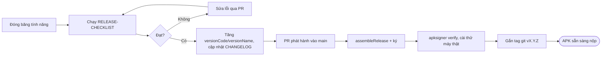

# Deployment — quy trình phát hành bản chính thức

**Mục đích:** cách tạo bản APK release đã ký để nghiệm thu, demo và nộp đồ án.
**Phạm vi:** LearningE **không phát hành lên Google Play** và không có máy chủ. "Production" ở đây là **APK release đã ký** cài trực tiếp lên máy và nộp kèm hồ sơ.

## 1. Phiên bản
| Trường (`app/build.gradle.kts`) | Quy ước |
|---|---|
| `versionName` | `MAJOR.MINOR.PATCH`: `0.x.y` trong lúc phát triển; `1.0.0` bản nộp đồ án; tăng PATCH khi chỉ sửa lỗi |
| `versionCode` | Số nguyên tăng 1 mỗi lần phát hành APK (bắt buộc tăng thì mới cài đè được) |
| Phiên bản CSDL (`DatabaseHelper.DATABASE_VERSION`) | Tăng khi đổi lược đồ hoặc dữ liệu nạp sẵn; viết bước nâng cấp trong `onUpgrade` ([DATABASE-DESIGN](../engineering/DATABASE-DESIGN.md)) |

## 2. Keystore ký ứng dụng (làm một lần)
1. Nhóm trưởng tạo keystore: Android Studio → Build → Generate Signed App Bundle/APK → Create new, hoặc:
```bash
keytool -genkeypair -v -keystore learninge-release.jks -alias learninge -keyalg RSA -keysize 2048 -validity 10000
```
2. Lưu `learninge-release.jks` **ngoài thư mục repo** và sao lưu ở 2 nơi (USB + ổ đám mây cá nhân). Mất keystore thì không cài đè được bản đã phát hành.
3. Tạo `keystore.properties` ở gốc repo (đã nằm trong `.gitignore`, **không commit**) — các biến ở [ENVIRONMENT](ENVIRONMENT.md).
4. Cấu hình `signingConfigs` trong `app/build.gradle.kts` đọc từ `keystore.properties` (làm ở task T-085).

## 3. Quy trình phát hành

Các lệnh:
```bash
./gradlew clean lint testDebugUnitTest
./gradlew assembleRelease
# APK: app/build/outputs/apk/release/app-release.apk
apksigner verify --print-certs app/build/outputs/apk/release/app-release.apk
adb install -r app/build/outputs/apk/release/app-release.apk
git tag -a v1.0.0 -m "Bản nộp đồ án"
git push origin v1.0.0
```
Đổi tên APK thành `LearningE-v1.0.0.apk` trước khi nộp. Có thể đính kèm APK vào GitHub Release của tag tương ứng.

## 4. Đóng gói nộp đồ án
Theo [RELEASE-CHECKLIST](../quality/RELEASE-CHECKLIST.md) mục 5: một tệp `GroupXX_MSSV1_MSSV2_MSSV3_MSSV4.zip` gồm báo cáo Word, "File báo cáo kết quả dự án", mã nguồn (bỏ `build/`, `.gradle/`, `local.properties`, keystore), APK release, sơ đồ `.drawio` + PNG, hình ảnh.

## 5. Rollback
- Giữ APK của mỗi tag; nếu bản mới lỗi nặng khi demo, cài lại APK tag trước (`adb install -r -d` cho phép hạ phiên bản trên bản debug; bản release cần gỡ app trước — mất dữ liệu cục bộ, xuất bộ từ trước bằng Export).
- Trên mã nguồn: `git revert` commit lỗi qua PR, không `force-push` lên `main`.
