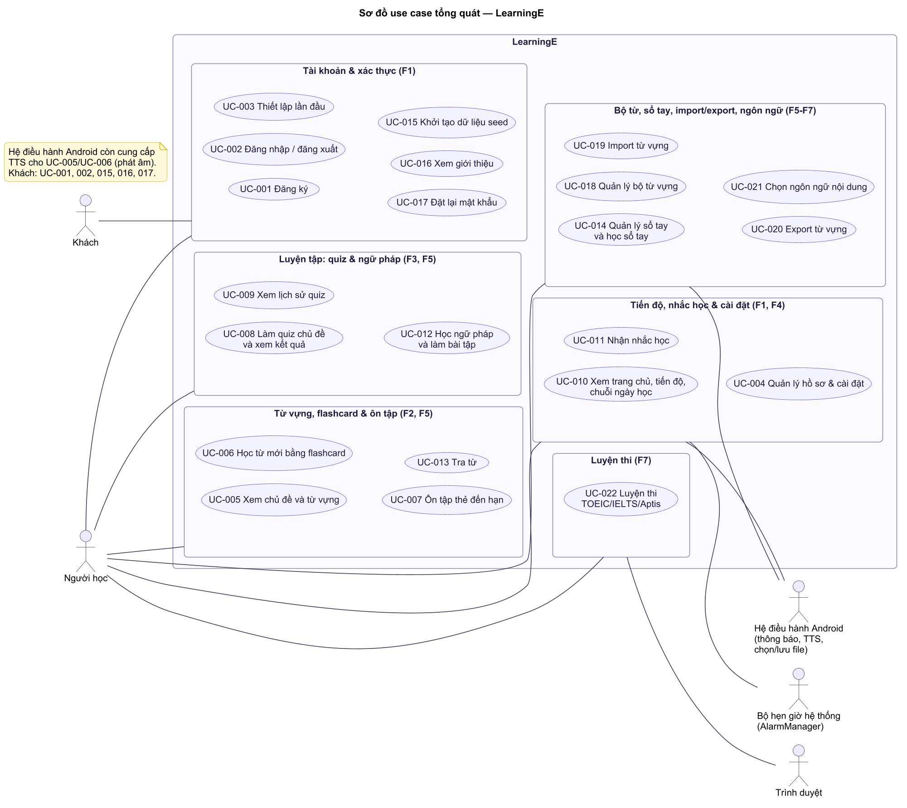
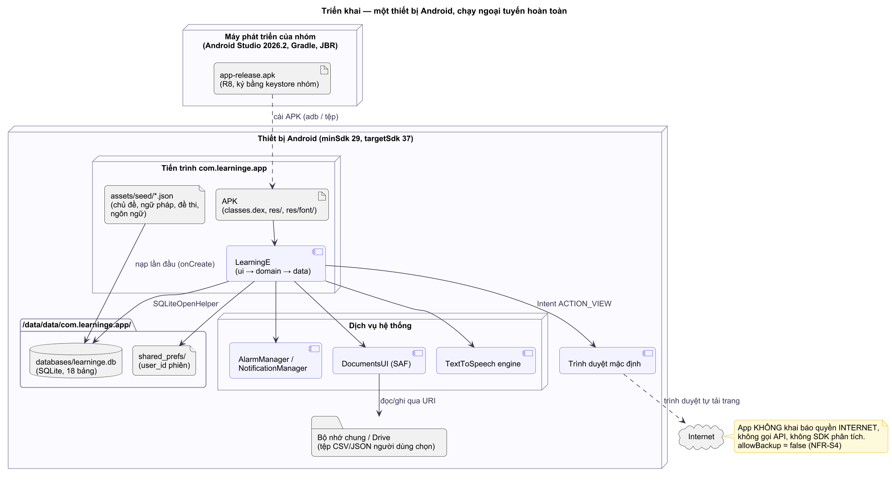

# PRD — Product Requirements Document

> **TỰ SINH** từ bộ phân tích thiết kế đã duyệt của nhóm — không sửa trực tiếp tệp này; đề xuất thay đổi qua Issue/PR để nhóm trưởng cập nhật nguồn và sinh lại. Danh mục tài liệu: [docs/README.md](../README.md).

**Mục đích:** mục tiêu, người dùng, phạm vi, yêu cầu ưu tiên MoSCoW, user story và tiêu chí chấp nhận, nội dung học có sẵn, nghiên cứu người dùng và đối thủ.

## Tôn chỉ dự án
> Tầm nhìn, mục tiêu, phạm vi sơ bộ, ràng buộc, chỉ số thành công. Chi tiết và nguồn: PRD.

## Tầm nhìn (1-2 câu)
Một app Android gọn, chạy offline, giúp người mới học tiếng Anh duy trì thói quen học 10–15 phút mỗi ngày: học từ bằng flashcard, tự kiểm tra bằng quiz và thấy rõ tiến bộ của mình.

## Vấn đề cần giải quyết
Người học cơ bản thiếu một công cụ ôn tập ngắn, không cần mạng, nhắc họ học đều và cho biết đã thuộc bao nhiêu (PRD §3, A1). Về mặt đồ án: nhóm cần một sản phẩm demo được và bộ tài liệu phân tích thiết kế hệ thống đầy đủ để nộp.

## Mục tiêu & chỉ số thành công
| Mục tiêu | Chỉ số | Mục tiêu đo |
|---|---|---|
| Sản phẩm demo được | Số nhóm tính năng Must (F1–F5) chạy end-to-end offline | 5/5 trên emulator và ít nhất 1 máy thật |
| Ổn định khi demo | Số crash ở luồng chính trong buổi kiểm thử cuối | 0 |
| Nội dung đủ để học | Số từ / chủ đề / bài ngữ pháp / câu hỏi seed sẵn | ≥300 từ, ≥10 chủ đề, ≥8 bài ngữ pháp, ≥150 câu hỏi |
| Tài liệu phân tích thiết kế | Sơ đồ use case, activity, sequence, class, ERD + đặc tả chức năng có trong báo cáo | Đủ 100% theo danh sách A8 |
| Nộp đúng hạn | Báo cáo + slide + mã nguồn trên GitHub | Trước ngày nộp (mốc tạm 2026-12-20) |

## Phạm vi sơ bộ

<!-- diagram:usecase/uc-00-overview.puml -->

<!-- /diagram -->
### In-scope
- F1 Tài khoản cục bộ (đăng ký, đăng nhập, đăng xuất, hồ sơ cơ bản).
- F2 Từ vựng theo chủ đề + flashcard (thuộc/chưa thuộc, yêu thích, phát âm TextToSpeech).
- F3 Quiz: trắc nghiệm, sắp xếp từ thành câu, điền từ; chấm điểm, lịch sử.
- F4 Tiến độ (thống kê, chuỗi ngày học) + nhắc học hằng ngày.
- F5 Ngữ pháp theo chủ điểm, tra từ, sổ tay từ do người dùng thêm.
- Tài liệu: phân tích thiết kế, báo cáo theo mẫu HCMUTE, slide bảo vệ.
### Out-of-scope
Server/API, đồng bộ đám mây, đăng nhập mạng xã hội, vai trò admin, đa ngôn ngữ, chấm phát âm, quảng cáo/thanh toán, phát hành Google Play, iOS (PRD §5).

## Người dùng / khách hàng chính
- Người học tiếng Anh trình độ A1–B1, giao diện tiếng Việt (A2).
- Người chấm: giảng viên môn Lập trình Android.

## Ràng buộc (ngân sách, thời gian, pháp lý, công nghệ bắt buộc)

<!-- diagram:architecture/arc-deployment.puml -->

<!-- /diagram -->
- Java native, XML + Material Components, SQLite bằng `SQLiteOpenHelper` (D2); offline hoàn toàn.
- Figma dựng trước khi code giao diện.
- 4 thành viên, 0đ, khoảng 6 tuần.
- Nội dung seed lấy từ nguồn mở phải ghi nguồn và kiểm tra giấy phép; không sao chép dữ liệu của app tham khảo.

## Giả định (ASSUMPTION)
A1–A8 trong PRD §7. Quan trọng nhất: A3 (khối lượng nội dung seed), A6 (mốc 2026-12-20), A8 (cấu trúc báo cáo HCMUTE).

## Rủi ro lớn ban đầu
| Rủi ro | Ảnh hưởng | Giảm thiểu |
|---|---|---|
| Soạn nội dung seed (từ, câu hỏi, ngữ pháp) tốn nhiều thời gian hơn dự kiến | Thiếu dữ liệu khi demo | Chốt định dạng dữ liệu sớm (phase 3), chia việc soạn cho cả nhóm từ tuần 2 |
| 4 người cùng sửa một project Android dễ xung đột | Mất code, chậm tiến độ | Git branch theo tính năng, PR + review, quy ước trong CODING-STANDARDS |
| Làm tài liệu dồn cuối kỳ | Báo cáo thiếu, lệch với code | Viết tài liệu theo phase; báo cáo tổng hợp từ tài liệu đã duyệt |
| TextToSpeech không có giọng tiếng Anh offline trên một số máy | Mất tính năng phát âm khi demo | Kiểm tra gói giọng trên máy demo; báo lỗi thân thiện khi không có |

## Mốc thời gian dự kiến
| Tuần | Khoảng ngày | Mốc |
|---|---|---|
| 1 | 09/11–15/11 | G0–G2: khởi tạo, khám phá, yêu cầu (PRD, use case, flow) |
| 2 | 16/11–22/11 | G3–G4: Figma hoàn chỉnh, kiến trúc, ERD, backlog, test plan; bắt đầu soạn nội dung |
| 3–4 | 23/11–06/12 | Build F1–F3 |
| 5 | 07/12–13/12 | Build F4–F5, hoàn thiện nội dung seed |
| 6 | 14/12–20/12 | Kiểm thử, sửa lỗi, báo cáo + slide, nghiệm thu nội bộ |

## Yêu cầu sản phẩm
> Tính năng, user story, tiêu chí chấp nhận, ưu tiên. Mỗi story có ID để truy vết (REQ → US → AC → TC).
> Thuật ngữ theo Glossary. Quy tắc nghiệp vụ chi tiết (BR-xxx) ở SRS; luồng (FLOW-xxx) ở Use-Cases (luồng).

## Bối cảnh & mục tiêu (liên kết PRD)
LearningE là app Android (Java, SQLite) học tiếng Anh offline cho người mới học (persona chính P1 — PRD (nghiên cứu người dùng)). Mục tiêu sản phẩm: giúp người dùng học đều mỗi ngày và nhớ lâu, nhờ flashcard + ôn tập ngắt quãng (Leitner 5 hộp), quiz, nhắc học và theo dõi tiến độ. Mục tiêu đồ án và chỉ số: PRD §Mục tiêu.

## Phạm vi
### In-scope
F1 Tài khoản cục bộ · F2 Từ vựng + flashcard + ôn tập · F3 Quiz · F4 Tiến độ + nhắc học · F5 Ngữ pháp + tra từ + sổ tay · **F6 Bộ từ vựng tự tạo + import/export** · **F7 Ngôn ngữ nội dung cấu hình được + luyện thi TOEIC/IELTS/Aptis** (F6, F7  để đáp ứng rubric môn học). Toàn bộ chạy offline, giao diện tiếng Việt; nội dung chính Anh–Việt cấp độ A1–B1, có bộ mẫu tiếng Nhật.
### Non-goals
Server/API và đồng bộ đám mây; đăng nhập Google/Facebook; vai trò admin và quản trị nội dung có sẵn trong app; đa ngôn ngữ **giao diện** (UI chỉ tiếng Việt — ngôn ngữ nội dung học thì cấu hình được, REQ-018); đề thi chính thức của ETS/IDP/British Council; chấm phát âm/nhận diện giọng nói; quảng cáo, thanh toán; phát hành Google Play; iOS; bảng xếp hạng/cộng đồng.

## Danh sách yêu cầu (ưu tiên MoSCoW)
| REQ | Yêu cầu / tính năng | Ưu tiên | Nguồn (ai yêu cầu) | Ghi chú |
|---|---|---|---|---|
| REQ-001 | Tài khoản cục bộ: đăng ký, đăng nhập, đăng xuất, đổi mật khẩu, xóa tài khoản | Must | Nhóm (PRD F1) | US-001..US-005 |
| REQ-002 | Thiết lập lần đầu: cấp độ, mục tiêu hằng ngày, giờ nhắc học | Must | nhóm trưởng (PRD (nghiên cứu người dùng) I1) | US-006 |
| REQ-003 | Từ vựng theo chủ đề + flashcard + phát âm + yêu thích | Must | Nhóm (F2) | US-007..US-011 |
| REQ-004 | Ôn tập ngắt quãng theo Leitner 5 hộp | Must | nhóm trưởng (Glossary (kiến thức miền) §2) | US-012 |
| REQ-005 | Quiz theo chủ đề: 5 dạng câu hỏi (BR-020), chấm điểm, lịch sử | Must | Nhóm (F3) | US-013..US-015 |
| REQ-006 | Trang chủ hôm nay, thống kê tiến độ, chuỗi ngày học | Must | Nhóm (F4) | US-016..US-018 |
| REQ-007 | Nhắc học hằng ngày bằng thông báo cục bộ | Must | Nhóm (F4) | US-019 |
| REQ-008 | Bài ngữ pháp + bài tập ngữ pháp | Must | Nhóm (F5) | US-020, US-021 |
| REQ-009 | Tra từ trong dữ liệu có sẵn và sổ tay | Must | Nhóm (F5) | US-022 |
| REQ-010 | Sổ tay từ cá nhân: thêm, sửa, xóa, học bằng flashcard | Must | Nhóm (F5); thay đổi phạm vi | US-023, US-024; sổ tay là bộ mặc định "Sổ tay của tôi" của REQ-016 |
| REQ-011 | Nạp dữ liệu seed khi cài app | Must | Nhóm (PRD A3) | US-025 |
| REQ-012 | Màn hình Giới thiệu: thông tin nhóm, nguồn dữ liệu, giấy phép | Should | Glossary (kiến thức miền) §Pháp lý | US-026 |
| REQ-013 | Chế độ tối (dark mode) | Should | nhóm trưởng; thay đổi phạm vi (PQ-4) | Theo hệ thống, dùng Material DayNight; token màu sáng/tối trong UI-UX-SPECIFICATION (hệ thống thiết kế) |
| REQ-014 | Đặt lại mật khẩu bằng câu hỏi bảo mật | Must | Phan Anh Tuấn | Offline không gửi email được; US-027 |
| REQ-015 | Widget màn hình chính hiện số thẻ cần ôn | Won't (vòng này) | thay đổi phạm vi | Nhường thời gian cho REQ-016..019 |
| REQ-016 | Bộ từ vựng do người dùng tạo: tạo/đổi tên/xóa bộ; thêm/sửa/xóa từ; học/ôn/quiz trên bộ | Must | Rubric "chức năng cơ bản" | US-028..US-031 |
| REQ-017 | Import/export bộ từ vựng (CSV, JSON) | Must | Rubric "nâng cao" | US-032, US-033 |
| REQ-018 | Ngôn ngữ nội dung cấu hình được (Anh, Nhật, Trung, Hàn…) | Must | Rubric "nâng cao" | US-034 |
| REQ-019 | Luyện thi TOEIC/IELTS/Aptis: bộ từ theo kỳ thi, thi thử có giờ, tài nguyên chính thức | Must | Rubric "nâng cao" | US-035..US-037 |

## User stories & Acceptance criteria
Vai trò duy nhất: **Người học** (đã hoặc chưa đăng nhập).

### F1 — Tài khoản (REQ-001)
#### US-001 (REQ-001): Là người học mới, tôi muốn đăng ký tài khoản để dữ liệu học được lưu riêng cho tôi
- AC-001.1: Given chưa có tài khoản, When nhập tên hiển thị, tên đăng nhập, mật khẩu, xác nhận mật khẩu hợp lệ và bấm Đăng ký, Then tài khoản được tạo, mật khẩu lưu dạng băm (BR-002), và app chuyển sang Thiết lập lần đầu (US-006).
- AC-001.2 (ngoại lệ): Given tên đăng nhập đã tồn tại, When bấm Đăng ký, Then không tạo tài khoản và hiện "Tên đăng nhập đã được sử dụng" dưới trường đó.
- AC-001.3 (ngoại lệ): Given một trường vi phạm quy tắc kiểm tra (SRS §Validation), When bấm Đăng ký, Then hiện lỗi tại đúng trường sai, giữ nguyên dữ liệu đã nhập (trừ mật khẩu).
- AC-001.4: Given đang đăng ký, When chọn 1 trong 5 câu hỏi bảo mật có sẵn (BR-009) và nhập câu trả lời 2–50 ký tự, Then câu trả lời được chuẩn hóa và lưu dạng băm (BR-007); thiếu một trong hai thì không cho đăng ký.
#### US-002 (REQ-001): Là người học, tôi muốn đăng nhập và đăng xuất để dùng đúng dữ liệu của mình
- AC-002.1: Given đúng tên đăng nhập và mật khẩu, When bấm Đăng nhập, Then vào Trang chủ trong ≤ 1 giây và phiên đăng nhập được ghi nhớ đến khi đăng xuất (BR-004).
- AC-002.2 (ngoại lệ): Given sai tên đăng nhập hoặc mật khẩu, When bấm Đăng nhập, Then hiện thông báo chung "Tên đăng nhập hoặc mật khẩu không đúng" (không nói rõ sai phần nào).
- AC-002.3 (ngoại lệ): Given một tên đăng nhập đã bị sai mật khẩu 4 lần liên tiếp, When nhập sai lần thứ 5, Then khóa ngay đăng nhập tên đăng nhập đó 60 giây và hiện thời gian còn lại (BR-003); lần sai thứ 1–4 chưa khóa.
- AC-002.4: Given đang đăng nhập, When bấm Đăng xuất và xác nhận, Then quay về màn hình Đăng nhập; mở lại app vẫn ở màn hình Đăng nhập.
#### US-003 (REQ-001): Là người học, tôi muốn xem và sửa hồ sơ, cài đặt để điều chỉnh việc học
- AC-003.1: Given đã đăng nhập, When mở tab Tôi, Then thấy tên hiển thị, cấp độ, mục tiêu hằng ngày, giờ nhắc học, công tắc nhắc học.
- AC-003.2: When đổi một giá trị hợp lệ và lưu, Then giá trị mới có hiệu lực ngay (lịch nhắc được đặt lại nếu đổi giờ nhắc — BR-030).
#### US-004 (REQ-001): Là người học, tôi muốn đổi mật khẩu để bảo vệ tài khoản
- AC-004.1: Given nhập đúng mật khẩu hiện tại và mật khẩu mới hợp lệ (khác mật khẩu cũ), When lưu, Then mật khẩu mới có hiệu lực ở lần đăng nhập sau.
- AC-004.2 (ngoại lệ): Given mật khẩu hiện tại sai, When lưu, Then báo "Mật khẩu hiện tại không đúng", không đổi gì.
#### US-005 (REQ-001): Là người học, tôi muốn xóa tài khoản để xóa toàn bộ dữ liệu của tôi khỏi máy
- AC-005.1: Given đã đăng nhập, When chọn Xóa tài khoản, nhập lại mật khẩu đúng và xác nhận, Then xóa tài khoản và mọi dữ liệu thuộc người dùng đó (cài đặt, tiến độ thẻ, yêu thích, bộ từ riêng và các từ trong bộ, lượt quiz và câu trả lời, lượt thi thử và câu trả lời, nhật ký học — BR-005), hủy lịch nhắc, về màn hình Đăng nhập.
- AC-005.2 (ngoại lệ): Given bấm Hủy ở hộp xác nhận, Then không xóa gì.

### F1 — Thiết lập lần đầu (REQ-002)
#### US-006 (REQ-002): Là người học vừa đăng ký, tôi muốn chọn cấp độ, mục tiêu và giờ nhắc để app phù hợp với tôi
- AC-006.1: Given vừa đăng ký, When hoàn thành 3 bước (cấp độ A1/A2/B1; mục tiêu 5/10/15/20 từ mỗi ngày; giờ nhắc), Then lưu cài đặt và vào Trang chủ.
- AC-006.2: Given ở bước giờ nhắc trên Android 13+, When bật nhắc học, Then app xin quyền thông báo; nếu bị từ chối thì vẫn vào Trang chủ, nhắc học ở trạng thái tắt và có hướng dẫn bật lại trong Cài đặt.
- AC-006.3: Given bấm "Bỏ qua", Then dùng mặc định: A1, 10 từ/ngày, nhắc 20:00 (BR-006).

### F2 — Từ vựng (REQ-003)
#### US-007 (REQ-003): Là người học, tôi muốn xem danh sách chủ đề để chọn nội dung muốn học
- AC-007.1: Given đã có dữ liệu seed, When mở tab Học, Then thấy ≥10 chủ đề, mỗi chủ đề hiện tên, icon, cấp độ, tiến độ "đã thuộc x/y từ".
- AC-007.2: When lọc theo cấp độ (Tất cả/A1/A2/B1), Then chỉ hiện chủ đề đúng cấp độ; mặc định lọc theo cấp độ trong cài đặt.
#### US-008 (REQ-003): Là người học, tôi muốn xem danh sách từ và chi tiết từng từ
- AC-008.1: When mở một chủ đề, Then thấy danh sách từ với từ, phiên âm, nghĩa và nhãn trạng thái (Mới/Đang học/Đã thuộc).
- AC-008.2: When chạm một từ, Then mở Chi tiết từ: từ, phiên âm IPA, từ loại, nghĩa, câu ví dụ Anh + Việt, nút phát âm, nút yêu thích, nút thêm vào sổ tay.
#### US-009 (REQ-003): Là người học, tôi muốn học từ mới bằng flashcard để ghi nhớ chủ động
- AC-009.1: Given chủ đề còn từ Mới, When bấm "Học từ mới", Then mở phiên gồm tối đa N thẻ (N = số từ mục tiêu còn lại trong ngày, tối thiểu 5 — BR-010).
- AC-009.2: When chạm thẻ, Then lật thẻ (mặt trước: từ + phiên âm; mặt sau: nghĩa + ví dụ) có hiệu ứng ≤ 400 ms.
- AC-009.3: When chọn "Đã nhớ" hoặc "Chưa nhớ", Then thẻ vào hộp Leitner theo BR-011 và hiện thẻ kế tiếp; hết phiên hiện màn hình Kết quả phiên (số từ đã nhớ/chưa nhớ).
- AC-009.4 (ngoại lệ): Given chủ đề không còn từ Mới, Then nút "Học từ mới" bị ẩn và hiện "Bạn đã học hết từ mới của chủ đề này", gợi ý Ôn tập hoặc Quiz.
- AC-009.5: Given thoát giữa phiên, Then các thẻ đã đánh giá được lưu; thẻ chưa đánh giá vẫn là Mới.
#### US-010 (REQ-003): Là người học, tôi muốn nghe phát âm từ và câu ví dụ
- AC-010.1: Given máy có giọng tiếng Anh cho TextToSpeech, When bấm nút loa, Then đọc từ (hoặc câu ví dụ) bằng giọng en-US trong ≤ 1 giây.
- AC-010.2 (ngoại lệ): Given máy thiếu dữ liệu giọng hoặc không hỗ trợ, When bấm nút loa, Then hiện "Máy chưa có giọng đọc tiếng Anh" kèm nút mở cài đặt giọng đọc; app không bị dừng.
#### US-011 (REQ-003): Là người học, tôi muốn đánh dấu từ yêu thích để xem lại nhanh
- AC-011.1: When bấm biểu tượng yêu thích ở Chi tiết từ hoặc danh sách từ, Then trạng thái đổi ngay và từ xuất hiện trong mục Yêu thích (tab Tra từ).
- AC-011.2: When bấm lại, Then bỏ yêu thích.

### F2 — Ôn tập (REQ-004)
#### US-012 (REQ-004): Là người học, tôi muốn ôn các thẻ đến hạn để không quên từ đã học
- AC-012.1: Given có thẻ với ngày ôn tiếp ≤ hôm nay, When bấm "Ôn tập" ở Trang chủ, Then mở phiên flashcard gồm các thẻ đến hạn, sắp theo ngày ôn sớm nhất trước, tối đa 50 thẻ/phiên (BR-013).
- AC-012.2: When chọn "Đã nhớ", Then thẻ lên 1 hộp và ngày ôn tiếp = hôm nay + khoảng của hộp mới (1/2/4/7/14 ngày); When chọn "Chưa nhớ", Then thẻ về hộp 1, ôn lại ngày mai (BR-011, BR-012).
- AC-012.3 (ngoại lệ): Given không có thẻ đến hạn, Then nút Ôn tập hiện "Hôm nay không có thẻ cần ôn" và bị vô hiệu.

### F3 — Quiz (REQ-005)
#### US-013 (REQ-005): Là người học, tôi muốn làm quiz theo chủ đề để tự kiểm tra
- AC-013.1: Given chọn một chủ đề có ≥ 4 từ, When bấm "Bắt đầu quiz", Then tạo bài 10 câu ngẫu nhiên trộn 5 dạng: trắc nghiệm Anh→Việt, trắc nghiệm Việt→Anh, nghe chọn từ, điền từ, sắp xếp câu (BR-020).
- AC-013.2: When trả lời một câu, Then hiện ngay đúng/sai và đáp án đúng; không trừ điểm, không khóa bài (BR-022).
- AC-013.3 (ngoại lệ): Given máy không có giọng TTS, Then không sinh câu dạng "nghe chọn từ" mà thay bằng trắc nghiệm nghĩa.
- AC-013.4 (ngoại lệ): Given thoát giữa bài, Then hỏi xác nhận; nếu thoát thì không lưu lượt làm.
#### US-014 (REQ-005): Là người học, tôi muốn xem kết quả quiz để biết mình sai ở đâu
- AC-014.1: When trả lời xong câu cuối, Then hiện điểm = số câu đúng/tổng × 100 (làm tròn số nguyên), số câu đúng, thời gian làm, danh sách câu sai kèm đáp án đúng.
- AC-014.2: Then các từ trả lời sai được đưa về hộp 1 (BR-021) và lượt làm được lưu lịch sử.
#### US-015 (REQ-005): Là người học, tôi muốn xem lịch sử quiz để thấy mình tiến bộ
- AC-015.1: When mở Lịch sử quiz, Then thấy danh sách lượt làm mới nhất trước: chủ đề/bài ngữ pháp, ngày giờ, điểm.
- AC-015.2 (trạng thái rỗng): Given chưa làm quiz nào, Then hiện "Bạn chưa làm bài kiểm tra nào" và nút đến danh sách quiz.

### F4 — Tiến độ (REQ-006)
#### US-016 (REQ-006): Là người học, tôi muốn Trang chủ cho biết hôm nay cần làm gì
- AC-016.1: When mở Trang chủ, Then thấy: lời chào theo tên, chuỗi ngày học, số từ mới đã học hôm nay / mục tiêu, số thẻ cần ôn hôm nay, nút "Ôn tập", nút "Học tiếp" (chủ đề học gần nhất).
- AC-016.2: Given người dùng mới chưa học gì, Then nút "Học tiếp" thay bằng "Chọn chủ đề đầu tiên".
#### US-017 (REQ-006): Là người học, tôi muốn xem thống kê tiến độ
- AC-017.1: When mở màn hình Tiến độ, Then thấy tổng số từ đã thuộc / tổng số từ; số từ theo trạng thái Mới/Đang học/Đã thuộc; tiến độ từng chủ đề; điểm quiz trung bình 7 ngày gần nhất; biểu đồ số hoạt động học 7 ngày gần nhất.
- AC-017.2: Các số liệu khớp với dữ liệu trong CSDL (người kiểm thử đối chiếu bằng truy vấn — BR-033).
#### US-018 (REQ-006): Là người học, tôi muốn thấy chuỗi ngày học để có động lực học đều
- AC-018.1: Given hôm qua có hoạt động học, When hoàn thành hoạt động học đầu tiên hôm nay, Then chuỗi +1 (BR-031).
- AC-018.2: Given hôm qua không có hoạt động học, When hoàn thành hoạt động học hôm nay, Then chuỗi = 1.
- AC-018.3: Chuỗi dài nhất từng đạt được hiển thị cạnh chuỗi hiện tại.

### F4 — Nhắc học (REQ-007)
#### US-019 (REQ-007): Là người học, tôi muốn được nhắc học mỗi ngày vào giờ tôi chọn
- AC-019.1: Given nhắc học bật và đã cấp quyền thông báo, When đến giờ nhắc (sai lệch cho phép ≤ 15 phút) và hôm nay chưa đạt mục tiêu, Then hiện thông báo "Đến giờ học rồi! Bạn còn x từ và y thẻ cần ôn"; chạm vào mở Trang chủ (BR-030).
- AC-019.2: Given hôm nay đã đạt mục tiêu, Then không hiện thông báo.
- AC-019.3: Given máy khởi động lại, Then lịch nhắc vẫn còn hiệu lực.
- AC-019.4 (ngoại lệ): Given quyền thông báo bị thu hồi, When mở Cài đặt, Then công tắc nhắc học hiện trạng thái tắt kèm nút "Cấp quyền".

### F5 — Ngữ pháp (REQ-008)
#### US-020 (REQ-008): Là người học, tôi muốn đọc bài ngữ pháp theo chủ điểm
- AC-020.1: When mở tab Luyện tập → Ngữ pháp, Then thấy ≥ 8 bài, mỗi bài có tên, cấp độ, trạng thái đã đọc/chưa đọc.
- AC-020.2: When mở một bài, Then thấy công thức, cách dùng, ví dụ (có nút phát âm), lỗi thường gặp; đọc đến cuối bài thì bài được đánh dấu "đã đọc".
#### US-021 (REQ-008): Là người học, tôi muốn làm bài tập sau mỗi bài ngữ pháp
- AC-021.1: Given bài có ≥ 5 câu hỏi (BR-056), When bấm "Làm bài tập", Then làm 5–10 câu trắc nghiệm (loại câu GRAMMAR), mỗi câu sai có giải thích; kết quả lưu vào lịch sử quiz (BR-023). Bài có < 5 câu thì ẩn nút và báo "Bài này chưa có bài tập".

### F5 — Tra từ & sổ tay (REQ-009, REQ-010)
#### US-022 (REQ-009): Là người học, tôi muốn tra từ nhanh
- AC-022.1: When gõ ≥ 1 ký tự vào ô tìm kiếm, Then sau ≤ 300 ms hiện kết quả khớp tiền tố từ tiếng Anh hoặc chứa chuỗi trong nghĩa tiếng Việt, không phân biệt hoa thường và dấu tiếng Việt (BR-040), gồm từ seed và từ trong sổ tay (có nhãn "Sổ tay").
- AC-022.2 (trạng thái rỗng): Given không có kết quả, Then hiện "Không tìm thấy “[từ khóa đã gõ]”" và nút "Thêm vào sổ tay" điền sẵn từ khóa.
#### US-023 (REQ-010): Là người học, tôi muốn thêm, sửa, xóa từ trong sổ tay của tôi
- AC-023.1: When nhập từ (bắt buộc), nghĩa (bắt buộc), phiên âm, ví dụ, ghi chú (tùy chọn) và lưu, Then từ xuất hiện đầu danh sách Sổ tay.
- AC-023.2 (ngoại lệ): Given từ đã có trong sổ tay của chính người dùng, When lưu, Then báo "Từ này đã có trong sổ tay" và mở mục đã có.
- AC-023.3: When xóa một từ và xác nhận, Then từ biến mất khỏi sổ tay và kết quả tra.
#### US-024 (REQ-010): Là người học, tôi muốn học các từ trong sổ tay bằng flashcard
- AC-024.1: Given sổ tay có ≥ 1 từ, When bấm "Học sổ tay", Then mở phiên flashcard như US-009, tiến độ thẻ áp dụng Leitner như từ seed.

#### US-027 (REQ-014, thay đổi phạm vi): Là người học quên mật khẩu, tôi muốn đặt lại mật khẩu bằng câu hỏi bảo mật
- AC-027.1: Given ở màn hình Đăng nhập, When bấm "Quên mật khẩu?" và nhập tên đăng nhập có tồn tại, Then hiện câu hỏi bảo mật của tài khoản đó.
- AC-027.2: Given trả lời đúng (so sánh sau chuẩn hóa — BR-007), When nhập mật khẩu mới hợp lệ + xác nhận, Then mật khẩu được đổi, bộ đếm sai đăng nhập về 0, quay về Đăng nhập với thông báo "Đã đặt lại mật khẩu".
- AC-027.3 (ngoại lệ): Given trả lời sai, Then báo "Câu trả lời không đúng"; sai 3 lần liên tiếp thì khóa đặt lại mật khẩu 5 phút (BR-008). Given tên đăng nhập không tồn tại, Then báo "Không tìm thấy tài khoản".

### F6 — Bộ từ vựng & import/export (REQ-016, REQ-017 — thay đổi phạm vi)
#### US-028 (REQ-016): Là người học, tôi muốn tạo bộ từ vựng của riêng mình để gom các từ tôi cần học
- AC-028.1: Given ở tab Học → "Bộ của tôi", When bấm "Tạo bộ", nhập tên (1–50 ký tự), mô tả (tùy chọn), chọn ngôn ngữ (mặc định Tiếng Anh) và lưu, Then bộ mới xuất hiện đầu danh sách "Bộ của tôi" với 0 từ.
- AC-028.2 (ngoại lệ): Given đã có bộ cùng tên (không phân biệt hoa thường) của chính người dùng, When lưu, Then báo "Bạn đã có bộ tên này" và không tạo (BR-044).
- AC-028.3: Given vừa đăng ký, When mở "Bộ của tôi", Then đã có sẵn bộ "Sổ tay của tôi" (BR-046).
#### US-029 (REQ-016): Là người học, tôi muốn đổi tên hoặc xóa bộ từ của tôi
- AC-029.1: When đổi tên hợp lệ và lưu, Then tên mới hiển thị ở mọi nơi.
- AC-029.2: When chọn "Xóa bộ" và xác nhận, Then bộ, các từ trong bộ và tiến độ học của các từ đó bị xóa (BR-045); bộ "Sổ tay của tôi" không có nút xóa.
- AC-029.3 (ngoại lệ): Given bộ có sẵn (15 chủ đề, bộ luyện thi), Then không có nút sửa/xóa (BR-043).
#### US-030 (REQ-016): Là người học, tôi muốn thêm, sửa, xóa từ trong bộ của tôi
- AC-030.1: When mở bộ → "Thêm từ", nhập từ và nghĩa (bắt buộc), cách đọc, ví dụ, bản dịch ví dụ (tùy chọn) rồi lưu, Then từ xuất hiện trong bộ; số từ của bộ tăng 1.
- AC-030.2 (ngoại lệ): Given từ đã có trong bộ, When lưu, Then báo "Từ này đã có trong bộ" (BR-047).
- AC-030.3: When sửa hoặc xóa (có xác nhận) một từ, Then thay đổi hiện ngay; xóa từ thì xóa luôn tiến độ học của từ.
- AC-030.4: Given đang xem một từ có sẵn (Chi tiết từ), When bấm "Lưu vào bộ", chọn một bộ của tôi, Then từ được chép vào bộ đó (dữ liệu có sẵn không bị sửa).
#### US-031 (REQ-016): Là người học, tôi muốn học, ôn và làm quiz trên bộ tôi tự tạo
- AC-031.1: Given bộ có ≥ 1 từ, When bấm "Học", Then mở phiên flashcard như US-009 với các từ của bộ; tiến độ theo Leitner (BR-011, BR-012) và thẻ đến hạn xuất hiện trong "Ôn tập" chung (US-012).
- AC-031.2: Given bộ có ≥ 4 từ, When bấm "Làm quiz", Then tạo quiz như US-013 từ các từ của bộ.
#### US-032 (REQ-017): Là người học, tôi muốn nhập (import) từ vựng từ file để không phải gõ tay
- AC-032.1: Given có file CSV hoặc JSON đúng định dạng (BR-048, BR-049), When chọn "Import" → chọn file bằng trình chọn file của Android, Then hiện màn hình xem trước: tổng số dòng, số dòng hợp lệ, số dòng trùng, số dòng lỗi kèm số dòng và lý do, 5 dòng đầu.
- AC-032.2: When chọn bộ đích (bộ mới hoặc bộ có sẵn của tôi) và bấm "Nhập", Then các dòng hợp lệ được thêm trong một giao dịch ≤ 3 giây với 2000 dòng, dòng trùng/lỗi bị bỏ qua, và hiện "Đã nhập x từ, bỏ qua y" (BR-050).
- AC-032.3 (ngoại lệ): Given file > 1 MB, > 2000 dòng, sai định dạng hoặc không có dòng hợp lệ, Then không nhập gì và báo lý do cụ thể.
#### US-033 (REQ-017): Là người học, tôi muốn xuất (export) một bộ từ ra file để sao lưu hoặc chia sẻ
- AC-033.1: Given một bộ bất kỳ có ≥ 1 từ, When chọn "Export", chọn CSV hoặc JSON và nơi lưu, Then file `<tên bộ>_<yyyyMMdd>.csv|json` được ghi, mở lại bằng Import cho ra đúng số từ và nội dung (BR-051).
- AC-033.2 (ngoại lệ): Given người dùng hủy chọn nơi lưu hoặc ghi file lỗi, Then không có file dở dang và báo "Không thể xuất file".

### F7 — Đa ngôn ngữ nội dung & luyện thi (REQ-018, REQ-019 — thay đổi phạm vi)
#### US-034 (REQ-018): Là người học ngôn ngữ khác (Nhật, Trung, Hàn), tôi muốn tạo và học bộ từ của ngôn ngữ đó trong cùng app
- AC-034.1: Given tạo bộ mới, When chọn ngôn ngữ Tiếng Nhật / Tiếng Trung / Tiếng Hàn / Tiếng Anh, Then nhãn trường "cách đọc" đổi theo ngôn ngữ (BR-052) và phát âm dùng giọng của ngôn ngữ đó.
- AC-034.2: Given cài app lần đầu, Then có sẵn bộ mẫu "Tiếng Nhật cơ bản" 20 từ (từ, kana/romaji, nghĩa, ví dụ) học được bằng flashcard và quiz như bộ tiếng Anh.
- AC-034.3: Thêm một ngôn ngữ mới chỉ cần thêm 1 dòng vào dữ liệu `languages` và (tùy chọn) 1 file seed — không sửa mã Java (kiểm chứng trong TESTING-STRATEGY TC-NFR-E2).
- AC-034.4 (ngoại lệ): Given máy thiếu giọng đọc của ngôn ngữ đó, Then áp dụng như AC-010.2 và quiz không sinh câu dạng nghe.
#### US-035 (REQ-019): Là người ôn thi TOEIC/IELTS/Aptis, tôi muốn có bộ từ vựng theo từng kỳ thi
- AC-035.1: When mở tab Luyện tập → "Luyện thi", Then thấy 3 kỳ thi TOEIC, IELTS, Aptis, mỗi kỳ thi có bộ từ riêng (TOEIC 60 từ, IELTS 60 từ, Aptis 40 từ) học được bằng flashcard, ôn tập, quiz.
#### US-036 (REQ-019): Là người ôn thi, tôi muốn làm bài thi thử có giới hạn thời gian để làm quen áp lực phòng thi
- AC-036.1: When chọn một đề thi thử (ví dụ "TOEIC Reading Part 5 — Đề 1: 30 câu, 20 phút"), Then bắt đầu bài có đồng hồ đếm ngược, thanh tiến độ câu, cho chuyển qua lại giữa các câu và đánh dấu câu để xem lại.
- AC-036.2: When bấm "Nộp bài" (có xác nhận nếu còn câu chưa làm) hoặc hết giờ (tự nộp), Then hiện điểm = số câu đúng/tổng × 100, thời gian làm, từng câu với đáp án đúng và giải thích; ghi chú rõ "Điểm luyện tập, không quy đổi sang thang điểm chính thức" (BR-054).
- AC-036.3: Then lượt thi được lưu vào lịch sử thi thử; từ vựng gắn với câu sai được đưa về hộp 1 để ôn (BR-055).
- AC-036.4 (ngoại lệ): Given thoát app giữa bài, When mở lại trong thời gian còn lại, Then tiếp tục đúng câu và đồng hồ; quá giờ thì bài được tự nộp với các câu đã trả lời.
#### US-037 (REQ-019): Là người ôn thi, tôi muốn biết nguồn chính thức để luyện thêm
- AC-037.1: When mở "Luyện thi" → "Tài nguyên chính thức", Then thấy danh sách liên kết tới trang chính thức của TOEIC (ETS), IELTS và British Council Aptis kèm mô tả ngắn; chạm vào mở trình duyệt của máy (app không cần quyền Internet).
- AC-037.2 (ngoại lệ): Given máy không có trình duyệt, Then báo "Không tìm thấy trình duyệt để mở liên kết".

### Hệ thống (REQ-011, REQ-012)
#### US-025 (REQ-011): Là người học, tôi muốn có sẵn nội dung ngay khi cài app để học được luôn mà không cần mạng
- AC-025.1: Given cài app lần đầu, When mở app, Then CSDL được tạo và nạp 15 chủ đề, 450 từ (30 từ/chủ đề, mỗi từ 1 câu ví dụ Anh–Việt), 10 bài ngữ pháp, 100 câu hỏi ngữ pháp, 4 ngôn ngữ (en, ja, zh, ko), 3 bộ luyện thi, 1 bộ tiếng Nhật, 2 đề thi thử trong ≤ 5 giây, có màn hình chờ. Danh sách: §Nội dung seed.
- AC-025.2 (ngoại lệ): Given nạp seed lỗi giữa chừng, Then không để CSDL dở dang (giao dịch rollback) và hiện "Không thể khởi tạo dữ liệu, vui lòng mở lại app".
#### US-026 (REQ-012): Là người học hoặc giảng viên, tôi muốn xem Giới thiệu để biết nhóm làm app và nguồn dữ liệu
- AC-026.1: When mở Tôi → Giới thiệu, Then thấy tên app, phiên bản, 4 thành viên, môn học, danh sách nguồn dữ liệu và giấy phép.

## Chỉ số thành công
| Chỉ số | Hiện tại | Mục tiêu | Cách đo |
|---|---|---|---|
| Số US Must đạt toàn bộ AC | 0 | 100% (36 US Must sau thay đổi phạm vi) | báo cáo kiểm thử |
| Mục rubric có minh chứng file/hàm | 0 | 10/10 mục chức năng trong "File báo cáo kết quả dự án" | Bảng tiến độ trong file báo cáo |
| Crash ở luồng chính trong kiểm thử cuối | Chưa có | 0 | Chạy kịch bản UAT trên emulator + 1 máy thật |
| Nội dung seed | 0 | 15 chủ đề, 450 từ, 450 câu ví dụ, 10 bài ngữ pháp, 100 câu hỏi ngữ pháp; + 3 bộ luyện thi (160 từ), 1 bộ tiếng Nhật (20 từ), 2 đề thi thử (50 câu) | Truy vấn đếm bảng trong CSDL |
| Thời gian một phiên học 10 từ | Chưa đo | 3–7 phút | Thử với 3–4 người (PRD (nghiên cứu người dùng) H2) |
| Tỷ lệ người thử bật nhắc học | Chưa đo | ≥ 5/8 | Phỏng vấn nhanh H1 |

## Nội dung seed
Mỗi chủ đề 30 từ thông dụng nhất của chủ đề ở cấp độ đó. Nhóm có thể đổi tên chủ đề trước 18/11.
| # | Chủ đề (tiếng Việt / English) | Cấp độ | Người soạn đề xuất |
|---|---|---|---|
| T01 | Gia đình / Family | A1 | Phan Anh Tuấn |
| T02 | Số đếm & thời gian / Numbers & Time | A1 | Phan Anh Tuấn |
| T03 | Màu sắc & hình dạng / Colors & Shapes | A1 | Phan Anh Tuấn |
| T04 | Cơ thể người / The Body | A1 | Phan Anh Tuấn |
| T05 | Đồ ăn & thức uống / Food & Drinks | A1 | Nguyễn Đức Quang Vinh |
| T06 | Động vật / Animals | A1 | Nguyễn Đức Quang Vinh |
| T07 | Nhà cửa & đồ dùng / House & Home | A1 | Nguyễn Đức Quang Vinh |
| T08 | Trường học / School | A2 | Nguyễn Đức Quang Vinh |
| T09 | Quần áo & mua sắm / Clothes & Shopping | A2 | Nguyễn Tấn Thành |
| T10 | Thời tiết & các mùa / Weather & Seasons | A2 | Nguyễn Tấn Thành |
| T11 | Thành phố & phương tiện / City & Transport | A2 | Nguyễn Tấn Thành |
| T12 | Sở thích & thể thao / Hobbies & Sports | A2 | Nguyễn Tấn Thành |
| T13 | Công việc & nghề nghiệp / Work & Jobs | B1 | Lê Văn Tấn Lực |
| T14 | Du lịch / Travel | B1 | Lê Văn Tấn Lực |
| T15 | Sức khỏe / Health | B1 | Lê Văn Tấn Lực |

| # | Bài ngữ pháp | Cấp độ | Số câu bài tập |
|---|---|---|---|
| G01 | Động từ "to be" (am/is/are) | A1 | 10 |
| G02 | Thì hiện tại đơn | A1 | 10 |
| G03 | Thì hiện tại tiếp diễn | A1 | 10 |
| G04 | Mạo từ a/an/the | A1 | 10 |
| G05 | Danh từ số ít/số nhiều; đếm được/không đếm được | A1 | 10 |
| G06 | Thì quá khứ đơn | A2 | 10 |
| G07 | Tương lai: will và be going to | A2 | 10 |
| G08 | So sánh hơn và so sánh nhất | A2 | 10 |
| G09 | Thì hiện tại hoàn thành | B1 | 10 |
| G10 | Câu điều kiện loại 1 và loại 2 | B1 | 10 |

Bài ngữ pháp do Lê Văn Tấn Lực điều phối, mỗi người soạn 2–3 bài. Nguồn soạn và giấy phép: Glossary (kiến thức miền) §Pháp lý.

Bổ sung :
| # | Bộ có sẵn | Ngôn ngữ | Nhãn kỳ thi | Số từ | Người soạn đề xuất |
|---|---|---|---|---|---|
| X01 | Từ vựng TOEIC thông dụng (văn phòng, kinh doanh) | en | TOEIC | 60 | Lê Văn Tấn Lực |
| X02 | Từ vựng IELTS học thuật | en | IELTS | 60 | Nguyễn Tấn Thành |
| X03 | Từ vựng Aptis | en | Aptis | 40 | Nguyễn Đức Quang Vinh |
| J01 | Tiếng Nhật cơ bản (mẫu chứng minh đa ngôn ngữ) | ja | — | 20 | Phan Anh Tuấn |

| # | Đề thi thử (tự soạn theo định dạng, không chép đề thật) | Số câu | Thời gian | Người soạn đề xuất |
|---|---|---|---|---|
| E01 | TOEIC Reading Part 5 — Đề 1 (điền từ vào câu) | 30 | 20 phút | Lê Văn Tấn Lực |
| E02 | IELTS/Aptis — Từ vựng & ngữ pháp — Đề 1 | 20 | 15 phút | Nguyễn Tấn Thành |

## Câu hỏi mở
| ID | Câu hỏi | Ảnh hưởng nếu chưa rõ | Ai trả lời | Hạn |
|---|---|---|---|---|
| PQ-1 | Figma hiện có những màn hình nào? | **Đã trả lời:** Figma rỗng, người thiết kế thiết kế toàn bộ 32 màn hình (33 mã SCR, sau thay đổi phạm vi/thay đổi phạm vi) ở phase 3 | Phan Anh Tuấn | Đóng 09/11 |
| PQ-2 | Danh sách chủ đề và bài ngữ pháp cụ thể | **Đã chốt:** §Nội dung seed | nhóm trưởng/người phân tích theo ủy quyền | Đóng 09/11 |
| PQ-3 | Có làm REQ-014 (quên mật khẩu bằng câu hỏi bảo mật) không? | **Đã trả lời:** có, REQ-014 thành Must, US-027 | Phan Anh Tuấn | Đóng 09/11 |
| PQ-4 | Giảng viên có yêu cầu số màn hình / chức năng tối thiểu không? | **Đã trả lời:** không có mức tối thiểu, làm càng đủ càng tốt → REQ-013 lên Should, REQ-015 lên Could | Phan Anh Tuấn | Đóng 09/11 |

## Nghiên cứu người dùng
> Persona, nhu cầu, nỗi đau, hành trình hiện tại.

## Phương pháp & nguồn
| Nguồn | Cách làm | Độ tin cậy |
|---|---|---|
| Trang Google Play của 4 app (học tiếng Anh InnovationApps, Duolingo, Quizlet, AnkiDroid), đọc 2026-11-09 | Đọc mô tả tính năng, mô hình giá, các bài đánh giá hiển thị đầu trang | Trung bình: mô tả do nhà phát triển viết; chỉ đọc vài bài đánh giá nổi bật |
| Kiến thức miền về ghi nhớ và học ngôn ngữ | Xem Glossary (kiến thức miền) | Cao (nguồn học thuật/chuẩn quốc tế) |
| Phỏng vấn đầu vào với nhóm (PRD) | Câu trả lời của nhóm | Cao cho ràng buộc; thấp cho nhu cầu người dùng thật |
| Phỏng vấn người dùng thật | **Chưa làm.** Đề xuất: mỗi thành viên hỏi nhanh 2 bạn cùng lớp (tổng 8 người) bằng 5 câu ở §Cơ hội | — |

Giới hạn: chưa có dữ liệu người dùng thật, nên persona và insight dưới đây là giả thuyết có căn cứ, cần kiểm chứng (H1–H5).

## Persona
| Persona | Mục tiêu | Nỗi đau | Bối cảnh dùng |
|---|---|---|---|
| **P1 — Minh, sinh viên năm 2 (20 tuổi)**, trình độ A2, cần chuẩn đầu ra tiếng Anh của trường | Tăng vốn từ cơ bản để thi chứng chỉ; học đều mỗi ngày | Học vài hôm rồi bỏ; quên từ sau 1–2 ngày; app nhiều quảng cáo, nhiều tính năng tốn phí | Trên xe buýt, giờ nghỉ giữa tiết; mạng di động yếu hoặc hết dung lượng; mỗi lần 5–15 phút |
| **P2 — Chị Lan, nhân viên văn phòng (28 tuổi)**, trình độ A1–A2, mất gốc ngữ pháp | Giao tiếp cơ bản, đọc email đơn giản | Không biết bắt đầu từ đâu; ngại app phức tạp; bị app phạt khi sai thấy nản | Buổi tối trước khi ngủ; cần được nhắc vì hay quên |
| **P3 — Học sinh lớp 10–12 (16–18 tuổi)**, trình độ A2–B1 | Ôn từ và ngữ pháp theo chủ đề cho bài kiểm tra | Cần tra nghĩa nhanh, tự ghi lại từ mới gặp | Ở nhà, điện thoại dùng chung, không có gói cước |

P1 là persona chính để thiết kế; P2, P3 dùng để kiểm tra giao diện đủ đơn giản và tính năng tra từ/sổ tay.

## Hành trình hiện tại (as-is)
Persona P1, không có LearningE:
1. **Quyết tâm** — tải một app học tiếng Anh hoặc mua sổ từ vựng.
2. **Học vài ngày đầu** — học được 20–30 từ; app chen quảng cáo, một số tính năng đòi trả phí hoặc cần mạng.
3. **Gián đoạn** — bận thi giữa kỳ, không ai nhắc, bỏ 3–4 ngày.
4. **Quên** — mở lại thấy đã quên phần lớn từ cũ, không biết từ nào cần ôn.
5. **Bỏ cuộc** — cảm giác không tiến bộ, chuyển app khác hoặc ngừng học.
Điểm đau lớn nhất: bước 3 → 4 (không có nhắc học và lịch ôn lại).

## Insight chính (kèm bằng chứng)
| # | Insight | Bằng chứng |
|---|---|---|
| I1 | Thói quen hằng ngày là yếu tố giữ chân chính | Duolingo đặt streak, mốc thành tích, nhắc học làm tính năng cốt lõi (mô tả Play); Duolingo vừa đổi tính năng streak ("Streak của bạn đang tiến hóa…") |
| I2 | Ôn lại đúng lúc sắp quên giúp nhớ lâu hơn học dồn | AnkiDroid dựa hoàn toàn vào lặp lại ngắt quãng (SM-2); Quizlet có chế độ "ôn luyện lặp lại, định kỳ"; đường cong quên của Ebbinghaus (Glossary (kiến thức miền)) |
| I3 | Offline là nhu cầu thật, đủ quan trọng để được bán thành tính năng trả phí | Quizlet đưa "truy cập ngoại tuyến" vào gói Plus; app tham khảo ghi rõ "Không cần kết nối Internet" |
| I4 | Cơ chế phạt khi sai gây khó chịu | Bài đánh giá Duolingo 05/11/2026 (27 lượt thấy hữu ích): bị trừ tim khi không nói được |
| I5 | Người mới cần lộ trình sẵn, không muốn tự tạo nội dung | App tham khảo (9000 từ chia sẵn thể loại) có 500N+ lượt tải dù tính năng đơn giản; AnkiDroid/Quizlet phải dựa vào kho bộ thẻ có sẵn |
| I6 | Phát âm là phần không thể thiếu khi học từ | Cả 4 app đều có âm thanh/TTS; AnkiDroid tích hợp text-to-speech |

## Cơ hội & giả thuyết cần kiểm chứng
| # | Giả thuyết | Liên quan | Cách kiểm chứng | Ngưỡng đạt |
|---|---|---|---|---|
| H1 | Người dùng sẽ bật nhắc học nếu chỉ phải chọn 1 giờ | F4 | Hỏi 8 bạn: "Bạn có bật thông báo nhắc học không?" | ≥5/8 trả lời có |
| H2 | Phiên học 10 từ (khoảng 5 phút) là vừa | F2 | Thử bản Figma prototype với 3–4 bạn, bấm giờ | Hoàn thành trong 3–7 phút |
| H3 | Người dùng thích "đánh dấu đã thuộc" + ôn lại từ sai hơn là bị trừ điểm | F2, F3 | Hỏi lựa chọn giữa 2 cách | ≥5/8 chọn không phạt |
| H4 | 10–15 chủ đề × 30 từ đủ cho đồ án và đủ hữu ích | A3 | Hỏi các chủ đề muốn học, đối chiếu danh sách dự kiến | ≥70% chủ đề được nhắc đến nằm trong danh sách |
| H5 | Sổ tay từ tự thêm được dùng thường xuyên | F5 | Hỏi "Bạn có hay ghi lại từ mới gặp không?" | ≥4/8 có |

5 câu hỏi nhanh cho mỗi người được hỏi:
1. Bạn đang học tiếng Anh bằng gì? Đã bỏ app nào chưa, vì sao?
2. Bạn học lúc nào, ở đâu, có mạng không?
3. Bạn có bật thông báo nhắc học nếu app cho chọn giờ không?
4. Khi trả lời sai, bạn muốn app làm gì?
5. Bạn muốn học từ theo những chủ đề nào?

## Phân tích đối thủ
> Đối thủ/giải pháp thay thế, điểm khác biệt.
> Nguồn: trang Google Play (tiếng Việt) của từng app, đọc ngày 2026-11-09. Số liệu (sao, lượt tải) có thể thay đổi theo thời gian.

## Đối thủ / giải pháp thay thế
| Tên | Điểm mạnh | Điểm yếu | Giá | Ghi chú |
|---|---|---|---|---|
| **Học tiếng Anh** — InnovationApps (`com.language.learnenglish`) — app tham khảo chính | ~9000 từ và cụm từ có âm thanh, chia thể loại → tiểu thể loại; quiz chọn đáp án + sắp xếp từ thành câu; tìm kiếm, yêu thích; chạy offline. 4,7★, 500N+ lượt tải | Không thấy flashcard có trạng thái thuộc/chưa thuộc, không thống kê tiến độ, không nhắc học, không có bài ngữ pháp (theo mô tả trên Play) | Miễn phí, có quảng cáo + mua trong app | Gần LearningE nhất về phạm vi và cách chạy offline. Lấy cấu trúc "chủ đề → bài → từ" và 2 dạng quiz |
| **Duolingo** (`com.duolingo`) | Bài học ngắn kiểu trò chơi; đủ nghe–nói–đọc–viết; streak, mốc thành tích, bảng xếp hạng tạo thói quen hằng ngày. 4,7★, 500Tr+ lượt tải | Cơ chế "tim" bị trừ khi sai/không nói được gây khó chịu (bài đánh giá 05/11/2026); cần mạng cho phần lớn tính năng; nhiều tính năng ngoài ngôn ngữ (cờ vua, toán) | Miễn phí có quảng cáo; Super Duolingo trả phí (dùng thử 14 ngày) | Mẫu tham khảo cho **chuỗi ngày học (streak)** và nhắc học; tránh cơ chế phạt |
| **Quizlet** (`com.quizlet.quizletandroid`) | Tự tạo bộ thẻ hoặc dùng 500Tr+ học phần có sẵn; chế độ Học lặp lại định kỳ, chấm điểm; bài kiểm tra thử; chia sẻ thẻ. 4,6★, 50Tr+ lượt tải | Truy cập offline chỉ có trong gói trả phí Quizlet Plus; nội dung do cộng đồng tạo, chất lượng không đều; không chuyên tiếng Anh | Miễn phí có quảng cáo; Quizlet Plus trả phí (tháng/năm) | Mẫu tham khảo cho **flashcard + chế độ kiểm tra** và sổ tay từ tự tạo |
| **AnkiDroid** (`com.ichi2.anki`) | Lặp lại ngắt quãng theo thuật toán SuperMemo 2 (SM-2); TextToSpeech; thống kê chi tiết; widget tiến độ; >6000 bộ thẻ có sẵn; mã nguồn mở. 4,8★, 10Tr+ lượt tải | Giao diện và cấu hình phức tạp với người mới; người dùng phải tự chọn/tạo bộ thẻ, không có lộ trình bài học | Miễn phí, mã nguồn mở, không quảng cáo | Mẫu tham khảo cho **thuật toán ôn tập** và **phát âm bằng TextToSpeech** (đúng hướng A4) |
| **Giải pháp thay thế không phải app**: sổ tay từ giấy, flashcard giấy, nhóm học | Không tốn tiền, quen thuộc | Không tự nhắc, không thống kê, không phát âm, dễ bỏ dở | 0đ | Đối thủ thật của người mới học: thói quen cũ |

## Điểm khác biệt của chúng ta
LearningE ghép những điểm mạnh nằm rải rác ở 4 app trên thành một app **gọn, miễn phí, offline 100%, không quảng cáo** cho người Việt mới học:
1. **Offline đầy đủ ở mọi tính năng** (Quizlet khóa offline sau gói trả phí; Duolingo cần mạng).
2. **Flashcard có trạng thái + lịch ôn đơn giản** (học theo ý tưởng SM-2/Leitner như AnkiDroid, nhưng người dùng không phải cấu hình gì).
3. **Lộ trình có sẵn theo chủ đề** như app tham khảo, thay vì bắt người dùng tự tìm bộ thẻ như AnkiDroid/Quizlet.
4. **Động lực không phạt**: chuỗi ngày học + nhắc học hằng ngày như Duolingo, nhưng **không trừ "tim"**, không khóa bài khi sai.
5. **Ngữ pháp + sổ tay từ cá nhân** trong cùng app, Anh–Việt, giao diện tiếng Việt.

## Bài học / mẫu nên tránh
| Mẫu | Thấy ở | Vì sao tránh | LearningE làm gì |
|---|---|---|---|
| Phạt khi sai (trừ tim, khóa bài) | Duolingo (bài đánh giá người dùng) | Làm người mới nản; lỗi kỹ thuật (micro) cũng bị phạt | Sai chỉ hiện đáp án đúng + đưa từ vào danh sách ôn lại |
| Khóa tính năng cốt lõi sau trả phí (offline) | Quizlet | Đi ngược mục tiêu "học mọi lúc" | Mọi tính năng đều offline, miễn phí |
| Cấu hình phức tạp, nhiều tùy chọn | AnkiDroid | Người mới không biết bắt đầu từ đâu | Chỉ 1 thiết lập: giờ nhắc học + mục tiêu số từ/ngày |
| Mở rộng sang lĩnh vực khác (cờ vua, toán) | Duolingo | Loãng trọng tâm | Chỉ tiếng Anh, 5 nhóm tính năng F1–F5 |
| Quảng cáo trong lúc học | App tham khảo, Duolingo, Quizlet (bản miễn phí) | Ngắt mạch học | Không quảng cáo (Non-goal) |
| Sao chép dữ liệu/nội dung của app khác | — | Vi phạm bản quyền | Nội dung seed tự soạn hoặc từ nguồn mở có giấy phép phù hợp (Glossary (kiến thức miền) §Nguồn) |
