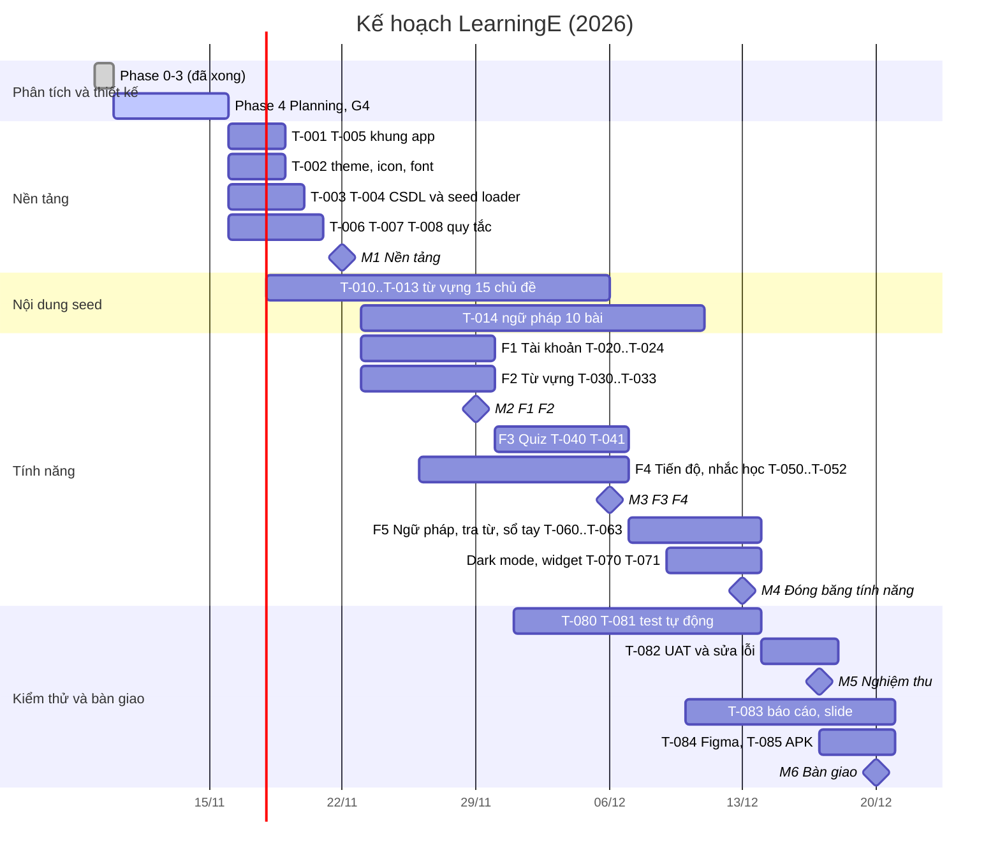

# Project Plan — mốc tiến độ, công việc, rủi ro

> **TỰ SINH** từ bộ phân tích thiết kế đã duyệt của nhóm — không sửa trực tiếp tệp này; đề xuất thay đổi qua Issue/PR để nhóm trưởng cập nhật nguồn và sinh lại. Danh mục tài liệu: [docs/README.md](../README.md).

**Mục đích:** mốc M0–M6, danh sách task T-xxx (ước lượng, phụ thuộc, ưu tiên, đề xuất phụ trách có thể xoay tua) và sổ rủi ro.

## Mốc tiến độ
> Mốc, thứ tự, đường găng.
> Hạn chót tạm 2026-12-20 (PRD A6); khi có ngày nộp thật thì dời các mốc M5–M6 và giữ nguyên thứ tự. Task: PROJECT-PLAN (công việc).

| Mốc | Nội dung | Phụ thuộc | Ngày dự kiến | Tiêu chí hoàn thành |
|---|---|---|---|---|
| M0 — Sẵn sàng build (G4) | Duyệt 7 tài liệu phase 4; repo GitHub có project rỗng build được | G3 (đã qua 09/11) | 15/11/2026 | `./gradlew assembleDebug` chạy được trên máy cả 4 người |
| M1 — Nền tảng | T-001..T-008, T-092, T-100, T-101 (use case): theme, CSDL theo DATABASE-DESIGN sau thay đổi phạm vi, SeedLoader, CsvCodec, Figma màn hình mới, khung điều hướng, quy tắc nghiệp vụ có unit test; định dạng seed chốt | M0 | 22/11/2026 | App mở được, có thanh tab 5 mục, nạp seed mẫu 1 chủ đề; `./gradlew test` pass, độ phủ `domain.rules` ≥ 80% |
| M2 — Tài khoản & học từ (F1, F2) | T-020..T-024, T-030..T-033, T-091; seed T01–T08, J01 xong | M1 | 29/11/2026 | Demo: đăng ký → thiết lập → chọn chủ đề → học flashcard → ôn tập → đổi mật khẩu / quên mật khẩu / xóa tài khoản |
| M3 — Quiz, tiến độ, bộ từ, import/export (F3, F4, F6) | T-040, T-041, T-050..T-052, T-090, T-093, T-094; seed T09–T15, X01–X03, E01–E02 xong | M2 | 06/12/2026 | Demo: quiz 5 dạng câu, lịch sử, Trang chủ có số liệu thật, chuỗi ngày, nhắc học đúng giờ ±15 phút; tạo bộ, thêm từ, import CSV 100 dòng, export rồi import lại đúng |
| M4 — Ngữ pháp, tra từ, luyện thi (F5, F7) + đóng băng tính năng | T-060, T-061, T-063, T-070, T-095; grammar.json đủ 10 bài | M3 | 13/12/2026 | Đủ 36 US Must chạy end-to-end, kể cả thi thử có giờ và bộ tiếng Nhật; sau mốc này chỉ sửa lỗi, không thêm tính năng |
| M5 — Kiểm thử & nghiệm thu | T-080..T-082: instrumented test, Espresso, UAT trên 3 cấu hình, sửa lỗi | M4 | 17/12/2026 | báo cáo kiểm thử: 0 lỗi nghiêm trọng/cao mở ở US Must, 0 crash; G6 |
| M6 — Bàn giao | T-083..T-085: APK release, báo cáo, slide, Figma hoàn thiện | M5 | 20/12/2026 | Nộp báo cáo + slide + APK + link GitHub; G7 |

## Đường găng
**T-001 → T-003 → T-004 (định dạng seed) → T-030 → T-032 (flashcard) → T-040 (quiz) → T-090 (bộ từ) → T-093 (import/export) → T-082 (UAT) → T-083 (báo cáo).** Sau thay đổi phạm vi nhánh luyện thi T-094 → T-095 chạy song song nhưng gần như không còn dự phòng.
- Trễ ở T-004 làm trễ cả việc soạn seed của 4 người lẫn màn hình từ vựng → T-004 phải xong trước 20/11.
- `FlashcardFragment` (T-032) và `QuizFragment` (T-040) được dùng lại ở ôn tập, sổ tay, ngữ pháp → làm sớm, review kỹ.
- T-050 (`ProgressService`) cần trước T-032 để ghi hoạt động học → Vinh bắt đầu T-050 song song F1/F2 từ 26/11.
- Báo cáo (T-083) bắt đầu sớm từ 10/12 bằng cách gom tài liệu phase 0–3 đã duyệt, không đợi xong code.

## Danh sách công việc
> Epic -> story -> task, truy vết về PRD/AC.
> Ưu tiên: **P0** = Must, cần cho demo; **P1** = Should; **P2** = Could. Một task xong khi đạt CODING-STANDARDS (định nghĩa hoàn thành).

| ID | Epic | Story (US) | Task | Đề xuất phụ trách (có thể xoay tua) | Ước lượng | Phụ thuộc | Ưu tiên |
|---|---|---|---|---|---|---|---|
| T-001 | E0 Nền tảng | — | Tạo project Android (Java 17, minSdk 29), cấu trúc gói theo SYSTEM-BLUEPRINT, version catalog, `.gitignore`, đẩy lên GitHub `LearningE_app`, bật bảo vệ nhánh `main` | Phan Anh Tuấn | 0.5 | — | P0 |
| T-002 | E0 Nền tảng | — | Theme Material 3 DayNight: `colors.xml` + `values-night`, `dimens.xml`, TextAppearance, font Baloo 2/Lexend/Noto Sans, 26 icon vector `ic_*` (UI-UX-SPECIFICATION §Ánh xạ token) | Nguyễn Đức Quang Vinh | 1.5 | T-001 | P0 |
| T-003 | E0 Nền tảng | US-025 | `DatabaseHelper`: 14 bảng, khóa ngoại, CHECK, index theo DATABASE-DESIGN; `onConfigure` bật FK | Nguyễn Tấn Thành | 1 | T-001 | P0 |
| T-004 | E0 Nền tảng | US-025 | `SeedLoader` đọc `assets/seed/*.json` (định dạng CODING-STANDARDS), chèn trong 1 giao dịch, `seed_meta`; unit test kiểm tra seed (số lượng, trường bắt buộc, trùng từ) | Nguyễn Tấn Thành | 1.5 | T-003 | P0 |
| T-005 | E0 Nền tảng | — | `LearningEApp`, `ServiceLocator`, `AppExecutors` (`main`, `dbRead`, `dbWrite`, `io`), `Result<T>`/`ErrorCode` (gói `core`), `SessionStore`; `AuthActivity` + `MainActivity` (BottomNavigationView 5 tab, nav graph, ẩn tab ở màn hình con); StrictMode bản debug | Phan Anh Tuấn | 1.5 | T-001 | P0 |
| T-006 | E0 Nền tảng | US-001, US-027 | `PasswordHasher` (PBKDF2-HMAC-SHA256, DEC-003) + unit test vector RFC 7914 §11; `TextNormalizer` (chữ thường, bỏ dấu) + unit test | Phan Anh Tuấn | 1 | T-001 | P0 |
| T-007 | E0 Nền tảng | US-009, US-012, US-018 | `LeitnerScheduler` (BR-011, BR-012), `StreakCalculator` (BR-031) + unit test ≥ 80% nhánh | Lê Văn Tấn Lực | 1 | T-001 | P0 |
| T-008 | E0 Nền tảng | US-013, US-014 | `QuizGenerator` (BR-020, BR-024, nhận `Random` có seed), `AnswerChecker` (BR-022, BR-025), tính điểm (BR-023) + unit test | Lê Văn Tấn Lực | 1.5 | T-001 | P0 |
| T-010 | E1 Nội dung seed | US-025 | Soạn `decks/T01..T04.json` (mỗi bộ một tệp, trường `icon`) (120 từ: từ, IPA, từ loại, nghĩa, ví dụ Anh–Việt), ghi nguồn | Phan Anh Tuấn | 2 | T-004 (định dạng) | P0 |
| T-011 | E1 Nội dung seed | US-025 | Soạn `decks/T05..T08.json` (mỗi bộ một tệp, trường `icon`) (120 từ) | Nguyễn Đức Quang Vinh | 2 | T-004 | P0 |
| T-012 | E1 Nội dung seed | US-025 | Soạn `decks/T09..T12.json` (mỗi bộ một tệp, trường `icon`) (120 từ) | Nguyễn Tấn Thành | 2 | T-004 | P0 |
| T-013 | E1 Nội dung seed | US-025 | Soạn `decks/T13..T15.json` (mỗi bộ một tệp, trường `icon`) (90 từ) | Lê Văn Tấn Lực | 1.5 | T-004 | P0 |
| T-014 | E1 Nội dung seed | US-020, US-021 | Soạn `grammar.json`: 10 bài G01–G10 (công thức, cách dùng, ví dụ, lỗi thường gặp) + 100 câu hỏi có giải thích; mỗi người 2–3 bài, Lực tổng hợp | Lê Văn Tấn Lực + cả nhóm | 3 | T-004 | P0 |
| T-020 | E2 Tài khoản (F1) | US-001, US-002 | `UserDao`, `SettingsDao`, `AuthService`: đăng ký (BR-001, BR-002, BR-009), đăng nhập, khóa tạm (BR-003), phiên (BR-004) | Phan Anh Tuấn | 1.5 | T-003, T-005, T-006 | P0 |
| T-021 | E2 Tài khoản (F1) | US-001, US-002, US-025 | Giao diện SCR-01 Splash (nạp seed), SCR-02 Đăng nhập (+ trạng thái khóa), SCR-03 Đăng ký (+ câu hỏi bảo mật), validation theo SRS | Phan Anh Tuấn | 2 | T-002, T-020 | P0 |
| T-022 | E2 Tài khoản (F1) | US-006 | SCR-04 Thiết lập lần đầu 3 bước, mặc định BR-006, xin quyền thông báo | Phan Anh Tuấn | 1 | T-021 | P0 |
| T-023 | E2 Tài khoản (F1) | US-027 | SCR-25 Quên mật khẩu 2 bước, BR-007, BR-008 | Phan Anh Tuấn | 1 | T-020, T-021 | P0 |
| T-024 | E2 Tài khoản (F1) | US-003, US-004, US-005 | SCR-22 Tôi (hồ sơ, cài đặt), SCR-23 Đổi mật khẩu, xóa tài khoản (BR-005, hộp thoại nhập mật khẩu), đăng xuất | Phan Anh Tuấn | 1.5 | T-020 | P0 |
| T-030 | E3 Từ vựng (F2) | US-007, US-008 | `DeckDao`, `WordDao`; SCR-06 lưới chủ đề + lọc cấp độ; SCR-07 danh sách từ + trạng thái (BR-014) | Nguyễn Tấn Thành | 2 | T-002, T-004, T-005 | P0 |
| T-031 | E3 Từ vựng (F2) | US-008, US-010, US-011 | SCR-08 Chi tiết từ; `TtsHelper` (thiếu giọng → thông báo); `FavoriteDao` + nút yêu thích | Nguyễn Tấn Thành | 1.5 | T-030 | P0 |
| T-032 | E3 Từ vựng (F2) | US-009 | `CardProgressDao`, `StudyService`; `FlashcardFragment` SCR-09 (lật thẻ 350 ms, đánh giá) + SCR-10 Kết quả phiên; nguồn "học mới" (BR-010) | Nguyễn Tấn Thành | 2.5 | T-007, T-030, T-050 | P0 |
| T-033 | E3 Từ vựng (F2) | US-012 | Nguồn "ôn tập": thẻ đến hạn (BR-013), tối đa 50 thẻ | Nguyễn Tấn Thành | 1 | T-032 | P0 |
| T-040 | E4 Quiz (F3) | US-013 | `QuizService`; SCR-12 Luyện tập; `QuizFragment` SCR-13 với 5 dạng câu (2 trắc nghiệm, nghe chọn, điền từ, sắp xếp câu), bỏ dạng nghe khi thiếu TTS, xác nhận thoát | Lê Văn Tấn Lực | 3 | T-008, T-030, T-031 | P0 |
| T-041 | E4 Quiz (F3) | US-014, US-015 | Lưu lượt làm + câu trả lời, BR-021 (từ sai về hộp 1); SCR-14 Kết quả; SCR-15 Lịch sử + trạng thái rỗng | Lê Văn Tấn Lực | 1.5 | T-040 | P0 |
| T-050 | E5 Tiến độ (F4) | US-016, US-018 | `StudyLogDao`, `ProgressService` (ghi hoạt động BR-032, chuỗi BR-031); SCR-05 Trang chủ | Nguyễn Đức Quang Vinh | 2 | T-005, T-007 | P0 |
| T-051 | E5 Tiến độ (F4) | US-017 | SCR-21 Tiến độ; `BarChartView` Canvas (DEC-005) | Nguyễn Đức Quang Vinh | 2 | T-050 | P0 |
| T-052 | E5 Tiến độ (F4) | US-019, US-003 | Nhắc học: `ReminderService`, `ReminderReceiver`, `BootReceiver`, kênh thông báo, đổi giờ/múi giờ (DEC-004, BR-030) | Phan Anh Tuấn | 2 | T-050, T-022 | P0 |
| T-060 | E6 Ngữ pháp & tra từ (F5) | US-020, US-021 | `GrammarDao`; SCR-16 danh sách; SCR-17 chi tiết (đánh dấu đã đọc khi cuộn cuối); bài tập dùng lại `QuizFragment` | Lê Văn Tấn Lực | 2 | T-014, T-040 | P0 |
| T-061 | E6 Ngữ pháp & tra từ (F5) | US-022, US-011 | SCR-18 Tra từ (debounce 250 ms, BR-040, ≤ 50 kết quả), tab Yêu thích, trạng thái rỗng | Nguyễn Đức Quang Vinh | 1.5 | T-030, T-031 | P0 |
| T-062 | E6 Ngữ pháp & tra từ (F5) | US-023, US-024 | ~~Sổ tay riêng~~ — **thay bằng T-090** (thay đổi phạm vi: sổ tay là bộ mặc định) | — | 0 | — | Hủy |
| T-063 | E6 Ngữ pháp & tra từ (F5) | US-026 | SCR-24 Giới thiệu (nhóm, nguồn dữ liệu, giấy phép, quyền riêng tư) | Nguyễn Đức Quang Vinh | 0.5 | T-002 | P1 |
| T-070 | E7 Mở rộng | — (REQ-013) | Dark mode: rà 24 màn hình ở theme tối, sửa màu cứng, kiểm tra tương phản | Nguyễn Đức Quang Vinh | 1 | T-002 và các màn hình | P1 |
| T-071 | E7 Mở rộng | — (REQ-015) | Widget "x thẻ cần ôn" — **Won't**  | — | 0 | — | Hủy |
| T-080 | E8 Chất lượng | US-005, US-025 | Instrumented test DAO trên SQLite thật: seed, CASCADE khi xóa tài khoản, ghi tiến độ hai lần cùng (user, word) chỉ còn 1 dòng (`UPDATE`, 0 dòng thì `INSERT`, ), tra từ | Nguyễn Tấn Thành | 1.5 | T-004, T-024, T-032 | P0 |
| T-081 | E8 Chất lượng | US-001, US-009, US-013 | Espresso: đăng ký → thiết lập → học 5 thẻ → quiz → xem kết quả | Lê Văn Tấn Lực | 1.5 | T-041 | P1 |
| T-082 | E8 Chất lượng | Tất cả US Must | Chạy kịch bản UAT trên 3 cấu hình (TESTING-STRATEGY), ghi lỗi, viết báo cáo kiểm thử | Lê Văn Tấn Lực + cả nhóm | 2 | Các task P0 | P0 |
| T-083 | E9 Bàn giao | — | Báo cáo đồ án theo mẫu HCMUTE (gom từ tài liệu đã duyệt), slide, video/ảnh demo | Phan Anh Tuấn + cả nhóm | 4 | T-082 | P0 |
| T-084 | E9 Bàn giao | — | ~~Hoàn thiện Figma v1~~ — **thay bằng T-102** (thiết kế lại ) | — | 0 | — | Hủy |
| T-085 | E9 Bàn giao | — | Build APK release (R8, keystore không lên GitHub), CHANGELOG, hướng dẫn sử dụng, nén `GroupXX_MSSV…zip`, điền "File báo cáo kết quả dự án" (file/hàm minh chứng) | Phan Anh Tuấn | 0.5 | T-082 | P0 |
| T-090 | E10 Bộ từ vựng (F6, thay đổi phạm vi) | US-028..US-031, US-023, US-024 | `DeckDao`, `WordDao` dùng chung, `DeckService` (BR-043..BR-047), tạo bộ "Sổ tay của tôi" khi đăng ký; SCR-26 Bộ của tôi, SCR-27 Tạo/sửa bộ, SCR-19 Chi tiết bộ, SCR-20 Thêm/sửa từ, "Lưu vào bộ" từ SCR-08; Học/Quiz trên bộ | Nguyễn Đức Quang Vinh | 3 | T-003, T-032, T-040 | P0 |
| T-091 | E11 Đa ngôn ngữ (F7, thay đổi phạm vi) | US-034 | `LanguageRegistry`, seed `languages` (en, ja, zh, ko); `TextNormalizer` theo ngôn ngữ (BR-053); TTS theo `tts_locale`; nhãn cách đọc theo ngôn ngữ (BR-052) | Phan Anh Tuấn | 1.5 | T-003, T-006, T-031 | P0 |
| T-092 | E12 Import/export (F6, thay đổi phạm vi) | US-032, US-033 | `CsvCodec` (RFC 4180, BOM, DEC-008, `domain.rules`) + `JsonCodec` (`data.io`, ; test `JsonCodec` trên JVM cần `testImplementation` `org.json:json`, thêm khi viết test và được nhóm duyệt) + unit test các ca khó (dấu phẩy, nháy, xuống dòng, tiếng Việt, tệp rỗng, sai tiêu đề) | Lê Văn Tấn Lực | 1.5 | T-001 | P0 |
| T-093 | E12 Import/export (F6, thay đổi phạm vi) | US-032, US-033 | `ImportExportService` (SAF, ≤ 1 MB / 2000 dòng, 1 giao dịch, `INSERT OR IGNORE`); SCR-28 Xem trước import; SCR-29 Export | Nguyễn Tấn Thành | 2 | T-090, T-092 | P0 |
| T-094 | E13 Luyện thi (F7, thay đổi phạm vi) | US-036 | `ExamDao`, `ExamService`: bắt đầu/tiếp tục lượt, lưu từng câu, tính giờ theo `started_at`, tự nộp, chấm (BR-054), đưa từ sai về hộp 1 (BR-055) + unit test | Lê Văn Tấn Lực | 2 | T-003, T-007, T-008 | P0 |
| T-095 | E13 Luyện thi (F7, thay đổi phạm vi) | US-035, US-036, US-037 | SCR-30 Luyện thi, SCR-31 Làm bài (Timer chip, Question grid), SCR-32 Kết quả, SCR-33 Tài nguyên chính thức (`ACTION_VIEW`) | Nguyễn Đức Quang Vinh | 1.5 | T-094, T-100 | P0 |
| T-096 | E1 Nội dung seed | US-035, US-036 | Soạn bộ X01 TOEIC 60 từ + đề E01 (30 câu kiểu Part 5, có giải thích, gắn từ) — tự soạn, không chép đề ETS | Lê Văn Tấn Lực | 2 | T-004 | P0 |
| T-097 | E1 Nội dung seed | US-035, US-036 | Soạn bộ X02 IELTS 60 từ + đề E02 (20 câu từ vựng & ngữ pháp) | Nguyễn Tấn Thành | 2 | T-004 | P0 |
| T-098 | E1 Nội dung seed | US-035 | Soạn bộ X03 Aptis 40 từ | Nguyễn Đức Quang Vinh | 1 | T-004 | P0 |
| T-099 | E1 Nội dung seed | US-034 | Soạn bộ J01 Tiếng Nhật cơ bản 20 từ (kanji/kana, romaji, nghĩa, ví dụ) | Phan Anh Tuấn | 0.5 | T-004 | P0 |
| T-100 | E9 Bàn giao | — (UI-UX-SPECIFICATION) | ~~Figma SCR-26..33 theo v1~~ — **gộp vào T-102** | — | 0 | — | Hủy |
| T-101 | E9 Bàn giao | — (báo cáo) | Vẽ bằng draw.io: lược đồ use case, class diagram (theo code M1), ERD; xuất PNG vào `docs/report/assets` | Phan Anh Tuấn | 1 | T-005 | P0 |
| T-102 | E9 Bàn giao | — | Thiết kế lại định hướng hình ảnh v2 (bảng màu theo nhóm tính năng, nền trang trí, bộ minh họa SVG) + mockup HTML 32 màn hình; dựng lại trên Figma từ mockup; xuất minh họa sang VectorDrawable | Nguyễn Đức Quang Vinh | 5 | — | P0 |

Tổng theo người (ngày công, chưa gồm phần chung T-014/T-082/T-083): Phan Anh Tuấn 17,5 · Nguyễn Đức Quang Vinh 21 · Nguyễn Tấn Thành 17 · Lê Văn Tấn Lực 17,5; phần chung 9 (sau thay đổi phạm vi; vượt ≈ 2 ngày công so với khả dụng — cần cắt bớt dữ liệu nạp sẵn hoặc chuyển bớt việc của Vinh). Thứ tự thực hiện và đường găng: PROJECT-PLAN (mốc).

## Rủi ro
> Rủi ro, xác suất, tác động, phương án.
> Thang đo: Xác suất / Tác động = Thấp · Trung bình · Cao. Rà lại mỗi Chủ nhật cùng buổi chốt mốc (PROJECT-PLAN (mốc)); rủi ro đã xảy ra chuyển sang danh sách lỗi đã biết hoặc CR.

| ID | Rủi ro | Xác suất | Tác động | Phòng ngừa | Kế hoạch dự phòng | Owner |
|---|---|---|---|---|---|---|
| R-01 | Soạn 450 từ + 10 bài ngữ pháp, cộng thêm 180 từ luyện thi/tiếng Nhật và 50 câu thi thử, tốn nhiều thời gian hơn dự kiến (4 người, song song với code) | Cao | Cao | Chốt định dạng JSON trước 20/11 (T-004); chia đều theo chủ đề (T-010..T-014); mỗi tuần nộp ít nhất 1 chủ đề; dùng nguồn mở có sẵn câu ví dụ (Tatoeba) | Mức tối thiểu  §Rollback: 10 chủ đề / 300 từ / 8 bài; các chủ đề còn thiếu để sau bảo vệ | Phan Anh Tuấn |
| R-02 | Xung đột Git / ghi đè code khi 4 người cùng sửa | Trung bình | Cao | Nhánh tính năng ngắn, PR có review, bảo vệ `main`, chia task theo gói `ui.*` (CODING-STANDARDS); `pull --rebase` mỗi ngày | Khôi phục từ lịch sử Git; người sở hữu gói tự giải quyết xung đột trong gói của mình | Phan Anh Tuấn |
| R-04 | Ngày nộp thật sớm hơn mốc tạm 20/12 | Trung bình | Cao | Hỏi giảng viên ngay khi có lịch; đóng băng tính năng sớm (M4 13/12); báo cáo bắt đầu từ 10/12 | Cắt theo thứ tự: T-071 widget → T-070 dark mode → T-062 sổ tay → giữ F1–F4 + ngữ pháp | Phan Anh Tuấn |
| R-05 | PBKDF2 dùng sai thông số hoặc quá chậm trên máy yếu (DEC-003, AC-002.1 ≤ 1 s) | Thấp | Cao | Unit test vector RFC 7914 §11; đo thời gian băm trên emulator API 29 ở M1 | Giảm số vòng lặp (ghi DEC mới) | Phan Anh Tuấn |
| R-06 | Nhắc học không đúng giờ / không hiện trên một số máy (Doze, hãng điện thoại tắt app nền) | Trung bình | Trung bình | AlarmManager inexact + BootReceiver (DEC-004); test TC-NFR-A5 trên emulator và máy thật | Ghi danh sách lỗi đã biết; hướng dẫn tắt tối ưu pin cho app trong hướng dẫn sử dụng | Phan Anh Tuấn |
| R-07 | Máy demo thiếu giọng đọc TTS tiếng Anh | Trung bình | Trung bình | Cài sẵn gói giọng trên máy demo trước buổi bảo vệ; app báo lỗi thân thiện (AC-010.2) | Demo trên emulator có giọng | Nguyễn Tấn Thành |
| R-08 | Lỗi dữ liệu do giao dịch nhiều bảng sai (mất chuỗi ngày, lượt quiz dở) | Thấp | Cao | Repository bọc giao dịch; instrumented test TC-NFR-A3 | Sửa lỗi; dữ liệu demo tạo lại bằng tài khoản mới | Nguyễn Tấn Thành |
| R-09 | Vi phạm bản quyền nội dung (chép từ app tham khảo, danh sách từ có bản quyền) | Thấp | Cao | Chỉ dùng nguồn mở có giấy phép, ghi nguồn trong file seed và SCR-24 (Glossary (kiến thức miền) §Pháp lý); review chéo nguồn | Thay nội dung vi phạm trước khi nộp | Lê Văn Tấn Lực |
| R-10 | Figma chưa hoàn thiện (gói Starter: hết lượt gọi MCP, 1 mode/collection) | Cao | Thấp | UI-UX-SPECIFICATION + UI-UX-SPECIFICATION (hệ thống thiết kế) đủ để code; Vinh hoàn thiện trực tiếp trên Figma (T-084) | Dùng ảnh chụp app thật trong báo cáo thay cho khung Figma còn thiếu | Nguyễn Đức Quang Vinh |
| R-11 | Phạm vi phình ra ("làm càng nhiều càng tốt" — PQ-4; thay đổi phạm vi đã dùng hết dự phòng) làm trễ phần Must | Cao | Cao | Mọi tính năng mới qua CR; chỉ làm P1/P2 khi P0 của người đó xong | Hoãn mọi CR mới sau M4 | Phan Anh Tuấn |
| R-12 | Mất máy / mất code cục bộ | Thấp | Trung bình | Đẩy nhánh lên GitHub ít nhất mỗi ngày làm việc; keystore release lưu 2 nơi (không đưa lên GitHub) | Lấy lại từ GitHub; tạo keystore mới nếu chưa nộp APK | Phan Anh Tuấn |
| R-13 | Thành viên bận thi giữa kỳ / ốm, vắng 1 tuần | Trung bình | Cao | Sau thay đổi phạm vi dự phòng gần 0 → ưu tiên tuyệt đối P0; mỗi task có người hiểu thứ hai (reviewer) | Reviewer nhận task; hạ ưu tiên P1/P2 | Phan Anh Tuấn |
| R-14 | Vấn đáp 50/100 điểm: thành viên không giải thích hoặc không sửa nhanh được code mình phụ trách; vi phạm cam kết "không dùng AI sinh code mà không hiểu" | Trung bình | Cao | Mỗi người tự viết/đọc hiểu code phần mình; code gợi ý phải được người phụ trách giải thích trong PR; CODING-STANDARDS (định nghĩa hoàn thành) có mục tự giải thích; tập dượt "sửa nhanh tham số/thêm log" trước bảo vệ | Ghép cặp ôn lại luồng code; phân công trình bày theo đúng phần đã làm | Phan Anh Tuấn |
| R-15 | Import lỗi với tệp thật (Excel lưu ANSI, dấu phẩy trong nghĩa, xuống dòng trong ô) | Trung bình | Trung bình | `CsvCodec` theo RFC 4180 + unit test ca khó (DEC-008); xem trước trước khi nhập; tệp CSV mẫu trong hướng dẫn sử dụng | Hướng dẫn lưu "CSV UTF-8"; dùng JSON | Lê Văn Tấn Lực |
| R-16 | Nội dung luyện thi vi phạm bản quyền (chép đề ETS/IDP/British Council) | Thấp | Cao | Tự soạn câu theo định dạng; ghi nguồn; review chéo trước M4 | Thay câu nghi vấn trước khi nộp | Lê Văn Tấn Lực |
