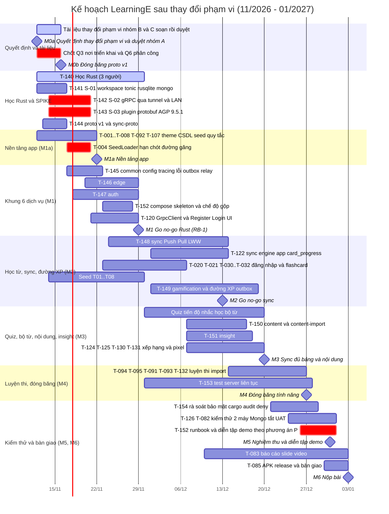

# Project Plan — mốc tiến độ, công việc, rủi ro

> **TỰ SINH** từ bộ phân tích thiết kế đã duyệt của nhóm — không sửa trực tiếp tệp này; đề xuất thay đổi qua Issue/PR để nhóm trưởng cập nhật nguồn và sinh lại. Danh mục tài liệu: [docs/README.md](../README.md).

**Mục đích:** mốc M0–M6, danh sách task T-xxx (ước lượng, phụ thuộc, ưu tiên, đề xuất phụ trách có thể xoay tua) và sổ rủi ro.

## Mốc tiến độ
> Mốc, thứ tự, đường găng, tiêu chí go/no-go và rollback.
> **Hạn nộp:** ≈ **03/01/2027** (thay đổi phạm vi §1; nhóm nêu "khoảng tuần 04/01", **chưa xác nhận** — nhóm trưởng hỏi giảng viên, xem §Quyết định cần chốt). M6 giữ 03/01; nếu hạn thật là 04/01 thì ngày dôi ra là đệm, không thêm tính năng. Nếu hạn thật **sớm hơn** 03/01 thì dồn M4–M6 và cắt X1–X4 ngay từ M2/M3.
> **Năng lực (thay đổi phạm vi §5):** kế hoạch ≈ **125 ngày công** so với ≈ **146 khả dụng** (4 người × 7,5 tuần hiệu dụng × 4 ngày công + ≈ 4 giờ/người/tuần thêm − nghỉ 01/01) → **dự phòng ≈ 21 (≈ 14%)**. Điều kiện: cả 4 người xác nhận ≈ 4 giờ/người/tuần thêm tới 03/01. Không có giờ thêm thì 125 / 116 → vượt ≈ 9 → áp dụng X1–X4 (−6,5) và xin thêm giờ.
> **Hợp đồng-trước (contract-first):** **proto v1** (`learninge.app.v1` + `learninge.internal.v1`, EP-01..EP-16 giữ ID), DATABASE-DESIGN (B) và THREAT_MODEL đóng băng ở **M0b 16/11**; từ đó app (S3a) và 6 dịch vụ Rust (S3b) làm song song. Đổi proto sau M0b chỉ qua quy trình ở CODING-STANDARDS (định nghĩa hoàn thành) §Đổi proto (chỉ thêm trường/RPC) hoặc CR.
> **Khóa code:** chưa code tính năng server/online tới khi tài liệu nhóm B + C được duyệt (M0b). Được làm ngay: **SPIKE có nhãn S-01..S-03**, học Rust (T-140), và mọi việc app không phụ thuộc server (T-002..T-008, T-092, seed, Figma, pixel).
> **ID task:**  §5 (T-140..T-154 server/spike/proto, T-120/T-122/T-123 app đổi). Khi PROJECT-PLAN (công việc) khác thì **PROJECT-PLAN (công việc) là nguồn cuối** — ghi "T-14x (PROJECT-PLAN (công việc) thay đổi phạm vi)" cho mọi ID chưa chắc.

## Bảng mốc
| Mốc | Nội dung | Phụ thuộc | Ngày dự kiến | Tiêu chí hoàn thành |
|---|---|---|---|---|
| **M0a** — Quyết định thay đổi phạm vi + duyệt nhóm A | thay đổi phạm vi APPROVED (11/11, Q1 Q2 Q4 Q5 đồng ý); nhóm A (UI-UX-SPECIFICATION (hệ thống thiết kế), UI-UX-SPECIFICATION (sơ đồ màn hình), UI-UX-SPECIFICATION) duyệt kèm CR; **bắt đầu T-140 (học Rust) và SPIKE S-01..S-03**; 13 tài liệu nhóm C đã chụp vào `changes/thay đổi phạm vi-snapshot/` | thay đổi phạm vi | **12/11/2026** | `thay đổi phạm vi.md` ghi APPROVED; snapshot có đủ 13 file; 3 thành viên server đã cài Rust toolchain + Docker Desktop, `cargo build` chạy |
| **M0b** — Duyệt nhóm B + C, **proto v1 đóng băng** | Người dùng duyệt nhóm B (CHARTER, Glossary, PRD, SRS, checklist yêu cầu, Use-Cases (luồng)) và nhóm C (SYSTEM-BLUEPRINT, SYSTEM-BLUEPRINT (công nghệ), DATABASE-DESIGN B, API_CONTRACT, THREAT_MODEL, ARCHITECTURE-DECISIONS, SRS (phi chức năng), TESTING-STRATEGY, TEST-CASES, PROJECT-PLAN (công việc), PROJECT-PLAN (mốc), PROJECT-PLAN (rủi ro), CODING-STANDARDS (định nghĩa hoàn thành), CODING-STANDARDS); T-144 proto v1 + `sync-proto`; **chốt Q6 (phân công dịch vụ)** và **Q3 (nơi triển khai) hoặc dùng mặc định P1**; nhóm trưởng xác nhận yêu cầu môn "Java + SQLite" (R-46) | M0a; T-144 | **16/11/2026** | Tài liệu nhóm B + C APPROVED (người dùng chạy lệnh duyệt); proto v1 commit ở repo server, `proto.lock` ở repo app khớp SHA (`verifyProtoLock` xanh); Q6 ghi vào PROJECT-PLAN/thay đổi phạm vi §6; Q3 ghi vào DEC-023 (Proposed → Accepted) |
| **M1a** — Nền tảng app | T-001..T-008, T-092, T-101, T-102, T-103, T-107, định dạng seed (T-004 hạn **20/11**, đường găng app); SPIKE S-01 xong (17/11), **S-02 + S-03 kết luận 20/11**; T-140 tiếp tục | M0a (app không chờ M0b) | **22/11/2026** | App mở được, thanh tab 5 mục, nạp seed mẫu 1 chủ đề; `./gradlew lint testDebugUnitTest assembleDebug` pass; độ phủ `domain.rules` ≥ 80%; **S-01**: workspace Rust + tonic hello + rusqlite + mongodb + compose + chế độ `--all` chạy; **S-02**: ghi kết luận "gRPC qua tunnel/LAN — chạy / không chạy theo từng phương án P"; **S-03**: emulator gọi `Health.Check` bằng `grpc-okhttp` với AGP 9.5.1 (hoặc ghi kích hoạt RB-2) |
| **M1** — Khung 6 dịch vụ + Register/Login qua gRPC · **go/no-go Rust (RB-1)** | T-145 `common`, T-146 `edge`, T-147 `auth`, khung `sync`/`content`/`gamification`/`insight` (health + `EventSink` rỗng), compose skeleton (T-152 phần 1), CI server, T-120 `GrpcClient` + màn Register/Login nối `auth` | M0b, M1a, S-02, S-03 | **29/11/2026** | Xem **§Go/no-go M1** bên dưới. Tóm tắt: `docker compose up` dựng 6 dịch vụ + `mongo`, chỉ `127.0.0.1:50051` publish; chế độ `--all` chạy cùng bộ test hợp đồng; app (emulator `10.0.2.2:50051`, LAN, và đường lộ ra của phương án P đã chọn nếu S-02 xong) Register → Login → `GetMe` thành công; CI Rust xanh (fmt, clippy, test) |
| **M2** — Học từ + đăng nhập online + sync `card_progress` + đường XP → Mongo · **go/no-go sync** | T-148 `sync` (Push/Pull, LWW, tombstone, `server_seq`, kiểm `xp_events`), T-122 lát đầu `card_progress`, outbox + relay chạy thật tới `gamification`/`insight`, T-020/T-021/T-030..T-032, seed T01–T08 | M1 | **13/12/2026** | Xem **§Go/no-go M2**. Tóm tắt: đăng nhập máy thứ hai thấy `card_progress` máy A ≤ 10 s; sự kiện XP đi `sync.db` → outbox → `gamification` (Mongo) và trùng 2 lần chỉ 1 bản ghi (TC-OUT); tắt Mongo giữa phiên → Login + Push/Pull vẫn chạy |
| **M3** — Quiz, tiến độ, bộ từ, sync đủ bảng, pixel, bảng xếp hạng, insight, nội dung | T-149 `gamification` (EP-13), T-150 `content` + `content-import` (EP-14..16), T-151 `insight`, T-122 đủ bảng, T-124/T-125 bảng xếp hạng + SCR-35, T-123 nội dung từ server (nâng Should), quiz, tiến độ, nhắc học, bộ từ, T-130/T-131 pixel | M2 | **20/12/2026** | Demo: quiz 5 dạng, Trang chủ số liệu thật, bảng xếp hạng top 50 + "Bạn", học ngoại tuyến rồi đồng bộ (US-039), nội dung tải từ `content`; `EP-13` khi `gamification` tắt → `UNAVAILABLE` → app hiện bản lưu gần nhất; `GetMe` `stats_partial=true`. **Điểm quyết định cắt:** tích lũy hoàn thành thấp hơn kế hoạch > 8 ngày công → X1 rồi X2 |
| **M4** — Luyện thi, import/export, **đóng băng tính năng** | Luyện thi (T-094/T-095), import/export CSV (T-091/T-093), T-132 ghép pixel, seed đủ 300 từ + X01–X03 + J01 + E01, T-153 test server đủ (unit + tích hợp SQLite tạm + Mongo container + hợp đồng), outbox dead-letter/WARN | M3 | **27/12/2026** | Đủ US Must chạy end-to-end; sau mốc này **chỉ sửa lỗi, không thêm tính năng, không đổi proto**. **Điểm quyết định cắt:** thiếu ≥ 3 ngày công → X3 rồi X4 |
| **M5** — Kiểm thử 2 máy, Mongo tắt giữa phiên, bảo mật, **diễn tập demo trên phương án P đã chọn** | T-126 kiểm thử 2 máy, mất mạng, xung đột; kịch bản Mongo tắt/bật, sự kiện trùng, xóa tài khoản lan 3 dịch vụ (≤ 60 s), plaintext bị chặn ở release; T-154 rà soát bảo mật + `cargo audit` + `cargo deny`; T-152 phần 2 (runbook, tunnel/hạ tầng); UAT; video demo quay trước | M4 | **31/12/2026** | báo cáo kiểm thử: 0 lỗi nghiêm trọng/cao mở ở US Must, 0 crash; checklist THREAT_MODEL RC-01..RC-24 do reviewer ký; TC-SEC-38 đạt cho phương án đã chọn; **diễn tập demo hoàn chỉnh (điện thoại thật + laptop/hạ tầng) và dự phòng LAN/emulator/chế độ `--all`**; mỗi thành viên server tự giải thích được dịch vụ của mình (tập vấn đáp); G6 |
| **M6** — Nộp bài | T-083 báo cáo (chương kiến trúc: sơ đồ 6 dịch vụ, compose, sequence đăng nhập/đồng bộ/outbox, ERD 2 SQLite + mô hình Mongo) + slide + video, T-085 APK release, **2 link GitHub** (app + server), README server, sao lưu `auth.db`/`sync.db`, tắt tunnel/hạ tầng sau demo | M5 | **03/01/2027** | Gói nộp đủ (báo cáo, slide, APK, 2 link); repo server không chứa `.env`/`*.db*`/secret (`git ls-files` sạch, RC-06); G7. Nếu hạn thật 04/01: giữ M6 ngày 03/01, ngày dôi là đệm |

## Tải kế hoạch theo mốc (ước lượng thô, ASSUMPTION — nhóm trưởng chốt theo PROJECT-PLAN (công việc) thay đổi phạm vi)
Năng lực tích lũy tính ≈ 20 ngày công/tuần (4 người × 5), bắt đầu 12/11, nghỉ 01/01 đã trừ ở tổng 146. Tải tích lũy là đề xuất để theo dõi tiến độ; **không** thay PROJECT-PLAN (công việc).

| Mốc | Năng lực tích lũy | Tải kế hoạch tích lũy | Dư | Ghi chú |
|---|---|---|---|---|
| M1a 22/11 | ≈ 28 | ≈ 27 | 1 | đường găng app T-004 |
| M1 29/11 | ≈ 48 | ≈ 46 | 2 | **dư thấp nhất — mốc go/no-go** |
| M2 13/12 | ≈ 88 | ≈ 84 | 4 | go/no-go sync |
| M3 20/12 | ≈ 108 | ≈ 100 | 8 | ngưỡng cắt X1/X2 (trễ > 8) |
| M4 27/12 | ≈ 128 | ≈ 114 | 14 | feature freeze; ngưỡng X3/X4 |
| M5 31/12 | ≈ 140 | ≈ 122 | 18 | kiểm thử, diễn tập demo |
| M6 03/01 | ≈ 146 | ≈ 125 | 21 | = dự phòng ≈ 14% |

Tải theo người (đề xuất Q6, **chưa chốt**, thay đổi phạm vi §5): Phan Anh Tuấn ≈ 33,5 / 36,5 (edge, auth, `common`, proto, compose) · Nguyễn Tấn Thành ≈ 33,5 / 36,5 (sync, content, `GrpcClient`/sync engine app, S-02/S-03) · Lê Văn Tấn Lực ≈ 33 / 36,5 (gamification, insight, test server, bảo mật server) · Nguyễn Đức Quang Vinh ≈ 24,5 / 36,5 (UI/pixel, tài liệu; còn dư ≈ 12 → nhóm trưởng chuyển T-121, T-125 và một phần T-030/T-050 sang Vinh khi lập PROJECT-PLAN (công việc)). Lưu ý: tổng các dòng T-140..T-154 ở thay đổi phạm vi §5 cộng lại = 37 (CR ghi 37,5); lấy 125 làm chuẩn tới khi PROJECT-PLAN (công việc) chốt.

## Đường găng
**Chốt Q3/Q6 + proto v1 (M0b) → T-145 `common` → T-147 `auth` / T-146 `edge` → T-120 `GrpcClient` (cần S-03) → Register/Login e2e (go/no-go M1) → T-148 `sync` → T-122 sync engine → đường XP outbox → `gamification` (M2) → T-126 kiểm thử 2 máy + Mongo tắt → T-082 UAT → T-083 báo cáo.** Nhánh app song song: T-001 → T-003 → T-004 (hạn 20/11) → T-030 → T-032 → T-040 → T-090 → T-093. Nhánh pixel T-130/T-131 → T-132 và nhánh luyện thi T-094 → T-095 gần như không còn dự phòng. T-142 (S-02) và T-143 (S-03) không tốn nhiều công nhưng **chặn quyết định** (phương án P, RB-2) nên được đánh dấu găng.
- **Q3/Q6 chậm = trễ đường găng:** mỗi ngày chậm sau 16/11 làm T-145 lùi tương ứng (≈ −3 ngày công/ngày vì 3 người server chờ). Chặn cứng: Q3 20/11 (hết S-02), nếu chưa quyết thì **tự áp dụng mặc định P1** (thay đổi phạm vi Q3).
- **S-03 trước 20/11** vì T-120 (M1) và cả đường app phụ thuộc; hỏng thì kích hoạt RB-2 (edge thêm cổng JSON, app giữ `HttpURLConnection` + `org.json`) và ghi CR.
- **Học Rust song song code thật:** T-140 (8 ngày công) trải tới 29/11; mẫu dịch vụ chuẩn trong `common` (T-145) làm sớm cho người khác chép theo; PR đầu tiên của mỗi người server là dịch vụ mỏng (health + 1 RPC) để lộ vấn đề học sớm.
- Báo cáo (T-083) bắt đầu từ 10/12 bằng cách gom tài liệu đã duyệt (kể cả thay đổi phạm vi) và sơ đồ; không chờ xong code.

## Go/no-go M1 — 29/11/2026 (RB-1: Rust hay quay về thay đổi phạm vi Javalin)
Người họp: cả nhóm; **người dùng (Phan Anh Tuấn) quyết định** theo số liệu nhóm trưởng/nhóm trưởng tổng hợp (nhóm trưởng không tự rollback).

**GO** khi đạt **tất cả**:
1. S-01, S-02, S-03 có kết luận bằng văn bản (S-02 ≤ 20/11; ghi phương án P nào chạy gRPC/HTTP/2 được).
2. `docker compose up` dựng đủ 6 dịch vụ + `mongo`, mọi healthcheck `SERVING`; chỉ edge publish `127.0.0.1:50051` (NFR-S9); chế độ `--all` chạy.
3. App (emulator `10.0.2.2:50051` và LAN; cộng đường lộ ra của phương án P nếu S-02 xong) **Register → Login → GetMe** qua gRPC edge → `auth`; log có cùng `x-request-id` ở edge và `auth` (DEC-025).
4. CI repo server xanh: `cargo fmt --check`, `cargo clippy -D warnings`, `cargo test --workspace`, `docker compose build`; CI repo app xanh gồm `verifyProtoLock`.
5. Tiến độ: tải tích lũy hoàn thành ≥ ≈ 41/46 (≥ 90% kế hoạch, trễ ≤ 5 ngày công) **và** T-140: cả 3 thành viên server tự viết được một RPC unary + test (tự đánh giá có người review chứng kiến).

**GO có điều kiện** (ghi danh sách lỗi đã biết, hạn xử lý ≤ 03/12): chỉ thiếu đường lộ ra ngoài (S-02 chưa có phương án chạy nhưng LAN + emulator đã chạy), hoặc trễ 5–8 ngày công kèm áp dụng X1 ngay.

**NO-GO → Rollback RB-1** khi **một** trong: (a) chưa có Register/Login qua gRPC từ app trên emulator; (b) S-03 thất bại **và** RB-2 không khả thi; (c) trễ > 8 ngày công so với kế hoạch tích lũy; (d) tiến độ học Rust dưới kế hoạch (thành viên chủ dịch vụ chưa viết nổi dịch vụ mỏng); (e) ≥ 2 thành viên server vắng > 1 tuần (R-13).

**Rollback RB-1 — quay về thay đổi phạm vi Javalin monolith REST + SQLite** (thay đổi phạm vi §5):
1. Người dùng ghi quyết định vào thay đổi phạm vi §6 (hoặc CR mới) — không tự động.
2. Khôi phục 13 tài liệu nhóm C từ `docs/changes/thay đổi phạm vi-snapshot/` (SYSTEM-BLUEPRINT, SYSTEM-BLUEPRINT (công nghệ), DATABASE-DESIGN, API_CONTRACT, THREAT_MODEL, ARCHITECTURE-DECISIONS, SRS (phi chức năng), TESTING-STRATEGY, TEST-CASES, PROJECT-PLAN (công việc), PROJECT-PLAN (mốc), PROJECT-PLAN (rủi ro), CODING-STANDARDS (định nghĩa hoàn thành)) + CODING-STANDARDS; chuyển DEC-018..DEC-023 sang Superseded, DEC-012/015/016 về Proposed. Nhóm A và B không đổi (không phụ thuộc công nghệ backend, trừ câu chữ mã gRPC — hoàn tác nhẹ).
3. Dựng `:server` Javalin + SQLite: T-110 2 + T-111 2,5 + T-112 3 + T-113 1,5 + T-115 2 + T-116 1 + T-117 1 = **≈ 13 ngày công**; còn **5 tuần** (29/11 → 03/01 ≈ 96 ngày công khả dụng) → vừa, thêm dự phòng lớn. Bỏ MongoDB; XP + bảng xếp hạng + nội dung tính trên SQLite như thay đổi phạm vi. Mốc M2 đặt lại ≈ 13/12, các mốc sau giữ.
4. Giữ: app Java + SQLite offline-first, nghiệp vụ, pixel layer, `BuildConfig.ONLINE=false` (app chạy hoàn toàn cục bộ).
5. Chi phí bỏ đi (sunk) ≈ 15–25 ngày công đã dùng cho tài liệu thay đổi phạm vi + T-140..T-147; chấp nhận, đổi lấy việc không trễ hạn nộp.
6. **Điều kiện để rollback khả thi (kiểm tra ở M1a):** snapshot thay đổi phạm vi không bị sửa; lớp mạng app (T-120) nằm sau một interface để thay `GrpcClient` bằng client HTTP (nhóm trưởng đề xuất cho T-120); chưa xóa thông tin Javalin/Jackson khỏi SYSTEM-BLUEPRINT (công nghệ) snapshot.

**Các rollback nhỏ hơn (thay đổi phạm vi §5):** RB-2 (S-03 hỏng → edge thêm cổng JSON tối giản cho 16 thao tác, app giữ `HttpURLConnection` + `org.json`, backend vẫn gRPC nội bộ; quyết định ≤ 20/11) · RB-3 (vận hành 6 dịch vụ quá tốn → demo bằng `--all`, cùng mã và test; quyết định ở M2) · RB-4 (Mongo hỏng lúc demo → lõi chạy SQLite, bảng xếp hạng/nội dung dùng bản lưu trên máy).

## Go/no-go M2 — 13/12/2026 (sync + đường XP)
**GO** khi: (1) đăng nhập 2 máy, `card_progress` máy A hiện trên máy B ≤ 10 s Wi-Fi; (2) Push/Pull LWW + tombstone + đẩy lặp idempotent có test (TESTING-STRATEGY); (3) XP: `sync.db` → outbox → `gamification` → Mongo, gửi trùng 2 lần = 1 bản ghi, `gamification rebuild` dựng lại từ `ExportXpEvents` (TC-OUT); (4) Mongo tắt giữa phiên → Register/Login/Push/Pull vẫn chạy (NFR-N5), bật lại → outbox xả ≤ 60 s (NFR-N6); (5) tải tích lũy ≥ 90% kế hoạch (≥ ≈ 76/84).
**NO-GO / giảm phạm vi:** chưa chạy được đăng nhập + sync `card_progress` trên 2 máy → hạ REQ-020 còn "sao lưu/khôi phục" (đẩy/kéo toàn bộ một lần), bảng xếp hạng → Could (X1), nếu vận hành 6 dịch vụ là nguyên nhân thì RB-3 (`--all`). Vẫn **không** quay lại RB-1 sau M1 (chi phí rollback > 5 tuần còn lại không còn lợi) trừ khi người dùng quyết định khác.

## Quyết định cần chốt (hạn)
| Quyết định | Hạn | Người | Nếu trễ |
|---|---|---|---|
| **Q6 — phân công dịch vụ** (đề xuất thay đổi phạm vi: Tuấn edge/auth/common/proto/compose; Thành sync/content/`GrpcClient`; Lực gamification/insight/test + bảo mật; Vinh UI/pixel + nhận thêm việc app) | **trước M0b, 16/11** | Phan Anh Tuấn + cả nhóm xác nhận giờ | T-145 không có chủ; vấn đáp (R-47) không có người giải thích dịch vụ; mỗi ngày trễ ≈ −3 ngày công |
| **Q3 — nơi triển khai/chấm** (P1 laptop + Compose + tunnel · P2 Atlas · P3 Railway · P4 VPS; khuyến nghị thay đổi phạm vi: Compose cục bộ, không Atlas) | **trước T-145, tức ≤ 16/11**; chặn cứng **20/11** (kết luận S-02) | Phan Anh Tuấn | **Tự áp dụng P1** (không chặn code: kiến trúc/proto/mã dịch vụ không đổi theo P, chỉ đổi `docker-compose.override.yml`, `LEARNINGE_MONGO_URI`, `EDGE_TRUST_PROXY`, `BuildConfig.GRPC_HOST/PORT`); muộn nhất trước T-152 phần 2 (26/12) |
| Hạn nộp thật (03/01 hay 04/01 hay sớm hơn) | nhóm trưởng hỏi giảng viên **≤ 22/11** | nhóm trưởng (Lê Văn Tấn Lực) | Sớm hơn 03/01 → dồn M4–M6, áp dụng X1–X4 từ M2 |
| Yêu cầu môn "Java + SQLite" chấp nhận server Rust (R-46) | **≤ 16/11** | nhóm trưởng | Nếu giảng viên không chấp nhận → kích hoạt RB-1 sớm (trước M1) |
| Xác nhận ≈ 4 giờ/người/tuần thêm tới 03/01 (điều kiện 125/146) | **≤ 16/11** | 4 thành viên | Không xác nhận → 125/116, áp dụng X1–X4 ngay |
| Duyệt dependency mới (Q1) | Đã duyệt 11/11; **phiên bản chốt ở S-01/S-03**, ghi SYSTEM-BLUEPRINT (công nghệ) ≤ 20/11 (bản ≥ 2 tuần tuổi) | Người dùng | Chặn T-145 |

## Dự phòng và thứ tự cắt (X1–X4)
- **Dự phòng lịch:** cửa sổ 14–27/12 (feature freeze 27/12, 4 ngày test/sửa lỗi 28–31/12) và 01–03/01 (APK, báo cáo, nộp). Dự phòng công sức ≈ 21 (≈ 14%).
- **Điểm quyết định:** M1 (go/no-go Rust), M2 (go/no-go sync), M3 (đo tích lũy → X1, X2), M4 (X3, X4). Cắt theo thứ tự **X1** bảng xếp hạng → Could (−3,5) · **X2** màn ăn mừng + rương (−1) · **X3** quiz 5 → 3 dạng (−1) · **X4** bộ X02/X03 → 20 từ (≈ −1; cần xác nhận). Tổng ≈ −6,5. Cắt X1 ảnh hưởng T-149/T-124 — nhóm trưởng xác nhận phạm vi `gamification` còn lại (XP + `GetStats`) để giữ đủ 6 dịch vụ cho điểm kiến trúc. Chi tiết ở PROJECT-PLAN (công việc).
- **Không cắt:** bảo mật (RC-01..RC-24, TC-SEC), outbox idempotent, đăng nhập + đồng bộ, mọi mục rubric; không bỏ MongoDB hoặc 6 dịch vụ trừ khi RB-1/RB-3.
- **Rollback online:** `BuildConfig.ONLINE=false` đưa app về đăng nhập cục bộ tối giản, không đồng bộ; lớp pixel độc lập.
- **Task Could** (T-061, T-104, T-114, T-133…) chỉ làm khi còn dư sau M4; T-123 (nội dung từ server) đã nâng Should ở thay đổi phạm vi.

## Demo (M5) theo phương án triển khai
Diễn tập trên **đúng phương án P đã chốt** (TC-SEC-38, TC-DEMO-02); luôn kèm dự phòng: LAN (plaintext h2c, chỉ bản debug), emulator `10.0.2.2:50051`, chế độ `--all`, video quay trước.
| P | Chuẩn bị đặc thù | Kiểm trước giờ demo |
|---|---|---|
| P1 laptop + Compose + tunnel | ngrok upstream HTTP/2 hoặc Cloudflare Tunnel có tên miền + bật gRPC; `EDGE_TRUST_PROXY` + `EDGE_TRUSTED_PROXIES`; laptop cắm sạc, tắt ngủ, hotspot 4G dự phòng | `Login` từ điện thoại thật qua tunnel ≤ 2 phút trước giờ; URL tunnel không đổi |
| P2 Atlas + dịch vụ ở nơi khác | IP Access List = IP công khai máy chạy dịch vụ (cập nhật trước buổi chấm), 3 user SCRAM riêng | Mongo truy cập được từ mạng phòng bảo vệ; độ trễ Singapore chấp nhận được |
| P3 Railway | proxy công khai chuyển h2/gRPC tới `edge` (hoặc TLS tại edge nếu chỉ có TCP proxy — cần duyệt dependency); chỉ `edge` public | hạn mức credit còn đủ 7 container; volume `auth.db`/`sync.db` |
| P4 VPS | Caddy h2c, tường lửa chỉ 443, SSH key-only, sao lưu volume | chứng chỉ ACME còn hạn; 2 GB RAM đủ khi 6 dịch vụ + Mongo |

## Danh sách công việc
> Epic -> story -> task, truy vết về PRD/AC.
> Số hiệu DEC theo ARCHITECTURE-DECISIONS đã đánh số lại: DEC-018 Rust · DEC-019 6 dịch vụ gRPC · DEC-020 app gọi gRPC + quan sát · DEC-021 SQLite chính + MongoDB phụ (outbox) · DEC-022 hợp đồng proto + repo server riêng · DEC-023 nơi triển khai (chưa chốt, Q3).
> **Kế hoạch sau thay đổi phạm vi: 124 ngày công (125 nếu REQ-022 nâng lên Should và làm T-123) / ≈ 146 khả dụng** (8 tuần kể cả tuần này, 4 người, đã gồm ≈ 4 giờ/người/tuần thêm) → **dự phòng ≈ 22 ngày công (≈ 15%)**; **không tăng giờ: khả dụng ≈ 116 → vượt 8 (≈ 7%)** → cần ≥ ≈ 1,1 giờ/người/tuần thêm hoặc áp dụng cắt X1–X8 (cuối tài liệu). Chi tiết ở "Tổng hợp công sức và năng lực".
> Ưu tiên: **P0** = Must, cần cho demo; **P1** = Should; **P2** = Could (**không tính vào tổng**, chỉ làm khi còn dư). Một task xong khi đạt CODING-STANDARDS (định nghĩa hoàn thành). Dòng "Hủy (CR-00x)" giữ lại để truy vết, ước lượng 0.
> **Khóa code (thay đổi phạm vi §1):** chưa code dịch vụ server/online và chưa sửa T-003/T-006/T-020..T-024 cho tới khi người dùng duyệt tài liệu nhóm B+C (M0b 16/11). **Được làm ngay (không chờ):** học Rust T-140, các SPIKE có nhãn T-141..T-143, và việc app không phụ thuộc server (T-002..T-008, T-092, seed, Figma, pixel). **Cổng bắt đầu code server = T-145** (theo SYSTEM-BLUEPRINT §Triển khai và DEC-023): phải có (1) tài liệu nhóm C được duyệt, (2) **Q3 nơi triển khai** chốt (muộn nhất trước T-152), (3) **Q6 phân công dịch vụ** chốt (mỗi dịch vụ có người giải thích được khi vấn đáp, R-47).
> **Hợp đồng-trước:** API_CONTRACT (proto3 `learninge.app.v1`, EP-01..EP-16 giữ ID) được đóng băng ở M0b; app (T-120..T-125) và 6 dịch vụ (T-145..T-151) chạy song song dựa trên hợp đồng; đổi hợp đồng sau đó phải qua CR và qua `proto.lock` (TC-PROTO).
> **Công cụ/dependency chỉ dùng cho test chưa được duyệt (TESTING-STRATEGY KG-8):** Rust `tempfile`, `testcontainers`, `cargo-llvm-cov`, `cargo-deny`; app `grpc-inprocess`/`grpc-testing` (`testImplementation`); tải `ghz` hoặc `tools/loadtest` tự viết; `buf` (chỉ nếu không dùng test descriptor). **Chưa duyệt thì không thêm.** Hệ quả: T-153 vẫn tính 3 ngày công nhưng nếu không duyệt `tempfile`/`testcontainers` thì phải viết helper tay (ASSUMPTION +0,5, không tính vào tổng); `cargo audit` (NFR-S10, T-154) thuộc phạm vi thay đổi phạm vi §3, là công cụ dev, không vào image.

| ID | Epic | Story (US) | Task | Đề xuất phụ trách (có thể xoay tua) | Gợi ý (PROPOSED, Q6) | Ước lượng | Phụ thuộc | Ưu tiên | Mốc |
|---|---|---|---|---|---|---|---|---|---|
| T-001 | E0 Nền tảng | — | Tạo project Android (Java 17, minSdk 29), cấu trúc gói theo SYSTEM-BLUEPRINT, version catalog, `.gitignore`, đẩy lên GitHub `LearningE_app`, bật bảo vệ nhánh `main` — **Xong** (trừ bảo vệ nhánh) | Phan Anh Tuấn | — | 0.5 | — | P0 | M1a |
| T-002 | E0 Nền tảng | — | Theme Material 3 **chỉ chế độ sáng** (thay đổi phạm vi C2: bỏ `values-night`), `colors.xml`, `dimens.xml`, TextAppearance, font Baloo 2/Lexend/Noto Sans, 26 icon vector `ic_*` (UI-UX-SPECIFICATION §Ánh xạ token) | Nguyễn Đức Quang Vinh | — | 1.5 | T-001 | P0 | M1a |
| T-003 | E0 Nền tảng | US-025, REQ-020 | `DatabaseHelper` theo DATABASE-DESIGN phần (A) (không đổi ở thay đổi phạm vi): bảng đồng bộ thêm `uuid`, `updated_at`, `deleted`, `dirty`; thêm `sync_state`, `xp_events`, `content_version`; `users` bỏ `password_hash`/`salt` (chỉ hồ sơ + token); FK, CHECK, index; `onConfigure` bật FK. Engine đồng bộ nằm ở T-122 | Nguyễn Tấn Thành | — | 1 | T-001 | P0 | M1a |
| T-004 | E0 Nền tảng | US-025 | `SeedLoader` đọc `assets/seed/*.json` (định dạng CODING-STANDARDS), chèn trong 1 giao dịch, `seed_meta`; unit test kiểm tra seed (số lượng, trường bắt buộc, trùng từ). Seed vẫn là bản nền ngoại tuyến (REQ-022); **hạn chót 20/11 (đường găng)** | Nguyễn Tấn Thành | — | 1.5 | T-003 | P0 | M1a |
| T-005 | E0 Nền tảng | — | `LearningEApp`, `ServiceLocator`, `AppExecutors` (`main`, `dbRead`, `dbWrite`, `io`), `Result<T>`/`ErrorCode` (gói `core`), `SessionStore` (giữ trạng thái phiên; token do `TokenStore` ở T-120); `AuthActivity` + `MainActivity` (BottomNavigationView 5 tab, nav graph, ẩn tab ở màn hình con); StrictMode bản debug | Phan Anh Tuấn | — | 1.5 | T-001 | P0 | M1a |
| T-006 | E0 Nền tảng | US-001, US-027 | **Sửa thay đổi phạm vi:** `PasswordHasher` (PBKDF2-HMAC-SHA256, DEC-013) **chuyển sang `auth` Rust (T-147, kèm test vector RFC 7914 §11)**; ở app chỉ còn `TextNormalizer` (chữ thường, bỏ dấu) + unit test. Ước lượng 1 → **0.5** (−0.5) | Phan Anh Tuấn | — | 0.5 | T-001 | P0 | M1a |
| T-007 | E0 Nền tảng | US-009, US-012, US-018 | `LeitnerScheduler` (BR-011, BR-012), `StreakCalculator` (BR-031) + unit test ≥ 80% nhánh | Lê Văn Tấn Lực | — | 1 | T-001 | P0 | M1a |
| T-008 | E0 Nền tảng | US-013, US-014 | `QuizGenerator` (BR-020, BR-024, nhận `Random` có seed), `AnswerChecker` (BR-022, BR-025), tính điểm (BR-023) + unit test | Lê Văn Tấn Lực | — | 1.5 | T-001 | P0 | M1a |
| T-010 | E1 Nội dung seed | US-025 | **Giảm theo C4 (30 → 20 từ/chủ đề):** soạn `decks/T01..T04.json` (mỗi bộ một tệp, trường `icon`) (4 × 20 = 80 từ: từ, IPA, từ loại, nghĩa, ví dụ Anh–Việt), ghi nguồn. Cùng nguồn JSON với `content/` của repo server (T-150) | Lê Văn Tấn Lực | — | 1.5 | T-004 (định dạng) | P0 | M2 |
| T-011 | E1 Nội dung seed | US-025 | **Giảm theo C4:** soạn `decks/T05..T08.json` (80 từ) | Nguyễn Đức Quang Vinh | — | 1.5 | T-004 | P0 | M2 |
| T-012 | E1 Nội dung seed | US-025 | **Giảm theo C4:** soạn `decks/T09..T12.json` (80 từ) | Nguyễn Tấn Thành | — | 1 | T-004 | P0 | M3 |
| T-013 | E1 Nội dung seed | US-025 | **Giảm theo C4:** soạn `decks/T13..T15.json` (3 × 20 = 60 từ). Tổng seed chủ đề 15 × 20 = 300 từ | Lê Văn Tấn Lực | — | 1 | T-004 | P0 | M3 |
| T-014 | E1 Nội dung seed | US-020, US-021 | ~~Soạn `grammar.json`: 10 bài + 100 câu hỏi~~ — **Hủy (thay đổi phạm vi C1)**: REQ-008 Ngữ pháp → Won't | — | — | 0 | — | Hủy | — |
| T-020 | E2 Tài khoản (F1) | US-001, US-002 | **Sửa thay đổi phạm vi:** `UserDao` (hồ sơ), `SettingsDao`, `AuthRepository` gọi `AuthRemote` (qua `GrpcClient` T-120; EP-02, EP-03) thay `AuthService` cục bộ; kiểm tra định dạng đăng ký/đăng nhập ở máy (BR-001, BR-002, BR-009); khóa tạm (BR-003) do `auth` + `edge` (mã `RESOURCE_EXHAUSTED` + `retry-after-seconds`); phiên (BR-004, BR-057..BR-061) | Phan Anh Tuấn | — | 1.5 | T-003, T-005, T-006, T-120 | P0 | M1 |
| T-021 | E2 Tài khoản (F1) | US-001, US-002, US-025 | **Sửa thay đổi phạm vi:** giao diện SCR-01 Splash (nạp seed, kiểm tra phiên), SCR-02 Đăng nhập (+ khóa tạm, mất mạng, lỗi server, phiên hết hạn), SCR-03 Đăng ký (+ câu hỏi bảo mật), validation theo SRS; thông báo lỗi theo `ErrorCode` (không theo mã HTTP) | Phan Anh Tuấn | — | 2 | T-002, T-020 | P0 | M1 |
| T-022 | E2 Tài khoản (F1) | US-006 | SCR-04 Thiết lập lần đầu 3 bước, mặc định BR-006, xin quyền thông báo | Phan Anh Tuấn | — | 1 | T-021 | P0 | M2 |
| T-023 | E2 Tài khoản (F1) | US-027 | **Sửa thay đổi phạm vi:** SCR-25 Quên mật khẩu 2 bước gọi server (EP-08, EP-09), BR-007, BR-008, trạng thái cần mạng | Phan Anh Tuấn | — | 1 | T-020, T-021 | P0 | M3 |
| T-024 | E2 Tài khoản (F1) | US-003, US-004, US-005 | **Sửa thay đổi phạm vi:** SCR-22 Tôi (hồ sơ, biệt danh, cài đặt), SCR-23 Đổi mật khẩu (EP-07), xóa tài khoản (EP-10, BR-005, hộp thoại nhập mật khẩu; `ACCOUNT_DELETED`), đăng xuất (EP-04, thu hồi token) | Phan Anh Tuấn | — | 1.5 | T-020 | P0 | M3 |
| T-030 | E3 Từ vựng (F2) | US-007, US-008 | `DeckDao`, `WordDao`; SCR-06 lưới chủ đề + lọc cấp độ (công tắc Lưới/Bản đồ: T-133 Could); SCR-07 danh sách từ + trạng thái (BR-014). **Chuyển cho Vinh (thay đổi phạm vi §5: cân tải, Q6)** | chưa phân công (Q6; thay đổi phạm vi: Thành) | Nguyễn Đức Quang Vinh | 2 | T-002, T-004, T-005 | P0 | M2 |
| T-031 | E3 Từ vựng (F2) | US-008, US-010, US-011 | SCR-08 Chi tiết từ; `TtsHelper` (thiếu giọng → thông báo); `FavoriteDao` + nút yêu thích | Nguyễn Tấn Thành | — | 1.5 | T-030 | P0 | M2 |
| T-032 | E3 Từ vựng (F2) | US-009 | `CardProgressDao`, `StudyService`; `FlashcardFragment` SCR-09 (lật thẻ 350 ms, đánh giá) + SCR-10 Kết quả phiên (màn ăn mừng: T-132); nguồn "học mới" (BR-010); ghi `dirty`/`updated_at` cho đồng bộ | Nguyễn Tấn Thành | — | 2.5 | T-007, T-030, T-050 | P0 | M2 |
| T-033 | E3 Từ vựng (F2) | US-012 | Nguồn "ôn tập": thẻ đến hạn (BR-013), tối đa 50 thẻ | Nguyễn Tấn Thành | — | 1 | T-032 | P0 | M3 |
| T-040 | E4 Quiz (F3) | US-013 | `QuizService`; SCR-12 Luyện tập; `QuizFragment` SCR-13 với 5 dạng câu (2 trắc nghiệm, nghe chọn, điền từ, sắp xếp câu), bỏ dạng nghe khi thiếu TTS, xác nhận thoát (dự phòng X3: còn 3 dạng) | Lê Văn Tấn Lực | — | 3 | T-008, T-030, T-031 | P0 | M3 |
| T-041 | E4 Quiz (F3) | US-014, US-015 | Lưu lượt làm + câu trả lời, BR-021 (từ sai về hộp 1); SCR-14 Kết quả; SCR-15 Lịch sử + trạng thái rỗng | Lê Văn Tấn Lực | — | 1.5 | T-040 | P0 | M3 |
| T-050 | E5 Tiến độ (F4) | US-016, US-018 | `StudyLogDao`, `ProgressService` (ghi hoạt động BR-032, chuỗi BR-031); SCR-05 Trang chủ (huy hiệu chuỗi ngày pixel: T-132) | Nguyễn Đức Quang Vinh | — | 2 | T-005, T-007 | P0 | M2 |
| T-051 | E5 Tiến độ (F4) | US-017 | SCR-21 Tiến độ; `BarChartView` Canvas (DEC-005); chỗ chứa ngọn lửa + 5 rương (gắn ở T-132) | Nguyễn Đức Quang Vinh | — | 2 | T-050 | P0 | M4 |
| T-052 | E5 Tiến độ (F4) | US-019, US-003 | Nhắc học: `ReminderService`, `ReminderReceiver`, `BootReceiver`, kênh thông báo, đổi giờ/múi giờ (DEC-004, BR-030) | Phan Anh Tuấn | — | 2 | T-050, T-022 | P0 | M3 |
| T-060 | E6 Ngữ pháp & tra từ (F5) | US-020, US-021 | ~~`GrammarDao`; SCR-16 danh sách; SCR-17 chi tiết; bài tập ngữ pháp~~ — **Hủy (thay đổi phạm vi C1)** | — | — | 0 | — | Hủy | — |
| T-061 | E6 Ngữ pháp & tra từ (F5) | US-022, US-011 | **Hạ Could (thay đổi phạm vi C7):** SCR-18 Tra từ (debounce 250 ms, BR-040, ≤ 50 kết quả), tab Yêu thích, trạng thái rỗng. Ước lượng 1.5 **không tính vào tổng** | Nguyễn Đức Quang Vinh | — | 1.5 | T-030, T-031 | P2 | — |
| T-062 | E6 Ngữ pháp & tra từ (F5) | US-023, US-024 | ~~Sổ tay riêng~~ — **thay bằng T-090** (thay đổi phạm vi: sổ tay là bộ mặc định) | — | — | 0 | — | Hủy | — |
| T-063 | E6 Ngữ pháp & tra từ (F5) | US-026 | SCR-24 Giới thiệu (nhóm, nguồn dữ liệu, giấy phép, quyền riêng tư — dữ liệu gửi lên server, sự kiện đã khử định danh sang MongoDB, 2 link GitHub) | Lê Văn Tấn Lực | — | 0.5 | T-002 | P1 | M5 |
| T-070 | E7 Mở rộng | — (REQ-013) | ~~Dark mode: rà 24 màn hình ở theme tối~~ — **Hủy (thay đổi phạm vi C2)**: REQ-013 → Won't | — | — | 0 | — | Hủy | — |
| T-071 | E7 Mở rộng | — (REQ-015) | Widget "x thẻ cần ôn" — **Won't**  | — | — | 0 | — | Hủy | — |
| T-080 | E8 Chất lượng | US-005, US-025 | Instrumented test DAO trên SQLite thật: seed, CASCADE khi xóa tài khoản, ghi tiến độ hai lần cùng (user, word) chỉ còn 1 dòng (`UPDATE`, 0 dòng thì `INSERT`, ), cột `dirty`/`updated_at` được đặt khi ghi, tra từ | Nguyễn Tấn Thành | — | 1.5 | T-004, T-024, T-032 | P0 | M5 |
| T-081 | E8 Chất lượng | US-001, US-009, US-013 | ~~Espresso: đăng ký → thiết lập → học 5 thẻ → quiz → xem kết quả~~ — **Hủy (thay đổi phạm vi C3)**: giữ unit test + test server (T-153) + UAT thủ công | — | — | 0 | — | Hủy | — |
| T-082 | E8 Chất lượng | Tất cả US Must | Chạy kịch bản UAT trên 3 cấu hình (TESTING-STRATEGY, gồm TC-038..TC-062 và §TC-DEMO), ghi lỗi, viết báo cáo kiểm thử. Việc chung (2) | Lê Văn Tấn Lực + cả nhóm | — | 2 | Các task P0 | P0 | M5 |
| T-083 | E9 Bàn giao | — | Báo cáo đồ án theo mẫu HCMUTE (gom từ tài liệu đã duyệt; chương kiến trúc microservice gRPC: sơ đồ 6 dịch vụ, sơ đồ triển khai compose, sequence đăng nhập/đồng bộ/outbox, ERD 2 SQLite + mô hình tài liệu Mongo; bảo mật), slide, video/ảnh demo (có video quay trước dự phòng demo online, R-35). Việc chung (4), bắt đầu 10/12 | Phan Anh Tuấn + cả nhóm | — | 4 | T-082, T-155 | P0 | M6 |
| T-084 | E9 Bàn giao | — | ~~Hoàn thiện Figma v1~~ — **thay bằng T-102** (thiết kế lại ) | — | — | 0 | — | Hủy | — |
| T-085 | E9 Bàn giao | — | Build APK release (R8 + quy tắc giữ lớp protobuf-lite, keystore không lên GitHub, `BuildConfig.ONLINE`, `GRPC_HOST/PORT` + TLS theo phương án triển khai đã chọn ở DEC-023), CHANGELOG, hướng dẫn sử dụng (cách chạy server: Docker Desktop + `docker compose up`, biến môi trường; địa chỉ server bản debug), nén `GroupXX_MSSV…zip` kèm **2 link GitHub (app + server)**, điền "File báo cáo kết quả dự án" (file/hàm minh chứng) | Phan Anh Tuấn | — | 0.5 | T-082 | P0 | M6 |
| T-090 | E10 Bộ từ vựng (F6, thay đổi phạm vi) | US-028..US-031, US-023, US-024 | `DeckDao`, `WordDao` dùng chung, `DeckService` (BR-043..BR-047), tạo bộ "Sổ tay của tôi" khi đăng ký; SCR-26 Bộ của tôi, SCR-27 Tạo/sửa bộ, SCR-19 Chi tiết bộ, SCR-20 Thêm/sửa từ, "Lưu vào bộ" từ SCR-08; Học/Quiz trên bộ; ghi `uuid`/`dirty` để đồng bộ | Nguyễn Đức Quang Vinh | — | 3 | T-003, T-032, T-040 | P0 | M3 |
| T-091 | E11 Đa ngôn ngữ (F7, thay đổi phạm vi) | US-034 | `LanguageRegistry`, seed `languages` (en, ja, zh, ko); `TextNormalizer` theo ngôn ngữ (BR-053); TTS theo `tts_locale`; nhãn cách đọc theo ngôn ngữ (BR-052) | Phan Anh Tuấn | — | 1.5 | T-003, T-006, T-031 | P0 | M4 |
| T-092 | E12 Import/export (F6, thay đổi phạm vi) | US-032, US-033 | **Giảm theo C6 (chỉ CSV):** `CsvCodec` (RFC 4180, BOM, DEC-008, `domain.rules`) + unit test các ca khó (dấu phẩy, nháy, xuống dòng, tiếng Việt, tệp rỗng, sai tiêu đề). `JsonCodec` bỏ | Lê Văn Tấn Lực | — | 1 | T-001 | P0 | M1a |
| T-093 | E12 Import/export (F6, thay đổi phạm vi) | US-032, US-033 | **Giảm theo C6:** `ImportExportService` (SAF, ≤ 1 MB / 2000 dòng, 1 giao dịch, `INSERT OR IGNORE`) chỉ CSV; SCR-28 Xem trước import; SCR-29 Export | Nguyễn Tấn Thành | — | 1.5 | T-090, T-092 | P0 | M4 |
| T-094 | E13 Luyện thi (F7, thay đổi phạm vi) | US-036 | `ExamDao`, `ExamService`: bắt đầu/tiếp tục lượt, lưu từng câu, tính giờ theo `started_at`, tự nộp, chấm (BR-054), đưa từ sai về hộp 1 (BR-055) + unit test | Lê Văn Tấn Lực | — | 2 | T-003, T-007, T-008 | P0 | M4 |
| T-095 | E13 Luyện thi (F7, thay đổi phạm vi) | US-035, US-036, US-037 | SCR-30 Luyện thi, SCR-31 Làm bài (Timer chip, Question grid), SCR-32 Kết quả, SCR-33 Tài nguyên chính thức (`ACTION_VIEW`) | Nguyễn Đức Quang Vinh | — | 1.5 | T-094, T-102 | P0 | M4 |
| T-096 | E1 Nội dung seed | US-035, US-036 | **Giảm theo C5:** bộ X01 TOEIC **40 từ** + **một đề E01 20 câu** kiểu Part 5 (có giải thích, gắn từ) — tự soạn, không chép đề ETS | Lê Văn Tấn Lực | — | 1.5 | T-004 | P0 | M4 |
| T-097 | E1 Nội dung seed | US-035 | **Giảm theo C5:** bộ X02 IELTS **30 từ**; **bỏ đề E02** | Nguyễn Tấn Thành | — | 0.5 | T-004 | P0 | M4 |
| T-098 | E1 Nội dung seed | US-035 | **Giảm theo C5:** bộ X03 Aptis **30 từ** | Nguyễn Đức Quang Vinh | — | 0.5 | T-004 | P0 | M4 |
| T-099 | E1 Nội dung seed | US-034 | Soạn bộ J01 Tiếng Nhật cơ bản 20 từ (kanji/kana, romaji, nghĩa, ví dụ) | Lê Văn Tấn Lực | — | 0.5 | T-004 | P0 | M4 |
| T-100 | E9 Bàn giao | — (UI-UX-SPECIFICATION) | ~~Figma SCR-26..33 theo v1~~ — **gộp vào T-102** | — | — | 0 | — | Hủy | — |
| T-101 | E9 Bàn giao | — (báo cáo) | Vẽ bằng draw.io: lược đồ use case, class diagram (theo code M1a), ERD máy + ERD server (2 SQLite `auth.db`/`sync.db` + mô hình tài liệu 3 database MongoDB); xuất PNG vào `docs/report/assets` | Lê Văn Tấn Lực | — | 1 | T-005 | P0 | M1a |
| T-102 | E9 Bàn giao | — | Thiết kế lại định hướng hình ảnh v2 + mockup HTML + dựng lại trên Figma; xuất minh họa sang VectorDrawable. **Mockup v2 + 13 minh họa + 15 icon chủ đề đã xong 10/11**; còn tách component Figma (Vinh làm tay). **Giảm 5 → 4 (11/11):** bỏ việc xuất bản phẳng của 13 minh họa + 15 icon chủ đề sang VectorDrawable vì T-107 thay bằng bản pixel. Phần pixel/SCR-34/35 tách sang T-103. **Đã làm ≈ 3 / 4** | Nguyễn Đức Quang Vinh | — | 4 | — | P0 | M1a |
| T-103 | E9 Bàn giao | US-042, US-045, US-046 | Figma + UI-UX-SPECIFICATION (hệ thống thiết kế) mục "Pixel layer" và khung mới: SCR-34 Bảng xếp hạng, SCR-35 Trạng thái đồng bộ, trạng thái mất mạng/đang tải/lỗi server/phiên hết hạn, thanh "Đang ngoại tuyến"; chốt sprite (ngọn lửa 5 giai đoạn, huy hiệu, rương, cúp) từ concept `docs/design/pixel` (**giảm 1,5 → 1, 11/11**) | Nguyễn Đức Quang Vinh | — | 1 | T-102 | P0 | M1a |
| T-104 | E9 Bàn giao | — | **Could (từ 11/11):** sinh lại `docs/` repo + diagrams PlantUML (sơ đồ triển khai compose, sequence đăng nhập/đồng bộ/outbox, ERD, use case) bằng `export_docs.py`/`embed.py`/`build_report.py`. Ước lượng 1 **không tính vào tổng**; sơ đồ cho báo cáo đã có ở T-101 và T-155 | người viết tài liệu · Nguyễn Tấn Thành | — | 1 | T-141 (tên repo/workspace), tài liệu thay đổi phạm vi đã duyệt | P2 | — |
| T-105 | E9 Bàn giao | — | **Cập nhật thay đổi phạm vi:** duyệt chéo tài liệu nhóm B+C cho nhóm (PRD, SRS, API_CONTRACT, DATABASE-DESIGN, THREAT_MODEL, SYSTEM-BLUEPRINT, SYSTEM-BLUEPRINT (công nghệ), ARCHITECTURE-DECISIONS, SRS (phi chức năng), TESTING-STRATEGY), ghi câu hỏi mở, nhắc 2 quyết định treo **Q3 và Q6**, cập nhật CHARTER/INTAKE một dòng phạm vi | Lê Văn Tấn Lực | — | 0.5 | — | P0 | M0b |
| T-107 | E9 Bàn giao | — | **Đang làm:** chuyển toàn bộ **15 icon chủ đề + 13 minh họa** sang phong cách pixel trong `docs/design` (lưới nguyên 1px, không gradient/khử răng cưa, bảng màu = token v2, đồng bộ với sprite game ở T-103/T-131), cập nhật mockup/Figma tương ứng và xuất SVG/PNG để nhập vào app. Icon giao diện Lucide, chữ, nút, form giữ phẳng. Ước lượng 2 (ASSUMPTION: xuất hàng loạt 28 tệp bằng script) | Nguyễn Đức Quang Vinh | — | 2 | T-102 | P0 | M1a |
| T-110 | E14 Server (F8, thay đổi phạm vi) | REQ-001, REQ-020, NFR-E4 | ~~Module `:server` (Java 17 + Javalin 6 + `sqlite-jdbc`)~~ — **Hủy**: thay bằng T-141 (SPIKE S-01) + T-145 (`common`). Ước lượng cũ 2 | — | — | 0 | — | Hủy | — |
| T-111 | E14 Server (F8, thay đổi phạm vi) | US-001..US-005, US-027 | ~~Auth API REST (EP-02..EP-10)~~ — **Hủy**: thay bằng T-147 (`auth` Rust). Ước lượng cũ 2.5 | — | — | 0 | — | Hủy | — |
| T-112 | E14 Server (F8, thay đổi phạm vi) | US-038..US-041 | ~~Đồng bộ REST `POST /sync/push`, `GET /sync/pull`~~ — **Hủy**: thay bằng T-148 (`sync` Rust, RPC `SyncService.Push/Pull`). Ước lượng cũ 3 | — | — | 0 | — | Hủy | — |
| T-113 | E14 Server (F8, thay đổi phạm vi) | US-042, US-043 | ~~XP + bảng xếp hạng (view SQLite, REST)~~ — **Hủy**: thay bằng T-149 (`gamification`, MongoDB). Ước lượng cũ 1.5 | — | — | 0 | — | Hủy | — |
| T-114 | E14 Server (F8, thay đổi phạm vi) | US-044; REQ-022 | ~~Nội dung từ server (REST EP-14..EP-16, Could)~~ — **Hủy**: gộp vào T-150 (`content` + `content-import`). Ước lượng cũ 1 (không tính) | — | — | 0 | — | Hủy | — |
| T-115 | E14 Server (F8, thay đổi phạm vi) | US-001..US-005, US-038..US-043 | ~~Test server JUnit 5 + HTTP~~ — **Hủy**: thay bằng T-153 (`cargo test`, tích hợp theo dịch vụ, hợp đồng gRPC). Ước lượng cũ 1.5 | — | — | 0 | — | Hủy | — |
| T-116 | E14 Server (F8, thay đổi phạm vi) | NFR-E4, R-35 | ~~Triển khai demo `./gradlew :server:run` + tunnel HTTPS~~ — **Hủy**: thay bằng T-152 (compose + runbook + triển khai). Ước lượng cũ 1 | — | — | 0 | — | Hủy | — |
| T-117 | E14 Server (F8, thay đổi phạm vi) | NFR-S7, NFR-S8 | ~~Rà soát bảo mật TM-01..TM-18 (Java)~~ — **Hủy**: thay bằng T-154. Ước lượng cũ 0.5 | — | — | 0 | — | Hủy | — |
| T-120 | E15 App online & đồng bộ (F9) | NFR-N1, NFR-N2, NFR-S12 | **Sửa thay đổi phạm vi (`GrpcClient`):** `ManagedChannel` `grpc-okhttp` dùng chung trên luồng `io` (TLS mặc định; **chặn plaintext bằng mã**: chỉ khi `BuildConfig.DEBUG` và host trong danh sách trắng), interceptor `authorization: Bearer`/`x-request-id`/`x-client-version`, deadline từng RPC (auth 10 s, Push 20 s, Pull 15 s, GetWeekly 5 s, content 15 s), `RetryPolicy` (BR-077: 2/4/8 s ±20%, chỉ RPC idempotent), `GrpcErrorMapper` (mã gRPC + trailer `error-code` → `ErrorCode`), `TokenStore` (SharedPreferences riêng tư/Keystore TM-06, không ghi log), `NetworkMonitor`, `ServerConfig` (ô địa chỉ chỉ ở debug). TC-AND-01..08, 22. Ước lượng 2 → **2.5** (+0.5) | chưa phân công (Q6; thay đổi phạm vi: Thành) | Nguyễn Tấn Thành | 2.5 | T-005, T-143 (S-03), T-144 (proto + `proto.lock`) | P0 | M1 |
| T-121 | E15 App online & đồng bộ (F9) | US-001..US-005, US-027 | Chuyển màn auth sang online (phần tăng thêm của T-020/T-021/T-023/T-024): trạng thái mất mạng, đang tải, lỗi server, `UNAUTHENTICATED` → SCR-02 giữ dữ liệu chưa đẩy, đăng nhập máy thứ hai kéo dữ liệu. **Chuyển cho Vinh (thay đổi phạm vi §5: cân tải, Q6)** | chưa phân công (Q6; thay đổi phạm vi: Tuấn) | Nguyễn Đức Quang Vinh | 1.5 | T-020, T-021, T-023, T-024, T-147, T-120 | P0 | M1 |
| T-122 | E15 App online & đồng bộ (F9) | US-038..US-041; BR-062..BR-064 | **Sửa thay đổi phạm vi (`SyncManager` qua gRPC):** ánh xạ proto ↔ bản ghi đồng bộ (+0.5), cột `uuid`/`updated_at`/`deleted`/`dirty` ở DAO, `sync_state`, `SyncManager` + `SyncRemote` (`SyncService.Push` ≤ 500, `Pull` theo cursor `server_seq`, LWW, `STALE`/`REJECTED`, tombstone, không xóa cứng trước khi server xác nhận), kích hoạt khi đăng nhập/mở app/sau phiên học/nút "Đồng bộ ngay"; **lát đầu `card_progress` ở M2**, đủ bảng ở M3. Ước lượng 3.5 → **4** (+0.5) | chưa phân công (Q6; thay đổi phạm vi: Thành) | Nguyễn Tấn Thành | 4 | T-003, T-032, T-148, T-120 | P0 | M3 (lát đầu M2) |
| T-123 | E15 App online & đồng bộ (F9) | US-044; REQ-022 | **Could (REQ-022 giữ Could — người dùng chưa xác nhận nâng):** tải nội dung từ server qua `ContentService` (`content_version`, `if_version`, bộ/đề mới hiện ở SCR-06; `UNAVAILABLE` → dùng seed). Ước lượng 1 **không tính vào tổng**; nếu nâng REQ-022 lên Should (thay đổi phạm vi §3, TESTING-STRATEGY KG-10) thì +1 (tổng 125) và đổi ưu tiên thành P1 | chưa phân công (Q6) | Nguyễn Tấn Thành | 1 | T-150, T-122 | P2 | — |
| T-124 | E15 App online & đồng bộ (F9) | US-042, US-043; BR-065..BR-069 | Ghi `xp_events` khi ôn/quiz/thi thử, hiển thị XP ở SCR-05; SCR-34 Bảng xếp hạng tuần (EP-13, top 50, dòng "Bạn" luôn hiện, `UNAVAILABLE` → bản lưu gần nhất kèm thời điểm). Dự phòng X1 (→ Could) | Nguyễn Đức Quang Vinh | — | 2 | T-050, T-149, T-120 | P0 | M3 |
| T-125 | E15 App online & đồng bộ (F9) | US-041 | Thanh "Đang ngoại tuyến" dùng chung + SCR-35 Trạng thái đồng bộ (lần cuối, số thay đổi chờ đẩy, lỗi gần nhất, nút "Đồng bộ ngay") trong SCR-22 | Nguyễn Đức Quang Vinh | — | 0.5 | T-120, T-122, T-103 | P1 | M4 |
| T-126 | E8 Chất lượng | US-038..US-041 | Kiểm thử tích hợp 2 máy: đăng nhập máy B thấy tiến độ máy A, mất mạng giữa phiên (máy bay), xung đột cùng thẻ trên 2 máy, token hết hạn, **Mongo tắt giữa phiên (TC-DEG)**, chạy qua lớp lộ ra của phương án triển khai đã chọn (TC-DEMO) | Lê Văn Tấn Lực | — | 1.5 | T-122, T-124, T-152 | P0 | M5 |
| T-130 | E16 Game pixel (F10) | US-045, US-046; BR-070..BR-072 | `FlameStage.of(streak)`, sao chủ đề (`ThemeStars`), `ChestCounts` trong `domain.rules` + unit test biên (0,1,2,3,6,7,29,30; 1/3, 2/3, 100%; tổng rương = tổng thẻ) | Lê Văn Tấn Lực | — | 0.5 | T-007, T-050 | P0 | M3 |
| T-131 | E16 Game pixel (F10) | US-045, US-046 | Sprite pixel → VectorDrawable (≤ 30 path, lưới 1px = 4dp, không gradient): ngọn lửa 5 giai đoạn, huy hiệu chuỗi ngày, 5 rương, cúp, confetti. **Giảm 1 → 0,5 (11/11)** | Nguyễn Đức Quang Vinh | — | 0.5 | T-102, T-103, T-107 | P0 | M3 |
| T-132 | E16 Game pixel (F10) | US-045, US-046 | Ghép vào SCR-05 (huy hiệu), SCR-21 (ngọn lửa + 5 rương có số), SCR-10 (màn ăn mừng: cúp, confetti, rương +/-). Dự phòng X2 (bỏ ăn mừng + rương, −1) | Nguyễn Đức Quang Vinh | — | 1 | T-130, T-131, T-032, T-050, T-051 | P0 | M4 |
| T-133 | E16 Game pixel (F10) | US-047; REQ-024; BR-072 | **Could:** chế độ Bản đồ SCR-06: 15 công trình trên địa hình pixel (PNG `drawable-nodpi`, `filterBitmap=false`), mở khóa theo cấp độ, sao chủ đề, công tắc Lưới/Bản đồ (mặc định Lưới, nhớ lựa chọn). Không tính vào tổng | Nguyễn Đức Quang Vinh | — | 1.5 | T-130, T-131, T-030 | P2 | — |
| T-140 | E17 Server Rust (F11, thay đổi phạm vi) | R-41, R-47 | **Học Rust (đường cong học, tính vào tổng):** sách Rust ch.1–10, async/`tokio`, `tonic`; mỗi người viết dịch vụ làm bài tập nhỏ (RPC + `rusqlite` + test); bắt đầu 12/11, đo tiến độ ở go/no-go 29/11. Tuấn 3 + Thành 3 + Lực 2 = 8 (Vinh không viết Rust — chỉ đọc proto/log khi cần). **Được làm ngay, không phụ thuộc Q3/Q6** | lập trình viên · chưa phân công (Q6) | Tuấn 3 · Thành 3 · Lực 2 | 8 | thay đổi phạm vi APPROVED | P0 | M1 |
| T-141 | E17 Server Rust (F11, thay đổi phạm vi) | REQ-001, NFR-E4; DEC-018, DEC-019, DEC-021 | **SPIKE S-01 (nhãn SPIKE, làm ngay):** repo `LearningE_Server` (Cargo workspace, `rust-toolchain.toml`), `tonic` hello + `rusqlite` (`spawn_blocking`) + `mongodb` + `docker compose` (mongo + 1 dịch vụ) + **chế độ gộp `--all`** (RB-3); build `cargo build --workspace` + `cargo test` **trên Windows và trong Docker**; 1 `#[tokio::test]` in-process + SQLite tạm + Mongo container + `trait Clock` giả (khung test cho TESTING-STRATEGY M0a); xác minh phiên bản và ghim `Cargo.lock`; `git init`/nối remote/push lần đầu khi Phan Anh Tuấn đồng ý (CODING-STANDARDS). Thất bại → báo nhóm trưởng, xét RB-1 | lập trình viên · chưa phân công (Q6) | Phan Anh Tuấn | 2 | T-140 (phần đầu) | P0 | M1a |
| T-142 | E17 Server Rust (F11, thay đổi phạm vi) | R-42; DEC-023 | **SPIKE S-02 (nhãn SPIKE, hạn 20/11):** `Health.Check` gRPC qua **tunnel hỗ trợ HTTP/2 tới origin** (ngrok upstream HTTP/2; Cloudflare Tunnel có tên miền + gRPC) và qua LAN h2c / emulator `10.0.2.2:50051`; ghi kết quả (độ trễ, giới hạn, ai thấy lưu lượng) làm đầu vào cho Q3. **Không phụ thuộc Q3** — S-02 là bằng chứng để chốt Q3 | lập trình viên · chưa phân công (Q6) | Nguyễn Tấn Thành | 0.5 | T-141 (hello `Health`) | P0 | M1a |
| T-143 | E17 Server Rust (F11, thay đổi phạm vi) | R-43; DEC-020 | **SPIKE S-03 (nhãn SPIKE):** plugin Gradle `com.google.protobuf` + `grpc-okhttp` + `grpc-protobuf-lite` + `protoc-gen-grpc-java` lite với **AGP 9.5.1**; emulator gọi `Health.Check` (LAN/tunnel); bản release R8 vẫn gọi được; đo APK sơ bộ (TC-PERF-14). Thất bại → sinh mã bằng `protoc` ngoài Gradle rồi commit mã sinh (RB-2/R-43) | chưa phân công (Q6) | Nguyễn Tấn Thành | 1 | T-141 (hello proto), T-001 | P0 | M1a |
| T-144 | E17 Server Rust (F11, thay đổi phạm vi) | NFR-V1; DEC-022 | **Proto v1 + đồng bộ 2 repo:** `proto/learninge/app/v1/*.proto` (5 service, 16 RPC, EP-01..EP-16) + `learninge/internal/v1/*.proto`; quy tắc chỉ-cộng-thêm/`reserved`; baseline `FileDescriptorSet`; ở repo app: bản sao gói công khai `app/src/main/proto/`, `proto.lock` (SHA repo server), tác vụ Gradle `verifyProtoLock`, script `tools/sync-proto.ps1` (`-Check`). TC-PROTO-01..05. Bắt đầu sau khi duyệt API_CONTRACT (M0b); bản nháp có thể viết trong S-01 | lập trình viên · chưa phân công (Q6) | Phan Anh Tuấn | 1.5 | T-141, API_CONTRACT duyệt (M0b) | P0 | M1a |
| T-145 | E17 Server Rust (F11, thay đổi phạm vi) | NFR-N5, NFR-N6, NFR-S9; DEC-020, DEC-021 | **Cổng Q3/Q6 — bắt đầu code server.** Crate `common`: cấu hình biến môi trường, `tracing` JSON + `x-request-id`, lỗi → `Status` + trailer `error-code`/`retry-after-seconds`, interceptor (`x-internal-auth`, deadline), bảng `outbox` + **relay** (lô 200, lùi 1 s → ≤ 15 s, ack → `published_at`, idempotent theo `event_id`), mẫu dịch vụ chuẩn (`serve()` + `main` mỏng) cho 6 crate. TC-SVC-01..11, TC-OUT | lập trình viên · chưa phân công (Q6) | Phan Anh Tuấn | 2 | T-141, T-144, **Q3, Q6 chốt**, tài liệu nhóm C duyệt | P0 | M1 |
| T-146 | E17 Server Rust (F11, thay đổi phạm vi) | EP-01..EP-16; NFR-N4, NFR-S8, NFR-S9 | `edge` (50051, cổng duy nhất lộ ra, bind `127.0.0.1` sau lớp lộ ra): 16 RPC công khai bằng chuyển tiếp tường minh, xác thực qua `auth.ValidateToken` (cache 60 s, xóa ngay khi Logout/ResetPassword), **xóa `x-user-id` từ client rồi tự gắn**, rate limit theo IP, message ≤ 1 MiB, deadline (trừ 100 ms), `GetMe` ghép auth + sync + gamification (`stats_partial`), `grpc.health.v1`, `request_logs` best-effort sang insight. TC-RPC-01..34, TC-SVC | lập trình viên · chưa phân công (Q6) | Phan Anh Tuấn | 2.5 | T-145, T-147 (ValidateToken; stub được) | P0 | M1 |
| T-147 | E17 Server Rust (F11, thay đổi phạm vi) | US-001..US-005, US-027; BR-057..BR-061, BR-076, BR-077; NFR-S7 | `auth` (50052, `auth.db`): đăng ký/đăng nhập/đăng xuất/`GetMe`/`UpdateMe`/đổi mật khẩu/câu hỏi bảo mật HMAC (`LEARNINGE_SERVER_KEY`)/đặt lại/xóa tài khoản (EP-02..EP-10); PBKDF2-HMAC-SHA256 (+ test vector RFC 7914 §11), token opaque 256 bit lưu SHA-256 hạn 30 ngày, khóa lũy tiến 60 s nhân đôi tới 1 giờ (BR-003/BR-008), thông báo chung chống dò email; `ValidateToken` nội bộ; sự kiện `user.registered`/`user.profile_changed`/`user.deleted`/`auth.login_failed`/`auth.locked` qua outbox. TC-SRV-01..14, TC-SEC-01..07 | lập trình viên · chưa phân công (Q6) | Phan Anh Tuấn | 3.5 | T-145 | P0 | M1 |
| T-148 | E17 Server Rust (F11, thay đổi phạm vi) | US-038..US-041; BR-062..BR-064, BR-065..BR-069 (kiểm `xp_events`) | `sync` (50053, `sync.db`): `Push` ≤ 500 bản ghi/giao dịch, LWW theo `updated_at`, tombstone, danh sách trắng cột, lọc `user_id` từ metadata (chống IDOR), kẹp `updated_at`; `Pull` theo `server_seq`; kiểm `xp_events` (loại hợp lệ, cửa sổ −7 ngày/+5 phút, mức XP đúng quy tắc) lưu cùng giao dịch với `outbox` `xp.recorded`/`progress.changed`; nhận `user.deleted` để purge; `ExportXpEvents`. TC-SRV-15..35, TC-SYN | lập trình viên · chưa phân công (Q6) | Nguyễn Tấn Thành | 4 | T-145, T-146 | P0 | M2 |
| T-149 | E17 Server Rust (F11, thay đổi phạm vi) | US-042, US-043; BR-065..BR-069 | `gamification` (50055, MongoDB `learninge_game`): nhận `xp.recorded`/`user.profile_changed`/`user.deleted` (idempotent theo `_id`), `weekly_xp` tính lại (không `$inc`), trần 500 XP/ngày, tuần ISO Asia/Ho_Chi_Minh, EP-13 top 50 + "Bạn" (hòa → đạt sớm hơn), `GetStats` nội bộ, lệnh `rebuild` từ `sync.ExportXpEvents`; Mongo tắt → `UNAVAILABLE`. **Đường XP → Mongo ở M2**, EP-13 ở M3. Dự phòng X1. TC-OUT-01..10, TC-DEG | lập trình viên · chưa phân công (Q6) | Lê Văn Tấn Lực | 2.5 | T-145, T-148 | P0 | M3 (đường XP M2) |
| T-150 | E17 Server Rust (F11, thay đổi phạm vi) | US-044; REQ-022 | `content` (50054, MongoDB `learninge_content`): `GetManifest`/`GetDeck`/`GetExam` (EP-14..EP-16, `if_version`), `content_version`; công cụ `tools/content-import` nạp JSON từ `content/` (cùng định dạng seed CODING-STANDARDS, ghi đè theo `code`, idempotent); là 1 trong 6 dịch vụ đã duyệt (DEC-019) nên **tính vào tổng**, phần app (T-123) là Could. Thay T-114 | lập trình viên · chưa phân công (Q6) | Nguyễn Tấn Thành | 1.5 | T-145, T-004 (định dạng seed) | P1 | M3 |
| T-151 | E17 Server Rust (F11, thay đổi phạm vi) | NFR-N5, NFR-S13; DEC-019, DEC-021 | `insight` (50056, MongoDB `learninge_insight`): `EventSink` nhận mọi sự kiện + `request_logs`; `audit_events` (TTL 90 ngày), `request_logs` (TTL 7 ngày), `analytics_daily` đã khử định danh (`seen_events` idempotent), `GetDailyStats` nội bộ (dùng bằng `grpcurl` cho báo cáo), purge theo `user_hmac` khi `user.deleted` (≤ 60 s); không email/mật khẩu/token/câu trả lời. Dự phòng X5 | lập trình viên · chưa phân công (Q6) | Lê Văn Tấn Lực | 2 | T-145, T-147 | P1 | M3 |
| T-152 | E17 Server Rust (F11, thay đổi phạm vi) | NFR-E4, NFR-E5, NFR-S14; R-35, R-45; DEC-023 | `deploy/docker-compose.yml` (`mongo:8.0` có xác thực + 6 dịch vụ, mạng nội bộ, **chỉ edge publish**, container không root, `docker compose up -d --wait` ≤ 60 s), chế độ gộp `--all` (RB-3); **triển khai theo phương án P1–P4 mà Q3 chốt (DEC-023)**: `docker-compose.override.yml`, `LEARNINGE_MONGO_URI`, `EDGE_TRUST_PROXY`, `BuildConfig.GRPC_HOST/PORT`; chép "Kiểm soát tối thiểu" của phương án vào DEC-023 (TC-SEC-38); runbook demo (sinh khóa, quét cổng, sao lưu, dọn hạ tầng sau môn); **diễn tập ở M5**. **Phần triển khai bị chặn bởi Q3** (compose cục bộ không bị chặn). Thay T-116 | lập trình viên · chưa phân công (Q6) | Phan Anh Tuấn | 1.5 | T-141, T-146..T-151, T-142, **Q3 chốt** | P0 | M3 (diễn tập M5) |
| T-153 | E17 Server Rust (F11, thay đổi phạm vi) | NFR-M2, NFR-V1; US-001..US-005, US-038..US-043 | Test server theo TESTING-STRATEGY: unit + **tích hợp theo dịch vụ** (tonic test client, SQLite tạm, Mongo thật) TC-SRV, **hợp đồng** TC-RPC (`errors.toml`, client Rust sinh từ proto + `grpcurl` cho EP-01..EP-16), TC-SVC, TC-OUT (trùng/lệch thứ tự/poison, xả ≤ 60 s), TC-DEG (Mongo tắt rồi sống lại), `gamification rebuild`, `content-import`, TC-PERF (p95 tại edge, RAM, `compose up`) trong CI (`cargo fmt --check`, `clippy -D warnings`, `cargo test --workspace --locked`). Làm xen kẽ: 0.5 M1 (auth/edge), 1 M2, 1 M3, 0.5 M4. **Cần duyệt công cụ test KG-8** (xem đầu tài liệu). Thay T-115 | chưa phân công (Q6) | Lê Văn Tấn Lực | 3 | T-145..T-151 (theo từng dịch vụ), duyệt KG-8 | P0 | M4 |
| T-154 | E17 Server Rust (F11, thay đổi phạm vi) | NFR-S7, NFR-S9, NFR-S10; TM-01..TM-24 | Rà soát bảo mật: checklist RC-01..RC-24 + TC-SEC-01..40 (đặc biệt `edge` xóa `x-user-id`, `x-internal-auth`, MongoDB/cổng nội bộ không lộ, plaintext bị chặn ở release, Mongo không PII, không log token/mật khẩu), **`cargo audit` 0 lỗi mức cao** (+ `cargo deny` nếu được duyệt), ghim phiên bản `Cargo.lock`, không secret trong repo; người review kiêm người review ký. Thay T-117 | người review/người review · chưa phân công (Q6) | Lê Văn Tấn Lực | 1.5 | T-146..T-152, T-120 | P0 | M4 |

## Tổng hợp công sức và năng lực (sau thay đổi phạm vi)

Tổng tính **không gồm P2/Could** (T-061 1,5 · T-104 1 · T-123 1 · T-133 1,5 = 5 ngày công, chỉ làm khi còn dư) và không gồm dòng Hủy. thay đổi phạm vi: 95,5. Điều chỉnh thay đổi phạm vi: **−12** (bỏ T-110 2, T-111 2,5, T-112 3, T-113 1,5, T-115 1,5, T-116 1, T-117 0,5 — số thực trong PROJECT-PLAN (công việc) thay đổi phạm vi; thay đổi phạm vi §5 ghi −13 vì tính T-115 = 2 và T-117 = 1) **−0,5** (T-006 chỉ còn `TextNormalizer`) **+37** (T-140..T-154; thay đổi phạm vi §5 cộng 37,5 nhưng các dòng liệt kê cộng ra 37) **+1** (T-120 +0,5, T-122 +0,5) **+3** (T-155) = **124**. Trùng khớp thay đổi phạm vi §5 (125) khi cộng thêm T-123 (+1, chỉ khi REQ-022 nâng lên Should) — chênh lệch ở hai dòng trên triệt tiêu nhau.

| Người (gợi ý, Q6 chưa chốt) | Việc cũ còn lại | Việc thay đổi phạm vi giữ lại | Server Rust (T-140..T-154) | App gRPC (T-120..T-122) | T-155 | Việc chung (T-082, T-083) | Tổng | Khả dụng +4 h/tuần (≈ 36,5) | Chênh | Khả dụng không +4 h (≈ 29) | Chênh |
|---|---|---|---|---|---|---|---|---|---|---|---|
| Phan Anh Tuấn | 13,5 | 0 | 16 (T-140 3, T-141 2, T-144 1,5, T-145 2, T-146 2,5, T-147 3,5, T-152 1,5) | 0 | 0 | 1 | **30,5** | 36,5 | +6 (dư) | 29 | **−1,5 (vượt)** |
| Nguyễn Đức Quang Vinh | 18 (gồm T-030 2 chuyển sang, T-102 4) | 7 (T-103, T-107, T-124, T-125, T-131, T-132) | 0 | 1,5 (T-121) | 3 | 1 | **30,5** | 36,5 | +6 (dư) | 29 | **−1,5 (vượt)** |
| Nguyễn Tấn Thành | 12 | 0 | 10 (T-140 3, T-142 0,5, T-143 1, T-148 4, T-150 1,5) | 6,5 (T-120 2,5, T-122 4) | 0 | 1,5 | **30** | 36,5 | +6,5 (dư) | 29 | **−1 (vượt)** |
| Lê Văn Tấn Lực | 16 | 3,5 (T-105, T-106, T-126, T-130) | 11 (T-140 2, T-149 2,5, T-151 2, T-153 3, T-154 1,5) | 0 | 0 | 2,5 | **33** | 36,5 | +3,5 (dư) | 29 | **−4 (vượt)** |
| **Cả nhóm** | **59,5** | **10,5** | **37** | **8** | **3** | **6** | **124** | **146** | **+22 (≈ 15%)** | **116** | **−8 (≈ 7%)** |

- **Khả dụng:** 4 ngày công/người/tuần × 4 người × ≈ 7,5 tuần hiệu dụng (11/11 → 03/01/2027) = ≈ 120, trừ nghỉ 01/01 (−4) = **116 không tăng giờ**; thêm ≈ 4 giờ/người/tuần (≈ +1 ngày công/người/tuần × 30 người-tuần) = +30 → **≈ 146** (thay đổi phạm vi §5). Mỗi người ≈ 36,5 (có +4 giờ) hoặc 29 (không). ASSUMPTION: cả 4 người xác nhận số giờ — chưa xác nhận.
- **Đã làm xong:** T-001 (0,5) và ≈ 3 ngày công của T-102 — vẫn nằm trong 124 (như các bản trước); nếu loại ra thì còn ≈ 120,5 phải làm; coi là đệm ngầm, **không** là dự phòng chính thức.
- **Quá tải/rủi ro nhận diện:**
  1. **Không ai vượt năng lực cá nhân khi có +4 giờ/tuần** (cao nhất Lực 33 / 36,5, dư 3,5). **Không tăng giờ thì cả 4 người đều vượt** (Lực −4, Tuấn −1,5, Vinh −1,5, Thành −1), tổng thiếu 8 ngày công (≈ 7%). Số giờ thêm tối thiểu để hòa vốn ≈ 8 ngày × 4 giờ ÷ 30 người-tuần ≈ **1,1 giờ/người/tuần** (thay đổi phạm vi §5 ghi "≥ 2,5 giờ"; tính lại từ chính số liệu CR — +4 giờ = +30 ngày công — ra ≈ 1,1–1,2, nên 2,5 giờ là ngưỡng an toàn, không phải ngưỡng tối thiểu). Cách khác: áp dụng X1–X8 (−8,3).
  2. **Lực là người tải cao nhất (33)** và là người duy nhất ôm cả test server (T-153), bảo mật (T-154) lẫn 2 dịch vụ (T-149, T-151) cùng 16 ngày công app cũ: nếu trễ, chuyển T-063 (0,5) và T-099 (0,5) sang Vinh (chưa áp dụng vì đây là phân công đã được nhóm xác nhận).
  3. **Rust là rủi ro đường găng:** 8 ngày học (T-140) + S-01 phải xong trước M1 (29/11, go/no-go RB-1); Tuấn mang 16 ngày Rust (edge + auth + common + proto + compose) — điểm nghẽn của M1. M1 (29/11) là đoạn chật nhất: kế hoạch tích lũy 47,5 / 51,4 có +4 giờ (**40,8 không +4 giờ → thiếu ≈ 6,7**).
  4. **Q3 và Q6 chưa chốt** chặn T-145 (cổng code server) và phần triển khai của T-152; mỗi ngày chậm chốt sau 16/11 làm trượt chuỗi T-145 → T-147 → T-148 → T-122 và ăn vào dự phòng ≈ 22. Hạn đề xuất: Q3 chốt sau khi có kết quả S-02 (hạn 20/11), Q6 chốt trước 16/11.
  5. **Vinh không viết Rust** — vấn đáp 50 điểm (R-47) vẫn áp dụng cho phần của Vinh (UI, pixel, tài liệu, `GrpcClient` ở mức dùng); ghi nhận để nhóm trưởng xác nhận với giảng viên.
  6. Thi cuối kỳ các môn khác trùng M4–M6 (R-48): dự phòng ≈ 15% là phần duy nhất hấp thụ.
- **Cắt đã áp dụng:** C1 −5 (T-014, T-060) · C2 −1 (T-070) · C3 −1,5 (T-081) · C4 −2,5 (T-010..T-013) · C5 −2,5 (T-096..T-098) · C6 −1 (T-092, T-093) · C7 −1,5 (T-061 → Could) · C8 −2 (T-114, T-123 → Could; T-114 nay đã hủy, T-150 tính vào tổng vì là 1 trong 6 dịch vụ) = **−17**; cân bằng pixel 11/11 −3 (T-107 +2).

### Tải theo mốc (kế hoạch tích lũy so với năng lực)

Mốc  §5; năng lực tích lũy tính tuyến tính theo ngày lịch từ 11/11 (ASSUMPTION; 146 có +4 giờ, 116 không). Mỗi task tính vào mốc kết thúc của nó (cột **Mốc**); T-140 8 và T-153 3 được chia theo giai đoạn.

| Mốc | Ngày | Việc kết thúc ở mốc (ngày công) | Tích lũy kế hoạch | Năng lực tích lũy (+4 giờ) | Năng lực tích lũy (không +4 giờ) |
|---|---|---|---|---|---|
| M0b | 16/11 | 0,5 (T-105) | 0,5 | 16,2 | 12,9 |
| M1a | 22/11 | 23 (app nền, T-141..T-144, Figma/pixel) | 23,5 | 32,4 | 25,8 |
| M1 | 29/11 | 24 (T-140 8, T-145..T-147, T-120, T-121, T-020, T-021, T-153 0,5) | 47,5 | 51,4 | 40,8 |
| M2 | 13/12 | 18 (T-148, sync lát đầu, học từ, seed T01–T08, T-153 1) | 65,5 | 89,2 | 70,9 |
| M3 | 20/12 | 30,5 (quiz, tiến độ, bộ từ, T-149..T-152, T-122 đủ, T-124, pixel) | 96 | 108,1 | 85,9 |
| M4 | 27/12 | 15 (luyện thi, import/export, T-153 xong, T-154, T-132) — **đóng băng tính năng** | 111 | 127,1 | 101 |
| M5 | 31/12 | 8,5 (kiểm thử 2 máy, UAT, T-155, T-080) | 119,5 | 137,9 | 109,6 |
| M6 | 03/01/2027 | 4,5 (báo cáo, APK) | 124 | 146 | 116 |

Nhận xét: M1 là điểm nghẽn (kế hoạch 47,5 sát 51,4; không +4 giờ thì thiếu); từ M2 trở đi kế hoạch thấp hơn năng lực — có thể kéo việc M3 sang M2 để giảm rủi ro cuối kỳ. Ngoài M1, **không mốc nào vượt năng lực có +4 giờ**; **không +4 giờ** thì M1 (−6,7) và từ M4 trở đi (M4 +10, M5 +9,9, M6 +8) đều vượt.

### Thứ tự cắt nếu trễ (dự phòng, theo thứ tự thực hiện)

Giữ X1–X4 của thay đổi phạm vi và thêm X5–X8 cho phần thay đổi phạm vi. Số tiết kiệm của X5–X8 là **ASSUMPTION của nhóm trưởng**, cần chủ sở hữu xác nhận. Điểm quyết định: M1 29/11 (go/no-go Rust, RB-1), M2 13/12 (go/no-go sync), M3 20/12 (đo tích lũy), M4 27/12 (đóng băng).

| # | Cắt | Task | Tiết kiệm | Ghi chú |
|---|---|---|---|---|
| X1 | Bảng xếp hạng → Could (REQ-021 giữ XP cục bộ) | T-124 (SCR-34) −2; T-149 chỉ giữ đường XP + `GetStats` (bỏ EP-13, `weekly_xp`) −1 | −3 | Làm đầu tiên. thay đổi phạm vi ghi −3,5 khi server Java; với Rust phần server tiết kiệm ≈ 1 |
| X2 | Màn ăn mừng + rương | phần của T-132 (SCR-10, SCR-21) | −1 | Giữ ngọn lửa + huy hiệu |
| X5 | `insight` tối giản: chỉ `audit_events` + `request_logs`, bỏ `analytics_daily` + `GetDailyStats` | T-151 | −1 | Vẫn là 1 trong 6 dịch vụ; sửa DATABASE-DESIGN/SYSTEM-BLUEPRINT một dòng |
| X7 | Thanh/ màn Trạng thái đồng bộ → Could | T-125 (P1) | −0,5 | Giữ thanh "Đang ngoại tuyến" |
| X3 | Quiz 5 dạng → 3 dạng | T-040 | −1 | Cần cập nhật BR-020 qua CR |
| X4 | Bộ X02/X03 → 20 từ | T-097, T-098 | −0,3 (thực tế sau C5) | Kiểm lại số thay đổi phạm vi |
| X8 | Demo bằng chế độ gộp `--all` (RB-3), bỏ diễn tập 6 container | phần của T-152 | −0,5 | Cùng mã, cùng test |

Tổng X1–X8 ≈ **−8,3**, vừa đủ bù thiếu 8 ngày công nếu **không** có +4 giờ/tuần; nếu có +4 giờ thì chỉ cần X1–X2 để thêm đệm.

| Rollback (thay đổi phạm vi §5) | Điều kiện | Hành động |
|---|---|---|
| RB-1 (go/no-go 29/11) | Chưa có Register/Login qua gRPC từ app, hoặc tiến độ Rust dưới kế hoạch | Quay về thay đổi phạm vi (Javalin monolith REST + SQLite) từ `docs/changes/thay đổi phạm vi-snapshot/` (≈ 13 ngày công, còn ≈ 5 tuần); bỏ MongoDB |
| RB-2 | S-03 (T-143) thất bại | `edge` thêm cổng JSON tối giản cho 16 thao tác, app giữ `HttpURLConnection` + `org.json`; backend vẫn gRPC nội bộ |
| RB-3 | Chi phí vận hành 6 dịch vụ quá cao ở M2 | Demo bằng chế độ gộp `--all` (X8) |
| RB-4 | Mongo hỏng lúc demo | Lõi chạy trên SQLite; bảng xếp hạng/nội dung dùng bản lưu trên máy; `BuildConfig.ONLINE=false` chạy hoàn toàn cục bộ |

### Việc treo cần người dùng quyết định
| # | Nội dung | Chặn | Hạn đề xuất |
|---|---|---|---|
| Q3 | Nơi triển khai demo/chấm (P1 laptop + compose + tunnel · P2 Atlas · P3 Railway · P4 VPS), DEC-023 | T-145 (cổng code), phần triển khai T-152, TC-SEC-38/27, TC-DEMO-02, TC-PERF-19, TC-AND-17 | Sau kết quả S-02 (20/11); muộn nhất trước T-152 |
| KG-8 | Duyệt công cụ test (`tempfile`, `testcontainers`, `cargo-llvm-cov`, `cargo-deny`, `grpc-inprocess`/`grpc-testing`, `ghz`/`tools/loadtest`, `buf`) | T-153 | Trước M1 (0,5 đầu của T-153) |
| REQ-022 | Nâng Could → Should (thay đổi phạm vi §3; PRD còn ghi Could; TESTING-STRATEGY KG-10) — nếu nâng: T-123 thành P1, tổng 125 | T-123 | Trước M2 |
| KG-6/KG-9 | Ngưỡng độ phủ server ≥ 80% dòng (auth, sync, gamification); thêm NFR-S11..S15 vào SRS (phi chức năng) | T-153, T-154 | M0b |

## Rủi ro
> Rủi ro, xác suất, tác động, phương án.
> Thang đo: Xác suất / Tác động = Thấp · Trung bình · Cao. Rà lại mỗi Chủ nhật cùng buổi chốt mốc (PROJECT-PLAN (mốc)); rủi ro đã xảy ra chuyển sang danh sách lỗi đã biết hoặc CR.

| ID | Rủi ro | Xác suất | Tác động | Phòng ngừa | Kế hoạch dự phòng | Owner |
|---|---|---|---|---|---|---|
| R-01 | Soạn nội dung seed tốn nhiều thời gian hơn dự kiến (4 người, song song với code). **[thay đổi phạm vi: đã giảm]** còn 15 chủ đề × 20 từ = 300 từ; luyện thi X01 40 từ + X02/X03 30 từ + 1 đề E01 20 câu; bỏ ngữ pháp (REQ-008 → Won't) | Cao | Cao | Chốt định dạng JSON trước 20/11 (T-004); chia đều theo chủ đề (T-010..T-014); mỗi tuần nộp ít nhất 1 chủ đề; dùng nguồn mở có sẵn câu ví dụ (Tatoeba) | Mức tối thiểu  §Rollback: 10 chủ đề / 200 từ; nếu có `content_version` (REQ-022, Could) thì bổ sung chủ đề thiếu từ server sau khi nộp | Phan Anh Tuấn |
| R-02 | Xung đột Git / ghi đè code khi 4 người cùng sửa | Trung bình | Cao | Nhánh tính năng ngắn, PR có review, bảo vệ `main`, chia task theo gói `ui.*` (CODING-STANDARDS); `pull --rebase` mỗi ngày | Khôi phục từ lịch sử Git; người sở hữu gói tự giải quyết xung đột trong gói của mình | Phan Anh Tuấn |
| R-04 | **[thay đổi phạm vi: đổi]** Hạn nộp ≈ 03/01/2027 (nhóm nêu "≈ 04/01", **chưa xác nhận**); ngày nộp thật sớm hơn 03/01 (cũ: mốc tạm 20/12) | Trung bình | Cao | Hỏi giảng viên ngay khi có lịch; đóng băng tính năng sớm (M4 13/12); báo cáo bắt đầu từ 10/12 | **[thay đổi phạm vi: thứ tự cũ lỗi thời — dark mode, ngữ pháp, widget đã là Won't]** Cắt theo thứ tự X1 bảng xếp hạng → Could, X2 màn ăn mừng + rương, X3 quiz 5 dạng → 3 dạng, X4 bộ X02/X03 → 20 từ (thay đổi phạm vi §5); giữ tài khoản + đồng bộ + mọi mục rubric | Phan Anh Tuấn |
| R-05 | PBKDF2 dùng sai thông số hoặc quá chậm. **[thay đổi phạm vi: đổi nơi hiện thực — dịch vụ `auth` bằng crate `pbkdf2`/`hmac`/`sha2` + test vector RFC 7914 trong `cargo test`, không còn `PasswordHasher` Java trong `:server:test`]** **[thay đổi phạm vi: đã đổi]** băm chạy trên **server** (DEC-013 thay một phần DEC-003) nên rủi ro "máy yếu" không còn; còn rủi ro thông số sai và đăng nhập chậm trên laptop demo (NFR-N4 miễn trừ nhóm băm) | Thấp | Cao | Dùng lại `PasswordHasher` + unit test vector RFC 7914 §11 (chạy trong `:server:test`); đo thời gian băm trên laptop demo ở M1 | Giảm số vòng lặp (ghi DEC mới) | Phan Anh Tuấn |
| R-06 | Nhắc học không đúng giờ / không hiện trên một số máy (Doze, hãng điện thoại tắt app nền) | Trung bình | Trung bình | AlarmManager inexact + BootReceiver (DEC-004); test TC-NFR-A5 trên emulator và máy thật | Ghi danh sách lỗi đã biết; hướng dẫn tắt tối ưu pin cho app trong hướng dẫn sử dụng | Phan Anh Tuấn |
| R-07 | Máy demo thiếu giọng đọc TTS tiếng Anh | Trung bình | Trung bình | Cài sẵn gói giọng trên máy demo trước buổi bảo vệ; app báo lỗi thân thiện (AC-010.2) | Demo trên emulator có giọng | Nguyễn Tấn Thành |
| R-08 | Lỗi dữ liệu do giao dịch nhiều bảng sai (mất chuỗi ngày, lượt quiz dở). **[thay đổi phạm vi]** áp dụng cả cho server (sync push); lỗi đồng bộ xem R-36 | Thấp | Cao | Repository bọc giao dịch; instrumented test TC-NFR-A3 | Sửa lỗi; khôi phục từ máy khách (máy giữ bản đầy đủ, đẩy lại bằng "Đồng bộ ngay") hoặc dữ liệu demo seed | Nguyễn Tấn Thành |
| R-09 | Vi phạm bản quyền nội dung (chép từ app tham khảo, danh sách từ có bản quyền) | Thấp | Cao | Chỉ dùng nguồn mở có giấy phép, ghi nguồn trong file seed và SCR-24 (Glossary (kiến thức miền) §Pháp lý); review chéo nguồn | Thay nội dung vi phạm trước khi nộp | Lê Văn Tấn Lực |
| R-10 | Figma chưa hoàn thiện (gói Starter: hết lượt gọi MCP, 1 mode/collection) | Cao | Thấp | UI-UX-SPECIFICATION + UI-UX-SPECIFICATION (hệ thống thiết kế) đủ để code; Vinh hoàn thiện trực tiếp trên Figma (T-084) | Dùng ảnh chụp app thật trong báo cáo thay cho khung Figma còn thiếu | Nguyễn Đức Quang Vinh |
| R-11 | Phạm vi phình ra ("làm càng nhiều càng tốt" — PQ-4; thay đổi phạm vi đã dùng hết dự phòng, **thay đổi phạm vi vượt thêm ≈ 21% — xem R-34**) làm trễ phần Must | Cao | Cao | Mọi tính năng mới qua CR; chỉ làm P1/P2 khi P0 của người đó xong | **[thay đổi phạm vi]** Không nhận CR mới nào ngoài CR sửa lỗi cho tới sau bảo vệ; hoãn mọi CR mới sau M4 | Phan Anh Tuấn |
| R-12 | Mất máy / mất code cục bộ. **[thay đổi phạm vi: mã server ở repo `LearningE_Server`, cùng quy tắc đẩy GitHub hằng ngày]** **[thay đổi phạm vi: giải quyết một phần]** dữ liệu học của người dùng nay có bản trên server (đồng bộ) nên mất điện thoại không mất tiến độ; mã nguồn vẫn dựa vào GitHub; rủi ro mới: mất file SQLite server → R-40 | Thấp | Trung bình | Đẩy nhánh lên GitHub ít nhất mỗi ngày làm việc; keystore release lưu 2 nơi (không đưa lên GitHub) | Lấy lại từ GitHub; tạo keystore mới nếu chưa nộp APK | Phan Anh Tuấn |
| R-13 | Thành viên bận thi giữa kỳ / ốm, vắng 1 tuần. **[thay đổi phạm vi: đổi — 3 thành viên cùng gánh Rust (edge/auth, sync/content, gamification/insight), vắng một người chặn ≥ 1 dịch vụ; thi cuối kỳ trùng M4–M6 → R-48]** **[thay đổi phạm vi: nặng hơn]** thiếu hụt ≈ 16,5 ngày công và phần server tập trung ở 2 người (auth/đồng bộ: Phan Anh Tuấn; lược đồ/bảng xếp hạng: Nguyễn Tấn Thành) → vắng một người chặn nhiều task | Trung bình | Cao | Sau thay đổi phạm vi/thay đổi phạm vi dự phòng bằng 0 → ưu tiên tuyệt đối P0 và đường găng server; mỗi task (đặc biệt server) có người hiểu thứ hai (reviewer); API_CONTRACT/DATABASE-DESIGN đủ để người khác tiếp tục; rà tiến độ mỗi Chủ nhật | Reviewer nhận task; hạ ưu tiên P1/P2; áp dụng thứ tự cắt X1..X4 (R-34) | Phan Anh Tuấn |
| R-14 | Vấn đáp 50/100 điểm: thành viên không giải thích hoặc không sửa nhanh được code mình phụ trách (**nay gồm cả code server và đồng bộ — xem R-38**); vi phạm cam kết "không dùng AI sinh code mà không hiểu" | Trung bình | Cao | Mỗi người tự viết/đọc hiểu code phần mình; code gợi ý phải được người phụ trách giải thích trong PR; CODING-STANDARDS (định nghĩa hoàn thành) có mục tự giải thích; tập dượt "sửa nhanh tham số/thêm log" trước bảo vệ | Ghép cặp ôn lại luồng code; phân công trình bày theo đúng phần đã làm | Phan Anh Tuấn |
| R-15 | Import lỗi với tệp thật (Excel lưu ANSI, dấu phẩy trong nghĩa, xuống dòng trong ô). **[thay đổi phạm vi: thu hẹp]** chỉ còn CSV (C6 bỏ JSON); bộ từ import cũng phải đồng bộ lên server (R-36) | Trung bình | Trung bình | `CsvCodec` theo RFC 4180 + unit test ca khó (DEC-008); xem trước trước khi nhập; tệp CSV mẫu trong hướng dẫn sử dụng | Hướng dẫn lưu "CSV UTF-8"; nhập tay từng từ (JSON không còn trong phạm vi) | Lê Văn Tấn Lực |
| R-16 | Nội dung luyện thi vi phạm bản quyền (chép đề ETS/IDP/British Council) | Thấp | Cao | Tự soạn câu theo định dạng; ghi nguồn; review chéo trước M4 | Thay câu nghi vấn trước khi nộp. **[thay đổi phạm vi]** nội dung đề/bộ từ phát hành qua server cũng phải được review nguồn trước khi đưa vào `content_items` | Lê Văn Tấn Lực |

## Rủi ro bổ sung  (online, server Java + SQLite, lớp pixel)

> Tham chiếu: thay đổi phạm vi §5, SYSTEM-BLUEPRINT §Rủi ro kiến trúc (RA-1..RA-8). "Dấu hiệu kích hoạt" là điều kiện đo được; khi thỏa thì chuyển sang "Kế hoạch dự phòng" và ghi danh sách lỗi đã biết hoặc CR. Rủi ro "thành viên vắng" nằm ở R-13 (đã cập nhật), không tạo ID riêng. ID R-35..R-39 khớp SYSTEM-BLUEPRINT §RA.

| ID | Rủi ro | Xác suất | Tác động | Dấu hiệu kích hoạt | Phòng ngừa | Kế hoạch dự phòng | Owner |
|---|---|---|---|---|---|---|---|
| R-34 | **[thay đổi phạm vi: đổi]** Vượt năng lực: kế hoạch ≈ **125 ngày công / ≈ 146 khả dụng** (8 tuần, dự phòng ≈ 21 ≈ 14%; không có giờ thêm: 125/116 → vượt ≈ 9; dư thấp nhất ở M1 ≈ 2) → trễ M2/M3/M4, không kịp phần Must. (thay đổi phạm vi cũ: ≈ 96,5 so với 80) | Cao | Cao | Đến M2 (29/11) chưa có đăng nhập online + đồng bộ `card_progress` chạy được trên 2 máy; hoặc trễ > 2 ngày so với PROJECT-PLAN (mốc) ở bất kỳ mốc nào; hoặc hết M1 (22/11) khung server chưa có `/health` + đăng ký/đăng nhập | Bắt đầu build 11/11 (không đợi 15/11) và thêm ≈ 4 giờ/người/tuần trong 5 tuần; áp dụng cắt C1..C8 ngay; đóng băng tính năng 13/12; không nhận CR mới (R-11); rà tiến độ mỗi Chủ nhật | Cắt theo thứ tự X1 bảng xếp hạng → Could (−3,5), X2 màn ăn mừng + rương (−1), X3 quiz 5 → 3 dạng (−1), X4 X02/X03 → 20 từ (−1); nếu trễ M2: hạ REQ-020 còn "sao lưu/khôi phục" (đẩy/kéo toàn bộ một lần); rollback cờ `BuildConfig.ONLINE=false` (app đăng nhập cục bộ, giữ mọi mục rubric) | Phan Anh Tuấn |
| R-35 | **[thay đổi phạm vi: đổi — rủi ro đường lộ ra thay bằng R-42 (gRPC/HTTP2 theo phương án P1–P4); mục "laptop + `./gradlew :server:run`" lỗi thời, nay `docker compose up`/`--all`; dự phòng LAN/emulator/video giữ]** Demo hỏng ngày bảo vệ: mạng trường yếu, đường hầm HTTPS (Cloudflare Tunnel/ngrok) rớt hoặc đổi địa chỉ, laptop chạy server sập/hết pin | Trung bình | Cao | Ngày trước buổi bảo vệ chạy thử mà `GET /health` qua đường hầm lỗi hoặc đăng nhập từ điện thoại thật thất bại; hoặc tại phòng bảo vệ không truy cập được đường hầm sau 2 phút | App offline-first (NFR-N1): sau lần đăng nhập đầu vẫn học/ôn/quiz/thi thử không cần mạng; server chạy 1 lệnh `./gradlew :server:run`, dữ liệu demo seed sẵn; đăng nhập sẵn trên máy demo trước giờ; địa chỉ server cấu hình được trong bản debug; chạy thử tại phòng/giờ tương tự; laptop cắm sạc, tắt ngủ, có 4G hotspot dự phòng | Chuyển sang **LAN** (laptop phát Wi-Fi/hotspot, HTTP tới IP đã khai trong `network_security_config`; emulator dùng `10.0.2.2`); nếu vẫn hỏng: demo ngoại tuyến + **video quay sẵn** luồng 2 máy, đăng nhập, đồng bộ, bảng xếp hạng (nộp kèm báo cáo) | Phan Anh Tuấn |
| R-36 | Lỗi đồng bộ làm mất hoặc ghi đè tiến độ/bộ từ (xung đột LWW sai, đồng hồ máy lệch, `INSERT OR REPLACE` xóa dữ liệu con, mất bản ghi khi mất mạng giữa lô) | Trung bình | Cao | Test 2 máy (TC-038..TC-062) thấy số thẻ/hộp Leitner khác nhau giữa 2 máy sau đồng bộ; cờ `dirty` bị xóa trước khi server xác nhận; người dùng báo mất dữ liệu | LWW theo `updated_at` do server ghi nhận, kẹp ≤ giờ server + 5 phút (RA-3); tombstone `deleted=1`; xóa `dirty` có điều kiện theo `updated_at`; trang + cursor cùng một giao dịch; không xóa cứng ở client trước khi server xác nhận; cấm `INSERT OR REPLACE` trên bảng cha (RA-6); integration test cho xung đột, mất mạng giữa lô, đẩy lặp (idempotent theo `uuid`) | Nút "Đồng bộ ngay" đẩy lại toàn bộ bản ghi `dirty`/toàn bộ bản đầy đủ của máy; khôi phục server từ bản sao lưu (R-40); hạ về "sao lưu/khôi phục một lần" (R-34); ghi danh sách lỗi đã biết | Phan Anh Tuấn |
| R-37 | **[thay đổi phạm vi: đổi — hiện thực lại ở edge + 6 dịch vụ Rust; chi tiết TM-01..TM-50 ở THREAT_MODEL, kiểm bằng RC-01..RC-24 và CODING-STANDARDS (định nghĩa hoàn thành) §Kiểm soát bảo mật; phần Mongo/hạ tầng → R-52; chuỗi cung ứng → R-49]** Sự cố bảo mật: lộ/đánh cắp token, dò mật khẩu, IDOR (người A đọc dữ liệu người B), SQL injection, gian lận XP, lộ server ra Internet qua đường hầm, lộ secret/DB trong repo | Trung bình | Cao | Integration test IDOR/401 không đạt; review thấy `user_id` lấy từ body/path; thấy token/mật khẩu/email trong log; `git ls-files` có `*.db`/secret; rate limit không chặn yêu cầu thứ 6 | THREAT_MODEL (STRIDE) + NFR-S1..S8; `user_id` chỉ từ token; chỉ `PreparedStatement`; token 256 bit, server lưu SHA-256, hạn 30 ngày, thu hồi khi đăng xuất/đổi mật khẩu; rate limit đăng nhập 5/phút/IP và khóa email 60 s; server tính lại XP + trần 500/ngày; log không PII; `.gitignore` chặn DB/secret; mỗi endpoint có test auth-fail + IDOR (DoD §Task server); đường hầm chỉ bật khi demo; review bởi người review kiêm người review | Thu hồi toàn bộ token (xóa bảng `sessions`), đổi cấu hình, tắt đường hầm; nếu lộ secret trong git: xoay secret và làm sạch lịch sử khi có người dùng duyệt; ghi sự cố vào danh sách lỗi đã biết | Phan Anh Tuấn |
| R-38 | **[thay đổi phạm vi: ĐÓNG — Javalin/JDBC không còn; thay bằng R-41 (học Rust), R-47 (vấn đáp), R-55 (phân công Q6 chưa chốt)]** Thiếu kỹ năng server: thành viên chưa quen Java server/JDBC/HTTP/đồng bộ, hoặc không giải thích được code server ở vấn đáp 50 điểm (R-14); code do AI gợi ý mà không ai hiểu | Trung bình | Cao | Task server (T-110..T-115) trễ > 2 ngày; PR server thiếu phần tự giải thích; tập dượt vấn đáp phát hiện người phụ trách không trả lời được luồng đăng nhập/đồng bộ | Javalin + JDBC thuần, không ORM/DI (DEC-012, RA-8); phân công rõ: Phan Anh Tuấn (auth, sync), Nguyễn Tấn Thành (lược đồ, bảng xếp hạng); khung mẫu T-110 làm sớm để người khác chép theo; mỗi PR server có mục tự giải thích + thử sửa nhanh (DoD); walkthrough code server hằng tuần; không để AI viết phần không ai đọc hiểu | Ghép cặp reviewer cùng chủ sở hữu; dùng sơ đồ sequence đăng nhập/đồng bộ (docs/diagrams) để ôn; hạ phần phức tạp (bảng xếp hạng, nội dung từ server) về Could (R-34) | Phan Anh Tuấn |
| R-39 | **[thay đổi phạm vi: ĐÓNG — không còn module Java `:server`; phần AGP 9.5.1 + plugin protobuf chuyển sang R-43; Javalin/Jackson/sqlite-jdbc/slf4j/JUnit 5 đã hủy]** AGP 9.5.1 / Gradle 9.6.0 và module Java thuần `:server` cùng build có thể xung đột (plugin, toolchain, repositories) — **chưa kiểm chứng (RA-1)**; dependency mới (Javalin, sqlite-jdbc, slf4j, JUnit 5; Jackson chờ xác nhận, RA-7) | Trung bình | Trung bình | `./gradlew :server:test :app:assembleDebug` lỗi khi chạy ở đầu T-110; hoặc cần thêm dependency ngoài danh sách đã duyệt | **Xác minh ngay ở đầu T-110** (SPIKE ≈ 0,5 ngày, có nhãn); cố định phiên bản dependency; chỉ dùng dependency trong danh sách duyệt, thay Jackson bằng `org.json:json` nếu chưa được xác nhận | Chuyển sang build Gradle riêng trong `server/` có wrapper riêng (DEC-012 phương án d), CI chạy hai build; báo nhóm trưởng, không vá tạm | Nguyễn Tấn Thành |
| R-40 | **[thay đổi phạm vi: đổi — 2 file `auth.db`, `sync.db` trên volume riêng (không còn một file) + dữ liệu Mongo; mất Mongo xử lý bằng `content-import`/`gamification rebuild` (R-44, R-52)]** Mất hoặc hỏng file SQLite của server (xóa nhầm, laptop hỏng, tắt đột ngột khi ghi, hoặc đặt trên cloud miễn phí dùng đĩa tạm) | Thấp | Cao | `PRAGMA integrity_check` báo lỗi; server không mở được file `.db`; thư mục dữ liệu trống sau khi khởi động lại | Server chạy trên laptop, không dùng cloud miễn phí (Q2); WAL + giao dịch; sao lưu tự động khi khởi động và theo lịch (`VACUUM INTO` hoặc chép file) ra thư mục ngoài repo, giữ 7 bản gần nhất, chép 1 bản sang ổ khác trước buổi bảo vệ; DB và bản sao nằm ngoài Git (`.gitignore`); lược đồ tạo lại bằng migration + script seed dữ liệu demo | Khôi phục từ bản sao lưu gần nhất; nếu mất hết: tạo lại lược đồ + seed demo, người dùng đăng nhập lại và máy khách đẩy lại toàn bộ dữ liệu của mình (máy giữ bản đầy đủ, R-36); ghi danh sách lỗi đã biết | Nguyễn Tấn Thành |

## Rà soát rủi ro cũ 

| ID | Tình trạng sau thay đổi phạm vi | Ghi chú |
|---|---|---|
| R-01 | Đã đổi (giảm phạm vi) | Seed còn 15 × 20 từ, bỏ ngữ pháp, luyện thi rút gọn |
| R-03 | Đã đổi (mở rộng) | Thêm mạng/đồng bộ/server → R-38 |
| R-04 | Đã đổi | Thứ tự cắt cũ lỗi thời, thay bằng X1..X4 (R-34) |
| R-05 | Đã đổi | Băm chuyển lên server; hết rủi ro "máy yếu" |
| R-08 | Đã đổi | Thêm giao dịch phía server; lỗi đồng bộ → R-36 |
| R-11 | Đã đổi | thay đổi phạm vi dùng hết dự phòng; khóa CR mới |
| R-12 | **Giải quyết một phần** | Tiến độ có bản trên server; mất code vẫn dựa GitHub; rủi ro mới R-40 |
| R-13 | Đã đổi (nặng hơn) | Server tập trung 2 người |
| R-14 | Đã đổi (mở rộng) | Gồm code server → R-38 |
| R-15 | Đã đổi | Chỉ CSV |
| R-16 | Đã đổi | Nội dung qua server cũng cần review nguồn |
| R-02, R-06, R-07, R-09, R-10 | Giữ nguyên | R-10: Vinh vẽ thêm khung pixel/SCR-34/35 trên Figma |

## Rủi ro bổ sung  (backend Rust 6 dịch vụ gRPC, MongoDB song song SQLite, app gọi gRPC trực tiếp, repo server riêng)

> Tham chiếu: thay đổi phạm vi §5, SYSTEM-BLUEPRINT §Rủi ro kiến trúc (RA-1..RA-12), THREAT_MODEL (TM-01..TM-50, RC-01..RC-24), PROJECT-PLAN (mốc) (go/no-go M1 29/11, M2 13/12). ID R-41..R-50 khớp thay đổi phạm vi §5 và SYSTEM-BLUEPRINT §RA; R-51..R-55 mới do nhóm trưởng thêm. "Dấu hiệu kích hoạt" là điều kiện đo được; khi thỏa thì chuyển sang "Kế hoạch dự phòng" và ghi danh sách lỗi đã biết hoặc CR. Owner "(đề xuất Q6)" = theo phân công đề xuất của thay đổi phạm vi §5, **chưa chốt** (R-55).

| ID | Rủi ro | Xác suất | Tác động | Dấu hiệu kích hoạt | Phòng ngừa | Kế hoạch dự phòng | Owner |
|---|---|---|---|---|---|---|---|
| R-41 | **Đường cong học Rust**: borrow checker, async/tokio, tonic, lỗi biên dịch khó đọc; 3 thành viên server chưa dùng Rust → server trễ, code kém chất lượng (RA-1) | Cao | Cao | Tới 20/11 chưa ai chạy được dịch vụ mỏng (health + 1 RPC + test); PR Rust đầu tiên bị kẹt > 2 ngày vì lỗi biên dịch; tải tích lũy trễ > 5 ngày công ở M1; tự đánh giá T-140 chưa đạt | T-140 (8 ngày công: sách Rust ch.1–10, async/tokio, tonic) + S-01 bắt đầu ngay 12/11; mẫu dịch vụ chuẩn trong `common` (T-145) làm sớm; `common` nhỏ, không macro tự viết; `rust-toolchain.toml` + `clippy` + `rustfmt` bắt lỗi sớm; ghép cặp khi viết dịch vụ đầu tiên; mỗi PR có mục tự giải thích | Go/no-go M1 29/11: không đạt → **RB-1 quay về thay đổi phạm vi Javalin** (≈ 13 ngày công, còn 5 tuần); hạ phạm vi `insight`/`gamification` (X1); chuyển task nặng cho người đã vững hơn | Phan Anh Tuấn (đề xuất Q6) |
| R-42 | **gRPC/HTTP2 lộ ra Internet khi demo**: gRPC cần HTTP/2 tới origin. P1 tunnel miễn phí có thể chỉ HTTP/1.1 (ngrok upstream h2 / Cloudflare Tunnel cần tên miền + bật gRPC, URL có thể đổi); P3 Railway có thể chỉ TCP proxy (khi đó TLS phải kết thúc tại edge — cần crate/feature mới, phải duyệt); P4 VPS cần Caddy h2c + tường lửa; P2 Atlas thêm đường Mongo qua Internet. **Q3 chưa chốt.** Release chỉ TLS (NFR-S12) nên không có đường lui plaintext qua Internet (RA-5) | Cao tới khi S-02 xong, sau đó Trung bình | Cao | S-02 (T-142, hạn 20/11) chưa kết luận hoặc không phương án nào chạy; `Login` từ điện thoại thật qua đường lộ ra thất bại; TC-SEC-38 / TC-DEMO-02 không đạt ở M5; URL/chứng chỉ đổi giữa lần chạy thử và buổi demo | S-02 thử ngrok (upstream HTTP/2) rồi Cloudflare Tunnel có tên miền + gRPC; chốt Q3 trước 16/11 hoặc mặc định P1; chỉ edge lộ, `127.0.0.1:50051`, `EDGE_TRUST_PROXY`/`EDGE_TRUSTED_PROXIES` đúng từng P (THREAT_MODEL §P1–P4); diễn tập đúng phương án ở M5; app release cố định `GRPC_HOST/PORT`, TLS | Cùng Wi-Fi LAN (plaintext h2c, **chỉ bản debug**, danh sách trắng host) + emulator `10.0.2.2:50051` + chế độ `--all` + video quay trước; chuyển P1 → P4 (VPS) nếu tunnel không chạy gRPC (chỉ đổi override compose + `BuildConfig`); RB-2 nếu cần cổng JSON | Phan Anh Tuấn (đề xuất Q6); S-02: Nguyễn Tấn Thành |
| R-43 | **gRPC trên Android + AGP 9.5.1**: plugin Gradle `com.google.protobuf` xung đột AGP 9.5.1/Gradle 9.6.0; `protoc` + `protoc-gen-grpc-java` tải lúc build; `grpc-okhttp` + `protobuf-javalite` làm tăng APK/method count, R8 làm hỏng stub; `grpc-okhttp` **không** tôn trọng `network_security_config` (TM-35); gọi mạng trên luồng UI; ánh xạ lỗi sai xóa token nhầm (RA-6) | Trung bình | Trung bình | S-03 (T-143) không gọi được `Health.Check` từ emulator trước 20/11; `assembleRelease` hỏng sau R8; StrictMode báo mạng trên luồng UI; unit test `GrpcClient` ánh xạ mã lỗi → `ErrorCode` đỏ | S-03 với đúng AGP 9.5.1; ghim phiên bản ≥ 2 tuần tuổi + `verification-metadata.xml` (RC-13); `GrpcChannelFactory` fail closed (RC-08); mọi gọi trên luồng `io`; kiểm `assembleRelease` (R8) ở CI; `ManagedChannel` dùng chung | Sinh mã Java lite bằng `protoc` ngoài Gradle rồi commit vào app (RA-6); **RB-2**: edge thêm cổng JSON tối giản cho 16 thao tác, app giữ `HttpURLConnection` + `org.json`, backend vẫn gRPC nội bộ | Nguyễn Tấn Thành (đề xuất Q6) |
| R-44 | **Lệch dữ liệu SQLite ↔ MongoDB (dual-write)**: mất/trùng/lệch thứ tự sự kiện outbox, poison event, relay chết, bên nhận tạo lại dữ liệu sau `user.deleted` (RA-7) | Trung bình | Cao | Số dòng `outbox` chưa phát > 10 000 hoặc `attempts` cao; bảng xếp hạng ≠ tổng XP từ `sync.db`; `mongodump` còn dữ liệu user đã xóa; TC-OUT-xx đỏ | **Outbox cùng giao dịch SQLite** (`event_id` UUIDv7 UNIQUE), relay giao ≥ 1 lần + bên nhận upsert theo `event_id` (idempotent); `weekly_xp` tính lại, không `$inc`; tombstone `purged_users`/`deleted_users`; dead-letter `dead_at` + WARN (RC-15, RC-16); không ghi kép trong một yêu cầu; `gamification rebuild` từ `sync.ExportXpEvents` | Chạy `rebuild`/`content-import`; audit/request log chấp nhận mất; bỏ MongoDB và tính trên SQLite (RB-1/RB-4) nếu M2 không đạt | Nguyễn Tấn Thành (đề xuất Q6: sync) |
| R-45 | **Vận hành 6 dịch vụ + Docker Desktop trên laptop Windows**: RAM/CPU (WSL2), khởi động chậm, 7 container vượt hạn mức P3/VPS nhỏ, cổng trùng, compose lỗi (RA-8) | Trung bình | Trung bình | `docker stats` vượt ngân sách NFR-E5; khởi động vượt ngưỡng TC-PERF-12/13; compose không lên sau khi máy ngủ | Healthcheck compose + `depends_on`; ngân sách RSS mỗi dịch vụ (NFR-E5); chế độ gộp `learninge-server --all` cùng mã/cùng test (DEC-019, **RB-3**); runbook T-152; dev hằng ngày `cargo run` + Mongo container | Demo bằng `--all` + Mongo cài thường; giảm `mem_limit`; tắt `insight` (đã thiết kế suy giảm có kiểm soát, NFR-N5) | Phan Anh Tuấn (đề xuất Q6: compose) |
| R-46 | **Yêu cầu môn "Java + SQLite"**: giảng viên cho rằng server Rust/MongoDB vượt phạm vi hoặc không chấp nhận | Thấp | Cao | nhóm trưởng hỏi giảng viên (≤ 16/11) và nhận câu trả lời tiêu cực/mơ hồ | App vẫn Java 17 + SQLite offline-first (đáp ứng đề); server Rust là phần mở rộng; nhóm trưởng xác nhận **trong tuần này** và lưu bằng chứng (email/tin nhắn) | **RB-1 sớm** (trước M1) quay về thay đổi phạm vi Javalin; nếu giảng viên chỉ phản đối ngôn ngữ thì hỏi lại về MongoDB/microservice | Lê Văn Tấn Lực |
| R-47 | **Vấn đáp 50 điểm**: mỗi thành viên phải giải thích và **sửa trực tiếp** code Rust của dịch vụ mình; code do AI gợi ý mà không ai hiểu (nâng cấp từ R-14/R-38) | Cao | Cao | PR dịch vụ thiếu mục tự giải thích; tập dượt vấn đáp (M4, M5) người phụ trách không trả lời/sửa được luồng đăng nhập, đồng bộ, outbox; Q6 chưa phân công (R-55) | Phân công theo dịch vụ, mỗi dịch vụ 1 chủ + 1 người hiểu thứ hai; không để AI viết phần không ai hiểu; DoD §Task server có mục tự giải thích + thử sửa nhanh (thêm log/đổi tham số rồi `cargo test`); walkthrough code hằng tuần; sơ đồ sequence đăng nhập/đồng bộ/outbox để ôn; `common` nhỏ | Ghép cặp ôn lại luồng; đổi người trình bày theo đúng phần đã tự viết; hạ phần phức tạp (X1) cho người chưa vững | Phan Anh Tuấn |
| R-48 | **Thi cuối kỳ các môn khác trùng M4–M6** (cuối 12/2026 – 01/2027): giờ công giảm đúng lúc tích hợp/kiểm thử | Trung bình | Cao | Giờ thực tế/người/tuần thấp hơn kế hoạch trong 14–31/12; tải tích lũy trễ ở M3/M4 | Dự phòng ≈ 14% (≈ 21 ngày công); **đóng băng tính năng 27/12**; chuyển phần việc cho Vinh (còn dư ≈ 12); bắt đầu báo cáo từ 10/12; lấy lịch thi 4 người trước 16/11 | Áp dụng X3 → X4; dùng đệm 04/01 nếu hạn thật là 04/01; giảm đầu việc luyện thi/import | Phan Anh Tuấn |
| R-49 | **Chuỗi cung ứng crate/thư viện mới** (TM-45, TM-29): crate bị chiếm/typosquat, lỗ hổng `h2`/`rustls`/`mongodb`, `build.rs` chạy mã tùy ý, `protoc-bin-vendored`, image `rust`/`mongo`/`debian` không ghim | Thấp | Cao | `cargo audit`/`cargo deny` báo lỗi mức cao; PR đổi `Cargo.lock` thiếu kết quả audit; image không có `@sha256:`; OSV báo plugin/artifact app | Ghim phiên bản (≥ 2 tuần tuổi), `Cargo.lock` + `rust-toolchain.toml` commit; chỉ crate phổ biến, có bảo trì; `cargo audit` + `cargo deny check` bắt buộc ở CI (NFR-S10); image ghim digest; không git dependency; app: `verification-metadata.xml`, `distributionSha256Sum` (RC-13, RC-21); không thêm dependency khi chưa duyệt | Nâng/ghim bản vá; thay crate; xoay secret nếu nghi lộ; ghi danh sách lỗi đã biết | Lê Văn Tấn Lực (đề xuất Q6: bảo mật server) |
| R-50 | **Lệch proto giữa 2 repo** (app giữ bản sao): app build với proto cũ, server đổi số trường/xóa RPC; sai tương thích v1 (RA-9) | Trung bình | Trung bình | `verifyProtoLock` đỏ; `sync-proto` báo lệch SHA; TC-PROTO-xx đỏ; app lỗi khi parse | `proto.lock` (SHA repo server) + `tools/sync-proto.ps1`; quy tắc v1 **chỉ thêm** trường/RPC, xóa thì `reserved`, không đổi số trường; quy trình đổi proto ở CODING-STANDARDS (định nghĩa hoàn thành) §Đổi proto; đóng băng proto M0b | Rollback commit proto; đồng bộ lại hai repo; thêm trường mới thay vì đổi | Phan Anh Tuấn |
| R-51 | **Độ phức tạp tích hợp 6 dịch vụ**: hợp đồng nội bộ `learninge.internal.v1` lệch, khóa `x-internal-auth` cấu hình sai, deadline/thử lại chồng nhau (N bước × timeout), `x-request-id` mất giữa chừng, `GetMe` ghép 3 nguồn lỗi một phần (`stats_partial`), chế độ `--all` và compose khác hành vi | Trung bình | Cao | Test hợp đồng edge ↔ dịch vụ đỏ; p95 vượt NFR-N4 (300 ms tại edge, ≤ 50 ms/bước nội bộ); log thiếu `request_id` ở dịch vụ đích; lỗi chỉ xuất hiện ở compose, không ở `--all` | Mẫu dịch vụ + interceptor dùng chung trong `common` (T-145); bộ test hợp đồng chạy cả compose và `--all`; harness tonic test client; deadline còn lại − 100 ms; edge chuyển tiếp tường minh; tích hợp từng dịch vụ vào compose ngay khi xong (không đợi cuối) | Gộp tạm ở `--all`; tắt dịch vụ phụ (đã thiết kế NFR-N5); đơn giản hóa `GetMe` | Phan Anh Tuấn (đề xuất Q6) |
| R-52 | **MongoDB vận hành và bảo mật**: mở cổng 27017/không xác thực, user dịch vụ có quyền quá rộng, lộ URI trong log/lỗi, `mongodump`/volume bị lộ, NoSQL injection, PII lọt vào Mongo, Atlas allowlist `0.0.0.0/0` (TM-43, TM-08, TM-20) | Trung bình | Cao | RC-17 đỏ (`ports:` cho Mongo/50052–50056; user có `root`/`dbAdmin`); `mongodump` còn email/tên hiển thị (TC-SEC-33); `nc` từ LAN tới 27017 thành công | Mongo bật xác thực, **mỗi dịch vụ một user** `readWrite` chỉ trên database của mình, `mongo-init` tạo role; không publish cổng; filter dựng từ giá trị có kiểu (RC-04); validator `additionalProperties:false`; không email/hash/token/câu trả lời trong Mongo (NFR-S13); `.env` ngoài git (RC-06); Atlas (P2): IP allowlist cụ thể, MFA, không `0.0.0.0/0` | Đổi mật khẩu/URI, thu hồi user, xóa dữ liệu; `content-import` + `gamification rebuild` dựng lại; chạy không Mongo (NFR-N5) | Lê Văn Tấn Lực (đề xuất Q6: bảo mật server); hạ tầng Mongo: Phan Anh Tuấn |
| R-53 | **Thời gian CI cho Rust**: build lần đầu 6 crate + tonic/prost/mongodb/rusqlite bundled rất chậm; dựng image Docker 6 dịch vụ; `clippy`/`audit`/`deny` cộng dồn → PR chờ lâu, nhóm bỏ qua CI | Cao | Trung bình | CI repo server vượt ≈ 15 phút (ASSUMPTION — nhóm xác nhận ngưỡng) hoặc hết phút GitHub Actions; có người merge khi CI chưa xong | Cache `~/.cargo` + `target` (vd `Swatinem/rust-cache`); `cargo build --workspace` một lần dùng chung; Dockerfile nhiều tầng có cache (cargo-chef hoặc tương đương — **là dependency/công cụ CI mới, cần duyệt**); tách job nhanh (fmt, clippy) và chậm (docker build, audit) chạy song song; `protoc-bin-vendored` tránh cài tay | Chạy build/test cục bộ trước khi merge theo checklist DoD; hẹp phạm vi CI theo crate thay đổi | Phan Anh Tuấn (CI) |
| R-54 | **Hạ tầng lộ ra không giữ được tới 03/01 hoặc còn tồn dữ liệu sau môn**: URL tunnel hết hạn, credit Railway hết, VPS hủy sớm, Atlas ngừng gói free; dữ liệu demo và secret còn trên hạ tầng sau môn (TM-28) | Thấp | Trung bình | Credit/gói báo sắp hết trước 31/12; URL đổi sau lần diễn tập; còn tài nguyên chạy sau nộp bài | Chọn phương án (Q3) có chi phí/hạn mức rõ; ghi hạn dùng vào runbook; sao lưu `auth.db`/`sync.db`/`mongodump` ngoài repo trước demo; RC-12: tắt tunnel/hủy hạ tầng + xóa dữ liệu sau môn | Chuyển sang LAN + `--all` + video; dựng lại bằng compose trên máy khác | Phan Anh Tuấn |
| R-55 | **Quyết định Q3 (nơi triển khai) và Q6 (phân công) chưa chốt** (thay đổi phạm vi §6): T-145 và T-152 chờ; không có chủ dịch vụ → R-47; không biết P → không diễn tập đúng | Cao | Cao | Quá 16/11 (M0b) mà Q3/Q6 chưa có; quá 20/11 chưa có phương án P (hết S-02) | Hạn quyết định ở PROJECT-PLAN (mốc) §Quyết định cần chốt: **Q6 ≤ 16/11, Q3 ≤ 16/11 (chặn cứng 20/11)**; nhóm trưởng nhắc ở M0a/M0b; kiến trúc/proto/mã không đổi theo P (chỉ override compose + biến môi trường + `BuildConfig`) nên không chặn code | Q3 trễ → **tự áp dụng P1**; Q6 trễ → theo đề xuất thay đổi phạm vi §5 (Tuấn edge/auth/common/proto/compose; Thành sync/content/`GrpcClient`; Lực gamification/insight/test+bảo mật; Vinh UI/pixel) và để nhóm xác nhận sau | Phan Anh Tuấn (người quyết định) |

## Rà soát rủi ro cũ 

| ID | Tình trạng sau thay đổi phạm vi | Ghi chú |
|---|---|---|
| R-04 | Đã đổi | Hạn ≈ 03/01/2027 chưa xác nhận; thứ tự cắt X1..X4 giữ (PROJECT-PLAN (mốc)) |
| R-05 | Đã đổi | Hiện thực ở `auth` (Rust), test vector trong `cargo test`; thông số DEC-013 không đổi |
| R-12 | Giữ (chú thích) | Mã server ở repo `LearningE_Server` |
| R-13 | Đã đổi (nặng hơn) | Vắng một người = chặn ≥ 1 dịch vụ Rust; thi cuối kỳ → R-48 |
| R-14 | Đã đổi | Nâng cấp thành R-47 (code Rust của từng người) |
| R-34 | Đã đổi | 125 / 146 ngày công, dự phòng ≈ 14% |
| R-35 | **Đã đổi** | Đường lộ ra → R-42; dự phòng LAN/emulator/video giữ |
| R-36 | Giữ | LWW + tombstone nay hiện thực ở `sync` (Rust); phần lệch 2 kho → R-44 |
| R-37 | **Đã đổi** | Hiện thực ở edge + dịch vụ; THREAT_MODEL TM-01..TM-50, RC-01..RC-24; Mongo → R-52; chuỗi cung ứng → R-49 |
| R-38 | **ĐÓNG** | Javalin/JDBC không còn; thay bằng R-41, R-47, R-55 |
| R-39 | **ĐÓNG** | Không còn `:server` Java; AGP + protobuf → R-43 |
| R-40 | **Đã đổi** | 2 SQLite + Mongo; sao lưu `auth.db`/`sync.db`; Mongo dựng lại bằng `rebuild`/`content-import` (R-44, R-52) |
| R-01..R-03, R-06..R-11, R-15, R-16 | Giữ nguyên (không bị thay đổi phạm vi ảnh hưởng) | R-11: không nhận CR mới sau thay đổi phạm vi trừ CR sửa lỗi |
