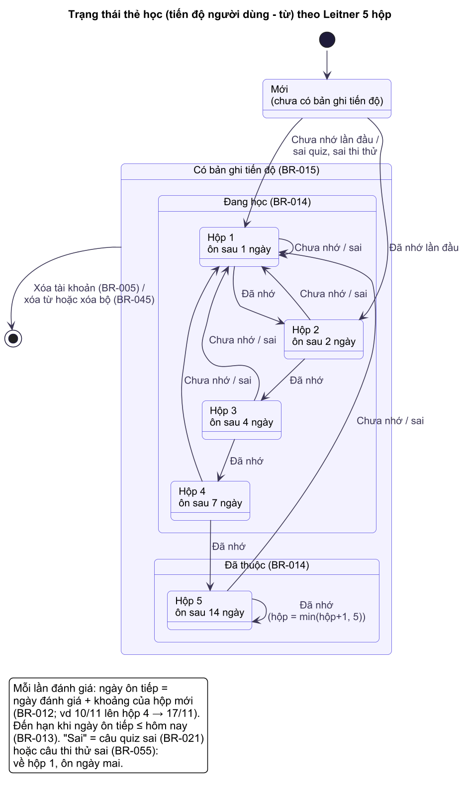
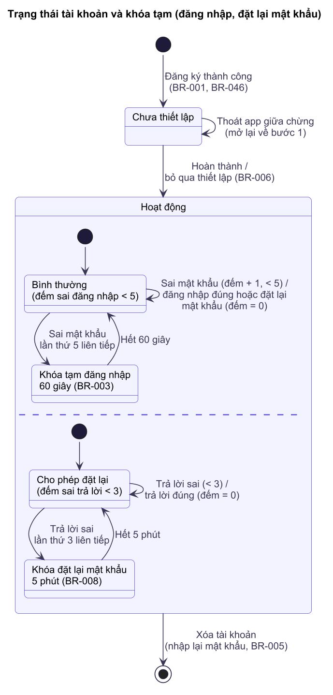
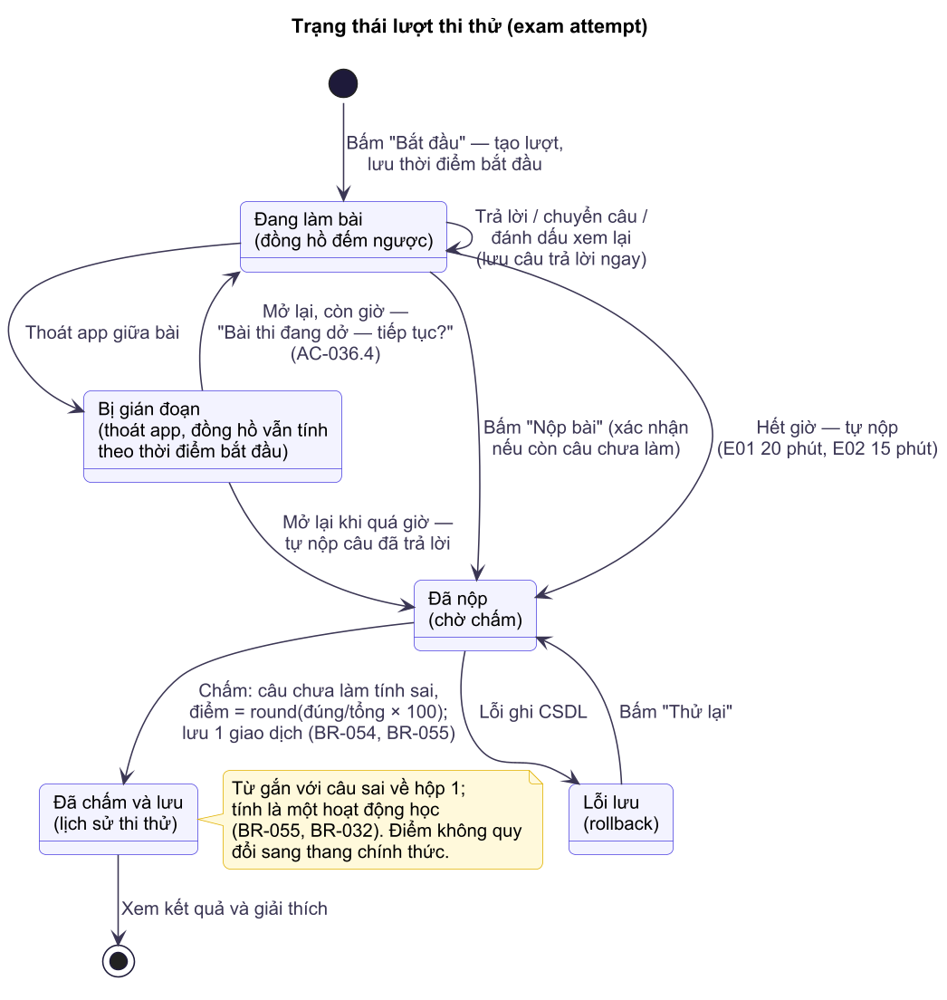
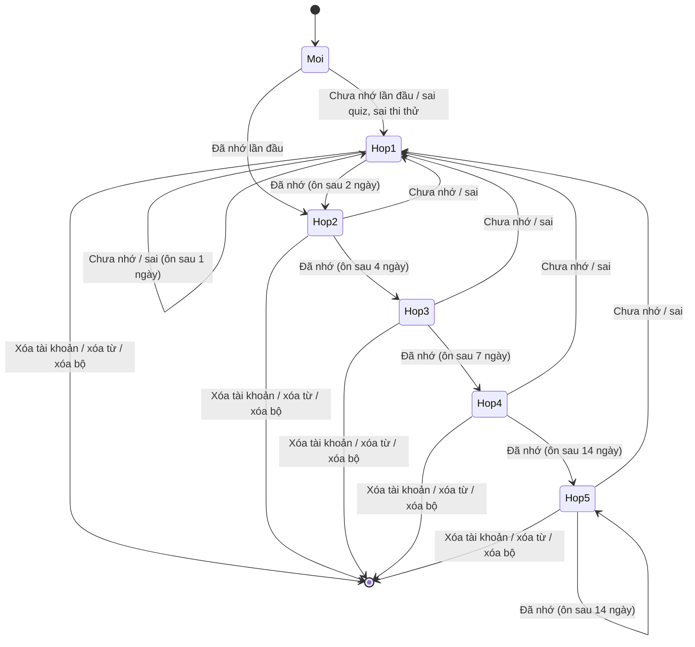
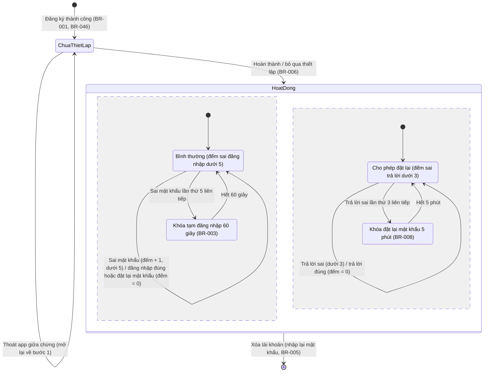

# SRS — Software Requirements Specification

> **TỰ SINH** từ bộ phân tích thiết kế đã duyệt của nhóm — không sửa trực tiếp tệp này; đề xuất thay đổi qua Issue/PR để nhóm trưởng cập nhật nguồn và sinh lại. Danh mục tài liệu: [docs/README.md](../README.md).

**Mục đích:** đặc tả yêu cầu phần mềm: phân quyền, quy tắc kiểm tra dữ liệu, trạng thái đối tượng, xử lý ngoại lệ, dữ liệu vào/ra từng chức năng và yêu cầu phi chức năng.

## 1. Giới thiệu
- **Phạm vi phần mềm:** ứng dụng Android LearningE chạy ngoại tuyến (Java, SQLite), một vai trò người dùng (Người học), không có máy chủ.
- **Tài liệu liên quan:** yêu cầu và user story ở [PRD](PRD.md); quy tắc nghiệp vụ ở [Business-Rules](Business-Rules.md); use case và luồng ở [Use-Cases](Use-Cases.md); thuật ngữ ở [Glossary](Glossary.md).
- **Cấu trúc:** mục 2–6 là yêu cầu chức năng chi tiết (phân quyền, kiểm tra dữ liệu, trạng thái, ngoại lệ, dữ liệu vào/ra); mục cuối là yêu cầu phi chức năng có số đo.

## Ma trận phân quyền
App có một vai trò; quyền phụ thuộc trạng thái đăng nhập và chủ sở hữu dữ liệu.
| Hành động | Khách (chưa đăng nhập) | Người học (đã đăng nhập) | Ghi chú |
|---|---|---|---|
| Đăng ký, đăng nhập | Có | Không (đã đăng nhập) | Đăng xuất để đổi tài khoản |
| Xem chủ đề, từ, bài ngữ pháp (dữ liệu seed) | Không | Xem | Seed chỉ đọc, không ai sửa trong app |
| Học, ôn tập, quiz, yêu thích | Không | Tạo/xem/sửa dữ liệu của chính mình | Lọc theo `user_id` (BR-015) |
| Sổ tay | Không | Tạo/xem/sửa/xóa của chính mình | Không xem được sổ tay người khác trên cùng máy |
| Hồ sơ, cài đặt, đổi mật khẩu, xóa tài khoản | Không | Của chính mình | Xóa tài khoản cần nhập lại mật khẩu |
| Bộ từ có sẵn (chủ đề, luyện thi, tiếng Nhật) | Không | Xem, học, export, chép từ sang bộ của mình | Không sửa/xóa (BR-043) |
| Bộ từ của tôi, import/export | Không | Tạo/xem/sửa/xóa/import/export của chính mình | Lọc theo chủ sở hữu (BR-043) |
| Thi thử, lịch sử thi | Không | Làm bài, xem lịch sử của chính mình | Đề thi là dữ liệu có sẵn, chỉ đọc |
| Xem Giới thiệu | Có | Có | Nội dung tĩnh |

## Quy tắc kiểm tra dữ liệu (validation)
| Trường | Kiểu | Bắt buộc | Quy tắc (độ dài, định dạng, miền giá trị) | Thông báo lỗi |
|---|---|---|---|---|
| Tên hiển thị | Chuỗi | Có | 2–30 ký tự sau khi bỏ khoảng trắng đầu/cuối; cho phép chữ có dấu, số, khoảng trắng | "Tên hiển thị từ 2 đến 30 ký tự" |
| Tên đăng nhập | Chuỗi | Có | 4–20 ký tự; chỉ a–z, 0–9, dấu chấm, gạch dưới; lưu dạng chữ thường | "Tên đăng nhập 4–20 ký tự, chỉ gồm chữ không dấu, số, '.' hoặc '_'" |
| Mật khẩu | Chuỗi | Có | 8–64 ký tự, có ít nhất 1 chữ cái và 1 chữ số | "Mật khẩu tối thiểu 8 ký tự, gồm cả chữ và số" |
| Xác nhận mật khẩu | Chuỗi | Có | Bằng mật khẩu | "Mật khẩu xác nhận không khớp" |
| Câu hỏi bảo mật | Danh mục | Có | 1 trong 5 câu (BR-009) | "Vui lòng chọn câu hỏi bảo mật" |
| Câu trả lời bảo mật | Chuỗi | Có | 2–50 ký tự sau khi bỏ khoảng trắng đầu/cuối | "Câu trả lời từ 2 đến 50 ký tự" |
| Tên bộ | Chuỗi | Có | 1–50 ký tự; không trùng trong bộ của người dùng (BR-044) | "Vui lòng nhập tên bộ" / "Bạn đã có bộ tên này" |
| Mô tả bộ | Chuỗi | Không | Tối đa 200 ký tự | "Mô tả tối đa 200 ký tự" |
| Ngôn ngữ bộ | Danh mục | Có | Mã trong `languages` (BR-052) | — (chọn từ danh sách) |
| Từ trong bộ — term, meaning, reading, example, example_translation | Chuỗi | term, meaning bắt buộc | Như quy tắc trường Sổ tay ở trên (term ≤ 50, meaning ≤ 200, reading ≤ 60, ví dụ ≤ 300) | Như Sổ tay |
| File import | CSV/JSON | Có | ≤ 1 MB, ≤ 2000 dòng, UTF-8, đúng tiêu đề/khóa (BR-048..BR-050) | "File quá lớn (tối đa 1 MB, 2000 dòng)" / "Sai định dạng: dòng tiêu đề phải là term,reading,meaning,example,example_translation" / "Không có dòng hợp lệ để nhập" |
| Cấp độ | Danh mục | Có | A1, A2, B1 | — (chọn từ danh sách) |
| Mục tiêu hằng ngày | Số nguyên | Có | 5, 10, 15, 20 | — (chọn từ danh sách) |
| Giờ nhắc | Giờ:phút | Có khi bật nhắc học | 00:00–23:59 | — (TimePicker) |
| Từ khóa tra | Chuỗi | Không | Tối đa 50 ký tự; bỏ khoảng trắng đầu/cuối | — (cắt bớt) |
| Sổ tay — Từ | Chuỗi | Có | 1–50 ký tự; không trùng trong sổ tay của người dùng (BR-041) | "Vui lòng nhập từ" / "Từ này đã có trong sổ tay" |
| Sổ tay — Nghĩa | Chuỗi | Có | 1–200 ký tự | "Vui lòng nhập nghĩa" |
| Sổ tay — Phiên âm | Chuỗi | Không | Tối đa 60 ký tự | "Phiên âm tối đa 60 ký tự" |
| Sổ tay — Ví dụ, ghi chú | Chuỗi | Không | Tối đa 300 ký tự mỗi trường | "Tối đa 300 ký tự" |
| Câu trả lời "điền từ" | Chuỗi | Có | 1–50 ký tự | "Vui lòng nhập câu trả lời" |

## Trạng thái & chuyển trạng thái của đối tượng chính

<!-- diagram:state/st-01-the-leitner.puml -->

<!-- /diagram -->

<!-- diagram:state/st-02-tai-khoan.puml -->

<!-- /diagram -->

<!-- diagram:state/st-03-luot-thi-thu.puml -->

<!-- /diagram -->
Thẻ học (tiến độ của một người dùng với một từ — BR-011, BR-012, BR-014, BR-021). Khớp sơ đồ PlantUML `docs/diagrams/state/st-01-the-leitner`:

Moi = Mới (chưa có bản ghi tiến độ); Hop1–Hop4 = Đang học; Hop5 = Đã thuộc (BR-014). "Sai" = câu quiz sai (BR-021) hoặc câu thi thử sai (BR-055). Từ **mọi hộp** đều thoát về [*] (bản ghi tiến độ bị xóa) khi xóa tài khoản (BR-005), xóa từ hoặc xóa bộ (BR-045) — thay đổi phạm vi.

Tài khoản và khóa tạm (BR-003, BR-005, BR-006, BR-008). Khớp `docs/diagrams/state/st-02-tai-khoan`; trong trạng thái Hoạt động có hai vùng chạy song song (đăng nhập, đặt lại mật khẩu), đếm sai và khóa tính **theo tên đăng nhập**:

Lượt thi thử (BR-054, BR-055, AC-036.4; cột `exam_attempts.status`: IN_PROGRESS gồm DangLam và GianDoan, SUBMITTED từ khi chấm và lưu xong). Khớp `docs/diagrams/state/st-03-luot-thi-thu`:

DangLam = đang làm bài (đồng hồ đếm ngược); GianDoan = bị gián đoạn (đồng hồ vẫn tính theo thời điểm bắt đầu); DaNop = đã nộp, chờ chấm; DaLuu = đã chấm và lưu vào lịch sử thi thử; LoiLuu = lỗi lưu (rollback). Từ gắn với câu sai về hộp 1 (BR-055).

## Ngoại lệ & thông báo lỗi
| Tình huống lỗi | Hệ thống làm gì | Thông báo cho người dùng | Có ghi log/cảnh báo? |
|---|---|---|---|
| Sai thông tin đăng nhập | Tăng đếm sai (BR-003) | "Tên đăng nhập hoặc mật khẩu không đúng" | Logcat mức DEBUG, không ghi mật khẩu |
| Tài khoản đang bị khóa tạm | Chặn đăng nhập | "Bạn đã nhập sai quá nhiều lần. Thử lại sau x giây" | Không |
| Lỗi ghi/đọc CSDL | Rollback giao dịch, giữ màn hình hiện tại | "Đã có lỗi khi lưu dữ liệu, vui lòng thử lại" | Logcat ERROR kèm stack trace |
| Nạp seed thất bại | Rollback, không vào app | "Không thể khởi tạo dữ liệu, vui lòng mở lại app" | Logcat ERROR |
| Thiếu giọng đọc TTS | Không đọc, tắt dạng câu nghe trong quiz | "Máy chưa có giọng đọc tiếng Anh" + nút "Cài đặt giọng đọc" | Logcat WARN |
| TTS khởi tạo chưa xong khi bấm loa | Xếp hàng đọc sau khi sẵn sàng (tối đa 3 giây) | Không có (nếu quá 3 giây: như thiếu giọng đọc) | Không |
| Từ chối/thu hồi quyền thông báo | Tắt nhắc học | "Bật quyền thông báo để nhận nhắc học" + nút "Cấp quyền" | Không |
| Thoát giữa bài quiz | Hỏi xác nhận | "Thoát bây giờ sẽ không lưu kết quả. Thoát?" | Không |
| Không có thẻ đến hạn / hết từ mới | Vô hiệu nút | "Hôm nay không có thẻ cần ôn" / "Bạn đã học hết từ mới của chủ đề này" | Không |
| Bộ nhớ máy đầy khi ghi | Rollback | "Bộ nhớ máy đã đầy, không thể lưu" | Logcat ERROR |
| Import: file sai định dạng / quá lớn / không có dòng hợp lệ | Không ghi gì | Thông báo cụ thể ở §Validation, kèm số dòng lỗi | Logcat WARN (không ghi nội dung file) |
| Export: hủy chọn nơi lưu / lỗi ghi | Xóa file dở dang nếu có | "Không thể xuất file" | Logcat ERROR |
| Hết giờ thi thử | Tự nộp bài | "Hết giờ! Bài của bạn đã được nộp" | Không |
| Không có trình duyệt để mở tài nguyên chính thức | Không mở | "Không tìm thấy trình duyệt để mở liên kết" | Không |

## Dữ liệu vào/ra từng chức năng
| Chức năng | Đầu vào | Đầu ra | Nguồn/đích dữ liệu |
|---|---|---|---|
| FN-001 Đăng ký | Tên hiển thị, tên đăng nhập, mật khẩu, câu hỏi + câu trả lời bảo mật | Người dùng mới, phiên | Bảng người dùng; SharedPreferences |
| FN-017 Đặt lại mật khẩu | Tên đăng nhập, câu trả lời bảo mật, mật khẩu mới | Mật khẩu băm mới / lỗi; đếm sai | Bảng người dùng |
| FN-018 Bộ từ | Tên, mô tả, ngôn ngữ; từ | Bộ, từ, tiến độ thẻ | Bảng bộ từ, từ, tiến độ thẻ |
| FN-019 Import | File CSV/JSON (URI do người dùng chọn) | Từ mới trong bộ đích; báo cáo dòng lỗi | Storage Access Framework → bảng từ |
| FN-020 Export | Bộ, định dạng, URI nơi lưu | File CSV/JSON | Bảng từ → Storage Access Framework |
| FN-021 Ngôn ngữ | Mã ngôn ngữ | Nhãn, locale TTS, quy tắc chuẩn hóa | Bảng ngôn ngữ |
| FN-022 Luyện thi | Đề, câu trả lời, thời gian | Lượt thi, điểm, câu trả lời; tiến độ thẻ | Bảng đề thi, câu hỏi thi (seed); bảng lượt thi |
| FN-002 Đăng nhập | Tên đăng nhập, mật khẩu | Phiên / lỗi; đếm sai | Bảng người dùng; SharedPreferences |
| FN-003 Thiết lập | Cấp độ, mục tiêu, giờ nhắc, bật/tắt | Cài đặt người dùng, lịch nhắc | Bảng cài đặt; AlarmManager/WorkManager |
| FN-004 Hồ sơ | Các trường cài đặt, mật khẩu | Cài đặt mới / xóa toàn bộ dữ liệu người dùng (BR-005) | Bảng người dùng, cài đặt, mọi bảng dữ liệu người dùng (tiến độ thẻ, yêu thích, bộ từ riêng và từ, lượt quiz, lượt thi, nhật ký học) |
| FN-005 Xem từ | Chủ đề, từ được chọn | Danh sách, chi tiết, cờ yêu thích | Bảng chủ đề, từ (seed); bảng yêu thích, tiến độ thẻ |
| FN-006/007 Flashcard | Đánh giá Đã nhớ/Chưa nhớ | Tiến độ thẻ, hoạt động học, chuỗi | Bảng tiến độ thẻ, nhật ký học, người dùng |
| FN-008 Quiz | Chủ đề, câu trả lời | Lượt làm, câu trả lời, điểm, tiến độ thẻ | Bảng từ (seed); bảng lượt làm, câu trả lời, tiến độ thẻ |
| FN-009 Lịch sử | — | Danh sách lượt làm | Bảng lượt làm |
| FN-010 Tiến độ | — | Số liệu thống kê | Truy vấn tổng hợp từ tiến độ thẻ, lượt làm, nhật ký học |
| FN-011 Nhắc học | Giờ nhắc, trạng thái mục tiêu | Thông báo cục bộ | Bảng cài đặt, nhật ký học; NotificationManager |
| FN-012 Ngữ pháp | Bài được chọn (≥ 5 câu hỏi mới làm bài tập — BR-056), câu trả lời | Trạng thái đã đọc, lượt làm | Bảng bài ngữ pháp, câu hỏi ngữ pháp (seed); bảng trạng thái bài, lượt làm |
| FN-013 Tra từ | Từ khóa | Danh sách kết quả | Bảng từ (seed), sổ tay |
| FN-014 Sổ tay | Từ, nghĩa, phiên âm, ví dụ, ghi chú | Mục sổ tay | Bảng sổ tay, tiến độ thẻ |
| FN-015 Seed | File trong `assets/` | Dữ liệu chủ đề, từ, ngữ pháp, câu hỏi | `assets/` → SQLite |

## Yêu cầu phi chức năng
> Hiệu năng, bảo mật, khả dụng, mở rộng, tuân thủ — có số đo.

| Hạng mục | Yêu cầu đo được | Cách kiểm chứng |
|---|---|---|
| Hiệu năng — khởi động | NFR-P1: Khởi động lạnh đến khi hiện Trang chủ ≤ 2 giây (lần mở thứ 2 trở đi); lần đầu có nạp seed ≤ 5 giây (US-025) | `adb shell am start -W` đo TotalTime, 5 lần lấy trung vị |
| Hiệu năng — truy vấn | NFR-P2: Mọi truy vấn CSDL trên luồng giao diện bị cấm; truy vấn danh sách/thống kê ≤ 100 ms với 5000 từ | StrictMode bật ở bản debug (không có vi phạm disk read trên main thread); đo thời gian truy vấn trong unit test/instrumented test |
| Hiệu năng — tra từ | NFR-P3: Kết quả tra hiện ≤ 300 ms sau khi ngừng gõ (debounce 250 ms); tra trên các cột chuẩn hóa sẵn `search_term`, `search_reading`, `search_meaning` | Instrumented test đo thời gian; thử tay |
| Hiệu năng — giao diện | NFR-P4: Cuộn danh sách từ (RecyclerView) và lật thẻ mượt, không quá 5% khung hình chậm (jank) | Android Studio Profiler / `adb shell dumpsys gfxinfo` |
| Kích thước | NFR-P5: APK bản release ≤ 30 MB; CSDL sau seed ≤ 10 MB | Kiểm tra file build; kiểm tra file `.db` trên emulator |
| Khả dụng — offline | NFR-A1: 100% chức năng dùng được không có mạng; manifest **không** khai báo quyền `INTERNET` | Bật chế độ máy bay chạy toàn bộ kịch bản UAT; kiểm tra manifest |
| Khả dụng — ổn định | NFR-A2: 0 crash/ANR khi chạy toàn bộ kịch bản UAT trên 2 thiết bị chuẩn | báo cáo kiểm thử; Logcat |
| Khả dụng — toàn vẹn dữ liệu | NFR-A3: Mọi thao tác ghi nhiều bảng chạy trong một giao dịch; tắt app đột ngột không làm hỏng CSDL hay để dữ liệu dở dang | Kill tiến trình giữa phiên học/quiz rồi mở lại, kiểm tra dữ liệu |
| Khả dụng — vòng đời | NFR-A4: Xoay màn hình, đưa app xuống nền, đổi theme hệ thống không mất trạng thái màn hình đang làm (thẻ hiện tại, câu quiz hiện tại, dữ liệu nhập) | Kiểm thử tay; bật "Don't keep activities" trong tùy chọn nhà phát triển |
| Khả dụng — nhắc học | NFR-A5: Thông báo nhắc học hiện trong khoảng ±15 phút so với giờ đặt; vẫn hoạt động sau khi khởi động lại máy | Đặt giờ nhắc + 2 phút; khởi động lại emulator rồi kiểm tra |
| Bảo mật — mật khẩu | NFR-S1: Mật khẩu băm PBKDF2-HMAC-SHA256, salt 16 byte/tài khoản (BR-002); không có mật khẩu rõ trong CSDL, SharedPreferences, Logcat | Mở file `.db` bằng DB Browser kiểm tra; tìm trong Logcat |
| Bảo mật — truy vấn | NFR-S2: 100% truy vấn có tham số dùng placeholder `?` (`selectionArgs`), không nối chuỗi đầu vào vào SQL | Code review (grep `rawQuery`/`execSQL` có nối chuỗi) |
| Bảo mật — thành phần | NFR-S3: Chỉ Activity khởi chạy và BroadcastReceiver khởi động máy được `exported`; receiver nhắc học `exported="false"` | Kiểm tra manifest |
| Bảo mật — sao lưu | NFR-S4: `android:allowBackup="false"` để CSDL chứa mật khẩu băm không bị trích ra qua sao lưu | Kiểm tra manifest |
| Bảo mật — tách dữ liệu | NFR-S5: Mọi truy vấn dữ liệu người dùng có điều kiện `user_id` của phiên hiện tại; không xem được dữ liệu người dùng khác trên cùng máy | Code review + test: 2 tài khoản trên một máy |
| Bảo mật — chuẩn tham chiếu | NFR-S6: Đạt các mục áp dụng của OWASP MASVS (MASVS-STORAGE, MASVS-CODE) mức cơ bản | Checklist của người review trước G6 |
| Accessibility | NFR-X1: Vùng chạm ≥ 48 × 48 dp; mọi nút chỉ có icon có `contentDescription` tiếng Việt; tương phản chữ ≥ 4.5:1 (WCAG 2.1 AA); không vỡ bố cục khi cỡ chữ hệ thống 200% | Accessibility Scanner trên 5 màn hình chính; thử TalkBack luồng FLOW-004 |
| Thiết bị/trình duyệt hỗ trợ | NFR-D1: Android 10 (API 29) đến Android 17 (API 37) (A5, thay đổi phạm vi): `minSdk = 29`, `targetSdk`/`compileSdk` = 37; `java.time` và `SecretKeyFactory("PBKDF2WithHmacSHA256")` có sẵn nên không cần thư viện hỗ trợ thêm; không dùng UPSERT của SQLite vì cần API 30 (minSdk 29 < API 30) — DEC-011. NFR-D2: Điện thoại 5–6,9 inch, chỉ hướng dọc cho màn hình flashcard/quiz (các màn hình khác hỗ trợ cả hai hướng). NFR-D3: Kiểm thử trên emulator API 29 (tối thiểu), API 33 (quyền thông báo), API 37 + ít nhất 1 máy thật | Chạy kịch bản UAT trên các cấu hình trên |
| Dữ liệu & quyền riêng tư | NFR-R1: Chỉ thu tên hiển thị, tên đăng nhập, mật khẩu băm, dữ liệu học; không thu email/số điện thoại/vị trí. NFR-R2: Dữ liệu chỉ lưu trên máy, không gửi ra ngoài. NFR-R3: Xóa tài khoản xóa sạch dữ liệu người dùng (BR-005). NFR-R4: Quyền hệ thống chỉ gồm `POST_NOTIFICATIONS`, `RECEIVE_BOOT_COMPLETED` (và quyền lên lịch nếu lập trình viên chọn AlarmManager) | Kiểm tra manifest; test xóa tài khoản rồi truy vấn các bảng |
| Khả năng mở rộng | NFR-E1: Đáp ứng NFR-P2 với 5000 từ, 100 chủ đề, 10 người dùng trên một máy. NFR-E2: Thêm chủ đề/từ mới chỉ cần sửa file seed và tăng phiên bản CSDL, không sửa code. NFR-E3: Lược đồ có cơ chế nâng cấp (`onUpgrade`) giữ dữ liệu người dùng | Test với seed giả 5000 từ; thử nâng phiên bản CSDL 1 → 2 |
| Bảo trì | NFR-M1: Tách tầng giao diện / nghiệp vụ / truy cập dữ liệu (SYSTEM-BLUEPRINT chốt). NFR-M2: Quy tắc Leitner, chuỗi ngày, chấm điểm (BR-011..BR-013, BR-021..BR-025, BR-031) có unit test JUnit, độ phủ nhánh ≥ 80% cho các lớp này. NFR-M3: Không có chuỗi giao diện viết cứng trong code/layout — tất cả nằm trong `strings.xml` | `./gradlew test` + báo cáo JaCoCo; Android Lint (HardcodedText = 0) |
| Bản địa hóa | NFR-L1: Giao diện tiếng Việt; nội dung học Anh–Việt; ngày hiển thị dạng dd/MM/yyyy, giờ 24h; múi giờ theo máy (BR-042) | Kiểm thử tay |
| Chất lượng build | NFR-Q1: `./gradlew assembleDebug` và `./gradlew lint` không lỗi; không cảnh báo mức Error trong Android Lint | Chạy trước mỗi lần merge |
