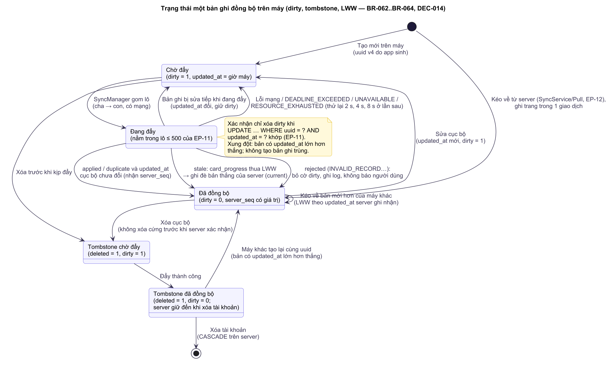
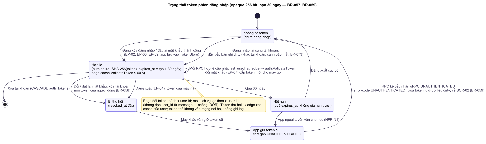
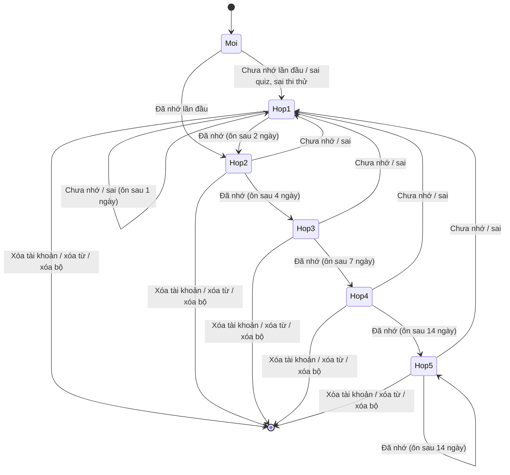
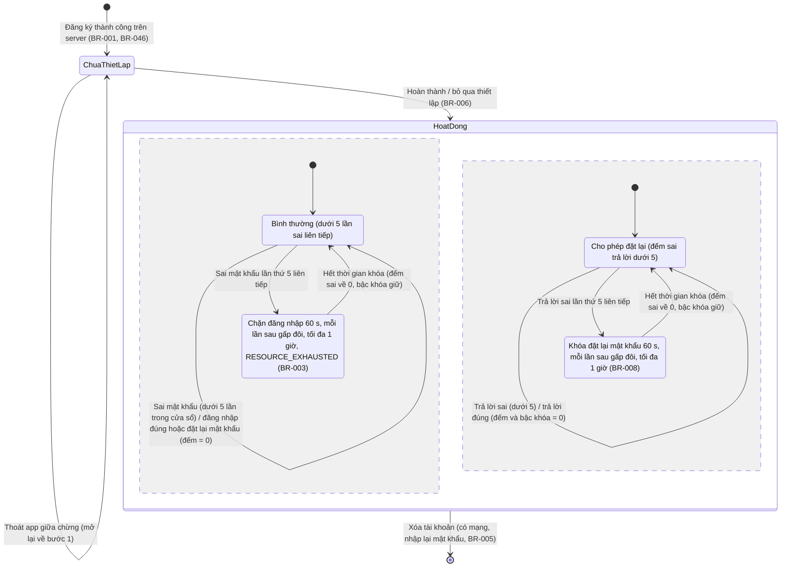
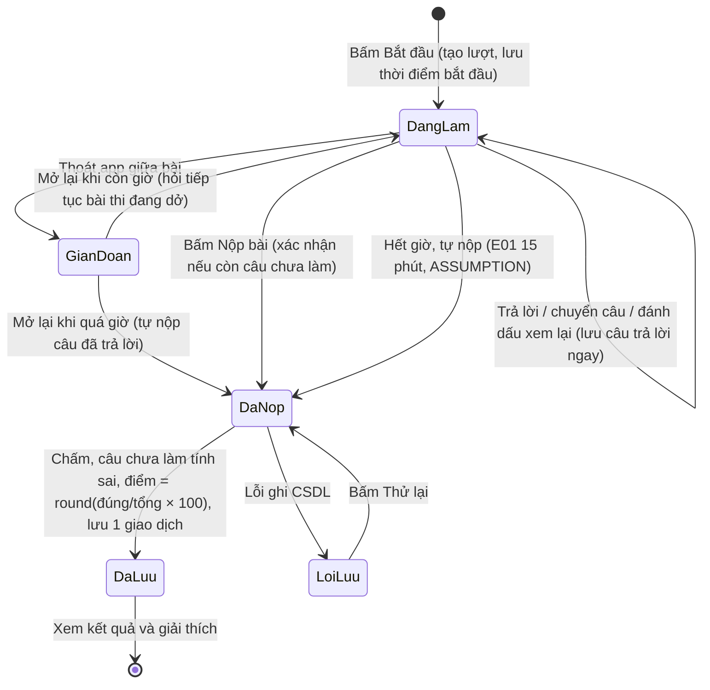

# SRS — Software Requirements Specification

> **TỰ SINH** từ bộ phân tích thiết kế đã duyệt của nhóm — không sửa trực tiếp tệp này; đề xuất thay đổi qua Issue/PR để nhóm trưởng cập nhật nguồn và sinh lại. Danh mục tài liệu: [docs/README.md](../README.md).

**Mục đích:** đặc tả yêu cầu phần mềm: phân quyền, quy tắc kiểm tra dữ liệu, trạng thái đối tượng, xử lý ngoại lệ, dữ liệu vào/ra từng chức năng và yêu cầu phi chức năng.

## 1. Giới thiệu
- **Phạm vi phần mềm:** hệ thống LearningE gồm ứng dụng Android (Java, SQLite, offline-first) và hệ thống máy chủ của nhóm (6 microservice Rust giao tiếp gRPC; SQLite là CSDL chính, MongoDB phụ) cung cấp tài khoản, đồng bộ tiến độ, bảng xếp hạng tuần và nội dung học; một vai trò người dùng (Người học).
- **Tài liệu liên quan:** API máy chủ ở [GRPC-API](../engineering/GRPC-API.md); bảo mật ở [SECURITY-THREAT-MODEL](../engineering/SECURITY-THREAT-MODEL.md); yêu cầu và user story ở [PRD](PRD.md); quy tắc nghiệp vụ ở [Business-Rules](Business-Rules.md); use case và luồng ở [Use-Cases](Use-Cases.md); thuật ngữ ở [Glossary](Glossary.md).
- **Cấu trúc:** mục 2–6 là yêu cầu chức năng chi tiết (phân quyền, kiểm tra dữ liệu, trạng thái, ngoại lệ, dữ liệu vào/ra); mục cuối là yêu cầu phi chức năng có số đo.

## Ma trận phân quyền
App có một vai trò người dùng; quyền phụ thuộc trạng thái đăng nhập và chủ sở hữu dữ liệu. Mọi kiểm tra quyền trên **server** dùng `user_id` lấy từ token (không lấy từ thông điệp app gửi — chống IDOR); app chỉ ẩn/hiện chức năng.
| Hành động | Khách (chưa đăng nhập) | Người học (đã đăng nhập) | Ghi chú |
|---|---|---|---|
| Đăng ký, đăng nhập, đặt lại mật khẩu | Có (cần mạng) | Không (đã đăng nhập) | Đăng xuất để đổi tài khoản (BR-073) |
| Xem chủ đề, từ (dữ liệu có sẵn) | Không | Xem | Chỉ đọc. Bài ngữ pháp **[Won't]** |
| Học, ôn tập, quiz, yêu thích | Không | Tạo/xem/sửa dữ liệu của chính mình | Lọc theo `user_id` (BR-015) trên máy và server |
| Sổ tay | Không | Tạo/xem/sửa/xóa của chính mình | Sổ tay là bộ mặc định (BR-046) |
| Hồ sơ, cài đặt, biệt danh | Không | Của chính mình | Cấp độ, mục tiêu sửa được khi ngoại tuyến (đồng bộ sau); biệt danh, tên hiển thị cần mạng (EP-06) |
| Đổi mật khẩu, xóa tài khoản | Không | Của chính mình (cần mạng) | Xóa tài khoản cần nhập lại mật khẩu |
| Bộ từ có sẵn (chủ đề, luyện thi, tiếng Nhật, bộ từ server) | Không | Xem, học, export, chép từ sang bộ của mình | Không sửa/xóa (BR-043) |
| Bộ từ của tôi, import/export | Không | Tạo/xem/sửa/xóa/import/export của chính mình | Lọc theo chủ sở hữu (BR-043) |
| Thi thử, lịch sử thi | Không | Làm bài, xem lịch sử của chính mình | Đề thi chỉ đọc |
| Đồng bộ (đẩy/kéo) — thay đổi phạm vi | Không | Chỉ dữ liệu của chính mình | Server bỏ qua mọi `user_id` trong thông điệp app gửi (BR-062) |
| Xem trạng thái đồng bộ — thay đổi phạm vi | Không | Của chính mình | Trên máy, không gọi server |
| Bảng xếp hạng tuần — thay đổi phạm vi | Không | Xem biệt danh, XP tuần, hạng của top 50 + dòng của mình | Không bao giờ thấy email/dữ liệu học của người khác (BR-060) |
| Tải nội dung từ server — thay đổi phạm vi [Could] | Không | Có (tự động) | RPC nội dung (`ContentService`, EP-14..EP-16) không chứa dữ liệu người dùng nhưng **cần token** (D-08, THREAT_MODEL): chỉ tải sau khi đăng nhập; dữ liệu seed trong APK đủ cho lần đầu |
| Sửa nội dung trên server | Không | Không | Chỉ nhóm phát triển sửa trực tiếp trên server (không có trang quản trị — Non-goal) |
| Xem Giới thiệu | Có | Có | Nội dung tĩnh |

## Quy tắc kiểm tra dữ liệu (validation) Các trường tài khoản kiểm ở **cả app (trước khi gửi) và server (bắt buộc)**; server trả `INVALID_ARGUMENT` kèm mã trường lỗi (cách mang mã: API_CONTRACT), app hiện đúng thông báo dưới đây.
| Trường | Kiểu | Bắt buộc | Quy tắc (độ dài, định dạng, miền giá trị) | Thông báo lỗi |
|---|---|---|---|---|
| Email | Chuỗi | Có | ≤ 254 ký tự sau chuẩn hóa; đúng 1 `@`, tên miền có `.`; lưu chữ thường (BR-060) | "Email không hợp lệ" / "Email đã được sử dụng" |
| Biệt danh công khai `nickname` | Chuỗi | Có | 3–20 ký tự, chỉ `A–Z a–z 0–9 _ .`, duy nhất không phân biệt hoa thường (BR-061) | "Biệt danh 3–20 ký tự, chỉ gồm chữ không dấu, số, '.' hoặc '_'" / "Biệt danh đã được sử dụng" |
| Tên hiển thị `display_name` | Chuỗi | Có | 2–30 ký tự sau khi bỏ khoảng trắng đầu/cuối; cho phép chữ có dấu, số, khoảng trắng; không công khai | "Tên hiển thị từ 2 đến 30 ký tự" |
| Tên đăng nhập (bỏ  — thay bằng Email) | — | — | Không còn dùng | — |
| Mật khẩu | Chuỗi | Có | 8–64 ký tự, có ít nhất 1 chữ cái và 1 chữ số (kiểm ở cả 2 phía) | "Mật khẩu tối thiểu 8 ký tự, gồm cả chữ và số" |
| Xác nhận mật khẩu | Chuỗi | Có | Bằng mật khẩu (chỉ kiểm ở app, không gửi lên server) | "Mật khẩu xác nhận không khớp" |
| Câu hỏi bảo mật | Danh mục | Có | 1 trong 5 câu (BR-009) | "Vui lòng chọn câu hỏi bảo mật" |
| Câu trả lời bảo mật | Chuỗi | Có | 2–50 ký tự sau khi bỏ khoảng trắng đầu/cuối | "Câu trả lời từ 2 đến 50 ký tự" |
| Tên bộ | Chuỗi | Có | 1–50 ký tự; không trùng trong bộ của người dùng (BR-044) | "Vui lòng nhập tên bộ" / "Bạn đã có bộ tên này" |
| Mô tả bộ | Chuỗi | Không | Tối đa 200 ký tự | "Mô tả tối đa 200 ký tự" |
| Ngôn ngữ bộ | Danh mục | Có | Mã trong `languages` (BR-052) | — (chọn từ danh sách) |
| Từ trong bộ — term, meaning, reading, example, example_translation | Chuỗi | term, meaning bắt buộc | Như quy tắc trường Sổ tay ở dưới (term ≤ 50, meaning ≤ 200, reading ≤ 60, ví dụ ≤ 300); server kiểm lại khi nhận đồng bộ | Như Sổ tay |
| File import (thay đổi phạm vi; thay đổi phạm vi C6) | CSV | Có | ≤ 1 MB, ≤ 2000 dòng, UTF-8, đúng tiêu đề (BR-048, BR-050) | "File quá lớn (tối đa 1 MB, 2000 dòng)" / "Sai định dạng: dòng tiêu đề phải là term,reading,meaning,example,example_translation" / "Không có dòng hợp lệ để nhập" |
| Cấp độ | Danh mục | Có | A1, A2, B1 | — (chọn từ danh sách) |
| Mục tiêu hằng ngày | Số nguyên | Có | 5, 10, 15, 20 | — (chọn từ danh sách) |
| Giờ nhắc | Giờ:phút | Có khi bật nhắc học | 00:00–23:59 | — (TimePicker) |
| Từ khóa tra [Could] | Chuỗi | Không | Tối đa 50 ký tự; bỏ khoảng trắng đầu/cuối | — (cắt bớt) |
| Sổ tay — Từ | Chuỗi | Có | 1–50 ký tự; không trùng trong sổ tay của người dùng (BR-047) | "Vui lòng nhập từ" / "Từ này đã có trong sổ tay" |
| Sổ tay — Nghĩa | Chuỗi | Có | 1–200 ký tự | "Vui lòng nhập nghĩa" |
| Sổ tay — Phiên âm | Chuỗi | Không | Tối đa 60 ký tự | "Phiên âm tối đa 60 ký tự" |
| Sổ tay — Ví dụ, ghi chú | Chuỗi | Không | Tối đa 300 ký tự mỗi trường | "Tối đa 300 ký tự" |
| Câu trả lời "điền từ" | Chuỗi | Có | 1–50 ký tự | "Vui lòng nhập câu trả lời" |
| Lô đồng bộ | Mảng bản ghi | Có | ≤ 500 bản ghi (BR-064); mỗi bản ghi có `uuid` dạng UUID, `updated_at` ≥ 0, đúng kiểu bảng | Không hiện cho người dùng; ghi `sync_state` "Đồng bộ lỗi, sẽ thử lại" |

## Trạng thái & chuyển trạng thái của đối tượng chính

<!-- diagram:state/st-01-the-leitner.puml -->

<!-- /diagram -->

<!-- diagram:state/st-02-tai-khoan.puml -->

<!-- /diagram -->

<!-- diagram:state/st-03-luot-thi-thu.puml -->

<!-- /diagram -->

<!-- diagram:state/st-04-ban-ghi-dong-bo.puml -->

<!-- /diagram -->

<!-- diagram:state/st-05-token-phien.puml -->

<!-- /diagram -->
Thẻ học (tiến độ của một người dùng với một từ — BR-011, BR-012, BR-014, BR-021). Khớp sơ đồ PlantUML `docs/diagrams/state/st-01-the-leitner`:

Moi = Mới (chưa có bản ghi tiến độ); Hop1–Hop4 = Đang học; Hop5 = Đã thuộc (BR-014). "Sai" = câu quiz sai (BR-021) hoặc câu thi thử sai (BR-055). Từ **mọi hộp** đều thoát về [*] (bản ghi tiến độ bị xóa) khi xóa tài khoản (BR-005), xóa từ hoặc xóa bộ (BR-045) — thay đổi phạm vi. Mỗi chuyển hộp cũng làm bản ghi đồng bộ chuyển sang "Chờ đẩy" (sơ đồ bản ghi đồng bộ bên dưới); "xóa" là tombstone tới khi server xác nhận. Một thay đổi hộp đến từ máy khác (kéo về) có thể đưa thẻ sang hộp bất kỳ theo BR-062.

Tài khoản và khóa tạm tăng dần (BR-003, BR-005, BR-006, BR-008). Khớp `docs/diagrams/state/st-02-tai-khoan`; trong trạng thái Hoạt động có hai vùng chạy song song (đăng nhập, đặt lại mật khẩu). Trạng thái nằm **trên server**, đếm sai và khóa tính **theo email**:

Ghi chú: "Chưa thiết lập" là trạng thái trên máy (cài đặt chưa có); server coi tài khoản đã hoạt động ngay khi tạo.

Lượt thi thử (BR-054, BR-055, AC-036.4; cột `exam_attempts.status`: IN_PROGRESS gồm DangLam và GianDoan, SUBMITTED từ khi chấm và lưu xong). Khớp `docs/diagrams/state/st-03-luot-thi-thu`:

DangLam = đang làm bài (đồng hồ đếm ngược); GianDoan = bị gián đoạn (đồng hồ vẫn tính theo thời điểm bắt đầu); DaNop = đã nộp, chờ chấm; DaLuu = đã chấm và lưu vào lịch sử thi thử (tạo `xp_event`, chờ đồng bộ); LoiLuu = lỗi lưu (rollback). Từ gắn với câu sai về hộp 1 (BR-055). Chỉ lượt đã ở DaLuu mới được đồng bộ (lượt đang làm không đồng bộ sang máy khác). Bản ghi đồng bộ trên máy — mọi bảng đồng bộ (BR-062..BR-064). Sạch = `dirty = 0` (đã đồng bộ); Chờ đẩy = `dirty = 1`:
```mermaid
stateDiagram-v2
  [*] --> ChoDay: Tạo trên máy (uuid mới, updated_at, dirty = 1)
  [*] --> Sach: Kéo về từ server (dirty = 0)
  Sach --> ChoDay: Sửa hoặc xóa trên máy (xóa = tombstone deleted = 1)
  ChoDay --> ChoDay: Sửa tiếp trên máy (updated_at mới)
  ChoDay --> DangDay: Bắt đầu đẩy (nằm trong lô ≤ 500)
  DangDay --> Sach: Server xác nhận, bản máy thắng, không sửa thêm trong lúc đẩy
  DangDay --> ChoDay: Mất mạng / quá hạn / UNAVAILABLE / INTERNAL / UNAUTHENTICATED / bị sửa trong lúc đẩy
  DangDay --> DaGiaiQuyet: Server trả bản khác thắng (LWW, BR-062)
  ChoDay --> DaGiaiQuyet: Kéo về bản cùng uuid hoặc cùng khóa tự nhiên
  DaGiaiQuyet --> Sach: Ghi bản thắng vào máy
  DaGiaiQuyet --> ChoDay: Bản máy thắng (updated_at lớn hơn), giữ chờ đẩy
  Sach --> Sach: Kéo về bản mới hơn (ghi đè)
  Sach --> [*]: Tombstone đã được server xác nhận (máy được xóa cứng)
  Sach --> [*]: Đăng xuất / xóa tài khoản (xóa dữ liệu máy)
  ChoDay --> [*]: Đăng xuất có xác nhận mất dữ liệu (BR-073)
``` Phiên đăng nhập (token) — nhìn từ máy, khớp BR-004, BR-057..BR-059, BR-073:
```mermaid
stateDiagram-v2
  [*] --> ChuaDangNhap
  ChuaDangNhap --> HieuLuc: Đăng ký / đăng nhập thành công (token 256 bit, hạn 30 ngày)
  HieuLuc --> HieuLuc: Gọi API 2xx / dùng app ngoại tuyến (không kiểm tra token)
  HieuLuc --> HieuLuc: Đổi mật khẩu trên máy này (nhận token mới)
  HieuLuc --> HetHan: Quá 30 ngày kể từ khi cấp
  HieuLuc --> BiThuHoi: Đổi/đặt lại mật khẩu ở máy khác / xóa tài khoản
  HetHan --> ChuaDangNhap: Gọi RPC nhận UNAUTHENTICATED → SCR-02, giữ dữ liệu chờ đẩy (BR-059)
  BiThuHoi --> ChuaDangNhap: Gọi RPC nhận UNAUTHENTICATED → SCR-02, giữ dữ liệu chờ đẩy (BR-059)
  HieuLuc --> ChuaDangNhap: Nhận PERMISSION_DENIED ACCOUNT_DELETED → xóa token + dữ liệu cục bộ của user, báo Tài khoản đã bị xóa, SCR-02 (BR-059)
  HieuLuc --> ChuaDangNhap: Đăng xuất (server thu hồi token máy này, BR-058, BR-073)
  ChuaDangNhap --> [*]: Gỡ app
```
HetHan/BiThuHoi là trạng thái trên server mà máy chưa biết cho tới lần gọi RPC kế tiếp; trong lúc đó app vẫn chạy ngoại tuyến bình thường (NFR-N1).

## Ngoại lệ & thông báo lỗi **Một cơ chế lỗi duy nhất** (API_CONTRACT §Quy ước lỗi): (1) mã trạng thái gRPC phân loại lỗi; (2) trailer `error-code` = mã nghiệp vụ, **tên giữ nguyên từ thay đổi phạm vi** (vd `EMAIL_TAKEN`, `NICKNAME_TAKEN`, `ACCOUNT_LOCKED`, `RESET_LOCKED`); (3) trailer phụ khi áp dụng: `retry-after-seconds` (số giây chờ, cho `RESOURCE_EXHAUSTED` và `UNAVAILABLE` do quá tải) và `error-fields` (`<trường>=<mã>` cho `VALIDATION_ERROR`). App ánh xạ (mã gRPC, `error-code`) → `ErrorCode` nội bộ rồi mới chọn thông báo (không dựa vào `grpc-message`); ý nghĩa nghiệp vụ và thông báo cho người dùng **không đổi** so với thay đổi phạm vi. Lỗi tầng vận chuyển (mất mạng, quá hạn) không có `error-code`.

| Mã gRPC | `error-code` (trailer) | Dùng khi | RPC |
|---|---|---|---|
| `INVALID_ARGUMENT` | `VALIDATION_ERROR` (+ `error-fields`) | Dữ liệu sai quy tắc §Validation | Mọi RPC có tham số |
| `INVALID_ARGUMENT` | `BATCH_TOO_LARGE` | Lô đồng bộ > 500 bản ghi (BR-064) | `SyncService.Push` |
| `RESOURCE_EXHAUSTED` | `PAYLOAD_TOO_LARGE` | Thông điệp vượt giới hạn kích thước | Mọi RPC |
| `UNAUTHENTICATED` | `UNAUTHENTICATED` | Token thiếu/sai/hết hạn/bị thu hồi/thuộc tài khoản đã xóa → BR-059 (cùng `ACCOUNT_DELETED`, **hai lỗi duy nhất làm app xóa token**) | Mọi RPC cần token |
| `UNAUTHENTICATED` | `INVALID_CREDENTIALS` | Sai email hoặc mật khẩu khi đăng nhập (chưa có token → không kích hoạt BR-059) | `AuthService.Login` |
| `UNAUTHENTICATED` | `INVALID_SECURITY_ANSWER` | Sai câu trả lời bảo mật hoặc email không tồn tại (BR-076) | `AuthService.ResetPassword` |
| `PERMISSION_DENIED` | `INVALID_CREDENTIALS` | Sai mật khẩu hiện tại khi đã đăng nhập (không xóa token) | `AuthService.ChangePassword`, `AuthService.DeleteAccount` |
| `PERMISSION_DENIED` | `ACCOUNT_DELETED` | Token của tài khoản đã xóa (lô đến muộn) — cả lô bị từ chối → BR-059: xóa token + dữ liệu cục bộ của user | `SyncService.Push` |
| `NOT_FOUND` | `NOT_FOUND` | Không có bộ/đề thi theo mã (nội dung) | `ContentService.GetDeck`, `GetExam` |
| `ALREADY_EXISTS` | `EMAIL_TAKEN` / `NICKNAME_TAKEN` | Trùng email hoặc biệt danh | `AuthService.Register`, `UpdateMe` |
| `FAILED_PRECONDITION` | `UPGRADE_REQUIRED` | Bản app quá cũ so với yêu cầu tối thiểu của máy chủ | Mọi RPC |
| `RESOURCE_EXHAUSTED` | `RATE_LIMITED` / `ACCOUNT_LOCKED` / `RESET_LOCKED` (+ `retry-after-seconds`) | Khóa tăng dần (BR-003, BR-008), giới hạn tần suất (NFR-S8) | `Register`, `Login`, `GetResetQuestion`, `ResetPassword`, mọi RPC |
| `UNAVAILABLE` | `SERVICE_UNAVAILABLE` (+ `retry-after-seconds` khi quá tải) | Máy chủ bận, dịch vụ đích hoặc MongoDB (content, gamification, insight) không sẵn sàng | Mọi RPC |
| `INTERNAL` | `INTERNAL_ERROR` | Lỗi nội bộ không lường trước | Mọi RPC |
| `DEADLINE_EXCEEDED`, `UNAVAILABLE` (không `error-code`) | — | Quá hạn / không kết nối được máy chủ (mất mạng) — lỗi phía mạng | Mọi RPC |

| Tình huống lỗi | Hệ thống làm gì | Thông báo cho người dùng | Có ghi log/cảnh báo? |
|---|---|---|---|
| Sai thông tin đăng nhập (`UNAUTHENTICATED` ở `AuthService.Login`) | Server tăng đếm sai theo email (BR-003) | "Email hoặc mật khẩu không đúng" | Server: log mức INFO kèm email đã che (m***@gmail.com), không ghi mật khẩu |
| Email đang bị chặn đăng nhập (`RESOURCE_EXHAUSTED`) | Server chặn, trả số giây chờ | "Bạn thử quá nhiều lần, vui lòng thử lại sau x giây" | Server: WARN |
| Lỗi ghi/đọc CSDL máy | Rollback giao dịch, giữ màn hình hiện tại | "Đã có lỗi khi lưu dữ liệu, vui lòng thử lại" | Logcat ERROR kèm stack trace |
| Nạp seed thất bại | Rollback, không vào app | "Không thể khởi tạo dữ liệu, vui lòng mở lại app" | Logcat ERROR |
| Thiếu giọng đọc TTS | Không đọc, tắt dạng câu nghe trong quiz | "Máy chưa có giọng đọc tiếng Anh" + nút "Cài đặt giọng đọc" | Logcat WARN |
| TTS khởi tạo chưa xong khi bấm loa | Xếp hàng đọc sau khi sẵn sàng (tối đa 3 giây) | Không có (nếu quá 3 giây: như thiếu giọng đọc) | Không |
| Từ chối/thu hồi quyền thông báo | Tắt nhắc học | "Bật quyền thông báo để nhận nhắc học" + nút "Cấp quyền" | Không |
| Thoát giữa bài quiz | Hỏi xác nhận | "Thoát bây giờ sẽ không lưu kết quả. Thoát?" | Không |
| Không có thẻ đến hạn / hết từ mới | Vô hiệu nút | "Hôm nay không có thẻ cần ôn" / "Bạn đã học hết từ mới của chủ đề này" | Không |
| Bộ nhớ máy đầy khi ghi | Rollback | "Bộ nhớ máy đã đầy, không thể lưu" | Logcat ERROR |
| Import: file sai định dạng / quá lớn / không có dòng hợp lệ | Không ghi gì | Thông báo cụ thể ở §Validation, kèm số dòng lỗi | Logcat WARN (không ghi nội dung file) |
| Export: hủy chọn nơi lưu / lỗi ghi | Xóa file dở dang nếu có | "Không thể xuất file" | Logcat ERROR |
| Hết giờ thi thử | Tự nộp bài | "Hết giờ! Bài của bạn đã được nộp" | Không |
| Không có trình duyệt để mở tài nguyên chính thức | Không mở | "Không tìm thấy trình duyệt để mở liên kết" | Không |
| Mất mạng khi dùng chức năng cần mạng (BR-078) | Không gửi; giữ dữ liệu đã nhập (trừ mật khẩu) | "Cần kết nối mạng để [đăng nhập / đổi mật khẩu / đặt lại mật khẩu / xóa tài khoản / xem bảng xếp hạng]"; thanh "Đang ngoại tuyến" | Không |
| Mất mạng khi đồng bộ tự động | Giữ `dirty`, thử lại theo BR-077 | Không chặn; SCR-35 hiện "Không có kết nối mạng" | `sync_state` lỗi gần nhất |
| (thay đổi phạm vi; thay đổi phạm vi) Quá hạn (`DEADLINE_EXCEEDED` — deadline gRPC theo từng RPC, NFR-N2) | Coi như lỗi mạng; thao tác tài khoản không thử lại tự động | "Không kết nối được máy chủ, vui lòng thử lại" | Logcat WARN (không ghi token/body) |
| (thay đổi phạm vi; thay đổi phạm vi) Server lỗi `UNAVAILABLE` (`SERVICE_UNAVAILABLE`, có thể kèm `retry-after-seconds`)/`INTERNAL` | Không đổi gì ở máy; đồng bộ thử lại 3 lần (BR-077) | "Máy chủ đang gặp sự cố, vui lòng thử lại sau" | Server: ERROR kèm mã yêu cầu; Logcat WARN |
| (thay đổi phạm vi; thay đổi phạm vi) `UNAUTHENTICATED` — token sai/hết hạn/thu hồi (cùng `ACCOUNT_DELETED` là hai lỗi làm app xóa token) | BR-059: xóa token, giữ dữ liệu chờ đẩy, về SCR-02 | "Phiên đăng nhập đã hết hạn, vui lòng đăng nhập lại" | Logcat INFO |
| (thay đổi phạm vi; thay đổi phạm vi) `ALREADY_EXISTS` (`error-code` = `EMAIL_TAKEN`) — trùng email khi đăng ký | Không tạo tài khoản | "Email đã được sử dụng" | Không |
| Xung đột khi đồng bộ (`stale`) / bản ghi `rejected` | `stale`: ghi bản server (BR-062); `rejected`: bỏ cờ chờ, ghi lỗi (BR-064) | Không hiện (tự xử lý); SCR-35 chỉ ghi số bản ghi đã hợp nhất | `sync_state` |
| (thay đổi phạm vi; thay đổi phạm vi) `RESOURCE_EXHAUSTED` (`RATE_LIMITED`/`ACCOUNT_LOCKED`/`RESET_LOCKED`) — giới hạn tần suất (đăng nhập, đặt lại, gọi RPC quá nhanh) | Chờ đúng số giây `retry-after-seconds` server báo | "Bạn thử quá nhiều lần, vui lòng thử lại sau x giây" (đặt lại mật khẩu: "Bạn đã trả lời sai quá nhiều lần. Thử lại sau x" — x theo `retry-after-seconds`, hiển thị giây hoặc phút; thời gian khóa tăng dần theo BR-003/BR-008) | Server: WARN |
| (thay đổi phạm vi; thay đổi phạm vi) `INVALID_ARGUMENT` (`VALIDATION_ERROR`) — dữ liệu không hợp lệ ở server | Hiện lỗi tại trường theo `error-fields` server trả | Thông báo tương ứng ở §Validation | Server: INFO |
| (thay đổi phạm vi; thay đổi phạm vi) `INVALID_ARGUMENT` (`BATCH_TOO_LARGE`)/`RESOURCE_EXHAUSTED` (`PAYLOAD_TOO_LARGE`) — lô đồng bộ > 500 bản ghi hoặc thông điệp quá lớn | Chia lô nhỏ hơn, thử lại | Không hiện | Logcat ERROR (lỗi lập trình) |
| `PERMISSION_DENIED` (`INVALID_CREDENTIALS`) — nhập sai mật khẩu hiện tại khi đổi mật khẩu/xóa tài khoản | Không đổi gì; **không** xóa token (không phải `UNAUTHENTICATED` — BR-059) | "Mật khẩu hiện tại không đúng" | Server: INFO |
| `PERMISSION_DENIED` (`ACCOUNT_DELETED`) — lô đồng bộ của token thuộc tài khoản đã bị xóa (ở máy khác) | Server từ chối cả lô, không ghi gì; app (BR-059 mở rộng) dừng đồng bộ, không thử lại, **xóa token + dữ liệu cục bộ của user đó kể cả `dirty`**, về SCR-02 | "Tài khoản đã bị xóa" | Logcat INFO |
| `FAILED_PRECONDITION` (`UPGRADE_REQUIRED`) — bản app quá cũ | Dừng gọi máy chủ; không xóa token; dữ liệu trên máy giữ nguyên, học ngoại tuyến vẫn dùng được | "Vui lòng cập nhật ứng dụng" | Logcat WARN |
| `ContentService.GetManifest` trả `not_modified = true` | Coi như nội dung đã mới nhất, không tải gì (BR-075) | Không | Không |
| Đặt lại mật khẩu: sai câu trả lời hoặc email không tồn tại | Đếm sai theo email (BR-008, BR-076) | "Thông tin không khớp" | Server: INFO, email đã che |
| Đăng xuất khi còn thay đổi chưa đồng bộ và không đồng bộ được | Hộp cảnh báo, mặc định "Ở lại" (BR-073) | "Còn x thay đổi chưa đồng bộ. Nếu đăng xuất bây giờ, các thay đổi này sẽ mất trên máy này." | Không |
| Đạt trần XP ngày | Không cộng thêm XP (BR-068) | "Bạn đã đạt tối đa 500 XP hôm nay" | Không |
| Tải nội dung từ server lỗi [Could] | Giữ phiên bản cũ (BR-075) | Không chặn; SCR-35 hiện "Chưa cập nhật được nội dung mới" | `sync_state` |
| Dịch vụ phụ không sẵn sàng (MongoDB, `content`, `gamification` hoặc `insight` ngừng; NFR-N5) | Đăng nhập, đăng ký, đẩy/kéo đồng bộ **vẫn chạy** (chỉ dùng SQLite). Bảng xếp hạng (EP-13) trả `UNAVAILABLE` → app hiện bản lưu gần nhất + thời điểm (AC-042.4); nội dung (EP-14..EP-16) trả `UNAVAILABLE` → dùng seed trong APK + bản đã tải (BR-075); `GetMe` thiếu XP → hiện XP tạm tính trên máy. Sự kiện XP/nội dung dồn lại ở hàng đợi outbox của server rồi tự xả khi dịch vụ sống lại (NFR-N6) | Bảng xếp hạng: "Cập nhật lúc hh:mm dd/MM"; không báo lỗi chặn việc học | Server: WARN khi outbox > 10.000 dòng; Logcat WARN |

## Dữ liệu vào/ra từng chức năng
| Chức năng | Đầu vào | Đầu ra | Nguồn/đích dữ liệu |
|---|---|---|---|
| FN-001 Đăng ký | Email, biệt danh, tên hiển thị, mật khẩu, câu hỏi + câu trả lời bảo mật (đã chuẩn hóa) | Server: người dùng, băm mật khẩu + câu trả lời, token băm, sự kiện `user.registered` (→ bộ "Sổ tay của tôi" do `sync` tạo). Máy: token, mã người dùng | RPC `AuthService.Register` (EP-02) → SQLite `auth.db`: `users`, `auth_tokens`, `security_answers`; bộ "Sổ tay của tôi" thuộc dữ liệu của dịch vụ `sync`, tạo từ sự kiện `user.registered` (outbox của `auth` → `sync`; `uuid` = UUIDv5 tất định — BR-046); SharedPreferences (máy) |
| FN-002 Đăng nhập/đăng xuất | Email, mật khẩu; đăng xuất: token | Token mới / lỗi; đếm sai trên server; dữ liệu kéo về; đăng xuất: token bị thu hồi, dữ liệu máy bị xóa | RPC `AuthService.Login` (EP-03), `Logout` (EP-04), `SyncService.Pull` (EP-12); SharedPreferences, CSDL máy |
| FN-003 Thiết lập | Cấp độ, mục tiêu, giờ nhắc, bật/tắt | Cài đặt người dùng (chờ đẩy), lịch nhắc | Bảng cài đặt; AlarmManager/WorkManager |
| FN-004 Hồ sơ | Biệt danh, các trường cài đặt; mật khẩu hiện tại/mới; mật khẩu xác nhận xóa | Cài đặt mới (chờ đẩy) / token mới / xóa toàn bộ dữ liệu người dùng ở server rồi máy (BR-005) | RPC `AuthService.ChangePassword` (EP-07), `DeleteAccount` (EP-10; xóa lan sang dịch vụ `sync`, gamification, insight qua sự kiện `user.deleted`); bảng cài đặt và mọi bảng dữ liệu người dùng (máy + server) |
| FN-005 Xem từ | Chủ đề, từ được chọn; bật/tắt yêu thích | Danh sách, chi tiết, cờ yêu thích (chờ đẩy); danh sách "Yêu thích" ở SCR-26/SCR-19 | Bảng chủ đề, từ (seed); bảng yêu thích, tiến độ thẻ |
| FN-006/007 Flashcard | Đánh giá Đã nhớ/Chưa nhớ | Tiến độ thẻ, hoạt động học, chuỗi, `xp_event` (đều chờ đẩy); chênh lệch rương | Bảng tiến độ thẻ, nhật ký học, sự kiện XP |
| FN-008 Quiz | Chủ đề, câu trả lời | Lượt làm, câu trả lời, điểm, tiến độ thẻ, `xp_event` | Bảng từ (seed); bảng lượt làm, câu trả lời, tiến độ thẻ, sự kiện XP |
| FN-009 Lịch sử | — | Danh sách lượt làm (mọi máy sau đồng bộ) | Bảng lượt làm |
| FN-010 Tiến độ | — | Số liệu thống kê, giai đoạn ngọn lửa, số trên 5 rương, XP tạm tính/server | Truy vấn tổng hợp từ tiến độ thẻ, lượt làm, nhật ký học; XP từ `sync_state`/bảng xếp hạng lưu |
| FN-011 Nhắc học | Giờ nhắc, trạng thái mục tiêu | Thông báo cục bộ | Bảng cài đặt, nhật ký học; NotificationManager |
| FN-012 Ngữ pháp [Won't] | Bài được chọn, câu trả lời | Trạng thái đã đọc, lượt làm | Không làm vòng này |
| FN-013 Tra từ [Could] | Từ khóa | Danh sách kết quả | Bảng từ (seed), bộ của người dùng |
| FN-014 Sổ tay | Từ, nghĩa, phiên âm, ví dụ, ghi chú | Từ trong bộ "Sổ tay của tôi" (chờ đẩy) | Bảng từ, tiến độ thẻ |
| FN-015 Seed | File trong `assets/` | Dữ liệu chủ đề, từ, bộ luyện thi, đề E01; `content_version` = 1 | `assets/` → SQLite |
| FN-017 Đặt lại mật khẩu | Email; câu trả lời bảo mật (đã chuẩn hóa), mật khẩu mới | Câu hỏi bảo mật (thật hoặc giả — BR-076); băm mật khẩu mới / lỗi; đếm sai; mọi token bị thu hồi | RPC `AuthService.GetResetQuestion` (EP-08), `ResetPassword` (EP-09) → `auth.db`: `users`, `auth_tokens` |
| FN-018 Bộ từ | Tên, mô tả, ngôn ngữ; từ | Bộ, từ, tiến độ thẻ (chờ đẩy, xóa = tombstone) | Bảng bộ từ, từ, tiến độ thẻ |
| FN-019 Import | File CSV (URI do người dùng chọn) | Từ mới trong bộ đích (chờ đẩy); báo cáo dòng lỗi | Storage Access Framework → bảng từ |
| FN-020 Export | Bộ, URI nơi lưu | File CSV | Bảng từ → Storage Access Framework |
| FN-021 Ngôn ngữ | Mã ngôn ngữ | Nhãn, locale TTS, quy tắc chuẩn hóa | Bảng ngôn ngữ |
| FN-022 Luyện thi | Đề E01, câu trả lời, thời gian | Lượt thi, điểm, câu trả lời; tiến độ thẻ; `xp_event` | Bảng đề thi, câu hỏi thi (seed); bảng lượt thi |
| FN-023 Đồng bộ | Token; bản ghi `dirty = 1` (≤ 500/lô) + giờ máy; cursor | Server: bản ghi theo `user_id` + `server_seq`, XP tính lại. Máy: `dirty = 0`, bản thắng, bản ghi kéo về, cursor mới, `sync_state` | RPC `SyncService.Push` (EP-11), `Pull` (EP-12); mọi bảng đồng bộ (máy + SQLite `sync.db`), `sync_state` |
| FN-024 Bảng xếp hạng & XP | Token; `xp_event` (qua FN-023) | Top 50 (hạng, biệt danh, XP tuần), dòng "Bạn" (hạng, XP tuần, chuỗi ngày), thời điểm cập nhật | RPC `LeaderboardService.GetWeekly` (EP-13) → `xp_events` gốc ở SQLite `sync.db`, bản sao + XP tuần ở MongoDB `learninge_game` (qua outbox); bản lưu trên máy |
| FN-025 Cập nhật nội dung [Could] | `content_version` máy | Bộ/đề thi mới hoặc sửa; `content_version` mới | RPC `ContentService.GetManifest` (EP-14), `GetDeck` (EP-15), `GetExam` (EP-16) → MongoDB `learninge_content` (server); bảng bộ, từ, đề thi (máy) |
| FN-026 Bản đồ [Could] | Lựa chọn Lưới/Bản đồ; cấp độ; tiến độ thẻ | Trạng thái mở/khóa 15 công trình, sao từng chủ đề | Bảng chủ đề, từ, tiến độ thẻ, cài đặt (máy); lựa chọn lưu SharedPreferences |
| FN-027 Trạng thái đồng bộ | Bấm "Đồng bộ ngay" | Thời điểm đồng bộ cuối, số chờ đẩy, lỗi gần nhất, tiến trình | `sync_state`, đếm `dirty` (máy); FN-023 |

## Yêu cầu phi chức năng
> Hiệu năng, bảo mật, khả dụng, mở rộng, tuân thủ — có số đo.

| Hạng mục | Yêu cầu đo được | Cách kiểm chứng |
|---|---|---|
| Hiệu năng — khởi động | NFR-P1: Khởi động lạnh đến khi hiện Trang chủ ≤ 2 giây (lần mở thứ 2 trở đi); lần đầu có nạp seed ≤ 5 giây (US-025). **thay đổi phạm vi:** `ManagedChannel` được tạo lười trên luồng `io`, không nằm trên đường khởi động; TotalTime không tăng quá 100 ms so với bản chưa có thư viện gRPC | `adb shell am start -W` đo TotalTime, 5 lần lấy trung vị, trước/sau khi thêm gRPC (S-03) |
| Hiệu năng — truy vấn | NFR-P2: Mọi truy vấn CSDL trên luồng giao diện bị cấm; truy vấn danh sách/thống kê ≤ 100 ms với 5000 từ | StrictMode bật ở bản debug (không có vi phạm disk read trên main thread); đo thời gian truy vấn trong unit test/instrumented test |
| Hiệu năng — tra từ | NFR-P3: Kết quả tra hiện ≤ 300 ms sau khi ngừng gõ (debounce 250 ms); tra trên các cột chuẩn hóa sẵn `search_term`, `search_reading`, `search_meaning` | Instrumented test đo thời gian; thử tay |
| Hiệu năng — giao diện | NFR-P4: Cuộn danh sách từ (RecyclerView) và lật thẻ mượt, không quá 5% khung hình chậm (jank) | Android Studio Profiler / `adb shell dumpsys gfxinfo` |
| Kích thước | NFR-P5: APK bản release ≤ 30 MB; CSDL sau seed ≤ 10 MB | Kiểm tra file build; kiểm tra file `.db` trên emulator |
| Kích thước — thư viện gRPC | NFR-P7: Thêm `grpc-okhttp`, `grpc-protobuf-lite`, `grpc-stub`, `protobuf-javalite` (+ `okio`) làm APK **release** (R8 bật) tăng **≤ +3 MB** so với cùng commit không có gRPC; tổng vẫn ≤ 30 MB (NFR-P5); không thêm `grpc-netty`, Conscrypt, `google.rpc`/googleapis, mã sinh cho gói `learninge.internal` (chỉ gói công khai + `grpc/health`). Vượt +3 MB → bật/chỉnh R8 và loại phụ thuộc thừa trước khi xin nới ngưỡng qua CR | `./gradlew assembleRelease` hai lần (có/không gRPC, cùng bộ seed), so `apkanalyzer apk file-size` và `apkanalyzer dex packages`; ghi vào báo cáo kiểm thử |
| Hiệu năng — pixel layer | NFR-P6: Sprite pixel (ngọn lửa, rương, cúp, bản đồ) không làm rớt khung hình: ở SCR-05, SCR-10, SCR-21, SCR-06 chế độ Bản đồ, thời gian vẽ khung p90 ≤ 16 ms và ≤ 5% khung hình chậm trên thiết bị chuẩn | `adb shell dumpsys gfxinfo <package>` sau 10 s thao tác mỗi màn hình; Profiler |
| Khả dụng — offline | NFR-A1: Mọi chức năng học (học/ôn flashcard, quiz, thi thử, bộ từ, import/export, tiến độ, nhắc học) chạy được không có mạng sau lần đăng nhập đầu — chi tiết NFR-N1. Manifest khai báo `INTERNET` và `ACCESS_NETWORK_STATE` (bỏ yêu cầu "không quyền INTERNET" cũ) | Như NFR-N1; kiểm tra manifest |
| Khả dụng — ổn định | NFR-A2: 0 crash/ANR khi chạy toàn bộ kịch bản UAT trên 2 thiết bị chuẩn | báo cáo kiểm thử; Logcat |
| Khả dụng — toàn vẹn dữ liệu | NFR-A3: Mọi thao tác ghi nhiều bảng chạy trong một giao dịch; tắt app đột ngột không làm hỏng CSDL hay để dữ liệu dở dang | Kill tiến trình giữa phiên học/quiz rồi mở lại, kiểm tra dữ liệu |
| Khả dụng — vòng đời | NFR-A4: Xoay màn hình, đưa app xuống nền, đổi theme hệ thống không mất trạng thái màn hình đang làm (thẻ hiện tại, câu quiz hiện tại, dữ liệu nhập) | Kiểm thử tay; bật "Don't keep activities" trong tùy chọn nhà phát triển |
| Khả dụng — nhắc học | NFR-A5: Thông báo nhắc học hiện trong khoảng ±15 phút so với giờ đặt; vẫn hoạt động sau khi khởi động lại máy | Đặt giờ nhắc + 2 phút; khởi động lại emulator rồi kiểm tra |
| Mạng — offline-first | NFR-N1: Sau lần đăng nhập đầu, 100% kịch bản UAT nhóm học (FLOW-004..FLOW-006, FLOW-014..FLOW-017) chạy ở chế độ máy bay, không lỗi, không màn hình chờ mạng; thanh "Đang ngoại tuyến" hiện ≤ 2 s sau khi mất mạng; khi có mạng lại, dữ liệu học ngoại tuyến được đẩy lên trong lần kích hoạt kế tiếp, 0 bản ghi bị mất (US-039: 20 thẻ → `sync.db` có 20 bản ghi). Chỉ đăng ký/đăng nhập/đổi–đặt lại mật khẩu/xóa tài khoản, bảng xếp hạng (hiện bản lưu), tải nội dung cần mạng. Hành vi khi phía server suy giảm (không phải mất mạng của máy): NFR-N5 | Chạy UAT ở chế độ máy bay; đếm bản ghi `card_progress`/`study_log` trong `sync.db` trước–sau (TESTING-STRATEGY) |
| Mạng — deadline & thử lại | NFR-N2: **Mọi** lời gọi gRPC từ app đặt `withDeadlineAfter` (không có deadline = lỗi review): Health 3 s · EP-02..EP-10 (auth) 10 s · Push 20 s · Pull 15 s · GetWeekly 5 s · EP-14..16 (content) 15 s. `edge` → dịch vụ: deadline = phần còn lại − 100 ms, chặn trên auth 8 s, Push 18 s, Pull 13 s, còn lại 3 s; nội bộ khác: `ValidateToken` 500 ms, phần không bắt buộc của `GetMe` 300 ms, `Export*` 10 s, `EventSink.Publish` 3 s/lô; `edge` không bao giờ kéo dài deadline của app và **không** thử lại. Thử lại **một lớp duy nhất** ở `GrpcClient` (BR-077, DEC-020): chỉ RPC idempotent (Health, GetMe, Push, Pull, GetWeekly, EP-14..16) khi `UNAVAILABLE`/`DEADLINE_EXCEEDED`, tối đa 3 lần, chờ 2 s, 4 s, 8 s (nhiễu ±20%; `UNAVAILABLE` có `retry-after-seconds` thì chờ max của hai giá trị); `RESOURCE_EXHAUSTED` không thử lại, chờ đúng `retry-after-seconds`; **không** thử lại Register, Login, Logout, UpdateMe, ChangePassword, GetResetQuestion, ResetPassword, DeleteAccount (tránh đếm sai khóa tăng dần). Kênh `disableRetry()`. Không có lời gọi gRPC/DNS nào trên luồng giao diện (StrictMode `detectNetwork` = 0 vi phạm). RPC không thử lại báo lỗi tiếng Việt trong ≤ deadline + 1 s; RPC có thử lại thì giao diện hiện dữ liệu cục bộ/bản lưu và không bị chặn, lỗi cuối cùng ghi `sync_state.last_error_code` | Unit test `GrpcClient`/`RetryPolicy`/`GrpcErrorMapper` với server giả (`grpc-inprocess` nếu được duyệt, hoặc stub tay) trả `UNAVAILABLE`/chậm/`RESOURCE_EXHAUSTED`; grep `withDeadlineAfter` (mọi stub); StrictMode bản debug; tắt `edge` giữa lúc đồng bộ; test server: đặt deadline 1 s rồi cho dịch vụ đích ngủ 2 s → `DEADLINE_EXCEEDED` |
| Mạng — tốc độ đồng bộ | NFR-N3: Đẩy một lô 500 bản ghi + kéo 500 bản ghi hoàn tất ≤ 5 s qua Wi-Fi LAN hoặc emulator tới `docker compose` trên laptop demo (emulator Pixel 6 API 33); đăng nhập máy thứ hai kéo dữ liệu 2.000 bản ghi (4 trang × 500) và hiện Trang chủ ≤ 10 s (US-038). Qua lớp lộ ra ngoài (tunnel/PaaS/VPS — DEC-023): mục tiêu ≤ 8 s cho cùng lô, phụ thuộc nhà cung cấp, đo một lần khi chốt DEC-023 (Should) | Test tích hợp đo thời gian (5 lần, lấy trung vị); kịch bản 2 máy |
| Mạng — độ trễ theo RPC | NFR-N4: p95 thời gian xử lý **đo tại `edge`** (từ lúc nhận yêu cầu tới lúc trả trailer, ghi bằng `tracing` `duration_ms`) đạt ngân sách từng RPC ở §Phụ lục N4 (chung: ≤ 300 ms; nhóm băm PBKDF2 — EP-02, EP-03, EP-07, EP-09, EP-10 — ≤ 800 ms; Push 500 bản ghi ≤ 1.500 ms), đo trên laptop demo, 20 người dùng giả, 10 yêu cầu/giây trong 60 s, **0 lỗi `INTERNAL`/`UNAVAILABLE`**. **Ngân sách hop:** xử lý riêng của `edge` (kiểm tra metadata, cache token trúng, rate limit) ≤ 10 ms p95; mỗi lời gọi nội bộ (h2c trong mạng compose, kênh dùng lại) tốn ≤ 50 ms p95 chưa tính việc của dịch vụ đích; `ValidateToken` khi cache trượt ≤ 50 ms; đường nóng có tối đa **2 bậc** gọi tuần tự (edge → dịch vụ; `GetMe` gọi song song) | Client tải viết bằng Rust dùng stub sinh từ proto (không thêm crate), 10 tác vụ tokio; tính p95 từ log `duration_ms` của `edge` (hoặc `InsightBackend.GetDailyStats`); đếm mã trạng thái |
| Mạng — suy giảm có kiểm soát | NFR-N5: Khi **MongoDB** hoặc một dịch vụ phụ ngừng, lõi vẫn chạy và app thấy đúng hành vi suy giảm: (a) **MongoDB ngừng** (cả 3 database) — Register, Login, Logout, Push, Pull, UpdateMe, ChangePassword, DeleteAccount thành công 100% trong kịch bản thử (chỉ dùng SQLite), p95 tăng ≤ 20% so với bình thường; EP-13, EP-14..EP-16 trả `UNAVAILABLE` + `error-code = SERVICE_UNAVAILABLE` trong ≤ 3 s (`serverSelectionTimeout` 2 s) → app hiện `leaderboard_cache` kèm thời điểm / dùng seed + bản đã tải; `GetMe` trả `stats_partial = true` ≤ 450 ms; health của content/gamification/insight = `NOT_SERVING`, của auth/sync/edge vẫn `SERVING`. (b) **gamification/content/insight ngừng riêng lẻ** — dịch vụ khác không bị ảnh hưởng; insight ngừng không làm chậm RPC nào (hàng đợi `request_logs` ở `edge` ≤ 1.000, đầy thì bỏ và đếm `dropped`). (c) **sync ngừng** — Login/Register vẫn OK (bộ "Sổ tay của tôi" được tạo ≤ 60 s sau khi sync sống lại); Push/Pull `UNAVAILABLE`, app học ngoại tuyến. (d) **auth ngừng** — RPC cần token vẫn chạy với token còn trong cache 60 s của `edge`, sau đó `UNAVAILABLE` (**không** phải `UNAUTHENTICATED`, app không xóa token); đăng ký/đăng nhập `UNAVAILABLE`. (e) **edge ngừng** — app hoạt động ngoại tuyến, không mất dữ liệu `dirty`. Tự phục hồi: sau khi dịch vụ/Mongo trở lại, mọi RPC liên quan hoạt động bình thường ≤ 30 s mà **không** cần thao tác tay hay khởi động lại dịch vụ khác; khởi động lại một dịch vụ (`docker restart`) về `SERVING` ≤ 10 s | TESTING-STRATEGY kịch bản Mongo tắt giữa phiên: `docker compose stop mongo` / `stop <service>` khi chạy script RPC; đo mã trạng thái, thời gian, `grpc.health.v1`; bật lại và đo thời gian phục hồi |
| Độ tin cậy — outbox | NFR-N6: Sự kiện outbox (XP, hồ sơ, xóa tài khoản, tiến độ…) tới đích **p95 ≤ 5 s** kể từ commit khi đích khỏe; khi một đích ngừng rồi sống lại (health = `SERVING`), tồn đọng ≤ 10.000 dòng được xả hết **≤ 60 s** (lô 200 dòng, không chờ chu kỳ khi lô đầy — DATABASE-DESIGN §B3); đích ngừng không chặn đích khác (tiến độ phát riêng từng đích); mỗi sự kiện được áp **đúng một lần về hiệu quả** (giao ít nhất một lần + upsert theo `event_id`): gửi trùng 2 lần → 1 bản ghi, `weekly_xp` không đổi; > 10.000 dòng chưa phát → log WARN. **Điều kiện đạt 60 s (đã áp dụng ở SYSTEM-BLUEPRINT §Outbox và DATABASE-DESIGN §B3):** trần thời gian lùi của relay `OUTBOX_MAX_BACKOFF_SECS` = 15 s **và** relay thử lại ngay khi đích báo `SERVING` | Test tích hợp: tắt Mongo, Push 500 bản ghi có XP, đếm dòng outbox; bật Mongo, đo tới khi `published_at` đầy đủ và `weekly_xp` khớp; gửi lại `Publish` cùng `event_id` rồi so tài liệu |
| Mạng — giới hạn kích thước | NFR-N7: Message **vào `edge` ≤ 1 MiB** (`max_decoding_message_size`; vượt → `RESOURCE_EXHAUSTED` `PAYLOAD_TOO_LARGE`, không đọc hết); **ra từ `edge` và mọi message nội bộ ≤ 4 MiB**; app `maxInboundMessageSize(4 MiB)`; `Push` ≤ 500 bản ghi/lô (cả lô > 500 → `INVALID_ARGUMENT` `BATCH_TOO_LARGE`, không ghi gì); `Pull` `limit` ≤ 500; chuỗi ≤ 1.000 ký tự/trường; kích thước điển hình: Pull 500 bản ghi ≈ 150–300 KB, bộ 1.000 từ ≈ 200 KB (phải < ngưỡng, có chỗ dự phòng ≥ 3×); app chia lô khi > 500 bản ghi và không gửi message > 1 MiB (kiểm trước khi gửi) | Test tích hợp gửi message 1 MiB + 1 byte (bị từ chối), lô 501 bản ghi (bị từ chối nguyên lô, 0 thay đổi), lô 500 bản ghi lớn nhất hợp lệ (< 1 MiB, thành công); unit test chia lô ở app |
| Bảo mật — mật khẩu | NFR-S1: Mật khẩu và câu trả lời bảo mật chỉ được băm **trong dịch vụ `auth`** bằng PBKDF2-HMAC-SHA256 (crate `pbkdf2` + `hmac` + `sha2`), 120.000 vòng, salt 16 byte ngẫu nhiên/tài khoản, khóa 32 byte (BR-002, BR-007, DEC-013); so sánh thời gian hằng (`subtle`). Không có mật khẩu/câu trả lời rõ ở: `auth.db`, CSDL app, SharedPreferences, Logcat, log mọi dịch vụ, **MongoDB, payload outbox/sự kiện, span `tracing`**, `grpc-message`. Mật khẩu chỉ rời máy qua TLS (bản release) hoặc h2c tới emulator/LAN khai báo ở bản debug (NFR-S3); trong mạng compose nội bộ đi `edge` → `auth` bằng h2c không lộ ra ngoài (NFR-S9) — nếu phương án DEC-023 đặt các dịch vụ trên nhiều máy thì bắt buộc mạng riêng + khóa nội bộ (NFR-S11, D-09; không mTLS) | Mở `auth.db`/`sync.db` bằng sqlite3 và dump Mongo, tìm mật khẩu thử (0 kết quả); tìm trong Logcat và `docker compose logs` (0); unit test `PasswordHasher` với vector kiểm thử PBKDF2-HMAC-SHA256 (RFC 7914 §11) |
| Bảo mật — truy vấn | NFR-S2: 100% truy vấn có tham số — app: `selectionArgs`/`SQLiteStatement`; server SQLite: `rusqlite` với `?`/`params!`; server Mongo: filter dựng bằng kiểu `doc!`/struct, **không** nối chuỗi thành JSON/filter, không dùng `$where`/`$function`; 0 chỗ nối đầu vào người dùng vào SQL (tên bảng/cột trong mã đồng bộ chỉ lấy từ danh sách cố định trong code — whitelist cột LWW) | Code review + grep `rawQuery`, `execSQL` (app) và `format!(` quanh `execute`/`prepare`/`query_row`, `"$where"` (server); test chèn `' OR 1=1 --` vào email/tên bộ trả `UNAUTHENTICATED`/lưu nguyên văn; test hợp đồng gửi chuỗi `{"$gt":""}` làm giá trị trường (lưu nguyên văn, không đổi nghĩa truy vấn) |
| Bảo mật — thành phần & truyền tải | NFR-S3: Chỉ Activity khởi chạy và BroadcastReceiver khởi động máy `exported`; receiver nhắc học `exported="false"`. **Bản release chỉ gọi gRPC qua TLS** (`BuildConfig.GRPC_TLS = true` bắt buộc; build release dừng nếu thiếu `learninge.grpcHost` hoặc TLS tắt; TLS ≥ 1.2 của nền tảng, xác thực chứng chỉ bằng kho tin cậy hệ thống, **cấm** `TrustManager`/`HostnameVerifier` tin mọi chứng chỉ). Vì `grpc-okhttp` dùng OkHttp nhúng và **không tôn trọng `network_security_config`**, việc chặn plaintext thực hiện **bằng mã**: h2c (`usePlaintext`) chỉ khi `BuildConfig.DEBUG` **và** host thuộc danh sách trắng (`10.0.2.2`, `localhost`, IP LAN khai báo) — còn lại ném lỗi lúc tạo kênh. `network_security_config` vẫn giữ `cleartextTrafficPermitted="false"` ở release (cho mọi thành phần HTTP khác); debug chỉ cho cleartext tới `10.0.2.2`, `localhost`, IP LAN khai báo. `edge` mặc định chỉ nghe `127.0.0.1` (`LISTEN_ADDR`, TM-13) — chế độ LAN mới đặt `0.0.0.0` | Kiểm tra manifest + `network_security_config`; unit test lớp tạo kênh (release + host lạ/plaintext → từ chối; debug + `10.0.2.2` → cho phép); `apkanalyzer` + grep `usePlaintext`/`TrustManager` trong mã release; thử bản release tới h2c (bị từ chối) và tới tunnel TLS (qua) |
| Bảo mật — lưu trữ & sao lưu | NFR-S4: **App:** `android:allowBackup="false"` **và** `android:dataExtractionRules` (`res/xml/data_extraction_rules.xml`, targetSdk 37) loại trừ `sharedpref` và `database` khỏi cả `cloud-backup` lẫn `device-transfer`; bàn giao APK **release** (không `debuggable`); token chỉ trong SharedPreferences `MODE_PRIVATE` (**Should:** mã hóa AES-256-GCM bằng khóa Android Keystore qua API nền tảng, không thêm thư viện — TM-06; giải mã lỗi → xóa token, đăng nhập lại), không ghi Logcat/log server, không đưa vào URL/metadata ngoài `authorization`. **Cả hai repo** (`LearningE_app`, `LearningE_Server`) không chứa bí mật: keystore, `.env`, `LEARNINGE_SERVER_KEY`, `LEARNINGE_PSEUDONYM_KEY`, mật khẩu Mongo, URL tunnel cá nhân, file `*.db`, `*.db-wal`, `*.db-shm`; `deploy/.env.example` chỉ có tên biến; image Docker không chứa bí mật (không `ARG`/`ENV` mang giá trị bí mật, không copy `.env`); bí mật chỉ qua biến môi trường/secret của nền tảng | Kiểm tra manifest có cả `allowBackup="false"` và `dataExtractionRules`; grep cả hai repo (công cụ quét bí mật nếu nhóm duyệt, hoặc `git grep` mẫu khóa, `*.db`, `.env`); `git status` trước commit; `docker history` + `docker inspect` image (0 giá trị bí mật); tìm token trong Logcat và `docker compose logs` (0) |
| Bảo mật — tách dữ liệu | NFR-S5: Mọi truy vấn dữ liệu người dùng ở dịch vụ lọc theo `user_id` lấy **từ metadata `x-user-id` do `edge` gắn sau khi xác thực token**, không từ message/path/query; `edge` **xóa** mọi `x-user-id`, `x-internal-*` do client gửi trước khi xác thực (client gửi `x-user-id` của A kèm token của B → xử lý như B); dùng `record_id`/`uuid` của người khác trong `Push` → `REJECTED`, không thay đổi dữ liệu người khác; `Pull` chỉ trả dữ liệu của chính người gọi; `GetWeekly` chỉ trả biệt danh, XP, chuỗi ngày (không email/user_id thô). App: mọi truy vấn có `user_id` của phiên hiện tại; 2 tài khoản trên cùng máy không thấy dữ liệu của nhau | Test tích hợp IDOR qua gRPC: B đẩy bản ghi với `record_id` của A (0 thay đổi ở A), B kéo về (0 bản ghi của A); test giả mạo `x-user-id`; code review; test 2 tài khoản trên một máy |
| Bảo mật — chuẩn tham chiếu | NFR-S6: Đạt các mục áp dụng mức cơ bản của OWASP MASVS (MASVS-STORAGE, CRYPTO, AUTH, NETWORK, CODE) cho app và OWASP API Security Top 10 2023 (API1 BOLA, API2 xác thực, API3 thuộc tính, API4 tiêu thụ tài nguyên, API8 cấu hình, API9 quản lý tài sản/phiên bản) cho `edge` và các dịch vụ; THREAT_MODEL (STRIDE, gồm TM-19..TM-24 của thay đổi phạm vi) không còn rủi ro mức Cao chưa xử lý trước G6 | Checklist của người review kiêm người review trước G6; THREAT_MODEL |
| Bảo mật — phiên | NFR-S7: Token = 32 byte từ nguồn ngẫu nhiên của hệ điều hành (`OsRng`), mã hóa base64url không đệm 43 ký tự; `auth` chỉ lưu SHA-256 của token; hạn 30 ngày kể từ khi cấp (không gia hạn trượt); **token thô không đi vào mạng nội bộ** (`edge` băm rồi gọi `ValidateToken`); `edge` cache kết quả ≤ 60 s (không quá `expires_at`). Logout/ChangePassword/DeleteAccount thu hồi và xóa cache ngay → `UNAUTHENTICATED` trong 100% trường hợp thử; edge xóa ngay mục cache của người dùng sau Logout, ChangePassword, ResetPassword và DeleteAccount (THREAT_MODEL D-12), nên token bị thu hồi mất hiệu lực ngay; chỉ thu hồi phát sinh ngoài các RPC này mới chờ cache hết hạn (≤ 60 s); token hết hạn/thu hồi/sai → `UNAUTHENTICATED` + `error-code = UNAUTHENTICATED`; metadata `authorization` và message của `AuthService` không xuất hiện trong log nào | Unit test `TokenService` (độ dài, ngẫu nhiên, băm); test tích hợp: token sau Logout/ChangePassword → `UNAUTHENTICATED` ngay; token có `expires_at` quá khứ → `UNAUTHENTICATED`; đo độ trễ thu hồi khi cache còn; grep log |
| Bảo mật — chống dò mật khẩu & lạm dụng | NFR-S8: `Login` tối đa 5 yêu cầu/phút/IP tại `edge` (yêu cầu thứ 6 trong 60 s → `RESOURCE_EXHAUSTED` `RATE_LIMITED` + `retry-after-seconds`); **khóa tăng dần** (quyết định 11/11/2026): sai mật khẩu 5 lần liên tiếp cho một email → khóa 60 s (`RESOURCE_EXHAUSTED` `ACCOUNT_LOCKED`, BR-003), mỗi lần khóa sau gấp đôi (2, 4, 8 phút …), tối đa 1 giờ; sai câu trả lời bảo mật 5 lần liên tiếp → khóa đặt lại 60 s, cũng gấp đôi, tối đa 1 giờ (`RESET_LOCKED`, BR-008); email không tồn tại cũng bị đếm và khóa như thật; giới hạn khác: `Register` 10/giờ/IP; `GetResetQuestion`/`ResetPassword` 5/phút/IP; `ChangePassword`/`DeleteAccount` sai mật khẩu hiện tại 5 lần/15 phút/tài khoản; `Push` 30/phút/token; RPC đã đăng nhập còn lại 120/phút/token; `edge` ≤ 64 RPC đồng thời (hàng đợi ≤ 2 s). Thứ tự xử lý RPC auth: kiểm định dạng → giới hạn IP (`edge`) → khóa email (`auth`) → **mới** băm PBKDF2 (không băm khi đã bị chặn); trần **4 phép băm PBKDF2 đồng thời** trong `auth`, chờ quá 2 s → `UNAVAILABLE` `SERVICE_UNAVAILABLE` + `retry-after-seconds: 5` (TM-05). Giới hạn đầu vào: message ≤ 1 MiB, `Push` ≤ 500 bản ghi, chuỗi ≤ 1.000 ký tự/trường (NFR-N7); sai kiểu/enum UNSPECIFIED → `INVALID_ARGUMENT` | Test tích hợp gửi 6 yêu cầu/phút, 5 lần sai liên tiếp rồi 5 lần nữa (`retry-after-seconds` 60 → 120; đủ nhiều lần thì chạm trần 3600); email không tồn tại cho kết quả giống hệt; giữ 4 phép băm (băm giả chậm > 2 s trong test) → yêu cầu thứ 5 nhận `UNAVAILABLE`; đo `retry-after-seconds` ở trailer |
| Bảo mật — bề mặt tấn công | NFR-S9: **Chỉ `edge` lộ cổng** — compose chỉ publish `127.0.0.1:50051` (hoặc cổng do lớp lộ ra ngoài ở DEC-023 trỏ tới); cổng nội bộ 50052–50056 và MongoDB 27017 **không** publish, chỉ có trong mạng compose; MongoDB bật xác thực, **mỗi dịch vụ một user** quyền `readWrite` chỉ trên database của mình (không dùng root ở dịch vụ); server reflection tắt ở bản demo/release (`LEARNINGE_GRPC_REFLECTION=false`); `APP_ENV=prod` từ chối khởi động khi thiếu `LEARNINGE_SERVER_KEY`/`LEARNINGE_PSEUDONYM_KEY`; container chạy người dùng không phải root (chi tiết NFR-S14); `APP_ENV=prod` cũng từ chối khởi động khi thiếu/ngắn `LEARNINGE_INTERNAL_TOKEN` (NFR-S11) | `docker compose ps`/`docker port` (chỉ 50051); thử `grpcurl`/`nc` từ máy khác trong LAN tới 50052–50056 và 27017 (bị từ chối); đăng nhập Mongo bằng user dịch vụ A vào database của B (bị từ chối); `docker inspect` user của container |
| Bảo mật — chuỗi cung ứng | NFR-S10: `cargo audit` (RustSec) **0 lỗ hổng mức cao/nghiêm trọng** chưa xử lý trên `Cargo.lock` tại mỗi PR vào `main` của repo server và trước demo; **`cargo deny check` (advisories, bans, sources, licenses) không lỗi — bắt buộc** (không còn "nếu nhóm bật"); **mọi image trong Dockerfile/compose (`mongo`, `rust`, `debian`) ghim theo digest `@sha256:…`** (TM-45); `Cargo.lock` và `rust-toolchain.toml` được commit; mọi phiên bản (Cargo, Gradle catalog, tag image `mongo:8.0.34`, base image) **ghim** và chỉ lấy bản phát hành ≥ 2 tuần (SYSTEM-BLUEPRINT (công nghệ)); không thêm dependency khi chưa duyệt; chỉ crate phổ biến, có bảo trì | CI chạy `cargo audit` và `cargo deny check` (TC-SEC-35); mọi `image:`/`FROM` có `@sha256:`; đối chiếu `Cargo.lock`/`libs.versions.toml` với SYSTEM-BLUEPRINT (công nghệ); review PR đổi `Cargo.toml`/`libs.versions.toml` |
| Bảo mật — khóa nội bộ | NFR-S11: Mọi RPC **nội bộ** (5 dịch vụ sau edge, kể cả `EventSink`, `Export*`, `GetDailyStats`) yêu cầu metadata `x-internal-auth` = `LEARNINGE_INTERNAL_TOKEN` (≥ 32 byte ngẫu nhiên, so sánh hằng thời gian); thiếu/sai → `UNAUTHENTICATED` không chi tiết (chỉ `grpc.health.v1.Health/Check` được miễn); `edge` xóa `x-user-id`, `x-user-id-bin`, `x-internal-*` do client gửi trước mọi xử lý; dịch vụ nội bộ chỉ bind loopback/mạng riêng (chế độ `--all`: `127.0.0.1`) | TC-SEC-24: gọi thẳng `SyncBackend.Pull`/`EventSink.Publish` không khóa/sai khóa → `UNAUTHENTICATED`; gửi `x-user-id` giả qua edge → không ảnh hưởng danh tính; `ss -ltn`/`docker port` không thấy cổng nội bộ trên giao diện công cộng |
| Bảo mật — không plaintext ở release | NFR-S12: Bản `release` **không thể** gọi gRPC plaintext: `GrpcChannelFactory` mặc định TLS, `usePlaintext()` chỉ khi `BuildConfig.DEBUG` **và** host ∈ danh sách trắng (không thì `IllegalStateException`, fail closed); build `release` hỏng nếu `GRPC_TLS != true` hoặc thiếu `GRPC_HOST`; ô "Địa chỉ server" và danh sách trắng chỉ ở source set `debug`; không tắt kiểm hostname/chứng chỉ (`grpc-okhttp` bỏ qua `network_security_config` nên không được dựa vào nó) | TC-SEC-26: unit test factory (release → ném lỗi với host plaintext); build `release` với `GRPC_TLS=false` thất bại; `apkanalyzer`/grep không có `usePlaintext` ngoài `debug` |
| Bảo mật — không PII trong Mongo, khóa giới hạn | NFR-S13: Dữ liệu MongoDB **không** chứa email, hash mật khẩu, token, câu trả lời bảo mật, tên hiển thị; `insight` chỉ có `user_hmac`; `LEARNINGE_SERVER_KEY` **chỉ `auth`** giữ; `LEARNINGE_PSEUDONYM_KEY` **chỉ `auth` và `sync`** giữ (edge nhận `user_hmac` từ `ValidateTokenResponse`; `gamification`, `insight`, `content`, Mongo không bao giờ có khóa); mỗi dịch vụ chỉ nhận bí mật của mình; validator Mongo `additionalProperties: false` | TC-SEC-33: `mongodump` cả 3 database rồi grep email/tên hiển thị (0 kết quả); `docker inspect` env của `gamification`, `insight`, `content`, `edge` không có khóa bút danh, chỉ `auth` có khóa server |
| Bảo mật — gia cố container | NFR-S14: Mọi container dịch vụ chạy **không root** (`USER 10001:10001`), `read_only: true` (+ `tmpfs: /tmp`), `cap_drop: [ALL]`, `security_opt: [no-new-privileges:true]`, có `mem_limit`/`cpus`/`pids_limit`, chỉ mount volume dữ liệu của chính nó, không mount `docker.sock`, không `privileged`; giới hạn HTTP/2 ở edge (`max_concurrent_streams` ≤ 100, `http2_max_header_list_size` 16 KiB, keepalive, `Server::timeout`) | TC-SEC-36: `docker inspect` mọi container (User ≠ root, `ReadonlyRootfs`, `CapDrop`, `no-new-privileges`, giới hạn bộ nhớ); TC-SEC-34: stream/metadata vượt giới hạn bị từ chối, `Health` vẫn `SERVING` |
| Bảo mật — xóa tài khoản lan truyền | NFR-S15: Sau `DeleteAccount`, dữ liệu của user ở `sync.db` (9 bảng), `learninge_game` (`xp_events`, `weekly_xp`, `user_stats`) và `learninge_insight` (theo `user_hmac`; trừ tổng hợp ngày đã khử định danh) bị xóa **≤ 60 s** khi các đích đang chạy (đích ngừng: ≤ 60 s sau khi sống lại, NFR-N6); tombstone (`purged_users`, `deleted_users`) chặn sự kiện đến muộn tạo lại dữ liệu; `auth` xóa email/hash/token/câu trả lời ngay trong giao dịch | TC-SEC-32 (đo tới khi 3 nơi sạch; lặp với `gamification` tắt rồi bật lại), TC-SEC-31 (sự kiện đến sau `user.deleted` không tạo lại dữ liệu) |
| Accessibility | NFR-X1: Vùng chạm ≥ 48 × 48 dp; mọi nút chỉ có icon có `contentDescription` tiếng Việt; tương phản chữ ≥ 4.5:1 (WCAG 2.1 AA); không vỡ bố cục khi cỡ chữ hệ thống 200% | Accessibility Scanner trên 5 màn hình chính; thử TalkBack luồng FLOW-004 |
| Thiết bị/trình duyệt hỗ trợ | NFR-D1: Android 10 (API 29) đến Android 17 (API 37) (A5, thay đổi phạm vi): `minSdk = 29`, `targetSdk`/`compileSdk` = 37; `java.time` và `SecretKeyFactory("PBKDF2WithHmacSHA256")` có sẵn nên không cần thư viện hỗ trợ thêm; không dùng UPSERT của SQLite vì cần API 30 (minSdk 29 < API 30) — DEC-011. NFR-D2: Điện thoại 5–6,9 inch, chỉ hướng dọc cho màn hình flashcard/quiz (các màn hình khác hỗ trợ cả hai hướng). NFR-D3: Kiểm thử trên emulator API 29 (tối thiểu), API 33 (quyền thông báo), API 37 + ít nhất 1 máy thật | Chạy kịch bản UAT trên các cấu hình trên |
| Dữ liệu & quyền riêng tư | NFR-R1: Chỉ thu email (đăng nhập, không gửi thư), biệt danh công khai (bảng xếp hạng), tên hiển thị (không công khai), mật khẩu/câu trả lời băm (chỉ `auth.db`), dữ liệu học; không thu số điện thoại/vị trí/danh bạ; bảng xếp hạng chỉ hiện biệt danh, XP, chuỗi ngày — không hiện email; **MongoDB và log không chứa email, hash mật khẩu, câu trả lời bảo mật, token** (insight chỉ có `user_hmac`; `gamification` có `user_id` nội bộ + biệt danh công khai). NFR-R2 (sửa): Dữ liệu chỉ lưu trên máy và ở nơi chạy `docker compose` của nhóm (nơi triển khai chốt ở DEC-023); nếu chọn P2 Atlas/P3 Railway thì bản sao Mongo (đã khử định danh) và volume SQLite nằm ở nhà cung cấp đó và phải ghi trong báo cáo; lớp lộ ra ngoài (tunnel/PaaS) thấy lưu lượng đã giải mã — ghi ở THREAT_MODEL; không SDK quảng cáo/phân tích. NFR-R3 (sửa): Xóa tài khoản xóa ngay `users`/token/câu trả lời ở `auth.db` (CASCADE, BR-005) và dữ liệu trên máy; `user.deleted` lan tới `sync` (xóa 9 bảng + ghi `purged_users`), `gamification` (`xp_events`, `weekly_xp`, `players`) và `insight` (purge theo `user_hmac`) **≤ 1 phút** khi các đích đang chạy (bình thường < 2 s; đích ngừng thì ngay khi sống lại, NFR-N6); người dùng biến khỏi bảng xếp hạng; lô `Push` đến muộn → `PERMISSION_DENIED` `ACCOUNT_DELETED`, không ghi gì. NFR-R4 (sửa): Quyền hệ thống chỉ gồm `INTERNET`, `ACCESS_NETWORK_STATE`, `POST_NOTIFICATIONS`, `RECEIVE_BOOT_COMPLETED` | Kiểm tra manifest; test xóa tài khoản rồi truy vấn `sync.db` (0 dòng của `user_id`), Mongo (0 tài liệu theo `user_id`/`user_hmac`) và gọi EP-13; Push muộn sau khi xóa; dump Mongo tìm email/hash (0) |
| Khả năng mở rộng | NFR-E1: Đáp ứng NFR-P2 với 5000 từ, 100 chủ đề, 10 người dùng trên một máy; server đáp ứng NFR-N4 với 50 tài khoản, 20.000 bản ghi đồng bộ/tài khoản. NFR-E2: Thêm chủ đề/từ mới chỉ cần sửa file JSON ở `content/` của repo server (tăng `version`) rồi chạy `content-import` (idempotent theo `code`), không sửa code — app nhận qua EP-14..EP-16 (REQ-022, Should) hoặc bản APK mới. NFR-E3: Lược đồ có cơ chế nâng cấp giữ dữ liệu người dùng — app `onUpgrade`; server migration chỉ-tiến `migrations/<auth|sync>/V###__*.sql` chạy lúc khởi động + sao lưu file trước khi chạy; index Mongo tạo idempotent lúc khởi động. **NFR-E4:** **một lệnh** `docker compose -f deploy/docker-compose.yml up -d --wait` (image đã build/pull; cấu hình qua `deploy/.env` từ `.env.example`, không có bí mật bắt buộc nào ngoài các khóa trong `.env`) đưa **MongoDB + cả 6 dịch vụ** về trạng thái `healthy` (`grpc.health.v1` `SERVING`) **≤ 60 s**; lần chạy đầu tự chạy migration SQLite và tạo index Mongo; nạp nội dung bằng `docker compose run --rm content-import`; chế độ gộp `learninge-server --all` + MongoDB cho health `SERVING` ≤ 20 s; dừng bằng SIGTERM kết thúc êm ≤ 10 s mỗi dịch vụ | Test với seed giả 5000 từ; thử nâng phiên bản CSDL 1 → 2; thành viên khác chạy compose trên máy sạch theo README/SYSTEM-BLUEPRINT (công nghệ) §Cách chạy, đo `time docker compose up -d --wait` (không tính thời gian build/pull lần đầu) và `grpcurl -plaintext 127.0.0.1:50051 grpc.health.v1.Health/Check` → `SERVING`; `docker compose stop` đo thời gian dừng |
| Tài nguyên máy chủ | NFR-E5: Ngân sách bộ nhớ khi **rảnh và dưới tải NFR-N4** (đo bằng `docker stats`, RSS): `edge` ≤ 64 MB, `auth` ≤ 96 MB, `sync` ≤ 128 MB, `content` ≤ 64 MB, `gamification` ≤ 64 MB, `insight` ≤ 64 MB, **MongoDB ≤ 400 MB** (đặt `--wiredTigerCacheSizeGB 0.25`); **tổng cả hệ thống ≤ 1 GB** (≈ 880 MB cộng dồn trần) trên máy nhỏ (VPS 2 GB RAM — phương án P4, hoặc laptop demo); chế độ gộp `--all` ≤ 200 MB + MongoDB. CPU rảnh tổng ≤ 10% của một lõi; mỗi image dịch vụ ≤ 150 MB; log container có `max-size` (vd 10 MB × 3 tệp) để không đầy đĩa; đặt `mem_limit` trong compose bằng đúng ngân sách (vượt → container bị OOM-kill là lỗi, không tự nới) | Chạy kịch bản tải N4 60 s rồi `docker stats --no-stream`; cộng RSS; `docker image ls`; kiểm tra `mem_limit` trong compose |
| Quan sát | NFR-O1: **`x-request-id` đầu–cuối:** app sinh UUID mỗi lời gọi → `edge` nhận lại nếu hợp lệ (ngược lại bỏ và tự sinh — TM-21) → truyền qua mọi lời gọi nội bộ và payload outbox → trả lại ở header phản hồi; 100% lời gọi thử có **cùng `request_id`** trong log của `edge` và của dịch vụ đích (và `request_id` trong sự kiện ở bên nhận). **Log có cấu trúc:** JSON một dòng/bản ghi ra stdout (`LOG_FORMAT=json` mặc định ở `APP_ENV=prod`) với các trường `timestamp`, `level`, `service`, `request_id`, `rpc`, `code` (mã gRPC), `error_code`, `duration_ms`, `user_hmac` (không `user_id` thô ở log/insight); **không** ghi `authorization`, message `AuthService`, mật khẩu, câu trả lời bảo mật, email đầy đủ (chỉ dạng che). **Sức khỏe:** mọi dịch vụ hiện thực `grpc.health.v1` và compose `healthcheck` dùng nó; `edge` báo số `request_logs` bị bỏ (`dropped`); lỗi `INTERNAL` luôn kèm `request_id` ở log. App: `request_id` của lời gọi lỗi có trong Logcat bản debug (R8 bỏ ở release) | Gọi 1 RPC từ app/`grpcurl` với `x-request-id` biết trước rồi `docker compose logs` lọc theo id (≥ 2 dịch vụ cùng id); gửi id không hợp lệ → id mới được sinh; kiểm cú pháp JSON mỗi dòng log (`jq`); grep log tìm mật khẩu/token (0) |
| Tương thích hợp đồng | NFR-V1: **Tương thích ngược proto v1:** chỉ **cộng thêm** (RPC, message, trường với số chưa từng dùng, giá trị enum, nhánh `oneof data`); **cấm** đổi số/kiểu/tên trường, đổi `optional`↔không, `repeated`↔đơn, chuyển trường vào/ra `oneof`, đổi nghĩa mã lỗi/`reason`/quy tắc LWW; xóa trường/enum chỉ bằng `reserved <số>;` + `reserved "<tên>";` (kèm ghi chú lý do + ngày), **không bao giờ dùng lại**; số 19000–19999 cấm; thay đổi phá vỡ → CR + gói `learninge.v2` chạy song song, bản app cũ bị chặn bằng `x-client-version` < `EDGE_MIN_CLIENT` → `FAILED_PRECONDITION` `UPGRADE_REQUIRED`. Client/server **chịu được trường/enum lạ** (Java lite `UNRECOGNIZED`, `prost` bỏ trường lạ). Các dịch vụ chạy lệch phiên bản lúc khởi động lại vẫn gọi được nhau; payload `Event` trong outbox cũ giải mã được bằng code mới. **Đồng bộ hai repo:** `app/src/main/proto/` chỉ là bản sao gói công khai ghi trong `proto.lock` (SHA commit server + SHA-256 từng tệp); build app **hỏng** nếu tệp lệch lock (`verifyProtoLock`); 0 chênh giữa `.proto`, mã và API_CONTRACT sau khi đóng băng (M0b) | Diff `.proto` trong mỗi PR theo danh sách cấm (review hợp đồng của lập trình viên); test hợp đồng Rust (client sinh từ proto) + `grpcurl` cho EP-01..EP-16; unit test giải mã tệp mẫu `Event` đã lưu (golden) của phiên bản trước; thử sửa tay 1 tệp proto trong app → `verifyProtoLock` fail; `tools/sync-proto.ps1 -Check` |
| Bảo trì | NFR-M1: Tách tầng giao diện / nghiệp vụ / truy cập dữ liệu ở app (SYSTEM-BLUEPRINT chốt, chỉ `data.remote` được import lớp sinh từ proto và `io.grpc.*`); mỗi dịch vụ server 3 tầng `grpc → domain → store`, dịch vụ không import crate của dịch vụ khác (chỉ qua proto), `user_id` không lấy từ message. NFR-M2: Quy tắc nghiệp vụ có unit test, độ phủ nhánh ≥ 80% cho các lớp này — app (JUnit): Leitner, chuỗi ngày, chấm điểm (BR-011..BR-013, BR-021..BR-025, BR-031); server (`cargo test`): `PasswordHasher`, `LockPolicy`, `TokenService`, `LwwPolicy`, `XpValidator`, `StreakCalculator`, `IsoWeek`, `DailyCap`, `Ranking`, chính sách outbox/lùi dần. NFR-M3: Không có chuỗi giao diện viết cứng trong code/layout — tất cả nằm trong `strings.xml` | `./gradlew test` + báo cáo JaCoCo; `cargo test --workspace` (+ báo cáo độ phủ nếu nhóm duyệt công cụ — nếu không, ma trận TC phủ từng nhánh quy tắc trong TESTING-STRATEGY); Android Lint (HardcodedText = 0); review quy tắc phụ thuộc |
| Bản địa hóa | NFR-L1: Giao diện tiếng Việt; nội dung học Anh–Việt; ngày hiển thị dạng dd/MM/yyyy, giờ 24h; múi giờ theo máy (BR-042) | Kiểm thử tay |
| Chất lượng build | NFR-Q1: **App:** `./gradlew assembleDebug` và `./gradlew lint` không lỗi, không cảnh báo mức Error, `verifyProtoLock` xanh. **Server:** `cargo fmt --check`, `cargo clippy --workspace --all-targets -- -D warnings`, `cargo test --workspace` đều xanh và `docker compose build` dựng được cả 6 image; `cargo audit` theo NFR-S10 | Chạy trước mỗi lần merge (CI từng repo — CODING-STANDARDS) |

## Phụ lục N4 — ngân sách độ trễ theo RPC
p95 đo **tại `edge`** (`duration_ms`), laptop demo, 20 người dùng giả, 10 yêu cầu/giây, 60 s, 0 lỗi `INTERNAL`/`UNAVAILABLE`. Cột "Phân bổ" là ngân sách thiết kế để chẩn đoán khi vượt (edge ≤ 10 ms + mỗi hop nội bộ ≤ 50 ms chưa tính việc dịch vụ). Đây là **mục tiêu chưa đo** (SPIKE S-01, M1/M2); số liệu thật ghi ở báo cáo kiểm thử.

| RPC (ID) | Deadline app | p95 ≤ | Phân bổ (edge + hop + việc dịch vụ/kho) |
|---|---|---|---|
| `Health/Check` (EP-01) | 3 s | 20 ms | edge 10 + kiểm trạng thái cục bộ |
| `Register` (EP-02) | 10 s | 800 ms | edge 10 + hop 20 + PBKDF2 ×2 (mật khẩu, câu trả lời) ≤ 600 + giao dịch `auth.db` ≤ 50 |
| `Login` (EP-03) | 10 s | 800 ms | edge 10 + hop 20 + PBKDF2 ×1 ≤ 400 + `auth_attempts`/token ≤ 50 |
| `Logout` (EP-04), `UpdateMe` (EP-06), `GetResetQuestion` (EP-08) | 10 s | 150 ms | edge 10 + hop 20 + SQLite/HMAC ≤ 60 |
| `GetMe` (EP-05) | 10 s | 300 ms (suy giảm: 450 ms) | edge 10 + `auth.GetProfile` ≤ 70 song song với `sync.GetStreak` ≤ 70 và `gamification.GetStats` ≤ 100 (hai lời gọi sau có deadline 300 ms; hết hạn → `stats_partial`) |
| `ChangePassword` (EP-07), `ResetPassword` (EP-09), `DeleteAccount` (EP-10) | 10 s | 800 ms | edge 10 + hop 20 + PBKDF2 ×1–2 ≤ 600 + giao dịch thu hồi token/xóa ≤ 100 |
| `Push` (EP-11) ≤ 50 bản ghi | 20 s | 300 ms | edge 10 + hop 20 + một giao dịch `BEGIN IMMEDIATE` ≤ 150 |
| `Push` (EP-11) 500 bản ghi | 20 s | 1.500 ms | edge 20 (giải mã ≤ 1 MiB) + hop 20 + giao dịch ≤ 1.000 + ghi outbox ≤ 100 |
| `Pull` (EP-12) trang ≤ 100 bản ghi / 500 bản ghi | 15 s | 300 ms / 600 ms | edge 10–20 + hop 20 + truy vấn `(user_id, server_seq)` |
| `GetWeekly` (EP-13) | 5 s | 300 ms | edge 10 + hop 20 + aggregation Mongo (index `{week, xp, reached_at}`) ≤ 150 |
| `GetManifest` (EP-14) | 15 s | 150 ms | edge 10 + hop 20 + đọc `content_meta` ≤ 50 |
| `GetDeck` (EP-15), `GetExam` (EP-16) (≤ 1.000 từ/câu) | 15 s | 400 ms | edge 20 + hop 20 + đọc 1 tài liệu Mongo ≤ 150 + truyền ≈ 200 KB |

Ghi chú: (1) `ValidateToken` khi cache trượt cộng ≤ 50 ms vào mọi RPC cần token; (2) các RPC nội bộ (`ValidateToken`, `EventSink.Publish`, `Export*`) không nằm trong bảng vì app không gọi — ngân sách deadline ở NFR-N2; (3) p95 của tuyến suy giảm (NFR-N5) được đo riêng và không tính vào chỉ tiêu bảng này, trừ `GetMe` đã ghi.
