# Use Cases — ca sử dụng, User Flow, System Flow

> **TỰ SINH** từ bộ phân tích thiết kế đã duyệt của nhóm — không sửa trực tiếp tệp này; đề xuất thay đổi qua Issue/PR để nhóm trưởng cập nhật nguồn và sinh lại. Danh mục tài liệu: [docs/README.md](../README.md).

**Mục đích:** danh sách và sơ đồ use case, đặc tả từng chức năng (tiền điều kiện, các bước, ngoại lệ), sơ đồ luồng người dùng và luồng hệ thống.

## Danh sách use case

<!-- diagram:usecase/uc-00-overview.puml -->
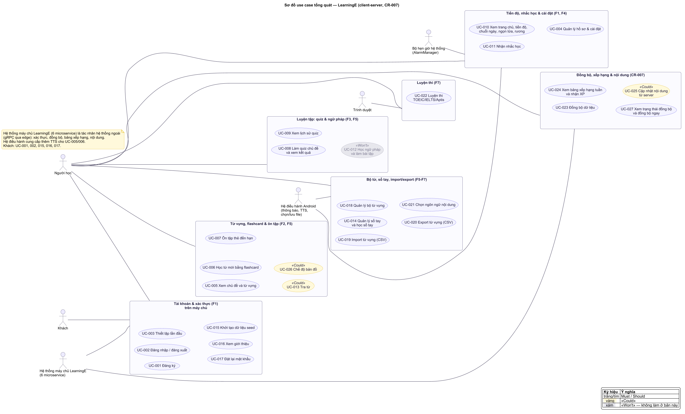
<!-- /diagram -->

<!-- diagram:usecase/uc-01-tai-khoan-xac-thuc.puml -->
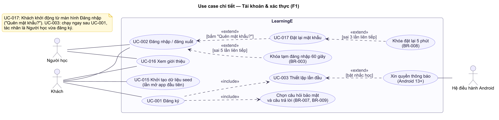
<!-- /diagram -->

<!-- diagram:usecase/uc-02-tu-vung-flashcard-on-tap.puml -->
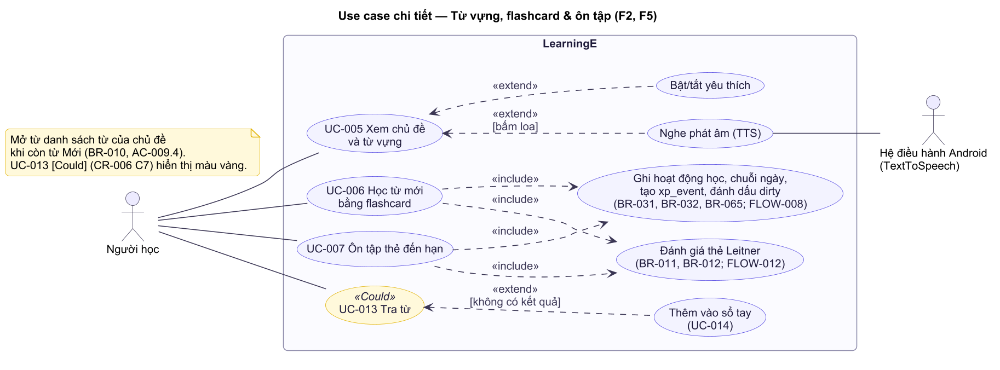
<!-- /diagram -->

<!-- diagram:usecase/uc-03-quiz-ngu-phap.puml -->
![Sơ đồ use case nhóm Luyện tập: quiz và ngữ pháp [Won't]](../diagrams/usecase/uc-03-quiz-ngu-phap.png)
<!-- /diagram -->

<!-- diagram:usecase/uc-04-bo-tu-import-export.puml -->
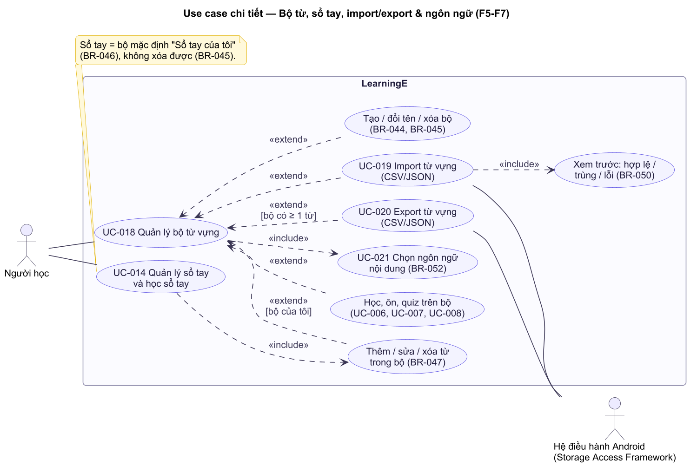
<!-- /diagram -->

<!-- diagram:usecase/uc-05-luyen-thi.puml -->
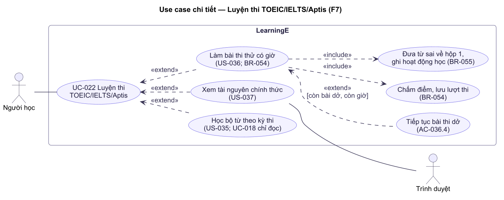
<!-- /diagram -->

<!-- diagram:usecase/uc-06-tien-do-nhac-hoc-cai-dat.puml -->
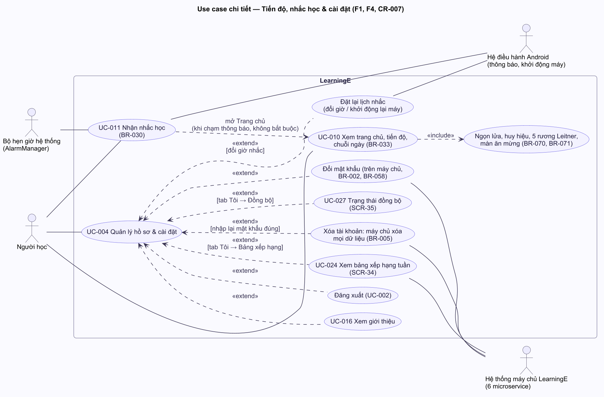
<!-- /diagram -->

<!-- diagram:usecase/uc-07-online-dong-bo-xep-hang.puml -->
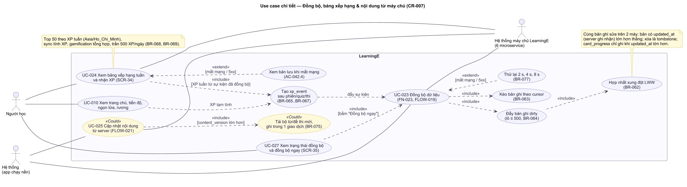
<!-- /diagram -->
Tác nhân: **Khách**, **Người học**, **Bộ hẹn giờ hệ thống (AlarmManager)**, **Hệ thống** (khởi tạo seed) và **Hệ thống máy chủ LearningE** (thay đổi phạm vi: 6 microservice Rust — edge, auth, sync, content, gamification, insight — giao tiếp gRPC; SQLite chính + MongoDB phụ; thay "server Java (Javalin) + SQLite" của thay đổi phạm vi), tác nhân phụ (secondary actor) tham gia mọi use case cần mạng. Lưu ý: "Hệ thống máy chủ" khác tác nhân "Hệ thống" (khởi tạo seed ở máy). Với app, hệ thống máy chủ là **một** tác nhân: chỉ cổng `edge` nhận lời gọi gRPC.
| UC | Tên | Tác nhân | US | FN |
|---|---|---|---|---|
| UC-001 | Đăng ký (thay đổi phạm vi: trên server) | Khách, Hệ thống máy chủ LearningE | US-001 | FN-001 |
| UC-002 | Đăng nhập / đăng xuất (thay đổi phạm vi: trên server, máy thứ hai) | Khách, Người học, Hệ thống máy chủ LearningE | US-002, US-038 | FN-002 |
| UC-003 | Thiết lập lần đầu | Người học | US-006 | FN-003 |
| UC-004 | Quản lý hồ sơ & cài đặt (gồm đổi mật khẩu, xóa tài khoản) | Người học, Hệ thống máy chủ LearningE | US-003..US-005 | FN-004 |
| UC-005 | Xem chủ đề và từ vựng (gồm yêu thích, phát âm) | Người học | US-007, US-008, US-010, US-011 | FN-005 |
| UC-006 | Học từ mới bằng flashcard | Người học | US-009 | FN-006 |
| UC-007 | Ôn tập thẻ đến hạn | Người học | US-012 | FN-007 |
| UC-008 | Làm quiz chủ đề và xem kết quả | Người học | US-013, US-014 | FN-008 |
| UC-009 | Xem lịch sử quiz | Người học | US-015 | FN-009 |
| UC-010 | Xem trang chủ, tiến độ, chuỗi ngày học (thay đổi phạm vi: ngọn lửa, rương, màn ăn mừng) | Người học | US-016..US-018, US-045, US-046 | FN-010 |
| UC-011 | Nhận nhắc học | Bộ hẹn giờ hệ thống (AlarmManager), Người học | US-019 | FN-011 |
| UC-012 | Học ngữ pháp và làm bài tập **[Won't]** | Người học | US-020, US-021 | FN-012 |
| UC-013 | Tra từ **[Could]** | Người học | US-022 | FN-013 |
| UC-014 | Quản lý sổ tay và học sổ tay | Người học | US-023, US-024 | FN-014 |
| UC-015 | Khởi tạo dữ liệu seed | Hệ thống | US-025 | FN-015 |
| UC-016 | Xem giới thiệu | Khách, Người học | US-026 | FN-016 |
| UC-017 | Đặt lại mật khẩu (thay đổi phạm vi; thay đổi phạm vi: trên server) | Khách, Hệ thống máy chủ LearningE | US-027 | FN-017 |
| UC-018 | Quản lý bộ từ vựng | Người học | US-028..US-031 | FN-018 |
| UC-019 | Import từ vựng | Người học | US-032 | FN-019 |
| UC-020 | Export từ vựng | Người học | US-033 | FN-020 |
| UC-021 | Chọn ngôn ngữ nội dung | Người học | US-034 | FN-021 |
| UC-022 | Luyện thi TOEIC/IELTS/Aptis | Người học | US-035..US-037 | FN-022 |
| UC-023 | Đồng bộ dữ liệu | Người học, Hệ thống máy chủ LearningE | US-038, US-039, US-040 | FN-023 |
| UC-024 | Xem bảng xếp hạng tuần và nhận XP | Người học, Hệ thống máy chủ LearningE | US-042, US-043 | FN-024 |
| UC-025 | Cập nhật nội dung từ server **[Could]** | Hệ thống, Hệ thống máy chủ LearningE | US-044 | FN-025 |
| UC-026 | Xem chủ đề ở chế độ bản đồ **[Could]** | Người học | US-047 | FN-026 |
| UC-027 | Xem trạng thái đồng bộ và đồng bộ ngay | Người học, Hệ thống máy chủ LearningE | US-041 | FN-027 |

Sơ đồ use case (Mermaid không có ký hiệu use case UML; bản UML chuẩn là PlantUML `docs/diagrams/usecase/uc-00..uc-06`, khớp bảng trên — nhóm trưởng sinh lại thêm UC-023..UC-027 và tác nhân Hệ thống máy chủ LearningE . thay đổi phạm vi: UC-011 → UC-010 chỉ là "mở Trang chủ" khi chạm thông báo, không phải `<<include>>`):
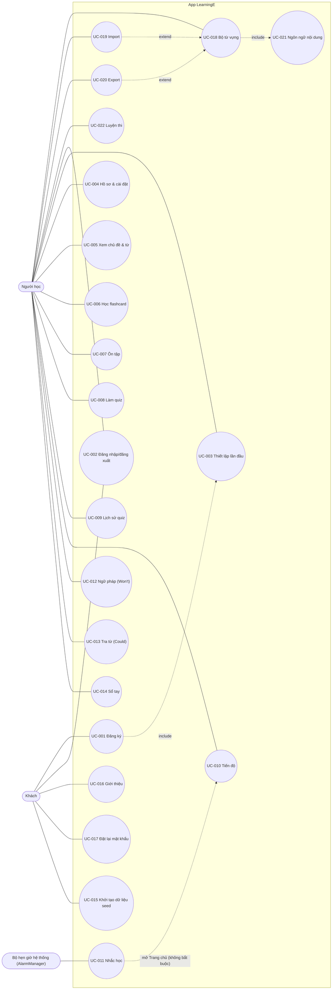

Phần bổ sung  (tách sơ đồ con để dễ đọc; UC-001, UC-002, UC-004, UC-017 vẽ lại để thể hiện tác nhân Hệ thống máy chủ LearningE):
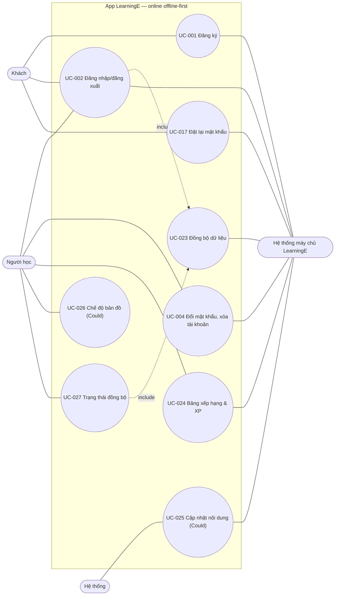

## Chức năng chi tiết
Mỗi chức năng: mục đích, điều kiện tiên quyết, các bước, dữ liệu vào/ra, ngoại lệ, liên kết flow. Mã lỗi (một cơ chế duy nhất: mã gRPC + trailer `error-code`) và thông báo chung cho lỗi mạng/server: §Ngoại lệ & thông báo lỗi.

### FN-001: Đăng ký (US-001; thay đổi phạm vi sửa)
- Mục đích: tạo tài khoản **trên server** để dùng được trên nhiều máy.
- Điều kiện tiên quyết: chưa đăng nhập; CSDL máy đã khởi tạo; **có mạng**.
- Các bước chính: (1) Mở Đăng ký từ màn hình Đăng nhập. (2) Nhập email, biệt danh công khai, tên hiển thị, mật khẩu, xác nhận mật khẩu, chọn 1 trong 5 câu hỏi bảo mật (BR-009) và nhập câu trả lời (AC-001.4). (3) Bấm Đăng ký. (4) App kiểm tra §Validation (BR-060, BR-061, mật khẩu), chuẩn hóa email và câu trả lời (BR-007). (5) Gọi RPC `AuthService.Register` (EP-02) tới edge → dịch vụ `auth`; server kiểm tra lại cùng quy tắc, kiểm tra trùng email (BR-001), băm mật khẩu và câu trả lời (BR-002, BR-007), tạo người dùng, cấp token (BR-057) và ghi sự kiện `user.registered` vào outbox; dịch vụ `sync` nhận sự kiện và tạo bộ mặc định "Sổ tay của tôi" (BR-046; `uuid` = UUIDv5 tất định, idempotent). (6) App lưu token (BR-004), kéo dữ liệu ban đầu (FN-023) — bộ "Sổ tay của tôi" có thể chưa có ở lần kéo đầu (sự kiện chuyển bất đồng bộ): app vẫn chạy bình thường, nhận bộ ở lần kéo sau; nếu cần dùng sổ tay ngay thì tạo cục bộ với **đúng uuid tất định** đó (BR-046) — rồi chuyển Thiết lập lần đầu.
- Ngoại lệ: dữ liệu sai → lỗi tại trường (không gửi); `ALREADY_EXISTS` (`EMAIL_TAKEN`) → "Email đã được sử dụng"; `ALREADY_EXISTS` (`NICKNAME_TAKEN`) → "Biệt danh đã được sử dụng"; `INVALID_ARGUMENT` (`VALIDATION_ERROR`) từ server → lỗi tại trường theo trailer `error-fields`; mất mạng/`DEADLINE_EXCEEDED`/`UNAVAILABLE`/`INTERNAL` → "Không kết nối được máy chủ, vui lòng thử lại", giữ dữ liệu đã nhập trừ mật khẩu (AC-001.5); `RESOURCE_EXHAUSTED` (`RATE_LIMITED`) → "Bạn thử quá nhiều lần, vui lòng thử lại sau x giây" (x = `retry-after-seconds`).
- Quy tắc áp dụng: BR-001, BR-002, BR-004, BR-007, BR-009, BR-046, BR-057, BR-060, BR-061
- Flow: FLOW-001

### FN-002: Đăng nhập / đăng xuất (US-002, US-038; thay đổi phạm vi sửa)
- Điều kiện tiên quyết: đăng nhập cần mạng (BR-078); mở app khi đã có token thì không cần mạng.
- Các bước chính: (1) Nhập email, mật khẩu. (2) Gọi RPC `AuthService.Login` (EP-03); server kiểm tra khóa tạm (BR-003), so băm (BR-002). (3) Đúng → server đặt lại đếm sai, cấp token (BR-057); app lưu token (BR-004). (4) Nếu đây là tài khoản khác với dữ liệu đang có trên máy → áp BR-059 (cảnh báo như BR-073 nếu còn bản ghi chờ của tài khoản cũ). (5) Kéo dữ liệu (FN-023, BR-063) — máy thứ hai thấy dữ liệu máy A trong ≤ 10 s qua Wi-Fi (AC-038.1) — rồi vào Trang chủ (vẫn vào được nếu kéo lỗi, kéo tiếp ở lần sau). (6) Đăng xuất theo BR-073.
- Ngoại lệ: `UNAUTHENTICATED` (`INVALID_CREDENTIALS`, chưa có token nên không kích hoạt BR-059) → "Email hoặc mật khẩu không đúng" (BR-076); `RESOURCE_EXHAUSTED` (`ACCOUNT_LOCKED`) → "Bạn thử quá nhiều lần, vui lòng thử lại sau x giây" (x = `retry-after-seconds`, BR-003); mất mạng → "Cần kết nối mạng để đăng nhập"; `UNAVAILABLE`/`INTERNAL`/quá hạn → "Máy chủ đang gặp sự cố, vui lòng thử lại sau"; `UNAUTHENTICATED` khi đang dùng → BR-059.
- Quy tắc áp dụng: BR-002, BR-003, BR-004, BR-057, BR-058, BR-059, BR-063, BR-073, BR-076
- Flow: FLOW-001, FLOW-018

### FN-003: Thiết lập lần đầu (US-006)
- Điều kiện tiên quyết: vừa đăng ký.
- Các bước chính: (1) Chọn cấp độ. (2) Chọn mục tiêu hằng ngày. (3) Bật/tắt nhắc học, chọn giờ; nếu bật trên Android 13+ thì xin quyền thông báo. (4) Lưu cài đặt trên máy (`dirty = 1`), đặt lịch nhắc (BR-030). (5) Vào Trang chủ; cài đặt được đồng bộ ở lần kế tiếp (BR-077) — không cần mạng ở bước này.
- Ngoại lệ: từ chối quyền thông báo → lưu nhắc học = tắt, hiện hướng dẫn; "Bỏ qua" → mặc định BR-006; mất mạng → vẫn lưu trên máy, đồng bộ sau.
- Quy tắc áp dụng: BR-006, BR-030, BR-077
- Flow: FLOW-002

### FN-004: Hồ sơ & cài đặt (US-003, US-004, US-005; thay đổi phạm vi sửa)
- Điều kiện tiên quyết: đã đăng nhập.
- Các bước chính: xem/sửa biệt danh, tên hiển thị (BR-061, `AuthService.UpdateMe` — EP-06, cần mạng); cấp độ, mục tiêu — lưu trên máy ngay, đồng bộ sau; giờ nhắc, công tắc nhắc học — riêng từng máy (BR-030); đổi mật khẩu (mật khẩu hiện tại + mới + xác nhận → RPC `AuthService.ChangePassword` — EP-07, cần mạng, BR-058); xóa tài khoản (nhập lại mật khẩu + xác nhận → RPC `AuthService.DeleteAccount` — EP-10, cần mạng, BR-005); mở Trạng thái đồng bộ (FN-027); mở Giới thiệu; đăng xuất (BR-073).
- Ngoại lệ: mật khẩu hiện tại sai (`ChangePassword`/`DeleteAccount` trả `PERMISSION_DENIED` `INVALID_CREDENTIALS`) → "Mật khẩu hiện tại không đúng", **không** xóa token (không phải `UNAUTHENTICATED` — BR-059); biệt danh trùng (`UpdateMe` trả `ALREADY_EXISTS` `NICKNAME_TAKEN`) → "Biệt danh đã được sử dụng"; mật khẩu mới trùng mật khẩu cũ → "Mật khẩu mới phải khác mật khẩu hiện tại"; mất mạng khi đổi mật khẩu/xóa tài khoản → "Cần kết nối mạng để …", không đổi gì; lỗi server khi xóa → server rollback, máy không xóa gì; `UNAUTHENTICATED` hoặc `PERMISSION_DENIED` `ACCOUNT_DELETED` khi đang ở các màn này → BR-059 (`ACCOUNT_DELETED`: xóa token + dữ liệu cục bộ của user, "Tài khoản đã bị xóa", SCR-02).
- Quy tắc áp dụng: BR-002, BR-005, BR-030, BR-058, BR-061, BR-073
- Flow: FLOW-009

### FN-005: Xem chủ đề và từ vựng (US-007, US-008, US-010, US-011)
- Điều kiện tiên quyết: đã đăng nhập.
- Các bước chính: (1) Tab Học → danh sách chủ đề lọc theo cấp độ (chế độ Lưới; Bản đồ: FN-026). (2) Chọn chủ đề → danh sách từ kèm trạng thái (BR-014). (3) Chọn từ → Chi tiết từ. (4) Bấm loa → TTS đọc. (5) Bấm yêu thích ở SCR-07 hoặc SCR-08 → bật/tắt (bản ghi `favorites` chờ đẩy). (6) (PQ-7, thay đổi phạm vi) Xem danh sách yêu thích: SCR-26 "Bộ của tôi" có mục **"Yêu thích"** (bộ ảo chỉ đọc, sinh từ `favorites`, không đổi tên/xóa được) mở SCR-19 với bộ lọc "Yêu thích"; học được bằng flashcard như bộ thường. Không phụ thuộc tab Tra từ (REQ-009 Could).
- Ngoại lệ: thiếu giọng TTS (AC-010.2); chủ đề trống (không xảy ra với seed hợp lệ — người kiểm thử kiểm tra seed); chưa có từ yêu thích → "Chưa có từ yêu thích. Bấm ♥ ở một từ để thêm".
- Quy tắc áp dụng: BR-014, BR-062
- Flow: FLOW-003

### FN-006: Học từ mới bằng flashcard (US-009)
- Điều kiện tiên quyết: chủ đề có từ Mới.
- Các bước chính: (1) Bấm "Học từ mới". (2) Hệ thống lấy N từ Mới theo thứ tự seed (BR-010). (3) Hiện thẻ, người dùng lật thẻ, nghe phát âm. (4) Chọn Đã nhớ/Chưa nhớ → tạo tiến độ theo BR-011, BR-012 (bản ghi chờ đẩy). (5) Hết thẻ → Kết quả phiên (SCR-10: XP BR-065, rương BR-071); ghi hoạt động học (BR-032), cập nhật chuỗi (BR-031), tạo `xp_event`; kích hoạt đồng bộ (BR-077).
- Ngoại lệ: thoát giữa phiên (AC-009.5); không còn từ Mới (AC-009.4); mất mạng → không ảnh hưởng (BR-078).
- Quy tắc áp dụng: BR-010, BR-011, BR-012, BR-015, BR-031, BR-032, BR-065, BR-071, BR-077
- Flow: FLOW-004

### FN-007: Ôn tập (US-012)
- Điều kiện tiên quyết: có thẻ đến hạn (BR-013).
- Các bước chính: (1) Trang chủ → Ôn tập. (2) Lấy tối đa 50 thẻ đến hạn. (3) Với mỗi thẻ: lật, đánh giá → cập nhật hộp và ngày ôn tiếp. (4) Hết thẻ → Kết quả phiên (XP, rương); ghi hoạt động học; kích hoạt đồng bộ.
- Ngoại lệ: không có thẻ đến hạn → nút vô hiệu.
- Quy tắc áp dụng: BR-011, BR-012, BR-013, BR-031, BR-032, BR-065, BR-071, BR-077
- Flow: FLOW-004

### FN-008: Làm quiz chủ đề (US-013, US-014)
- Điều kiện tiên quyết: chủ đề có ≥ 4 từ.
- Các bước chính: (1) Tab Luyện tập → chọn chủ đề → Bắt đầu. (2) Sinh câu hỏi 5 dạng (BR-020, BR-024). (3) Trả lời từng câu, hiện đúng/sai ngay (BR-022, BR-025). (4) Hết câu → tính điểm (BR-023), lưu lượt làm + câu trả lời, áp BR-021 cho câu sai, ghi hoạt động học, tạo `xp_event` (BR-066). (5) Màn hình Kết quả (kèm XP). (6) Kích hoạt đồng bộ.
- Ngoại lệ: thiếu TTS → bỏ dạng nghe (AC-013.3); thoát giữa bài → hỏi xác nhận, không lưu, không XP.
- Quy tắc áp dụng: BR-020..BR-025, BR-031, BR-032, BR-066, BR-077
- Flow: FLOW-005

### FN-009: Lịch sử quiz (US-015)
- Các bước chính: Tab Luyện tập → Lịch sử → danh sách lượt làm (mới nhất trước, gồm lượt từ máy khác sau đồng bộ) → chạm một lượt để xem lại câu sai.
- Ngoại lệ: rỗng → trạng thái rỗng (AC-015.2).
- Flow: FLOW-005

### FN-010: Trang chủ, tiến độ, chuỗi ngày học (US-016, US-017, US-018, US-045, US-046)
- Các bước chính: Trang chủ hiện số liệu hôm nay (AC-016.1), XP hôm nay/tuần (tạm tính khi chưa đồng bộ) và huy hiệu chuỗi ngày pixel (BR-070); tab Tôi → Tiến độ (SCR-21) hiện thống kê (AC-017.1), ngọn lửa 5 giai đoạn (BR-070), 5 rương Leitner (BR-071). SCR-10 sau phiên hiện cúp, confetti, chênh lệch rương. Số liệu tính trực tiếp (BR-033).
- Ngoại lệ: chưa có thẻ nào → 5 rương đều 0, ngọn lửa tắt; sprite không tải được → hiện số dạng chữ (không chặn màn hình).
- Quy tắc áp dụng: BR-014, BR-031, BR-032, BR-033, BR-042, BR-070, BR-071
- Flow: FLOW-008

### FN-011: Nhắc học (US-019)
- Điều kiện tiên quyết: nhắc học bật, có quyền thông báo.
- Các bước chính: (1) Bộ hẹn giờ đến giờ nhắc. (2) Kiểm tra người dùng đang đăng nhập đã đạt mục tiêu hôm nay chưa. (3) Chưa đạt → hiện thông báo. (4) Đặt lịch cho ngày hôm sau. (5) Khởi động lại máy → đặt lại lịch.
- Ngoại lệ: không có người dùng đăng nhập → không hiện thông báo; quyền bị thu hồi → không hiện, Cài đặt báo trạng thái.
- Quy tắc áp dụng: BR-030
- Flow: FLOW-007

### FN-012: Ngữ pháp (US-020, US-021) — [Won't] thay đổi phạm vi C1
- Không thiết kế, không code, không test ở vòng này; giữ để truy vết.
- Các bước chính (vòng sau): (1) Tab Luyện tập → Ngữ pháp → danh sách bài. (2) Mở bài, đọc đến cuối → đánh dấu đã đọc, ghi hoạt động học. (3) Làm bài tập (chỉ khi bài có ≥ 5 câu hỏi — BR-056) → chấm như FN-008 → lưu lượt làm.
- Ngoại lệ: bài có < 5 câu hỏi → ẩn nút "Làm bài tập" (BR-056).
- Quy tắc áp dụng: BR-022, BR-023, BR-056
- Flow: FLOW-006

### FN-013: Tra từ (US-022) — [Could] thay đổi phạm vi C7
- Các bước chính: (1) Màn hình Tra từ (vị trí do người thiết kế chốt nếu làm) → gõ từ khóa. (2) Tìm trong từ có sẵn + bộ của người dùng (BR-040, BR-053). (3) Chạm kết quả → Chi tiết từ. Mục Yêu thích **không** còn nằm ở đây (PQ-7 → FN-005).
- Ngoại lệ: không có kết quả → gợi ý thêm vào sổ tay.
- Quy tắc áp dụng: BR-040, BR-053
- Flow: FLOW-011

### FN-014: Sổ tay (US-023, US-024)
- Các bước chính: thêm/sửa/xóa từ trong bộ "Sổ tay của tôi" (BR-047); "Học sổ tay" mở phiên flashcard dùng chung FN-006 với nguồn là sổ tay. Mọi thay đổi là bản ghi chờ đẩy.
- Quy tắc áp dụng: BR-011, BR-012, BR-015, BR-046, BR-047
- Flow: FLOW-011

### FN-015: Khởi tạo dữ liệu seed (US-025)
- Các bước chính: lần mở đầu tiên `onCreate` tạo bảng → đọc file seed trong `assets/` → chèn trong một giao dịch → ghi phiên bản seed (= `content_version` 1, BR-075). Nâng phiên bản app có seed mới → `onUpgrade` chèn/cập nhật seed, không đụng dữ liệu người dùng. Không cần mạng. Seed không có bài ngữ pháp (Won't).
- Ngoại lệ: lỗi đọc/chèn → rollback, báo lỗi (AC-025.2).
- Flow: FLOW-010

### FN-017: Đặt lại mật khẩu (US-027, thay đổi phạm vi; thay đổi phạm vi sửa)
- Điều kiện tiên quyết: chưa đăng nhập; **có mạng**.
- Các bước chính: (1) Đăng nhập → "Quên mật khẩu?". (2) Nhập email → RPC `AuthService.GetResetQuestion` (EP-08) trả câu hỏi bảo mật (email không tồn tại: câu hỏi giả — BR-076). (3) Nhập câu trả lời + mật khẩu mới + xác nhận → app kiểm tra §Validation, chuẩn hóa câu trả lời → gọi RPC `AuthService.ResetPassword` (EP-09). (4) Server kiểm tra khóa (BR-008), so băm (BR-007); đúng → lưu băm mật khẩu mới, đếm sai đăng nhập về 0, thu hồi mọi token (BR-058) → app về Đăng nhập với "Đã đặt lại mật khẩu".
- Ngoại lệ: trả lời sai hoặc email không tồn tại → "Thông tin không khớp" (BR-076); sai lần thứ 5 liên tiếp → `RESOURCE_EXHAUSTED` "Bạn đã trả lời sai quá nhiều lần. Thử lại sau x" (x = giây hoặc phút theo `retry-after-seconds`; khóa tăng dần — BR-008); mất mạng → "Cần kết nối mạng để đặt lại mật khẩu" (AC-027.4); `UNAVAILABLE`/`INTERNAL` → "Máy chủ đang gặp sự cố, vui lòng thử lại sau".
- Quy tắc áp dụng: BR-002, BR-007, BR-008, BR-058, BR-076
- Flow: FLOW-013

### FN-018: Quản lý bộ từ vựng (US-028..US-031, thay đổi phạm vi)
- Điều kiện tiên quyết: đã đăng nhập.
- Các bước chính: tab Học → "Bộ của tôi" (SCR-26, gồm mục "Yêu thích" — FN-005) → danh sách bộ (tên, ngôn ngữ, số từ, số thẻ đến hạn) → tạo/đổi tên/xóa bộ; mở bộ → danh sách từ → thêm/sửa/xóa từ; "Học" (FN-006 với nguồn = bộ), "Làm quiz" (FN-008 với nguồn = bộ); "Lưu vào bộ" từ Chi tiết từ có sẵn. Mọi thay đổi ghi trên máy với `uuid`/`updated_at`/`dirty`, xóa là tombstone (BR-063).
- Ngoại lệ: trùng tên bộ; trùng từ; xóa bộ mặc định; bộ có sẵn chỉ đọc; trùng tên do 2 máy tạo khi ngoại tuyến → BR-044.
- Quy tắc áp dụng: BR-043..BR-047, BR-011, BR-012, BR-063
- Flow: FLOW-014

### FN-019: Import từ vựng (US-032, thay đổi phạm vi; thay đổi phạm vi C6 chỉ CSV)
- Các bước chính: (1) "Import" trong "Bộ của tôi" → trình chọn file hệ thống (`ACTION_OPEN_DOCUMENT`, loại `text/csv`, `text/comma-separated-values`). (2) Đọc file trên luồng nền, kiểm tra kích thước, phân tích theo BR-048. (3) Màn hình xem trước. (4) Chọn bộ đích → chèn trong một giao dịch (BR-050). (5) Báo kết quả. Import JSON **[Won't]** (BR-049).
- Ngoại lệ: file quá lớn, sai định dạng, không có dòng hợp lệ, lỗi đọc file, hủy chọn file.
- Flow: FLOW-015

### FN-020: Export từ vựng (US-033, thay đổi phạm vi; thay đổi phạm vi C6 chỉ CSV)
- Các bước chính: mở bộ → "Export" → trình lưu file hệ thống (`ACTION_CREATE_DOCUMENT`, tên gợi ý theo BR-051) → ghi CSV trên luồng nền → báo "Đã xuất x từ". Xuất JSON **[Won't]**.
- Ngoại lệ: hủy chọn nơi lưu; lỗi ghi (xóa file dở dang nếu tạo được).
- Flow: FLOW-016

### FN-021: Ngôn ngữ nội dung (US-034, thay đổi phạm vi)
- Các bước chính: chọn ngôn ngữ khi tạo bộ; mọi màn hình học/quiz đọc `language` của bộ để lấy nhãn cách đọc, locale TTS, quy tắc chuẩn hóa (BR-052).
- Flow: FLOW-014

### FN-022: Luyện thi (US-035..US-037, thay đổi phạm vi; thay đổi phạm vi C5)
- Các bước chính: tab Luyện tập → "Luyện thi" → chọn kỳ thi (TOEIC/IELTS/Aptis) → bộ từ của kỳ thi (dùng FN-018 chế độ chỉ đọc) hoặc đề thi thử E01 (20 câu, 15 phút — BR-054) → làm bài có đồng hồ → nộp/hết giờ → kết quả + giải thích → lưu lịch sử, áp BR-055, tạo `xp_event` (BR-067), kích hoạt đồng bộ; "Tài nguyên chính thức" mở URL bằng `Intent.ACTION_VIEW`.
- Ngoại lệ: thoát giữa bài (lưu trạng thái, tiếp tục nếu còn giờ — AC-036.4); không có trình duyệt.
- Quy tắc áp dụng: BR-054, BR-055, BR-067
- Flow: FLOW-017

### FN-016: Giới thiệu (US-026)
- Các bước chính: Tôi → Giới thiệu (hoặc liên kết ở màn hình Đăng nhập) → hiện nội dung tĩnh (thay đổi phạm vi: nêu dữ liệu nào được gửi lên hệ thống máy chủ của nhóm).

### FN-023: Đồng bộ dữ liệu (US-038, US-039, US-040; thay đổi phạm vi)
- Mục đích: giữ dữ liệu học của một tài khoản giống nhau trên mọi máy, máy vẫn dùng được khi ngoại tuyến.
- Điều kiện tiên quyết: đã đăng nhập (có token); có mạng; không có lần đồng bộ khác đang chạy (BR-077).
- Các bước chính: (1) Kích hoạt theo BR-077. (2) Đọc bản ghi `dirty = 1` của các bảng đồng bộ (`card_progress`, `study_log`, `quiz_attempts`/`quiz_answers`, `exam_attempts`/`exam_answers`, bộ từ + từ của người dùng, `favorites`, cài đặt, `xp_events`). (3) Chia lô ≤ 500 (BR-064), gọi RPC `SyncService.Push` (EP-11) kèm giờ máy. (4) Server áp BR-062 từng bản ghi trong một giao dịch/lô, trả xác nhận + bản thắng. (5) Máy xóa `dirty` của bản đã xác nhận, ghi đè bản thua bằng bản thắng. (6) RPC `SyncService.Pull` (EP-12) với `since` = cursor, theo trang (BR-063), ghi từng trang trong một giao dịch, cập nhật cursor. (7) Cập nhật `sync_state` (thời điểm thành công, lỗi gần nhất), tính lại chuỗi (BR-031), XP từ server, đổi tên bộ trùng (BR-044), gộp từ trùng (BR-047); chuỗi trên bảng xếp hạng do server tính (BR-031).
- Ngoại lệ: mất mạng/`DEADLINE_EXCEEDED`/`UNAVAILABLE`/`INTERNAL` → thử lại BR-077, dữ liệu giữ `dirty`; `UNAUTHENTICATED` → BR-059; `stale` → ghi bản server theo BR-062, `rejected` → bỏ cờ chờ và ghi lỗi (BR-064), không hiện lỗi cho người dùng; `INVALID_ARGUMENT` `BATCH_TOO_LARGE` (lô quá lớn) → chia nhỏ lô (lỗi lập trình, ghi log); `RESOURCE_EXHAUSTED` → chờ `retry-after-seconds`; `PERMISSION_DENIED` `ACCOUNT_DELETED` (tài khoản đã bị xóa ở máy khác, cả lô bị từ chối, không ghi gì) → dừng lượt đồng bộ, không thử lại, hiện "Tài khoản đã bị xóa", **xóa token và dữ liệu cục bộ của user đó kể cả `dirty`**, về SCR-02 (BR-059); mất mạng giữa lúc kéo → giữ trang đã ghi, tiếp tục từ cursor.
- Quy tắc áp dụng: BR-015, BR-031, BR-044, BR-046, BR-059, BR-062, BR-063, BR-064, BR-077, BR-078
- Flow: FLOW-018, FLOW-019

### FN-024: Bảng xếp hạng tuần và XP (US-042, US-043; thay đổi phạm vi)
- Điều kiện tiên quyết: đã đăng nhập; xem bản mới cần mạng.
- Các bước chính: (1) Hoạt động học tạo `xp_event` trên máy (BR-065..BR-067), hiện XP tạm tính. (2) Đồng bộ đẩy sự kiện; server tính lại XP, áp trần ngày (BR-068). (3) Mở SCR-34 (từ thẻ XP ở Trang chủ hoặc tab Tôi — vị trí người thiết kế chốt) → RPC `LeaderboardService.GetWeekly` (EP-13) → top 50 + dòng "Bạn" (BR-069). (4) Lưu bản mới nhất trên máy kèm thời điểm. (5) Kéo để làm mới.
- Ngoại lệ: mất mạng hoặc dịch vụ bảng xếp hạng/MongoDB không sẵn sàng (`UNAVAILABLE`, NFR-N5) → bản lưu gần nhất + "Cập nhật lúc hh:mm dd/MM"; chưa từng tải → "Cần kết nối mạng để xem bảng xếp hạng"; 0 XP tuần → dòng "Bạn" hiện "Chưa có hạng tuần này — học để nhận XP"; đạt trần → "Bạn đã đạt tối đa 500 XP hôm nay"; `INTERNAL` → như mất mạng kèm "Máy chủ đang gặp sự cố".
- Quy tắc áp dụng: BR-061, BR-065, BR-066, BR-067, BR-068, BR-069
- Flow: FLOW-020

### FN-025: Cập nhật nội dung từ server (US-044; thay đổi phạm vi) — [Could]
- Điều kiện tiên quyết: có mạng; chạy nền khi mở app, sau đồng bộ.
- Các bước chính: (1) RPC `ContentService.GetManifest` (EP-14) kèm `if_version` của máy → `not_modified = true` (đã mới nhất, kết thúc) hoặc `content_version` + danh sách mục đổi. (2) Lớn hơn bản máy → tải `ContentService.GetDeck` (EP-15), `ContentService.GetExam` (EP-16). (3) Kiểm tra đủ, đúng định dạng. (4) Ghi một giao dịch, cập nhật `content_version` (BR-075). (5) Bộ mới hiện ở SCR-06.
- Ngoại lệ: mất mạng/`UNAVAILABLE` (dịch vụ `content` hoặc MongoDB ngừng)/lỗi giữa chừng/dữ liệu sai định dạng → giữ phiên bản cũ, không báo lỗi chặn (chỉ ghi `sync_state` lỗi gần nhất), thử lại lần mở sau.
- Quy tắc áp dụng: BR-043, BR-075
- Flow: FLOW-021

### FN-026: Chế độ bản đồ (US-047; thay đổi phạm vi) — [Could]
- Các bước chính: (1) SCR-06 có công tắc Lưới/Bản đồ (mặc định Lưới; nhớ lựa chọn trên máy). (2) Bản đồ: 15 công trình pixel tương ứng 15 chủ đề, trạng thái mở/khóa (BR-074), sao chủ đề (BR-072). (3) Chạm công trình mở → SCR-07 của chủ đề; công trình khóa → thông báo điều kiện mở.
- Ngoại lệ: ảnh bản đồ không tải được → quay về Lưới và báo "Không hiển thị được bản đồ"; màn hình hẹp → cuộn ngang/dọc bản đồ.
- Quy tắc áp dụng: BR-072, BR-074
- Flow: FLOW-022

### FN-027: Trạng thái đồng bộ (US-041; thay đổi phạm vi)
- Các bước chính: Tôi → Trạng thái đồng bộ (SCR-35): thời điểm đồng bộ thành công gần nhất (hh:mm dd/MM), số thay đổi chờ đẩy, lỗi gần nhất (tiếng Việt), trạng thái mạng; nút "Đồng bộ ngay" chạy FN-023 và hiện tiến trình.
- Ngoại lệ: mất mạng → "Không có kết nối mạng", số chờ giữ nguyên (AC-041.3); đang đồng bộ → nút vô hiệu, hiện "Đang đồng bộ…"; chưa đồng bộ lần nào → "Chưa đồng bộ".
- Quy tắc áp dụng: BR-064, BR-077
- Flow: FLOW-019

## Luồng người dùng & luồng hệ thống

<!-- diagram:activity/act-13-dong-bo.puml -->
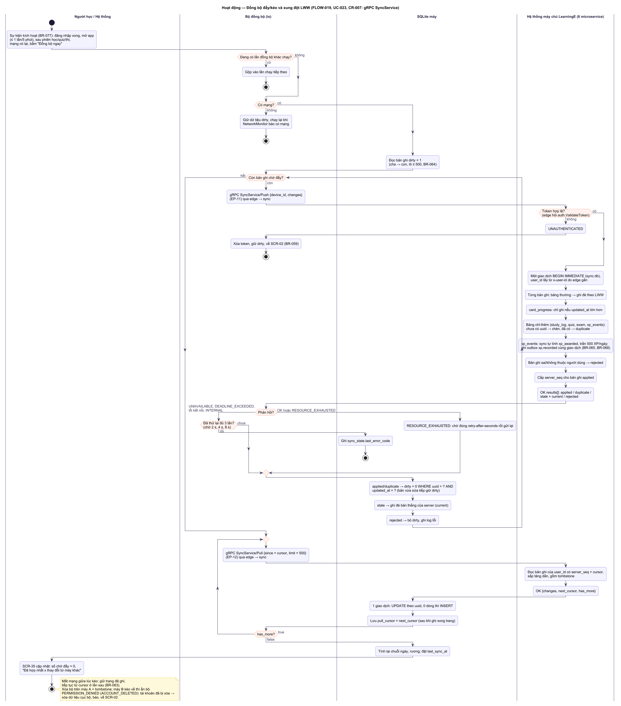
<!-- /diagram -->

<!-- diagram:activity/act-14-dang-nhap-may-thu-hai.puml -->
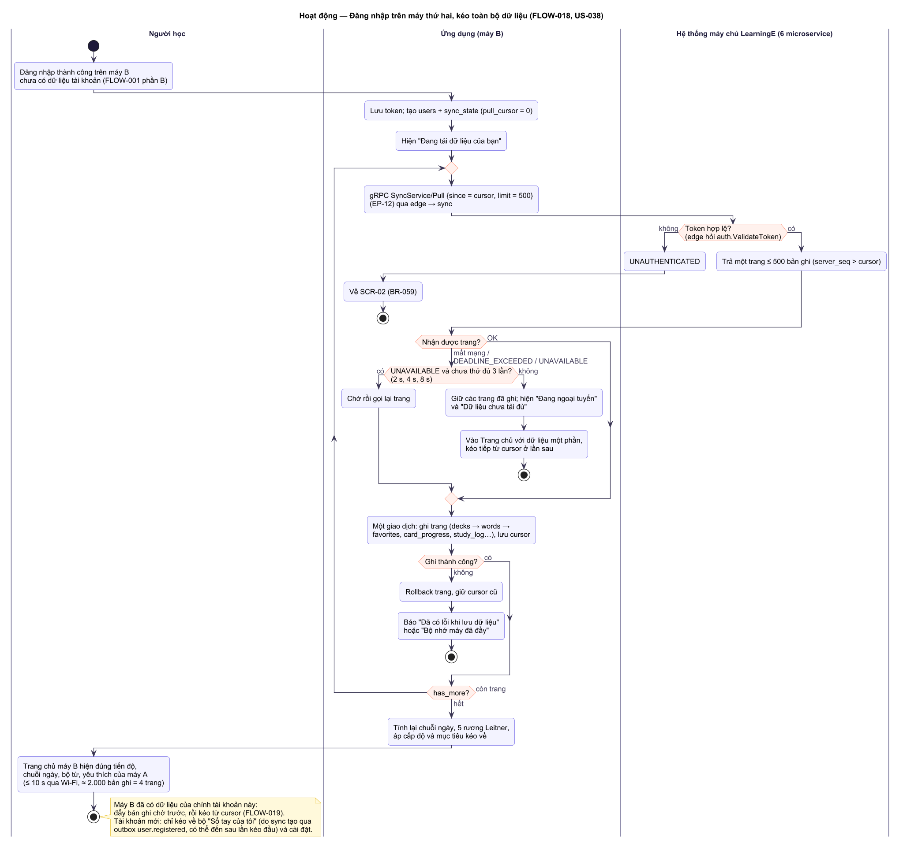
<!-- /diagram -->

<!-- diagram:activity/act-15-bang-xep-hang.puml -->
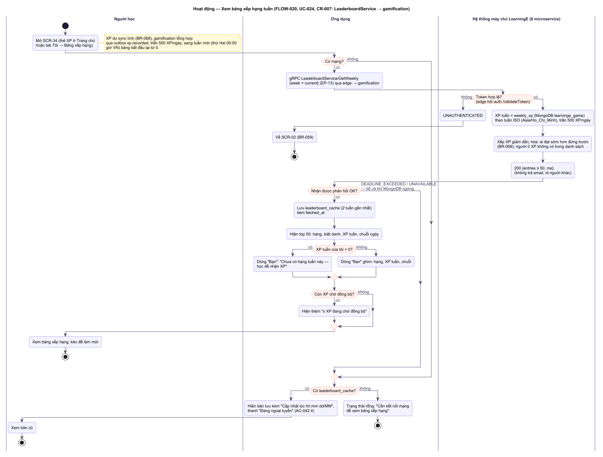
<!-- /diagram -->

<!-- diagram:activity/act-16-cap-nhat-noi-dung.puml -->
![Sơ đồ hoạt động cập nhật nội dung từ máy chủ (ContentService → content) [Could] (FLOW-021)](../diagrams/activity/act-16-cap-nhat-noi-dung.png)
<!-- /diagram -->
> Mã màn hình SCR-xx ở §Bản đồ màn hình; người thiết kế đối chiếu với Figma ở phase 3 (PRD PQ-1).

## Danh sách flow
| ID | Flow | Loại (user flow / quy trình nghiệp vụ / tương tác hệ thống / vòng đời) | Vai trò | US liên quan | Có nhánh lỗi? |
|---|---|---|---|---|---|
| FLOW-001 | Mở app, đăng ký, đăng nhập (thay đổi phạm vi: trên server) | user flow | Khách | US-001, US-002 | có |
| FLOW-002 | Thiết lập lần đầu | user flow | Người học | US-006 | có |
| FLOW-003 | Xem chủ đề, từ, phát âm, yêu thích | user flow | Người học | US-007, US-008, US-010, US-011 | có |
| FLOW-004 | Phiên flashcard (học từ mới / ôn tập / học sổ tay) | user flow | Người học | US-009, US-012, US-024, US-046 | có |
| FLOW-005 | Làm quiz chủ đề, xem kết quả, lịch sử | user flow | Người học | US-013, US-014, US-015 | có |
| FLOW-006 | Học ngữ pháp và làm bài tập — **Won't** (thay đổi phạm vi C1, giữ để truy vết) | user flow | Người học | US-020, US-021 | có |
| FLOW-007 | Nhắc học hằng ngày | quy trình nghiệp vụ (swimlane) | Người học, App, Hệ thống Android | US-019 | có |
| FLOW-008 | Ghi hoạt động học và cập nhật chuỗi ngày | quy trình nghiệp vụ | Hệ thống | US-016, US-017, US-018, US-043, US-045 | có |
| FLOW-009 | Cài đặt, đổi mật khẩu, xóa tài khoản | user flow | Người học | US-003, US-004, US-005 | có |
| FLOW-010 | Khởi tạo dữ liệu seed lần đầu | tương tác hệ thống | Hệ thống | US-025 | có |
| FLOW-011 | Tra từ và sổ tay (phần tra từ **Could** — thay đổi phạm vi C7; Yêu thích chuyển sang FN-005/SCR-26) | user flow | Người học | US-022, US-023 | có |
| FLOW-012 | Đánh giá một thẻ flashcard (sequence) | tương tác hệ thống | Người học | US-009, US-012, US-046 | có |
| FLOW-013 | Quên mật khẩu (thay đổi phạm vi; thay đổi phạm vi: kiểm tra trên server) | user flow | Khách | US-027 | có |
| FLOW-014 | Quản lý bộ từ vựng | user flow | Người học | US-028..US-031, US-034 | có |
| FLOW-015 | Import từ vựng | user flow | Người học | US-032 | có |
| FLOW-016 | Export từ vựng | user flow | Người học | US-033 | có |
| FLOW-017 | Làm bài thi thử | user flow | Người học | US-035, US-036, US-037 | có |
| FLOW-018 | Đăng nhập trên máy thứ hai (kéo dữ liệu) — thay đổi phạm vi | user flow | Người học, Hệ thống máy chủ LearningE | US-038, US-002 | có |
| FLOW-019 | Đồng bộ đẩy/kéo, xung đột — thay đổi phạm vi | quy trình nghiệp vụ + tương tác hệ thống (sequence) | Người học, App, Hệ thống máy chủ LearningE | US-039, US-040, US-041 | có |
| FLOW-020 | Xem bảng xếp hạng tuần — thay đổi phạm vi | user flow | Người học, Hệ thống máy chủ LearningE | US-042, US-043 | có |
| FLOW-021 | Cập nhật nội dung từ server (Could) — thay đổi phạm vi | tương tác hệ thống | Hệ thống, Hệ thống máy chủ LearningE | US-044 | có |
| FLOW-022 | Chế độ Bản đồ chủ đề (Could) — thay đổi phạm vi | user flow | Người học | US-047 | có |

## FLOW-001: Mở app, đăng ký, đăng nhập

<!-- diagram:activity/act-01-dang-ky.puml -->
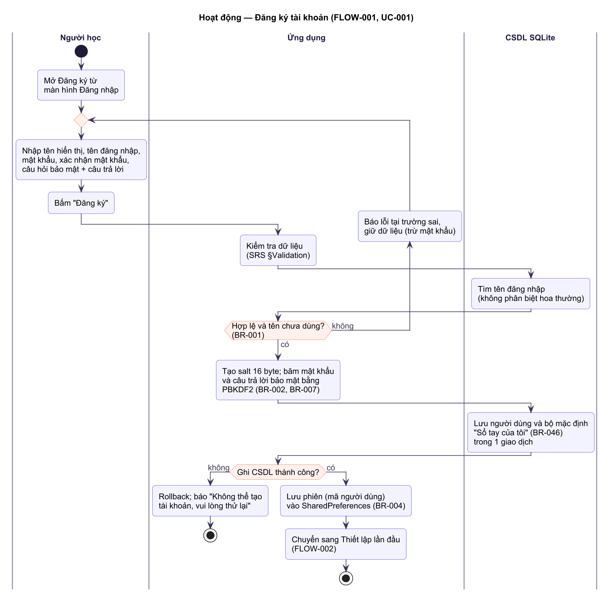
<!-- /diagram -->

<!-- diagram:activity/act-03-dang-nhap-dang-xuat.puml -->
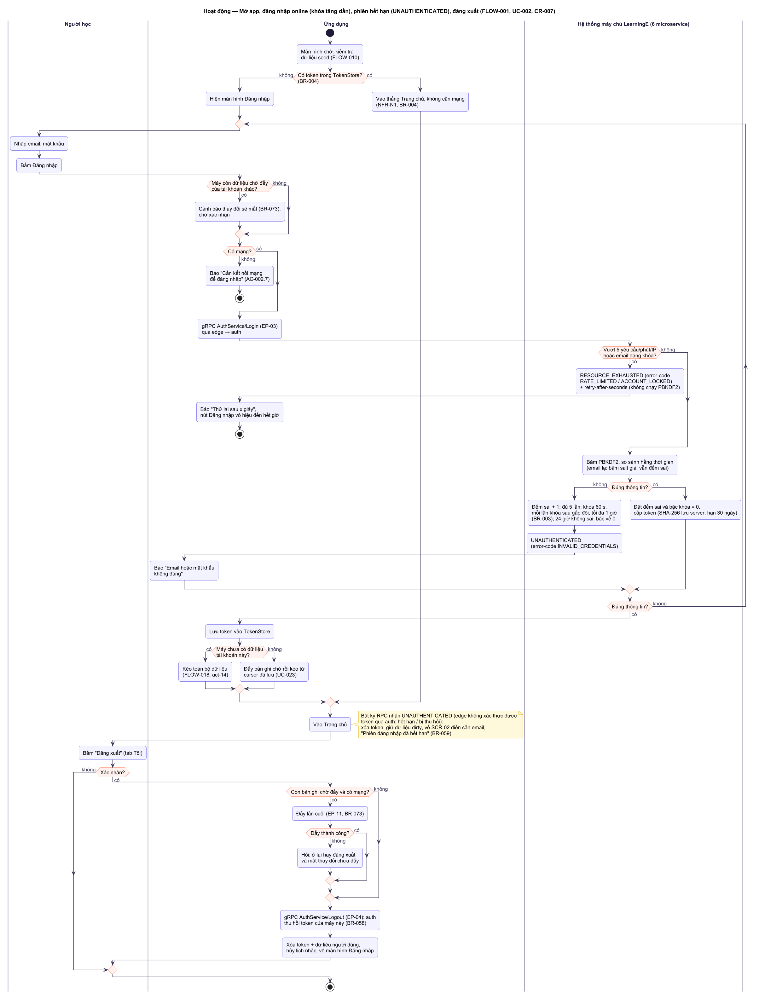
<!-- /diagram -->
- Vai trò: Khách · Điểm vào: chạm icon app · Thành công: vào Trang chủ hoặc Thiết lập lần đầu · Tiền đề: không có. (thay đổi phạm vi; thay đổi phạm vi) Tài khoản nằm trên Hệ thống máy chủ LearningE (6 microservice Rust, app chỉ gọi gRPC tới cổng `edge`); đăng ký/đăng nhập cần mạng, mở app khi đã có token thì không cần mạng (BR-004, BR-078).

Phần A — mở app và đăng ký:
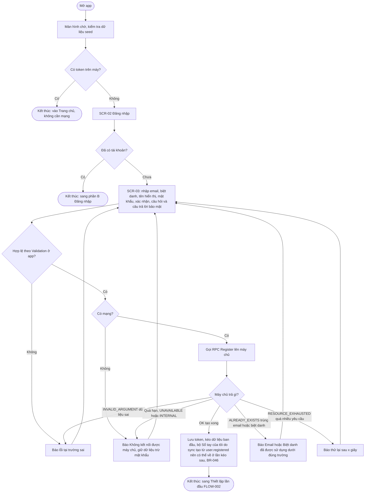

Phần B — đăng nhập:
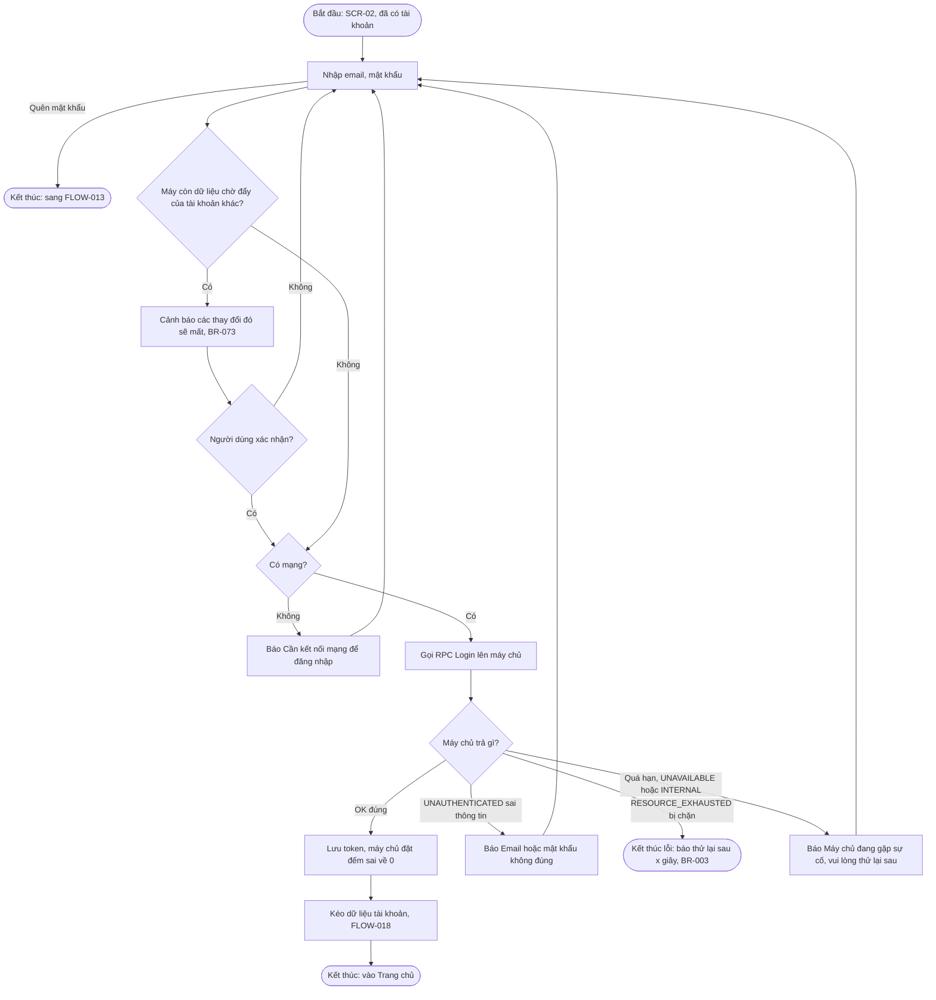
### Nhánh ngoại lệ (bắt buộc)
| Tình huống | Hệ thống làm gì | Thông báo | Quay về đâu |
|---|---|---|---|
| Sai mật khẩu 5 lần liên tiếp (đếm theo email trên server, kể cả email không tồn tại) | **Khóa tăng dần** (BR-003, quyết định 11/11/2026): khóa 60 giây, gRPC `RESOURCE_EXHAUSTED` (mã nghiệp vụ `ACCOUNT_LOCKED`) kèm `retry-after-seconds`; mỗi lần khóa sau gấp đôi (2, 4, 8 … phút), tối đa 1 giờ; về mức 0 sau 24 giờ không sai | "Bạn thử quá nhiều lần, vui lòng thử lại sau x giây" | SCR-02, nút Đăng nhập vô hiệu đến hết giờ |
| Email đã được đăng ký | Server trả `ALREADY_EXISTS` (`EMAIL_TAKEN`), không tạo tài khoản (BR-001, BR-060) | "Email đã được sử dụng" | SCR-03, giữ dữ liệu đã nhập (trừ mật khẩu) |
| Biệt danh đã có người dùng | Server trả `ALREADY_EXISTS` (`NICKNAME_TAKEN`) (BR-061) | "Biệt danh đã được sử dụng" | SCR-03, giữ dữ liệu đã nhập (trừ mật khẩu) |
| Token hết hạn khi máy đang ngoại tuyến | Không chặn, vẫn học; có mạng lại → `UNAUTHENTICATED` → đăng nhập lại, dữ liệu chờ đẩy được đẩy sau đăng nhập (BR-059) | "Phiên đăng nhập đã hết hạn, vui lòng đăng nhập lại" | SCR-02 |
| Mất mạng khi đăng ký | Không gửi (AC-001.5) | "Không kết nối được máy chủ, vui lòng thử lại" | SCR-03, giữ dữ liệu trừ mật khẩu |
| Mất mạng khi đăng nhập | Không gửi (AC-002.7) | "Cần kết nối mạng để đăng nhập" | SCR-02 |
| Server không phản hồi trong deadline gRPC (`DEADLINE_EXCEEDED`) hoặc trả `UNAVAILABLE`/`INTERNAL` | Không đổi gì ở máy | Đăng ký: "Không kết nối được máy chủ, vui lòng thử lại"; đăng nhập: "Máy chủ đang gặp sự cố, vui lòng thử lại sau" | Màn hình hiện tại |
| Phiên hết hạn / bị thu hồi khi đang dùng (bất kỳ lời gọi RPC nhận `UNAUTHENTICATED`) | Xóa token, giữ dữ liệu chờ đẩy (BR-059) | "Phiên đăng nhập đã hết hạn, vui lòng đăng nhập lại" | SCR-02, điền sẵn email |
| Đăng nhập tài khoản khác khi máy còn dữ liệu chờ đẩy của tài khoản cũ | Cảnh báo, chỉ tiếp tục khi xác nhận (BR-073) | "Còn x thay đổi chưa đồng bộ. Nếu đăng nhập tài khoản khác, các thay đổi này sẽ mất trên máy này." | SCR-02 |
| Nạp seed lỗi ở màn hình chờ | Xem FLOW-010 | "Không thể khởi tạo dữ liệu…" | Đóng app |
| Token trỏ tới tài khoản đã bị xóa (ở máy khác) | Lần gọi kế tiếp nhận `UNAUTHENTICATED` (token đã bị thu hồi khi xóa) → như phiên hết hạn; riêng lô `Push` đến muộn nhận `ACCOUNT_DELETED` → xóa token + dữ liệu cục bộ của user, "Tài khoản đã bị xóa" (BR-059) | "Phiên đăng nhập đã hết hạn, vui lòng đăng nhập lại" | SCR-02 |

## FLOW-002: Thiết lập lần đầu

<!-- diagram:activity/act-02-thiet-lap-lan-dau.puml -->
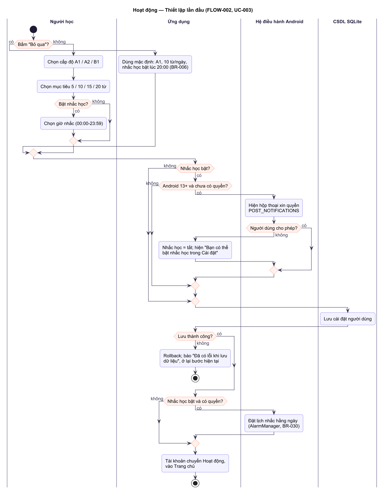
<!-- /diagram -->
- Vai trò: Người học vừa đăng ký · Thành công: cài đặt được lưu, vào Trang chủ. Cài đặt lưu trên máy (chờ đẩy) và đồng bộ ở lần kế tiếp (BR-077); bước này **không cần mạng** — mất mạng sau khi đăng ký vẫn hoàn thành được.
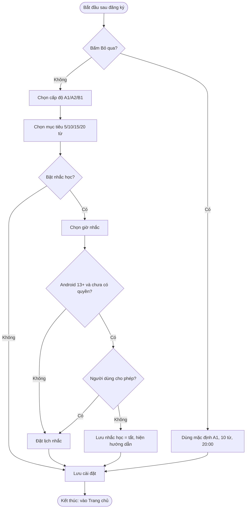
### Nhánh ngoại lệ (bắt buộc)
| Tình huống | Hệ thống làm gì | Thông báo | Quay về đâu |
|---|---|---|---|
| Từ chối quyền thông báo | Tắt nhắc học | "Bạn có thể bật nhắc học trong Cài đặt bất cứ lúc nào" | Trang chủ |
| Thoát app giữa chừng | Không lưu; lần mở sau quay lại bước 1 (tài khoản ở trạng thái Chưa thiết lập) | Không | SCR-04 |
| Lỗi ghi CSDL | Rollback | "Đã có lỗi khi lưu dữ liệu, vui lòng thử lại" | Bước hiện tại |
| Mất mạng khi lưu cài đặt | Lưu trên máy, đánh dấu chờ đẩy; đồng bộ khi có mạng (BR-077) | Thanh "Đang ngoại tuyến" (không chặn) | Trang chủ |
| Máy khác đã có cài đặt của tài khoản (đăng ký xong ở máy A, máy B kéo về trước) | Cấp độ, mục tiêu áp LWW theo BR-062; giờ nhắc là riêng từng máy (BR-030) | Không | Trang chủ |

## FLOW-003: Xem chủ đề, từ, phát âm, yêu thích

### Nhánh ngoại lệ (bắt buộc)
| Tình huống | Hệ thống làm gì | Thông báo | Quay về đâu |
|---|---|---|---|
| Thiếu giọng đọc TTS | Không đọc | "Máy chưa có giọng đọc tiếng Anh" + "Cài đặt giọng đọc" | SCR-08 |
| Bộ lọc không có chủ đề nào | Hiện trạng thái rỗng | "Chưa có chủ đề cho cấp độ này" | SCR-06 |
| Chủ đề hết từ Mới | Ẩn nút Học từ mới | "Bạn đã học hết từ mới của chủ đề này" | SCR-07 |

## FLOW-004: Phiên flashcard (học từ mới / ôn tập / học sổ tay)

<!-- diagram:activity/act-05-hoc-tu-moi-flashcard.puml -->
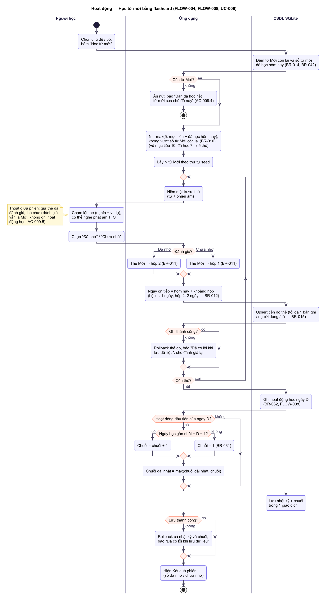
<!-- /diagram -->
- Điểm vào: "Học từ mới" (SCR-07), "Ôn tập" (SCR-05), "Học sổ tay" (SCR-19 Chi tiết bộ; sổ tay là một bộ). Cùng một màn hình SCR-09, khác nguồn thẻ.

### Nhánh ngoại lệ (bắt buộc)
| Tình huống | Hệ thống làm gì | Thông báo | Quay về đâu |
|---|---|---|---|
| Không có thẻ đến hạn / không còn từ Mới / sổ tay rỗng | Không mở phiên | Thông báo tương ứng (SRS §Ngoại lệ) | Màn hình gọi |
| Thoát giữa phiên | Thẻ đã đánh giá được lưu, không ghi hoạt động học | Không | Màn hình gọi |
| Lỗi ghi tiến độ một thẻ | Rollback thẻ đó, cho đánh giá lại | "Đã có lỗi khi lưu dữ liệu, vui lòng thử lại" | Thẻ hiện tại |
| Xoay màn hình / app bị đưa xuống nền | Giữ vị trí thẻ và trạng thái lật | Không | Thẻ hiện tại |

## FLOW-005: Làm quiz chủ đề, xem kết quả, lịch sử

<!-- diagram:activity/act-07-lam-quiz.puml -->
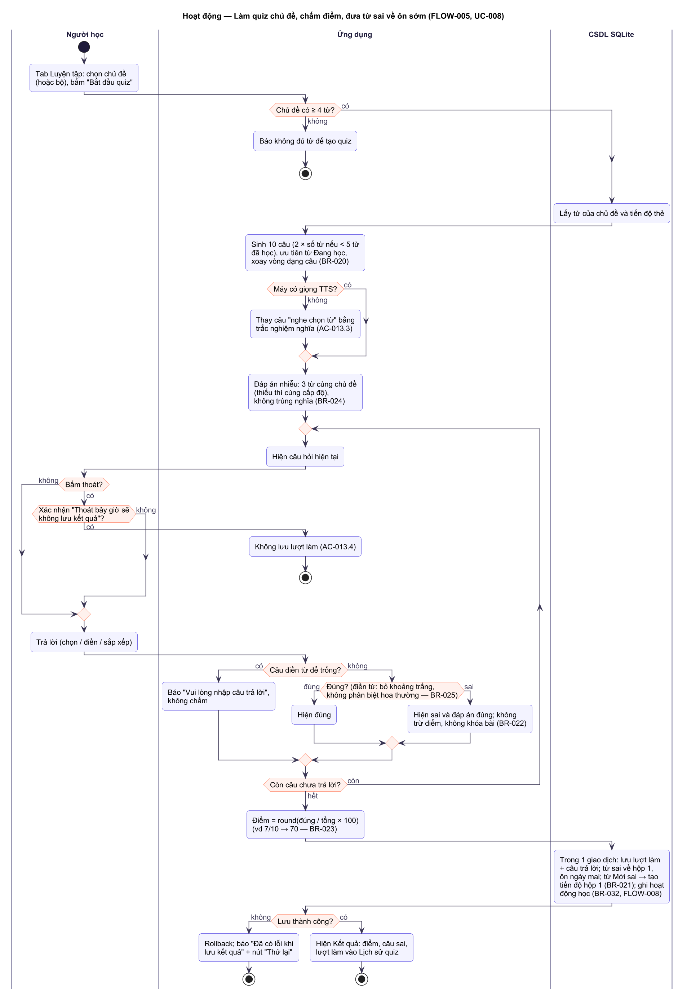
<!-- /diagram -->
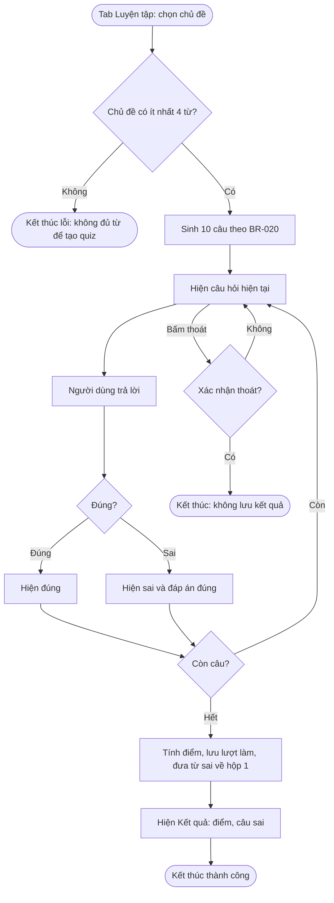
### Nhánh ngoại lệ (bắt buộc)
| Tình huống | Hệ thống làm gì | Thông báo | Quay về đâu |
|---|---|---|---|
| Thiếu giọng TTS | Thay câu "nghe chọn từ" bằng trắc nghiệm nghĩa | Không | Bình thường |
| Điền từ để trống | Không chấm | "Vui lòng nhập câu trả lời" | Câu hiện tại |
| Lịch sử rỗng | Trạng thái rỗng | "Bạn chưa làm bài kiểm tra nào" | SCR-15 |
| Lỗi lưu lượt làm | Rollback | "Đã có lỗi khi lưu kết quả" + "Thử lại" | SCR-14 |

## FLOW-006: Học ngữ pháp và làm bài tập
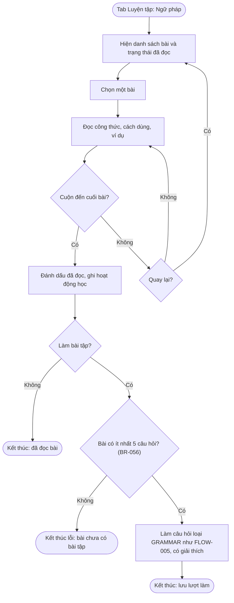
### Nhánh ngoại lệ (bắt buộc)
| Tình huống | Hệ thống làm gì | Thông báo | Quay về đâu |
|---|---|---|---|
| Bài có dưới 5 câu hỏi (BR-056) | Ẩn nút Làm bài tập | "Bài này chưa có bài tập" | SCR-17 |
| Đọc lại bài đã đọc | Không ghi thêm hoạt động học trong cùng ngày | Không | SCR-17 |

## FLOW-007: Nhắc học hằng ngày

<!-- diagram:activity/act-12-nhac-hoc-hang-ngay.puml -->
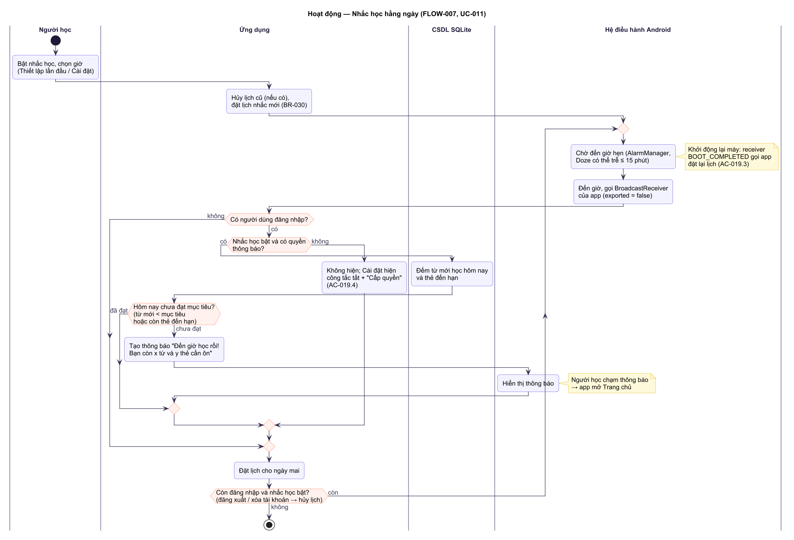
<!-- /diagram -->

### Nhánh ngoại lệ (bắt buộc)
| Tình huống | Hệ thống làm gì | Thông báo | Quay về đâu |
|---|---|---|---|
| Quyền thông báo bị thu hồi | Không hiện thông báo; Cài đặt hiện trạng thái tắt | "Bật quyền thông báo để nhận nhắc học" | SCR-22 |
| Đổi giờ nhắc | Hủy lịch cũ, đặt lịch mới | Không | SCR-22 |
| Máy ở chế độ tiết kiệm pin (Doze) | Hệ thống có thể trễ ≤ 15 phút (chấp nhận theo BR-030) | Không | — |
| Đăng xuất / xóa tài khoản | Hủy lịch nhắc | Không | SCR-02 |

## FLOW-008: Ghi hoạt động học và cập nhật chuỗi ngày
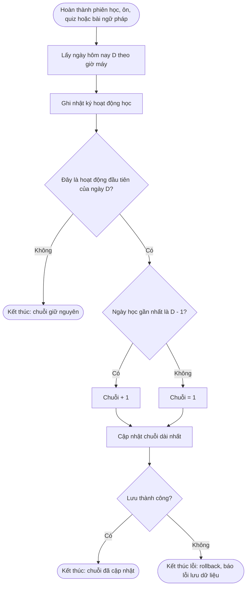
### Nhánh ngoại lệ (bắt buộc)
| Tình huống | Hệ thống làm gì | Thông báo | Quay về đâu |
|---|---|---|---|
| Người dùng chỉnh giờ máy lùi về quá khứ | Dùng ngày máy (BR-042); chuỗi có thể sai, chấp nhận | Không | — |
| Lỗi ghi nhật ký | Rollback cả nhật ký và chuỗi | "Đã có lỗi khi lưu dữ liệu" | Màn hình Kết quả |

## FLOW-009: Cài đặt, đổi mật khẩu, xóa tài khoản
```mermaid
flowchart TD
  S([Mở tab Tôi]) --> A{Chọn mục nào?}
  A -- Sửa cài đặt --> B[Đổi cấp độ, mục tiêu, giờ nhắc]
  B --> BS[Lưu, đặt lại lịch nhắc nếu đổi giờ]
  BS --> E1([Kết thúc: đã lưu])
  A -- Đổi mật khẩu --> C[Nhập mật khẩu hiện tại, mới, xác nhận]
  C --> CV{Hiện tại đúng và mới hợp lệ?}
  CV -- Không --> CE[Báo lỗi tại trường sai]
  CE --> C
  CV -- Có --> CS([Kết thúc: đã đổi mật khẩu])
  A -- Xóa tài khoản --> D[Nhập lại mật khẩu]
  D --> DC{Mật khẩu đúng và xác nhận xóa?}
  DC -- Không --> E2([Kết thúc: hủy, không xóa])
  DC -- Có --> DD["Xóa mọi dữ liệu của người dùng trong một giao dịch (BR-005): cài đặt, tiến độ thẻ, yêu thích, bộ từ riêng và từ, lượt quiz và câu trả lời, lượt thi và câu trả lời, nhật ký học; hủy nhắc, xóa phiên"]
  DD --> E3([Kết thúc: về màn hình Đăng nhập])
  A -- Đăng xuất --> LO[Xác nhận, xóa phiên, hủy nhắc]
  LO --> E4([Kết thúc: về màn hình Đăng nhập])
```
### Nhánh ngoại lệ (bắt buộc)
| Tình huống | Hệ thống làm gì | Thông báo | Quay về đâu |
|---|---|---|---|
| Mật khẩu mới trùng mật khẩu cũ | Không đổi | "Mật khẩu mới phải khác mật khẩu hiện tại" | SCR-23 |
| Lỗi giữa lúc xóa tài khoản | Server rollback toàn bộ, máy không xóa gì (BR-005) | "Không thể xóa tài khoản, vui lòng thử lại" | SCR-22 |
| Mất mạng khi đổi mật khẩu / xóa tài khoản | Không gửi, không đổi gì ở máy và server (AC-004.3, AC-005.3) | "Cần kết nối mạng để đổi mật khẩu" / "Cần kết nối mạng để xóa tài khoản" | SCR-23 / SCR-22 |
| Đổi mật khẩu thành công | Server thu hồi token mọi máy, cấp token mới cho máy này (BR-058) | "Đã đổi mật khẩu. Các máy khác sẽ phải đăng nhập lại" | SCR-22 |
| Đăng xuất khi còn x thay đổi chờ đẩy, có mạng | Đồng bộ trước (FLOW-019) rồi đăng xuất (BR-073) | "Đang đồng bộ trước khi đăng xuất…" | SCR-02 |
| Đăng xuất khi còn x thay đổi chờ đẩy, mất mạng hoặc đồng bộ lỗi | Hộp cảnh báo, mặc định "Ở lại"; "Vẫn đăng xuất" → xóa token và dữ liệu máy (BR-073) | "Còn x thay đổi chưa đồng bộ. Nếu đăng xuất bây giờ, các thay đổi này sẽ mất trên máy này." | SCR-22 (Ở lại) / SCR-02 |
| (thay đổi phạm vi; thay đổi phạm vi) `UNAVAILABLE`/`INTERNAL` hoặc quá hạn khi đổi mật khẩu / xóa tài khoản | Không đổi gì | "Máy chủ đang gặp sự cố, vui lòng thử lại sau" | SCR-23 / SCR-22 |
| (thay đổi phạm vi; thay đổi phạm vi) `UNAUTHENTICATED` khi đổi mật khẩu / xóa tài khoản | BR-059 | "Phiên đăng nhập đã hết hạn, vui lòng đăng nhập lại" | SCR-02 |
| Nhập sai mật khẩu hiện tại (`PERMISSION_DENIED` `INVALID_CREDENTIALS`) khi đổi mật khẩu / xóa tài khoản | Không đổi gì; **không** xóa token (không phải `UNAUTHENTICATED`, BR-059) | "Mật khẩu hiện tại không đúng" | SCR-23 / SCR-22 |

## FLOW-010: Khởi tạo dữ liệu seed lần đầu
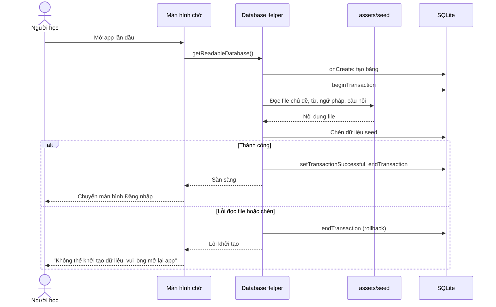
### Nhánh ngoại lệ (bắt buộc)
| Tình huống | Hệ thống làm gì | Thông báo | Quay về đâu |
|---|---|---|---|
| File seed thiếu hoặc sai định dạng | Rollback | "Không thể khởi tạo dữ liệu, vui lòng mở lại app" | Đóng app |
| Nâng phiên bản app có seed mới | `onUpgrade` cập nhật seed, giữ dữ liệu người dùng | Không | Bình thường |
| Nạp lâu hơn 5 giây | Vẫn hiện màn hình chờ có vòng tiến trình | Không | SCR-01 |

## FLOW-011: Tra từ và sổ tay

### Nhánh ngoại lệ (bắt buộc)
| Tình huống | Hệ thống làm gì | Thông báo | Quay về đâu |
|---|---|---|---|
| Từ đã có trong sổ tay | Không tạo mới, mở mục đã có | "Từ này đã có trong sổ tay" | SCR-20 |
| Xóa mục sổ tay | Hỏi xác nhận, xóa mục và tiến độ thẻ của mục | "Xóa từ này khỏi sổ tay?" | SCR-19 |
| Từ khóa > 50 ký tự | Cắt còn 50 ký tự | Không | SCR-18 |

## FLOW-012: Đánh giá một thẻ flashcard

<!-- diagram:activity/act-06-on-tap-leitner.puml -->
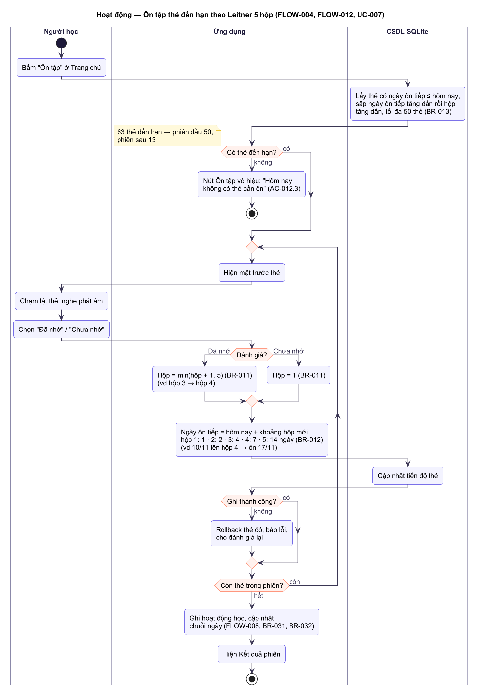
<!-- /diagram -->
```mermaid
sequenceDiagram
  actor U as Người học
  participant FA as FlashcardFragment
  participant RP as ProgressRepository
  participant DAO as CardProgressDao
  participant SQL as SQLite
  U->>FA: Chọn Đã nhớ / Chưa nhớ
  FA->>RP: rate(userId, wordId, remembered)
  RP->>DAO: findByUserAndWord(userId, wordId)
  DAO->>SQL: SELECT tiến độ thẻ
  SQL-->>DAO: Bản ghi hoặc rỗng
  RP->>RP: Tính hộp mới và ngày ôn tiếp (BR-011, BR-012)
  RP->>DAO: saveProgress(tiến độ mới) trong một giao dịch
  DAO->>SQL: UPDATE; nếu 0 dòng thì INSERT (không dùng UPSERT, )
  alt Lưu thành công
    SQL-->>DAO: OK
    RP-->>FA: Kết quả mới
    FA-->>U: Hiện thẻ kế tiếp
  else Lỗi ghi
    SQL-->>DAO: SQLiteException
    RP-->>FA: Lỗi
    FA-->>U: "Đã có lỗi khi lưu dữ liệu, vui lòng thử lại"
  end
```
Tên lớp ở sơ đồ này theo SYSTEM-BLUEPRINT: `FlashcardFragment`, `ProgressRepository`, `CardProgressDao`; UI không truyền `userId` (Service lấy từ `SessionStore`).

## FLOW-013: Quên mật khẩu

<!-- diagram:activity/act-04-quen-mat-khau.puml -->
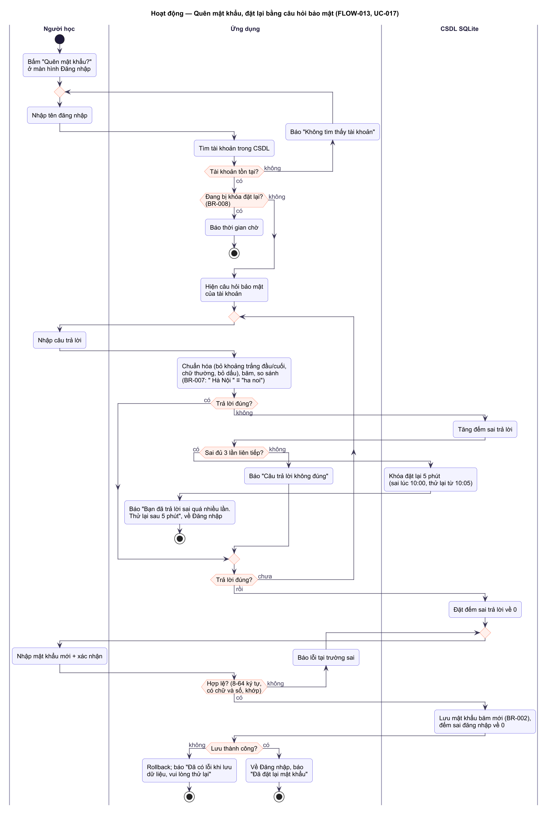
<!-- /diagram -->
- Vai trò: Khách · Điểm vào: SCR-02 "Quên mật khẩu?" · Thành công: mật khẩu mới được lưu trên server, mọi token cũ bị thu hồi. Kiểm tra trên Hệ thống máy chủ LearningE (RPC `GetResetQuestion`, `ResetPassword` qua `edge` → `auth`), cần mạng, không gửi email; email không tồn tại được xử lý giống email có thật (BR-076).
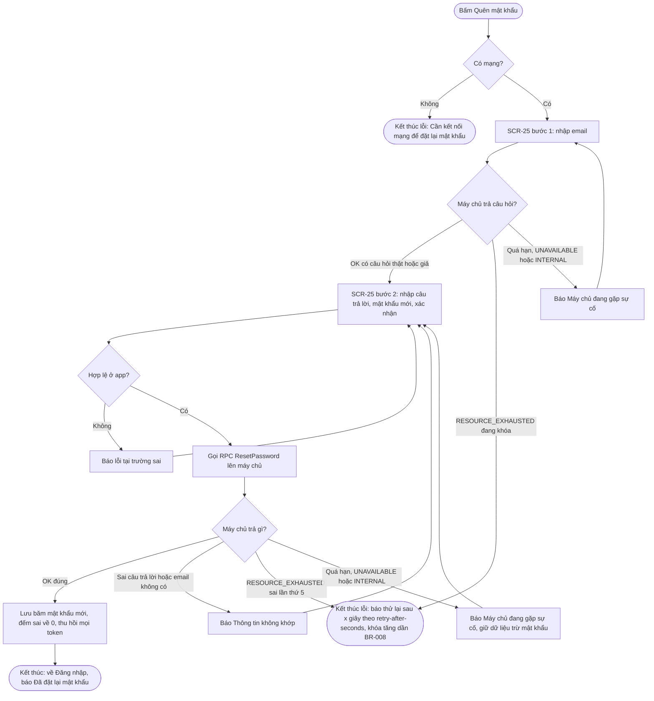
### Nhánh ngoại lệ (bắt buộc)
| Tình huống | Hệ thống làm gì | Thông báo | Quay về đâu |
|---|---|---|---|
| Email không tồn tại | Server trả câu hỏi giả cố định theo email; mọi câu trả lời đều sai, vẫn đếm và khóa (BR-076) | "Thông tin không khớp" (không có "Không tìm thấy tài khoản") | SCR-25 bước 2 |
| Trả lời sai lần 1–4 | Server tăng đếm sai theo email | "Thông tin không khớp" | SCR-25 bước 2 |
| Sai câu trả lời 5 lần liên tiếp | **Khóa tăng dần** (BR-008): khóa đặt lại mật khẩu 60 giây, gRPC `RESOURCE_EXHAUSTED` (mã nghiệp vụ `RESET_LOCKED`) kèm `retry-after-seconds`; mỗi lần khóa sau gấp đôi, tối đa 1 giờ; về mức 0 sau 24 giờ không sai | "Bạn đã trả lời sai quá nhiều lần. Thử lại sau x giây" | SCR-02 |
| Mất mạng | Không gửi (AC-027.4) | "Cần kết nối mạng để đặt lại mật khẩu" | SCR-02 |
| `UNAVAILABLE`/`INTERNAL` hoặc quá hạn (`DEADLINE_EXCEEDED`) | Không đổi gì | "Máy chủ đang gặp sự cố, vui lòng thử lại sau" | Bước hiện tại, giữ dữ liệu trừ mật khẩu |
| Lỗi ghi CSDL server | Server rollback, mật khẩu cũ giữ nguyên | "Máy chủ đang gặp sự cố, vui lòng thử lại sau" | SCR-25 bước 2 |
| Máy khác đang đăng nhập tài khoản này | Token máy đó bị thu hồi (BR-058); lần gọi kế tiếp nhận `UNAUTHENTICATED` → BR-059 | Ở máy kia: "Phiên đăng nhập đã hết hạn, vui lòng đăng nhập lại" | SCR-02 ở máy kia |

## FLOW-014: Quản lý bộ từ vựng

<!-- diagram:activity/act-08-quan-ly-bo-tu.puml -->
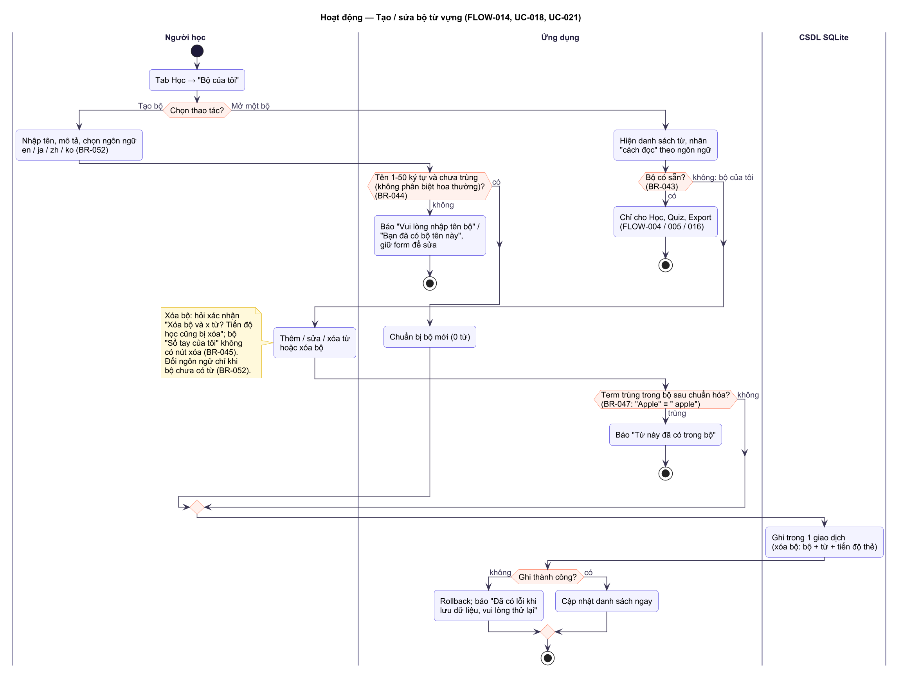
<!-- /diagram -->
- Vai trò: Người học · Điểm vào: tab Học → "Bộ của tôi" · Thành công: bộ/từ được tạo hoặc sửa.
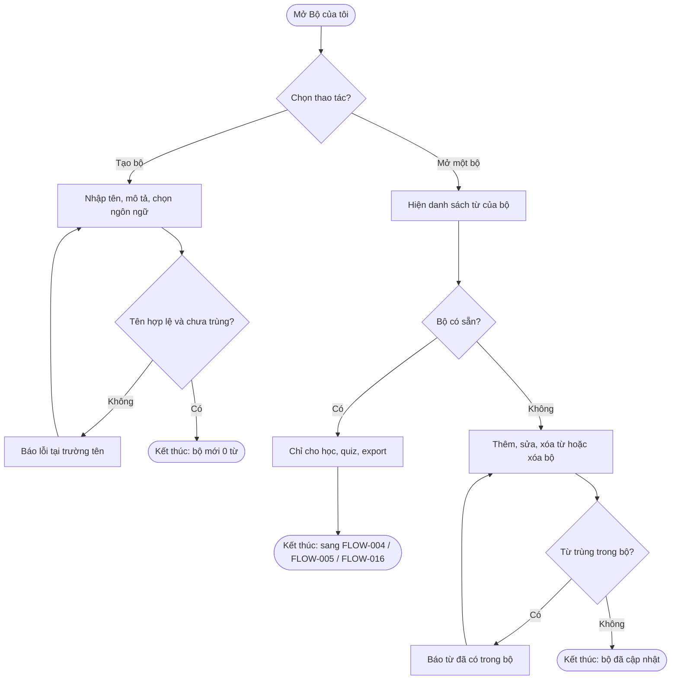
### Nhánh ngoại lệ (bắt buộc)
| Tình huống | Hệ thống làm gì | Thông báo | Quay về đâu |
|---|---|---|---|
| Xóa bộ "Sổ tay của tôi" | Không có nút xóa (BR-045) | — | SCR-19 |
| Xóa bộ khác | Hỏi xác nhận, xóa bộ + từ + tiến độ trong 1 giao dịch | "Xóa bộ và x từ? Tiến độ học của các từ này cũng bị xóa" | SCR-26 |
| Đổi ngôn ngữ bộ đã có từ | Ô ngôn ngữ bị khóa | "Chỉ đổi ngôn ngữ khi bộ chưa có từ" | SCR-27 |

## FLOW-015: Import từ vựng

<!-- diagram:activity/act-09-import-tu-vung.puml -->
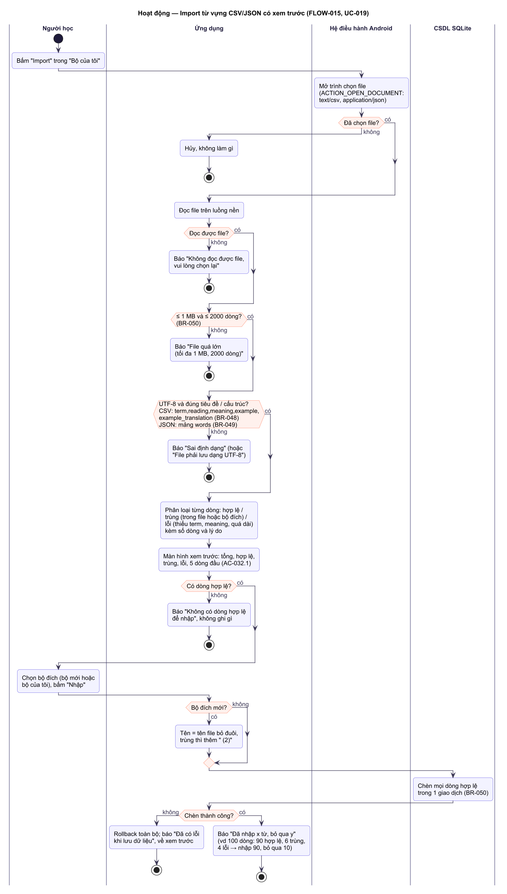
<!-- /diagram -->

### Nhánh ngoại lệ (bắt buộc)
| Tình huống | Hệ thống làm gì | Thông báo | Quay về đâu |
|---|---|---|---|
| Lỗi đọc file (quyền URI bị thu hồi) | Không ghi gì | "Không đọc được file, vui lòng chọn lại" | SCR-26 |
| Lỗi khi chèn | Rollback toàn bộ | "Đã có lỗi khi lưu dữ liệu, vui lòng thử lại" | SCR-28 xem trước |
| File có dấu tiếng Việt lưu bằng ANSI (không phải UTF-8) | Phát hiện ký tự thay thế (U+FFFD), coi là sai định dạng | "File phải lưu dạng UTF-8" | SCR-26 |

## FLOW-016: Export từ vựng

<!-- diagram:activity/act-10-export-tu-vung.puml -->
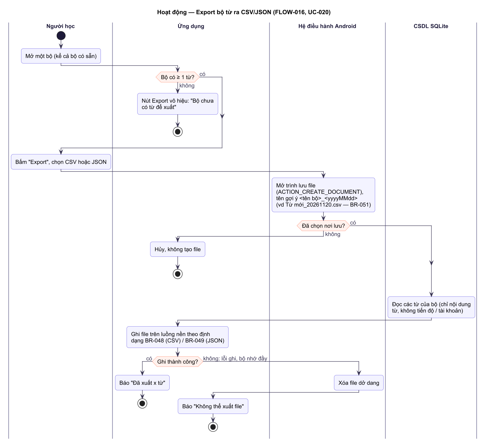
<!-- /diagram -->
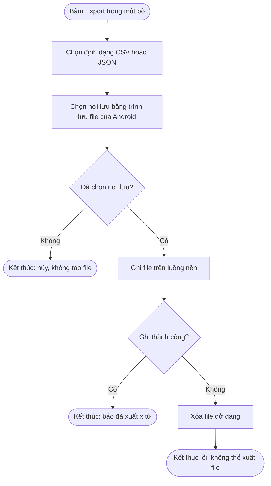
### Nhánh ngoại lệ (bắt buộc)
| Tình huống | Hệ thống làm gì | Thông báo | Quay về đâu |
|---|---|---|---|
| Bộ không có từ | Nút Export vô hiệu | "Bộ chưa có từ để xuất" | SCR-19 |
| Bộ nhớ đầy | Xóa file dở dang | "Không thể xuất file" | SCR-29 |

## FLOW-017: Làm bài thi thử

<!-- diagram:activity/act-11-lam-bai-thi-thu.puml -->
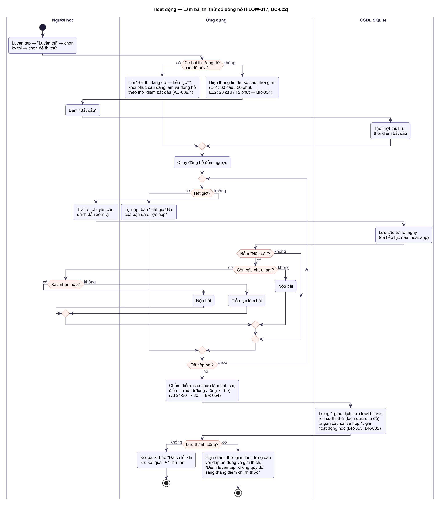
<!-- /diagram -->
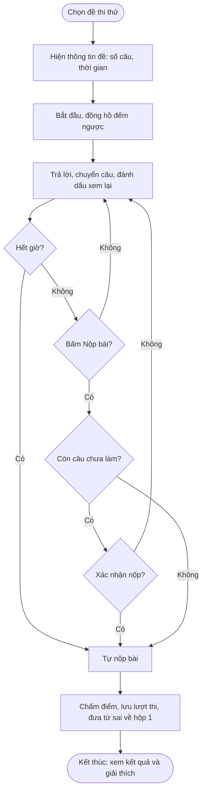
### Nhánh ngoại lệ (bắt buộc)
| Tình huống | Hệ thống làm gì | Thông báo | Quay về đâu |
|---|---|---|---|
| Thoát app giữa bài | Lưu câu trả lời và thời điểm bắt đầu; mở lại thì tiếp tục nếu còn giờ, quá giờ thì tự nộp (AC-036.4) | "Bài thi đang dở — tiếp tục?" | SCR-31 |
| Lỗi lưu lượt thi | Rollback | "Đã có lỗi khi lưu kết quả" + "Thử lại" | SCR-32 |

## FLOW-018: Đăng nhập trên máy thứ hai
- Vai trò: Người học, Hệ thống máy chủ LearningE · Điểm vào: đăng nhập thành công ở FLOW-001 phần B trên máy B chưa có dữ liệu của tài khoản · Thành công: trong ≤ 10 s (Wi-Fi) máy B hiện đúng tiến độ thẻ, chuỗi ngày, bộ từ, yêu thích, cài đặt của máy A (AC-038.1) · Tiền đề: máy A đã đồng bộ xong.
```mermaid
flowchart TD
  S([Bắt đầu: đăng nhập thành công trên máy B]) --> P[Đặt cursor = 0, hiện Đang tải dữ liệu của bạn]
  P --> PG[Kéo một trang tối đa 500 bản ghi]
  PG --> R{Máy chủ trả gì?}
  R -- OK --> W[Ghi trang trong 1 giao dịch, lưu cursor]
  W --> WR{Ghi thành công?}
  WR -- Không --> RB[Rollback trang, giữ cursor cũ]
  RB --> OFF
  WR -- Có --> M{Còn trang?}
  M -- Có --> PG
  M -- Không --> REC[Tính lại chuỗi ngày, rương, áp cấp độ và mục tiêu kéo về]
  REC --> E([Kết thúc: Trang chủ hiện đúng dữ liệu máy A])
  R -- Mất mạng hoặc quá hạn --> OFF[Giữ các trang đã ghi, hiện thanh Đang ngoại tuyến và Dữ liệu chưa tải đủ]
  OFF --> E2([Kết thúc: vào Trang chủ với dữ liệu một phần, kéo tiếp từ cursor ở lần sau])
  R -- UNAUTHENTICATED --> X([Kết thúc lỗi: về SCR-02, BR-059])
  R -- UNAVAILABLE hoặc INTERNAL --> RT{Đã thử lại đủ 3 lần?}
  RT -- Chưa --> PG
  RT -- Rồi --> OFF
```
### Nhánh ngoại lệ (bắt buộc)
| Tình huống | Hệ thống làm gì | Thông báo | Quay về đâu |
|---|---|---|---|
| Mất mạng giữa lúc kéo | Giữ trang đã ghi, lần đồng bộ sau tiếp tục từ cursor (BR-063); không tạo bản ghi trùng (AC-038.2) | Thanh "Đang ngoại tuyến" + "Dữ liệu chưa tải đủ, sẽ tiếp tục khi có mạng" | SCR-05 |
| `UNAVAILABLE`/`INTERNAL` | Thử lại 3 lần cách 2 s, 4 s, 8 s (BR-077), rồi như mất mạng | "Máy chủ đang gặp sự cố, dữ liệu sẽ được tải sau" | SCR-05 |
| `UNAUTHENTICATED` trong lúc kéo (token vừa bị thu hồi) | BR-059 | "Phiên đăng nhập đã hết hạn, vui lòng đăng nhập lại" | SCR-02 |
| Lỗi ghi CSDL máy / bộ nhớ đầy | Rollback trang, giữ cursor cũ | "Bộ nhớ máy đã đầy, không thể lưu" hoặc "Đã có lỗi khi lưu dữ liệu, vui lòng thử lại" | SCR-05 |
| Máy B đã có dữ liệu của chính tài khoản này (đăng nhập lại) | Đẩy bản ghi chờ trước, rồi kéo từ cursor đã lưu (FLOW-019) | Không | SCR-05 |
| Tài khoản mới chưa có dữ liệu | Kéo về chỉ có bộ "Sổ tay của tôi" và cài đặt | Không | SCR-04 nếu chưa thiết lập, ngược lại SCR-05 |

## FLOW-019: Đồng bộ đẩy/kéo và xung đột
- Vai trò: Người học (kích hoạt), App, Hệ thống máy chủ LearningE · Điểm vào: sau đăng nhập, mở app, kết thúc phiên/quiz/thi, có mạng trở lại, nút "Đồng bộ ngay" ở SCR-35 (BR-077) · Thành công: số chờ đẩy = 0, cursor mới, thời điểm đồng bộ cuối cập nhật.
```mermaid
flowchart TD
  S([Bắt đầu: có sự kiện kích hoạt đồng bộ]) --> RUN{Đang có lần đồng bộ khác chạy?}
  RUN -- Có --> Q([Kết thúc: gộp vào lần chạy tiếp theo])
  RUN -- Không --> N{Có mạng?}
  N -- Không --> OFF([Kết thúc: giữ dữ liệu chờ đẩy, chạy lại khi có mạng])
  N -- Có --> D{Còn bản ghi chờ đẩy?}
  D -- Có --> PS[Đẩy lô tối đa 500 bản ghi kèm giờ máy]
  PS --> R{Máy chủ trả gì?}
  R -- OK --> AP[Xóa cờ chờ đẩy bản đã xác nhận, ghi bản thắng nếu thua LWW]
  AP --> D
  R -- UNAUTHENTICATED --> X([Kết thúc lỗi: về SCR-02, giữ dữ liệu chờ đẩy, BR-059])
  R -- RESOURCE_EXHAUSTED --> WT[Chờ đúng số giây máy chủ báo]
  WT --> PS
  R -- Mất mạng, quá hạn, UNAVAILABLE hoặc INTERNAL --> RT{Đã thử lại đủ 3 lần?}
  RT -- Chưa, chờ 2 s, 4 s, 8 s --> PS
  RT -- Rồi --> ERR([Kết thúc lỗi: ghi lỗi gần nhất ở SCR-35, giữ dữ liệu chờ đẩy])
  D -- Không --> PL[Kéo trang bản ghi có server_seq lớn hơn cursor]
  PL --> PR{Kéo và ghi thành công?}
  PR -- Có --> UP[Ghi trang 1 giao dịch, lưu cursor]
  UP --> MORE{Còn trang?}
  MORE -- Có --> PL
  MORE -- Không --> E([Kết thúc: đồng bộ xong, cập nhật thời điểm đồng bộ cuối])
  PR -- Không --> ERR
```
### Nhánh ngoại lệ (bắt buộc)
| Tình huống | Hệ thống làm gì | Thông báo | Quay về đâu |
|---|---|---|---|
| Không có mạng | Không gọi; giữ `dirty` (AC-041.3) | Tự động: không hiện; bấm "Đồng bộ ngay": "Không có kết nối mạng" | Màn hình hiện tại / SCR-35 |
| Quá hạn, `UNAVAILABLE` hoặc `INTERNAL` | Thử lại tối đa 3 lần (BR-077); lô đã xác nhận giữ nguyên, lô lỗi còn `dirty` (BR-064) | SCR-35: "Máy chủ đang gặp sự cố, sẽ thử lại sau" | Màn hình hiện tại |
| `UNAUTHENTICATED` | BR-059: xóa token, giữ dữ liệu chờ đẩy | "Phiên đăng nhập đã hết hạn, vui lòng đăng nhập lại" | SCR-02 |
| `PERMISSION_DENIED` `ACCOUNT_DELETED` (tài khoản đã bị xóa ở máy khác; cả lô bị từ chối) | Dừng lượt đồng bộ, không thử lại; BR-059 mở rộng: **xóa token + dữ liệu cục bộ của user đó kể cả `dirty`** (không còn tài khoản để đẩy tới) | "Tài khoản đã bị xóa" | SCR-02 |
| Xung đột cùng bản ghi trên 2 máy (kết quả `stale` kèm bản thắng trong phản hồi `Push`) | Áp LWW BR-062 (riêng `card_progress` theo `updated_at` của lần đánh giá); không tạo bản ghi trùng (AC-040.1) | Không hiện lỗi; SCR-35: "Đã hợp nhất x thay đổi từ máy khác" | Màn hình hiện tại |
| Bản ghi bị sửa tiếp trong lúc đang đẩy | Giữ `dirty`, đẩy ở lượt sau (BR-064) | Không | — |
| `RESOURCE_EXHAUSTED` | Chờ đúng số giây `retry-after-seconds` server báo rồi gửi lại | Không (tự động) | — |
| Lô vượt 500 bản ghi (`INVALID_ARGUMENT` `BATCH_TOO_LARGE`) | Chia lô nhỏ hơn, gửi lại; ghi log lỗi lập trình | Không | — |
| Mất mạng giữa lúc kéo | Trang đã ghi giữ nguyên, tiếp tục từ cursor (BR-063) | Thanh "Đang ngoại tuyến" | Màn hình hiện tại |
| Xóa bộ trên máy A | Tombstone cho bộ, từ, tiến độ; máy B kéo về thì ẩn bộ (AC-040.2) | Không | — |

Tương tác hệ thống — một lần đồng bộ (sequence; thay đổi phạm vi: app chỉ gọi `edge`, `edge` xác thực rồi chuyển tới `sync`):
```mermaid
sequenceDiagram
  actor U as Người học
  participant A as App (bộ đồng bộ)
  participant DB as SQLite máy
  participant E as edge (cổng gRPC)
  participant AU as auth
  participant S as sync
  participant SDB as SQLite sync.db
  U->>A: Kết thúc phiên ôn hoặc bấm Đồng bộ ngay
  A->>DB: Đọc bản ghi dirty = 1 (tối đa 500)
  DB-->>A: Lô bản ghi
  A->>E: SyncService.Push (metadata authorization Bearer, lô, giờ máy, deadline 20 s)
  E->>AU: ValidateToken (cache 60 s ở edge)
  alt Token hợp lệ
    AU-->>E: user_id
    E->>S: Push (metadata x-user-id, x-request-id do edge gắn)
    S->>SDB: Một giao dịch: áp LWW từng bản ghi, gán server_seq, tính lại XP, ghi outbox xp.recorded
    SDB-->>S: OK
    S-->>E: Kết quả từng bản ghi
    E-->>A: OK (uuid đã nhận, server_seq, bản thắng nếu xung đột)
    A->>DB: Xóa dirty bản đã xác nhận, ghi bản thắng
  else Token hết hạn hoặc bị thu hồi
    AU-->>E: Không hợp lệ
    E-->>A: UNAUTHENTICATED
    A->>DB: Giữ dirty, xóa token
    A-->>U: SCR-02 "Phiên đăng nhập đã hết hạn, vui lòng đăng nhập lại"
  else Dịch vụ sync không sẵn sàng hoặc quá hạn
    E-->>A: UNAVAILABLE hoặc DEADLINE_EXCEEDED
    A->>DB: Giữ dirty, thử lại 2 s, 4 s, 8 s (BR-077)
  end
  A->>E: SyncService.Pull (since = cursor, deadline 15 s)
  E->>S: Pull (x-user-id)
  S->>SDB: Đọc bản ghi của user_id có server_seq lớn hơn cursor (tối đa 500)
  SDB-->>S: Trang bản ghi
  S-->>E: Trang bản ghi
  E-->>A: OK (bản ghi, cursor mới, còn nữa hay không)
  A->>DB: Ghi trang trong 1 giao dịch, lưu cursor
  A-->>U: SCR-35 cập nhật thời điểm đồng bộ, số chờ đẩy = 0
```

Đường sự kiện XP sau khi đẩy xong (chạy nền trên server, **không** nằm trong lời gọi của app; NFR-N5, NFR-N6):
```mermaid
sequenceDiagram
  participant S as sync
  participant SDB as SQLite sync.db
  participant R as relay (tác vụ nền của sync)
  participant G as gamification
  participant M as MongoDB learninge_game
  S->>SDB: Cùng giao dịch Push: ghi xp_events gốc và outbox xp.recorded
  R->>SDB: Đọc outbox chưa phát theo thứ tự
  R->>G: EventSink.Publish (event_id, lô tối đa 200)
  alt MongoDB và gamification hoạt động
    G->>M: Upsert xp_events theo id, tính lại weekly_xp (không cộng dồn)
    M-->>G: OK
    G-->>R: Ack
    R->>SDB: Đặt published_at
  else MongoDB hoặc gamification ngừng
    G-->>R: Lỗi hoặc không phản hồi
    R->>R: Giữ outbox, thử lại lùi dần 1 s đến trần 15 s, thử ngay khi đích `SERVING` (đăng nhập và đồng bộ của app vẫn chạy)
  end
```

Xung đột cùng một thẻ trên 2 máy (AC-040.1, BR-062):
```mermaid
sequenceDiagram
  participant MA as Máy A (ngoại tuyến)
  participant MB as Máy B
  participant E as edge
  participant S as sync
  MA->>MA: 10:00 đánh giá thẻ apple → hộp 3 (updated_at 10:00, dirty)
  MB->>MB: 11:00 đánh giá thẻ apple → hộp 1 (updated_at 11:00, dirty)
  MB->>E: 11:01 Push card_progress apple (11:00)
  E->>S: Push
  S-->>MB: OK nhận, server_seq 501
  MA->>E: 12:00 Push card_progress apple (10:00)
  E->>S: Push
  alt updated_at của máy A nhỏ hơn bản trên server
    S-->>MA: OK kèm stale và bản thắng (hộp 1, 11:00)
    MA->>MA: Ghi hộp 1, dirty = 0
  else updated_at của máy A lớn hơn
    S-->>MA: OK nhận, server_seq 502
  end
  MB->>E: Pull since 501
  E->>S: Pull
  S-->>MB: Không có bản mới hơn, hộp 1 giữ nguyên
```

## FLOW-020: Xem bảng xếp hạng tuần
- Vai trò: Người học, Hệ thống máy chủ LearningE · Điểm vào: thẻ XP ở Trang chủ (SCR-05) hoặc tab Tôi (vị trí người thiết kế chốt) → SCR-34 · Thành công: thấy top 50 và dòng "Bạn" (AC-042.1, AC-042.2).
```mermaid
flowchart TD
  S([Mở SCR-34 Bảng xếp hạng]) --> N{Có mạng?}
  N -- Có --> API[Gọi bảng xếp hạng tuần hiện tại]
  API --> R{Máy chủ trả gì?}
  R -- OK --> SV[Lưu bản mới trên máy kèm thời điểm]
  SV --> SH[Hiện top 50: hạng, biệt danh, XP tuần]
  SH --> Z{XP tuần của tôi bằng 0?}
  Z -- Có --> NZ[Dòng Bạn: Chưa có hạng tuần này, học để nhận XP]
  Z -- Không --> ME[Dòng Bạn: hạng, XP tuần, chuỗi ngày]
  NZ --> E([Kết thúc: đã xem bảng xếp hạng])
  ME --> E
  R -- UNAUTHENTICATED --> X([Kết thúc lỗi: về SCR-02, BR-059])
  R -- Quá hạn, UNAVAILABLE hoặc INTERNAL --> C
  N -- Không --> C{Có bản lưu trên máy?}
  C -- Có --> OLD[Hiện bản lưu kèm Cập nhật lúc hh:mm dd/MM, thanh Đang ngoại tuyến]
  OLD --> E2([Kết thúc: xem bản cũ])
  C -- Không --> NE([Kết thúc lỗi: Cần kết nối mạng để xem bảng xếp hạng])
```
### Nhánh ngoại lệ (bắt buộc)
| Tình huống | Hệ thống làm gì | Thông báo | Quay về đâu |
|---|---|---|---|
| Mất mạng, có bản lưu | Hiện bản lưu gần nhất (AC-042.4) | "Cập nhật lúc hh:mm dd/MM" + thanh "Đang ngoại tuyến" | SCR-34 |
| Mất mạng, chưa từng tải | Không hiện bảng | "Cần kết nối mạng để xem bảng xếp hạng" | SCR-34 trạng thái rỗng |
| `UNAVAILABLE` (dịch vụ bảng xếp hạng hoặc MongoDB ngừng — NFR-N5) / `INTERNAL` / quá hạn | Như mất mạng | "Máy chủ đang gặp sự cố" + bản lưu gần nhất nếu có (đăng nhập, đồng bộ vẫn chạy) | SCR-34 |
| `UNAUTHENTICATED` | BR-059 | "Phiên đăng nhập đã hết hạn, vui lòng đăng nhập lại" | SCR-02 |
| XP tuần = 0 | Không xếp hạng (BR-069) | "Chưa có hạng tuần này — học để nhận XP" | SCR-34 |
| Còn XP chưa đồng bộ | Bảng chỉ tính XP server đã nhận; app hiện thêm "x XP đang chờ đồng bộ" | "x XP đang chờ đồng bộ" | SCR-34 |
| Đạt trần 500 XP/ngày | Không cộng thêm (BR-068) | "Bạn đã đạt tối đa 500 XP hôm nay" | SCR-10 / SCR-14 |
| Sang tuần mới (thứ Hai 00:00 giờ VN) | Bảng tuần mới bắt đầu từ 0 (BR-069) | Không | SCR-34 |

## FLOW-021: Cập nhật nội dung từ server
- Vai trò: Hệ thống (app chạy nền), Hệ thống máy chủ LearningE · Điểm vào: mở app có mạng, sau đồng bộ · Thành công: bộ từ/đề thi mới hiện ở SCR-06, tiến độ không đổi (AC-044.1).
```mermaid
flowchart TD
  S([Bắt đầu: mở app có mạng, sau đồng bộ]) --> M[Lấy manifest nội dung]
  M --> R{Lấy được manifest?}
  R -- Không --> K([Kết thúc: giữ nội dung hiện có, thử lần mở sau])
  R -- Có --> V{content_version máy chủ lớn hơn máy?}
  V -- Không --> E0([Kết thúc: nội dung đã mới nhất])
  V -- Có --> DL[Tải các bộ từ, đề thi thay đổi]
  DL --> OK{Tải đủ và đúng định dạng?}
  OK -- Không --> K
  OK -- Có --> TX[Ghi tất cả trong 1 giao dịch, cập nhật content_version]
  TX --> TR{Ghi thành công?}
  TR -- Có --> E([Kết thúc: bộ mới hiện ở SCR-06, tiến độ giữ nguyên])
  TR -- Không --> RB[Rollback]
  RB --> K
```
### Nhánh ngoại lệ (bắt buộc)
| Tình huống | Hệ thống làm gì | Thông báo | Quay về đâu |
|---|---|---|---|
| Mất mạng / tải lỗi giữa chừng / `UNAVAILABLE` (dịch vụ `content` hoặc MongoDB ngừng) | Giữ seed/phiên bản trước, không có nội dung dở dang (AC-044.2, BR-075) | Không chặn; SCR-35: "Chưa cập nhật được nội dung mới" | Màn hình hiện tại |
| Dữ liệu tải về sai định dạng | Bỏ toàn bộ lần cập nhật | Như trên | — |
| Lỗi ghi CSDL máy | Rollback | Như trên | — |
| Mục nội dung bị gỡ trên server | Ẩn khỏi danh sách, giữ tiến độ của người dùng (BR-075) | Không | — |
| Phản hồi `not_modified = true` (`if_version` bằng phiên bản máy chủ) | Coi là đã mới nhất, không tải gì (BR-075) | Không | — |
| `UNAUTHENTICATED` | Bỏ qua lần cập nhật, xử lý phiên theo BR-059 ở lần đồng bộ | Không | — |

## FLOW-022: Chế độ Bản đồ chủ đề
- Vai trò: Người học · Điểm vào: tab Học (SCR-06) · Thành công: mở được chủ đề từ công trình trên bản đồ; lựa chọn Lưới/Bản đồ được nhớ (AC-047.1).
```mermaid
flowchart TD
  S([Mở tab Học SCR-06]) --> P{Lựa chọn đã lưu là Bản đồ?}
  P -- Không --> G[Hiện chế độ Lưới mặc định]
  G --> T{Bấm công tắc Bản đồ?}
  T -- Không --> EG([Kết thúc: dùng chế độ Lưới, FLOW-003])
  T -- Có --> SV[Lưu lựa chọn Bản đồ]
  SV --> MAP
  P -- Có --> MAP[Vẽ 15 công trình, trạng thái khóa BR-074, sao chủ đề BR-072]
  MAP --> LD{Ảnh bản đồ hiển thị được?}
  LD -- Không --> FB[Báo Không hiển thị được bản đồ, chuyển về Lưới]
  FB --> EG
  LD -- Có --> TAP{Người dùng chạm gì?}
  TAP -- Công trình đã mở --> E([Kết thúc: mở SCR-07 của chủ đề])
  TAP -- Công trình đang khóa --> LK[Báo Đổi cấp độ lên X trong Tôi, Cài đặt để mở]
  LK --> TAP
  TAP -- Công tắc Lưới --> G2[Lưu lựa chọn Lưới]
  G2 --> EG
```
### Nhánh ngoại lệ (bắt buộc)
| Tình huống | Hệ thống làm gì | Thông báo | Quay về đâu |
|---|---|---|---|
| Chạm công trình khóa | Không mở chủ đề (BR-074) | "Đổi cấp độ lên X trong Tôi → Cài đặt để mở chủ đề này" | SCR-06 Bản đồ |
| Ảnh bản đồ lỗi / thiếu bộ nhớ | Chuyển về Lưới | "Không hiển thị được bản đồ" | SCR-06 Lưới |
| Chủ đề mới tải từ server (ngoài 15 công trình) | Chỉ hiện ở chế độ Lưới | Không | SCR-06 |
| Mất mạng | Không ảnh hưởng (dữ liệu trên máy) | Không | — |

## Quy trình liên vai trò (swimlane)
Quy trình liên "vai trò": (1) Người học, App và Hệ thống Android khi nhắc học: xem FLOW-007. (2) Người học, App và Hệ thống máy chủ LearningE khi đồng bộ: xem FLOW-019 (flowchart + sequence) và FLOW-018.

## Tương tác hệ thống (sequence)

<!-- diagram:sequence/seq-login-online.puml -->
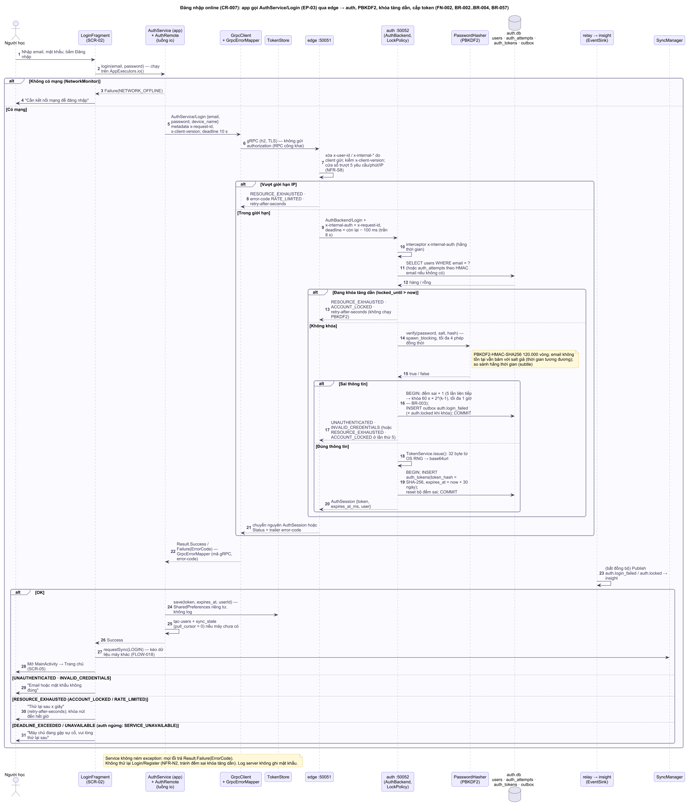
<!-- /diagram -->
Tương tác nội bộ: khởi tạo seed (FLOW-010) và đánh giá thẻ (FLOW-012). (thay đổi phạm vi; thay đổi phạm vi) App gọi **gRPC** tới dịch vụ `learninge.app.v1` của Hệ thống máy chủ LearningE (chỉ qua cổng `edge`; hợp đồng ở API_CONTRACT, EP-xx là bí danh của RPC): đồng bộ và xung đột 2 máy — sequence ở FLOW-019 (kéo dữ liệu máy thứ hai FLOW-018 dùng lại `SyncService.Pull` của sequence này); đăng ký và bộ mặc định (FLOW-001 phần A), đăng nhập (FLOW-001 phần B), đặt lại mật khẩu (FLOW-013), bảng xếp hạng (FLOW-020), nội dung (FLOW-021) vẽ bên dưới. FLOW-022 (Bản đồ) chỉ chạy trên máy, không gọi máy chủ. Lỗi theo cơ chế duy nhất (mã gRPC + trailer `error-code`; `retry-after-seconds`, `error-fields` khi áp dụng) — `UNAUTHENTICATED`/`PERMISSION_DENIED`/`ALREADY_EXISTS`/`RESOURCE_EXHAUSTED`/`FAILED_PRECONDITION`/`UNAVAILABLE`/`INTERNAL` — theo bảng ở §Ngoại lệ của SRS; app chỉ xóa token khi `UNAUTHENTICATED` (BR-059).

Đăng ký và bộ mặc định "Sổ tay của tôi" (FLOW-001 phần A, BR-046):
```mermaid
sequenceDiagram
  actor U as Khách
  participant A as App
  participant E as edge
  participant AU as auth
  participant S as sync
  U->>A: Nhập thông tin, bấm Đăng ký
  A->>E: AuthService.Register (EP-02, deadline 10 s)
  E->>AU: Register (nội bộ, x-request-id)
  alt Hợp lệ, email và biệt danh chưa dùng
    AU->>AU: Một giao dịch: tạo người dùng, token băm, outbox user.registered
    AU-->>E: Token, hồ sơ
    E-->>A: OK (token, hồ sơ)
    A->>E: SyncService.Pull (EP-12)
    E-->>A: Có thể chưa có bộ Sổ tay của tôi vì sự kiện chuyển bất đồng bộ, app vẫn chạy
    AU-)S: Relay phát user.registered (thử lại lùi dần nếu sync chưa sẵn sàng)
    S->>S: Tạo bộ mặc định uuid = UUIDv5 của notebook và user_id, idempotent
    A->>E: SyncService.Pull (lần sau)
    E-->>A: Bộ Sổ tay của tôi, cùng uuid với bản tạo cục bộ nếu có
  else Trùng email hoặc biệt danh
    E-->>A: ALREADY_EXISTS, error-code EMAIL_TAKEN hoặc NICKNAME_TAKEN
    A-->>U: "Email đã được sử dụng" hoặc "Biệt danh đã được sử dụng"
  else Dữ liệu sai quy tắc
    E-->>A: INVALID_ARGUMENT, error-code VALIDATION_ERROR, error-fields theo trường
    A-->>U: Lỗi tại trường sai
  else Dịch vụ không sẵn sàng hoặc quá hạn
    E-->>A: UNAVAILABLE hoặc DEADLINE_EXCEEDED
    A-->>U: "Không kết nối được máy chủ, vui lòng thử lại"
  end
```

Đăng nhập (FLOW-001 phần B) và kéo dữ liệu máy thứ hai (FLOW-018):
```mermaid
sequenceDiagram
  actor U as Người học
  participant A as App
  participant E as edge
  participant AU as auth
  participant S as sync
  U->>A: Nhập email, mật khẩu, bấm Đăng nhập
  A->>E: AuthService.Login (EP-03, deadline 10 s)
  E->>AU: Login (nội bộ, x-request-id)
  alt Đúng thông tin
    AU-->>E: Token mới (chỉ băm được lưu), hạn 30 ngày
    E-->>A: OK (token, hồ sơ)
    A->>A: Lưu token (BR-004)
    A->>E: SyncService.Pull (since = 0, FLOW-018)
    E->>S: Pull
    S-->>A: Trang dữ liệu qua edge
    A-->>U: Vào Trang chủ
  else Sai thông tin
    AU-->>E: Sai, tăng đếm sai theo email
    E-->>A: UNAUTHENTICATED
    A-->>U: "Email hoặc mật khẩu không đúng"
  else Đang bị khóa tăng dần
    E-->>A: RESOURCE_EXHAUSTED kèm retry-after-seconds
    A-->>U: "Bạn thử quá nhiều lần, vui lòng thử lại sau x giây"
  else Dịch vụ không sẵn sàng hoặc quá hạn
    E-->>A: UNAVAILABLE hoặc DEADLINE_EXCEEDED
    A-->>U: "Máy chủ đang gặp sự cố, vui lòng thử lại sau"
  end
```

Quên mật khẩu (FLOW-013):
```mermaid
sequenceDiagram
  actor U as Khách
  participant A as App
  participant E as edge
  participant AU as auth
  U->>A: Nhập email
  A->>E: AuthService.GetResetQuestion (EP-08)
  E->>AU: GetResetQuestion
  AU-->>A: Câu hỏi bảo mật thật hoặc giả theo HMAC (BR-076), qua edge
  U->>A: Nhập câu trả lời, mật khẩu mới
  A->>E: AuthService.ResetPassword (EP-09)
  E->>AU: ResetPassword
  alt Đúng và không bị khóa
    AU-->>A: OK, mọi token bị thu hồi, qua edge
    A-->>U: Về Đăng nhập, "Đã đặt lại mật khẩu"
  else Sai câu trả lời hoặc email không có
    AU-->>A: UNAUTHENTICATED, qua edge
    A-->>U: "Thông tin không khớp"
  else Bị khóa tăng dần
    AU-->>A: RESOURCE_EXHAUSTED kèm retry-after-seconds, qua edge
    A-->>U: "Bạn đã trả lời sai quá nhiều lần. Thử lại sau x"
  end
```

Bảng xếp hạng tuần (FLOW-020):
```mermaid
sequenceDiagram
  actor U as Người học
  participant A as App
  participant E as edge
  participant AU as auth
  participant G as gamification
  participant M as MongoDB learninge_game
  U->>A: Mở SCR-34
  A->>E: LeaderboardService.GetWeekly (EP-13, deadline 5 s)
  E->>AU: ValidateToken (cache 60 s)
  AU-->>E: user_id
  E->>G: GetWeekly (x-user-id)
  alt MongoDB và gamification hoạt động
    G->>M: Aggregation top 50 theo tuần ISO Asia/Ho_Chi_Minh, hạng của tôi
    M-->>G: Danh sách
    G-->>E: Top 50 và dòng Bạn
    E-->>A: OK
    A->>A: Lưu bản mới kèm thời điểm
    A-->>U: Hiện bảng xếp hạng
  else MongoDB hoặc gamification ngừng
    G-->>E: Lỗi
    E-->>A: UNAVAILABLE
    A-->>U: Hiện bản lưu gần nhất, "Cập nhật lúc hh:mm dd/MM" (AC-042.4)
  end
```

Cập nhật nội dung (FLOW-021, Could):
```mermaid
sequenceDiagram
  participant A as App (nền)
  participant E as edge
  participant C as content
  participant M as MongoDB learninge_content
  A->>E: ContentService.GetManifest (EP-14, if_version = bản trên máy)
  E->>C: GetManifest (cần token đã xác thực)
  C->>M: Đọc content_meta
  alt Có bản mới hơn
    M-->>C: content_version lớn hơn
    C-->>A: Manifest, qua edge
    A->>E: ContentService.GetDeck và GetExam (EP-15, EP-16)
    E->>C: GetDeck, GetExam
    C-->>A: Bộ từ, đề thi thay đổi, qua edge
    A->>A: Kiểm tra, ghi một giao dịch, cập nhật content_version
  else Đã mới nhất
    C-->>A: not_modified = true, qua edge
  else content hoặc MongoDB ngừng
    E-->>A: UNAVAILABLE
    A->>A: Giữ seed và phiên bản đã tải (BR-075)
  end
```

## Bản đồ màn hình và flow
Điều hướng chính: thanh tab dưới gồm **Trang chủ · Học · Luyện tập · Tra từ · Tôi**.
| Flow | Màn hình / trang đi qua | Ghi chú |
|---|---|---|
| FLOW-001 | SCR-01 Màn hình chờ → SCR-02 Đăng nhập → SCR-03 Đăng ký → SCR-05 Trang chủ | SCR-02 có liên kết Giới thiệu (SCR-24) |
| FLOW-002 | SCR-04 Thiết lập lần đầu (3 bước) → SCR-05 | Hộp thoại xin quyền thông báo của hệ thống |
| FLOW-003 | SCR-06 Danh sách chủ đề → SCR-07 Danh sách từ → SCR-08 Chi tiết từ | Tab Học |
| FLOW-004 | SCR-07 / SCR-05 / SCR-19 → SCR-09 Flashcard → SCR-10 Kết quả phiên | Một màn hình flashcard cho 3 nguồn |
| FLOW-005 | SCR-12 Chọn quiz → SCR-13 Làm quiz → SCR-14 Kết quả quiz; SCR-15 Lịch sử quiz | Tab Luyện tập |
| FLOW-006 | SCR-16 Danh sách ngữ pháp → SCR-17 Chi tiết bài → SCR-13 → SCR-14 | Dùng lại màn hình quiz |
| FLOW-007 | Thông báo hệ thống → SCR-05 | Không có màn hình riêng |
| FLOW-008 | SCR-10, SCR-14, SCR-17 (điểm kích hoạt) → SCR-05, SCR-21 (hiển thị) | Chạy nền |
| FLOW-009 | SCR-22 Hồ sơ & cài đặt → SCR-23 Đổi mật khẩu; SCR-21 Tiến độ; SCR-24 Giới thiệu | Tab Tôi |
| FLOW-010 | SCR-01 | Chỉ lần mở đầu tiên hoặc khi nâng phiên bản seed |
| FLOW-011 | SCR-18 Tra từ (gồm mục Yêu thích) → SCR-08 / SCR-20 Thêm/sửa từ; SCR-19 Chi tiết bộ (sổ tay là một bộ) | Tab Tra từ |
| FLOW-013 | SCR-02 → SCR-25 Quên mật khẩu (2 bước) → SCR-02 | thay đổi phạm vi |
| FLOW-014 | SCR-06 → SCR-26 Bộ của tôi → SCR-27 Tạo/sửa bộ; SCR-19 Chi tiết bộ → SCR-20 Thêm/sửa từ | thay đổi phạm vi: SCR-19/20 đổi từ "Sổ tay" thành chi tiết bộ (sổ tay là một bộ) |
| FLOW-015 | SCR-26 → trình chọn file hệ thống → SCR-28 Xem trước import → SCR-19 | thay đổi phạm vi |
| FLOW-016 | SCR-19 → SCR-29 Chọn định dạng export → trình lưu file hệ thống | thay đổi phạm vi |
| FLOW-017 | SCR-12 → SCR-30 Luyện thi → SCR-31 Làm bài thi thử → SCR-32 Kết quả thi thử; SCR-30 → SCR-33 Tài nguyên chính thức | thay đổi phạm vi |
| FLOW-018 | SCR-02 → (đang tải dữ liệu) → SCR-04 hoặc SCR-05 | thay đổi phạm vi; trạng thái "Đang tải dữ liệu của bạn" do người thiết kế chốt |
| FLOW-019 | Kích hoạt từ SCR-05 (mở app), SCR-10, SCR-14, SCR-32; SCR-22 → SCR-35 Trạng thái đồng bộ | thay đổi phạm vi; thanh "Đang ngoại tuyến" dùng chung |
| FLOW-020 | SCR-05 hoặc SCR-22 → SCR-34 Bảng xếp hạng tuần | thay đổi phạm vi |
| FLOW-021 | Chạy nền khi mở app → SCR-06 (bộ mới) | thay đổi phạm vi, Could |
| FLOW-022 | SCR-06 (công tắc Lưới/Bản đồ) → SCR-07 | thay đổi phạm vi, Could |
Ghi chú: Tab "Tra từ" phụ thuộc REQ-009 (Could); mục Yêu thích chuyển sang SCR-26 "Bộ của tôi" → SCR-19 lọc "Yêu thích" (PQ-7, FN-005) — người thiết kế cập nhật UI-UX-SPECIFICATION (sơ đồ màn hình).
Tổng: 34 màn hình (35 mã SCR: SCR-01 … SCR-35) sau thay đổi phạm vi, thay đổi phạm vi và thay đổi phạm vi (thêm SCR-34, SCR-35).
