# Use Cases — ca sử dụng, User Flow, System Flow

> **TỰ SINH** từ bộ phân tích thiết kế đã duyệt của nhóm — không sửa trực tiếp tệp này; đề xuất thay đổi qua Issue/PR để nhóm trưởng cập nhật nguồn và sinh lại. Danh mục tài liệu: [docs/README.md](../README.md).

**Mục đích:** danh sách và sơ đồ use case, đặc tả từng chức năng (tiền điều kiện, các bước, ngoại lệ), sơ đồ luồng người dùng và luồng hệ thống.

## Danh sách use case
| UC | Tên | Tác nhân | US | FN |
|---|---|---|---|---|
| UC-001 | Đăng ký | Khách | US-001 | FN-001 |
| UC-002 | Đăng nhập / đăng xuất | Khách, Người học | US-002 | FN-002 |
| UC-003 | Thiết lập lần đầu | Người học | US-006 | FN-003 |
| UC-004 | Quản lý hồ sơ & cài đặt (gồm đổi mật khẩu, xóa tài khoản) | Người học | US-003..US-005 | FN-004 |
| UC-005 | Xem chủ đề và từ vựng (gồm yêu thích, phát âm) | Người học | US-007, US-008, US-010, US-011 | FN-005 |
| UC-006 | Học từ mới bằng flashcard | Người học | US-009 | FN-006 |
| UC-007 | Ôn tập thẻ đến hạn | Người học | US-012 | FN-007 |
| UC-008 | Làm quiz chủ đề và xem kết quả | Người học | US-013, US-014 | FN-008 |
| UC-009 | Xem lịch sử quiz | Người học | US-015 | FN-009 |
| UC-010 | Xem trang chủ, tiến độ, chuỗi ngày học | Người học | US-016..US-018 | FN-010 |
| UC-011 | Nhận nhắc học | Hệ thống (bộ hẹn giờ), Người học | US-019 | FN-011 |
| UC-012 | Học ngữ pháp và làm bài tập | Người học | US-020, US-021 | FN-012 |
| UC-013 | Tra từ | Người học | US-022 | FN-013 |
| UC-014 | Quản lý sổ tay và học sổ tay | Người học | US-023, US-024 | FN-014 |
| UC-015 | Khởi tạo dữ liệu seed | Hệ thống | US-025 | FN-015 |
| UC-016 | Xem giới thiệu | Khách, Người học | US-026 | FN-016 |
| UC-017 | Đặt lại mật khẩu | Khách | US-027 | FN-017 |
| UC-018 | Quản lý bộ từ vựng | Người học | US-028..US-031 | FN-018 |
| UC-019 | Import từ vựng | Người học | US-032 | FN-019 |
| UC-020 | Export từ vựng | Người học | US-033 | FN-020 |
| UC-021 | Chọn ngôn ngữ nội dung | Người học | US-034 | FN-021 |
| UC-022 | Luyện thi TOEIC/IELTS/Aptis | Người học | US-035..US-037 | FN-022 |

Sơ đồ use case (Mermaid không có ký hiệu use case UML; bản UML chuẩn vẽ lại bằng draw.io/StarUML cho báo cáo theo đúng bảng trên):
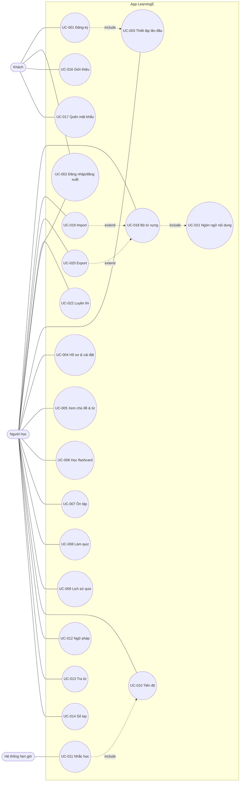

## Chức năng chi tiết
Mỗi chức năng: mục đích, điều kiện tiên quyết, các bước, dữ liệu vào/ra, ngoại lệ, liên kết flow.

### FN-001: Đăng ký (US-001)
- Mục đích: tạo tài khoản cục bộ.
- Điều kiện tiên quyết: chưa đăng nhập; CSDL đã khởi tạo.
- Các bước chính: (1) Mở Đăng ký từ màn hình Đăng nhập. (2) Nhập tên hiển thị, tên đăng nhập, mật khẩu, xác nhận mật khẩu. (3) Bấm Đăng ký. (4) Hệ thống kiểm tra dữ liệu, kiểm tra trùng (BR-001). (5) Tạo salt, băm mật khẩu (BR-002), lưu người dùng. (6) Lưu phiên (BR-004), chuyển Thiết lập lần đầu.
- Ngoại lệ: dữ liệu sai → lỗi tại trường; trùng tên → lỗi BR-001; lỗi ghi CSDL → "Không thể tạo tài khoản, vui lòng thử lại".
- Quy tắc áp dụng: BR-001, BR-002, BR-004
- Flow: FLOW-001

### FN-002: Đăng nhập / đăng xuất (US-002)
- Điều kiện tiên quyết: có ít nhất một tài khoản trên máy (nếu không, màn hình Đăng nhập gợi ý Đăng ký).
- Các bước chính: (1) Nhập tên đăng nhập, mật khẩu. (2) Kiểm tra khóa tạm (BR-003). (3) Tìm người dùng, băm mật khẩu nhập với salt đã lưu, so sánh. (4) Đúng → đặt lại đếm sai, lưu phiên, vào Trang chủ. (5) Đăng xuất: xác nhận → xóa phiên → màn hình Đăng nhập.
- Ngoại lệ: sai → tăng đếm, thông báo chung; đủ 5 lần → khóa 60 giây.
- Quy tắc áp dụng: BR-002, BR-003, BR-004
- Flow: FLOW-001

### FN-003: Thiết lập lần đầu (US-006)
- Điều kiện tiên quyết: vừa đăng ký.
- Các bước chính: (1) Chọn cấp độ. (2) Chọn mục tiêu hằng ngày. (3) Bật/tắt nhắc học, chọn giờ; nếu bật trên Android 13+ thì xin quyền thông báo. (4) Lưu cài đặt, đặt lịch nhắc (BR-030). (5) Vào Trang chủ.
- Ngoại lệ: từ chối quyền thông báo → lưu nhắc học = tắt, hiện hướng dẫn; "Bỏ qua" → mặc định BR-006.
- Quy tắc áp dụng: BR-006, BR-030
- Flow: FLOW-002

### FN-004: Hồ sơ & cài đặt (US-003, US-004, US-005)
- Điều kiện tiên quyết: đã đăng nhập.
- Các bước chính: xem/sửa tên hiển thị, cấp độ, mục tiêu, giờ nhắc, công tắc nhắc học; đổi mật khẩu (mật khẩu hiện tại + mới + xác nhận); xóa tài khoản (nhập lại mật khẩu + xác nhận); mở Giới thiệu; đăng xuất.
- Ngoại lệ: mật khẩu hiện tại sai; mật khẩu mới trùng mật khẩu cũ → "Mật khẩu mới phải khác mật khẩu hiện tại"; lỗi xóa → rollback, báo lỗi.
- Quy tắc áp dụng: BR-002, BR-005, BR-030
- Flow: FLOW-009

### FN-005: Xem chủ đề và từ vựng (US-007, US-008, US-010, US-011)
- Điều kiện tiên quyết: đã đăng nhập.
- Các bước chính: (1) Tab Học → danh sách chủ đề lọc theo cấp độ. (2) Chọn chủ đề → danh sách từ kèm trạng thái (BR-014). (3) Chọn từ → Chi tiết từ. (4) Bấm loa → TTS đọc. (5) Bấm yêu thích → bật/tắt.
- Ngoại lệ: thiếu giọng TTS (AC-010.2); chủ đề trống (không xảy ra với seed hợp lệ — người kiểm thử kiểm tra seed).
- Quy tắc áp dụng: BR-014
- Flow: FLOW-003

### FN-006: Học từ mới bằng flashcard (US-009)
- Điều kiện tiên quyết: chủ đề có từ Mới.
- Các bước chính: (1) Bấm "Học từ mới". (2) Hệ thống lấy N từ Mới theo thứ tự seed (BR-010). (3) Hiện thẻ, người dùng lật thẻ, nghe phát âm. (4) Chọn Đã nhớ/Chưa nhớ → tạo tiến độ theo BR-011, BR-012. (5) Hết thẻ → Kết quả phiên; ghi hoạt động học (BR-032), cập nhật chuỗi (BR-031).
- Ngoại lệ: thoát giữa phiên (AC-009.5); không còn từ Mới (AC-009.4).
- Quy tắc áp dụng: BR-010, BR-011, BR-012, BR-015, BR-031, BR-032
- Flow: FLOW-004

### FN-007: Ôn tập (US-012)
- Điều kiện tiên quyết: có thẻ đến hạn (BR-013).
- Các bước chính: (1) Trang chủ → Ôn tập. (2) Lấy tối đa 50 thẻ đến hạn. (3) Với mỗi thẻ: lật, đánh giá → cập nhật hộp và ngày ôn tiếp. (4) Hết thẻ → Kết quả phiên; ghi hoạt động học.
- Ngoại lệ: không có thẻ đến hạn → nút vô hiệu.
- Quy tắc áp dụng: BR-011, BR-012, BR-013, BR-031, BR-032
- Flow: FLOW-004

### FN-008: Làm quiz chủ đề (US-013, US-014)
- Điều kiện tiên quyết: chủ đề có ≥ 4 từ.
- Các bước chính: (1) Tab Luyện tập → chọn chủ đề → Bắt đầu. (2) Sinh câu hỏi (BR-020, BR-024). (3) Trả lời từng câu, hiện đúng/sai ngay (BR-022, BR-025). (4) Hết câu → tính điểm (BR-023), lưu lượt làm + câu trả lời, áp BR-021 cho câu sai, ghi hoạt động học. (5) Màn hình Kết quả.
- Ngoại lệ: thiếu TTS → bỏ dạng nghe (AC-013.3); thoát giữa bài → hỏi xác nhận, không lưu.
- Quy tắc áp dụng: BR-020..BR-025, BR-031, BR-032
- Flow: FLOW-005

### FN-009: Lịch sử quiz (US-015)
- Các bước chính: Tab Luyện tập → Lịch sử → danh sách lượt làm (mới nhất trước) → chạm một lượt để xem lại câu sai.
- Ngoại lệ: rỗng → trạng thái rỗng (AC-015.2).
- Flow: FLOW-005

### FN-010: Trang chủ, tiến độ, chuỗi ngày học (US-016, US-017, US-018)
- Các bước chính: Trang chủ hiện số liệu hôm nay (AC-016.1); tab Tôi → Tiến độ hiện thống kê (AC-017.1). Số liệu tính trực tiếp (BR-033).
- Quy tắc áp dụng: BR-014, BR-031, BR-032, BR-033, BR-042
- Flow: FLOW-008

### FN-011: Nhắc học (US-019)
- Điều kiện tiên quyết: nhắc học bật, có quyền thông báo.
- Các bước chính: (1) Bộ hẹn giờ đến giờ nhắc. (2) Kiểm tra người dùng đang đăng nhập đã đạt mục tiêu hôm nay chưa. (3) Chưa đạt → hiện thông báo. (4) Đặt lịch cho ngày hôm sau. (5) Khởi động lại máy → đặt lại lịch.
- Ngoại lệ: không có người dùng đăng nhập → không hiện thông báo; quyền bị thu hồi → không hiện, Cài đặt báo trạng thái.
- Quy tắc áp dụng: BR-030
- Flow: FLOW-007

### FN-012: Ngữ pháp (US-020, US-021)
- Các bước chính: (1) Tab Luyện tập → Ngữ pháp → danh sách bài. (2) Mở bài, đọc đến cuối → đánh dấu đã đọc, ghi hoạt động học. (3) Làm bài tập → chấm như FN-008 (dạng trắc nghiệm, có giải thích) → lưu lượt làm.
- Quy tắc áp dụng: BR-022, BR-023, BR-032
- Flow: FLOW-006

### FN-013: Tra từ (US-022)
- Các bước chính: (1) Tab Tra từ → gõ từ khóa. (2) Tìm trong từ seed + sổ tay của người dùng (BR-040). (3) Chạm kết quả → Chi tiết từ (seed) hoặc chi tiết mục sổ tay. (4) Mục Yêu thích nằm cùng tab.
- Ngoại lệ: không có kết quả → gợi ý thêm vào sổ tay.
- Quy tắc áp dụng: BR-040
- Flow: FLOW-006

### FN-014: Sổ tay (US-023, US-024)
- Các bước chính: thêm/sửa/xóa mục sổ tay (BR-041); "Học sổ tay" mở phiên flashcard dùng chung FN-006 với nguồn là sổ tay.
- Quy tắc áp dụng: BR-011, BR-012, BR-015, BR-041
- Flow: FLOW-006

### FN-015: Khởi tạo dữ liệu seed (US-025)
- Các bước chính: lần mở đầu tiên `onCreate` tạo bảng → đọc file seed trong `assets/` → chèn trong một giao dịch → ghi phiên bản seed. Nâng phiên bản app có seed mới → `onUpgrade` chèn/cập nhật seed, không đụng dữ liệu người dùng.
- Ngoại lệ: lỗi đọc/chèn → rollback, báo lỗi (AC-025.2).
- Flow: FLOW-010

### FN-017: Đặt lại mật khẩu (US-027, thay đổi phạm vi)
- Điều kiện tiên quyết: chưa đăng nhập; tài khoản có câu hỏi bảo mật.
- Các bước chính: (1) Đăng nhập → "Quên mật khẩu?". (2) Nhập tên đăng nhập → hiện câu hỏi bảo mật. (3) Nhập câu trả lời → kiểm tra khóa (BR-008), so sánh băm (BR-007). (4) Đúng → nhập mật khẩu mới + xác nhận → lưu băm mới, đếm sai đăng nhập về 0 → về Đăng nhập.
- Ngoại lệ: tên không tồn tại; trả lời sai; bị khóa 5 phút.
- Quy tắc áp dụng: BR-002, BR-007, BR-008
- Flow: FLOW-013

### FN-018: Quản lý bộ từ vựng (US-028..US-031, thay đổi phạm vi)
- Điều kiện tiên quyết: đã đăng nhập.
- Các bước chính: tab Học → "Bộ của tôi" → danh sách bộ (tên, ngôn ngữ, số từ, số thẻ đến hạn) → tạo/đổi tên/xóa bộ; mở bộ → danh sách từ → thêm/sửa/xóa từ; "Học" (FN-006 với nguồn = bộ), "Làm quiz" (FN-008 với nguồn = bộ); "Lưu vào bộ" từ Chi tiết từ có sẵn.
- Ngoại lệ: trùng tên bộ; trùng từ; xóa bộ mặc định; bộ có sẵn chỉ đọc.
- Quy tắc áp dụng: BR-043..BR-047, BR-011, BR-012
- Flow: FLOW-014

### FN-019: Import từ vựng (US-032, thay đổi phạm vi)
- Các bước chính: (1) "Import" trong "Bộ của tôi" → trình chọn file hệ thống (`ACTION_OPEN_DOCUMENT`, loại `text/csv`, `text/comma-separated-values`, `application/json`). (2) Đọc file trên luồng nền, kiểm tra kích thước, phân tích theo BR-048/BR-049. (3) Màn hình xem trước. (4) Chọn bộ đích → chèn trong một giao dịch (BR-050). (5) Báo kết quả.
- Ngoại lệ: file quá lớn, sai định dạng, không có dòng hợp lệ, lỗi đọc file, hủy chọn file.
- Flow: FLOW-015

### FN-020: Export từ vựng (US-033, thay đổi phạm vi)
- Các bước chính: mở bộ → "Export" → chọn CSV/JSON → trình lưu file hệ thống (`ACTION_CREATE_DOCUMENT`, tên gợi ý theo BR-051) → ghi trên luồng nền → báo "Đã xuất x từ".
- Ngoại lệ: hủy chọn nơi lưu; lỗi ghi (xóa file dở dang nếu tạo được).
- Flow: FLOW-016

### FN-021: Ngôn ngữ nội dung (US-034, thay đổi phạm vi)
- Các bước chính: chọn ngôn ngữ khi tạo bộ; mọi màn hình học/quiz/tra từ đọc `language` của bộ để lấy nhãn cách đọc, locale TTS, quy tắc chuẩn hóa (BR-052, BR-053).
- Flow: FLOW-014

### FN-022: Luyện thi (US-035..US-037, thay đổi phạm vi)
- Các bước chính: tab Luyện tập → "Luyện thi" → chọn kỳ thi (TOEIC/IELTS/Aptis) → bộ từ của kỳ thi (dùng FN-018 chế độ chỉ đọc) hoặc đề thi thử → làm bài có đồng hồ → nộp/hết giờ → kết quả + giải thích → lưu lịch sử, áp BR-055; "Tài nguyên chính thức" mở URL bằng `Intent.ACTION_VIEW`.
- Ngoại lệ: thoát giữa bài (lưu trạng thái, tiếp tục nếu còn giờ — AC-036.4); không có trình duyệt.
- Quy tắc áp dụng: BR-054, BR-055
- Flow: FLOW-017

### FN-016: Giới thiệu (US-026)
- Các bước chính: Tôi → Giới thiệu (hoặc liên kết ở màn hình Đăng nhập) → hiện nội dung tĩnh.

## Luồng người dùng & luồng hệ thống
> Mã màn hình SCR-xx ở §Bản đồ màn hình; người thiết kế đối chiếu với Figma ở phase 3 (PRD PQ-1).

## Danh sách flow
| ID | Flow | Loại (user flow / quy trình nghiệp vụ / tương tác hệ thống / vòng đời) | Vai trò | US liên quan | Có nhánh lỗi? |
|---|---|---|---|---|---|
| FLOW-001 | Mở app, đăng ký, đăng nhập | user flow | Khách | US-001, US-002 | có |
| FLOW-002 | Thiết lập lần đầu | user flow | Người học | US-006 | có |
| FLOW-003 | Xem chủ đề, từ, phát âm, yêu thích | user flow | Người học | US-007, US-008, US-010, US-011 | có |
| FLOW-004 | Phiên flashcard (học từ mới / ôn tập / học sổ tay) | user flow | Người học | US-009, US-012, US-024 | có |
| FLOW-005 | Làm quiz chủ đề, xem kết quả, lịch sử | user flow | Người học | US-013, US-014, US-015 | có |
| FLOW-006 | Học ngữ pháp và làm bài tập | user flow | Người học | US-020, US-021 | có |
| FLOW-007 | Nhắc học hằng ngày | quy trình nghiệp vụ (swimlane) | Người học, App, Hệ thống Android | US-019 | có |
| FLOW-008 | Ghi hoạt động học và cập nhật chuỗi ngày | quy trình nghiệp vụ | Hệ thống | US-016, US-018 | có |
| FLOW-009 | Cài đặt, đổi mật khẩu, xóa tài khoản | user flow | Người học | US-003, US-004, US-005 | có |
| FLOW-010 | Khởi tạo dữ liệu seed lần đầu | tương tác hệ thống | Hệ thống | US-025 | có |
| FLOW-011 | Tra từ và sổ tay | user flow | Người học | US-022, US-023 | có |
| FLOW-012 | Đánh giá một thẻ flashcard (sequence) | tương tác hệ thống | Người học | US-009, US-012 | có |
| FLOW-013 | Quên mật khẩu | user flow | Khách | US-027 | có |
| FLOW-014 | Quản lý bộ từ vựng | user flow | Người học | US-028..US-031, US-034 | có |
| FLOW-015 | Import từ vựng | user flow | Người học | US-032 | có |
| FLOW-016 | Export từ vựng | user flow | Người học | US-033 | có |
| FLOW-017 | Làm bài thi thử | user flow | Người học | US-035, US-036, US-037 | có |

## FLOW-001: Mở app, đăng ký, đăng nhập
- Vai trò: Khách · Điểm vào: chạm icon app · Thành công: vào Trang chủ hoặc Thiết lập lần đầu · Tiền đề: không có.
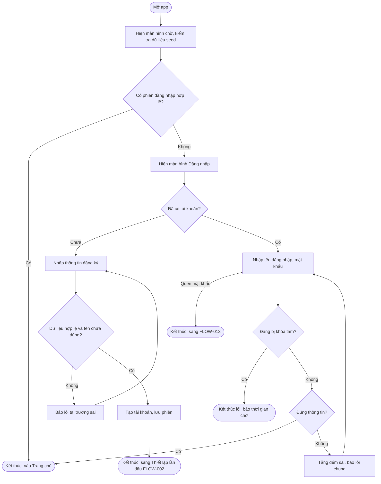
### Nhánh ngoại lệ (bắt buộc)
| Tình huống | Hệ thống làm gì | Thông báo | Quay về đâu |
|---|---|---|---|
| Sai mật khẩu lần thứ 5 | Khóa 60 giây (BR-003) | "Bạn đã nhập sai quá nhiều lần. Thử lại sau 60 giây" | SCR-02, nút Đăng nhập vô hiệu đến hết giờ |
| Tên đăng nhập đã dùng | Không tạo tài khoản | "Tên đăng nhập đã được sử dụng" | SCR-03, giữ dữ liệu đã nhập |
| Nạp seed lỗi ở màn hình chờ | Xem FLOW-010 | "Không thể khởi tạo dữ liệu…" | Đóng app |
| Phiên trỏ tới tài khoản đã bị xóa | Xóa phiên | Không | SCR-02 |

## FLOW-002: Thiết lập lần đầu
- Vai trò: Người học vừa đăng ký · Thành công: cài đặt được lưu, vào Trang chủ.

### Nhánh ngoại lệ (bắt buộc)
| Tình huống | Hệ thống làm gì | Thông báo | Quay về đâu |
|---|---|---|---|
| Từ chối quyền thông báo | Tắt nhắc học | "Bạn có thể bật nhắc học trong Cài đặt bất cứ lúc nào" | Trang chủ |
| Thoát app giữa chừng | Không lưu; lần mở sau quay lại bước 1 (tài khoản ở trạng thái Chưa thiết lập) | Không | SCR-04 |
| Lỗi ghi CSDL | Rollback | "Đã có lỗi khi lưu dữ liệu, vui lòng thử lại" | Bước hiện tại |

## FLOW-003: Xem chủ đề, từ, phát âm, yêu thích
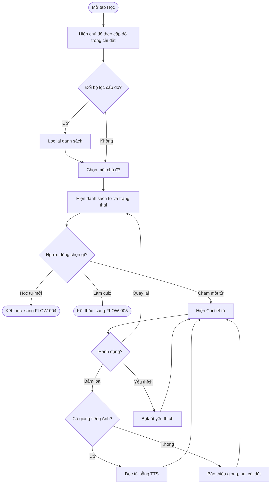
### Nhánh ngoại lệ (bắt buộc)
| Tình huống | Hệ thống làm gì | Thông báo | Quay về đâu |
|---|---|---|---|
| Thiếu giọng đọc TTS | Không đọc | "Máy chưa có giọng đọc tiếng Anh" + "Cài đặt giọng đọc" | SCR-08 |
| Bộ lọc không có chủ đề nào | Hiện trạng thái rỗng | "Chưa có chủ đề cho cấp độ này" | SCR-06 |
| Chủ đề hết từ Mới | Ẩn nút Học từ mới | "Bạn đã học hết từ mới của chủ đề này" | SCR-07 |

## FLOW-004: Phiên flashcard (học từ mới / ôn tập / học sổ tay)
- Điểm vào: "Học từ mới" (SCR-07), "Ôn tập" (SCR-05), "Học sổ tay" (SCR-19). Cùng một màn hình SCR-09, khác nguồn thẻ.
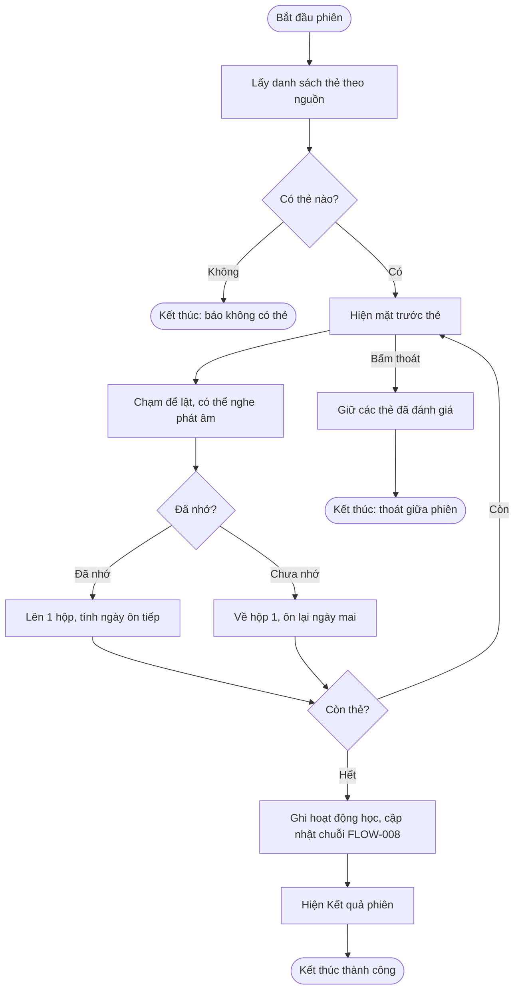
### Nhánh ngoại lệ (bắt buộc)
| Tình huống | Hệ thống làm gì | Thông báo | Quay về đâu |
|---|---|---|---|
| Không có thẻ đến hạn / không còn từ Mới / sổ tay rỗng | Không mở phiên | Thông báo tương ứng (SRS §Ngoại lệ) | Màn hình gọi |
| Thoát giữa phiên | Thẻ đã đánh giá được lưu, không ghi hoạt động học | Không | Màn hình gọi |
| Lỗi ghi tiến độ một thẻ | Rollback thẻ đó, cho đánh giá lại | "Đã có lỗi khi lưu dữ liệu, vui lòng thử lại" | Thẻ hiện tại |
| Xoay màn hình / app bị đưa xuống nền | Giữ vị trí thẻ và trạng thái lật | Không | Thẻ hiện tại |

## FLOW-005: Làm quiz chủ đề, xem kết quả, lịch sử

### Nhánh ngoại lệ (bắt buộc)
| Tình huống | Hệ thống làm gì | Thông báo | Quay về đâu |
|---|---|---|---|
| Thiếu giọng TTS | Thay câu "nghe chọn từ" bằng trắc nghiệm nghĩa | Không | Bình thường |
| Điền từ để trống | Không chấm | "Vui lòng nhập câu trả lời" | Câu hiện tại |
| Lịch sử rỗng | Trạng thái rỗng | "Bạn chưa làm bài kiểm tra nào" | SCR-15 |
| Lỗi lưu lượt làm | Rollback | "Đã có lỗi khi lưu kết quả" + "Thử lại" | SCR-14 |

## FLOW-006: Học ngữ pháp và làm bài tập
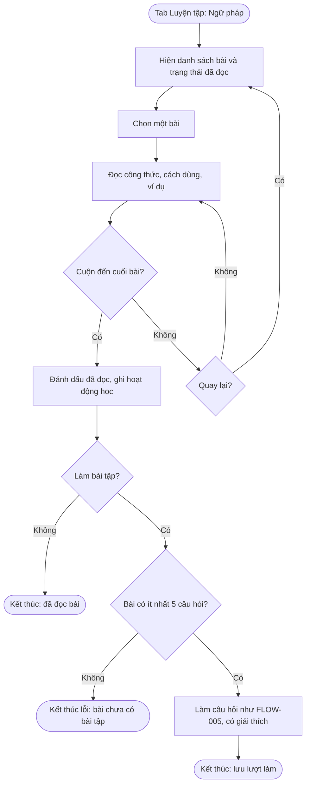
### Nhánh ngoại lệ (bắt buộc)
| Tình huống | Hệ thống làm gì | Thông báo | Quay về đâu |
|---|---|---|---|
| Bài chưa có bài tập | Ẩn nút Làm bài tập | "Bài này chưa có bài tập" | SCR-17 |
| Đọc lại bài đã đọc | Không ghi thêm hoạt động học trong cùng ngày | Không | SCR-17 |

## FLOW-007: Nhắc học hằng ngày
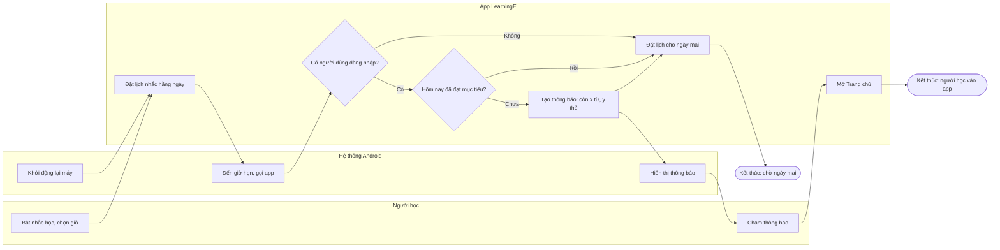
### Nhánh ngoại lệ (bắt buộc)
| Tình huống | Hệ thống làm gì | Thông báo | Quay về đâu |
|---|---|---|---|
| Quyền thông báo bị thu hồi | Không hiện thông báo; Cài đặt hiện trạng thái tắt | "Bật quyền thông báo để nhận nhắc học" | SCR-22 |
| Đổi giờ nhắc | Hủy lịch cũ, đặt lịch mới | Không | SCR-22 |
| Máy ở chế độ tiết kiệm pin (Doze) | Hệ thống có thể trễ ≤ 15 phút (chấp nhận theo BR-030) | Không | — |
| Đăng xuất / xóa tài khoản | Hủy lịch nhắc | Không | SCR-02 |

## FLOW-008: Ghi hoạt động học và cập nhật chuỗi ngày

### Nhánh ngoại lệ (bắt buộc)
| Tình huống | Hệ thống làm gì | Thông báo | Quay về đâu |
|---|---|---|---|
| Người dùng chỉnh giờ máy lùi về quá khứ | Dùng ngày máy (BR-042); chuỗi có thể sai, chấp nhận | Không | — |
| Lỗi ghi nhật ký | Rollback cả nhật ký và chuỗi | "Đã có lỗi khi lưu dữ liệu" | Màn hình Kết quả |

## FLOW-009: Cài đặt, đổi mật khẩu, xóa tài khoản
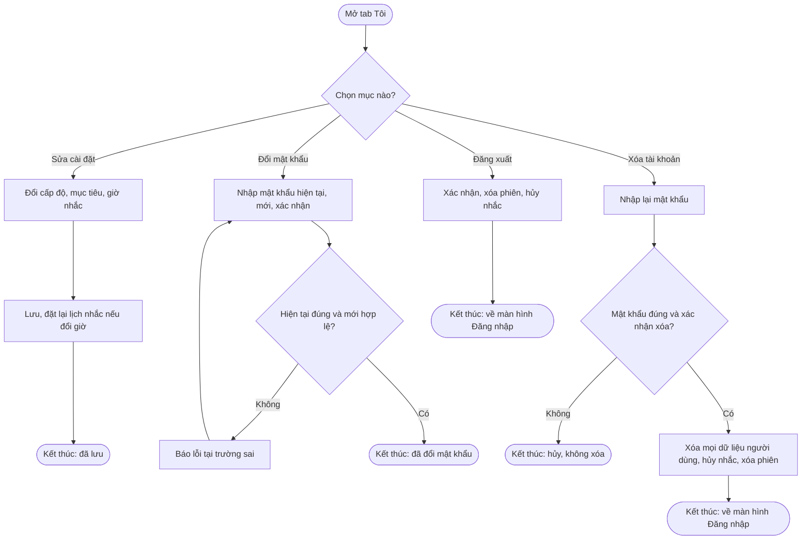
### Nhánh ngoại lệ (bắt buộc)
| Tình huống | Hệ thống làm gì | Thông báo | Quay về đâu |
|---|---|---|---|
| Mật khẩu mới trùng mật khẩu cũ | Không đổi | "Mật khẩu mới phải khác mật khẩu hiện tại" | SCR-23 |
| Lỗi giữa lúc xóa tài khoản | Rollback toàn bộ (BR-005) | "Không thể xóa tài khoản, vui lòng thử lại" | SCR-22 |

## FLOW-010: Khởi tạo dữ liệu seed lần đầu
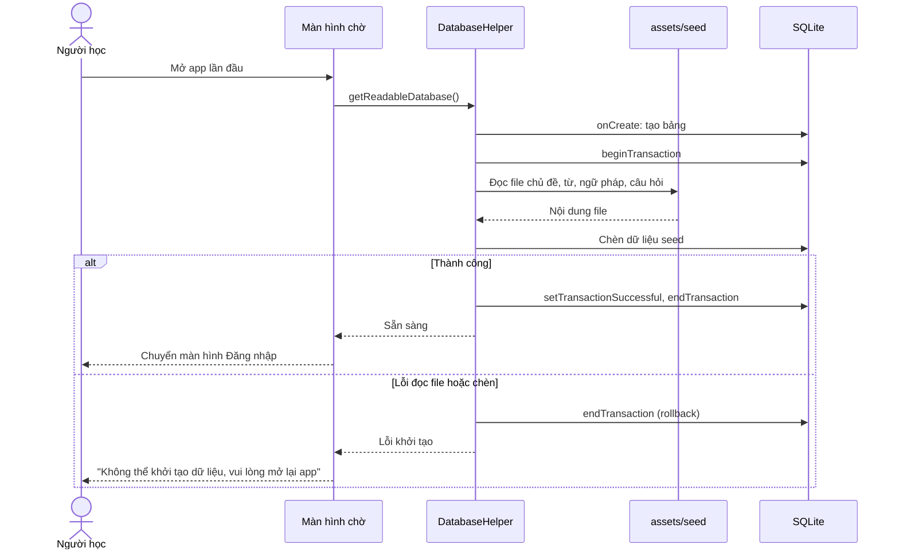
### Nhánh ngoại lệ (bắt buộc)
| Tình huống | Hệ thống làm gì | Thông báo | Quay về đâu |
|---|---|---|---|
| File seed thiếu hoặc sai định dạng | Rollback | "Không thể khởi tạo dữ liệu, vui lòng mở lại app" | Đóng app |
| Nâng phiên bản app có seed mới | `onUpgrade` cập nhật seed, giữ dữ liệu người dùng | Không | Bình thường |
| Nạp lâu hơn 5 giây | Vẫn hiện màn hình chờ có vòng tiến trình | Không | SCR-01 |

## FLOW-011: Tra từ và sổ tay
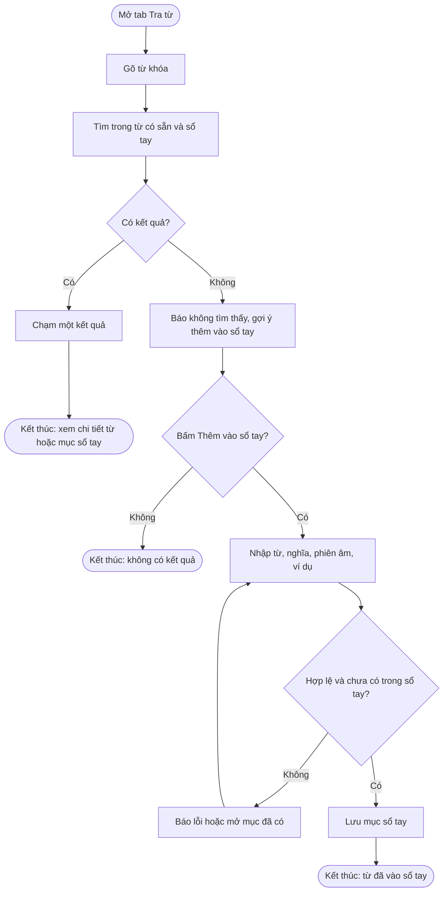
### Nhánh ngoại lệ (bắt buộc)
| Tình huống | Hệ thống làm gì | Thông báo | Quay về đâu |
|---|---|---|---|
| Từ đã có trong sổ tay | Không tạo mới, mở mục đã có | "Từ này đã có trong sổ tay" | SCR-20 |
| Xóa mục sổ tay | Hỏi xác nhận, xóa mục và tiến độ thẻ của mục | "Xóa từ này khỏi sổ tay?" | SCR-19 |
| Từ khóa > 50 ký tự | Cắt còn 50 ký tự | Không | SCR-18 |

## FLOW-012: Đánh giá một thẻ flashcard
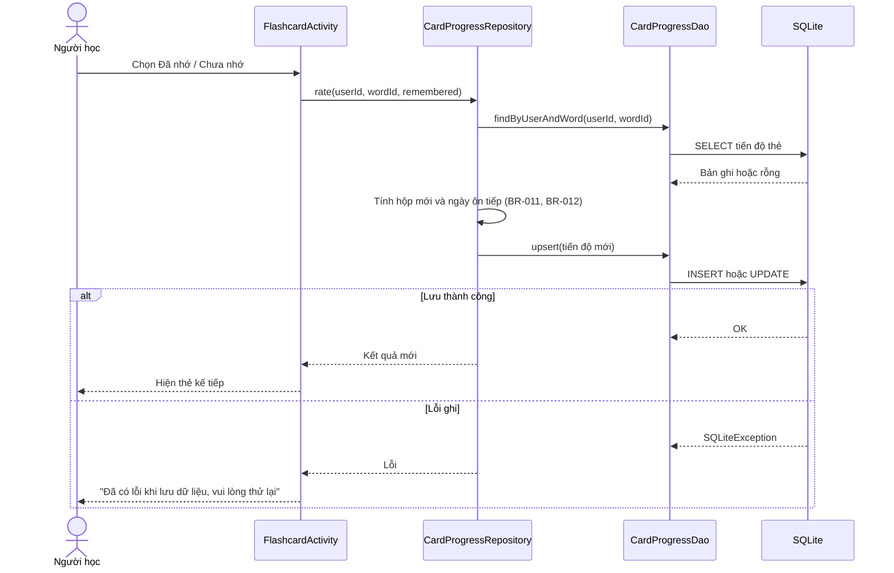
Tên lớp ở sơ đồ này là đề xuất; lập trình viên chốt ở SYSTEM-BLUEPRINT phase 3.

## FLOW-013: Quên mật khẩu
- Vai trò: Khách · Điểm vào: SCR-02 "Quên mật khẩu?" · Thành công: mật khẩu mới được lưu.
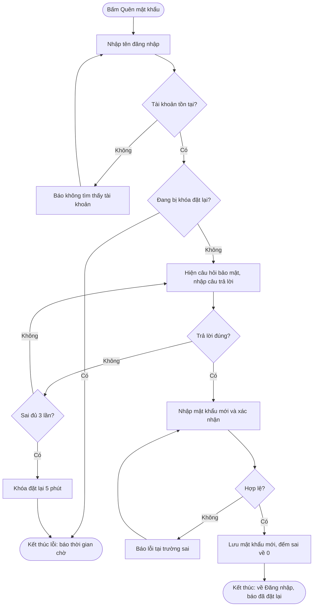
### Nhánh ngoại lệ (bắt buộc)
| Tình huống | Hệ thống làm gì | Thông báo | Quay về đâu |
|---|---|---|---|
| Tên đăng nhập không tồn tại | Không hiện câu hỏi | "Không tìm thấy tài khoản" | SCR-25 bước 1 |
| Sai câu trả lời lần 3 | Khóa 5 phút (BR-008) | "Bạn đã trả lời sai quá nhiều lần. Thử lại sau 5 phút" | SCR-02 |
| Lỗi ghi CSDL | Rollback | "Đã có lỗi khi lưu dữ liệu, vui lòng thử lại" | SCR-25 bước 2 |

## FLOW-014: Quản lý bộ từ vựng
- Vai trò: Người học · Điểm vào: tab Học → "Bộ của tôi" · Thành công: bộ/từ được tạo hoặc sửa.

### Nhánh ngoại lệ (bắt buộc)
| Tình huống | Hệ thống làm gì | Thông báo | Quay về đâu |
|---|---|---|---|
| Xóa bộ "Sổ tay của tôi" | Không có nút xóa (BR-045) | — | SCR-19 |
| Xóa bộ khác | Hỏi xác nhận, xóa bộ + từ + tiến độ trong 1 giao dịch | "Xóa bộ và x từ? Tiến độ học của các từ này cũng bị xóa" | SCR-26 |
| Đổi ngôn ngữ bộ đã có từ | Ô ngôn ngữ bị khóa | "Chỉ đổi ngôn ngữ khi bộ chưa có từ" | SCR-27 |

## FLOW-015: Import từ vựng
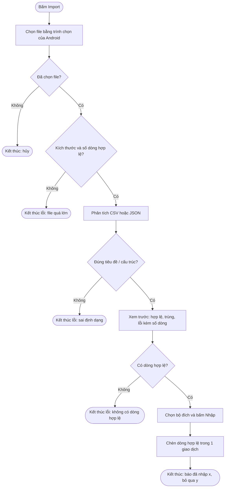
### Nhánh ngoại lệ (bắt buộc)
| Tình huống | Hệ thống làm gì | Thông báo | Quay về đâu |
|---|---|---|---|
| Lỗi đọc file (quyền URI bị thu hồi) | Không ghi gì | "Không đọc được file, vui lòng chọn lại" | SCR-26 |
| Lỗi khi chèn | Rollback toàn bộ | "Đã có lỗi khi lưu dữ liệu, vui lòng thử lại" | SCR-28 xem trước |
| File có dấu tiếng Việt lưu bằng ANSI (không phải UTF-8) | Phát hiện ký tự thay thế (U+FFFD), coi là sai định dạng | "File phải lưu dạng UTF-8" | SCR-26 |

## FLOW-016: Export từ vựng

### Nhánh ngoại lệ (bắt buộc)
| Tình huống | Hệ thống làm gì | Thông báo | Quay về đâu |
|---|---|---|---|
| Bộ không có từ | Nút Export vô hiệu | "Bộ chưa có từ để xuất" | SCR-19 |
| Bộ nhớ đầy | Xóa file dở dang | "Không thể xuất file" | SCR-29 |

## FLOW-017: Làm bài thi thử

### Nhánh ngoại lệ (bắt buộc)
| Tình huống | Hệ thống làm gì | Thông báo | Quay về đâu |
|---|---|---|---|
| Thoát app giữa bài | Lưu câu trả lời và thời điểm bắt đầu; mở lại thì tiếp tục nếu còn giờ, quá giờ thì tự nộp (AC-036.4) | "Bài thi đang dở — tiếp tục?" | SCR-31 |
| Lỗi lưu lượt thi | Rollback | "Đã có lỗi khi lưu kết quả" + "Thử lại" | SCR-32 |

## Quy trình liên vai trò (swimlane)
App chỉ có một vai trò người dùng; quy trình liên "vai trò" duy nhất là giữa Người học, App và Hệ thống Android khi nhắc học: xem FLOW-007.

## Tương tác hệ thống (sequence)
App không gọi API ngoài. Hai tương tác nội bộ quan trọng: khởi tạo seed (FLOW-010) và đánh giá thẻ (FLOW-012).

## Bản đồ màn hình và flow
Điều hướng chính: thanh tab dưới gồm **Trang chủ · Học · Luyện tập · Tra từ · Tôi**.
| Flow | Màn hình / trang đi qua | Ghi chú |
|---|---|---|
| FLOW-001 | SCR-01 Màn hình chờ → SCR-02 Đăng nhập → SCR-03 Đăng ký → SCR-05 Trang chủ | SCR-02 có liên kết Giới thiệu (SCR-24) |
| FLOW-002 | SCR-04 Thiết lập lần đầu (3 bước) → SCR-05 | Hộp thoại xin quyền thông báo của hệ thống |
| FLOW-003 | SCR-06 Danh sách chủ đề → SCR-07 Danh sách từ → SCR-08 Chi tiết từ | Tab Học |
| FLOW-004 | SCR-07 / SCR-05 / SCR-19 → SCR-09 Flashcard → SCR-10 Kết quả phiên | Một màn hình flashcard cho 3 nguồn |
| FLOW-005 | SCR-12 Chọn quiz → SCR-13 Làm quiz → SCR-14 Kết quả quiz; SCR-15 Lịch sử quiz | Tab Luyện tập |
| FLOW-006 | SCR-16 Danh sách ngữ pháp → SCR-17 Chi tiết bài → SCR-13 → SCR-14 | Dùng lại màn hình quiz |
| FLOW-007 | Thông báo hệ thống → SCR-05 | Không có màn hình riêng |
| FLOW-008 | SCR-10, SCR-14, SCR-17 (điểm kích hoạt) → SCR-05, SCR-21 (hiển thị) | Chạy nền |
| FLOW-009 | SCR-22 Hồ sơ & cài đặt → SCR-23 Đổi mật khẩu; SCR-21 Tiến độ; SCR-24 Giới thiệu | Tab Tôi |
| FLOW-010 | SCR-01 | Chỉ lần mở đầu tiên hoặc khi nâng phiên bản seed |
| FLOW-011 | SCR-18 Tra từ (gồm mục Yêu thích) → SCR-08 / SCR-20 Thêm-sửa mục sổ tay; SCR-19 Sổ tay | Tab Tra từ |
| FLOW-013 | SCR-02 → SCR-25 Quên mật khẩu (2 bước) → SCR-02 | thay đổi phạm vi |
| FLOW-014 | SCR-06 → SCR-26 Bộ của tôi → SCR-27 Tạo/sửa bộ; SCR-19 Chi tiết bộ → SCR-20 Thêm/sửa từ | thay đổi phạm vi: SCR-19/20 đổi từ "Sổ tay" thành chi tiết bộ (sổ tay là một bộ) |
| FLOW-015 | SCR-26 → trình chọn file hệ thống → SCR-28 Xem trước import → SCR-19 | thay đổi phạm vi |
| FLOW-016 | SCR-19 → SCR-29 Chọn định dạng export → trình lưu file hệ thống | thay đổi phạm vi |
| FLOW-017 | SCR-12 → SCR-30 Luyện thi → SCR-31 Làm bài thi thử → SCR-32 Kết quả thi thử; SCR-30 → SCR-33 Tài nguyên chính thức | thay đổi phạm vi |

Tổng: 33 mã màn hình (SCR-01 … SCR-33) sau thay đổi phạm vi.
