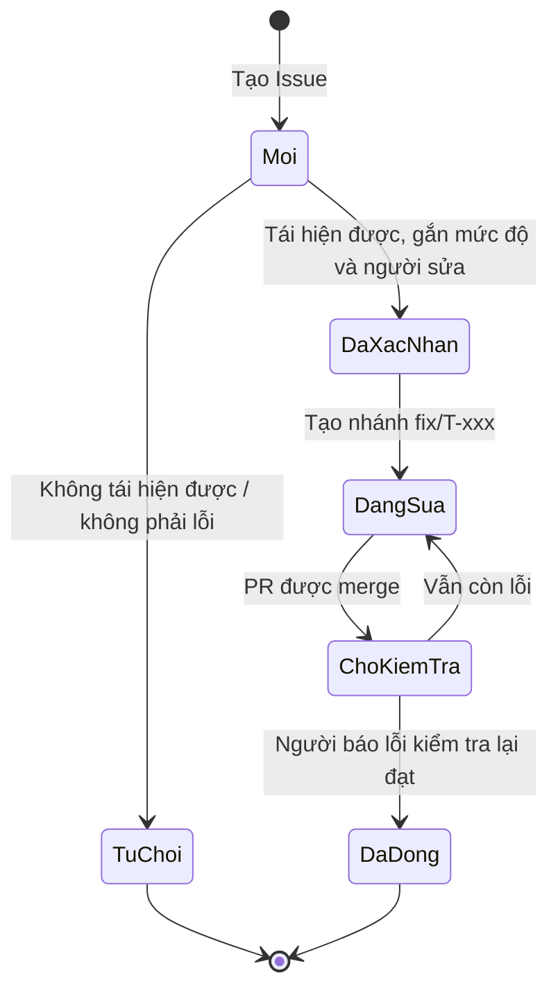

# Bug Report Template — mẫu ghi nhận và báo cáo lỗi

**Mục đích:** mọi lỗi được ghi cùng một cách để người sửa tái hiện được ngay. Báo lỗi bằng **GitHub Issue** (mẫu "Báo lỗi" đã có sẵn trong repo, cùng nội dung bên dưới), gắn nhãn `bug` và mức độ.

## 1. Mức độ lỗi
| Mức | Định nghĩa | Ví dụ | Xử lý |
|---|---|---|---|
| **Nghiêm trọng** (`sev:critical`) | Crash/ANR, mất hoặc hỏng dữ liệu, lộ mật khẩu | Xóa tài khoản làm crash; quiz không lưu kết quả | Sửa ngay; chặn phát hành |
| **Cao** (`sev:high`) | Sai quy tắc nghiệp vụ (BR) hoặc không hoàn thành được luồng Must | Thẻ "Đã nhớ" không lên hộp; nhắc học không bao giờ hiện | Sửa trong mốc hiện tại; chặn phát hành |
| **Trung bình** (`sev:medium`) | Sai hiển thị/thông báo nhưng có cách làm khác | Thông báo lỗi sai chữ; số liệu thống kê lệch 1 | Sửa trước đóng băng tính năng hoặc ghi vào lỗi đã biết |
| **Thấp** (`sev:low`) | Chính tả, căn lề, màu lệch nhẹ | Chữ bị tràn 1 dòng ở 360 dp | Sửa khi rảnh |

## 2. Mẫu báo lỗi
```markdown
**Tiêu đề:** [Màn hình/SCR-xx] Mô tả ngắn hiện tượng
  (vd: [SCR-09 Flashcard] Chọn "Đã nhớ" ở hộp 5 làm crash)

**Mức độ:** Nghiêm trọng / Cao / Trung bình / Thấp
**Liên quan:** US-xxx / AC-xxx.x / BR-xxx / TC-xxx.x (nếu biết)
**Phiên bản:** versionName + commit (Tôi → Giới thiệu, hoặc `git log -1 --oneline`)
**Thiết bị:** emulator Pixel 6 API 34 / máy thật (hãng, Android ?) · theme sáng/tối · cỡ chữ

**Các bước tái hiện:**
1. Đăng nhập tài khoản test `qa.user1`
2. Vào Học → Gia đình → Học từ mới
3. …

**Kết quả mong đợi:** (trích tiêu chí chấp nhận / quy tắc nghiệp vụ)
**Kết quả thực tế:** (mô tả, kèm thông báo lỗi nếu có)
**Tần suất:** Luôn luôn / Thỉnh thoảng (x/10 lần) / Một lần

**Minh chứng:** ảnh chụp / video ngắn / đoạn Logcat (lọc theo tag `LearningE`, KHÔNG dán mật khẩu hay dữ liệu cá nhân)
**Ghi chú thêm:** (dữ liệu đặc biệt, tệp import gây lỗi — đính kèm tệp mẫu đã xóa dữ liệu cá nhân)
```

## 3. Vòng đời lỗi

- Người sửa ghi "Fixes #<số issue>" trong PR để Issue tự đóng khi merge; người báo lỗi kiểm tra lại trên bản mới.
- Lỗi mức Trung bình/Thấp chưa sửa trước khi nộp được ghi vào mục "Lỗi đã biết" trong [HANDOVER](../operations/HANDOVER.md) kèm lý do.
- Mỗi lỗi đã sửa thêm một test case hoặc unit test để không tái phát.
